<!-- Generated by scripts/build_anthology.py export from the source PDF; edit the catalog, not this file. -->
# 05 · Feature Visualization

**Olah et al. — 2017** · Chris Olah, Alexander Mordvintsev, Ludwig Schubert

| | |
|---|---|
| Priority | ○ P1 — Important |
| Section | B — Foundations: vision models and early transformers |
| Source | [https://distill.pub/2017/feature-visualization/](https://distill.pub/2017/feature-visualization/) (Distill) |
| Licence | CC BY 4.0 (Distill: text and diagrams) |
| Print anthology | pages 147–169 (cover 147, text 148–169) |

**Why read this.** The working manual for seeing what a vision neuron responds to by optimising the input, and an early, frank admission that neurons may not be the right units: one GoogLeNet neuron answers to cats, foxes and cars.

**Reading focus.** Optimisation objectives, why optimisation separates causes from correlates, diversity terms, neuron interaction and random directions, the high-frequency ‘enemy’, the regularisation spectrum, and decorrelated Fourier preconditioning.

**In context.** The main instrument of [07](07_zoom_in.md), [08](08_curve_detectors.md) and [09](09_multimodal_neurons.md). It weighs its own experience against [06](06_network_dissection.md), which found basis directions more interpretable than random ones, and its cat-fox-car neuron anticipates the polysemanticity [33](33_toy_models_of_superposition.md) formalises. It sets attribution aside; [84](84_saliency_sanity_checks.md) shows how gradient explanations of that kind can fail basic sanity checks.

[← 04 Attention Is All You Need](04_attention_is_all_you_need.md) · [Contents](README.md) · [06 Network Dissection →](06_network_dissection.md)

---

*Text extracted automatically from the source PDF. Display equations, figures and some tables appear as images; inline mathematics may be garbled — the PDF is authoritative.*

# Feature Visualization 

How neural networks build up their understanding of images 


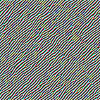


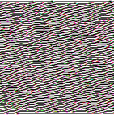


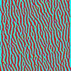


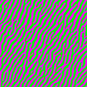


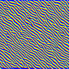


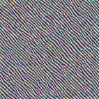


Edges (layer conv2d0) 


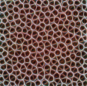


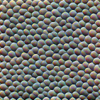


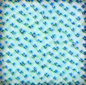


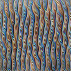


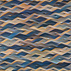


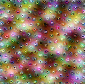


Textures (layer mixed3a) 


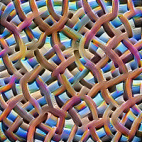


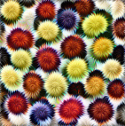


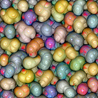


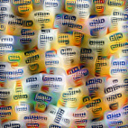


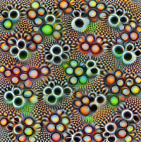


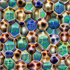


Patterns (layer mixed4a) 


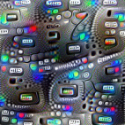


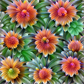


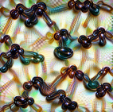


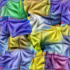


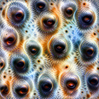


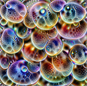


Parts (layers mixed4b & mixed4c) 


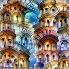


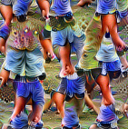


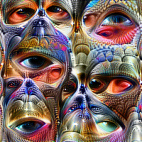


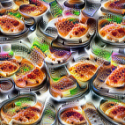


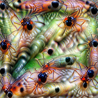


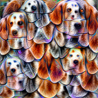


Objects (layers mixed4d & mixed4e) 

Feature visualization allows us to see how GoogLeNet [1] , trained on the ImageNet [2] dataset, builds up its understanding of images over many layers. Visualizations of all channels are available in the <u>appendix.</u> 

AFFILIATIONS PUBLISHED Google Brain Team Nov. 7, 2017 Google Research Google Brain Team 

There is a growing sense that neural networks need to be interpretable to humans. The field of neural network interpretability has formed in response to these concerns. As it matures, two major threads of research have begun to coalesce: feature visualization and attribution. 


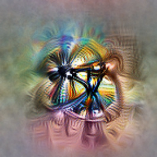


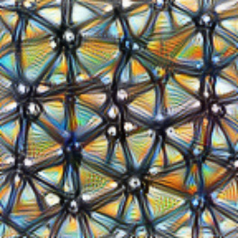


Feature visualization answers questions about what a network — or parts of a network — are looking for by generating examples. 


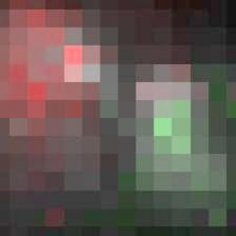


Attribution 1 studies what part of an example is responsible for the network activating a particular way. 

This article focuses on feature visualization. While feature visualization is a powerful tool, actually getting it to work involves a number of details. In this article, we examine the major issues and explore common approaches to solving them. We find that remarkably simple methods can produce high-quality visualizations. Along the way we introduce a few tricks for exploring variation in what neurons react to, how they interact, and how to improve the optimization process. 

## Feature Visualization by Optimization 

Neural networks are, generally speaking, differentiable with respect to their inputs. If we want to find out what kind of input would cause a certain behavior — whether that’s an internal neuron firing or the final output behavior — we can use derivatives to iteratively tweak the input towards that goal [3] . 


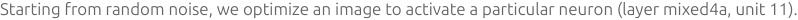


<!-- Start of picture text -->
Starting from random noise, we optimize an image to activate a particular neuron (layer mixed4a, unit 11).<br><!-- End of picture text -->


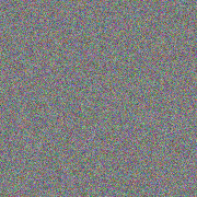


Step 0 


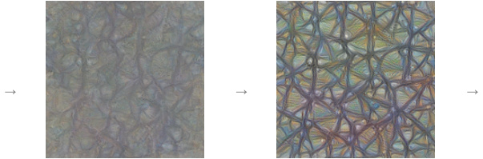


<!-- Start of picture text -->
→ → →<br><!-- End of picture text -->

Step 4 

Step 48 


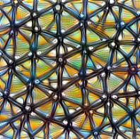


Step 2048 

While conceptually simple, there are subtle challenges in getting the optimization to work. We will explore them, as well as common approaches to tackle them in the section ”The <u>Enemy of Feature Visualization″.</u> 

### Optimization Objectives 

What do we want examples of? This is the core question in working with examples, regardless of whether we’re searching through a dataset to find the examples, or optimizing images to create them from scratch. We have a wide variety of options in what we search for: 

Different optimization objectives show what different parts of a network are looking for. 

**`n`** layer index **`x,y`** spatial position **`z`** channel index **`k`** class index 


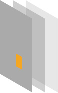


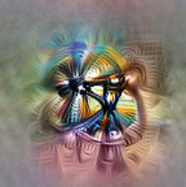


Neuron Channel `layern[x,y,z] layern[:,:,z]` 


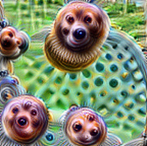


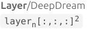


<!-- Start of picture text -->
Layer/DeepDream<br> layern[:,:,:] 2<br><!-- End of picture text -->


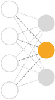


<!-- Start of picture text -->
softmax<br><!-- End of picture text -->


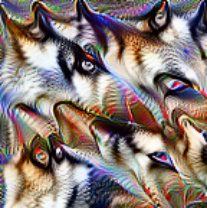


Class Logits 

```
 pre_softmax[k]
```


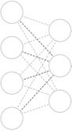


<!-- Start of picture text -->
softmax<br><!-- End of picture text -->


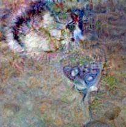


Class Probability `softmax[k]` 

If we want to understand individual features, we can search for examples where they have high values — either for a neuron at an individual position, or for an entire channel. We used the channel objective to create most of the images in this article. 

If we want to understand a layer as a whole, we can use the DeepDream objective [4] , searching for images the layer finds “interesting.” 

And if we want to create examples of output classes from a classifier, we have two options — optimizing class logits before the softmax or optimizing class probabilities after the softmax. One can see the logits as the evidence for each class, and the probabilities as the likelihood of each class given the evidence. Unfortunately, the easiest way to increase the probability softmax gives to a class is often to make the alternatives unlikely rather than to make the class of interest likely [5] . From our experience, optimizing pre-softmax logits produces images of better visual quality. 2 

The objectives we’ve mentioned only scratch the surface of possible objectives — there are a lot more that one could try. Of particular note are the objectives used in style transfer [6] , which can teach us about the kinds of style and content a network understands, and objectives used in optimization-based model inversion [7] , which help us understand what information a model keeps and what it throws away. We are only at the beginning of understanding which objectives are interesting, and there is a lot of room for more work in this area. 

### Why visualize by optimization? 

Optimization can give us an example input that causes the desired behavior — but why bother with that? Couldn’t we just look through the dataset for examples that cause the desired behavior? 

It turns out that optimization approach can be a powerful way to understand what a model is really looking for, because it separates the things causing behavior from things that merely correlate with the causes. For example, consider the following neurons visualized with dataset examples and optimization: 

Dataset Examples show us what neurons respond to in practice 


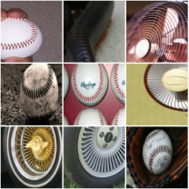


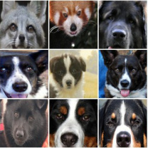


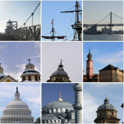


Optimization isolates the causes of behavior from mere correlations. A neuron may not be detecting what you initially thought. 


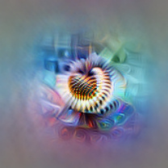


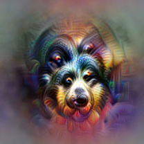


Baseball—or stripes? Animal faces—or snouts? Clouds—or fluffiness? mixed4a, Unit 6 mixed4a, Unit 240 mixed4a, Unit 453 


Buildings—or sky? mixed4a, Unit 492 

Optimization also has the advantage of flexibility. For example, if we want to study how neurons jointly represent information, we can easily ask how a particular example would need to be different for an additional neuron to activate. This flexibility can also be helpful in visualizing how features evolve as the network trains. If we were limited to understanding the model on the fixed examples in our dataset, topics like these ones would be much harder to explore. 

On the other hand, there are also significant challenges to visualizing features with optimization. In the following sections we’ll examine techniques to get diverse visualizations, understand how neurons interact, and avoid high frequency artifacts. 

## Diversity 

Do our examples show us the full picture? When we create examples by optimization, this is something we need to be very careful of. It’s entirely possible for genuine examples to still mislead us by only showing us one “facet” of what a feature represents. 

Dataset examples have a big advantage here. By looking through our dataset, we can find diverse examples. It doesn’t just give us ones activating a neuron intensely: we can look across a whole spectrum of activations to see what activates the neuron to different extents. 


Positive optimized 


Maximum activation examples 


Slightly positive activation examples 


Negative optimized 


Minimum activation examples 


Slightly negative activation examples 

Layer mixed 4a, unit 492 

REPRODUCE IN A NOTEBOOK 

In contrast, optimization generally gives us just one extremely positive example — and if we’re creative, a very negative example as well. Is there some way that optimization could also give us this diversity? 

### Achieving Diversity with Optimization 

A given feature of a network may respond to a wide range of inputs. On the class level, for example, a classifier that has been trained to recognize dogs should recognize both closeups of their faces as well as wider profile images — even though those have quite different visual appearances. Early work by Wei et al. [8] attempts to demonstrate this “intra-class” diversity by recording activations over the entire training set, clustering them and optimizing for the cluster centroids, revealing the different facets of a class that were learned. 

A different approach by Nguyen, Yosinski, and collaborators was to search through the dataset for diverse examples and use those as starting points for the optimization process [9] . The idea is that this initiates optimization in different facets of the feature so that the resulting example from optimization will demonstrate that facet. In more recent work, they combine visualizing classes with a generative model, which they can sample for diverse examples [10] . Their first approach had limited success, and while the generative model approach works very well — we’ll discuss it more in the section on regularization under <u>learned priors — it</u> can be a bit tricky. 

We find there’s a very simple way to achieve diversity: adding a “diversity term” 3 to one’s objective that pushes multiple examples to be different from each other. The diversity term can take a variety of forms, and we don’t have much understanding of their benefits yet. One possibility is to penalize the cosine similarity of different examples. Another is to use ideas from style transfer [6] to force the feature to be displayed in different styles. 

In lower level neurons, a diversity term can reveal the different facets a feature represents: 


Simple Optimization 


Optimization with diversity reveals four different, curvy facets. Layer mixed4a, Unit 97 REPRODUCE IN A NOTEBOOK 


Dataset examples 

Diverse feature visualizations allow us to more closely pinpoint what activates a neuron, to the degree that we can make, and — by looking at dataset examples — check predictions about what inputs will activate the neuron. 

For example, let’s examine this simple optimization result. 


Simple optimization 

Looking at it in isolation one might infer that this neuron activates on the top of dog heads, as the optimization shows both eyes and only downward curved edges. Looking at the optimization with diversity however, we see optimization results which don’t include eyes, and also one which includes upward curved edges. We thus have to broaden our expectation of what this neuron activates on to be mostly about the fur texture. Checking this hypothesis against dataset examples shows that is broadly correct. Note the spoon with a texture and color similar enough to dog fur for the neuron to activate. 


Optimization with diversity. Layer mixed4a, Unit 143 


Dataset examples 

The effect of diversity can be even more striking in higher level neurons, where it can show us different types of objects that stimulate a neuron. For example, one neuron responds to different kinds of balls, even though they have a variety of appearances. 


Simple Optimization 


Optimization with diversity reveals multiple types of balls. Layer mixed5a, Unit 9 


Dataset examples 

This simpler approach has a number of shortcomings: For one, the pressure to make examples different can cause unrelated artifacts (such as eyes) to appear. Additionally, the optimization may make examples be different in an unnatural way. For example, in the above example one might want to see examples of soccer balls clearly separated from other types of balls like golf or tennis balls. Dataset based approaches such as Wei et al. [8] can split features apart more naturally — however they may not be as helpful in understanding how the model will behave on different data. 

Diversity also starts to brush on a more fundamental issue: while the examples above represent a mostly coherent idea, there are also neurons that represent strange mixtures of ideas. Below, a neuron responds to two types of animal faces, and also to car bodies. 


Simple Optimization 


Optimization with diversity show cats, foxes, but also cars. Layer mixed4e, Unit 55 


Dataset examples 

Examples like these suggest that neurons are not necessarily the right semantic units for understanding neural nets. 

## Interaction between Neurons 

If neurons are not the right way to understand neural nets, what is? In real life, combinations of neurons work together to represent images in neural networks. A helpful way to think about these combinations is geometrically: let’s define activation space to be all possible combinations of neuron activations. We can then think of individual neuron activations as the basis vectors of this activation space. Conversely, a combination of neuron activations is then just a vector in this space. 

This framing unifies the concepts “neurons” and “combinations of neurons” as “vectors in activation space”. It allows us to ask: Should we expect the directions of the basis vectors to be any more interpretable than the directions of other vectors in this space? 

Szegedy et al. [11] found that random directions seem just as meaningful as the directions of the basis vectors. More recently Bau, Zhou et al. [12] found the directions of the basis vectors to be interpretable more often than random directions. Our experience is broadly consistent with both results; we find that random directions often seem interpretable, but at a lower rate than basis directions. 

Dataset examples and optimized examples of random directions in activation space. The directions shown here were hand-picked for interpretability. 


<!-- Start of picture text -->
REPRODUCE IN A NOTEBOOK<br><!-- End of picture text -->


mixed3a, random direction 

mixed4c, random direction 


mixed4d, random direction 


mixed5a, random direction 

We can also define interesting directions in activation space by doing arithmetic on neurons. For example, if we add a “black and white” neuron to a “mosaic” neuron, we obtain a black and white version of the mosaic. This is reminiscent of semantic arithmetic of word embeddings as seen in Word2Vec or generative models’ latent spaces. 

By jointly optimizing two neurons we can get a sense of how they interact. 


<!-- Start of picture text -->
REPRODUCE IN A NOTEBOOK<br>Neuron 1<br><!-- End of picture text -->


Neuron 2 


Jointly optimized 

These examples show us how neurons jointly represent images. To better understand how neurons interact, we can also interpolate between them. 4 This is similar to interpolating in the latent space of generative models. 


<!-- Start of picture text -->
REPRODUCE IN A NOTEBOOK<br><!-- End of picture text -->


Layer 4a, Unit 476 


Layer 4a, Unit 460 

This is only starting to scratch the surface of how neurons interact. The truth is that we have almost no clue how to select meaningful directions, or whether there even exist particularly meaningful directions. Independent of finding directions, there are also questions on how directions interact — for example, interpolation can show us how a small number of directions interact, but in reality there are hundreds of directions interacting. 

## The Enemy of Feature Visualization 

If you want to visualize features, you might just optimize an image to make neurons fire. Unfortunately, this doesn’t really work. Instead, you end up with a kind of neural network optical illusion — an image full of noise and nonsensical high-frequency patterns that the network responds strongly to. 

Even if you carefully tune learning rate, you’ll get noise. 

Optimization results are enlarged to show detail and artifacts. 


<!-- Start of picture text -->
REPRODUCE IN A NOTEBOOK<br>Learning Rate (0.05)<br>Step 1 Step 32 Step 128 Step 256 Step 2048<br><!-- End of picture text -->

These patterns seem to be the images kind of cheating, finding ways to activate neurons that don’t occur in real life. If you optimize long enough, you’ll tend to see some of what the neuron genuinely detects as well, but the image is dominated by these high frequency patterns. These patterns seem to be closely related to the phenomenon of adversarial examples [11] . 

We don’t fully understand why these high frequency patterns form, but an important part seems to be strided convolutions and pooling operations, which create high-frequency patterns in the gradient [13] . 

Each strided convolution or pooling creates checkerboard patterns in the gradient magnitudes when we backprop through it. 


<!-- Start of picture text -->
← ← ←<br>input conv2d0 conv2d1 conv2d2 mixed3a mixed3b mixed4a mixed4b mixed4c<br>←<br>mixed4d mixed4e mixed5a<br><!-- End of picture text -->

These high-frequency patterns show us that, while optimization based visualization’s freedom from constraints is appealing, it’s a double-edged sword. Without any constraints on images, we end up with adversarial examples. These are certainly interesting, but if we want to understand how these models work in real life, we need to somehow move past them… 

### The Spectrum of Regularization 

Dealing with this high frequency noise has been one of the primary challenges and overarching threads of feature visualization research. If you want to get useful visualizations, you need to impose a more natural structure using some kind of prior, regularizer, or constraint. 

In fact, if you look at most notable papers on feature visualization, one of their main points will usually be an approach to regularization. Researchers have tried a lot of different things! 

We can think of all of these approaches as living on a spectrum, based on how strongly they regularize the model. On one extreme, if we don’t regularize at all, we end up with adversarial examples. On the opposite end, we search over examples in our dataset and run into all the limitations we discussed earlier. In the middle we have three main families of regularization options. 


<!-- Start of picture text -->
Weak Regularization avoids Strong Regularization gives more<br>misleading correlations, but is less realistic examples at risk of<br>connected to real use. misleading correlations.<br>Unregularized Frequency Transformation Learned Dataset<br>Penalization Robustness Prior Examples<br>Erhan, et al., 2009 [3]<br>Introduced core idea. Minimal regularization.<br>Szegedy, et al., 2013 [11]<br>Adversarial examples. Visualizes with dataset<br>examples.<br>Mahendran & Vedaldi, 2015 [7]<br>Introduces total variation regularizer.<br>Reconstructs input from representation.<br>Nguyen, et al., 2015 [14]<br>Explores counterexamples. Introduces image<br>blurring.<br>Mordvintsev, et al., 2015 [4]<br>Introduced jitter & multi-scale. Explored GMM<br>priors for classes.<br>Øygard, et al., 2015 [15]<br>Introduces gradient blurring.<br>(Also uses jitter.)<br>Tyka, et al., 2016 [16]<br>Regularizes with bilateral filters.<br>(Also uses jitter.)<br>Mordvintsev, et al., 2016 [17]<br>Normalizes gradient frequencies.<br>(Also uses jitter.)<br>Nguyen, et al., 2016 [18]<br>Paramaterizes images with GAN generator.<br>Nguyen, et al., 2016 [10]<br>Uses denoising autoencoder prior to make a<br>generative model.<br><!-- End of picture text -->

### Three Families of Regularization 

Let’s consider these three intermediate categories of regularization in more depth. 

Frequency penalization directly targets the high frequency noise these methods suffer from. It may explicitly penalize variance between neighboring pixels (total variation) [7] , or implicitly penalize high-frequency noise by 5 blurring the image each optimization step [14] . Unfortunately, these approaches also discourage legitimate high-frequency features like edges along with noise. This can be slightly improved by using a bilateral filter, which preserves edges, instead of blurring [16] . 

(Some work uses similar techniques to reduce high frequencies in the gradient before they accumulate in the visualization [15, 17] . These techniques are in some ways very similar to the above and in some ways radically different — we’ll examine them in the next section, Preconditioning <u>and Parameterization.)</u> 

Frequency penalization directly targets high frequency noise 


<!-- Start of picture text -->
REPRODUCE IN A NOTEBOOK<br>L1 (-0.05) Total Variation (-0.25) Blur (-1)<br>Step 1 Step 32 Step 128 Step 256 Step 2048<br><!-- End of picture text -->

Transformation robustness tries to find examples that still activate the optimization target highly even if we slightly transform them. Even a small amount seems to be very effective in the case of images [4] , especially when combined with a more general regularizer for high-frequencies [15, 17] . Concretely, this means that we stochastically jitter, rotate or scale the image before applying the optimization step. 

Stochastically transforming the image before applying the optimization step suppresses noise 


<!-- Start of picture text -->
REPRODUCE IN A NOTEBOOK<br>Jitter (1px) Rotate (5°) Scale (1.1×)<br>Step 1 Step 32 Step 128 Step 256 Step 2048<br><!-- End of picture text -->

Learned priors. Our previous regularizers use very simple heuristics to keep examples reasonable. A natural next step is to actually learn a model of the real data and try to enforce that. With a strong model, this becomes similar to searching over the dataset. This approach produces the most photorealistic visualizations, but it may be unclear what came from the model being visualized and what came from the prior. 

One approach is to learn a generator that maps points in a latent space to examples of your data, such as a GAN or VAE, and optimize within that latent space [18] . An alternative approach is to learn a prior that gives you access to the gradient of probability; this allows you to jointly optimize for the prior along with your objective [10, 4] . When one optimizes for the prior and the probability of a class, one recovers a generative model of the data conditioned on that particular class. Finally, Wei et al. [8] approximate a generative model prior, at least for the color distribution, by penalizing distance between patches of the output and the nearest patches retrieved from a database of image patches collected from the training data. 

## Preconditioning and Parameterization 

In the previous section, we saw a few methods [15, 17] that reduced high frequencies in the gradient rather than the visualization itself. It’s not clear this is really a regularizer: it resists high frequencies, but still allows them to form when the gradient consistently pushes for it. If it isn’t a regularizer, what does transforming the gradient like this do? 

Transforming the gradient like this is actually quite a powerful tool — it’s called “preconditioning” in optimization. You can think of it as doing steepest descent to optimize the same objective, but in another parameterization of the space or under a different notion of distance. 6 This changes which direction of descent will be steepest, and how fast the optimization moves in each direction, but it does not change what the minimums are. If there are many local minima, it can stretch and shrink their basins of attraction, changing which ones the optimization process falls into. As a result, using the right preconditioner can make an optimization problem radically easier. 

How can we choose a preconditioner that will give us these benefits? A good first guess is one that makes your data decorrelated and whitened. In the case of images this means doing gradient descent in the Fourier basis, 7 with frequencies scaled so that they all have equal energy. 8 

Let’s see how using different measures of distance changes the direction of steepest descent. The regular L2 gradient can be quite different from the directions of steepest descent in the L∞ metric or in the decorrelated space: 


<!-- Start of picture text -->
Three directions of steepest descent under different notions of distance<br>Image L∞ metric L2 metric decorrelated space<br>used in adverserial work regular gradient<br><!-- End of picture text -->

All of these directions are valid descent directions for the same objective, but we can see they’re radically different. Notice that optimizing in the decorrelated space reduces high frequencies, while using L∞ increases them. 

Using the decorrelated descent direction results in quite different visualizations. It’s hard to do really fair comparisons because of hyperparameters, but the resulting visualizations seem a lot better — and develop faster, too. 

Combining the preconditioning and transformation robustness improves quality even further 


<!-- Start of picture text -->
REPRODUCE IN A NOTEBOOK<br>Learning Rate (0.05) Decorrelated Space<br>Transformation Robustness<br>Step 1 Step 32 Step 128 Step 256 Step 2048<br><!-- End of picture text -->

(Unless otherwise noted, the images in this article were optimizing in the decorrelated space and a suite of transformation robustness techniques. )9 

Is the preconditioner merely accelerating descent, bringing us to the same place normal gradient descent would have brought us if we were patient enough? Or is it also regularizing, changing which local minima we get attracted to? It’s hard to tell for sure. On the one hand, gradient descent seems to continue improving as you exponentially increase the number of optimization steps — it hasn’t converged, it’s just moving very slowly. On the other hand, if you turn off all other regularizers, the preconditioner seems to reduce high-frequency patterns. 

## Conclusion 

Neural feature visualization has made great progress over the last few years. As a community, we’ve developed principled ways to create compelling visualizations. We’ve mapped out a number of important challenges and found ways of addressing them. 

In the quest to make neural networks interpretable, feature visualization stands out as one of the most promising and developed research directions. By itself, feature visualization will never give a completely satisfactory understanding. We see it as one of the fundamental building blocks that, combined with additional tools, will empower humans to understand these systems. 

There remains still a lot of important work to be done in improving feature visualization. Some issues that stand out include understanding neuron interaction, finding which units are most meaningful for understanding neural net activations, and giving a holistic view of the facets of a feature. 

Additional Resources 

<u>Appendix: GoogLeNet Visualizations</u> 

Visualizations of every channel in GoogLeNet 

<u>Code: tensorfowl /lucid</u> 

Open-source implementation of our techniques 

<u>Follow-up: The Building Blocks of Interpretability</u> 

Exploration of how feature visualization and other techniques can be combined. 

#### Acknowledgments 

We are extremely grateful to Shan Carter and Ian Goodfellow. Shan gave thoughtful feedback, especially on the design of the article. Ian generously stepped in to handle the review process of this article — we would not have been able to publish it without him. 

We’re also grateful for the comments, thoughts and support of Arvind Satyanarayan, Ian Johnson, Greg Corrado, Blaise Aguera y Arcas, Katherine Ye, Michael Nielsen, Emma Pierson, Dario Amodei, Mike Tyka, Andrea Vedaldi, Ruth Fong, Jason Freidenfelds, Geoffrey Hinton, Timon Ruban, Been Kim, Martin Wattenberg, and Fernanda Viegas. 

This work was made possible by many open source tools, for which we are grateful. In particular, all of our experiments were based on Tensorflow [19] . 

#### Author Contributions 

Writing, Exposition, and Diagram Contributions. Chris drafted most of the text of the article and made the original version of most interactive diagrams. Ludwig made the neuron addition, dataset examples, and interpolation diagrams, as well as refined the others. Ludwig also created the appendix that visualizes all of GoogLeNet. 

Research Contributions. The biggest technical contribution of this work is likely the section on preconditioning. Alex discovered in prior work that normalizing gradient frequencies had a radical effect on visualizing neurons. Chris reframed this as adaptive gradient descent in a different basis. Together, they iterated on a number of ways of parameterizing images. Similarly, Alex originally introduced the use of diversity term, and Chris refined using it. Chris did the exploration of interpolating between neurons. 

Infrastructure Contributions. All experiments are based on code written by Alex, some of which was <u>published previously.</u> Alex, Chris and 

Ludwig all contributed significantly to refining this into the present library, Lucid. Alex and Chris introduced particularly important abstractions. 

#### Discussion and Review 

<u>Review 1</u> - <u>Anonymous Review 2</u> - <u>Anonymous Review 3</u> - <u>Anonymous</u> 

#### Footnotes 

1. As a young field, neural network interpretability does not yet have standardized terminology. Attribution has gone under many different names in the literature — including “feature visualization”! — but recent work seems to prefer terms like “attribution” and “saliency maps”. <u>[</u> ↩ <u>]</u> 

2. While the standard explanation is that maximizing probability doesn’t work very well because you can just push down evidence for other classes, an alternate hypothesis is that it’s just harder to optimize through the softmax function. We understand this has sometimes been an issue in adversarial examples, and the solution is to optimize the LogSumExp of the logits instead. This is equivalent to optimizing softmax but generally more tractable. Our experience was that the LogSumExp trick doesn’t seem better than dealing with the raw probabilities. 

Regardless of why that happens, it can be fixed by very strong regularization with generative models. In this case the probabilities can be a very principled thing to optimize. <u>[</u> ↩ <u>]</u> 

3. For this article we use an approach based on ideas from artistic style transfer. Following that work, we begin by computing the Gram matrix _G_ of the channels, where _Gi_ , _j_ is a the dot product between the (flattened) response of filter _i_ and filter _j_ : 

_Gi_ , _j_ = ∑ layer _n_ [x, y, i] ⋅layer _n_ [x, y, j] _x_ , _y_ 

From this, we compute the diversity term: the negative pairwise cosine similarity of pairs of visualizations. 


We then maximize the diversity term jointly with the regular optimization objective. <u>[</u> ↩ <u>]</u> 

4. The optimization objective is a linear interpolation between the individual channel objectives. To get the interpolations to look better, we also add a small alignment objective that encourages lower layer activations to be similar. We additionally use a combination of separate and shared image parameterizations to make it easier for the optimization algorithm to cause objects to line up, while still giving it the freedom to create any image it needs to. <u>[</u> ↩ <u>]</u> 

5. If we think about blurring in Fourier space, it is equivalent to adding a scaled L2 penalty to the objective, penalizing each Fouriercomponent based on its frequency. <u>[</u> ↩ <u>]</u> 

6. Gradient blurring [15] is equivalent to gradient descent in a different parameterization of image space, where high frequency dimensions are stretched to make moving in those directions slower. Gradient Laplacian Pyramid normalization [17] is a kind of adaptive learning rate approach in the same space. <u>[</u> ↩ <u>]</u> 

7. This points to a profound fact about the Fourier transform. As long as a correlation is consistent across spatial positions — such as the correlation between a pixel and its left neighbor being the same across all positions of an image — the Fourier coefficients will be independent variables. To see this, note that such a spatially consistent correlation can be expressed as a convolution, and by the convolution theorem becomes pointwise multiplication after the Fourier transform. <u>[</u> ↩ <u>]</u> 

8. Note that we have to be careful to get the colors to be decorrelated, too. The Fourier transforms decorrelates spatially, but a correlation will still exist between colors. To address this, we explicitly measure the correlation between colors in the training set and use a Cholesky decomposition to decorrelate them. Compare the directions of steepest decent before and after decorrelating colors: 


Correlated Colors Decorrelated Colors <u>[</u> ↩ <u>]</u> 

9. Images were optimized for 2560 steps in a color-decorrelated fourier-transformed space, using Adam at a learning rate of 0.05. We used each of following transformations in the given order at each step of the optimization: 

- Padding the input by 16 pixels to avoid edge artifacts 

- Jittering by up to 16 pixels 

- Scaling by a factor randomly selected from this list: 1, 0.975, 1.025, 0.95, 1.05 

- Rotating by an angle randomly selected from this list; in degrees: -5, -4, -3, -2, -1, 0, 1, 2, 3, 4, 5 

- Jittering a second time by up to 8 pixels 

- Cropping the padding 

- <u>[</u> ↩ <u>]</u> 

##### 1. Going deeper with convolutions <u>[PDF]</u> 

Szegedy, C., Liu, W., Jia, Y., Sermanet, P., Reed, S., Anguelov, D., Erhan, D., Vanhoucke, V. and Rabinovich, A., 2015. Proceedings of the IEEE conference on computer vision and pattern recognition, pp. 1--9. 

##### 2. Imagenet: A large-scale hierarchical image database <u>[PDF]</u> 

Deng, J., Dong, W., Socher, R., Li, L., Li, K. and Fei-Fei, L., 2009. Computer Vision and Pattern Recognition, 2009. CVPR 2009. IEEE Conference on, pp. 248--255. DOI: 10.1109/cvprw.2009.5206848 

##### 3. Visualizing higher-layer features of a deep network <u>[PDF]</u> 

Erhan, D., Bengio, Y., Courville, A. and Vincent, P., 2009. University of Montreal, Vol 1341, pp. 3. 

4. Inceptionism: Going deeper into neural networks <u>[HTML]</u> 

- Mordvintsev, A., Olah, C. and Tyka, M., 2015. Google Research Blog. 

5. Deep inside convolutional networks: Visualising image classification models and saliency maps <u>[PDF]</u> 

Simonyan, K., Vedaldi, A. and Zisserman, A., 2013. arXiv preprint arXiv:1312.6034. 

##### 6. A neural algorithm of artistic style <u>[PDF]</u> 

Gatys, L.A., Ecker, A.S. and Bethge, M., 2015. arXiv preprint arXiv:1508.06576. 

##### 7. Understanding deep image representations by inverting them <u>[PDF]</u> 

Mahendran, A. and Vedaldi, A., 2015. Proceedings of the IEEE Conference on Computer Vision and Pattern Recognition, pp. 5188-5196. DOI: 10.1109/cvpr.2015.7299155 

8. Understanding Intra-Class Knowledge Inside {CNN} <u>[PDF]</u> 

Wei, D., Zhou, B., Torralba, A. and Freeman, W.T., 2015. CoRR, Vol abs/1507.02379. 

9. Multifaceted feature visualization: Uncovering the different types of features learned by each neuron in deep neural networks 

##### <u>[PDF]</u> 

Nguyen, A., Yosinski, J. and Clune, J., 2016. arXiv preprint arXiv:1602.03616. 

##### 10. Plug & play generative networks: Conditional iterative generation of images in latent space <u>[PDF]</u> 

Nguyen, A., Yosinski, J., Bengio, Y., Dosovitskiy, A. and Clune, J., 2016. arXiv preprint arXiv:1612.00005. 

11. Intriguing properties of neural networks <u>[PDF]</u> 

Szegedy, C., Zaremba, W., Sutskever, I., Bruna, J., Erhan, D., Goodfellow, I. and Fergus, R., 2013. arXiv preprint arXiv:1312.6199. 

12. Network Dissection: Quantifying Interpretability of Deep Visual Representations <u>[PDF]</u> 

Bau, D., Zhou, B., Khosla, A., Oliva, A. and Torralba, A., 2017. Computer Vision and Pattern Recognition. 

##### 13. Deconvolution and checkerboard artifacts <u>[link]</u> 

Odena, A., Dumoulin, V. and Olah, C., 2016. Distill, Vol 1(10), pp. e3. DOI: distill.00003 

14. Deep neural networks are easily fooled: High confidence predictions for unrecognizable images <u>[PDF]</u> 

Nguyen, A., Yosinski, J. and Clune, J., 2015. Proceedings of the IEEE Conference on Computer Vision and Pattern Recognition, pp. 427-436. DOI: 10.1109/cvpr.2015.7298640 

15. Visualizing GoogLeNet Classes <u>[link]</u> 

Øygard, A., 2015. 

16. Class visualization with bilateral filters <u>[HTML]</u> 

Tyka, M., 2016. 

17. DeepDreaming with TensorFlow <u>[link]</u> 

   - Mordvintsev, A., 2016. 

18. Synthesizing the preferred inputs for neurons in neural networks via deep generator networks <u>[PDF]</u> 

   - Nguyen, A., Dosovitskiy, A., Yosinski, J., Brox, T. and Clune, J., 2016. Advances in Neural Information Processing Systems, pp. 3387-3395. 

19. Tensorflow: Large-scale machine learning on heterogeneous distributed systems <u>[PDF]</u> 

   - Abadi, M., Agarwal, A., Barham, P., Brevdo, E., Chen, Z., Citro, C., Corrado, G.S., Davis, A., Dean, J., Devin, M., Ghemawat, S., Goodfellow, I.J., Harp, A., Irving, G., Isard, M., Jia, Y., J{\'{o}}zefowicz, R., Kaiser, L., Kudlur, M., Levenberg, J., Man{\'{e}}, D., Monga, R., Moore, S., Murray, D.G., Olah, C., Schuster, M., Shlens, J., Steiner, B., Sutskever, I., Talwar, K., Tucker, P.A., Vanhoucke, V., Vasudevan, V., Vi{\'{e}}gas, F.B., Vinyals, O., Warden, P., Wattenberg, M., Wicke, M., Yu, Y. and Zheng, X., 2016. arXiv preprint arXiv:1603.04467. 

#### Updates and Corrections 

If you see mistakes or want to suggest changes, please <u>create an issue on GitHub.</u> 

#### Reuse 

Diagrams and text are licensed under Creative Commons Attribution <u>CC-BY 4.0</u> with the <u>source available on GitHub,</u> unless noted otherwise. The figures that have been reused from other sources don’t fall under this license and can be recognized by a note in their caption: “Figure from …”. 

#### Citation 

For attribution in academic contexts, please cite this work as 

```
Olah, et al., "Feature Visualization", Distill, 2017.
```

BibTeX citation 

```
@article{olah2017feature,
  author = {Olah, Chris and Mordvintsev, Alexander and Schubert, Ludwig},
  title = {Feature Visualization},
  journal = {Distill},
  year = {2017},
  note = {https://distill.pub/2017/feature-visualization},
  doi = {10.23915/distill.00007}
}
```

Distill is dedicated to clear explanations of machine learning 

About Submit Prize Archive RSS GitHub Twitter ISSN 2476-0757

---

[← 04 Attention Is All You Need](04_attention_is_all_you_need.md) · [Contents](README.md) · [06 Network Dissection →](06_network_dissection.md)
