<!-- Generated by scripts/build_anthology.py export from the source PDF; edit the catalog, not this file. -->
# 12 · interpreting GPT: the logit lens

**nostalgebraist — 2020** · nostalgebraist

| | |
|---|---|
| Priority | ○ P1 — Important |
| Section | B — Foundations: vision models and early transformers |
| Source | [https://www.lesswrong.com/posts/AcKRB8wDpdaN6v6ru/interpreting-gpt-the-logit-lens](https://www.lesswrong.com/posts/AcKRB8wDpdaN6v6ru/interpreting-gpt-the-logit-lens) (LessWrong) |
| Licence | No explicit licence (LessWrong / AI Alignment Forum terms leave copyright with the author) |
| Print anthology | pages 417–446 (cover 417, text 418–446) |

**Why read this.** A blog post that decodes GPT-2's intermediate residual stream with the model's own unembedding, finding that a guess at the next token forms by the middle layers and is then refined, while the input token vanishes almost at once.

**Reading focus.** The top-guess, rank and KL plots across GPT-2's 48 layers, the rare-token copying and repetition examples, the argument from residual connections and weight decay for a shared basis, and the caveat that the lens shows only part of the picture.

**In context.** A probe with no trained parameters, which escapes the probe-capacity worry of [30](30_probe_control_tasks.md) but not the correlational limits [02](02_mechanistic_question.md) notes. The residual-stream view of [10](10_mathematical_framework.md) formalises its shared-basis intuition, [36](36_ffn_key_value_memories.md) reads MLP outputs in the same vocabulary space, and causal methods ([26](26_activation_patching_best_practices.md), [18](18_rome.md)) ask what its readings miss.

[← 11 In-context Learning and Induction Heads](11_induction_heads.md) · [Contents](README.md) · [13 Interpretability in the Wild (IOI circuit) →](13_ioi_circuit.md)

---

*Text extracted automatically from the source PDF. Display equations, figures and some tables appear as images; inline mathematics may be garbled — the PDF is authoritative.*

# interpreting GPT: the logit lens 

by nostalgebraist 30th Aug 2020 AI Alignment Forum 

This post relates an observation I've made in my work with GPT-2, which I have not seen made elsewhere. 

IMO, this observation sheds a good deal of light on how the GPT-2/3/etc models (hereafter just "GPT") work internally. 

There is an accompanying Colab notebook which will let you interactively explore the phenomenon I describe here. 

[Edit: updated with another section on comparing to the inputs, rather than the outputs. This arguably resolves some of my confusion at the end. Thanks to algon33 and Gurkenglas for relevant suggestions here.] [Edit 5/17/21: I've recently written a new Colab notebook which extends this post in various ways: 

- trying the "lens" on various models from 125M to 2.7B parameters, including GPT-Neo and CTRL exploring the contributions of the attention and MLP sub-blocks within transformer blocks/layers trying out a variant of the "decoder" used in this post, which dramatically helps with interpreting some models 

] 

## overview 

- GPT's probabilistic predictions are a linear function of the activations in its final layer. If one applies the same function to the activations of intermediate GPT layers, the resulting distributions make intuitive sense. 

   - This "logit lens" provides a simple (if partial) interpretability lens for GPT's internals. 

   - Other work on interpreting transformer internals has focused mostly on what the attention is looking at. The logit lens focuses on what GPT "believes" after each step of processing, rather than how it updates that belief inside the step. 

- These distributions gradually converge to the final distribution over the layers of the network, often getting close to that distribution long before the end. 

   - At some point in the middle, GPT will have formed a "pretty good guess" as to the next token, and the later layers seem to be refining these guesses in light of one another. The general trend, as one moves from earlier to later layers, is 

      - "nonsense / not interpretable" (sometimes, in very early layers) --> 

      - "shallow guesses (words that are the right part of speech / register / etc)" --> 

      - "better guesses" 

   - ...though some of those phases are sometimes absent. 

- On the other hand, only the inputs look like the input tokens. 

   - In the logit lens, the early layers sometimes look like nonsense, and sometimes look like very simple guesses about the output. They almost never look like the input. 

   - Apparently, the model does not "keep the inputs around" for a while and gradually process them into some intermediate representation, then into a prediction. 

   - Instead, the inputs are immediately converted to a very different representation, which is smoothly refined into the final prediction. 

- This is reminiscent of the perspective in Universal Transformers which sees transformers as iteratively refining a guess. 

   - However, Universal Transformers have both an encoder and decoder, while GPT is only a decoder. This means GPT faces a tradeoff between keeping around the input tokens, and producing the next tokens. 

   - Eventually it has to spit out the next token, so the longer it spends (in depth terms) processing something that looks like token i, the less time it has to convert it into token i+1. GPT has a deadline, and the clock is ticking. 

- More speculatively, this suggests that GPT mostly "thinks in predictive space," immediately converting inputs to predicted outputs, then refining guesses in light of other guesses that are themselves being refined. 

   - I think this might suggest there is some fundamentally better way to do sampling from GPT models? I'm having trouble writing out the intuition clearly, so I'll leave it for later posts. 

- Caveat: I call this a "lens" because it is one way of extracting information from GPT's internal activations. I imagine there is other information present in the activations that cannot be understood by looking at logits over tokens. The logit lens show us some of what is going on, not all of it. 

## background on GPT's structure 

You can skip or skim this if you already know it. 

Input and output 

   - As input, GPT takes a sequence of tokens. Each token is a single item from a vocabulary of N ___ v=50257 byte pairs (mostly English words). 

   - As output, GPT returns a probability distribution over the vocabulary. It is trained so this distribution predicts the next token. 

   - That is, the model's outputs are shifted forward by one position relative to the inputs. The token at position i should, after flowing through the layers of the model, turn into the token at position i+1. (More accurately, a distribution over the token at position i+1.) 

- Vocab and embedding spaces 

   - The vocab has size N ___ v=50257, but GPT works internally in a smaller "embedding" vector space, of dimension N ___ e. 

      - For example, in the GPT-2 1558M model size, N ___ e=1600. (Below, I'll often assume we're talking about GPT-2 1558M for concreteness.) 

   - There is an N ___ v-by-N ___ e embedding matrix W which is used to project the vocab space into the embedding space and vice versa. 

- In, blocks, out 

   - The first thing that happens to the inputs is a multiplication by W, which projects them into the embedding space. [1] 

   - The resulting 1600-dimensional vector then passes through many neural network blocks, each of which returns another 1600-dimensional vector. 

   - At the end, the final 1600-dimensional vector is multiplied by W's transpose to project back into vocab space. 

   - The resulting 50257-dim vectors are treated as logits. Applying the softmax function to them gives you the output probability distribution. 

## the logit lens 

As described above, GPT schematically looks like 

- Project the input tokens from vocab space into the 1600-dim embedding space 

- Modify this 1600-dim vector many times 

- Project the final 1600-dim vector back into vocab space 

We have a "dictionary," W, that lets us convert between vocab space and embedding space at any point. We know that some vectors in embedding space make sense when converted into vocab space: 

The very first embedding vectors are just the input tokens (in embedding space) 

The very last embedding vectors are just the output logits (in embedding space) 

What about the 1600-dim vectors produced in the middle of the network, say the output of the 12th layer or the 33rd? If we convert them to vocab space, do the results make sense? The answer is **yes** . 

### logits 

For example: the plots below show the logit lens on GPT-2 as it predicts a segment of the abstract of the GPT-3 paper. (This is a segment in the middle of the abstract; it can see all the preceding text, but I'm not visualizing the activations for it.) 

For readability, I've made two plots showing two consecutive stretches of 10 tokens. Notes on how to read them: 

- The input tokens are shown as 45-degree tilted axis labels at the bottom. 

- The correct output (i.e. the input shifted by one) is likewise shown at the top. 

   - A (*) is added in these labels when the model's top guess matched the correct output. 

- The vertical axis indexes the layers (or "blocks"), zero-indexed from 0 to 47. To make the plots less huge I skip every other intermediate layer. The Colab notebook lets you control this skipping as you like. 

- The top guess for each token, according to the model's activations at a given layer, is printed in each cell. 

- The colors show the logit associated with the top guess. These tend to increase steadily as the model converges on a "good guess," then get refined in the last layers. Cells are outlined when their top guess matches the final top guess. 

- For transformer experts: the "activations" here are the block outputs after layer norm, but before the learned point-wise transformation. 

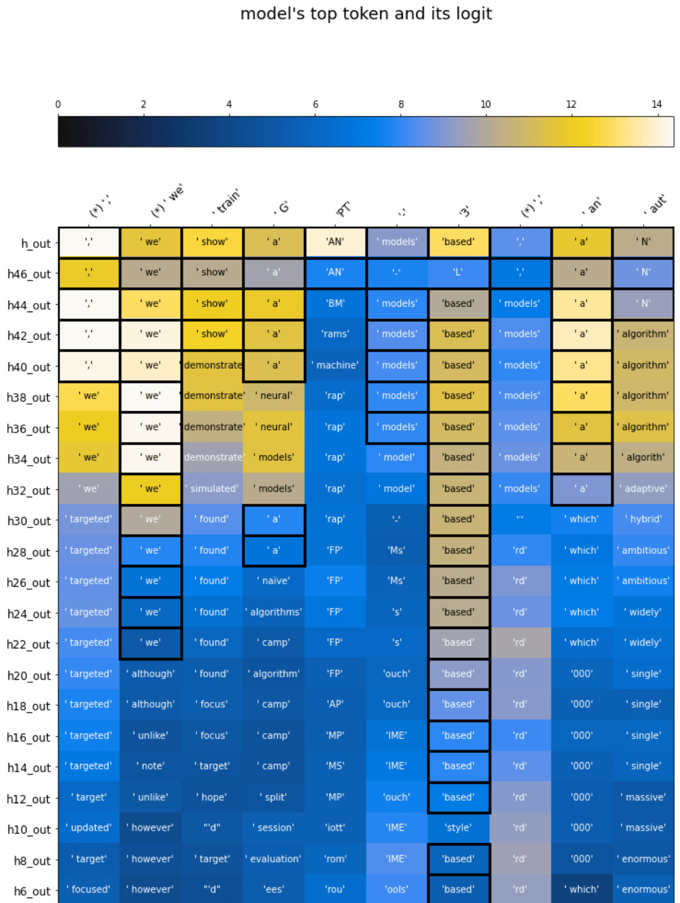

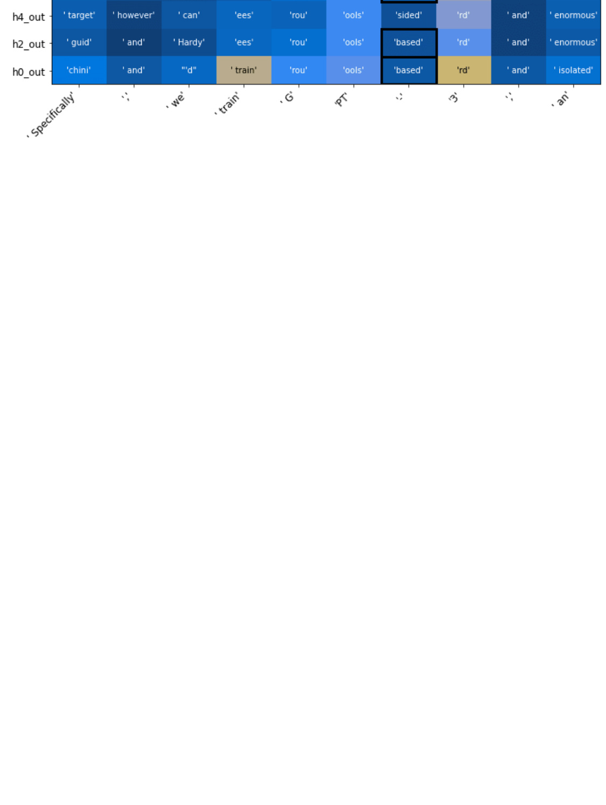

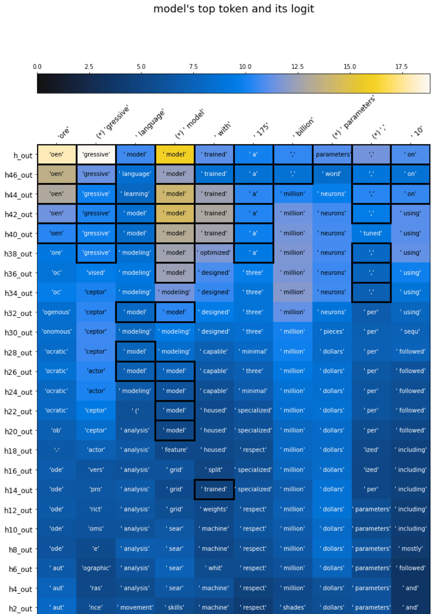

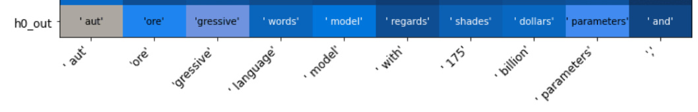

There are various amusing and interesting things one can glimpse in these plots. The "early guesses" are generally wrong but often sensible enough in some way: 

- "We train GPT-3..." 000? (someday!) 

- "GPT-3, an..." enormous? massive? (not wrong!) 

- "We train GPT-3, an aut..." oreceptor? (later converges to the correct oregressive) 

- "model with 175..." million? (later converges to a comma, not the correct billion) 

### ranks 

The view above focuses only on the top-1 guess at each layer, which is a reductive window on the full distributions. 

Another way to look at things: we still reduces the final output to the top-1 guess, but we compare other distributions to the final one by looking at the rank of the final top-1 guess. 

Even if the middle of the model hasn't yet converged to the final answer, maybe it's got that answer somewhere in its top 3, top 10, etc. That's a lot better than "top 50257." 

Here's the same activations as ranks. (Remember: these are ranks of the model's final top-1 prediction, not the true token.) 

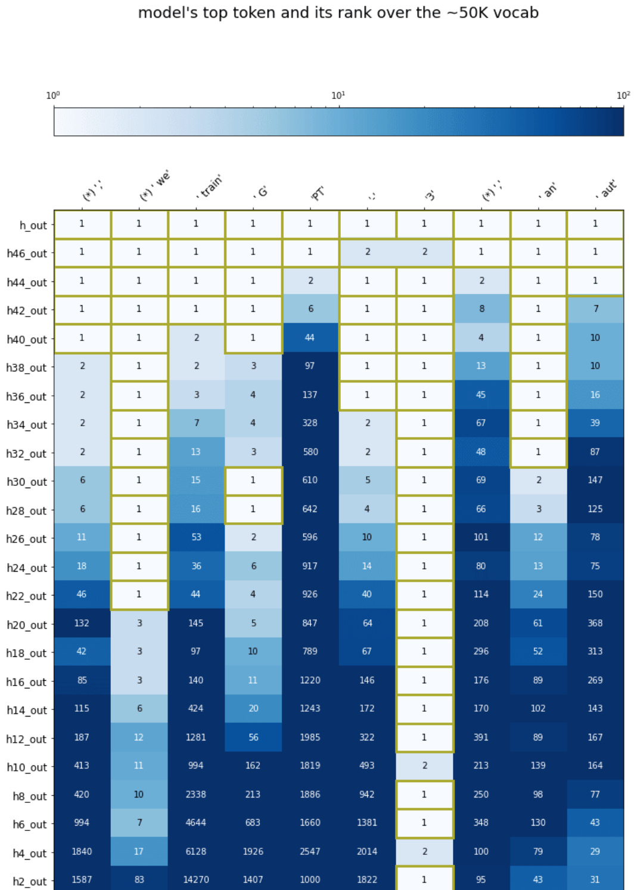

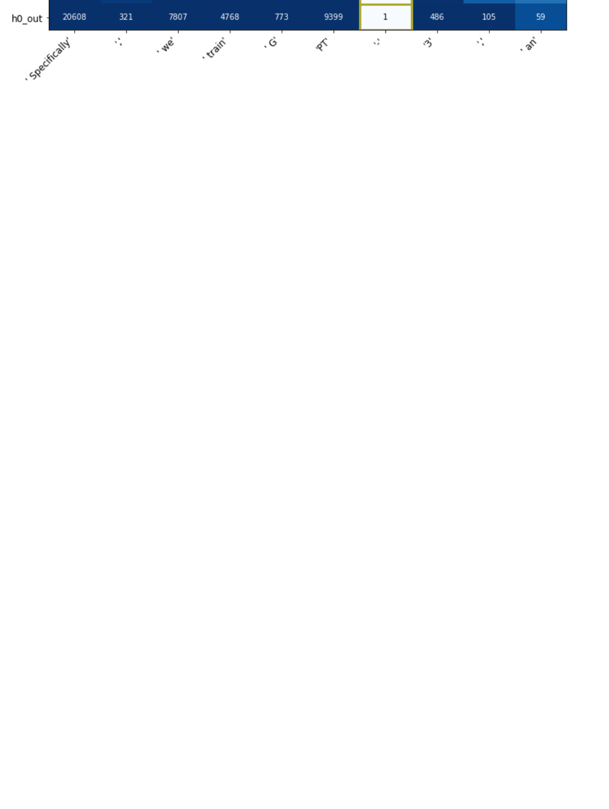

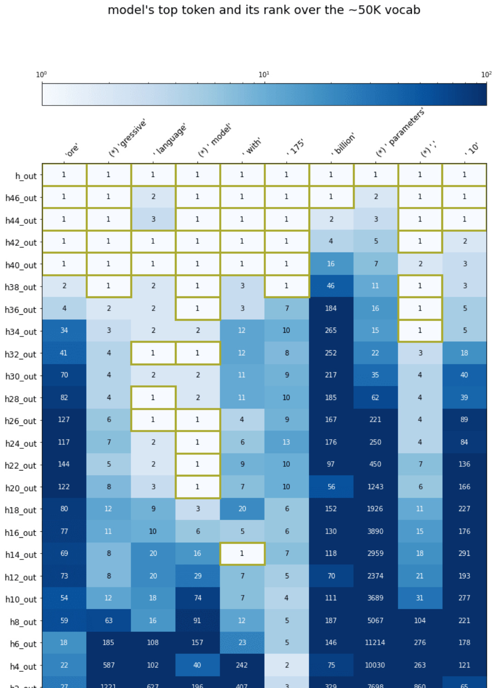

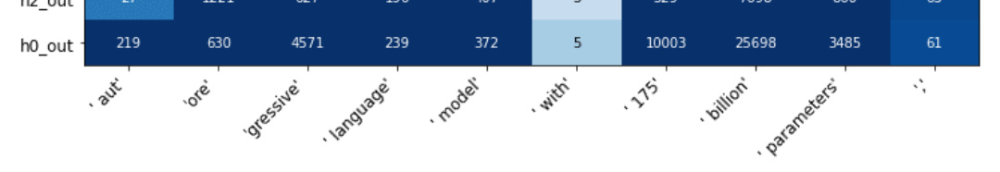

In most cases, network's uncertainty has drastically reduced by the middle layers. The order of the top candidates may not be right, and the probabilities may not be perfectly calibrated, but it's got the gist already. 

### KL divergence and input discarding 

Another way of comparing the similarity of two probability distributions is the KL divergence. Taking the KL divergence of the intermediate probabilities w/r/t the final probabilities, we get a more continuous view of how the distributions smoothly converge to the model's output. 

Because KL divergence is a more holistic measure of the similarity between two distributions than the ones I've used above, it's also my preferred metric for making the point that nothing looks like the input. 

In the plots above, I've skipped the input layer (i.e. the input tokens in embedding space). Why? Because they're so different from everything else, they distract the eye! 

In the plots below, where color is KL divergence, I include the input as well. If we trust that KL divergence is a decent holistic way to compare two distributions (I've seen the same pattern with other metrics), then: 

- Immediately, after the very first layer, the input has been transformed into something that looks more like the final output (47 layers layer) than it does like the input. 

- After this one discontinuous jump, the distribution progresses in a much more smooth way to the final output distribution. 

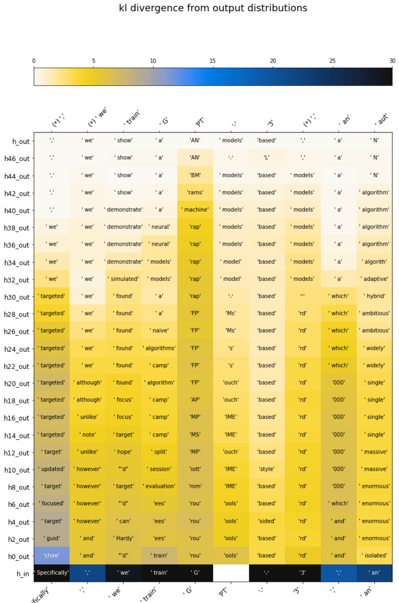

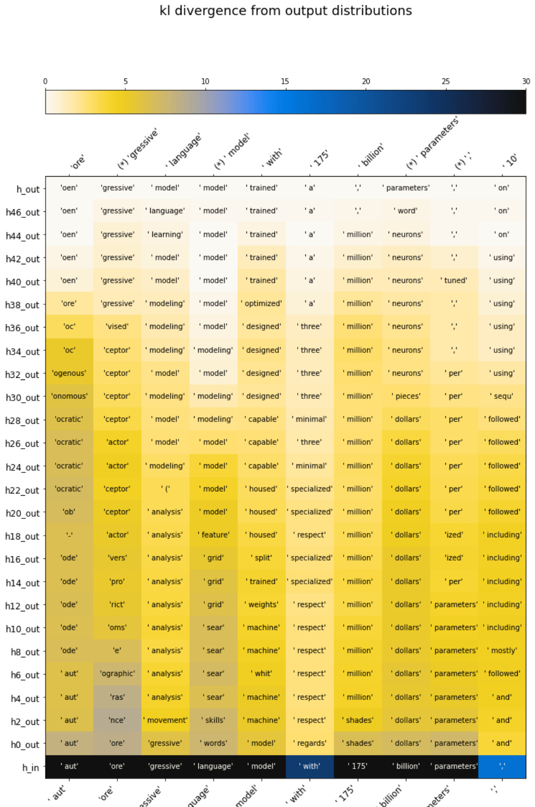

## other examples 

I show several other examples in the Colab notebook. I'll breeze through a few of them here. 

### copying a rare token 

Sometimes it's clear that the next token should be a "copy" of an earlier token: whatever arbitrary thing was in that slot, spit it out again. 

If this is a token with relatively low prior probability, one would think it would be useful to "keep it around" from the input so later positions can look at it and copy it. But as we saw, the input is never "kept around"! 

What happens instead? I tried this text: 

Sometimes, when people say plasma, they mean a state of matter. Other times, when people say plasma 

As shown below (truncated to the last few tokens for visibility), the model correctly predicts "plasma" at the last position, but only figures it out in the very last layers. 

Apparently it is keeping around a representation of the token "plasma" with enough resolution to copy it . . . but it only retrieves this representation at the end! (In the rank view, the rank of plasma is quite low until the very end.) 

This is surprising to me. The repetition is directly visible in the input: "when people say" is copied verbatim. If you just applied the rule "if input seems to be repeating, keep repeating it," you'd be good. Instead, the model scrambles away the pattern, then recovers it later through some other computational route. 

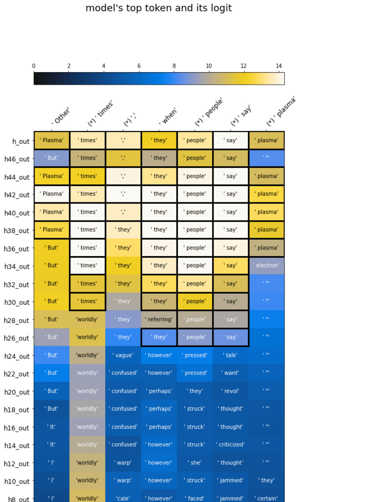

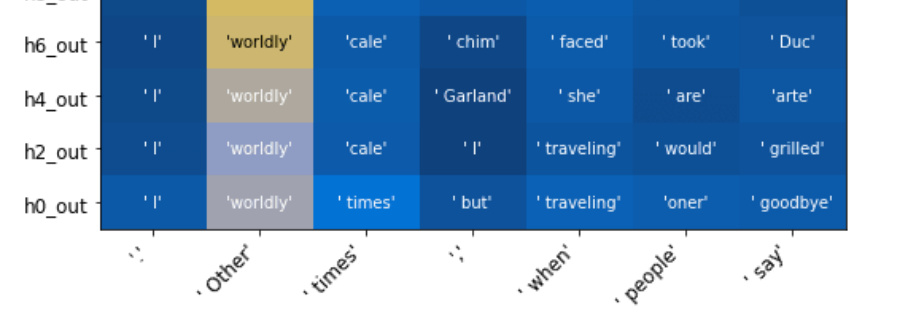

### extreme repetition 

We've all seen GPT sampling get into a loop where text repeats itself exactly, over and over. When text is repeating like this, where is the pattern "noticed"? 

At least in the following example, it's noticed in the upper half of the network, while the lower half can't see it even after several rounds of repetition. 

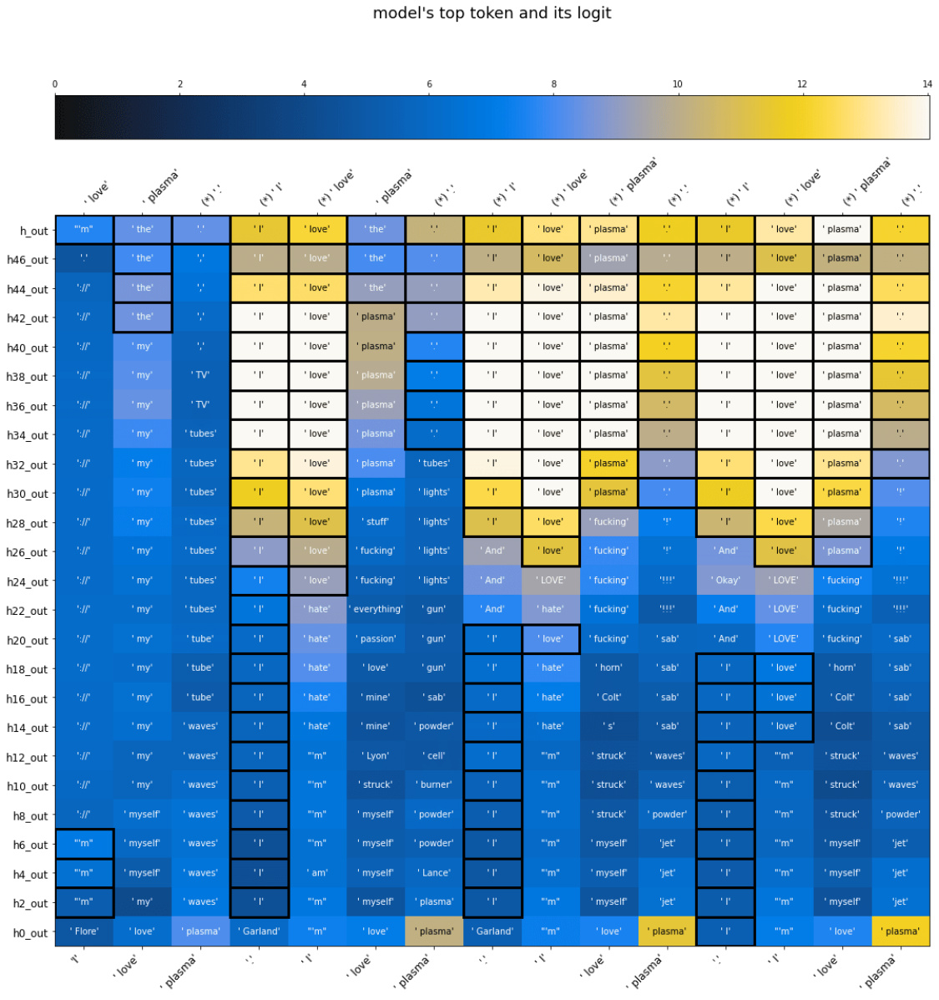

why? / is this surprising? 

First, some words about why this trick can even work at all. 

One can imagine models that perform the exact same computation as GPT-2, for which this trick would not work. For instance, each layer could perform some arbitrary vector rotation of the previous one before doing anything else to it. This would preserve all the information, but the change of basis would prevent the vectors from making sense when multiplied by W _^_ T. 

Why doesn't the model do this? Two relevant facts: 

1. Transformers are residual networks. Every connection in them looks like x + f(x) where f is the learned part. So the identity is very easy to learn. 

This tends to keep things in the same basis across different layers, unless there's some reason to switch. 

2. Transformers are usually trained with weight decay, which is almost the same thing as L2 regularization. This encourages learned weights to have small L2 norm. 

That means the model will try to "spread out" a computation across as many layers as possible (since the sum-of-squares is less than the square-of-sums). Given the task of turning an input into an output, the model will generally prefer changing the input a little, then a little more, then a little more, bit by bit. 

1+2 are a good story if you want to explain why the same vector basis is used across the network, and why things change smoothly. This story would render the whole thing unsurprising . . . except that the input is discarded in such a discontinuous way! 

I would have expected a U-shaped pattern, where the early layers mostly look like the input, the late layers mostly look like the output, and there's a gradual "flip" in the middle between the two perspectives. Instead, the input space immediately vanishes, and we're in output space the whole way. 

Maybe there is some math fact I'm missing here. 

Or, maybe there's some sort of "hidden" invertible relationship between 

the embedding of a given token, and 

the model's prior for what token comes after it (given no other information) 

so that a token like "plasma" is kept around from the input -- but not in the form "the output is plasma," instead in the form "the output is [the kind of word that comes after plasma]." 

However, I'm not convinced by that story as stated. For one thing, GPT layers don't share their weights, so the mapping between these two spaces would have to be separately memorized by each layer, which seems costly. Additionally, if this were true, we'd expect the very early activations to look like naive context-less guesses for the next token. Often they are, but just as often they're weird nonsense like "Garland." 

## addendum: more on "input discarding" 

In comments, Gurkenglas noted that the plots showing KL(final || layer) don't tend the whole story. 

The KL divergence is not a metric: it is not symmetric and does not obey the triangle inequality. Hence my intuitive picture of the distribution "jumping" from the input to the first layer, then smoothly converging to the final layer, is misleading: it implies we are measuring distances along a path through some space, but KL divergence does not measure distance in any space. 

Gurkenglas and algon33 suggested plotting the KL divergences of everything w/r/t the input rather than the output: KL(input || layer). 

Note that the input is close to a distribution that just assigns probability 1 to the input token ("close" because W * W^T is not invertible), so this is similar to asking "how probable is the input token, according to each layer?" That's a question which is also natural to answer by plotting ranks: what rank is assigned to the input token by each layer? 

Below, I show both: KL(input || layer), and the rank of the input token according to later layers. 

- For KL(input || layer), I use the same color scale as in the plots for KL(final || layer), so the two are comparable. 

- For the ranks, I do not use the same color scale: I have the colors bottom out at rank 1000 instead of rank 100. This gives more visual insight into where the model could be preserving input information. 

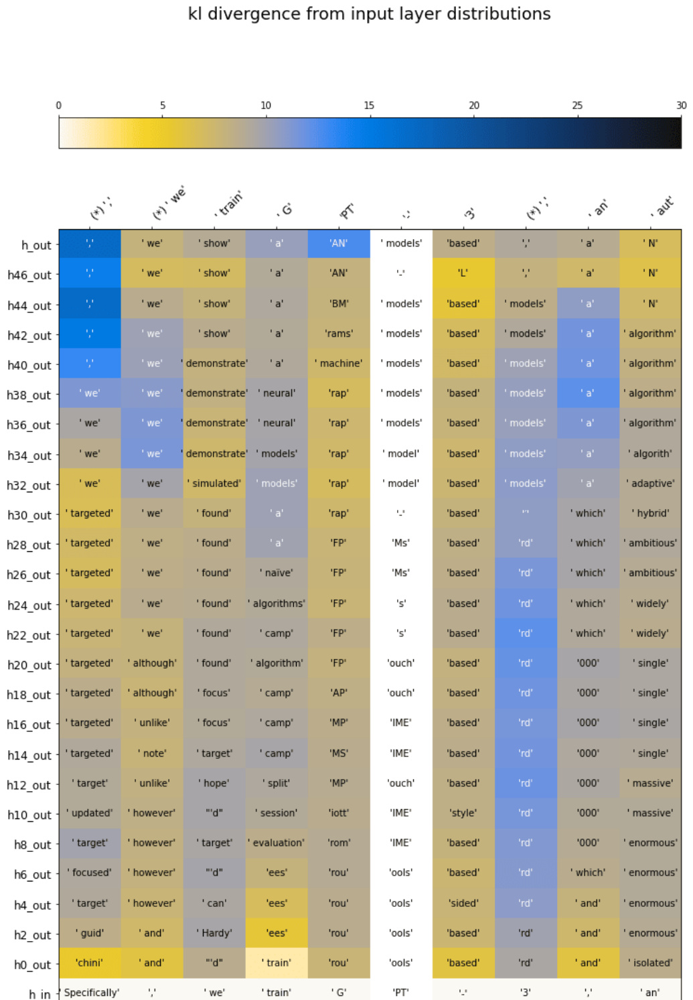

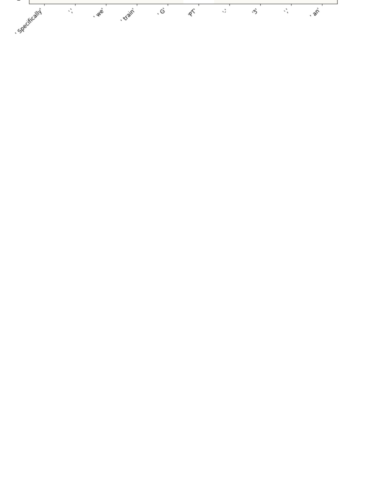

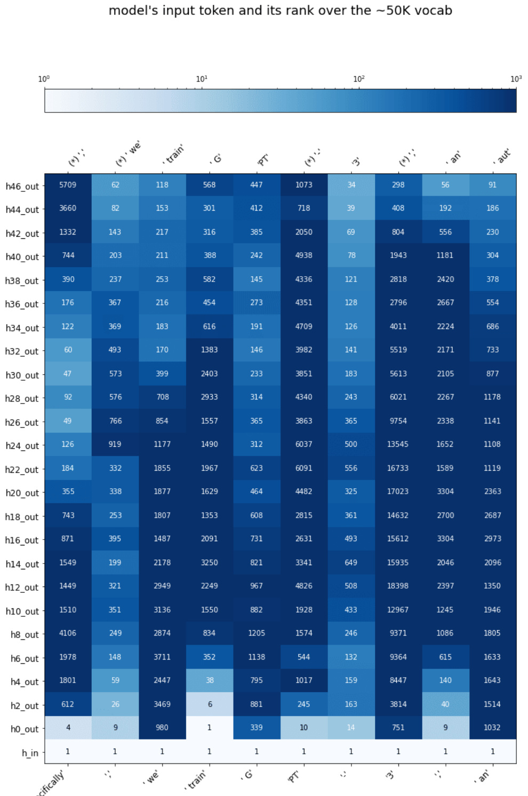

- There is still a fast jump in KL(input || layer) after the input. 

   - However, it's far smaller than the jump in KL(output || layer) at the same point. 

   - Note that the darkest color, meaning KL=30 does not appear on the plot of KL(input || layer). 

   - On the plot of KL(output || layer), however, the maximum values were in fact much greater than 30; I cut off the color scale at 30 so other distinctions were perceptible at all. 

- Likewise, while ranks jump quickly after the input, they often stay relatively high in the context of a ~50K vocab. 

   - I am curious about the differences here: some tokens are "preserved" much more in this sense than others. 

   - This is apparently contextual, not just based on the token itself. Note the stark differences between the rank trajectories of the first, second, and third commas in the passage. 

It's possible that the relatively high ranks -- in the 100s or 1000s, but not the 10000s -- of input tokens in many cases is (related to) the mechanism by which the model "keeps around" rarer tokens in order to copy them later. 

As some evidence for this, I will show plots like the above for the plasma example. Here, I show a segment including the first instance of "plasma," rather than the second which copies it. 

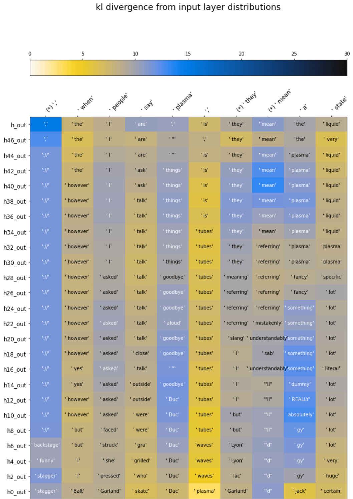

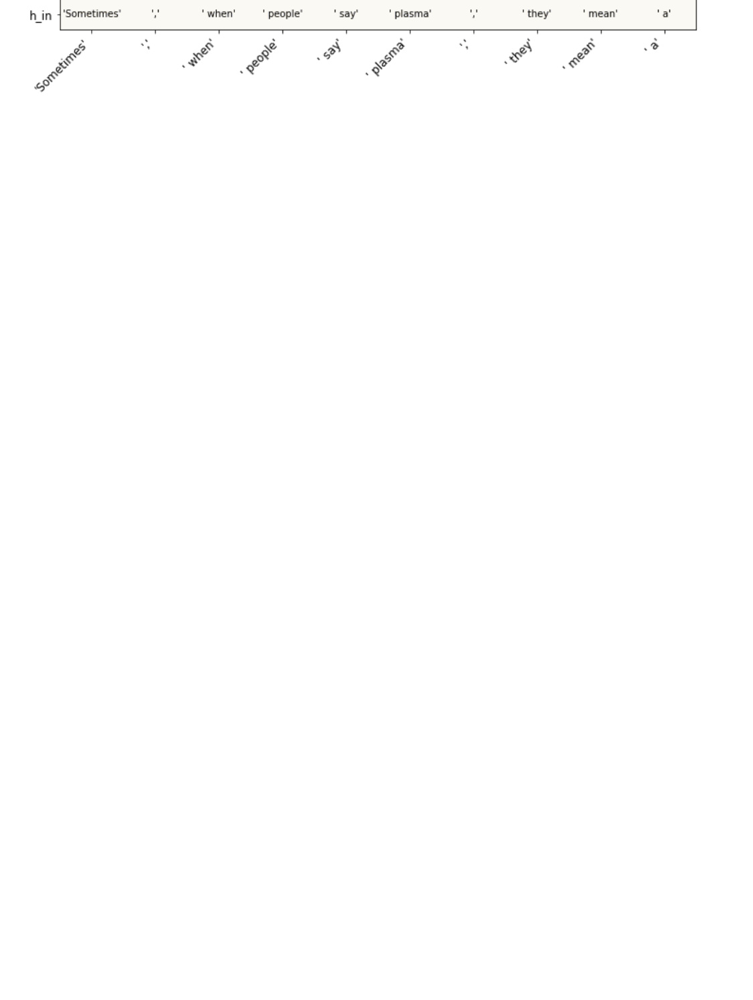

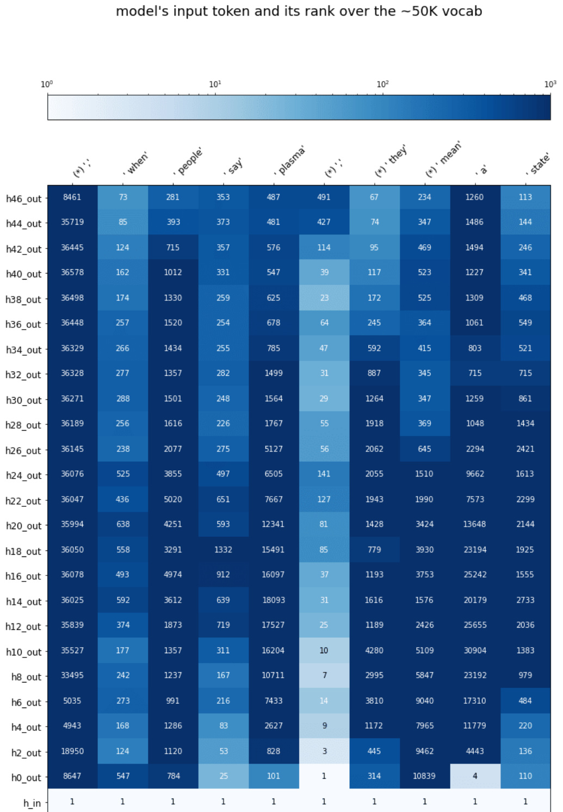

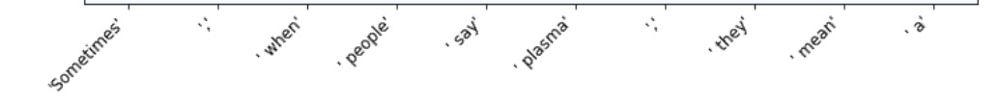

The preservation of "plasma" here is striking. 

My intuitive guess is that the rarity, or (in some sense) "surprisingness," of the token causes early layers to preserve it: this would provide a mechanism for providing raw access to rare tokens in the later layers, which otherwise only be looking at more plausible tokens that GPT had guessed for the corresponding positions. 

On the other hand, this story has trouble explaining why "G" and "PT" are not better preserved in the GPT3 abstract plots just above. This is the first instance of "GPT" in the full passage, so the model can't rely on copies of these at earlier positions. That said, my sense of scale for "well-preservedness" is a wild guess, and these particular metrics may not be ideal for capturing it anyway. 

• • • 

1. Right after this, positional embeddings are added. I'm ignoring positional embeddings in the post, but mention them in this footnote for accuracy. ↩

---

[← 11 In-context Learning and Induction Heads](11_induction_heads.md) · [Contents](README.md) · [13 Interpretability in the Wild (IOI circuit) →](13_ioi_circuit.md)
