<!-- Generated by scripts/build_anthology.py export from the source PDF; edit the catalog, not this file. -->
# 22 · Causal Abstraction: A Theoretical Foundation for Mechanistic Interpretability

**Geiger et al. — 2025** · Atticus Geiger, Duligur Ibeling, Amir Zur, Maheep Chaudhary, Sonakshi Chauhan, Jing Huang, Aryaman Arora, Zhengxuan Wu, Noah Goodman, Christopher Potts, Thomas Icard

| | |
|---|---|
| Priority | ○ P1 — Important · optional |
| Section | C — Causal methods and their critics |
| Source | [https://arxiv.org/abs/2301.04709v4](https://arxiv.org/abs/2301.04709v4) (arXiv:2301.04709v4) |
| Licence | CC BY 4.0 |
| Print anthology | pages 697–760 (cover 697, text 698–760) |

**Why read this.** Generalizes causal abstraction from replacing mechanisms to transforming them, and offers it as a common language for polysemanticity, the linear representation hypothesis, graded faithfulness and most current interpretability methods.

**Reading focus.** Interventionals and constructive abstraction in Section 2, approximate abstraction as graded faithfulness, and Section 3's translations of patching, path patching, causal scrubbing, concept erasure, sparse autoencoders, DAS and steering into one framework.

**In context.** Grows [21](21_causal_abstractions.md) into a general theory and claims most of this section for it: the causal tracing of [18](18_rome.md), [20](20_causal_scrubbing.md), path patching and [23](23_distributed_alignment_search.md) all appear as special cases. It is the theoretical position behind [25](25_illusion_reply.md), which shares several of its authors, and gives formal definitions for ideas argued informally in [33](33_toy_models_of_superposition.md) and [40](40_linear_representation_hypothesis.md).

**Optional.** A long formal treatment: [21](21_causal_abstractions.md) and [23](23_distributed_alignment_search.md) carry the working ideas, and Section 3 alone serves as a map of methods.

**Note.** First posted January 2023 as “Causal Abstraction for Faithful Model Interpretation” (Geiger, Potts & Icard); later versions were retitled and expanded, the latest (v4) in May 2025.

[← 21 Causal Abstractions of Neural Networks](21_causal_abstractions.md) · [Contents](README.md) · [23 Distributed Alignment Search (DAS) →](23_distributed_alignment_search.md)

---

*Text extracted automatically from the source PDF. Display equations, figures and some tables appear as images; inline mathematics may be garbled — the PDF is authoritative.*

# **Causal Abstraction: A Theoretical Foundation for Mechanistic Interpretability** 

**Atticus Geiger**_∗♢_ **, Duligur Ibeling**_♠_ **, Amir Zur**_♢_ **, Maheep Chaudhary**_♢_ **, Sonakshi Chauhan**_♢_ **, Jing Huang**_♠_ **, Aryaman Arora**_♠_ **, Zhengxuan Wu**_♠_ **, Noah Goodman**_♠_ **, Christopher Potts**_♠_ **, Thomas Icard**_∗♠_ 

> _♢_ **Pr(Ai)** 2 **R Group** _♠_ **Stanford University** 

> _∗_ **Corresponding authors: atticusg@gmail.com; icard@stanford.edu** 

**Editor:** Jin Tian 

## **Abstract** 

Causal abstraction provides a theoretical foundation for mechanistic interpretability, the field concerned with providing intelligible algorithms that are faithful simplifications of the known, but opaque low-level details of black box AI models. Our contributions are (1) generalizing the theory of causal abstraction from mechanism replacement (i.e., hard and soft interventions) to arbitrary mechanism transformation (i.e., functionals from old mechanisms to new mechanisms), (2) providing a flexible, yet precise formalization for the core concepts of polysemantic neurons, the linear representation hypothesis, modular features, and graded faithfulness, and (3) unifying a variety of mechanistic interpretability methods in the common language of causal abstraction, namely, activation and path patching, causal mediation analysis, causal scrubbing, causal tracing, circuit analysis, concept erasure, sparse autoencoders, differential binary masking, distributed alignment search, and steering. **Keywords:** Mechanistic Interpretability, Causality, Abstraction, Explainable AI 

> ©2025 Atticus Geiger, Duligur Ibeling, Amir Zur, Maheep Chaudhary, Sonakshi Chauhan, Jing Huang, Aryaman Arora, Zhengxuan Wu, Noah Goodman, Christopher Potts, Thomas Icard. 

> License: CC-BY 4.0, see `https://creativecommons.org/licenses/by/4.0/` . Attribution requirements are provided at `http://jmlr.org/papers/v26/23-0058.html` . 

## **Contents** 

|**1** **Int**|**roduct**|**ion**|**4**|
|---|---|---|---|
|**2** **Ca**|**usality **|**and Abstraction**|**6**|
|2.1|Deter|ministic Causal Models with Implicit Graphical Structure . . . . . . .|6|
|2.2|Interv|ention Algebras . . . . . . . . . . . . . . . . . . . . . . . . . . . . . .|9|
|2.3|Exact|Transformation with Interventionals . . . . . . . . . . . . . . . . . . .|13|
||2.3.1|Bijective Translation . . . . . . . . . . . . . . . . . . . . . . . . . . .|14|
||2.3.2|Constructive Causal Abstraction . . . . . . . . . . . . . . . . . . . .|16|
||2.3.3|Decomposing Alignments Between Models . . . . . . . . . . . . . . .|17|
|2.4|Appro|ximate Transformation . . . . . . . . . . . . . . . . . . . . . . . . . .|20|
|2.5|Interc|hange Interventions . . . . . . . . . . . . . . . . . . . . . . . . . . . .|21|
|2.6|Exam|ple: Causal Abstraction in Mechanistic Interpretability . . . . . . . .|23|
|2.7|Exam|ple: Causal Abstraction with Cycles and Infinite Variables . . . . . .|27|
|**3** **A C**|**ommo**|**n Language for Mechanistic Interpretability**|**30**|
|3.1|Polyse Featu|mantic Neurons, the Linear Representation Hypothesis, and Modular res via Intervention Algebras . . . . . . . . . . . . . . . . . . . . . . .|30|
|3.2|Grade|d Faithfulness via Approximate Abstraction . . . . . . . . . . . . . .|32|
|3.3|Behav|ioral Evaluations as Abstraction by a Two Variable Chains . . . . . .|32|
||3.3.1|LIME: Behavioral Fidelity as Approximate Abstraction . . . . . . .|32|
||3.3.2|Single Source Interchange Interventions from Integrated Gradients .|34|
||3.3.3|Estimating the Causal Effect of Real-World Concepts . . . . . . . .|34|
|3.4|Patch|ing Activations with Interchange Interventions . . . . . . . . . . . . .|35|
||3.4.1|Causal Mediation as Abstraction by a Three-Variable Chain . . . . .|36|
||3.4.2|Path Patching as Recursive Interchange Interventions . . . . . . . .|37|
|3.5|Ablati|on as Abstraction by a Three Variable Collider . . . . . . . . . . . . .|37|
||3.5.1|Concept Erasure . . . . . . . . . . . . . . . . . . . . . . . . . . . . .|38|
||3.5.2|Sub-Circuit Analysis . . . . . . . . . . . . . . . . . . . . . . . . . . .|39|
||3.5.3|Causal Scrubbing . . . . . . . . . . . . . . . . . . . . . . . . . . . . .|40|
|3.6|Modu|lar Feature Learning as Bijective Transformation . . . . . . . . . . . .|41|
||3.6.1|Unsupervised Methods . . . . . . . . . . . . . . . . . . . . . . . . . .|42|
||3.6.2|Aligning Low-Level Features with High-Level Variables . . . . . . .|42|
||3.6.3|Supervised Methods . . . . . . . . . . . . . . . . . . . . . . . . . . .|43|
|3.7|Activa|tion Steering as Causal Abstraction . . . . . . . . . . . . . . . . . . .|44|
|3.8 **4** **Co**|Traini **nclusio**|ng AI Models to be Interpretable . . . . . . . . . . . . . . . . . . . . . **n**|44 **45**|

|Symbol|Meaning|Location|
|---|---|---|
|Domain(_f_)|the domain of a function _f_||
|**v**_�→f_(**v**)|the function _f_||
|1[_φ_]|An indicator function that outputs 1 if _φ_ is true, 0 otherwise.||
|**V**|A complete set of variables|Definition 2|
|Val**X**|A function mapping variables **X**_⊆_**V** to values|Definition 2|
|Σ|A signature (variables **V** and values Val)|Definition 2|
|**v**|A total setting **v**_∈_Val**V**|Definition 3|
|_X, x_|A variable _X ∈_**V** and a value _x ∈_Val_X_|Definition 3|
|**X**_,_**x**|A set of variables **X**_⊆_**V** and a partial setting **x**_∈_Val**X**|Definition 3|
|Proj**X**(**y**)|The restriction of a partial setting **y** to variables **X**_⊆_**Y** _⊆_**V**|Definition 4|
|Proj_−_1 **Y** (**x**)|The set of partial settings **y** where Proj**X**(**y**) =**x**|Definition 4|
|_{FX}X∈_**V**|Mechanisms for the variables in **V**|Definition 5|
|_≺_|An ordering of **V** by causal dependency as induced via _{FX}X∈_**V**|Definition 5|
|_M_|A causal model (a signature Σ and mechanisms _{FX}X∈_**V**)|Definition 5|
|Solve(_M_)|The set of total settings that are solutions to a model _M_|Definition 5|
|**i**_∈_Hard|A hard intervention that fixes the variables **I**_⊆_**V**|Definition 9|
|_{IX}X∈_**X** _∈_Soft|A soft intervention that replaces the mechanisms of **X**_⊆_**V**|Definition 10|
|_{_I_X}X∈_**X** _∈_Func|An interventional that edits the mechanisms of **X**_⊆_**V**|Definition 11|
|Func**V**|The set of interventionals that edit all mechanisms|Definition 11|
|Φ|The interventionals in Func**V** equivalent to hard interventions.|Definition 11|
|_α_|A sequence of elements|Definition 11|
|Ψ|A set of interventionals|Definition 11|
|_τ_|A map from total settings of _M_ to total settings of _M__∗_|Definition 25|
|_ω_|A map from interventionals in _M_ to interventionals of _M__∗_|Definition 25|
|_H, L_|High-level and low-level causal models|Definition 33|
|Π_XH_|A partition cell of **V**_L_ assigned to the variable _XH ∈_**V**_H_|Definition 31|
|_πXH_|A function mapping from values of Π_XH_ to values of _XH_|Definition 31|

Geiger, Ibeling, Zur, Chaudhary, Chauhan, Huang, Arora, Wu, Goodman, Potts, Icard 

## **1 Introduction** 

We take the fundamental aim of explainable artificial intelligence to be explaining _why_ a model makes the predictions it does. For many purposes the paradigm of explanation is causal explanation (Woodward, 2003; Pearl, 2019), elucidating counterfactual differencemaking details of the mechanisms underlying model behavior. However, not just any causal explanation will be apt. There is an obvious sense in which we already know all the low-level causal facts about a deep learning model. After all, we can account for every aspect of model behavior in terms of real-valued vectors, activation functions, and weight tensors. The problem, of course, is that these low-level explanations are typically not _transparent_ to humans—they fail to instill an understanding of the high-level principles underlying model behavior (Lipton, 2018; Creel, 2020) that can guide human action (Karimi et al., 2021, 2023). 

In many contexts it can be quite straightforward to devise simple algorithms for tasks that operate on human-intelligible concepts. The crucial question is, under what conditions does such a transparent algorithm constitute a _faithful interpretation_ (Jacovi and Goldberg, 2020) of the known, but opaque, low-level details of a black box model? This is the motivating question for the explainable AI subfield known as _interpretability_ . The question takes on particular significance for _mechanistic interpretability_ ,1 which, in contrast to behavioral interpretability, is precisely aimed at reverse engineering the _internals_ of a black box model in terms of a transparent algorithm. 

Mechanistic interpretability research is quite analogous to the problem that cognitive scientists face in understanding how the human mind works. At one extreme, we can try to understand minds at a very low level, e.g., of biochemical processes in the brain. At the other extreme, we can focus just on the input-output facts of the system, roughly speaking, on ‘observable behavior.’ Analogously, for a deep learning model, we can focus either on low-level features (weight tensors, activation functions, etc.), or on what input-output function is computed. In both cases, however, it can be illuminating to investigate the mediating processes and mechanisms that transform input to output at a slightly higher-level of abstraction. This is what Marr (1982) famously called the _algorithmic_ level of analysis. To the extent that these algorithmic-level hypotheses are transparent to the scientist, we may have a useful elucidation of the agent’s inner workings. 

However, it is crucial that mechanistic interpretability methods avoid telling ‘just-so’ stories that are completely divorced from the internal workings of the model. To clarify what this means exactly, we need a common language for explicating and comparing methodologies, and for precisifying core concepts. We submit that the theory of _causal abstraction_ provides this common language. 

In some ways, modern deep learning models are like the weather or an economy: they involve large numbers of densely connected ‘microvariables’ with complex, non-linear dynamics. One way of reining in this complexity is to find ways of understanding these systems in 

> 1. Saphra and Wiegreffe (2024) argue that the term ‘mechanistic interpretability’ often signals not a single research program, but rather a cultural identity within the AI alignment community (Olah et al., 2020; Elhage et al., 2021; Wang et al., 2023; Nanda et al., 2023a). However, they also note that there is a natural ‘narrow’ technical reading of the term, where the concern is specifically with _causal_ analyses of models’ internal mechanisms (Vig et al., 2020; Geiger et al., 2020, 2021, 2023; Finlayson et al., 2021; Meng et al., 2022; Stolfo et al., 2023; Todd et al., 2024; Prakash et al., 2024; Mueller et al., 2024). We embrace that causality is core to mechanistic interpretability. 

terms of higher-level, more abstract variables (‘macrovariables’). For instance, the many microvariables might be clustered together into more abstract macrovariables. A number of researchers have been exploring theories of causal abstraction, providing a mathematical framework for causally analyzing a system at multiple levels of detail (Chalupka et al., 2017; Rubenstein et al., 2017; Beckers and Halpern, 2019; Beckers et al., 2019; Rischel and Weichwald, 2021; Massidda et al., 2023, 2024). These methods tell us when a high-level causal model is a simplification of a (typically more fine-grained) low-level model. To date, causal abstraction has been used to analyze weather patterns (Chalupka et al., 2016), human brains (Dubois et al., 2020a,b), physical systems (Kekic et al., 2023), batteries (Zennaro et al., 2023a), epidemics (Dyer et al., 2023), and deep learning models (Chalupka et al., 2015; Geiger et al., 2021; Hu and Tian, 2022; Geiger et al., 2023; Wu et al., 2023). 

Macrovariables will not always correspond to sets of microvariables. Just as with neural network models of human cognition (Smolensky, 1986), this is the typical situation in mechanistic interpretability, where high-level concepts are thought to be represented by modular ‘features’ distributed across individual neural activations (Harradon et al., 2018; Olah et al., 2020; Huang et al., 2024). For example, the linear subspaces of activation space learned from distributed alignment search (Geiger et al., 2023) and the output dimensions of sparse autoencoders (Bricken et al., 2023; Cunningham et al., 2023) are features that are distributed across overlapping sets of neural activations. 

Our first contribution is to extend the theory of causal abstraction to remove this limitation, building heavily on previous work. The core issue is that typical hard and soft interventions replace variable mechanisms entirely, so they are unable to isolate quantities distributed across overlapping sets of microvariables. To address this, we consider a very general type of intervention—what we call _interventionals_ —that maps from old mechanisms to new mechanisms. While this space of operations is generally unconstrained, we isolate special classes of interventionals that form _intervention algebras_ , satisfying two key modularity properties. Such classes can essentially be treated as hard interventions with respect to a new (‘translated’) variable space. We elucidate this situation, generalizing earlier work by Rubenstein et al. (2017) and Beckers and Halpern (2019). 

Our second contribution is to show how causal abstraction provides a solid theoretical foundation for the field of mechanistic interpretability. We leverage our general presentation to provide flexible, yet mathematically precise, definitions for the core mechanistic interpretability concepts of polysemantic neurons, the linear representation hypothesis, modular features, and graded faithfulness. Furthermore, we unify a wide range of existing interpretability methodologies in a common language, including activation and path patching, causal mediation analysis, causal scrubbing, causal tracing, circuit analysis, concept erasure, sparse autoencoders, differential binary masking, distributed alignment search, and activation steering. We also connect the behavioral interpretability methods of LIME, integrated gradients, and causal effect estimation to the language of causal abstraction. 

We are optimistic about productive interplay between theoretical work on causal abstraction and applied work on mechanistic interpretability. In stark contrast to weather, brains, or economies, we can measure and manipulate the microvariables of deep learning models with perfect precision and accuracy, and thus empirical claims about their structure can be held to the highest standard of rigorous falsification through experimentation. 

## **2 Causality and Abstraction** 

This section presents a general theory of causal abstraction. Although we build on much existing work in the recent literature, our presentation is in some ways more general, and in other ways less so. Due to our focus on (deterministic) neural network models, we do not incorporate probability into the picture. At the same time, because the operations employed in the study of modern machine learned system go beyond ‘hard’ and ‘soft’ interventions that replace model mechanisms (see Def. 9 and 10 below), we define a very general kind of intervention, the _interventional_ , which is a functional mapping from old mechanisms to new mechanisms (see Def. 11). In order to impose structure on this unconstrained class of model transformations, we establish some new results on classes of interventionals that form what we will call _intervention algebras_ (see especially Theorems 20, 21). 

Next, we explore key relations that can hold between causal models. We begin with _exact transformations_ (Rubenstein et al., 2017), which characterize when the mechanisms of one causal model are realized by the mechanisms of another (‘causal consistency’). We generalize exact transformation from hard interventions to interventionals that form intervention algebras (see Def. 25). A bijective translation (see Def. 28) is an exact transformation that retains all the details in the original model, staying at the same level of granularity. On the other hand, a constructive causal abstraction (see Def. 33) is a ‘lossy’ exact transformation that merges microvariables into macrovariables, while maintaining a precise and accurate description of the original model. Also, we (1) decompose constructive causal abstraction into three operations, namely marginalization, variable merge, and value merge (see Prop. 40), and (2) provide a framework for approximate transformations (see Def. 41). 

Lastly, we define a family of _interchange intervention_ operations, which are central to understanding mechanistic interpretability through the lens of causal abstraction. We begin with simple interchange interventions (see Def. 44), where a causal model with input and output variables has certain variables fixed to values they would have under different input conditions. We extend these to recursive interchange interventions (see Def. 45), which allow variables to be fixed based on the results of previous interchange interventions. Crucially, we also define distributed interchange interventions that target variables distributed across multiple causal variables and involve a bijective translation to and from a transformed variable space (see Def. 46). We conclude by explicating how to construct an alignment for interchange intervention analysis and how to use interchange intervention accuracy to quantify approximate abstractions. 

### **2.1 Deterministic Causal Models with Implicit Graphical Structure** 

We start with some basic notation. 

**Remark 1 (Notation throughout the paper)** Capital letters (e.g., _X_ ) are used for variables and lower case letters (e.g., _x_ ) are used for values. Bold faced letters (e.g. **X** or **x** ) are used for sets of variables and sets of values. When a variable (or set of variables) and a value (or set of values) have the same letter, the values correspond to the variables (e.g., _x ∈_ Val _X_ or **x** _∈_ Val **X** ). 

**Definition 2 (Signature)** We use **V** to denote a fixed set of variables, each _X ∈_ **V** coming with a non-empty range Val _X_ of possible values. Together Σ = ( **V** _,_ Val) are called a _signature_ . 

**Definition 3 (Partial and Total Settings)** We assume Val _X ∩_ Val _Y_ = ∅ whenever _X̸_ = _Y_ , meaning no two variables can take on the same value.2 This assumption allows representing the values of a set of variables **X** _⊆_ **V** as a set **x** of values, with exactly one value _x ∈_ Val _X_ in **x** for each _X ∈_ **X** . When we need to be specific about the choice of variable _X_ , we denote this element of Val _X_ as _x_ . We thus have **x** _⊆_� _X∈_ **X**Val_X_,andwerefertothevalues **x** _∈_ Val **X** as _partial settings_ . In the special case where **v** _∈_ Val **V** , we call **v** a _total setting_ . 

Another useful construct in this connection is the _projection_ of a partial setting: 

**Definition 4 (Projection)** Given a partial setting **y** for a set of variables **Y** _⊇_ **X** , we define Proj **X** ( **y** ) to be the restriction of **y** to the variables in **X** . Given a partial setting **x** , we define the inverse: 

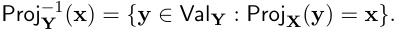

**Definition 5** A (deterministic) _causal model_ is a pair _M_ = (Σ _, {FX }X∈_ **V** ), such that Σ is a signature and _{FX }X∈_ **V** is a set of _mechanisms_ , with _FX_ : Val **V** _→_ Val _X_ assigning a value to _X_ as a function of the values of all the variables, including _X_ itself. We write _F_ **X** for _{FX }X∈_ **X** . We will often break up the input argument to a mechanism into partial settings that form a total setting, e.g., _FX_ ( **y** _,_ **z** ) for **Y** _∪_ **Z** = **V** . 

**Remark 6 (Inducing Graphical Structure)** Observe that our definition of causal model makes no explicit reference to a graphical structure defining a causal ordering on the variables. While the mechanism for a variable takes in total settings, it might be that the output of a mechanism depends only on a subset of values. This induces a _causal ordering_ among the variables, such that _Y ≺ X_ —or _Y_ is a _parent_ of _X_ —just in case there is a setting **z** of the variables **Z** = **V** _\ {Y }_ , and two settings _y, y__′_ of _Y_ such that _FX_ ( **z** _, y_ ) _̸_ = _FX_ ( **z** _, y__′_ ) (see, e.g., Woodward 2003). The resulting order _≺_ captures a notion of direct causation, which can be extended to indirect causation by taking its transitive closure _≺__∗_ . Throughout the paper, we will define mechanisms to take in partial settings of parent variables, though technically they take in total settings and depend only on the parent variables. 

When _≺__∗_ is irreflexive, we say the causal model is _acyclic_ . Most of our examples of causal models will have this property. However, it is often also possible to give causal interpretations of cyclic models (see, e.g., Bongers et al. 2021). Indeed, the abstraction operations to be introduced generally create cycles among variables, even from initially acyclic models (see Rubenstein et al. 2017, §5.3 for an example). In Section 2.7, we provide an example where we abstract a causal model representing the bubble sort algorithm into a cyclic model where any sorted list is a solution satisfying the equations. 

**Remark 7 (Acyclic Model Notation)** Our example in Section 2.6 will involve causal abstraction between two finite, acyclic causal models. We will call variables that depend on no other variable _input variables_ ( **X****In** ), and variables on which no other variables depend _output variables_ ( **X****Out** ). The remaining variables are _intermediate variables_ . We can 

> 2. To allow the same value to occur multiple times, we can simply take any causal model where variables share values, and then ‘tag’ the shared values with variable names to make them unique. 

Geiger, Ibeling, Zur, Chaudhary, Chauhan, Huang, Arora, Wu, Goodman, Potts, Icard 

intervene on input variables **X****In** to ‘prime’ the model with a particular input.3 As such, the constant functions for input variables in our examples will be overwritten. 

As _M_ can also be interpreted simply as a set of equations, we can define the set of solutions, which may be empty. 

**Definition 8 (Solution Sets)** Given _M_ = ( **V** _, {FX }X∈_ **V** ), the set of solutions, called Solve( _M_ ), is the set of all **v** _∈_ Val **V** such that all the equations Proj _X_ ( **v** ) = _FX_ ( **v** ) are satisfied for each _X ∈_ **V** . When _M_ is acyclic, there is a single solution and we use Solve( _M_ ) to refer interchangeably to a singleton set of solutions and its sole member, relying on context to disambiguate. 

We give a general definition of intervention on a model (see, e.g., Spirtes et al. 2000; Woodward 2003; Pearl 2009). For the following, assume we have fixed a signature Σ. 

**Definition 9 (Intervention)** Define a _hard intervention_ to be a partial setting **i** _∈_ Val **I** for finite **I** _⊆_ **V** . Given a model _M_ with signature Σ, define _M_ **i** to be just like _M_ , except that we replace _FX_ with the constant function **v** _�→_ Proj _X_ ( **i** ) for each _X ∈_ **I** . Define Hard **X** = Val **X** to be the set of all hard interventions on **X** . 

**Definition 10 (Soft Intervention)** We define a _soft intervention_ on some finite set of variables **X** _⊆_ **V** to be a family of functions _{IX }X∈_ **X** where _IX_ : Val **V** _→_ Val _X_ for each _X ∈_ **X** . Given a model _M_ with signature Σ, define _MI_ to be just like _M_ , except that we replace each function _FX_ with the function _IX_ . Define Soft **X** to be the set of all soft interventions on **X** . 

Soft interventions generalize hard interventions. The hard intervention **i** is equivalent to a constant soft intervention _I_ = _{_ **v** _�→ x}x∈_ **i** . 

**Definition 11 (Interventional)** We define an _interventional_ on some finite set of variables **X** _⊆_ **V** to be a family of functions I = _{_ I _X }X∈_ **X** where I _X_ : Soft **X** _→_ Soft _X_ for each _X ∈_ **X** . We define _M_ I to be just like _M_ , except that we replace each function _FX_ with the function I _X ⟨F_ **X** _⟩_ . Define Func **X** to be the set of interventionals on **X** . 

Interventionals generalize soft interventions. The soft intervention _I_ is a constant interventional—namely, the family of functions that, for each _X ∈_ **X** , sends any element of Soft **X** to _IX_ . When only one variable is targeted, we say that the intervention(al) is _atomic_ . 

**Remark 12 (On Terminology)** What we are calling hard interventions are sometimes called _structural_ interventions (Eberhardt and Scheines, 2007). Our soft interventions are essentially the same as the soft interventions studied, e.g., in Tian (2008); Bareinboim and Correa (2020), although as mentioned, we set aside probabilistic aspects of causal models in this paper. The main difference between soft interventions and interventionals is that the latter ‘mechanism replacements’ can depend on the previous mechanisms in the model. This type of dependence has also been studied, e.g., in the setting of so-called _parametric_ interventions (Eberhardt and Scheines, 2007). 

> 3. In some parts of the literature what we are calling input variables are designated as ‘exogenous’ variables. 

**Remark 13 (Interventionals as Unconstrained Model Transformations)** The set Func **V** contains the interventionals that targets _all_ variables **V** . This set of interventionals is quite general, containing every function that maps from and to causal models with the same signature. 

**Remark 14 (Composing Intervention(al)s)** Interventionals containing families of constant functions to constant functions are exactly the set of hard interventions. Similarly, interventionals containing families of constant functions are exactly the set of soft interventions. As such, we treat all three types of interventions as interventionals on all variables, i.e.,� **X** _⊆_ **V**Hard**X**_⊆_� **X** _⊆_ **V**Soft**X**_⊆_� **X** _⊆_ **V**Func**X**_⊆_Func**V**.Thisallowsustounderstand the composition of interventions as function composition. We simplify notation by writing, e.g., _x ◦ y_ for the composition of hard interventions (setting _X_ to _x_ and then _Y_ to _y_ ).4 The unconstrained space of interventionals Func **V** is unruly, and there is no guarantee that an interventional can be thought of as isolating a natural model component. We want to characterize spaces of interventionals that ‘act like hard interventions’ insofar as they possess a basic algebraic structure. We elaborate on this in the next section. 

The following is an example of a causal model with hard interventions, soft interventions, and interventionals defined on it. 

**Example 1** Define a signature Σ with variables **V** = _{X, Y }_ with values Val _X_ = _{_ 0 _, . . . ,_ 9 _}_ and Val _Y_ = _{_ True _,_ False _}_ . Define a model _M_ with mechanisms _FX_ ( **v** ) = 0 (recall that input variables have no parents and are mapped to constants per Remark 7) and _FY_ ( **v** ) = [Proj _X_ ( **v** ) _>_ 5]. The graphical structure of _M_ has one directed edge from _X_ to _Y_ because _X ≺ Y_ . Per Remark 6, we could define the mechanism for _Y_ as _FY_ ( _x_ ) = [ _x >_ 5] omitting the value that _Y_ does not depend on, namely its own. 

Define the hard intervention _y_ = _{_ True _} ∈_ Hard _Y_ , the soft intervention _I_ = **v** _�→_ [Proj _X_ ( **v** ) _≤_ 5] _∈_ Soft _Y_ , and the interventional I = _FY �→_ ( **v** _�→¬FY_ ( **v** )) _∈_ Func _Y_ . The model _My_ has mechanisms _FX_ ( **v** ) = 0 and _FY_ ( **v** ) = True and a graphical structure with no edges. The models _MI_ , _MI◦I_ , and _M_ I all have the mechanisms _FX_ ( **v** ) = 0 and _FY_ ( _x_ ) = [ _x ≤_ 5] and the same graphical structure as _M_ . The model _M_ I _◦_ I is identical to _M_ . 

Define the interventional J = _{FX , FY } �→{_ **v** _→_ 6 _×_ 1 [Proj _Y_ ( **v** )] _,_ **v** _�→_ [ _¬FY_ ( **v** )] _} ∈_ Func **V** . The model _M_ J has mechanisms _FX_ ( _y_ ) = 6 _×_ 1 [ _y_ ] and _FY_ ( _x_ ) = [ _x ≤_ 5] with a cyclic graphical structure where _X ≺ Y_ and _Y ≺ X_ . This model has no solutions. The model _M_ J _◦_ J has mechanisms _FX_ ( _y_ ) = 6 _×_ 1 [ _y_ ] and _FY_ ( _x_ ) = [ _x >_ 5] with a cyclic graphical structure where _X ≺ Y_ and _Y ≺ X_ . The solutions to this model are _{_ 6 _,_ True _}_ and _{_ 0 _,_ False _}_ . 

### **2.2 Intervention Algebras** 

We are interested in the subsets of Func **V** that are well-behaved in the sense that they share an algebraic structure with hard interventions under the operation of function composition. The relevant algebraic structure is captured in the next definition. 

**Definition 15** Let Λ be a set and _⊕_ be a binary operation on Λ. We define (Λ _, ⊕_ ) to be an _intervention algebra_ if there exists a signature Σ = ( **V** _,_ Val) such that (Φ _, ◦_ ) _≃_ (Λ _, ⊕_ )—that 

> 4. Note that we write composition in the opposite order from common notation for function composition, following the more intuitive order of intervention composition adopted, e.g., in Rubenstein et al. (2017). 

Geiger, Ibeling, Zur, Chaudhary, Chauhan, Huang, Arora, Wu, Goodman, Potts, Icard 

is, these structures are isomorphic—where Φ is the set of all constant functionals mapping to constant functions (i.e., hard interventions) for signature Σ, and _◦_ is function composition. 

As a matter of fact, intervention algebras can be given an intuitive characterization based on two key properties of hard interventions. 

**Definition 16 (Commutativity and Left-Annihilativity)** Hard interventions _x, y ∈_ Φ under function composition have the following properties: 

- (a) If hard interventions target different variables, _◦_ is commutative: if _X̸_ = _Y_ then _x ◦ y_ = _y ◦ x_ ; 

- (b) If hard interventions target the same variable, _◦_ is left-annihilative: if _X_ = _Y_ , then _x ◦ y_ = _y_ ; 

Note equality signifies the compositions are the very same functions from models to models. 

These two properties highlight an important sense in which hard interventions are modular: when intervening on two different variables, the order does not matter; and when intervening on the same variable twice, the second undoes any effect of the first intervention. 

We can use commutativity and left-annihilativity to build an equivalence relation that we will show captures the fundamental algebraic structure of hard interventions. 

**Definition 17** Let _A_ be any set with equivalence relation _∼_ , and define ( _A__∗_ _, ·_ ) to be the free algebra generated by elements of _A_ under concatenation. Define _≈_ to be the smallest congruence on _A__∗_ extending the following: 

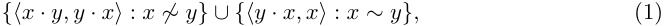

for all _x, y ∈ A_ , where _·_ is concatenation in _A__∗_ . 

As it turns out, _≈_ can be obtained constructively as the result of two operations that define a normal form for sequences of atomic hard interventions. 

**Definition 18 (Normal form)** Let _A_ be a set equipped with equivalence relation _∼_ . Fix an order ⋖ on _∼_ -equivalence classes. Define Collapse : _A__∗_ _→ A__∗_ to take a sequence and remove every element that has an _∼_ -equivalent element that occurs to its right. Define Sort : _A__∗_ _→ A__∗_ to take a sequence and sort it according to ⋖. For any element _α ∈ A__∗_ , we call Sort(Collapse( _α_ )) the _normal form_ of _α_ . This normal form clearly exists and is unique. 

**Lemma 19** For _α, β ∈ A__∗_ , we have _α ≈ β_ iff Sort(Collapse( _α_ )) = Sort(Collapse( _β_ )), that is, iff _α_ and _β_ have the same normal form. 

**Proof** Let us write _α ≡ β_ when Sort(Collapse( _α_ )) = Sort(Collapse( _β_ )). First note that _≡_ is a congruence extending the relation in (1), and hence _≈⊆≡_ . 

For the other direction, it suffices to observe that both Collapse( **c** ) _≈_ **c** and Sort( **c** ) _≈_ **c** , for any **c** _∈ A__∗_ . This follows from the fact that _≈_ is a congruence extending (1). Then if _α ≡ β_ , we have Sort(Collapse( _α_ )) _≈_ Sort(Collapse( _β_ )) (by reflexivity of _≈_ ), and moreover: 

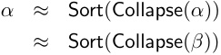

- _≈ β,_ 

and hence _≡⊆≈_ . Consequently, _α ≈ β_ iff _α_ and _β_ have the same normal form. 

The foregoing produces a representation theorem for intervention algebras. 

**Theorem 20** The quotient ( _A__∗_ _/ ≈, ⊙_ ) of ( _A__∗_ _, ·_ ) under _≈_ , with _⊙_ defined so 

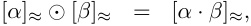

is a intervention algebra. 

**Proof** Define a signature Σ where the variables **V** are the _∼_ -equivalence classes of _A_ and the values of each variable are the members of the respective _∼_ -equivalence class. We need to show that ( _A__∗_ _/ ≈, ⊙_ ) is isomorphic to (Φ _, ◦_ ), the set of all (finite) hard interventions with function composition. 

Begin by defining the map _ι__∗_ : _A__∗_ _→_ Φ, where _ι__∗_ ( _x_ 1 _· ... · xn_ ) = _x_ 1 _◦ ... ◦ xn_ . First observe: 

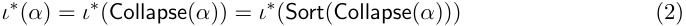

Eq. (2) follows from commutativity and left-annihilativity (Def. 16). 

Moreover, again by commutativity and left-annihilativity, if _X_ = _Y_ but _X ∈/_ **Z** , then _x ◦_ **z** _◦ y_ = **z** _◦ y_ , which is precisely what justifies the first equality. 

Finally, define _ι_ : _A__∗_ _/ ≈→_ Φ so that _ι_ ([ _α_ ] _≈_ ) = _ι__∗_ ( _α_ ). This is well-defined by Eq. (2) and Lemma 19. It is surjective because _ι__∗_ is surjective. It is also injective: if Sort(Collapse( _α_ )) _̸_ = Sort(Collapse( _β_ )), then pick the ⋖-least _∼_ -equivalence class of _A_ —that is, the ⋖-least variable _X_ —such that Sort(Collapse( _α_ )) and Sort(Collapse( _β_ )) disagree on _X_ . Without loss, we can assume _ι__∗_ (Sort(Collapse( _α_ ))) assigns _X_ to some value _x_ , but _ι__∗_ (Sort(Collapse( _β_ ))) does not assign _X_ to _x_ (either because it does not assign _X_ to any value or because it assigns _X_ to a different value). In any case, if [ _α_ ] _≉_ = [ _β_ ] _≈_ , then _ι_ ([ _α_ ] _≈_ ) = _ι__∗_ (Sort(Collapse( _α_ ))) _̸_ = _ι__∗_ (Sort(Collapse( _β_ ))) = _ι_ ([ _β_ ] _≈_ ). 

That _ι_ is an isomorphism follows from the sequence of equalities below: 

_ι_ ([ _α_ ] _≈ ⊙_ [ _β_ ] _≈_ ) = _ι_ ([ _α · β_ ] _≈_ ) By the definition of _⊙_ = _ι_ (Sort(Collapse( _α · β_ ))) By Lemma 19 = _ι__∗_ (Sort(Collapse( _α · β_ ))) By the definition of _ι_ = _ι__∗_ ( _α · β_ ) By Equation (2) = _ι__∗_ ( _α_ ) _◦ ι__∗_ ( _β_ ) By the definition of _ι__∗_ = _ι__∗_ (Sort(Collapse( _α_ ))) _◦ ι__∗_ (Sort(Collapse( _β_ ))) By Equation (2) = _ι_ (Sort(Collapse( _α_ ))) _◦ ι_ (Sort(Collapse( _β_ ))) By the definition of _ι_ = _ι_ ([ _α_ ] _≈_ ) _◦ ι_ ([ _β_ ] _≈_ ) By Lemma 19 

This concludes the proof of Theorem 20. 

Sets of atomic soft interventions also form intervention algebras: 

**Theorem 21** Suppose Ψ0 is a set of atomic soft interventions with signature Σ. Let Ψ be the closure of Ψ0 under function composition. Then (Ψ _, ◦_ ) is an intervention algebra. 

Geiger, Ibeling, Zur, Chaudhary, Chauhan, Huang, Arora, Wu, Goodman, Potts, Icard 

**Proof** Just as in the proof of Theorem 20 we can consider the free algebra generated by _A_ = Ψ0, quotiented under _≈_ , to obtain ( _A/ ≈, ⊙_ ). The proof that this algebra is isomorphic to a set of hard interventions follows exactly as in the proof of Theorem 20, relying on the fact that soft interventions also satisfy the key properties (a) and (b) in Definition 16: 

- (i) If soft interventions target different variables, _◦_ is commutative: if _X̸_ = _Y_ then _IX ◦IY_ = _IY ◦IX_ ; 

- (ii) If interventions target the same variable, _◦_ is left-annihilative: if _X_ = _Y_ , then _IX ◦IY_ = _IY_ . 

Consequently, we know that there exists a signature Σ_∗_ such that hard interventions on Σ are isomorphic to the soft interventions Ψ with respect to function composition. Specifically, where Ψ_X_ 0_⊆_Ψ0isthesetofatomicsoftinterventionsthattarget_X_,thevariablesofΣ_∗_are **V**_∗_ = _{X__∗_ : Ψ_X_ 0 _̸_=_∅}_and,foreach_X∗∈_**V**_∗_,thevaluesareVal_X∗_= Ψ 0_X_. 

**Remark 22** While both hard and soft interventions give rise to intervention algebras, the more general class of interventionals satisfies weaker algebraic constraints. For instance, it is easy to see that left-annihilativity (see (b) and (ii) above) often fails. Consider a signature Σ with a single variable _X_ that takes on binary values _{_ 0 _,_ 1 _}_ . Define the interventional I _⟨FX ⟩_ = _x �→_ 1 _−FX_ ( _x_ ). Observe that I _◦_ I _̸_ = I because I _◦_ I is the identity function, and so left-annihilativity fails. 

While interventionals do not form intervention algebras in general, particular classes of interventionals can form intervention algebras. 

**Example 2** Consider a signature Σ with variables _{X_ 1 _, . . . , Xn}_ that take on integer values. Define Ψ to contain interventionals that fix the _p_ th digit of a number to be the digit _q_ , where % is modulus and _//_ is integer division: 

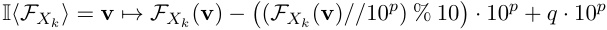

This class of interventionals is isomorphic to hard interventions on a signature Σ_∗_ with variables _{Y_ 0_p, Y_ 1_p, . . . , Y_ _n__p_:_p ∈{_0_,_1_, . . . }}_thattakeonvalues_{_0_,_1_, . . . ,_9_}_.Theinterventional fixing the _p_ th digit of _Xk_ to be the digit _q_ corresponds to the hard intervention fixing _Yk__p_to the value _q_ . **Remark 23 (Assignment mutations)** As a side remark, it is worth observing that another setting where intervention algebras appear is in programming language semantics and the semantics of, e.g., first-order predicate logic. Let _D_ be some domain of values and Var a set of variables. An _assignment_ is a function _g_ : Var _→ D_ . Let _gd__x_bethe_mutation_of_g_, defined so that _gd__x_(_y_)=_g_(_y_)when_y̸_=_x_,and_g_ _d__x_(_y_)=_d_when_y_=_x_.Thenamutation ( _·_ )_x_ _d_canbeunderstoodasafunctionfromthesetofassignmentstothesetofassignments. Where M is the set of all mutations, it is then easy to show that the pair (M _, ◦_ ) forms an intervention algebra. Furthermore, every intervention algebra can be obtained this way (up to isomorphism), for a suitable choice of _D_ and Var. 

**Definition 24 (Ordering on Intervention Algebras)** Let (Λ _, ⊕_ ) be a intervention algebra. We define an ordering _≤_ on elements of Λ as follows: 

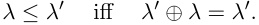

So, in particular, if the intervention algebra contains hard interventions—if it is of the form (Φ _, ◦_ )—then this amounts to the ordering from Rubenstein et al. (2017): 

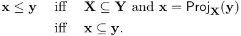

Note that _≤_ is defined as in a semi-lattice, except that _⊕_ (or _◦_ ) is not commutative in general. So the order matters. 

### **2.3 Exact Transformation with Interventionals** 

Researchers have been interested in the question of when two models—potentially defined on different signatures—are compatible with one another in the sense that they could both accurately describe the same target causal phenomena. The next definition presents a deterministic variant of the notion of ‘exact transformation’ from Rubenstein et al. (2017) (see also Def. 3.5 in Beckers and Halpern 2019), generalized to interventionals. The other notions we study in this paper—namely, bijective translation and constructive abstraction—are special cases of exact transformation. 

**Definition 25** Let _M, M__∗_ be causal models and let (Ψ _, ◦_ ) and (Ψ_∗_ _, ◦_ ) be two intervention algebras where Ψ and Ψ_∗_ are interventionals on _M_ and _M__∗_ , respectively. Furthermore, let _τ_ : Val **V** _→_ Val **V** _∗_ and _ω_ : Ψ _→_ Ψ_∗_ be two partial surjective functions where _ω_ is _≤_ -preserving; that is, _ω_ (I) _≤ ω_ (I_′_ ) whenever I _≤_ I_′_ . 

Then _M__∗_ is an _exact transformation_ of _M_ under ( _τ, ω_ ) if for all I _∈_ Domain( _ω_ ), the following diagram commutes: 

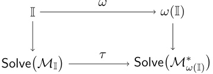

That is to say, the interventional _ω_ (I) on _M__∗_ results in the same total settings of **V**_∗_ as the result of first determining a setting of **V** from I and then applying the translation _τ_ to obtain a setting of **V**_∗_ . In a single equation:5 

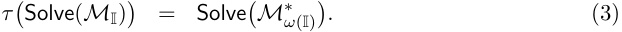

> 5. When evaluating whether _τ_ ( _S_ ) = _T_ , as in, e.g. (3), it is possible that not every element of _S_ is in the domain of _τ_ , since _τ_ is partial. Simply map such points to some distinguished element _⊥_ . 

Geiger, Ibeling, Zur, Chaudhary, Chauhan, Huang, Arora, Wu, Goodman, Potts, Icard 

This definition captures the intuitive idea that _M_ and _M__∗_ are consistent descriptions of the same causal situation. 

**Remark 26** Definition 25 is a variant of exact transformation in Rubenstein et al. (2017) with intervention algebras. However, their definition of exact transformation includes an existential quantifier over _ω_ , stating that _M__∗_ is an exact transformation of _M_ under _τ_ if an _ω_ exists that satisfies the commuting diagram. Our definition tells us when a particular pair _τ_ and _ω_ constitute an exact transformation. We believe this difference to be inessential. 

**Remark 27** The composition of exact transformations is an exact transformation. That is, if ( _τ_ 1 _, ω_ 1) and ( _τ_ 2 _, ω_ 2) are exact transformation, then so is ( _τ_ 1 _◦ τ_ 2 _, ω_ 1 _◦ ω_ 2), when these compositions are all defined. (See Lemma 5 from Rubenstein et al. 2017.) 

### 2.3.1 Bijective Translation 

Exact transformations can be ‘lossy’ in the sense that _M_ may involve a more detailed, or finer-grained, description than _M__∗_ . For example, the model _M_ could encode the causal process of computer hardware operating on bits of memory while the model _M__∗_ encodes the fully precise, but less detailed, process of assembly code the hardware implements. In contrast, when _τ_ is a bijective function, there is an important sense in which _M_ and _M__∗_ are just two equivalent (and inter-translatable) descriptions of the same causal setup. 

**Definition 28 (Bijective Translation)** Fix signatures Σ and Σ_∗_ . Let _M_ be a causal model with signature Σ and mechanisms _F_ **V** . Let _τ_ : Val **V** _→_ Val **V** _∗_ be a bijective map from total settings of Σ to total settings of Σ_∗_ . Define _τ_ ( _M_ ) to be the causal model with signature Σ_∗_ and mechanisms 

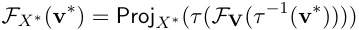

for each variable _X__∗_ _∈_ **V**_∗_ . We say that _τ_ ( _M_ ) is the bijective translation of _M_ under _τ_ . 

**Remark 29 (Bijective Translations Define a Canonical** _ω_ **)** Let Φ_∗_ be the intervention algebra formed by hard interventions on Σ_∗_ . We will now construct an intervention algebra Ψ consisting of interventionals on Σ and define a function _ω_ : Ψ _→_ Φ_∗_ . 

For each **i**_∗_ _∈_ Hard **I** _∗_ with **I**_∗_ _⊆_ **V**_∗_ , define the interventional using notation from Definition 11, 

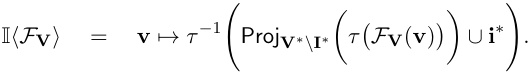

We add I to Ψ and define _ω_ (I) = **i**_∗_ . The interventional I takes in a set of mechanisms _F_ **V** for all of the variables and outputs a new set of mechanisms I _⟨F_ **V** _⟩_ for all of the variables. To retrieve mechanisms for individual variables, a projection must be applied. By construction (Ψ _, ◦_ ) is isomorphic to (Φ_∗_ _, ◦_ ) with the _≤_ -order preserving (and reflecting) map _ω_ , so (Ψ _, ◦_ ) is an intervention algebra. 

**Theorem 30 (Bijective Translations are Exact Transformations)** The bijective translation _M__∗_ = _τ_ ( _M_ ) is an exact transformation of _M_ under ( _τ, ω_ ), relative to Ψ and Φ_∗_ as constructed above. 

**Proof** Choose an arbitrary I _∈_ Ψ with corresponding hard intervention **i**_∗_ _∈_ Φ_∗_ where _ω_ (I) = **i**_∗_ . Let _F__∗_ be the mechanisms of _M__∗_ and _G__∗_ be the mechanisms of _M__∗_ **i**_∗_. Fix an arbitrary solution **v** _∈_ Solve( _M_ I). The following string of equalities shows that _τ_ ( **v** ) is in Solve( _M__∗_ **i**_∗_)andtherefore_τ_(Solve(_M_I))_⊆_Solve(_M∗_ **i**_∗_). 

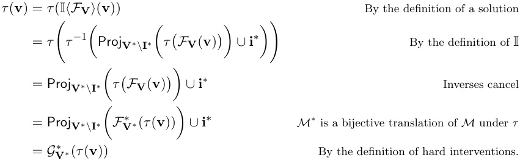

Fix an arbitrary solution **v**_∗_ _∈_ Solve( _M__∗_ **i**_∗_).Thefollowingstringofequalitiesshowthat _τ__−_1 ( **v**_∗_ ) is in Solve( _M_ I) and therefore _τ_ (Solve( _M_ I)) _⊇_ Solve( _M__∗_ **i**_∗_). 

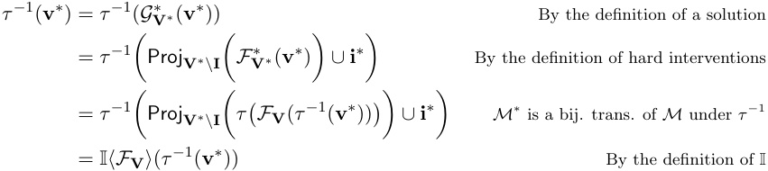

Thus, _τ_ (Solve( _M_ I)) = Solve( _M__∗_ **i**_∗_)foranarbitraryI,andwecanconclude_M∗_=_τ_(_M_)is an exact transformation of _M_ under ( _τ, ω_ ). 

**Example 3** If the variables of a causal model form a vector space, then a natural bijective translation is a rotation of a vector. Consider the following causal model _M_ that computes boolean conjunction. 

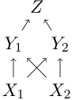

The variables _X_ 1 and _X_ 2 take on binary values from _{_ 0 _,_ 1 _}_ and have constant mechanisms mapping to 0. The variables _Y_ 1 and _Y_ 2 take on real-valued numbers and have mechanisms defined by a 20_◦_ rotation matrix 

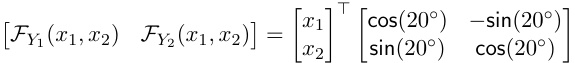

Geiger, Ibeling, Zur, Chaudhary, Chauhan, Huang, Arora, Wu, Goodman, Potts, Icard 

The variable _Z_ takes on binary values from _{_ 0 _,_ 1 _}_ and has the mechanism 

_FZ_ ( _y_ 1 _, y_ 2) = 1 [(sin(20_◦_ ) + cos(20_◦_ )) _y_ 1 + (cos(20_◦_ ) _−_ sin(20_◦_ )) _y_ 2 = 2] 

Note that _Z_ = _X_ 1 _∧ X_ 2, since _FZ_ un-rotates _Y_ 1 and _Y_ 2 before summing their values. 

The variables _Y_ 1 and _Y_ 2 perfectly encode the values of the variables _X_ 1 and _X_ 2 using a coordinate system with axes that are tilted by 20_◦_ . We can view the model _M_ through this tilted coordinate system using a bijective translation. Define the function 

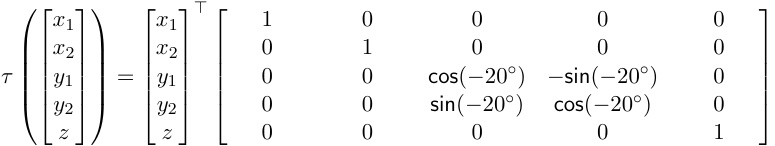

and consider the model _τ_ ( _M_ ). This model will have altered mechanisms for _Y_ 1, _Y_ 2, and _Z_ . In particular, these mechanisms are 

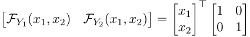

and _FZ_ ( _y_ 1 _, y_ 2) = 1 [ _y_ 1 + _y_ 2 = 2]. 

### 2.3.2 Constructive Causal Abstraction 

Suppose we have a ‘low-level model’ _L_ = (Σ _L, FL_ ) built from ‘low-level variables’ **V** _L_ and a ‘high-level model’ _H_ = (Σ _H, FH_ ) built from ‘high-level variables’ **V** _H_ . What structural conditions must be in place for _H_ to be a high-level _abstraction_ of the low-level model _L_ ? At a minimum, this requires that the high-level interventions represent the low-level ones, in the sense of Def. 25; _H_ should be an exact transformation of _L_ . What else must be the case? 

A prominent further intuition about abstraction is that it may involve associating specific high-level variables with _clusters_ of low-level variables. That is, low-level variables are to be clustered together in ‘macrovariables’ that abstract away from low-level details. To systematize this idea, we introduce alignment between a low-level and a high-level signature: 

**Definition 31 (Alignment)** An _alignment_ between signatures Σ _L_ and Σ _H_ is given by a pair _⟨_ Π _, π⟩_ of a partition Π = _{_ Π _XH}XH∈_ **V** _H∪{⊥}_ and a family _π_ = _{πXH}XH∈_ **V** _H_ of maps, such that: 

1. The partition Π of **V** _L_ consists of non-overlapping, non-empty cells Π _XH ⊆_ **V** _L_ for each _XH ∈_ **V** _H_ , in addition to a (possibly empty) cell Π _⊥_ ; 

2. There is a partial surjective map _πXH_ : ValΠ _XH →_ Val _XH_ for each _XH ∈_ **V** _H_ . 

In words, the set Π _XH_ consists of those low-level variables that are ‘aligned’ with the high-level variable _XH_ , and _πXH_ tells us how a given setting of the low-level cluster Π _XH_ corresponds to a setting of the high-level variable _XH_ . The remaining set Π _⊥_ consists of those low-level variables that are ‘forgotten’, that is, not mapped to any high-level variable. 

**Remark 32** An alignment _⟨_ Π _, π⟩_ induces a unique partial function _ω__π_ that maps from low-level hard interventions to high-level hard interventions. We only define _ω__π_ on lowlevel interventions that target full partition cells, excluding Π _⊥_ . For **x** _L ∈_ ValΠ **X** _H_ where **X** _H ⊆_ **V** _H_ and Π **X** _H_ =� _X∈_ **X** _H_Π_X_,wedefine 

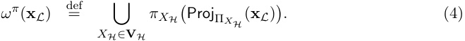

As a special case of Eq. (4), we obtain a unique partial function _τ__π_ : Val **V** _L →_ Val **V** _H_ that maps from low-level total settings to high-level total settings. To wit, for any **v** _L ∈_ Val **V** _L_ : 

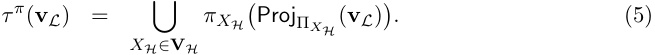

Thus, the cell-wise maps _πXH_ canonically give us these partial functions ( _τ__π_ _, ω__π_ ). 

**Definition 33 (Constructive Abstraction)** We say that _H_ is a constructive abstraction of _L_ under an alignment _⟨_ Π _, π⟩_ iff _H_ is an exact transformation of _L_ under ( _τ__π_ _, ω__π_ ). 

See Section 2.6 for an example of constructive causal abstraction. 

**Remark 34** Though the idea was implicit in much earlier work (going back at least to Simon and Ando 1961 and Iwasaki and Simon 1994), Beckers and Halpern (2019) and Beckers et al. (2019) explicitly introduced the notion of a constructive abstraction in the setting of probabilistic causal models.6 As Examples 3.10 and 3.11 from Beckers and Halpern (2019) show, there are exact transformations that are not also constructive abstractions, even when we restrict attention to hard interventions. 

**Remark 35** In the field of program analysis, _abstract interpretation_ is a framework that can be understood as a special case of constructive causal abstraction where models are acyclic and high-level variables are aligned with individual low-level variables rather than sets of low-level variables (Cousot and Cousot, 1977). The functions _τ_ and _τ__−_1 are the abstraction and concretization operators that form a Galois connection, and the commuting diagram summarized in Equation 3 guarantees that abstract transfer functions are consistent with concrete transfer functions. 

### 2.3.3 Decomposing Alignments Between Models 

Given the importance and prevalence of this relatively simple notion of abstraction, it is worth understanding the notion from different angles. Abstraction under the alignment _⟨_ Π _, π⟩_ can be decomposed via the following three fundamental operations on variables. _Marginalization_ removes a set of variables. _Variable merge_ collapses a partition of variables, i.e., each partition cell becoming a single variable. _Value merge_ collapses a partition of values for each variable, i.e., each partition cell becoming a single value. The first and third operations relate closely to concepts identified in the philosophy of science literature as being critical to addressing the problem of _variable choice_ (Kinney, 2019; Woodward, 2021). 

> 6. Beckers and Halpern (2019) require each _π_ is total, while we allow partial functions for more flexibility. 

First, _marginalization_ removes a set of variables **X** . As an alignment, the variables **X** are placed into the cell Π _⊥_ , while each other variable _Y ∈/_ **X** is left untouched; in a model that is an abstraction under this alignment, the parents and children of each marginalized variable are directly linked. 

**Definition 36 (Marginalization)** Define the marginalization of **X** _⊂_ **V** to be an alignment from the signature Σ = ( **V** _,_ Val) to the high-level signature Σ_∗_ = ( **V** _\_ **X** _,_ Val): We set the partitions Π _Y_ = _{Y }_ for _Y ∈_ **V** _\_ **X** and Π _⊥_ = **X** , while the functions are identity, _πY_ = _y �→ y_ for _Y ∈_ **V** _\_ **X** . 

Marginalization is essentially a matter of _ignoring_ a subset **X** of variables. 

Next, _variable merge_ collapses each cell of a partition into single variables. Variables are merged according to a partition _{_ Π _X ∗}X ∗∈_ **V** _∗_ with cells indexed by _new_ variables **V**_∗_ . In a model that is an abstraction under a variable merge, these new variables depend on the parents of their partition and determine the children of their partition. 

**Definition 37 (Variable Merge)** Let _{_ Π _X ∗}X ∗∈_ **V** _∗_ be a partition of **V** indexed by new high-level variables **V**_∗_ where Val_∗_ _X__∗_=ValΠ _X__∗_foreach_X∗∈_**V**_∗_. Then the variable merge of **V** into **V**_∗_ is an alignment to the new signature Σ_∗_ = ( **V**_∗_ _,_ Val_∗_ ) with partition Π = _{_ Π _X ∗}X ∗∈_ **V** _∗ ∪{_ Π _⊥}_ where Π _⊥_ = ∅ and functions _πX ∗_ ( **y** ) = **y** for each _X__∗_ _∈_ **V**_∗_ . 

Finally, _value merge_ alters the value space of each variable, potentially collapsing values: **Definition 38 (Value Merge)** Choose some family _δ_ = _{δX }X∈_ **V** of partial surjective functions _δX_ : Val _X →_ Val_∗_ _X_mappingtonewvariablevalues. The value merge is an alignment to the new signature Σ_∗_ = ( **V** _,_ Val_∗_ ) with partition cells Π _X_ = _{X}_ for _X ∈_ **V** , Π _⊥_ = ∅, and functions _πX_ = _δX_ for _X ∈_ **V** . 

The notion of value merge relates to an important concept in the philosophy of causation. The range of values Val _X_ for a variable _X_ can be more or less coarse-grained, and some levels of resolution seem to be better causal-explanatory targets. For instance, to use a famous example from Yablo (1992), if a bird is trained to peck any target that is a shade of red, then it would be misleading, if not incorrect, to say that appearance of crimson (a particular shade of red) causes the bird to peck. Roughly, the reason is that this suggests the wrong counterfactual contrasts: if the target were not crimson (but instead another shade of red, say, scarlet), the bird would still peck. Thus, for a given explanatory purpose, the level of grain in a model should guarantee that cited causes can be _proportional_ to their effects (Yablo, 1992; Woodward, 2021). 

The three operations above are notable not only for conceptual reasons, but also because they suffice to decompose any alignment, as we will now explain. Composition of alignments is defined, as expected, via composition of their maps. Formally: 

**Definition 39** Let _⟨_ Π _, π⟩_ be an alignment from signature ( **V** _,_ Val) to signature ( **V**_′_ _,_ Val_′_ ) and _⟨_ Π_′_ _, π__′_ _⟩_ be an alignment from signature ( **V**_′_ _,_ Val_′_ ) to signature ( **V**_′′_ _,_ Val_′′_ ). We define the _composition ⟨_ Π_′_ _, π__′_ _⟩◦⟨_ Π _, π⟩_ as an alignment _⟨_ Π_′′_ _, π__′′_ _⟩_ from signature ( **V** _,_ Val) to signature ( **V**_′′_ _,_ Val_′′_ ) whose cells Π_′′_ and maps _π__′′_ are given as follows: 

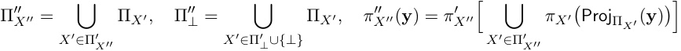

We then have the following: 

**Proposition 40** Let _⟨_ Π _, π⟩_ be an alignment. Then there is a marginalization, variable merge, and value merge whose composition is _⟨_ Π _, π⟩_ . 

**Proof** It is straightforward to verify that the composition of alignments corresponding to the following three operations gives _⟨_ Π _, π⟩_ . First, marginalize the variables **X** = Π _⊥_ . Then, variable merge with **V**_∗_ as the index set for the partition Π. Lastly, value merge with _δX_ = _πX_ for each _X ∈_ **V**_∗_ . 

Here, we give an example of an abstraction under a composition of marginalization, variable merge, and value merges. At each step we give a model that is a constructive abstraction of the previous model under the corresponding operation, with the final result being a high-level model that is a constructive abstraction of the initial model. 

For succinctness, we will henceforth use marginalization, variable merge, and value merge as operations on models themselves. Thus, rather than saying, e.g., “a constructive abstraction of the model under a value merge alignment,” we simply say “a value merged model,” and so on. 

**Example 4** Consider a causal model _M_ that computes the maximum of two positive numbers. 

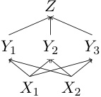

The variables _X_ 1 and _X_ 2 take on positive real values and have constant functions mapping to 1. The variables _Y_ 1 _, Y_ 2 _, Y_ 3 take on real-valued numbers and have the following mechanisms: 

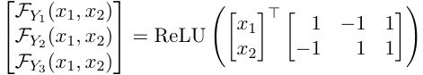

The variable _Z_ takes on a real-number value and has the mechanism _FZ_ ( _y_ 1 _, y_ 2 _, y_ 3) = <u>12</u>(_y_1 +_y_2 +_y_3).ObservethatProj_Z_(Solve(_Mx_1_◦x_2)) = max(_x_1_, x_2);onlyoneof_Y_1and_Y_2 takes on a positive value, depending on whether _X_ 1 or _X_ 2 is greater. 

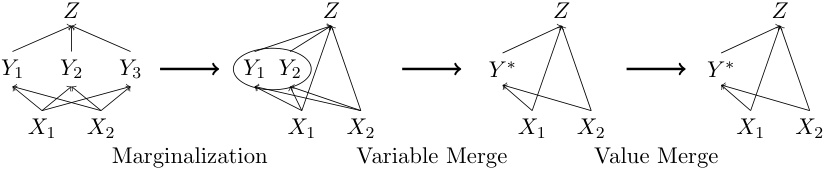

<!-- Start of picture text -->
Z Z Z Z Y 1 Y 2 Y 3 Y 1 Y 2 Y ∗ Y ∗ X 1 X 2 X 1 X 2 X 1 X 2 X 1 X 2 Marginalization Variable Merge Value Merge <!-- End of picture text -->

The marginalization of _M_ with Π _⊥_ = _{Y_ 3 _}_ removes the mechanism of _Y_ 3 and changes the mechanism of _Z_ to _FZ_ ( _x_ 1 _, x_ 2 _, y_ 1 _, y_ 2) =<u>1</u> 2(_y_1 +_y_2 +_x_1 +_x_2). 

The variable merge of the marginalized model with Π _Y ∗_ = _{Y_ 1 _, Y_ 2 _}_ constructs a new variable _Y__∗_ with mechanism 

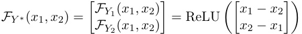

and alters the mechanism of _Z_ to _FZ_ ( _x_ 1 _, x_ 2 _,_ ( _y_ 1_∗, y_ 2_∗_)) =<u>1</u> 2(_y_ 1_∗_+_y_ 2_∗_+_x_1 +_x_2). Finally, we value merge the marginalized and variable merged model. Define _δY ∗_ : R2 _→ {_ 0 _,_ 1 _}_ where _δY ∗_ ( _y_ 1 _, y_ 2) = 1 [ _y_ 1 _≥_ 0], which creates a binary partition over the values of _Y_ . In the case that _y_ 1 = _x_ 1 _− x_ 2, then _δY ∗_ ( _h_ ) = 1, meaning that _x_ 1 _≥ x_ 2; in the other possible case where _y_ = 0 and _x_ 1 _< x_ 2, then _δY ∗_ ( _h_ ) = 0. After value merge with _δ_ , the mechanism of _Y__∗_ is _FY ∗_ ( _x_ 1 _, x_ 2) = 1 [ _x_ 1 _≥ x_ 2] and the mechanism of _Z_ is _FZ_ ( _x_ 1 _, x_ 2 _, y__∗_ ) = _y__∗_ _· x_ 1 + (1 _− y__∗_ ) _x_ 2. 

### **2.4 Approximate Transformation** 

Constructive causal abstraction and other exact transformations are all-or-nothing notions; the exact transformation relation either holds or it doesn’t. This binary concept prevents us from having a graded notion of faithful interpretation that is more useful in practice. We define a notion of approximate abstraction (Beckers et al., 2019; Rischel and Weichwald, 2021; Zennaro et al., 2023b) that can be flexibly adapted: 

**Definition 41 (Approximate Transformation)** Consider causal models _M, M__∗_ and intervention algebras (Ψ _, ◦_ ) _,_ (Ψ_∗_ _, ◦_ ) with signatures Σ and Σ_∗_ , respectively. Furthermore, let _τ_ : Val **V** _→_ Val **V** _∗_ and _ω_ be surjective partial functions where _ω_ : Ψ _→_ Ψ_∗_ is _≤_ order preserving. Finally, we also need: 

1. a (‘distance’) function Sim that maps two total settings of _M__∗_ to a real number, 

2. a probability distribution P over Domain( _ω_ ) used to describe which interventionals are expected, 

3. a real-valued statistic S for the random variable Sim� _τ_ (Solve( _M_ I)) _,_ Solve( _M__∗_ _ω_ (I)) � where I _∼_ P. 

Taken together, we can construct a metric that quantifies the degree to which _M__∗_ is an _approximate transformation_ of _M_ in a single number: 

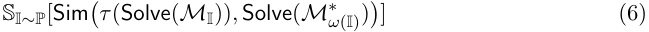

This metric is a graded version of Equation 3 in the definition of exact transformation. If this number is above a particular cutoff _η_ , we can say that _M__∗_ is an _η_ -approximate abstraction of _M_ . 

**Remark 42** When _M_ is a model with inputs and outputs, we might consider probability distributions that only give mass to interventionals that assign all input variables. This ensures that the default value for input variables is not taken into account (See Remark 7). 

**Remark 43** In a paper on approximate causal abstraction, Beckers et al. (2019) propose _d_ max- _α_ -approximate abstraction, which takes the maximum distance over low-level interventions. 

**Example 5** Let _M_ be a causal model that computes the sum of two numbers with addend variables _X_ 1 and _X_ 2 that take on values _{_ 0 _,_ 1 _,_ 2 _, . . . }_ and a sum variable _Y_ that takes on values _{_ 0 _,_ 1 _,_ 2 _, . . . }_ . Let _M__∗_ be a causal model that only sums multiples of 10 with addend variables _X_ 1_∗_and_X_ 2_∗_thattakeonvalues_{_0_,_10_,_20_, . . . }_andasumvariable_Y∗_thattakes on values _{_ 0 _,_ 10 _,_ 20 _, . . . }_ . 

We can quantify the degree to which _M__∗_ approximates _M_ where P is uniform over hard interventions targeting exactly _X_ 1 and _X_ 2, Sim outputs the absolute difference between the values of _Y__∗_ , and S is expected value. Let (Ψ _, ◦_ ) and (Ψ_∗_ _, ◦_ ) be hard interventions and define maps _τ_ ( _x_ 1 _, x_ 2 _, y_ ) = _{x_ 1%10 _, x_ 2%10 _, y_ %10 _}_ and _ω_ ( **z** ) = _{_ Proj _Z_ ( **z** )%10 : _Z ∈_ **Z** _}_ . The degree to which _M__∗_ is an approximate transformation of _M_ is 

S _{x_ 1 _,x_ 2 _}∼_ P[Sim� _τ_ (Solve( _M{x_ 1 _,x_ 2 _}_ )) _,_ Solve( _M__∗_ _ω_ ( _{x_ 1 _,x_ 2 _}_ )) �] = S _{x_ 1 _,x_ 2 _}∼_ P[Sim�( _x_ 1%10 _, x_ 2%10 _,_ ( _x_ 1 + _x_ 2)%10) _,_ ( _x_ 1%10 _, x_ 2%10 _, x_ 1%10 + _x_ 2%10)�] = E _{x_ 1 _,x_ 2 _}∼_ P[ _|_ ( _x_ 1 + _x_ 2)%10) _−_ ( _x_ 1%10 + _x_ 2%10) _|_ ] = 4 _._ 5 

### **2.5 Interchange Interventions** 

An _interchange intervention_ (Geiger et al., 2020, 2021) is an operation on a causal model with input and output variables (e.g., acyclic models; recall Remark 7). Specifically, the causal model is provided a ‘base’ input and an intervention is performed that fixes some variables to be the values they would have if different ‘source’ inputs were provided. Such interventions will be central to grounding mechanistic interpretability in causal abstraction. 

**Definition 44 (Interchange Interventions)** Let _M_ be a causal model with input variables **X****In** _⊆_ **V** . Furthermore, consider source inputs **s** 1 _, . . . ,_ **s** _k ∈_ Val **XIn** and disjoint sets of target variables **X** 1 _, . . . ,_ **X** _k ⊆_ **V** _\_ **X****In** . Define the hard intervention 

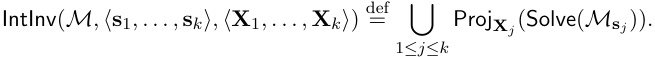

We take interchange interventions as a base case and generalize to _recursive interchange interventions_ , where variables are fixed to be the value they would have if a recursive interchange intervention (that itself may be defined in terms of other interchange interventions) were performed. 

**Definition 45 (Recursive Interchange Interventions)** Let _M_ be a causal model with input variables **X****In** _⊆_ **V** . Define recursive interchange interventions of depth 0 to simply be interchange interventions. Given **s** 1 _, . . . ,_ **s** _k ∈_ Val **XIn** , disjoint sets of target variables **X** 1 _, . . . ,_ **X** _k ⊆_ **V**_∗_ _\_ **X****In** , and interchange interventions **i** 1 _, . . . ,_ **i** _k_ of depth _m_ , we define the recursive interchange interventions of depth _m_ + 1 to be 

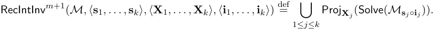

Geiger et al. (2023) generalize interchange interventions to _distributed interchange interventions_ that target variables distributed across multiple causal variables. We define this operation using an interventional that applies a bijective translation, performs an interchange 

Geiger, Ibeling, Zur, Chaudhary, Chauhan, Huang, Arora, Wu, Goodman, Potts, Icard 

intervention in the new variable space, and then applies the inverse translation to get back to the original variable space. 

**Definition 46 (Distributed Interchange Interventions)** Let _M_ be a causal model with input variables **X****In** _⊆_ **V** and let _τ_ : Val **V** _→_ Val **V** _∗_ be a bijective translation that preserves inputs.7 For source inputs **s** 1 _, . . . ,_ **s** _k ∈_ Val **XIn** , and disjoint target variables **X**_∗_ 1_, . . . ,_**X**_∗_ _k__⊆_**V**_∗\_**XIn**,wedefine 

DistIntInv( _M, τ, ⟨_ **s** 1 _, . . . ,_ **s** _k⟩, ⟨_ **X** 1_∗, . . . ,_**X**_∗_ _k__⟩_) 

to be an interventional on all variables **V** that replaces each mechanism for _X_ with the function 

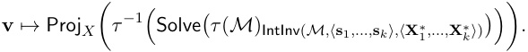

When conducting a causal abstraction analysis using interchange interventions, a partition _{_ Π _X }X∈_ **V** _H∪{⊥}_ defined over all high-level variables and mapping _{πX }X∈_ **XIn** _H_definedover high-level input variables are together sufficient to fully determine an alignment _⟨_ Π _, π⟩_ . 

**Remark 47 (Constructing an Alignment for Interchange Intervention Analysis)** Consider low-level causal model _L_ and high-level causal model _H_ with input variables **X****In** _L__⊆_**V**_L_and**XIn** _H__⊆_**V**_H_,respectively.Supposewehaveapartiallyconstructedalignment ( _{_ Π _X }X∈_ **V** _H∪⊥, {πX }X∈_ **XIn** _H_)with 

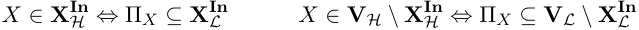

We can induce the remaining alignment functions from the partitions and the input alignment functions, and the two causal models. For _YH ∈_ **V** _H \_ **X****In** _H_and**z**_L∈_ValΠ _YH_,ifthereexists **x** _L ∈_ Val **XIn** _L_suchthat**z**_L_= ProjΠ_Y_ _H_(Solve(_L_**x**_L_)),then,with**x**_H_=_π_**X** _H_**In**(**x**_L_),wedefinethe alignment functions 

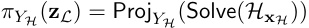

and otherwise, we leave _πYH_ undefined for **z** _L_ . In words, map the low-level partial settings realized for a given input to the corresponding high-level values realized for the same input. 

This is a subtle point, but, in general, this construction is not well defined because two different inputs can produce the same **z** _L_ while producing different Proj _YH_ (Solve( _H_ **x** _H_ )). If this were to happen, the causal abstraction relationship simply wouldn’t hold for the alignment. 

Once an alignment _⟨_ Π _, π⟩_ is constructed, aligned interventions must be performed to experimentally verify the alignment is a witness to the high-level model being an abstraction of the low-level model. Observe that _π_ will only be defined for values of intermediate partition cells that are realized when some input is provided to the low-level model. This greatly constrains the space of low-level interventions to intermediate partitions that will correspond with high-level interventions. Specifically, we are only able to interpret low-level _interchange interventions_ as high-level interchange interventions. 

> 7. I.e., **X****In** _⊆_ **V**_∗_ and for all **x** _∈_ Val **XIn** and **y** _∈_ Val **V** _\_ **XIn** there exists a **y**_∗_ _∈_ Val **V** _∗\_ **XIn** such that _τ_ ( **x** _∪_ **y** ) = **x** _∪_ **y**_∗_ . 

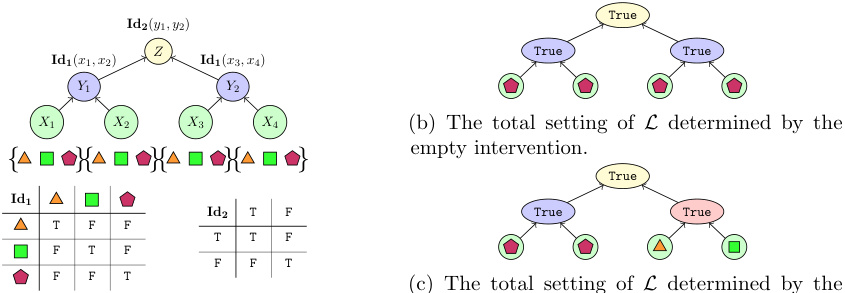

<!-- Start of picture text -->
True Id2 ( y 1 , y 2) Z True True Id1 ( x 1 , x 2) Id1 ( x 3 , x 4) Y 1 Y 2 X 1 X 2 X 3 X 4 (b) The total setting of L determined by the empty intervention. { }{ }{ }{ } True Id1 Id2 T F True True T F F T T F F T F F F T F F T (c) The total setting of L determined by the <!-- End of picture text -->

(c) The total setting of _L_ determined by the intervention fixing _X_ 3, _X_ 4, and _Y_ 2 to be _△_ , □, and `True` . 

(a) The algorithm. 

Figure 1: A tree-structured algorithm that perfectly solves the hierarchical equality task with a compositional solution. 

Geiger et al. (2022b) propose _interchange intervention accuracy_ , which is simply the proportion of interchange interventions where the low-level and high-level causal models have the same input–output behavior (see Section 2.6 for an example). 

**Definition 48 (Interchange Intervention Accuracy)** Consider a low-level causal model _L_ aligned to a high-level causal model _H_ , an alignment (Π _, π_ ) as defined in Definition 47, and a probability distribution P over the domain of _ω__π_ . We define the interchange intervention accuracy as follows: 

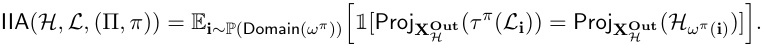

Interchange intervention accuracy is equivalent to input-output accuracy if we further restrict _ω_ to be defined only on interchange interventions where base and sources are all the same single input. 

This is a special case of approximate causal abstraction (Section 2.4) where Sim( **v** _L,_ **v** _H_ ) = 1 [Proj **XOut** ( _τ__π_ ( **v** _L_ )) = Proj **XOut** ( **v** _H_ )] and S is expected value. This analysis can be extended _H H_ to the case of distributed interchange interventions by simply applying a bijective translation to the low-level model before constructing the alignment to the high-level model. 

### **2.6 Example: Causal Abstraction in Mechanistic Interpretability** 

With the theory laid out, we can now present an example of causal abstraction from the field of mechanistic interpretability. We begin by defining two basic examples of causal models that demonstrate a potential to model a diverse array of computational processes; the first causal model represents a tree-structured algorithm and the second is fully-connected feedforward neural network. Both the network and the algorithm solve the same ‘hierarchical equality’ task. 

A basic equality task is to determine whether a pair of objects is identical. A hierarchical equality task is to determine whether a pair of pairs of objects have identical relations. The 

Geiger, Ibeling, Zur, Chaudhary, Chauhan, Huang, Arora, Wu, Goodman, Potts, Icard 

input to the hierarchical task is two pairs of objects, and the output is True if both pairs are equal or both pairs are unequal, and False otherwise. For illustrative purposes, we define the domain of objects to consist of a triangle, square, and pentagon. For example, the input (� _,_ � _, △,_ □) is assigned the output False and the inputs (� _,_ � _, △, △_ ) and (� _,_ □ _, △,_ □) are both labeled True. 

We chose hierarchical equality for two reasons. First, there is an obvious tree-structured symbolic algorithm that solves the task: compute whether the first pair is equal, compute whether the second is equal, then compute whether those two outputs are equal. We will encode this algorithm as a causal model. Second, equality reasoning is ubiquitous and has served as a case study for broader questions about the representations underlying relational reasoning in biological organisms (Marcus et al., 1999; Alhama and Zuidema, 2019; Geiger et al., 2022a). 

We provide a companion jupyter notebook that walks through this example. 

**A Tree-Structured Algorithm for Hierarchical Equality** We define a tree structured algorithm _H_ consisting of four ‘input’ variables **X****In** _H_=_{X_1_, X_2_, X_3_, X_4_}_eachwith possible values Val _Xj_ = _{_ � _, △,_ □ _}_ , two ‘intermediate’ variables _Y_ 1 _, Y_ 2 with values Val _Yj_ = _{_ `True` _,_ `False` _}_ , and one ‘output’ variable **X****Out** _H_ = _{Z}_ with values Val _Z_ = _{_ `True` _,_ `False` _}_ . The acyclic causal graph is depicted in Figure 1a, where each _FXi_ (with no arguments) is a constant function to � (which will be overwritten, per Remark 7), and _FY_ 1 _, FY_ 2 _, FO_ each compute equality over their respective domains, e.g., _FY_ 1( _x_ 1 _, x_ 2) = 1 � _x_ 1 = _x_ 2�. A total setting can be captured by a vector [ _x_ 1 _, x_ 2 _, x_ 3 _, x_ 4 _, y_ 1 _, y_ 2 _, z_ ] of values for each of the variables. 

The default total setting that results from no intervention is [� _,_ � _,_ � _,_ � _,_ `True` _,_ `True` _,_ `True` ] (see Figure 1b). We can also ask what would have occurred had we intervened to fix _X_ 3, _X_ 4, and _Y_ 1 to be _△_ , □, and `False` , for example. The result is [� _,_ � _, △,_ □ _,_ `False` _,_ `False` _,_ `True` ] (See Figure 1c). 

**A Handcrafted Fully Connected Neural Network for Hierarchical Equality** Define a neural network _L_ consisting of eight ‘input’ neurons **X****Out** _H_ = _{N_ 1 _, . . . , N_ 8 _}_ , twenty-four ‘intermediate’ neurons _H_ ( _i,j_ ) for 1 _≤ i ≤_ 3 and 1 _≤ i ≤_ 8, and two ‘output’ neurons **X****Out** _H_ = _{O_ True _, O_ False _}_ . The values for each of these variables are the real numbers. We depict the causal graph in Figure 2. 

Let **N** , **H** 1, **H** 2, **H** 3 be the sets of variables for the first four layers, respectively. We define _FNk_ (with no arguments) to be a constant function to 0, for 1 _≤ k ≤_ 8. The intermediate and output neurons are determined by the network weights _W_ 1 _, W_ 2 _∈_ R8_×_8 , and _W_ 3 _∈_ R8_×_2 . For 1 _≤ j ≤_ 8, we define 

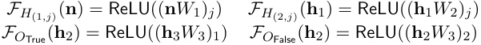

The four shapes that are the input for the hierarchical equality task are represented in **n** � _,_ **n** □ _,_ **n** _△ ∈_ R2 by a pair of neurons with randomized activation values. The network outputs True if the value of the output logit _O_ True is larger than the value of _O_ False, and False otherwise. We can simulate a network operating on the input (□ _,_ � _,_ □ _, △_ ) by performing an intervention setting ( _N_ 1 _, N_ 2) and ( _N_ 5 _, N_ 6) to **n** □, ( _N_ 3 _, N_ 4) to **n** �, and ( _N_ 7 _, N_ 8) to **n** _△_ . 

In Figure 2, we define the weights of the network _L_ , which have been handcrafted to implement the tree-structured algorithm _H_ . 

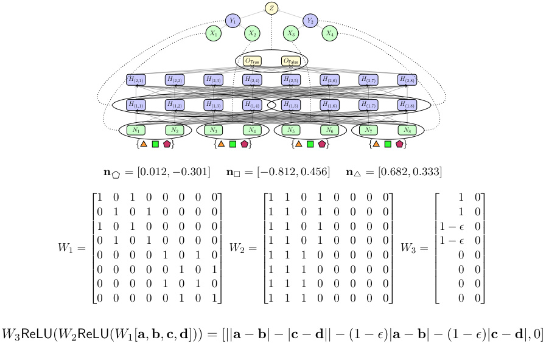

<!-- Start of picture text -->
Z Y 1 Y 2 X 1 X 2 X 3 X 4 O True O False H (2 , 1) H (2 , 2) H (2 , 3) H (2 , 4) H (2 , 5) H (2 , 6) H (2 , 7) H (2 , 8) H (1 , 1) H (1 , 2) H (1 , 3) H (1 , 4) H (1 , 5) H (1 , 6) H (1 , 7) H (1 , 8) N 1 N 2 N 3 N 4 N 5 N 6 N 7 N 8 { } { } { } { } n � = [0 . 012 , − 0 . 301] n □ = [ − 0 . 812 ,  0 . 456] n △ = [0 . 682 ,  0 . 333] 10 01 10 01 00 00 00 00 11 11 00 11 00 00 00 00  11 00 1 0 1 0 0 0 0 0 1 1 0 1 0 0 0 0 1  − ϵ 0 0 1 0 1 0 0 0 0 1 1 0 1 0 0 0 0 1  − ϵ 0 W 1 = W 2 = W 3 = 0 0 0 0 1 0 1 0 1 1 1 0 0 0 0 0 0 0 0 0 0 0 0 1 0 1 1 1 1 0 0 0 0 0 0 0 0 0 0 0 1 0 1 0 1 1 1 0 0 0 0 0 0 0 0 0 0 0 0 1 0 1 1 1 1 0 0 0 0 0  0 0 W 3ReLU( W 2ReLU( W 1[ a ,  b ,  c ,  d ])) = [ || a  − b | −| c  − d || − (1  − ϵ ) | a  − b | − (1  − ϵ ) | c  − d |,  0] <!-- End of picture text -->

Figure 2: A fully-connected feed-forward neural network that labels inputs for the hierarchical equality task. The weights of the network are handcrafted to implement the tree-structured solution to the task. 

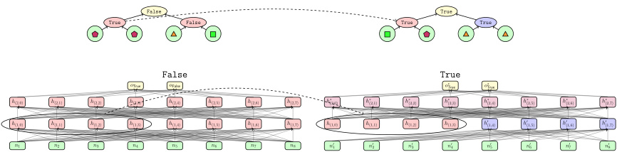

<!-- Start of picture text -->
False True True False True True False True o True o False o ∗ True o ∗ True h (2 , 0) h (2 , 1) h (2 , 2) h (2 , 3) h (2 , 4) h (2 , 5) h (2 , 6) h (2 , 7) h ∗ (2 , 0) h ∗ (2 , 1) h ∗ (2 , 2) h ∗ (2 , 3) h ∗ (2 , 4) h ∗ (2 , 5) h ∗ (2 , 6) h ∗ (2 , 7) h (1 , 0) h (1 , 1) h (1 , 2) h (1 , 3) h (1 , 4) h (1 , 5) h (1 , 6) h (1 , 7) h (1 , 0) h (1 , 1) h (1 , 2) h (1 , 3) h ′ (1 , 4) h ′ (1 , 5) h ′ (1 , 6) h ′ (1 , 7) n 1 n 2 n 3 n 4 n 5 n 6 n 7 n 8 n ′ 1 n ′ 2 n ′ 3 n ′ 4 n ′ 5 n ′ 6 n ′ 7 n ′ 8 <!-- End of picture text -->

Figure 3: The result of aligned interchange intervention on the low-level fully-connected neural network and a high-level tree structured algorithm under the alignment in Figure 2. Observe the equivalent counterfactual behavior across the two levels. 

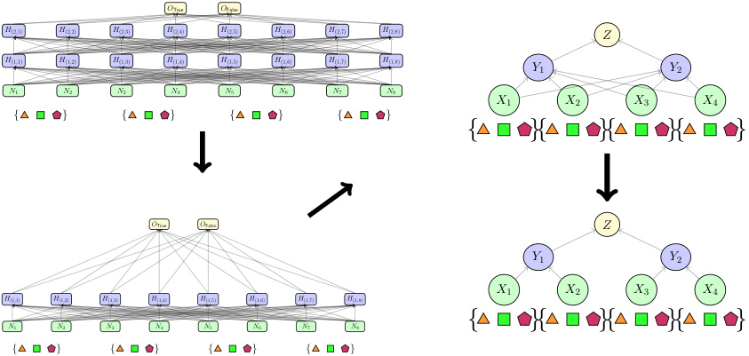

<!-- Start of picture text -->
O True O False H (2 , 1) H (2 , 2) H (2 , 3) H (2 , 4) H (2 , 5) H (2 , 6) H (2 , 7) H (2 , 8) Z H (1 , 1) H (1 , 2) H (1 , 3) H (1 , 4) H (1 , 5) H (1 , 6) H (1 , 7) H (1 , 8) Y 1 Y 2 N 1 N 2 N 3 N 4 N 5 N 6 N 7 N 8 X 1 X 2 X 3 X 4 { } { } { } { } { }{ }{ }{ } O True O False Z Y 1 Y 2 X 1 X 2 X 3 X 4 H (1 , 1) H (1 , 2) H (1 , 3) H (1 , 4) H (1 , 5) H (1 , 6) H (1 , 7) H (1 , 8) N 1 N 2 N 3 N 4 N 5 N 6 N 7 N 8 { }{ }{ }{ } { } { } { } { } <!-- End of picture text -->

Figure 4: An illustration of a fully-connected neural network being transformed into a tree structured algorithm by (1) marginalizing away neurons aligned with no high-level variable, (2) merging sets of variables aligned with high-level variables, and (3) merging the continuous values of neural activity into the symbolic values of the algorithm. 

**An Alignment Between the Algorithm and the Neural Network** The network _L_ was explicitly constructed to be abstracted by the algorithm _H_ under the alignment written formally below and depicted visually in Figure 2. 

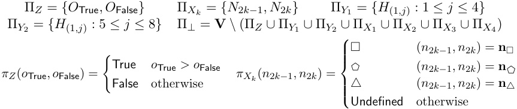

We follow Definition 47 to define _πY_ 1 and _πY_ 2 on all interchange interventions. For each input **n** _∈{_ **n** � _,_ **n** □ _,_ **n** _△}_4 , let **x** = _π_ **XIn** _H_(**n**)and_{h_(1_,j_):1_≤j≤_8_}_=Proj**H**(Solve(_L_**n**)). Then define 

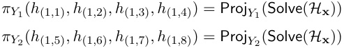

Otherwise leave _πY_ 1 and _πY_ 2 undefined. 

Consider an intervention **i** in the domain of _ω__π_ . We have a fixed alignment for the input and output neurons, where **i** can have output values from the real numbers and input values from _{_ **n** � _,_ **n** □ _,_ **n** _△}_4 . The intermediate neurons are assigned high-level alignment by stipulation; **i** can only have intermediate variables that are realized on some input intervention _L_ **n** for **n** _∈{_ **n** � _,_ **n** □ _,_ **n** _△}_4 (i.e., interchange interventions). Constructive abstraction will hold only if these stipulative alignments to intermediate variables do not violate the causal laws of _L_ . 

**The Algorithm Abstracts the Neural Network** Following Def. 47, the domain of _ω__π_ is restricted to 34 input interventions, (34 )2 single-source hard interchange interventions for high-level interventions fixing either _Y_ 1 or _Y_ 2, and (34 )3 double-source hard interchange interventions for high-level interventions fixing both _Y_ 1 and _Y_ 2. 

This low-level neural network was hand crafted to be abstracted by the high-level algorithm under the alignment _⟨_ Π _, π⟩_ . This means that for all **i** _∈_ Domain( _ω__π_ ) we have 

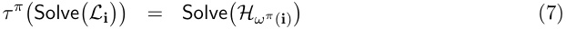

In the companion jupyter notebook, we provide code that verifies this is indeed the case. In Figure 3, we depict an aligned interchange intervention performed on _L_ and _H_ with the base input (� _,_ � _, △,_ □) and a single source input (□ _,_ � _, △, △_ ). The central insight is that the network and algorithm have the same counterfactual behavior. 

**Decomposing the Alignment** Our decomposition of the alignment object in Section 2.3.2 provides a new lens through which to view this result. The network _L_ can be transformed into the algorithm _H_ through a marginalization, variable merge, and value merge. We visually depict the algorithm _H_ being constructed from the network _L_ in Figure 4. 

**A Fully Connected Neural Network Trained on Hierarchical Equality** Instead of handcrafting weights, we can also train the neural network _L_ on the hierarchical equality task. Looking at the network weights provides no insight into whether or not it implements the algorithm _H_ . A core result of Geiger et al. (2023) demonstrates that it is possible to learn a bijective translation _τ_ of the neural model _L_ such that the algorithm _H_ is a constructive abstraction of the transformed model _τ_ ( _L_ ). This bijective translation is in the form of an orthogonal matrix that rotates a hidden vector into a new coordinate system. The method is Distributed Alignment Search which is covered in Section 3.6.3 and the result is replicated in our companion jupyter notebook. 

### **2.7 Example: Causal Abstraction with Cycles and Infinite Variables** 

Causal abstraction is a highly expressive, general purpose framework. However, our example in Section 2.6 involved only finite and acyclic models. To demonstrate the framework’s expressive capacity, we will define a causal model with infinitely many variables with infinite value ranges that implements the bubble sort algorithm on lists of arbitrary length. Then, we show this acyclic model can be abstracted into a cyclic process with an equilibrium state. 

**A Causal Model for Bubble Sort** Bubble sort is an iterative algorithm. On each iteration, the first two members of the sequence are compared and swapped if the left element is larger than the right element; then the second and third member of the resulting list are compared and possibly swapped, and so on until the end of the list is reached. This process is repeated until no more swaps are needed. 

Define the causal model _M_ to have the following (countably) infinite variables and values 

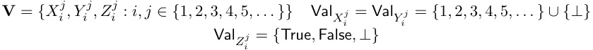

The causal structure of _M_ is depicted in Figure 5a. The _⊥_ value will indicate that a variable is not being used in a computation, much like a blank square on a Turing 

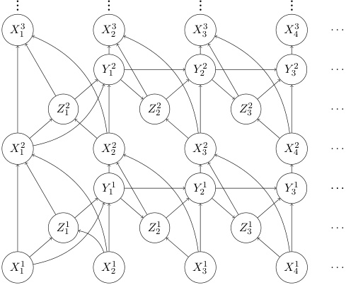

<!-- Start of picture text -->
... ... ... ... X 1 3 X 2 3 X 3 3 X 4 3 . . . Y 1 2 Y 2 2 Y 3 2 . . . Z 1 2 Z 2 2 Z 3 2 . . . X 1 2 X 2 2 X 3 2 X 4 2 . . . Y 1 1 Y 2 1 Y 3 1 . . . Z 1 1 Z 2 1 Z 3 1 . . . X 1 1 X 2 1 X 3 1 X 4 1 . . . <!-- End of picture text -->

(a) A causal model that represents the bubble sort algorithm. 

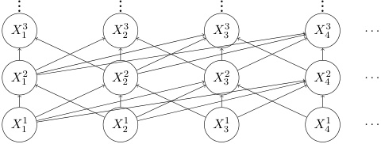

<!-- Start of picture text -->
... ... ... ... X 1 3 X 2 3 X 3 3 X 4 3 . . . X 1 2 X 2 2 X 3 2 X 4 2 . . . X 1 1 X 2 1 X 3 1 X 4 1 . . . <!-- End of picture text -->

(b) The causal model from Figure 5a with the variables _Yj__i_and_Z_ _j__i_marginalized. 

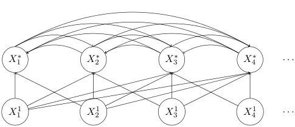

<!-- Start of picture text -->
X 1 ∗ X 2 ∗ X 3 ∗ X 4 ∗ . . . X 1 1 X 2 1 X 3 1 X 4 1 . . . <!-- End of picture text -->

(c) The causal model from Figure 5b with the variables _Xi_2_, X_ _i_3_, . . ._mergedforall_i >_0.Thevalues of these new variables contain the full history of the algorithm, e.g., the value of _X_ 1_∗_asequence containing the first element in the list after each bubbling iteration. 

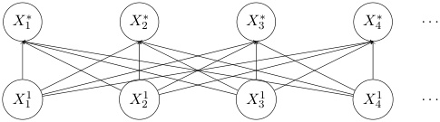

(d) The causal model from Figure 5c with the values of each variable _Xj__∗_mergedforall_j>_0,e.g., the value of _X_ 1_∗_isthefirstelementinthesortedlist. 

Figure 5: Abstractions of the bubble sort causal model. 

machine. The (countably) infinite sequence of variables _X_ 11_, X_ 21_, . . ._containstheunsorted input sequence, where an input sequence of length _k_ is represented by setting _X_ 11_, . . . , X_ _k_1to encode the sequence and doing nothing to the infinitely many remaining input variables _Xj_ for _j > k_ . For a given row _j_ of variables, the variables _Zi__j_storethetruth-valuedoutputofthe comparison of two elements, the variables _Yi__j_containthevaluesbeing‘bubbledup’through the sequence, and the variables _Xi__j_arepartiallysortedlistsresultingfrom_j−_1passes through the algorithm. When there are rows _j_ and _j_ + 1 such that _Xi__j_and_X_ _i__j−_1 take on the same value for all _i_ , the output of the computation is the sorted sequence found in both of these rows. 

We define the mechanisms as follows. The input variables _Xi_1haveconstantfunctionsto _⊥_ . The variable _Z_ 11is_⊥_ifeitherof_X_ 11or_X_ 21is_⊥_,Trueifthevalueof_X_ 11isgreaterthan _X_ 21,andFalseotherwise.Thevariable_Y_ 11is_⊥_if_Z_ 11is_⊥_,_X_ 11if_Z_ 11isTrue,and_X_ 21if_Z_ 11is False. The remaining intermediate variables can be uniformly defined: 

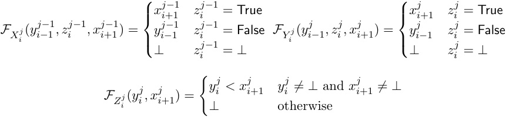

This causal model is countably infinite, supporting both sequences of arbitrary length and an arbitrary number of sorting iterations. 

**Abstracting Bubble Sort** Suppose we aren’t concerned with how, exactly, each iterative pass of the bubble sort algorithm is implemented. Then we can marginalize away the variables **Z** = _{Zi__j}_and**Y**=_{Y_ _i__j}_andreasonabouttheresultingmodelinstead(Figure5b).Define the mechanisms of this model recursively with base case _FX_ 1 _j_(_x_ 1_j−_1 _, x__j_ 2_−_1 ) = Min( _x__j_ 1_−_1 _, x_ 2_j−_1 ) for _j >_ 1 and recursive case 

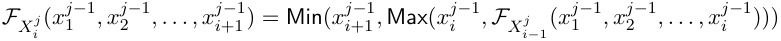

Suppose instead that our only concern is whether the input sequence is sorted. We can further abstract the causal model using variable merge with the partition Π _Xi__∗_=_{X_ _i__j_:_j∈_ _{_ 2 _,_ 3 _, . . . }}_ for each _i ∈{_ 1 _,_ 2 _, . . . }_ . The result is a model (Figure 5c) where each variable _Xi__∗_takesonthevalueofaninfinitesequence.Therearecausalconnectionstoandfrom_X_ _i__∗_ and _Xj__∗_forany_i̸_=_j_,becausetheinfinitesequencesstoredineachvariablemustjointlybe a valid run of the bubble sort algorithm. This is a cyclic causal process with an equilibrium point. 

Next, we can value-merge with a family of functions _δ_ where the input variable functions _δXi_ 1areidentityfunctionsandtheotherfunctions_δX_ _i__∗_outputtheconstantvaluetowhich an eventually-constant infinite sequence converges. The mechanisms for the resulting model (Figure 5d) simply map unsorted input sequences to sorted output sequences. 

## **3 A Common Language for Mechanistic Interpretability** 

The central claim of this paper is that causal abstraction provides a theoretical foundation for mechanistic interpretability. Equipped with a general theory of causal abstraction, we will provide mathematically precise definitions for a handful of core mechanistic interpretability concepts and show that a wide range of methods can be viewed as special cases of causal abstraction analysis. A tabular summary of this section can be found in Table 1. 

### **3.1 Polysemantic Neurons, the Linear Representation Hypothesis, and Modular Features via Intervention Algebras** 

A vexed question when analyzing black box AI is how to decompose a deep learning system into constituent parts. Should the units of analysis be real-valued activations, directions in the activation space of vectors, or entire model components? Localizing an abstract concept to a component of a black box AI would be much easier if neurons were a sufficient unit of analysis. However, it has long been known that artificial (and biological) neural networks have polysemantic neurons that participate in the representation of multiple high-level concepts (Smolensky, 1986; Rumelhart et al., 1986; McClelland et al., 1986; Thorpe, 1989). Therefore, individual neural activations are insufficient as units of analysis in interpretability, a fact that has been recognized in the recent literature (Harradon et al., 2018; Cammarata et al., 2020; Olah et al., 2020; Goh et al., 2021; Elhage et al., 2021; Bolukbasi et al., 2021; Geiger et al., 2023; Gurnee et al., 2023; Huang et al., 2023a). 

Perhaps the simplest case of polysemantic neurons is where some rotation can be applied to the neural activations such that the dimensions in the new coordinate system are monosemantic (Smolensky, 1986; Elhage et al., 2021; Scherlis et al., 2022; Geiger et al., 2023). Indeed, the _linear representation hypothesis_ (Mikolov et al., 2013; Elhage et al., 2022b; Nanda et al., 2023b; Park et al., 2023; Jiang et al., 2024) states that linear representations will be sufficient for analyzing the complex non-linear building blocks of deep learning models. We are concerned that this is too restrictive. The ideal theoretical framework won’t bake in an assumption like the linear representation hypothesis, but rather support any and all decompositions of a deep learning system into _modular features_ that each have separate mechanisms from one another. We should have the flexibility to choose the units of analysis, free of restrictive assumptions that may rule out meaningful structures. Whether a particular decomposition of a deep learning system into modular features is useful for mechanistic interpretability should be understood as an empirical hypothesis that can be falsified through experimentation. 

Our theory of causal abstraction supports a flexible, yet precise conception of modular features via intervention algebras (Section 2.2). An intervention algebra formalizes the notion of a set of separable components with distinct mechanisms, satisfying the fundamental algebraic properties of commutativity and left-annihilativity (see (a) and (b) in Definition 16). Individual activations, orthogonal directions in vector space, and model components (e.g. attention heads) are all separable components with distinct mechanisms in this sense. A bijective translation (Section 2.3.1) gives access to such features while preserving the overall mechanistic structure of the model. We propose to define modular features as any set of variables that form an intervention algebra accessed by a bijective translation. 

### Table 1: Interpretability Methods 

|Behavioral Methods (Section 3.3)|• **Feature attribution** (Zeiler and Fergus, 2014; Ribeiro et al., 2016; Lundberg and Lee, 2017) • **Integrated gradients** (Sundararajan et al., 2017) • **Effects of real-world concepts on models** (Goyal et al., 2019; Feder et al., 2021; Abraham et al., 2022; Wu et al., 2022a)|
|---|---|
|Patching Activations with Interchange Interventions (Section 3.4)|• **Interchange interventions** (Geiger et al., 2020; Vig et al., 2020; Geiger et al., 2021; Li et al., 2021; Chan et al., 2022b; Wang et al., 2023; Lieberum et al., 2023; Huang et al., 2023a; Hase et al., 2023; Cunningham et al., 2023; Davies et al., 2023; Tigges et al., 2023; Feng and Steinhardt, 2024; Ghandeharioun et al., 2024; Todd et al., 2024) • **Path patching** (Goldowsky-Dill et al., 2023; Wang et al., 2023; Hanna et al., 2023; Prakash et al., 2024) • **Causal mediation analysis** (Vig et al., 2020; Finlayson et al., 2021; Meng et al., 2022; Stolfo et al., 2023; Mueller et al., 2024)|
|Ablation-Based Analysis (Section 3.5)|• **Concept erasure** (Ravfogel et al., 2020, 2022, 2023b,a; Elazar et al., 2020; Lovering and Pavlick, 2022; Belrose et al., 2023) • **Sub-circuit analysis** (Michel et al., 2019; Sanh and Rush, 2021; Csord´as et al., 2021; Cammarata et al., 2020; Olsson et al., 2022; Chan et al., 2022b; Lepori et al., 2023b,a; Wang et al., 2023; Conmy et al., 2023; Nanda et al., 2023b) • **Causal scrubbing** (Chan et al., 2022b)|
|Modular Feature Learning (Section 3.6)|• **Principal Component Analysis** (Bolukbasi et al., 2016; Chormai et al., 2022; Marks and Tegmark, 2023; Tigges et al., 2023) • **Sparse autoencoders** (Bricken et al., 2023; Cunningham et al., 2023; Huben et al., 2024; Marks et al., 2024) • **Differential Binary Masking** (De Cao et al., 2020, 2021; Csord´as et al., 2021; Davies et al., 2023; Prakash et al., 2024; Huang et al., 2024) • **Probing** (Peters et al., 2018; Tenney et al., 2019; Hupkes et al., 2018) • **Difference of means** (Tigges et al., 2023; Marks and Tegmark, 2023) • **Distributed Alignment Search** (Geiger et al., 2023; Wu et al., 2023; Tigges et al., 2023; Arora et al., 2024; Huang et al., 2024; Minder et al., 2024; Feng et al., 2024; Rodriguez et al., 2024; Grant et al., 2025)|
|Activation Steering (Section 3.7)|(Giulianelli et al., 2018; Bau et al., 2019; Soulos et al., 2020; Besserve et al., 2020; Subramani et al., 2022; Turner et al., 2023; Zou et al., 2023; Vogel, 2024; Li et al., 2024; Wu et al., 2024a,b)|
|Training Models to be Interpretable (Section 3.8)|(Geiger et al., 2022b; Wu et al., 2022b,a; Elhage et al., 2022a; Hewitt et al., 2023; Y¨uksekg¨on¨ul et al., 2023; Chauhan et al., 2023; Huang et al., 2023b; Tamkin et al., 2024; G´omez and Cin`a, 2024; Zur et al., 2024; Liu et al., 2024)|

Geiger, Ibeling, Zur, Chaudhary, Chauhan, Huang, Arora, Wu, Goodman, Potts, Icard 

If the linear representation hypothesis is correct, then rotation matrices should be sufficient bijective translations for mechanistic interpretability. If not, there will be cases where non-linear bijective translations will be needed to discover modular features that are not linearly accessible, e.g., the ‘onion’ representations found by Csord´as et al. (2024) in simple recurrent neural networks. Our conception of modular features enables us to remain agnostic to the exact units of analysis that will prove essential. 

### **3.2 Graded Faithfulness via Approximate Abstraction** 

Informally, faithfulness has been defined as the degree to which an explanation accurately represents the ‘true reasoning process behind a model’s behavior’ (Wiegreffe and Pinter, 2019; Jacovi and Goldberg, 2020; Lyu et al., 2022; Chan et al., 2022a). Crucially, faithfulness should be a graded notion (Jacovi and Goldberg, 2020), but precisely which metric of faithfulness is correct will depend on the situation. It could be that for safety reasons there are some domains of inputs for which we need a perfectly faithful interpretation of a black box AI, while for others it matters less. Ideally, we can defer the exact details to be filled in based on the use case. This would allow us to provide a variety of graded faithfulness metrics that facilitates apples-to-apples comparisons between existing (and future) mechanistic interpretability methods. 

Approximate transformation (Section 2.4) provides the needed flexible notion of graded faithfulness. The similarity metric between high-level and low-level states, the probability distribution over evaluated interventions, and the summary statistic used to aggregate individual similarity scores are all points of variation that enable our notion of approximate transformation to be adapted to a given situation. Interchange intervention accuracy (Geiger et al., 2022b, 2023; Wu et al., 2023), probability or logit difference (Meng et al., 2022; Chan et al., 2022b; Wang et al., 2023; Zhang and Nanda, 2024), and KL-divergence all can be understood via approximate transformation. 

### **3.3 Behavioral Evaluations as Abstraction by a Two Variable Chains** 

The behavior of an AI model is simply the function from inputs to outputs that the model implements. Behavior is trivial to characterize in causal terms; any input–output behavior can be represented by a model with input variables directly connected to output variables. 

### 3.3.1 LIME: Behavioral Fidelity as Approximate Abstraction 

Feature attribution methods ascribe scores to input features that capture the ‘impact’ of a feature on model behavior. Gradient-based feature attribution methods (Zeiler and Fergus, 2014; Springenberg et al., 2014; Shrikumar et al., 2016; Binder et al., 2016; Lundberg and Lee, 2017; Kim et al., 2018; Narendra et al., 2018; Lundberg et al., 2019; Schrouff et al., 2022) measure causal properties when they satisfy some basic axioms (Sundararajan et al., 2017). In particular, Geiger et al. (2021) provide a natural causal interpretation of the integrated gradients method and Chattopadhyay et al. (2019) argue for a direct measurement of a feature’s individual causal effect. 

Among the most popular feature attribution methods is LIME (Ribeiro et al., 2016), which learns an interpretable model that locally approximates an uninterpretable model. LIME defines an explanation to be faithful to the degree that the interpretable model agrees 

with local input–output behavior. While not conceived as a causal explanation method, when we interpret priming a model with an input as an intervention, it becomes obvious that two models having the same local input–output behavior is a matter of causality. 

Crucially, however, the interpretable model lacks any connection to the internal causal dynamics of the uninterpretable model. In fact, it is presented as a benefit that LIME is a model-agnostic method that provides the same explanations for models with identical behaviors, but different internal structures. Without further grounding in causal abstraction, methods like LIME do not tell us anything meaningful about the abstract causal structure between input and output. 

**Definition 49 (LIME Fidelity of Interpretable Model)** Let _L_ and _H_ be models with identical input and output spaces. Let Distance( _·, ·_ ) compute some measure of distance between outputs. Given an input **x** _∈_ Val **XIn** _H_,let∆**x**_⊆_Val**X** _H_**In**beafiniteneighborhoodof inputs close to **x** . The LIME fidelity of using _H_ to interpret _L_ on the input **x** is given as: 

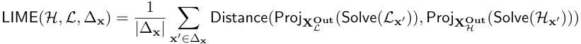

The uninterpretable model _L_ is an AI model with fully-connected causal structure: 

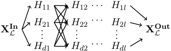

The interpretable model _H_ will often also have rich internal structure—such as a decision tree model—which one could naturally interpret as causal. For instance: 

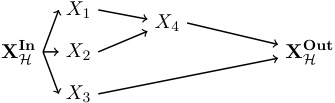

However, LIME only seeks to find a correspondence between the input–output behaviors of the interpretable and uninterpretable models. Therefore, representing both _L_ and _H_ as a causal models connecting inputs to outputs is sufficient to describe the fidelity measure in LIME. To shape approximate transformation to mirror the LIME fidelity metric, define 

1. The similarity between a low-level and high-level total state to be 

2. The probability distribution P to assign equal probability mass to input interventions in ∆ **x** and zero mass to all other interventions. 

3. The statistic S to compute the expected value of a random variable. 

The LIME fidelity metric is the approximate transformation metric (Def. 41) with _τ_ and _ω_ as identity functions: 

### 3.3.2 Single Source Interchange Interventions from Integrated Gradients 

Integrated gradients (Sundararajan et al., 2017) computes the impact of neurons on model predictions. Following Geiger et al. (2021), we can easily translate the original integrated gradients equation into our causal model formalism. 

**Definition 50 (Integrated Gradients)** Given a neural network as a causal model _M_ , we define the integrated gradient value of the _i_ th neuron of an hidden vector **Y** when the network is provided **x** as an input as follows, where **y**_′_ is the so-called baseline value of **Y** : 

The completeness axiom of the integrated gradients method is formulated as follows: 

Integrated gradients was not initially conceived as a method for the causal analysis of neural networks. Therefore, it is perhaps surprising that integrated gradients can be used to compute interchange interventions. This hinges on a strategic use of the ‘baseline’ value of integrated gradients; typically, the baseline value is set to be the zero vector, but here we set it to an interchange intervention. 

**Remark 51 (Integrated Gradients Can Compute Interventions)** The following is an immediate consequence of the completeness axiom 

In principle, we could perform causal abstraction analysis using the integrated gradients method and taking 

However, computing integrals is an inefficient way to compute interchange interventions. 

### 3.3.3 Estimating the Causal Effect of Real-World Concepts 

The ultimate downstream goal of explainable AI is to provide explanations with intuitive concepts (Goyal et al., 2019; Feder et al., 2021; Elazar et al., 2022; Abraham et al., 2022) that are easily understood by human decision makers and guide their actions (Karimi et al., 2021, 2023; Beckers, 2022). These concepts can be abstract and mathematical, such as 

truth-valued propositional content, natural numbers, or real valued quantities like height or weight; they can also be grounded and concrete, such as the breed of a dog, the education level of a job applicant, or the pitch of a singer’s voice. A basic question is how to estimate the effect of real-world concepts on the behavior of AI models. 

The explainable AI benchmark CEBaB (Abraham et al., 2022) evaluates methods on their ability to estimate the causal effects of the quality of food, service, ambiance, and noise in a real-world dining experience on the prediction of a sentiment classifier, given a restaurant review as input data. Using CEBaB as an illustrative example, we represent the real-world data generating process and the neural network with a single causal model _M_ CEBaB.8 The real-world concepts _C_ service, _C_ noise, _C_ food, and _C_ ambiance can take on three values +, _−_ , and Unknown, the input data **X****In** takes on the value of a restaurant review text, the prediction output **X****Out** takes on the value of a five star rating, and hidden vectors _Hij_ can take on real number values. 

If we are interested in the causal effect of food quality on model output, then we can marginalize away every variable other than the real-world concept _C_ food and the neural network output **X****Out** to get a causal model with two variables. This marginalized causal model is a high-level abstraction of _M_ CEBaB that contains a single causal mechanism describing how food quality in a dining experience affects the neural network output. 

**X****Out** 

_C_ food 

### **3.4 Patching Activations with Interchange Interventions** 

There is a diverse body of mechanistic interpretability literature in which interchange interventions (see Section 2.5) are used to analyze neural networks (see Table 1). However, the terminology used within this literature is often inconsistent and can lead to confusion regarding the precise techniques being employed. What is called an ‘activation patch’ is typically equivalent to an interchange intervention on a neural network, but the term is sometimes used to describe a variety of other intervention techniques. Wang et al. (2023) use ‘activation patching’ to mean (recursive) interchange interventions, while Conmy et al. (2023), Zhang and Nanda (2024), and Heimersheim and Nanda (2024) include ablation interventions under this heading (see Section 3.5), and Ghandeharioun et al. (2024) include arbitrary transformations that are more akin to activation steering (see Section 3.7). We propose to use ‘activation patch’ to refer broadly to interventions on hidden vectors in neural networks, while using ‘interchange intervention’ to pick out a specific type of intervention on causal models, which may be neural networks in some cases. 

> 8. The models in Abraham et al. (2022) are _probabilistic_ models, but we simplify to the deterministic case. 

Geiger, Ibeling, Zur, Chaudhary, Chauhan, Huang, Arora, Wu, Goodman, Potts, Icard 

### 3.4.1 Causal Mediation as Abstraction by a Three-Variable Chain 

Vig et al. (2020), Finlayson et al. (2021), Meng et al. (2022), and Stolfo et al. (2023) apply the popular causal inference framework of mediation analysis (Imai et al., 2010; Hicks and Tingley, 2011) to understand how internal model components of neural networks mediate the causal effect of inputs on outputs. It is straightforward to show that mediation analysis is a special case of causal abstraction analysis. Mediation analysis is compatible with both ablation interventions (see Section 3.5) and interchange interventions. In this section, we present mediation analysis with interchange interventions. 

Suppose that changing the value of variables **X** from **x** to **x**_′_ has an effect on a second set of variables **Y** . Causal mediation analysis determines how this causal effect is mediated by a third set of intermediate variables **Z** . The fundamental notions involved in mediation are total, direct, and indirect effects, which can be defined with interchange interventions. 

**Definition 52 (Total, Direct, and Indirect Effects)** Consider a causal model _M_ with disjoint sets of variables **X** _,_ **Y** _,_ **Z** _⊂_ **V** such that addition and subtraction are well-defined on values of **Y** . The _total causal effect_ of changing the values of **X** from **x** to **x**_′_ on **Y** is 

TotalEffect( _M,_ **x** _,_ **x**_′_ _,_ **Y** ) = Proj **Y** (Solve( _M_ **x** _′_ )) _−_ Proj **Y** (Solve( _M_ **x** )) 

The _direct causal effect_ of changing **X** from **x** to **x**_′_ on **Y** around mediator **Z** is 

DirectEffect( _M,_ **x** _,_ **x**_′_ _,_ **Y** _,_ **Z** ) = Proj **Y** (Solve( _M_ **x** _′∪_ IntInv( _M,⟨_ **x** _⟩,⟨_ **Z** _⟩_ ))) _−_ Proj **Y** (Solve( _M_ **x** )) 

The _indirect causal effect_ of changing **X** from **x** to **x**_′_ on **Y** through mediator **Z** is 

IndirectEffect( _M,_ **x** _,_ **x**_′_ _,_ **Y** _,_ **Z** ) = Proj **Y** (Solve( _M_ **x** _∪_ IntInv( _M,⟨_ **x** _′⟩,⟨_ **Z** _⟩_ ))) _−_ Proj **Y** (Solve( _M_ **x** )) 

This method has been applied to the analysis of neural networks to characterize how the causal effect of inputs on outputs is mediated by (parts of) hidden vectors, with the goal identifying complete mediators. This is equivalent to a simple causal abstraction analysis. 

**Remark 53** Consider a neural network _L_ with inputs **X****In** , outputs **X****Out** , and hidden vector **H** . Define Π _X_ = **X****In** , Π _Y_ = **X****Out** , Π _Z_ = **H** , and Π _⊥_ = **V** _\_ ( **X****In** _∪_ **H** _∪_ **X****Out** ). Apply variable merge and marginalization to _L_ with Π to obtain a high-level model _H_ that is an abstraction of _L_ with _τ_ and _ω_ as identity functions. The following are equivalent: 

1. The hidden vector **H** completely mediate the causal effect of inputs on outputs: 

IndirectEffect( _L,_ **x** _,_ **x**_′_ _,_ **X****Out** _,_ **H** ) = TotalEffect( _M,_ **x** _,_ **x**_′_ _,_ **X****Out** ) 

2. _H_ has a structure such that _X_ is not a child of _Y_ : _X Z Y_ 

### 3.4.2 Path Patching as Recursive Interchange Interventions 

Path patching (Wang et al., 2023; Goldowsky-Dill et al., 2023; Hanna et al., 2023; Zhang and Nanda, 2024; Prakash et al., 2024) is a type of interchange intervention analysis that targets the connections between variables rather than variables themselves. To perform a path patch, we use a recursive interchange intervention on a model _M_ processing a base input **b** that simulates ‘sender’ variables **H** taking on intervened values from a source input **s** , restricting the effect of this intervention to receiver variables **R** while freezing variables **F** . 

Each receiver variable takes on a value determined by the **s** input for the sender variables **H** while fixing **F** to be the value determined by the **b** input. For receiver variable _R ∈_ **R** , define an interchange intervention: 

The path patch is a recursive interchange intervention resulting from the receiver variables _{R_ 1 _, . . . , Rk}_ = **R** taking on the value determined by each of the basic interchange interventions: 

The intervened model _M_ **b** _∪_ **j** has a patched path according to the definition of Wang et al. (2023). Simpler path patching experiments will not freeze any variables, meaning **F** = ∅. We show a visualization below, where **H** = _{H_ 11 _}_ is the sender neuron, **R** = _{H_ 32 _}_ is the receiver neuron, and **F** = _{H_ 22 _}_ is a neuron we would like to keep frozen (meaning it has no effect in computing the value of the patched receiver node). 

<!-- Start of picture text -->
o o ′ o ∗ o ∗∗ h 31 h 32 h 33 h ′ 31 h ′ 32 h ′ 33 h ∗ 31 h ∗ 32 h ∗ 33 h 31 h ∗ 32 h 33 h 21 h 22 h 23 h ′ 21 h ′ 22 h ′ 23 h ∗ 21 h 22 h ∗ 23 h 21 h 22 h 23 h 11 h 12 h 13 h ′ 11 h ′ 12 h ′ 13 h ′ 11 h 12 h 13 h 11 h 12 h 13 b s b b <!-- End of picture text -->

### **3.5 Ablation as Abstraction by a Three Variable Collider** 

Neuroscientific lesion studies involve damage to a region of the brain in order to determine its function; if the lesion results in a behavioral deficit, then the brain region is assumed to be involved in the production of that behavior. In mechanistic interpretability, such interventions are known as _ablations_ . Common ablations include replacing neural hidden vectors with zero activations (Cammarata et al., 2020; Olsson et al., 2022; Geva et al., 2023) or with mean activations over a set of input data (Wang et al., 2023), adding random noise to the activations (causal tracing; Meng et al. 2022, 2023), and replacing activations with the values from a different input (resample ablations; Chan et al. 2022b). To capture ablation studies as a special case of causal abstraction analysis, we only need a high-level model 

Geiger, Ibeling, Zur, Chaudhary, Chauhan, Huang, Arora, Wu, Goodman, Potts, Icard 

with an input variable, an output variable, and a binary valued variable aligned with the variables targeted for ablation. 

### 3.5.1 Concept Erasure 

Concept erasure is a common application of ablations in which an hidden vector **H** in a neural network _L_ is ablated in order to remove information about a particular concept _C_ (Ravfogel et al., 2020, 2022, 2023b,a; Elazar et al., 2020; Lovering and Pavlick, 2022; Olsson et al., 2022; Belrose et al., 2023). To quantify the success of a concept erasure experiment, each concept _C_ is associated with some degraded behavioral capability encoded as a partial function _AC_ : Val **XIn** _L__→_Val**X** _L_**Out** (e.g., ablating the concept ‘dog’ would be associated with the behavior of inaccurately captioning images with dogs in them). If performing an ablation on **H** to erase the concept _C_ leads _L_ to have the degraded behavior _AC_ without changing other behaviors, then the ablation was successful. 

We can model ablation on _L_ as abstraction by a three-variable causal model. Define a high-level signature to be an input variable _X_ taking on values from **X****In** _L_,outputvariable_Y_ taking on values from **X****Out** _L_ , and a binary variable _Z_ that indicates whether the concept _C_ has been erased. The mechanism for _X_ assigns an arbitrary default input, the mechanism for _Z_ assigns 0, and the mechanism for _Y_ produces the degraded behavior if _Z_ is 1, and mimics _L_ otherwise: 

The map _τ_ from low-level settings to the high-level settings simply sets _Z_ to be 0 exactly when the low-level input determines the value of the model component **H** : 

The function _ω_ is defined on low-level input interventions and the interventional I that is an ablation on **H** (e.g., setting activations to zero or a mean value, or projecting activations onto a linear subspace whose complement is thought to encode the concept _C_ ). Low-level input interventions are mapped by _ω_ to identical high-level input interventions, while I is mapped by _ω_ to the high-level intervention setting _Z_ to 1. 

The high-level causal model _H_ is an exact transformation of the low-level neural model _L_ under ( _τ, ω_ ) exactly when the ablation removing the concept _C_ results in degraded behavior defined by _AC_ . We show a visualization below, where **H** = _{H_ 12 _, H_ 22 _}_ . 

<!-- Start of picture text -->
X Z Y H 11 H 12 H 13 X In L H 21 H 22 H 23 X Out L H 31 H 32 H 33 <!-- End of picture text -->

Observe that the high-level model _H_ does not have a variable encoding the concept _C_ and the values it might take on. Ablation studies attempt to determine _whether_ a concept is used by a model; they do not characterize _how_ that concept is used. 

### 3.5.2 Sub-Circuit Analysis 

Sub-circuit analysis (Michel et al., 2019; Sanh and Rush, 2021; Csord´as et al., 2021; Cammarata et al., 2020; Olsson et al., 2022; Chan et al., 2022b; Lepori et al., 2023b,a; Wang et al., 2023; Conmy et al., 2023) aims to identify a minimal circuit _C ⊆_ **V** _×_ **V** between components in a model _L_ that is sufficient to perform particular behavior that we represent with a partial function _B_ : Val **XIn** _L__→_Val**XOut** _L_ . This claim is cashed out in terms of ablations, specifically, the behavior _B_ should remain intact when all connections between model components _C_ = **V** _×_ **V** _\ C_ are ablated. Define **H** = _{H_ : _∃G_ ( _G, H_ ) _∈ C}_ as the model components with incoming severed connections, **G** = _{G_ : _∃H_ ( _G, H_ ) _∈ C}_ as the model components with outgoing severed connections, and let **g** be the ablation values. 

We can model sub-circuit analysis on _L_ as abstraction by a three-variable causal model. Define a high-level signature to be an input variable _X_ taking on values from **X****In** _L_,output variable _Y_ taking on values from **X****Out** _L ∪{⊥}_ , and a binary variable _Z_ that indicates whether the connections _C_ have been severed. The mechanism for _X_ assigns an arbitrary default input, the mechanism for _Z_ assigns 0, and the mechanism for _Y_ mimics the behavior of _L_ when _Z_ is 0 and preserves only the behavior _B_ when _Z_ is 1: 

The map _τ_ from low-level settings to high-level settings simply sets _Z_ to be 0 exactly when the low-level input determines the value of the model components **H** : 

The function _ω_ is defined on low-level input interventions in Domain( _B_ ) and the interventional I that fixes the connections in _C_ to an ablated value and leaves the connections in 

_C_ untouched: 

Low-level input interventions are mapped by _ω_ to identical high-level input interventions and I is mapped by _ω_ to the high-level intervention setting _Z_ to 1. 

The high-level causal model _H_ is an exact transformation of the low-level neural model _L_ under ( _τ, ω_ ) exactly when the subcircuit _C_ preserves the behavior _B_ . We show a visualization below, where: 

<!-- Start of picture text -->
X Z Y H 11 H 12 H 13 X In L H 21 H 22 H 23 X Out L H 31 H 32 H 33 <!-- End of picture text -->

### 3.5.3 Causal Scrubbing 

Causal scrubbing (Chan et al., 2022b) is an ablation method that proposes to determine whether a circuit _C_ is sufficient for a behavior _B_ . It doesn’t fit into our general paradigm of sub-circuit analysis for two reasons. First, the minimal circuit _C_ is determined by a high-level causal model _H_ with identical input and output spaces as _L_ and a surjective partial function _δ_ : **V** _L →_ **V** _H_ assigning each low-level variable a high-level variable. Specifically, the low-level minimal circuit is the high-level causal graph pulled back into the low-level _C_ = _{_ ( _G, H_ ) : _δ_ ( _G_ ) _≺ δ_ ( _H_ ) _}_ . Second, the connections in the minimal circuit _C_ are intervened upon in addition to connections in _C_ . This means that every single connection in the network is being intervened upon. 

Given a base input **b** , causal scrubbing recursively intervenes on every connection in the network. The connections in _C_ are replaced using randomly sampled source inputs, and the connections ( _G, H_ ) _∈C_ are replaced using randomly sampled source inputs that set _δ_ ( _H_ ) to the same value in _H_ . Chan et al. (2022b) call these interchange interventions—where the base and source input agree on a high-level variable— _resampling ablations_ . The exact intervention value for each targeted connection is determined by a recursive interchange intervention performed by calling the algorithm Scrub( **b** _,_ **X****Out** _L_ ) defined below. 

|**Al**|**gorithm 1:** Scrub(**b**_,_**H**)|
|---|---|
|**1 h**|_←{}_|
|**2 f**|**or** _H ∈_**H do** |
|**3**|**if** _H ∈_**X****In** _L_ **then**|
|**4**|**h**_←_**h**_∪_Proj_H_(**b**) |
|**5**|**continue**|
|**6**|**g**_←{}_   _̸_|
|**7**|**for** _G ∈{G_: (_G, H_)_̸ ∈C}_ **do**|
|**8**|**s**_∼_Val**XIn** _L_|
|**9**|**g**_←_**g**_∪_Scrub(**s**_, {G}_)|
|**10**|**if** _H ∈_Domain(_δ_) **then**|
|**11**|**s**_∼{_**s**_∈_Val**XIn** _L_ : Proj_δ_(_H_)(Solve(_H_**s**)) = Proj_δ_(_H_)(Solve(_H_**b**))_}_|
|**12**|**g**_←_**g**_∪_Scrub(**s**_, {G_: (_G, H_)_∈C}_)|
|**13** **14 r**|**h**_←_**h**_∪_Proj_H_(Solve(_L_**g**)) **eturn h**|

While causal scrubbing makes use of a high-level model _H_ , the only use of this model in the algorithm Scrub is to sample source inputs **s** that assign the same value to a variable as a base input **b** . No interventions are performed on the high-level model and so no correspondences between high-level and low-level interventions are established. This means that we can still model causal scrubbing as abstraction by the same three-variable causal model we defined in Section 3.5.2, which we will name _H__∗_ . The map _τ_ from low-level settings to the high-level settings simply sets _Y_ to be 0 exactly when the low-level input determines the value of the total setting 

The function _ω_ is defined to map low-level input interventions to identical high-level input interventions and map any interventional I resulting from a call to Scrub to the high-level intervention setting _Z_ to 1. 

Chan et al. (2022b) propose to measure the faithfulness of _H_ by appeal to the proportion of performance maintained by _L_ under interventionals determined by Scrub. This is equivalent to the approximate transformation metric for high-level causal model _H__∗_ and low-level causal model _L_ under ( _τ, ω_ ) (Definition 41) with P as a random distribution over inputs and interventionals from Scrub, Sim as a function outputting 1 only if the low-level and high-level outputs are equal, and S as expected value. 

### **3.6 Modular Feature Learning as Bijective Transformation** 

A core task of mechanistic interpretability is disentangling a vector of activations into a set of modular features that correspond to human-intelligible concepts. We construe modular feature learning as constructing a bijective translation (Def. 28). Some methods use a high-level causal model as a source of supervision in order to construct modular features that localize the concepts encoded in the high-level intermediate variables. Other methods are entirely unsupervised and produce modular features that must be further analyzed 

Geiger, Ibeling, Zur, Chaudhary, Chauhan, Huang, Arora, Wu, Goodman, Potts, Icard 

to determine the concepts they might encode. Formalizing modular feature learning as bijective transformation provides a unified framework to evaluate commonly used mechanistic interpretability methods through distributed interchange interventions (see Huang et al. 2024 for a mechanistic interpretability benchmark based in this framework). 

### 3.6.1 Unsupervised Methods 

**Principal Component Analysis** Principal Component Analysis (PCA) is a technique that represents high-dimensional data in a lower-dimensional space while maximally preserving information in the original data. PCA has been used to identify subspaces related to human-interpretable concepts, e.g., gender (Bolukbasi et al., 2016), sentiment (Tigges et al., 2023), truthfulness (Marks and Tegmark, 2023), and visual concepts involved in object classification (Chormai et al., 2022). 

The modular features produced by PCA are simply the principal components. Given a model _M_ and _k_ inputs, to featurize an _n_ -dimensional hidden vector **H** we first create a _k × n_ matrix with a column Proj **H** (Solve( _M_ **xIn** )) for each input **x****In** . Then we use PCA to compute an _n × n_ matrix **P** whose rows are principal components. The bijective translation _τ_ : **V** _→_ **V** is defined as 

**Sparse Autoencoders** Sparse autoencoders are tools for learning to translate an _n_ - dimensional hidden vector **H** into a sparse, _k_ -dimensional feature space with _k ≫ n_ (Bricken et al., 2023; Cunningham et al., 2023; Huben et al., 2024; Marks et al., 2024). However, instead of learning a single invertible function that translates activations into a new feature space, sparse autoencoders separately learn an encoder _f_ enc and decoder _f_ dec, each typically parameterized by a single layer feed-forward network. These two functions are optimized to reconstruct the activations Val **H** while creating a sparse feature space, with a hyperparameter _λ_ balancing the two terms: 

Given a sparse autoencoder that perfectly reconstructs the activations, i.e., one with a reconstruction loss of zero, we can view the encoder and decoder as the bijective translation 

However, in practice, reconstruction loss is never zero and sparse autoencoders are approximate transformations of the underlying model. 

### 3.6.2 Aligning Low-Level Features with High-Level Variables 

Once a space of features has been learned, there is still the task of aligning features with high-level causal variables. Supervised modular feature learning techniques learn a feature 

space with an explicit alignment to high-level causal variables already in mind. However, in unsupervised modular feature learning an additional method is needed to align features with high-level causal variables. 

**Sparse Feature Selection** A simple baseline method for aligning features with a highlevel variable is to train a linear probe with a regularization term to select the features most correlated with the high-level variable (Huang et al., 2024). 

**Differential Binary Mask** Differential binary masking selects a subset of features for a high-level variable by optimizing a binary mask with a training objective defined using interventions (De Cao et al., 2020; Csord´as et al., 2021; De Cao et al., 2021; Davies et al., 2023; Prakash et al., 2024; Huang et al., 2024). Differential binary masking has often been used to select individual neurons that play a particular causal role, but can just as easily be used to select features as long as the bijective translation is differentiable. 

### 3.6.3 Supervised Methods 

**Probes** Probing is the technique of using a supervised or unsupervised model to determine whether a concept is present in a hidden vector of a separate model. Probes are a popular tool for analyzing deep learning models, especially pretrained language models (Hupkes et al., 2018; Conneau et al., 2018; Peters et al., 2018; Tenney et al., 2019; Clark et al., 2019). 

Although probes are quite simple, they raise subtle methodological issues and our theoretical understanding of probes has greatly improved since their recent introduction into the field. From an information-theoretic point of view, we can observe that using arbitrarily powerful probes is equivalent to measuring the mutual information between the concept and the hidden vector (Hewitt and Liang, 2019; Pimentel et al., 2020). If we restrict the class of probing models based on their complexity, we can measure how usable the information is (Xu et al., 2020; Hewitt et al., 2021). 

Regardless of what probe models are used, successfully probing a hidden vector does not guarantee that it plays a causal role in model behavior (Ravichander et al., 2020; Elazar et al., 2020; Geiger et al., 2020, 2021). However, a linear probe with weights _W_ trained to predict the value of a concept from an hidden vector **H** can be understood as learning a feature space for activations that can be analyzed with causal abstraction. Let _r_ 1 _, . . . , rk_ be a set of orthonormal vectors that span the rowspace of _W_ and _uk_ +1 _, . . . , un_ be a set of orthonormal vectors that span the nullspace of _W_ . The bijective transformation is 

Since the probe is trained to capture information related to the concept _C_ , the rowspace of the projection matrix _W_ (i.e., the first _k_ dimensions of the new feature space) might localize the concept _C_ . If we have a high-level model that has a variable for the concept _C_ , that variable should be aligned with the first _k_ features. 

**Distributed Alignment Search** Distributed Alignment Search (DAS) finds linear subspaces of an _n_ -dimensional hidden vector **H** in model _L_ that align with high-level variables _X_ 1 _, . . . , Xk_ in model _H_ by optimizing an orthogonal matrix **Q** _∈_ R_n×n_ with a loss objective defined using distributed interchange interventions (Section 2.5). This method has been used to analyze causal mechanisms in a variety of deep learning models (Geiger et al., 2023; 

Wu et al., 2023; Tigges et al., 2023; Arora et al., 2024; Huang et al., 2024; Minder et al., 2024). The bijective translation _τ_ : **V** _→_ **V** is defined 

DAS optimizes **Q** so that **Y** 1 _, . . . ,_ **Y** _k_ , disjoint subspaces of **H** , are abstracted by high-level variables _X_ 1 _, . . . , Xk_ using the loss 

where _ω_ maps low-level inputs to high-level inputs and CE is cross-entropy loss. 

### **3.7 Activation Steering as Causal Abstraction** 

Causal explanation and manipulation are intrinsically linked (Woodward, 2003); if we understand which components in a deep learning model store high-level causal variables, we will be able to control the behavior of the deep learning model via intervention on those components. Controlling model behavior via interventions was initially studied on recursive neural networks and generative adversarial networks (Giulianelli et al., 2018; Bau et al., 2019; Soulos et al., 2020; Besserve et al., 2020). Recently, various works have focused on steering large language model generation through interventions. For instance, researchers have demonstrated that adding fixed steering vectors to the residual stream of transformer models can control the model’s generation without training (Subramani et al., 2022; Turner et al., 2023; Zou et al., 2023; Vogel, 2024; Li et al., 2024; Wu et al., 2024a). Additionally, parameter-efficient fine-tuning methods such as Adapter-tuning (Houlsby et al., 2019) can be viewed as interventions on model parameters. Between these two types of methods is _representation fine-tuning_ (Wu et al., 2024b), where low-rank adapters are attached to a small number of hidden vectors in order to steer model behavior. 

While a successful interchange intervention analysis implies an ability to control the low-level model, the reverse does not hold. Activation steering has the power to bring the hidden vectors of a network off the distribution induced by the input data, potentially targeting hidden vectors that have the same value for every possible model input. An interchange intervention on such a vector will never have any impact on the model behavior. However, activation steering can still be represented in the framework of causal abstraction. For hidden vectors that are useful knobs to steer model generations in specific direction, we can simply define the map _ω_ from low-level interventionals to high-level interventionals on steering interventions rather than interchange interventions. The crucial point is that causal abstraction analysis that doesn’t define _ω_ on interchange interventions will fail to uncover how the network reasons. It may nonetheless uncover how to control the network’s reasoning process. 

### **3.8 Training AI Models to be Interpretable** 

Our treatment of interpretability has been largely through a scientific lens; an AI model being uninterpretable simply makes it an interesting object of study. However, when cracking open the black box is understood as normative goal that could have real positive societal 

impacts, a natural question is whether we can make our job any easier by creating models that are inherently more interpretable. This is an active area of research. 

General purpose approaches attempt to design training procedure that produces more interpretable representations, such as using a SoLU function as a non-linearity (Elhage et al., 2022a), collapsing real-valued vector space into a discrete-valued space (Tamkin et al., 2024), learning a contextually weighted combination of vectors for different word meanings (Hewitt et al., 2023), or replacing MLPs with a new kind of network (Liu et al., 2024). More targeted approaches will construct architectural bottle-necks (Koh et al., 2020; Y¨uksekg¨on¨ul et al., 2023; Chauhan et al., 2023) or use interchange intervention based loss terms (Geiger et al., 2022b; Wu et al., 2022b,a; Huang et al., 2023b; Zur et al., 2024) in order to force a concept to be mediated by a particular vector or feature. While these are active avenues of exploration, there are, to date, no state-of-the-art models that have architectures or losses designed around interpretability. 

## **4 Conclusion** 

We submit that causal abstraction provides a theoretical foundation for mechanistic interpretability that clarifies core concepts and lays useful groundwork for future development of methods that investigate algorithmic hypotheses about the internal reasoning of AI models. 

## **Acknowledgements** 

Thank you to the reviewers, Nora Belrose, and Frederik Hytting Jørgensen for their feedback on earlier drafts of this paper. In particular, we would like to thank Sander Beckers for deep and thoughtful engagement as a reviewer, which improved the quality of this work over the course of the review process. This research is supported by a grant from Open Philanthropy. 

## **References** 

- Eldar David Abraham, Karel D’Oosterlinck, Amir Feder, Yair Ori Gat, Atticus Geiger, Christopher Potts, Roi Reichart, and Zhengxuan Wu. CEBaB: Estimating the causal effects of real-world concepts on NLP model behavior. arXiv:2205.14140, 2022. URL `https://arxiv.org/abs/2205.14140` . 

- Raquel G Alhama and Willem Zuidema. A review of computational models of basic rule learning: The neural-symbolic debate and beyond. _Psychonomic bulletin & review_ , 26(4): 1174–1194, 2019. 

- Aryaman Arora, Dan Jurafsky, and Christopher Potts. CausalGym: Benchmarking causal interpretability methods on linguistic tasks. In Lun-Wei Ku, Andre Martins, and Vivek Srikumar, editors, _Proceedings of the 62nd Annual Meeting of the Association for Computational Linguistics (Volume 1: Long Papers)_ , pages 14638– 14663, Bangkok, Thailand, 2024. Association for Computational Linguistics. URL `https://aclanthology.org/2024.acl-long.785` . 

- Elias Bareinboim and Juan D. Correa. A calculus for stochastic interventions: Causal effect identification and surrogate experiments. In _The Thirty-Fourth AAAI Conference on Artificial Intelligence_ , 2020. 

- David Bau, Jun-Yan Zhu, Hendrik Strobelt, Bolei Zhou, Joshua B. Tenenbaum, William T. Freeman, and Antonio Torralba. Visualizing and understanding gans. In _Deep Generative Models for Highly Structured Data, ICLR 2019 Workshop, New Orleans, Louisiana, United States, May 6, 2019_ . OpenReview.net, 2019. URL `https://openreview.net/forum?id= rJgON8ItOV` . 

- Sander Beckers. Causal explanations and XAI. In Bernhard Sch¨olkopf, Caroline Uhler, and Kun Zhang, editors, _Proceedings of the First Conference on Causal Learning and Reasoning_ , volume 177 of _Proceedings of Machine Learning Research_ , pages 90–109. PMLR, 11–13 Apr 2022. URL `https://proceedings.mlr.press/v177/beckers22a.html` . 

- Sander Beckers and Joseph Halpern. Abstracting causal models. In _AAAI Conference on Artificial Intelligence_ , 2019. 

- Sander Beckers, Frederick Eberhardt, and Joseph Y. Halpern. Approximate causal abstractions. In _Proceedings of The 35th Uncertainty in Artificial Intelligence Conference_ , 2019. 

- Nora Belrose, David Schneider-Joseph, Shauli Ravfogel, Ryan Cotterell, Edward Raff, and Stella Biderman. LEACE: perfect linear concept erasure in closed form. In Alice Oh, Tristan Naumann, Amir Globerson, Kate Saenko, Moritz Hardt, and Sergey Levine, editors, _Advances in Neural Information Processing Systems 36: Annual Conference on Neural Information Processing Systems 2023, NeurIPS 2023, New Orleans, LA, USA, December 10 - 16, 2023_ , 2023. URL `http://papers.nips.cc/paper_files/paper/2023/hash/ d066d21c619d0a78c5b557fa3291a8f4-Abstract-Conference.html` . 

- Michel Besserve, Arash Mehrjou, R´emy Sun, and Bernhard Sch¨olkopf. Counterfactuals uncover the modular structure of deep generative models. In _8th International Conference on Learning Representations, ICLR 2020, Addis Ababa, Ethiopia, April 26-30, 2020_ . OpenReview.net, 2020. URL `https://openreview.net/forum?id=SJxDDpEKvH` . 

- Alexander Binder, Gr´egoire Montavon, Sebastian Bach, Klaus-Robert M¨uller, and Wojciech Samek. Layer-wise relevance propagation for neural networks with local renormalization layers. _CoRR_ , abs/1604.00825, 2016. URL `http://arxiv.org/abs/1604.00825` . 

- Tolga Bolukbasi, Kai-Wei Chang, James Y Zou, Venkatesh Saligrama, and Adam T Kalai. Man is to computer programmer as woman is to homemaker? Debiasing word embeddings. In D. Lee, M. Sugiyama, U. Luxburg, I. Guyon, and R. Garnett, editors, _Advances in Neural Information Processing Systems_ , volume 29. Curran Associates, Inc., 2016. URL `https://proceedings.neurips.cc/paper_files/paper/2016/file/ a486cd07e4ac3d270571622f4f316ec5-Paper.pdf` . 

- Tolga Bolukbasi, Adam Pearce, Ann Yuan, Andy Coenen, Emily Reif, Fernanda B. Vi´egas, and Martin Wattenberg. An interpretability illusion for BERT. In _arXiv preprint arXiv:2104.07143_ , 2021. URL `https://arxiv.org/abs/2104.07143` . 

- Stephan Bongers, Patrick Forr´e, Jonas Peters, and Joris M. Mooij. Foundations of structural causal models with cycles and latent variables. _The Annals of Statistics_ , 49(5):2885–2915, 2021. 

- Trenton Bricken, Adly Templeton, Joshua Batson, Brian Chen, Adam Jermyn, Tom Conerly, Nick Turner, Cem Anil, Carson Denison, Amanda Askell, Robert Lasenby, Yifan Wu, Shauna Kravec, Nicholas Schiefer, Tim Maxwell, Nicholas Joseph, Zac Hatfield-Dodds, Alex Tamkin, Karina Nguyen, Brayden McLean, Josiah E Burke, Tristan Hume, Shan Carter, Tom Henighan, and Christopher Olah. Towards monosemanticity: Decomposing language models with dictionary learning. _Transformer Circuits Thread_ , 2023. https://transformercircuits.pub/2023/monosemantic-features/index.html. 

- Nick Cammarata, Shan Carter, Gabriel Goh, Chris Olah, Michael Petrov, Ludwig Schubert, Chelsea Voss, Ben Egan, and Swee Kiat Lim. Thread: Circuits. _Distill_ , 2020. doi: 10.23915/distill.00024. https://distill.pub/2020/circuits. 

- Krzysztof Chalupka, Pietro Perona, and Frederick Eberhardt. Visual causal feature learning. In Marina Meila and Tom Heskes, editors, _Proceedings of the Thirty-First Conference on Uncertainty in Artificial Intelligence, UAI 2015, July 12-16, 2015, Amsterdam, The Netherlands_ , pages 181–190. AUAI Press, 2015. URL `http://auai.org/uai2015/proceedings/ papers/109.pdf` . 

- Krzysztof Chalupka, Tobias Bischoff, Frederick Eberhardt, and Pietro Perona. Unsupervised discovery of el nino using causal feature learning on microlevel climate data. In Alexander T. Ihler and Dominik Janzing, editors, _Proceedings of the Thirty-Second Conference on Uncertainty in Artificial Intelligence, UAI 2016, June 25-29, 2016, New York City, NY, USA_ . AUAI Press, 2016. URL `http://auai.org/uai2016/proceedings/papers/11. pdf` . 

- Krzysztof Chalupka, Frederick Eberhardt, and Pietro Perona. Causal feature learning: an overview. _Behaviormetrika_ , 44:137–164, 2017. 

- Chun Sik Chan, Huanqi Kong, and Guanqing Liang. A comparative study of faithfulness metrics for model interpretability methods. In Smaranda Muresan, Preslav Nakov, and Aline Villavicencio, editors, _Proceedings of the 60th Annual Meeting of the Association for Computational Linguistics (Volume 1: Long Papers), ACL 2022, Dublin, Ireland, May 22-27, 2022_ , pages 5029–5038. Association for Computational Linguistics, 2022a. doi: 10.18653/v1/2022.acl-long.345. URL `https://doi.org/10.18653/v1/2022.acl-long. 345` . 

- Lawrence Chan, Adri`a Garriga-Alonso, Nicholas Goldwosky-Dill, Ryan Greenblatt, Jenny Nitishinskaya, Ansh Radhakrishnan, Buck Shlegeris, and Nate Thomas. Causal scrubbing, a method for rigorously testing interpretability hypotheses. _AI Alignment Forum_ , 2022b. `https://www.alignmentforum.org/posts/JvZhhzycHu2Yd57RN/ causal-scrubbing-a-method-for-rigorously-testing` . 

- Aditya Chattopadhyay, Piyushi Manupriya, Anirban Sarkar, and Vineeth N Balasubramanian. Neural network attributions: A causal perspective. In _Proceedings of the 36th International Conference on Machine Learning (ICML)_ , pages 981–990, 2019. 

- Kushal Chauhan, Rishabh Tiwari, Jan Freyberg, Pradeep Shenoy, and Krishnamurthy Dvijotham. Interactive concept bottleneck models. In Brian Williams, Yiling Chen, and Jennifer Neville, editors, _Thirty-Seventh AAAI Conference on Artificial Intelligence, AAAI 2023, Thirty-Fifth Conference on Innovative Applications of Artificial Intelligence, IAAI 2023, Thirteenth Symposium on Educational Advances in Artificial Intelligence, EAAI 2023, Washington, DC, USA, February 7-14, 2023_ , pages 5948–5955. AAAI Press, 2023. doi: 10.1609/AAAI.V37I5.25736. URL `https://doi.org/10.1609/aaai.v37i5.25736` . 

- Pattarawat Chormai, Jan Herrmann, Klaus-Robert M¨uller, and Gr´egoire Montavon. Disentangled explanations of neural network predictions by finding relevant subspaces, 2022. 

- Kevin Clark, Urvashi Khandelwal, Omer Levy, and Christopher D. Manning. What does BERT look at? An analysis of BERT’s attention. In _Proceedings of the 2019 ACL_ 

- _Workshop BlackboxNLP: Analyzing and Interpreting Neural Networks for NLP_ , pages 276–286, Florence, Italy, August 2019. Association for Computational Linguistics. URL `https://www.aclweb.org/anthology/W19-4828` . 

- Arthur Conmy, Augustine N. Mavor-Parker, Aengus Lynch, Stefan Heimersheim, and Adri`a Garriga-Alonso. Towards automated circuit discovery for mechanistic interpretability. In Alice Oh, Tristan Naumann, Amir Globerson, Kate Saenko, Moritz Hardt, and Sergey Levine, editors, _Advances in Neural Information Processing Systems 36: Annual Conference on Neural Information Processing Systems 2023, NeurIPS 2023, New Orleans, LA, USA, December 10 - 16, 2023_ , 2023. URL `http://papers.nips.cc/paper_files/paper/ 2023/hash/34e1dbe95d34d7ebaf99b9bcaeb5b2be-Abstract-Conference.html` . 

- Alexis Conneau, German Kruszewski, Guillaume Lample, Lo¨ıc Barrault, and Marco Baroni. What you can cram into a single $&!#* vector: Probing sentence embeddings for linguistic properties. In _Proceedings of the 56th Annual Meeting of the Association for Computational Linguistics (Volume 1: Long Papers)_ , pages 2126–2136, Melbourne, Australia, July 2018. Association for Computational Linguistics. doi: 10.18653/v1/P18-1198. URL `https://aclanthology.org/P18-1198` . 

- P. Cousot and R. Cousot. Abstract interpretation: a unified lattice model for static analysis of programs by construction or approximation of fixpoints. In _Conference Record of the Fourth Annual ACM SIGPLAN-SIGACT Symposium on Principles of Programming Languages_ , pages 238–252, Los Angeles, California, 1977. ACM Press, New York, NY. 

- Kathleen A. Creel. Transparency in complex computational systems. _Philosophy of Science_ , 87:568–589, 2020. 

- R´obert Csord´as, Sjoerd van Steenkiste, and J¨urgen Schmidhuber. Are neural nets modular? inspecting functional modularity through differentiable weight masks. In _9th International Conference on Learning Representations, ICLR 2021, Virtual Event, Austria, May 3-7, 2021_ . OpenReview.net, 2021. URL `https://openreview.net/forum?id=7uVcpu-gMD` . 

- R´obert Csord´as, Christopher Potts, Christopher D Manning, and Atticus Geiger. Recurrent neural networks learn to store and generate sequences using non-linear representations. In _The 7th BlackboxNLP Workshop_ , 2024. URL `https://openreview.net/forum?id= NUQeYgg8x4` . 

- Hoagy Cunningham, Aidan Ewart, Logan Riggs, Robert Huben, and Lee Sharkey. Sparse autoencoders find highly interpretable features in language models. _CoRR_ , abs/2309.08600, 2023. doi: 10.48550/ARXIV.2309.08600. URL `https://doi.org/10.48550/arXiv.2309. 08600` . 

- Xander Davies, Max Nadeau, Nikhil Prakash, Tamar Rott Shaham, and David Bau. Discovering variable binding circuitry with desiderata. _CoRR_ , abs/2307.03637, 2023. doi: 10.48550/ARXIV.2307.03637. URL `https://doi.org/10.48550/arXiv.2307.03637` . 

- Nicola De Cao, Michael Sejr Schlichtkrull, Wilker Aziz, and Ivan Titov. How do decisions emerge across layers in neural models? interpretation with differentiable masking. In Bonnie Webber, Trevor Cohn, Yulan He, and Yang Liu, editors, _Proceedings of the 2020 Conference on Empirical Methods in Natural Language Processing (EMNLP)_ , pages 3243– 3255, Online, November 2020. Association for Computational Linguistics. doi: 10.18653/ v1/2020.emnlp-main.262. URL `https://aclanthology.org/2020.emnlp-main.262` . 

- Nicola De Cao, Leon Schmid, Dieuwke Hupkes, and Ivan Titov. Sparse interventions in language models with differentiable masking. arXiv:2112.06837, 2021. URL `https: //arxiv.org/abs/2112.06837` . 

- Julien Dubois, Frederick Eberhardt, Lynn K. Paul, and Ralph Adolphs. Personality beyond taxonomy. _Nature human behaviour_ , 4 11:1110–1117, 2020a. 

- Julien Dubois, Hiroyuki Oya, Julian Michael Tyszka, Matthew A. Howard, Frederick Eberhardt, and Ralph Adolphs. Causal mapping of emotion networks in the human brain: Framework and initial findings. _Neuropsychologia_ , 145, 2020b. 

- Joel Dyer, Nicholas Bishop, Yorgos Felekis, Fabio Massimo Zennaro, Anisoara Calinescu, Theodoros Damoulas, and Michael J. Wooldridge. Interventionally consistent surrogates for agent-based simulators. _CoRR_ , abs/2312.11158, 2023. doi: 10.48550/ARXIV.2312.11158. URL `https://doi.org/10.48550/arXiv.2312.11158` . 

- Frederick Eberhardt and Richard Scheines. Interventions and causal inference. _Philosophy of Science_ , 74(5):981–995, 2007. 

- Yanai Elazar, Shauli Ravfogel, Alon Jacovi, and Yoav Goldberg. Amnesic probing: Behavioral explanation with amnesic counterfactuals. In _Proceedings of the 2020 EMNLP Workshop BlackboxNLP: Analyzing and Interpreting Neural Networks for NLP_ . Association for Computational Linguistics, November 2020. doi: 10.18653/v1/W18-5426. 

- Yanai Elazar, Nora Kassner, Shauli Ravfogel, Amir Feder, Abhilasha Ravichander, Marius Mosbach, Yonatan Belinkov, Hinrich Sch¨utze, and Yoav Goldberg. Measuring causal effects of data statistics on language model’s ’factual’ predictions. _CoRR_ , abs/2207.14251, 2022. doi: 10.48550/arXiv.2207.14251. URL `https://doi.org/10.48550/arXiv.2207.14251` . 

- Nelson Elhage, Neel Nanda, Catherine Olsson, Tom Henighan, Nicholas Joseph, Ben Mann, Amanda Askell, Yuntao Bai, Anna Chen, Tom Conerly, Nova DasSarma, Dawn Drain, Deep Ganguli, Zac Hatfield-Dodds, Danny Hernandez, Andy Jones, Jackson Kernion, Liane 

Geiger, Ibeling, Zur, Chaudhary, Chauhan, Huang, Arora, Wu, Goodman, Potts, Icard 

Lovitt, Kamal Ndousse, Dario Amodei, Tom Brown, Jack Clark, Jared Kaplan, Sam McCandlish, and Chris Olah. A mathematical framework for transformer circuits. _Transformer Circuits Thread_ , 2021. https://transformer-circuits.pub/2021/framework/index.html. 

- Nelson Elhage, Tristan Hume, Catherine Olsson, Neel Nanda, Tom Henighan, Scott Johnston, Sheer ElShowk, Nicholas Joseph, Nova DasSarma, Ben Mann, Danny Hernandez, Amanda Askell, Kamal Ndousse, Andy Jones, Dawn Drain, Anna Chen, Yuntao Bai, Deep Ganguli, Liane Lovitt, Zac Hatfield-Dodds, Jackson Kernion, Tom Conerly, Shauna Kravec, Stanislav Fort, Saurav Kadavath, Josh Jacobson, Eli Tran-Johnson, Jared Kaplan, Jack Clark, Tom Brown, Sam McCandlish, Dario Amodei, and Christopher Olah. Softmax linear units. _Transformer Circuits Thread_ , 2022a. https://transformercircuits.pub/2022/solu/index.html. 

- Nelson Elhage, Tristan Hume, Catherine Olsson, Nicholas Schiefer, Tom Henighan, Shauna Kravec, Zac Hatfield-Dodds, Robert Lasenby, Dawn Drain, Carol Chen, Roger Grosse, Sam McCandlish, Jared Kaplan, Dario Amodei, Martin Wattenberg, and Christopher Olah. Toy models of superposition. _Transformer Circuits Thread_ , 2022b. 

- Amir Feder, Nadav Oved, Uri Shalit, and Roi Reichart. CausaLM: Causal Model Explanation Through Counterfactual Language Models. _Computational Linguistics_ , pages 1–54, 05 2021. ISSN 0891-2017. doi: 10.1162/coli ~~a 0~~ 0404. URL `https://doi.org/10.1162/ coli_a_00404` . 

- Jiahai Feng and Jacob Steinhardt. How do language models bind entities in context? In _The Twelfth International Conference on Learning Representations_ , 2024. URL `https: //openreview.net/forum?id=zb3b6oKO77` . 

- Jiahai Feng, Stuart Russell, and Jacob Steinhardt. Monitoring latent world states in language models with propositional probes. _CoRR_ , abs/2406.19501, 2024. doi: 10.48550/ARXIV. 2406.19501. URL `https://doi.org/10.48550/arXiv.2406.19501` . 

- Matthew Finlayson, Aaron Mueller, Sebastian Gehrmann, Stuart Shieber, Tal Linzen, and Yonatan Belinkov. Causal analysis of syntactic agreement mechanisms in neural language models. In Chengqing Zong, Fei Xia, Wenjie Li, and Roberto Navigli, editors, _Proceedings of the 59th Annual Meeting of the Association for Computational Linguistics and the 11th International Joint Conference on Natural Language Processing (Volume 1: Long Papers)_ , pages 1828–1843, Online, August 2021. Association for Computational Linguistics. doi: 10.18653/v1/2021.acl-long.144. URL `https://aclanthology.org/2021.acl-long.144` . 

- Atticus Geiger, Kyle Richardson, and Christopher Potts. Neural natural language inference models partially embed theories of lexical entailment and negation. In _Proceedings of the Third BlackboxNLP Workshop on Analyzing and Interpreting Neural Networks for NLP_ , pages 163–173, Online, November 2020. Association for Computational Linguistics. doi: 10.18653/v1/2020.blackboxnlp-1.16. URL `https://www.aclweb.org/anthology/2020. blackboxnlp-1.16` . 

- Atticus Geiger, Hanson Lu, Thomas F Icard, and Christopher Potts. Causal abstractions of neural networks. In A. Beygelzimer, Y. Dauphin, P. Liang, and J. Wortman Vaughan, 

editors, _Advances in Neural Information Processing Systems_ , 2021. URL `https:// openreview.net/forum?id=RmuXDtjDhG` . 

- Atticus Geiger, Alexandra Carstensen, Michael C. Frank, and Christopher Potts. Relational reasoning and generalization using nonsymbolic neural networks. _Psychological Review_ , 2022a. doi: 10.1037/rev0000371. 

- Atticus Geiger, Zhengxuan Wu, Hanson Lu, Josh Rozner, Elisa Kreiss, Thomas Icard, Noah Goodman, and Christopher Potts. Inducing causal structure for interpretable neural networks. In Kamalika Chaudhuri, Stefanie Jegelka, Le Song, Csaba Szepesvari, Gang Niu, and Sivan Sabato, editors, _Proceedings of the 39th International Conference on Machine Learning_ , volume 162 of _Proceedings of Machine Learning Research_ , pages 7324–7338. PMLR, 17–23 Jul 2022b. URL `https://proceedings.mlr.press/v162/ geiger22a.html` . 

- Atticus Geiger, Zhengxuan Wu, Christopher Potts, Thomas Icard, and Noah D. Goodman. Finding alignments between interpretable causal variables and distributed neural representations. Ms., Stanford University, 2023. URL `https://arxiv.org/abs/2303.02536` . 

- Mor Geva, Jasmijn Bastings, Katja Filippova, and Amir Globerson. Dissecting recall of factual associations in auto-regressive language models. In _The 2023 Conference on Empirical Methods in Natural Language Processing_ , 2023. URL `https://openreview. net/forum?id=F1G7y94K02` . 

- Asma Ghandeharioun, Avi Caciularu, Adam Pearce, Lucas Dixon, and Mor Geva. Patchscopes: A unifying framework for inspecting hidden representations of language models. _CoRR_ , abs/2401.06102, 2024. doi: 10.48550/ARXIV.2401.06102. URL `https: //doi.org/10.48550/arXiv.2401.06102` . 

- Mario Giulianelli, Jack Harding, Florian Mohnert, Dieuwke Hupkes, and Willem H. Zuidema. Under the hood: Using diagnostic classifiers to investigate and improve how language models track agreement information. In Tal Linzen, Grzegorz Chrupala, and Afra Alishahi, editors, _Proceedings of the Workshop: Analyzing and Interpreting Neural Networks for NLP, BlackboxNLP@EMNLP 2018, Brussels, Belgium, November 1, 2018_ , pages 240–248. Association for Computational Linguistics, 2018. doi: 10.18653/v1/w18-5426. URL `https://doi.org/10.18653/v1/w18-5426` . 

- Gabriel Goh, Nick Cammarata †, Chelsea Voss †, Shan Carter, Michael Petrov, Ludwig Schubert, Alec Radford, and Chris Olah. Multimodal neurons in artificial neural networks. _Distill_ , 2021. doi: 10.23915/distill.00030. https://distill.pub/2021/multimodal-neurons. 

- Nicholas Goldowsky-Dill, Chris MacLeod, Lucas Sato, and Aryaman Arora. Localizing model behavior with path patching, 2023. 

- Ana Esponera G´omez and Giovanni Cin`a. Interchange intervention training applied to post-meal glucose prediction for type 1 diabetes mellitus patients. In _9th Causal Inference_ 

- _Workshop at UAI 2024_ , 2024. URL `https://openreview.net/forum?id=6sRLazdA1l` . 

Geiger, Ibeling, Zur, Chaudhary, Chauhan, Huang, Arora, Wu, Goodman, Potts, Icard 

- Yash Goyal, Uri Shalit, and Been Kim. Explaining classifiers with causal concept effect (cace). _CoRR_ , abs/1907.07165, 2019. URL `http://arxiv.org/abs/1907.07165` . 

- Satchel Grant, Noah D. Goodman, and James L. McClelland. Emergent symbol-like number variables in artificial neural networks, 2025. URL `https://arxiv.org/abs/2501.06141` . 

- Wes Gurnee, Neel Nanda, Matthew Pauly, Katherine Harvey, Dmitrii Troitskii, and Dimitris Bertsimas. Finding neurons in a haystack: Case studies with sparse probing. In _Transactions on Machine Learning Research (TMLR)_ , 2023. URL `https: //doi.org/10.48550/arXiv.2305.01610` . 

- Michael Hanna, Ollie Liu, and Alexandre Variengien. How does GPT-2 compute greaterthan?: Interpreting mathematical abilities in a pre-trained language model. In Alice Oh, Tristan Naumann, Amir Globerson, Kate Saenko, Moritz Hardt, and Sergey Levine, editors, _Advances in Neural Information Processing Systems 36: Annual Conference on Neural Information Processing Systems 2023, NeurIPS 2023, New Orleans, LA, USA, December 10 - 16, 2023_ , 2023. URL `http://papers.nips.cc/paper_files/paper/2023/hash/ efbba7719cc5172d175240f24be11280-Abstract-Conference.html` . 

- Michael Harradon, Jeff Druce, and Brian E. Ruttenberg. Causal learning and explanation of deep neural networks via autoencoded activations. _CoRR_ , abs/1802.00541, 2018. URL `http://arxiv.org/abs/1802.00541` . 

- Peter Hase, Mohit Bansal, Been Kim, and Asma Ghandeharioun. Does localization inform editing? surprising differences in causality-based localization vs. knowledge editing in language models. In Alice Oh, Tristan Naumann, Amir Globerson, Kate Saenko, Moritz Hardt, and Sergey Levine, editors, _Advances in Neural Information Processing Systems 36: Annual Conference on Neural Information Processing Systems 2023, NeurIPS 2023, New Orleans, LA, USA, December 10 - 16, 2023_ , 2023. URL `http://papers.nips.cc/paper_files/paper/2023/hash/ 3927bbdcf0e8d1fa8aa23c26f358a281-Abstract-Conference.html` . 

- Stefan Heimersheim and Neel Nanda. How to use and interpret activation patching, 2024. 

- John Hewitt and Percy Liang. Designing and interpreting probes with control tasks. In _Proceedings of the 2019 Conference on Empirical Methods in Natural Language Processing and the 9th International Joint Conference on Natural Language Processing (EMNLP-IJCNLP)_ , pages 2733–2743, Hong Kong, China, November 2019. Association for Computational Linguistics. doi: 10.18653/v1/D19-1275. URL `https: //www.aclweb.org/anthology/D19-1275` . 

- John Hewitt, Kawin Ethayarajh, Percy Liang, and Christopher D. Manning. Conditional probing: measuring usable information beyond a baseline. In Marie-Francine Moens, Xuanjing Huang, Lucia Specia, and Scott Wen-tau Yih, editors, _Proceedings of the 2021 Conference on Empirical Methods in Natural Language Processing, EMNLP 2021, Virtual Event / Punta Cana, Dominican Republic, 7-11 November, 2021_ , pages 1626–1639. Association for Computational Linguistics, 2021. doi: 10.18653/v1/2021.emnlp-main.122. URL `https://doi.org/10.18653/v1/2021.emnlp-main.122` . 

- John Hewitt, John Thickstun, Christopher D. Manning, and Percy Liang. Backpack language models. In Anna Rogers, Jordan L. Boyd-Graber, and Naoaki Okazaki, editors, _Proceedings of the 61st Annual Meeting of the Association for Computational Linguistics (Volume 1: Long Papers), ACL 2023, Toronto, Canada, July 9-14, 2023_ , pages 9103–9125. Association for Computational Linguistics, 2023. doi: 10.18653/V1/2023.ACL-LONG.506. URL `https://doi.org/10.18653/v1/2023.acl-long.506` . 

- Raymond Hicks and Dustin Tingley. Causal mediation analysis. _The Stata Journal_ , 11(4): 605–619, 2011. doi: 10.1177/1536867X1201100407. URL `https://doi.org/10.1177/ 1536867X1201100407` . 

- Neil Houlsby, Andrei Giurgiu, Stanislaw Jastrzebski, Bruna Morrone, Quentin de Laroussilhe, Andrea Gesmundo, Mona Attariyan, and Sylvain Gelly. Parameter-efficient transfer learning for NLP. In Kamalika Chaudhuri and Ruslan Salakhutdinov, editors, _Proceedings of the 36th International Conference on Machine Learning, ICML 2019, 9-15 June 2019, Long Beach, California, USA_ , volume 97 of _Proceedings of Machine Learning Research_ , pages 2790–2799. PMLR, 2019. URL `http://proceedings.mlr.press/v97/houlsby19a. html` . 

- Yaojie Hu and Jin Tian. Neuron dependency graphs: A causal abstraction of neural networks. In Kamalika Chaudhuri, Stefanie Jegelka, Le Song, Csaba Szepesvari, Gang Niu, and Sivan Sabato, editors, _Proceedings of the 39th International Conference on Machine Learning_ , volume 162 of _Proceedings of Machine Learning Research_ , pages 9020–9040. PMLR, 17–23 Jul 2022. URL `https://proceedings.mlr.press/v162/hu22b.html` . 

- Jing Huang, Atticus Geiger, Karel D’Oosterlinck, Zhengxuan Wu, and Christopher Potts. Rigorously assessing natural language explanations of neurons. In Yonatan Belinkov, Sophie Hao, Jaap Jumelet, Najoung Kim, Arya McCarthy, and Hosein Mohebbi, editors, _Proceedings of the 6th BlackboxNLP Workshop: Analyzing and Interpreting Neural Networks for NLP_ , pages 317–331, Singapore, December 2023a. Association for Computational Linguistics. doi: 10.18653/v1/2023.blackboxnlp-1.24. URL `https://aclanthology.org/2023.blackboxnlp-1.24` . 

- Jing Huang, Zhengxuan Wu, Kyle Mahowald, and Christopher Potts. Inducing characterlevel structure in subword-based language models with type-level interchange intervention training. In _Findings of the Association for Computational Linguistics: ACL 2023_ , pages 12163–12180, Toronto, Canada, July 2023b. Association for Computational Linguistics. doi: 10.18653/v1/2023.findings-acl.770. URL `https://aclanthology.org/2023. findings-acl.770` . 

- Jing Huang, Zhengxuan Wu, Christopher Potts, Mor Geva, and Atticus Geiger. Ravel: Evaluating interpretability methods on disentangling language model representations, 2024. 

- Robert Huben, Hoagy Cunningham, Logan Riggs Smith, Aidan Ewart, and Lee Sharkey. Sparse autoencoders find highly interpretable features in language models. In _The Twelfth International Conference on Learning Representations_ , 2024. URL `https://openreview. net/forum?id=F76bwRSLeK` . 

Geiger, Ibeling, Zur, Chaudhary, Chauhan, Huang, Arora, Wu, Goodman, Potts, Icard 

- Dieuwke Hupkes, Sara Veldhoen, and Willem H. Zuidema. Visualisation and ’diagnostic classifiers’ reveal how recurrent and recursive neural networks process hierarchical structure. _J. Artif. Intell. Res._ , 61:907–926, 2018. doi: 10.1613/jair.1.11196. URL `https://doi. org/10.1613/jair.1.11196` . 

- Kosuke Imai, Luke Keele, and Dustin Tingley. A general approach to causal mediation analysis. _Psychological Methods_ , 15(4):309–334, Dec 2010. doi: 10.1037/a0020761. 

- Yumi Iwasaki and Herbert A. Simon. Causality and model abstraction. _Artificial Intelligence_ , 67(1):143–194, 1994. 

- Alon Jacovi and Yoav Goldberg. Towards faithfully interpretable NLP systems: How should we define and evaluate faithfulness? In Dan Jurafsky, Joyce Chai, Natalie Schluter, and Joel R. Tetreault, editors, _Proceedings of the 58th Annual Meeting of the Association for Computational Linguistics, ACL 2020, Online, July 5-10, 2020_ , pages 4198–4205. Association for Computational Linguistics, 2020. doi: 10.18653/v1/2020.acl-main.386. URL `https://doi.org/10.18653/v1/2020.acl-main.386` . 

- Yibo Jiang, Goutham Rajendran, Pradeep Ravikumar, Bryon Aragam, and Victor Veitch. On the origins of linear representations in large language models. _CoRR_ , abs/2403.03867, 2024. doi: 10.48550/ARXIV.2403.03867. URL `https://doi.org/10.48550/arXiv.2403. 03867` . 

- Amir-Hossein Karimi, Bernhard Sch¨olkopf, and Isabel Valera. Algorithmic recourse: From counterfactual explanations to interventions. In _Proceedings of the 2021 ACM Conference on Fairness, Accountability, and Transparency_ , FAccT ’21, page 353–362, New York, NY, USA, 2021. Association for Computing Machinery. ISBN 9781450383097. doi: 10.1145/3442188.3445899. URL `https://doi.org/10.1145/3442188.3445899` . 

- Amir-Hossein Karimi, Gilles Barthe, Bernhard Sch¨olkopf, and Isabel Valera. A survey of algorithmic recourse: Contrastive explanations and consequential recommendations. _ACM Comput. Surv._ , 55(5):95:1–95:29, 2023. doi: 10.1145/3527848. URL `https://doi.org/ 10.1145/3527848` . 

- Armin Kekic, Bernhard Sch¨olkopf, and Michel Besserve. Targeted reduction of causal models. _CoRR_ , abs/2311.18639, 2023. doi: 10.48550/ARXIV.2311.18639. URL `https: //doi.org/10.48550/arXiv.2311.18639` . 

- Been Kim, Martin Wattenberg, Justin Gilmer, Carrie Cai, James Wexler, Fernanda Viegas, and Rory Sayres. Interpretability beyond feature attribution: Quantitative testing with concept activation vectors (tcav), 2018. 

- David Kinney. On the explanatory depth and pragmatic value of coarse-grained, probabilistic, causal explanations. _Philosophy of Science_ , 86:145–167, 2019. 

- Pang Wei Koh, Thao Nguyen, Yew Siang Tang, Stephen Mussmann, Emma Pierson, Been Kim, and Percy Liang. Concept bottleneck models. In Hal Daum´e III and Aarti Singh, editors, _Proceedings of the 37th International Conference on Machine Learning_ , volume 

119 of _Proceedings of Machine Learning Research_ , pages 5338–5348. PMLR, 13–18 Jul 2020. URL `https://proceedings.mlr.press/v119/koh20a.html` . 

- Michael A. Lepori, Ellie Pavlick, and Thomas Serre. Neurosurgeon: A toolkit for subnetwork analysis. _CoRR_ , abs/2309.00244, 2023a. doi: 10.48550/ARXIV.2309.00244. URL `https: //doi.org/10.48550/arXiv.2309.00244` . 

- Michael A. Lepori, Thomas Serre, and Ellie Pavlick. Break it down: Evidence for structural compositionality in neural networks. In Alice Oh, Tristan Naumann, Amir Globerson, Kate Saenko, Moritz Hardt, and Sergey Levine, editors, _Advances in Neural Information Processing Systems 36: Annual Conference on Neural Information Processing Systems 2023, NeurIPS 2023, New Orleans, LA, USA, December 10 - 16, 2023_ , 2023b. URL `http://papers.nips.cc/paper_files/paper/2023/hash/ 85069585133c4c168c865e65d72e9775-Abstract-Conference.html` . 

- Belinda Z. Li, Maxwell I. Nye, and Jacob Andreas. Implicit representations of meaning in neural language models. In Chengqing Zong, Fei Xia, Wenjie Li, and Roberto Navigli, editors, _Proceedings of the 59th Annual Meeting of the Association for Computational Linguistics and the 11th International Joint Conference on Natural Language Processing, ACL/IJCNLP 2021, (Volume 1: Long Papers), Virtual Event, August 1-6, 2021_ , pages 1813–1827. Association for Computational Linguistics, 2021. doi: 10.18653/v1/2021. acl-long.143. URL `https://doi.org/10.18653/v1/2021.acl-long.143` . 

- Kenneth Li, Oam Patel, Fernanda Vi´egas, Hanspeter Pfister, and Martin Wattenberg. Inference-time intervention: Eliciting truthful answers from a language model. _Advances in Neural Information Processing Systems_ , 36, 2024. URL `https://proceedings.neurips.cc/paper_files/paper/2023/hash/ 81b8390039b7302c909cb769f8b6cd93-Abstract-Conference.html` . 

- Tom Lieberum, Matthew Rahtz, J´anos Kram´ar, Neel Nanda, Geoffrey Irving, Rohin Shah, and Vladimir Mikulik. Does circuit analysis interpretability scale? evidence from multiple choice capabilities in chinchilla. _CoRR_ , abs/2307.09458, 2023. doi: 10.48550/ARXIV.2307. 09458. URL `https://doi.org/10.48550/arXiv.2307.09458` . 

- Zachary C. Lipton. The mythos of model interpretability. _Commun. ACM_ , 61(10):36–43, 2018. doi: 10.1145/3233231. URL `https://doi.org/10.1145/3233231` . 

- Ziming Liu, Yixuan Wang, Sachin Vaidya, Fabian Ruehle, James Halverson, Marin Soljacic, Thomas Y. Hou, and Max Tegmark. KAN: kolmogorov-arnold networks. _CoRR_ , abs/2404.19756, 2024. doi: 10.48550/ARXIV.2404.19756. URL `https://doi.org/10. 48550/arXiv.2404.19756` . 

- Charles Lovering and Ellie Pavlick. Unit testing for concepts in neural networks. _CoRR_ , abs/2208.10244, 2022. doi: 10.48550/arXiv.2208.10244. URL `https://doi.org/10. 48550/arXiv.2208.10244` . 

- Scott M Lundberg and Su-In Lee. A unified approach to interpreting model predictions. In I. Guyon, U. Von Luxburg, S. Bengio, H. Wallach, R. Fergus, S. Vishwanathan, and 

Geiger, Ibeling, Zur, Chaudhary, Chauhan, Huang, Arora, Wu, Goodman, Potts, Icard 

R. Garnett, editors, _Advances in Neural Information Processing Systems_ , volume 30. Curran Associates, Inc., 2017. URL `https://proceedings.neurips.cc/paper/2017/ file/8a20a8621978632d76c43dfd28b67767-Paper.pdf` . 

- Scott M. Lundberg, Gabriel G. Erion, and Su-In Lee. Consistent individualized feature attribution for tree ensembles, 2019. 

- Qing Lyu, Marianna Apidianaki, and Chris Callison-Burch. Towards faithful model explanation in NLP: A survey. _CoRR_ , abs/2209.11326, 2022. doi: 10.48550/arXiv.2209.11326. URL `https://doi.org/10.48550/arXiv.2209.11326` . 

- Gary F Marcus, Sugumaran Vijayan, S Bandi Rao, and Peter M Vishton. Rule learning by seven-month-old infants. _Science_ , 283(5398):77–80, 1999. 

- Samuel Marks and Max Tegmark. The geometry of truth: Emergent linear structure in large language model representations of true/false datasets, 2023. 

- Samuel Marks, Can Rager, Eric J. Michaud, Yonatan Belinkov, David Bau, and Aaron Mueller. Sparse feature circuits: Discovering and editing interpretable causal graphs in language models, 2024. 

- David Marr. _Vision_ . W.H. Freeman and Company, 1982. 

- Riccardo Massidda, Atticus Geiger, Thomas Icard, and Davide Bacciu. Causal abstraction with soft interventions. In Mihaela van der Schaar, Cheng Zhang, and Dominik Janzing, editors, _Conference on Causal Learning and Reasoning, CLeaR 2023, 11-14 April 2023, Amazon Development Center, T¨ubingen, Germany, April 11-14, 2023_ , volume 213 of _Proceedings of Machine Learning Research_ , pages 68–87. PMLR, 2023. URL `https: //proceedings.mlr.press/v213/massidda23a.html` . 

- Riccardo Massidda, Sara Magliacane, and Davide Bacciu. Learning causal abstractions of linear structural causal models. In _The 40th Conference on Uncertainty in Artificial Intelligence_ , 2024. URL `https://openreview.net/forum?id=XlFqI9TMhf` . 

- J. L. McClelland, D. E. Rumelhart, and PDP Research Group, editors. _Parallel Distributed Processing. Volume 2: Psychological and Biological Models_ . MIT Press, Cambridge, MA, 1986. 

- Kevin Meng, David Bau, Alex Andonian, and Yonatan Belinkov. Locating and editing factual associations in gpt, 2022. URL `https://arxiv.org/abs/2202.05262` . 

- Kevin Meng, Arnab Sen Sharma, Alex J. Andonian, Yonatan Belinkov, and David Bau. Mass-editing memory in a transformer. In _The Eleventh International Conference on Learning Representations, ICLR 2023, Kigali, Rwanda, May 1-5, 2023_ . OpenReview.net, 2023. URL `https://openreview.net/pdf?id=MkbcAHIYgyS` . 

- Paul Michel, Omer Levy, and Graham Neubig. Are sixteen heads really better than one?, 2019. 

- Tomas Mikolov, Wen-tau Yih, and Geoffrey Zweig. Linguistic regularities in continuous space word representations. In Lucy Vanderwende, Hal Daum´e III, and Katrin Kirchhoff, editors, _Proceedings of the 2013 Conference of the North American Chapter of the Association for Computational Linguistics: Human Language Technologies_ , pages 746–751, Atlanta, Georgia, June 2013. Association for Computational Linguistics. URL `https://aclanthology.org/N13-1090` . 

- Julian Minder, Kevin Du, Niklas Stoehr, Giovanni Monea, Chris Wendler, Robert West, and Ryan Cotterell. Controllable context sensitivity and the knob behind it, 2024. URL `https://arxiv.org/abs/2411.07404` . 

- Aaron Mueller, Jannik Brinkmann, Millicent Li, Samuel Marks, Koyena Pal, Nikhil Prakash, Can Rager, Aruna Sankaranarayanan, Arnab Sen Sharma, Jiuding Sun, Eric Todd, David Bau, and Yonatan Belinkov. The quest for the right mediator: A history, survey, and theoretical grounding of causal interpretability, 2024. URL `https://arxiv.org/abs/ 2408.01416` . 

- Neel Nanda, Lawrence Chan, Tom Lieberum, Jess Smith, and Jacob Steinhardt. Progress measures for grokking via mechanistic interpretability. In _The Eleventh International Conference on Learning Representations, ICLR 2023, Kigali, Rwanda, May 1-5, 2023_ . OpenReview.net, 2023a. URL `https://openreview.net/pdf?id=9XFSbDPmdW` . 

- Neel Nanda, Andrew Lee, and Martin Wattenberg. Emergent linear representations in world models of self-supervised sequence models. In Yonatan Belinkov, Sophie Hao, Jaap Jumelet, Najoung Kim, Arya McCarthy, and Hosein Mohebbi, editors, _Proceedings of the 6th BlackboxNLP Workshop: Analyzing and Interpreting Neural Networks for NLP, BlackboxNLP@EMNLP 2023, Singapore, December 7, 2023_ , pages 16–30. Association for Computational Linguistics, 2023b. doi: 10.18653/V1/2023.BLACKBOXNLP-1.2. URL `https://doi.org/10.18653/v1/2023.blackboxnlp-1.2` . 

- Tanmayee Narendra, Anush Sankaran, Deepak Vijaykeerthy, and Senthil Mani. Explaining deep learning models using causal inference. _CoRR_ , abs/1811.04376, 2018. URL `http: //arxiv.org/abs/1811.04376` . 

- Chris Olah, Nick Cammarata, Ludwig Schubert, Gabriel Goh, Michael Petrov, and Shan Carter. Zoom in: An introduction to circuits. _Distill_ , 2020. doi: 10.23915/distill.00024.001. https://distill.pub/2020/circuits/zoom-in. 

- Catherine Olsson, Nelson Elhage, Neel Nanda, Nicholas Joseph, Nova DasSarma, Tom Henighan, Ben Mann, Amanda Askell, Yuntao Bai, Anna Chen, Tom Conerly, Dawn Drain, Deep Ganguli, Zac Hatfield-Dodds, Danny Hernandez, Scott Johnston, Andy Jones, Jackson Kernion, Liane Lovitt, Kamal Ndousse, Dario Amodei, Tom Brown, Jack Clark, Jared Kaplan, Sam McCandlish, and Chris Olah. In-context learning and induction heads. _Transformer Circuits Thread_ , 2022. https://transformer-circuits.pub/2022/in-contextlearning-and-induction-heads/index.html. 

- Kiho Park, Yo Joong Choe, and Victor Veitch. The linear representation hypothesis and the geometry of large language models. _CoRR_ , abs/2311.03658, 2023. doi: 10.48550/ARXIV. 2311.03658. URL `https://doi.org/10.48550/arXiv.2311.03658` . 

Geiger, Ibeling, Zur, Chaudhary, Chauhan, Huang, Arora, Wu, Goodman, Potts, Icard 

Judea Pearl. _Causality_ . Cambridge University Press, 2009. 

- Judea Pearl. The limitations of opaque learning machines. _Possible minds: twenty-five ways of looking at AI_ , pages 13–19, 2019. 

- Matthew E. Peters, Mark Neumann, Luke Zettlemoyer, and Wen-tau Yih. Dissecting contextual word embeddings: Architecture and representation. In Ellen Riloff, David Chiang, Julia Hockenmaier, and Jun’ichi Tsujii, editors, _Proceedings of the 2018 Conference on Empirical Methods in Natural Language Processing, Brussels, Belgium, October 31 - November 4, 2018_ , pages 1499–1509. Association for Computational Linguistics, 2018. doi: 10.18653/v1/d18-1179. URL `https://doi.org/10.18653/v1/d18-1179` . 

- Tiago Pimentel, Josef Valvoda, Rowan Hall Maudslay, Ran Zmigrod, Adina Williams, and Ryan Cotterell. Information-theoretic probing for linguistic structure. In Dan Jurafsky, Joyce Chai, Natalie Schluter, and Joel R. Tetreault, editors, _Proceedings of the 58th Annual Meeting of the Association for Computational Linguistics, ACL 2020, Online, July 5-10, 2020_ , pages 4609–4622. Association for Computational Linguistics, 2020. doi: 10.18653/v1/2020.acl-main.420. URL `https://doi.org/10.18653/v1/2020.acl-main. 420` . 

- Nikhil Prakash, Tamar Rott Shaham, Tal Haklay, Yonatan Belinkov, and David Bau. Finetuning enhances existing mechanisms: A case study on entity tracking. In _The Twelfth International Conference on Learning Representations_ , 2024. URL `https://openreview. net/forum?id=8sKcAWOf2D` . 

- Shauli Ravfogel, Yanai Elazar, Hila Gonen, Michael Twiton, and Yoav Goldberg. Null it out: Guarding protected attributes by iterative nullspace projection. In Dan Jurafsky, Joyce Chai, Natalie Schluter, and Joel R. Tetreault, editors, _Proceedings of the 58th Annual Meeting of the Association for Computational Linguistics, ACL 2020, Online, July 5-10, 2020_ , pages 7237–7256. Association for Computational Linguistics, 2020. doi: 10.18653/ v1/2020.acl-main.647. URL `https://doi.org/10.18653/v1/2020.acl-main.647` . 

- Shauli Ravfogel, Michael Twiton, Yoav Goldberg, and Ryan Cotterell. Linear adversarial concept erasure, 2022. 

- Shauli Ravfogel, Yoav Goldberg, and Ryan Cotterell. Log-linear guardedness and its implications. In Anna Rogers, Jordan L. Boyd-Graber, and Naoaki Okazaki, editors, _Proceedings of the 61st Annual Meeting of the Association for Computational Linguistics (Volume 1: Long Papers), ACL 2023, Toronto, Canada, July 9-14, 2023_ , pages 9413–9431. Association for Computational Linguistics, 2023a. doi: 10.18653/V1/2023.ACL-LONG.523. URL `https://doi.org/10.18653/v1/2023.acl-long.523` . 

- Shauli Ravfogel, Francisco Vargas, Yoav Goldberg, and Ryan Cotterell. Kernelized concept erasure, 2023b. 

- Abhilasha Ravichander, Yonatan Belinkov, and Eduard Hovy. Probing the probing paradigm: Does probing accuracy entail task relevance?, 2020. 

- Marco Tulio Ribeiro, Sameer Singh, and Carlos Guestrin. ”why should i trust you?”: Explaining the predictions of any classifier. In _Proceedings of the 22nd ACM SIGKDD International Conference on Knowledge Discovery and Data Mining_ , KDD ’16, page 1135–1144, New York, NY, USA, 2016. Association for Computing Machinery. ISBN 9781450342322. doi: 10.1145/2939672.2939778. URL `https://doi.org/10.1145/2939672.2939778` . 

- Eigil F. Rischel and Sebastian Weichwald. Compositional abstraction error and a category of causal models. In _Proceedings of the 37th Conference on Uncertainty in Artificial Intelligence (UAI)_ , 2021. 

- Juan Diego Rodriguez, Aaron Mueller, and Kanishka Misra. Characterizing the role of similarity in the property inferences of language models. _CoRR_ , abs/2410.22590, 2024. doi: 10.48550/ARXIV.2410.22590. URL `https://doi.org/10.48550/arXiv.2410.22590` . 

- Paul K. Rubenstein, Sebastian Weichwald, Stephan Bongers, Joris M. Mooij, Dominik Janzing, Moritz Grosse-Wentrup, and Bernhard Sch¨olkopf. Causal consistency of structural equation models. In _Proceedings of the 33rd Conference on Uncertainty in Artificial Intelligence (UAI)_ , 2017. 

- D. E. Rumelhart, J. L. McClelland, and PDP Research Group, editors. _Parallel Distributed Processing. Volume 1: Foundations_ . MIT Press, Cambridge, MA, 1986. 

- Victor Sanh and Alexander M. Rush. Low-complexity probing via finding subnetworks. In Kristina Toutanova, Anna Rumshisky, Luke Zettlemoyer, Dilek Hakkani-T¨ur, Iz Beltagy, Steven Bethard, Ryan Cotterell, Tanmoy Chakraborty, and Yichao Zhou, editors, _Proceedings of the 2021 Conference of the North American Chapter of the Association for Computational Linguistics: Human Language Technologies, NAACL-HLT 2021, Online, June 6-11, 2021_ , pages 960–966. Association for Computational Linguistics, 2021. doi: 10.18653/V1/2021.NAACL-MAIN.74. URL `https://doi.org/10.18653/v1/2021. naacl-main.74` . 

- Naomi Saphra and Sarah Wiegreffe. Mechanistic? _CoRR_ , abs/2410.09087, 2024. doi: 10.48550/ARXIV.2410.09087. URL `https://doi.org/10.48550/arXiv.2410.09087` . 

- Adam Scherlis, Kshitij Sachan, Adam S. Jermyn, Joe Benton, and Buck Shlegeris. Polysemanticity and capacity in neural networks. _CoRR_ , abs/2210.01892, 2022. doi: 10.48550/ARXIV.2210.01892. URL `https://doi.org/10.48550/arXiv.2210.01892` . 

- Jessica Schrouff, Sebastien Baur, Shaobo Hou, Diana Mincu, Eric Loreaux, Ralph Blanes, James Wexler, Alan Karthikesalingam, and Been Kim. Best of both worlds: local and global explanations with human-understandable concepts, 2022. 

- Avanti Shrikumar, Peyton Greenside, Anna Shcherbina, and Anshul Kundaje. Not just a black box: Learning important features through propagating activation differences. _CoRR_ , abs/1605.01713, 2016. URL `http://arxiv.org/abs/1605.01713` . 

- Herbert A. Simon and Albert Ando. Aggregation of variables in dynamic systems. _Econometrica_ , 29(2):111–138, 1961. ISSN 00129682, 14680262. URL `http://www.jstor.org/ stable/1909285` . 

Geiger, Ibeling, Zur, Chaudhary, Chauhan, Huang, Arora, Wu, Goodman, Potts, Icard 

- Paul Smolensky. Neural and conceptual interpretation of PDP models. In James L. McClelland, David E. Rumelhart, and the PDP Research Group, editors, _Parallel Distributed Processing: Explorations in the Microstructure of Cognition: Psychological and Biological Models_ , volume 2, pages 390–431. MIT Press, 1986. 

- Paul Soulos, R. Thomas McCoy, Tal Linzen, and Paul Smolensky. Discovering the compositional structure of vector representations with role learning networks. In Afra Alishahi, Yonatan Belinkov, Grzegorz Chrupala, Dieuwke Hupkes, Yuval Pinter, and Hassan Sajjad, editors, _Proceedings of the Third BlackboxNLP Workshop on Analyzing and Interpreting Neural Networks for NLP, BlackboxNLP@EMNLP 2020, Online, November 2020_ , pages 238–254. Association for Computational Linguistics, 2020. doi: 10.18653/v1/2020. blackboxnlp-1.23. URL `https://doi.org/10.18653/v1/2020.blackboxnlp-1.23` . 

- Peter Spirtes, Clark Glymour, and Richard Scheines. _Causation, Prediction, and Search_ . MIT Press, 2000. 

- Jost Springenberg, Alexey Dosovitskiy, Thomas Brox, and Martin Riedmiller. Striving for simplicity: The all convolutional net. _CoRR_ , 12 2014. 

- Alessandro Stolfo, Yonatan Belinkov, and Mrinmaya Sachan. A mechanistic interpretation of arithmetic reasoning in language models using causal mediation analysis. In Houda Bouamor, Juan Pino, and Kalika Bali, editors, _Proceedings of the 2023 Conference on Empirical Methods in Natural Language Processing, EMNLP 2023, Singapore, December 6-10, 2023_ , pages 7035–7052. Association for Computational Linguistics, 2023. URL `https://aclanthology.org/2023.emnlp-main.435` . 

- Nishant Subramani, Nivedita Suresh, and Matthew E. Peters. Extracting latent steering vectors from pretrained language models. _arXiv:2205.05124_ , 2022. URL `https://arxiv. org/abs/2205.05124` . 

- Mukund Sundararajan, Ankur Taly, and Qiqi Yan. Axiomatic attribution for deep networks. In _Proceedings of the 34th International Conference on Machine Learning-Volume 70_ , pages 3319–3328. JMLR. org, 2017. 

- Alex Tamkin, Mohammad Taufeeque, and Noah Goodman. Codebook features: Sparse and discrete interpretability for neural networks, 2024. URL `https://openreview.net/ forum?id=LfhG5znxzR` . 

- Ian Tenney, Dipanjan Das, and Ellie Pavlick. BERT rediscovers the classical NLP pipeline. In _Proceedings of the 57th Annual Meeting of the Association for Computational Linguistics_ , pages 4593–4601, Florence, Italy, July 2019. Association for Computational Linguistics. URL `https://www.aclweb.org/anthology/P19-1452` . 

- Simon Thorpe. Local vs. distributed coding. _Intellectica_ , 8(2):3–40, 1989. doi: 10.3406/intel. 1989.873. URL `https://www.persee.fr/doc/intel_0769-4113_1989_num_8_2_873` . 

- Jin Tian. Identifying dynamic sequential plans. In _Appears in Proceedings of the TwentyFourth Conference on Uncertainty in Artificial Intelligence_ , 2008. 

- Curt Tigges, Oskar John Hollinsworth, Atticus Geiger, and Neel Nanda. Linear representations of sentiment in large language models, 2023. 

- Eric Todd, Millicent L. Li, Arnab Sen Sharma, Aaron Mueller, Byron C. Wallace, and David Bau. Function vectors in large language models. In _The Twelfth International Conference on Learning Representations, ICLR 2024, Vienna, Austria, May 7-11, 2024_ . OpenReview.net, 2024. URL `https://openreview.net/forum?id=AwyxtyMwaG` . 

- Alexander Matt Turner, Lisa Thiergart, David Udell, Gavin Leech, Ulisse Mini, and Monte MacDiarmid. Activation addition: Steering language models without optimization, 2023. 

- Jesse Vig, Sebastian Gehrmann, Yonatan Belinkov, Sharon Qian, Daniel Nevo, Yaron Singer, and Stuart Shieber. Causal mediation analysis for interpreting neural nlp: The case of gender bias, 2020. 

- Theia Vogel. repeng, 2024. URL `https://github.com/vgel/repeng/` . 

- Kevin Ro Wang, Alexandre Variengien, Arthur Conmy, Buck Shlegeris, and Jacob Steinhardt. Interpretability in the wild: a circuit for indirect object identification in GPT-2 small. In _The Eleventh International Conference on Learning Representations_ , 2023. URL `https://openreview.net/forum?id=NpsVSN6o4ul` . 

- Sarah Wiegreffe and Yuval Pinter. Attention is not not explanation. In Kentaro Inui, Jing Jiang, Vincent Ng, and Xiaojun Wan, editors, _Proceedings of the 2019 Conference on Empirical Methods in Natural Language Processing and the 9th International Joint Conference on Natural Language Processing, EMNLP-IJCNLP 2019, Hong Kong, China, November 3-7, 2019_ , pages 11–20. Association for Computational Linguistics, 2019. doi: 10.18653/v1/D19-1002. URL `https://doi.org/10.18653/v1/D19-1002` . 

- James Woodward. _Making Things Happen: A Theory of Causal Explanation_ . Oxford university press, 2003. 

- James Woodward. Explanatory autonomy: the role of proportionality, stability, and conditional irrelevance. _Synthese_ , 198:237–265, 2021. 

- Muling Wu, Wenhao Liu, Xiaohua Wang, Tianlong Li, Changze Lv, Zixuan Ling, Jianhao Zhu, Cenyuan Zhang, Xiaoqing Zheng, and Xuanjing Huang. Advancing parameter efficiency in fine-tuning via representation editing. _arXiv:2402.15179_ , 2024a. URL `https://arxiv.org/abs/2402.15179` . 

- Zhengxuan Wu, Karel D’Oosterlinck, Atticus Geiger, Amir Zur, and Christopher Potts. Causal Proxy Models for concept-based model explanations. arXiv:2209.14279, 2022a. URL `https://arxiv.org/abs/2209.14279` . 

- Zhengxuan Wu, Atticus Geiger, Josh Rozner, Elisa Kreiss, Hanson Lu, Thomas Icard, Christopher Potts, and Noah D. Goodman. Causal distillation for language models. In _Proceedings of the 2022 Conference of the North American Chapter of the Association for Computational Linguistics: Human Language Technologies_ , pages 4288–4295, Seattle, United States, July 2022b. Association for Computational Linguistics. doi: 10.18653/v1/ 2022.naacl-main.318. URL `https://aclanthology.org/2022.naacl-main.318` . 

- Zhengxuan Wu, Atticus Geiger, Thomas Icard, Christopher Potts, and Noah Goodman. Interpretability at scale: Identifying causal mechanisms in alpaca. In _Thirty-seventh Conference on Neural Information Processing Systems_ , 2023. URL `https://openreview. net/forum?id=nRfClnMhVX` . 

- Zhengxuan Wu, Aryaman Arora, Zheng Wang, Atticus Geiger, Dan Jurafsky, Christopher D. Manning, and Christopher Potts. Reft: Representation finetuning for language models. _CoRR_ , abs/2404.03592, 2024b. doi: 10.48550/ARXIV.2404.03592. URL `https://doi. org/10.48550/arXiv.2404.03592` . 

- Yilun Xu, Shengjia Zhao, Jiaming Song, Russell Stewart, and Stefano Ermon. A theory of usable information under computational constraints. In _8th International Conference on Learning Representations, ICLR 2020, Addis Ababa, Ethiopia, April 26-30, 2020_ . OpenReview.net, 2020. URL `https://openreview.net/forum?id=r1eBeyHFDH` . 

- Stephen Yablo. Mental causation. _Philosophical Review_ , 101:245–280, 1992. 

- Mert Y¨uksekg¨on¨ul, Maggie Wang, and James Zou. Post-hoc concept bottleneck models. In _The Eleventh International Conference on Learning Representations, ICLR 2023, Kigali, Rwanda, May 1-5, 2023_ . OpenReview.net, 2023. URL `https://openreview.net/forum? id=nA5AZ8CEyow` . 

- Matthew D. Zeiler and Rob Fergus. Visualizing and understanding convolutional networks. In David Fleet, Tomas Pajdla, Bernt Schiele, and Tinne Tuytelaars, editors, _Computer_ 

- _Vision – ECCV 2014_ , pages 818–833, Cham, 2014. Springer International Publishing. ISBN 978-3-319-10590-1. 

- Fabio Massimo Zennaro, M´at´e Dr´avucz, Geanina Apachitei, Widanalage Dhammika Widanage, and Theodoros Damoulas. Jointly learning consistent causal abstractions over multiple interventional distributions. In Mihaela van der Schaar and Cheng Zhang and/D Dominik Janzing, editors, _Conference on Causal Learning and Reasoning, CLeaR 2023, 11-14 April 2023, Amazon Development Center, T¨ubingen, Germany, April 11-14, 2023_ , volume 213 of _Proceedings of Machine Learning Research_ , pages 88–121. PMLR, 2023a. URL `https://proceedings.mlr.press/v213/zennaro23a.html` . 

- Fabio Massimo Zennaro, Paolo Turrini, and Theodoros Damoulas. Quantifying consistency and information loss for causal abstraction learning. In _Proceedings of the Thirty-Second International Joint Conference on Artificial Intelligence, IJCAI 2023, 19th-25th August 2023, Macao, SAR, China_ , pages 5750–5757. ijcai.org, 2023b. doi: 10.24963/IJCAI.2023/ 638. URL `https://doi.org/10.24963/ijcai.2023/638` . 

- Fred Zhang and Neel Nanda. Towards best practices of activation patching in language models: Metrics and methods. In _The Twelfth International Conference on Learning Representations_ , 2024. URL `https://openreview.net/forum?id=Hf17y6u9BC` . 

- Andy Zou, Long Phan, Sarah Chen, James Campbell, Phillip Guo, Richard Ren, Alexander Pan, Xuwang Yin, Mantas Mazeika, Ann-Kathrin Dombrowski, et al. Representation engineering: A top-down approach to AI transparency. _arXiv:2310.01405_ , 2023. URL `https://arxiv.org/abs/2310.01405` . 

- Amir Zur, Elisa Kreiss, Karel D’Oosterlinck, Christopher Potts, and Atticus Geiger. Updating CLIP to prefer descriptions over captions. In Yaser Al-Onaizan, Mohit Bansal, and Yun-Nung Chen, editors, _Proceedings of the 2024 Conference on Empirical Methods in Natural Language Processing_ , pages 20178–20187, Miami, Florida, USA, November 2024. Association for Computational Linguistics. doi: 10.18653/v1/2024.emnlp-main.1125. URL `https://aclanthology.org/2024.emnlp-main.1125` .

---

[← 21 Causal Abstractions of Neural Networks](21_causal_abstractions.md) · [Contents](README.md) · [23 Distributed Alignment Search (DAS) →](23_distributed_alignment_search.md)
