<!-- Generated by scripts/build_anthology.py export from the source PDF; edit the catalog, not this file. -->
# 29 · The Hydra Effect: Emergent Self-repair in Language Model Computations

**McGrath et al. — 2023** · Thomas McGrath, Matthew Rahtz, Janos Kramar, Vladimir Mikulik, Shane Legg

| | |
|---|---|
| Priority | ○ P1 — Important |
| Section | C — Causal methods and their critics |
| Source | [https://arxiv.org/abs/2307.15771v1](https://arxiv.org/abs/2307.15771v1) (arXiv:2307.15771v1) |
| Licence | CC BY 4.0 |
| Print anthology | pages 951–972 (cover 951, text 952–972) |

**Why read this.** Finds that when one attention layer of Chinchilla 7B is ablated, later layers compensate, and that late MLPs suppress the top token, so ablation-based and direct-effect measures of a layer's importance disagree.

**Reading focus.** The disagreement between unembedding and ablation importance, direct versus total effects with the compute graph as causal graph, the erasure MLPs, the roughly 70% restoration at middle layers, and training without dropout.

**In context.** The rebuttal paired with [26](26_activation_patching_best_practices.md) and the ablation tradition: if components compensate for one another, knock-out experiments ([11](11_induction_heads.md), [13](13_ioi_circuit.md), [28](28_acdc.md)) measure a repaired network rather than the intact one. It corroborates the backup heads of [13](13_ioi_circuit.md) while ruling out dropout as their cause, works in the factual-recall setting of [18](18_rome.md), and informs [27](27_activation_patching_how.md)'s advice.

[← 28 Automated Circuit Discovery (ACDC)](28_acdc.md) · [Contents](README.md) · [30 Probes with Control Tasks →](30_probe_control_tasks.md)

---

*Text extracted automatically from the source PDF. Display equations, figures and some tables appear as images; inline mathematics may be garbled — the PDF is authoritative.*

# **The Hydra Effect: Emergent Self-repair in Language Model Computations** 

**Thomas McGrath**1 **, Matthew Rahtz**1 **, János Kramár**1 **, Vladimir Mikulik**1 **and Shane Legg**1 1Google DeepMind 

**We investigate the internal structure of language model computations using causal analysis and demonstrate two motifs: (1) a form of adaptive computation where ablations of one attention layer of a language model cause another layer to compensate (which we term the Hydra effect) and (2) a counterbalancing function of late MLP layers that act to downregulate the maximum-likelihood token. Our ablation studies demonstrate that language model layers are typically relatively loosely coupled (ablations to one layer only affect a small number of downstream layers). Surprisingly, these effects occur even in language models trained without any form of dropout. We analyse these effects in the context of factual recall and consider their implications for circuit-level attribution in language models.** 

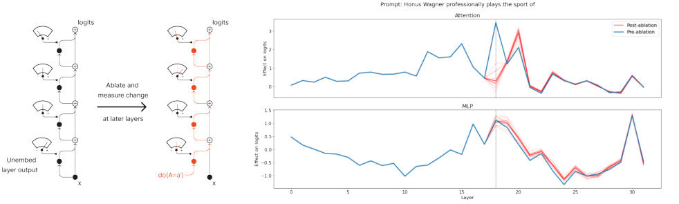

Figure 1 | Diagram of our protocol for investigating network self-repair and illustrative results. The blue line indicates the effect on output logits for each layer for the maximum-likelihood continuation of the prompt shown in the title. Faint red lines show direct effects following ablation of at a single layer indicated by dashed vertical line (attention layer 18 in this case) using patches from different prompts and the solid red line indicates the mean across patches. See Section 2 for details. 

## **1. Introduction** 

Ablation studies are a vital tool in our attempts to understand the internal computations of neural networks: by ablating components of a trained network at inference time and studying the downstream effects of these ablations we hope to be able to map the network’s computational structure and attribute responsibility among different components. In order to interpret the results of interventions on neural networks we need to understand how network computations respond to the types of interventions we typically perform. A natural expectation is that ablating important components will substantially degrade model performance (Morcos et al., 2018) and may cause cascading failures that break the network. We demonstrate that the situation in large language models (LLMs) is substantially more complex: LLMs exhibit not just redundancy but actively self-repairing computations. When one layer of attention heads is ablated, another later layer appears to take over its function. We call this 

the Hydra effect: when one set of heads is cut off, other heads grow in importance1 . We present these results in Section 2. 

The Hydra effect (referred to in (Wang et al., 2022) as backup behaviour) complicates our understanding of what it means for a network component to be important because two natural-seeming measures of importance (unembedding and ablation-based measures) become much less correlated than we would naïvely expect. These impact measurements correspond to the direct and total effect, which we introduce in a short, self-contained primer on causal inference in neural networks in Section 3 before performing a more comprehensive quantitative analysis of the Hydra effect in Section 4. Finally we discuss related work in Section 5 and close by hypothesising possible causes for our findings and discuss their implications for future causal analyses of language model computations in Section 6. 

## **2. Self-repair and the Hydra effect** 

### **2.1. The Transformer architecture for autoregressive language modelling** 

We want to analyse the computational structure of large autoregressive language models with an decoder-only Transformer architecture. In this work we use a 7 billion parameter model from the Chinchilla family (meaning that the architecture and training setup is identical to that proposed in (Hoffmann et al., 2022) but the model is approximately 7 billion parameters and the training dataset size is scaled down appropriately). An autoregressive language model maps a sequence of input tokens _𝑥_ ≤ _𝑡_ = ( _𝑥_ 1 _, . . . , 𝑥𝑡_ ) of length _𝑡_ to a probability distribution over the next token _𝑥𝑡_ +1 using a function _𝑓𝜃_ 

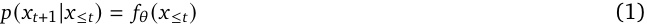

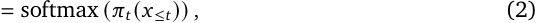

where the pre-softmax values _𝜋_ are called the logits. The function _𝑓𝜃_ is a standard Transformer architecture comprised of _𝐿_ layers 

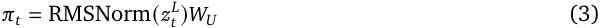

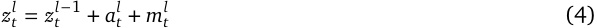

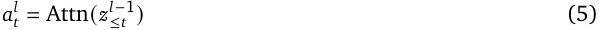

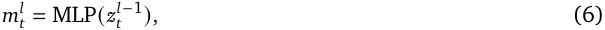

where RMSNorm(·) is an RMSNorm normalisation layer, _𝑊𝑈_ an unembedding matrix Attn(·) an attention layer (Bahdanau et al., 2014; Vaswani et al., 2017) and MLP(·) a two-layer perceptron. The dependence of these functions on the model parameters _𝜃_ is left implicit. In common with much of the literature on mechanistic interpretability (e.g. Elhage et al. (2021)) we refer to the series of residual activations _𝑧𝑖__𝑙_,_𝑖_= 1_, . . . , 𝑡_as the residual stream.For more details on the Transformer architecture in language modelling and the specific details of Chinchilla language models see (Hoffmann et al., 2022; Phuong and Hutter, 2022). As an additional notational shorthand we will typically denote the dependence of network activations on inputs by skipping the repeated function composition and simply writing _𝑧𝑡__𝑙_(_𝑥_≤_𝑡_)(or_𝑎_ _𝑡__𝑙_(_𝑥_≤_𝑡_,_𝑚_ _𝑡__𝑙_(_𝑥_≤_𝑡_)) to denote the activations at layer_𝑙_, position_𝑡_due to input string _𝑥_ ≤ _𝑡_ rather than writing the full recursive function composition implied by Equations 3-6. 

> 1Although evocative, we recognise that the use of the name ‘Hydra’ is not completely mythologically accurate: sometimes only one head grows in importance, and as we show in Section 4 the total effect decreases on average, in contrast with the behaviour of the mythological Hydra. 

### **2.2. Using the Counterfact dataset to elicit factual recall** 

The Counterfact dataset, introduced in (Wang et al., 2022), is a collection of factual statements originally intended to evaluate the efficacy of model editing. The dataset comprises a series of prompts formed by combining tuples of subject, relation, and object ( _𝑠, 𝑟, 𝑜_∗ _, 𝑜__𝑐_ ), where _𝑠_ is the subject (e.g. Honus Wagner), _𝑟_ the relation (e.g. “professionally plays the sport of”), _𝑜_∗ the true object (e.g. baseball), and _𝑜__𝑐_ some counterfactual claim that makes sense in context. We are interested in the way that language models store and relate factual knowledge so we only use the concatentation of _𝑠_ and _𝑟_ to form our prompts. This produces prompts whose completion requires factual knowledge that Chinchilla 7B can complete answer correctly. 

### **2.3. Measuring importance by unembedding** 

One way to assess the effect of a neural network layer is to attempt to map its outputs onto the network output logits. We discuss approaches that use a learned probe in Section 5, however in this work we use the model’s own unembedding mechanism _𝑢_ to compute effects. This approach, often referred to as the logit lens, was introduced in (nostalgebraist, 2020) and has also been used in subsequent interpretability research (Dar et al., 2022; Geva et al., 2022a). The GPT-2 model used in the original logit lens analysis had a LayerNorm (Ba et al., 2016) prior to unembedding, however in the Chinchilla model we analyse the unembedding function is an RMSNorm (Zhang and Sennrich, 2019) followed by an unembedding matrix _𝑊𝑈_ : 

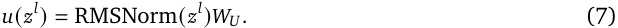

RMSNorm is a simplification of LayerNorm referred to as RMSNorm Zhang and Sennrich (2019) which dispenses with centring and the learned bias term: 

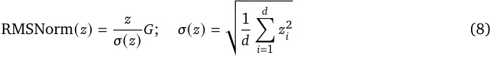

where _𝑧𝑖_ is the _𝑖_ -th element of the vector _𝑧_ and _𝐺_ is a learned diagonal matrix. In the remainder of this paper, unembedding refers to computing the logit lens distribution _𝜋_ ˜ _𝑡_ = _𝑢_ ( _𝑧𝑡__𝑙_)= RMSNorm(_𝑧_ _𝑡__𝑙_)_𝑊𝑈_ using the model’s final RMSNorm layer. 

### **_2.3.1. Impact metric_** 

Our unembedding-based impact measurement Δunembed will be measured in terms of model logits over the vocabulary _𝑉_ . Whenever we deal with logits, either from inference by the complete model or from unembedding, we will first centre the logits: 

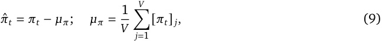

where [ _𝜋𝑡_ ] _𝑗_ indicates the logit of the _𝑗_ -th vocabulary element. We measure the impact of an attention layer _𝑎__𝑙_ on the logit of the maximum-likelihood token at the final token position _𝑡_ : 

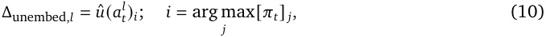

where _𝑢_ ˆ denotes the centred version of the logits obtained by unembedding as in Equation 9. We also repeat the procedure for the MLP layers _𝑚__𝑙_ , _𝑙_ = 1 _, . . . , 𝐿_ . We fix the RMSNorm normalisation 

factor _𝜎_ to the value attained in the forward pass, i.e. _𝜎_ = _𝜎_ ( _𝑧𝑡__𝐿_)where_𝐿_denotes the final layer of the network. Fixing the normalisation factor means that the effect of each layer output on the logits is linear, and corresponds to the unembedding that is actually carried out during the model’s forward pass. As we will show in Section 3, unembedding in this way corresponds to the direct effect from causal inference. 

### **2.4. Measuring importance by ablation** 

An alternative approach to investigating a layer’s function is to ablate it by replacing its output with some other value, for example replacing _𝑎𝑡__𝑙_with an identically-shaped vector of zeros during network inference would ablate _𝑎𝑡__𝑙_.This approach has appealing parallels to standard methodologies in neuro- science and has been suggested as a gold standard for evidence in interpretability research (Leavitt and Morcos, 2020). We naturally expect that ablating components that are important for a given input will lead to degraded performance on that input (indeed this seems like a reasonable definition of importance) and if a network’s internal mechanisms generalise then the ablation will also lead to degraded performance on other similar inputs. 

### **_2.4.1. Intervention notation & impact metric_** 

In keeping with standard notation in causality (Glymour et al., 2016; Pearl, 2009) we indicate replacing one set of activations _𝑎𝑡__𝑙_with another using the do(·)operation.Here we need to introduce some additional notation: we refer to specific nodes in the model’s compute graph using capital letters and their actual realisation on a set of inputs with lowercase. For example: _𝐴𝑡__𝑙_refers to the attention output at layer _𝑙_ and position _𝑡_ , whereas _𝑎𝑡__𝑙_(_𝑥_≤_𝑡_)refers to the value of this vector when the model is evaluated on inputs _𝑥_ ≤ _𝑡_ (when the dependence on inputs is omitted for brevity it should be either clear from context or not relevant). If we have inputs _𝑥_ ≤ _𝑡_ that result in logits _𝜋𝑡_ ( _𝑥_ ≤ _𝑡_ ) we would write the value of _𝜋𝑡_ ( _𝑥_ ≤ _𝑡_ ) following an intervention on _𝐴𝑡__𝑙_as 

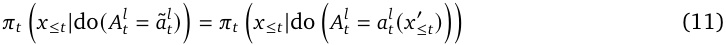

for some alternative input _𝑥_′ ≤ _𝑡_(see Appendix A for details of how alternative inputs can be chosen). As with the unembedding impact measure Δunembed we measure the impact of ablation Δablate on the centred logit _𝜋_ ˆ of the maximum-likelihood token _𝑖_ for a given input _𝑥_ ≤ _𝑡_ (see Section 2.3.1). To compute Δablate _,𝑙_ of attention layer _𝑙_ , token position _𝑡_ we instead compare the centred logit of the maximum-likelihood token _𝑖_ before and after intervention: 

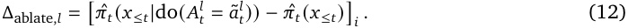

As we will show in Section 3, Equation 12 corresponds to measuring the total effect of _𝐴𝑡__𝑙_inthe context _𝑥_ ≤ _𝑡_ . We used resample ablation (Chan et al., 2022) with patches from 15 alternative prompts from the dataset to provide ablation activations _𝑎_ ˜ _𝑡__𝑙_(see Appendix A for more details). 

### **2.5. Ablation-based and unembedding-based importance measures disagree in most layers** 

We calculate the importance of each layer according to both ablation and unembedding-based measures of importance for all layers of Chinchilla 7B for all prompts in the Counterfact dataset. For each prompt we calculate Δunembed _,𝑙_ and Δablate _,𝑙_ at the final token position for every attention and MLP layer. 

These results are shown in Figure 2, which shows average and per-prompt results, demonstrating a substantial disagreement between Δunembed and Δablate. This is surprising as we would expect that 

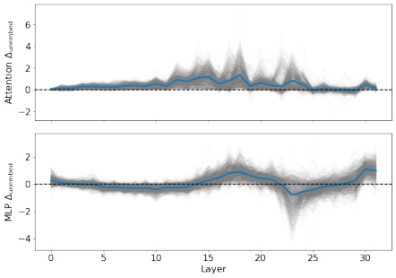

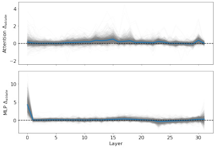

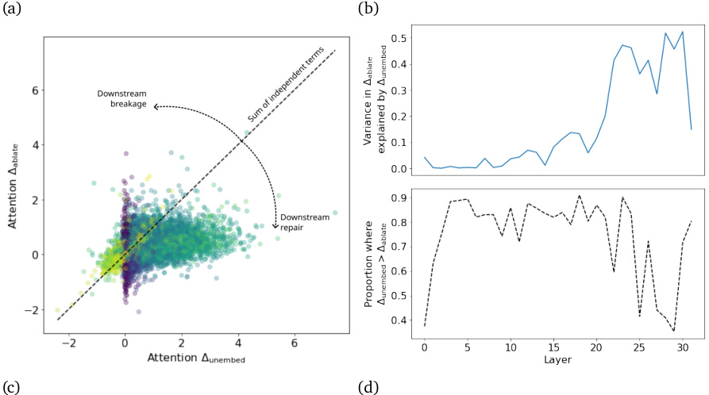

<!-- Start of picture text -->
(a) (b) (c) (d) <!-- End of picture text -->

Figure 2 | Measurements of (a) unembedding-based and (b) ablation-based impact for MLP and attention layers for a 7B parameter language model on the Counterfact dataset. Grey lines indicate per-prompt data, blue line indicates average across prompts. (c) Comparison of unembedding- and ablation-based impact measures across all layers showing low correlation and Δunembed _>_ Δablate for most prompts and layers, contrary to expectations. (d) Quantification of correlation between Δunembed and Δablate and proportion of prompts where Δunembed _>_ Δablate across layers. 

ablating a layer not only destroys its impact on the logits from unembedding but potentially also breaks further downstream network components, so we would expect that the ablation-based measure would be greater than or equal to the unembedding measure. As Figure 2 shows, this is far from the case. We now demonstrate that the lack of correlation between ablation and unembedding measures of component importance at all but the late layers of the network is due to downstream changes in layer outputs that counteract the effect of ablations. 

### **_2.5.1. Methodology_** 

In order to understand the mechanism behind the difference in results from ablation and unembedding methods we propose a simple methodology that allows us to localise changes in network computation. First, for each input _𝑥_ ≤ _𝑡_ we compute attention and MLP outputs _𝑎𝑡__𝑙_(_𝑥_≤_𝑡_)and_𝑚_ _𝑡__𝑙_(_𝑥_≤_𝑡_)foralllayers 

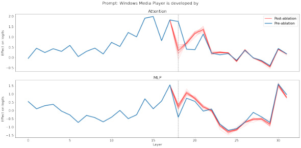

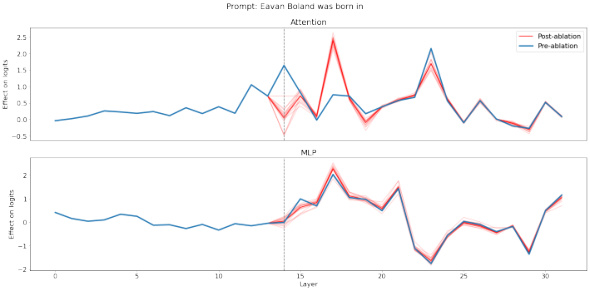

Figure 3 | Example results of self-healing computations in Chinchilla 7B showing per-layer impact on final logits before and after ablation. 

_𝑙_ . We refer to this as the clean run, matching the terminology from (Meng et al., 2022). We then compute the unembedding-based impact Δunembed _,𝑙_ as defined in Section 2.3.1. This gives us a perlayer measure of the impact of each layer on the maximum-likelihood logit in the clean run. We then ablate a specific attention or MLP layer _𝑘_ using resample ablation (see Appendix A). We refer to this as the layer _𝑘_ ablation run. We now compute Δunembed _,𝑙_ for each layer _𝑙_ and layer _𝑘_ ablation run. We denote a specific unembedding layer _𝑙_ and ablation layer _𝑘_ by Δ˜_𝑘_ unembed _,𝑙_: 

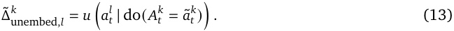

Because the transformer network is a feedforward network, if a readout layer _𝑙_ is not causally downstream of the ablation layer _𝑘_ then Δ˜ unembed_𝑘_ _,𝑙_=Δunembed_,𝑙_.If_𝑘_=_𝑙_thenΔ˜ unembed_𝑘_ _,𝑙_≈0becausethe output of that layer will be ablated (the approximate equality is due to the fact that the resample ablation is stochastic and so may not fully zero out the centred logit of the maximum-likelihood token). 

This methodology, depicted in Figure 1, measures the impact of each layer on the maximum-likelihood token before and after ablation. This allows us to determine how individual layers react to a given ablation. 

### **_2.5.2. Results_** 

Sample results for attention ablation are shown in Figure 1 and Figure 3 showing ablations of layers with high Δunembed. Several observations stand out from this data: 

**Resample ablations work but are noisy:** Resample ablations successfully reduce Δunembed of the ablated layer to approximately zero when averaged across patches, although there is substantial 

variance between the effect of each patch. This demonstrates that resample ablations can provide true ablations but require a reasonably large sample size to prevent excessive noise. 

**The Hydra effect occurs in networks trained without dropout:** In both cases an attention layer downstream of the ablated layer (layer 20 in the examples shown) substantially _increases_ its impact in the ablated network compared to the intact network, i.e. Δ˜ unembed_𝑚_ _,𝑙__>_Δunembed_,𝑙_for some unembedding layer _𝑙> 𝑚_ . These are examples of the Hydra effect: we cut off some attention heads, but others grow their effect to (partially) compensate. The Chinchilla-like language model we study here was trained entirely without dropout, stochastic depth, or layer dropout. 

**Downstream effects of ablation on attention layers are localised:** The effects of attention ablation on downstream layers are localised: apart from the subsequent attention layer involved in the Hydra effect, other attention layers have Δunembed almost entirely unchanged in the ablated network. This does not necessarily imply that the features that would have been created by the ablated layer are unused in later layers, however (although it is consistent with this hypothesis). It is possible that the Hydra effect is not just compensating for the impact of the ablated layer on logits, but is also replacing the missing features that the ablated layer would have provided. More detailed multiple ablation studies would be needed to distinguish between these hypotheses. 

**Downstream MLPs may perform erasure/memory management:** The shape of the unembedding impact curve across layers for the MLP layers remains very similar, but the impact of many of the layers is attenuated. This suggests that these MLPs are performing an erasure/memory-management role: when the attention layer has a high positive impact they have a high negative impact and when the attention layer’s Δunembed is reduced theirs is similarly attenuated. 

Although these observations are surprising, the evidence we have presented here is largely anecdotal. Before expanding our analysis to the full Counterfact dataset and analysing all layers in Section 4 we first introduce basic tools of causal inference and reframe our analyses in terms of concepts from causality in Section 3. 

## **3. Neural networks as causal models: the compute graph is the causal graph** 

This section introduces structural causal models, causal graphs and the idea of interventions. The central idea of this section is that we can consider the internal structure of neural networks as structural causal models and use tools from causality to analyse their internal workings. One thing we are _not_ claiming is that neural networks are naturally forming causal models of their training data, or that networks learn to perform causal reasoning - the degree to which this happens in practice or forms the basis for successful generalisation is still not well understood. 

### **Causal models** 

**Definition 3.1** (Causal model) **.** A structural causal model _𝑀_ is a tuple _𝑀_ = ⟨ _𝑈, 𝑉, 𝐹, 𝑃_ ( _𝑢_ )⟩ where: 

1. _𝑈_ and _𝑉_ are sets of variables called the exogenous and endogenous variables respectively. We follow the standard convention of writing a random variable in uppercase and a specific realisation of that variable in lowercase, so _𝑢_ is a realisation of the exogenous variable _𝑈_ . 

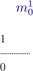

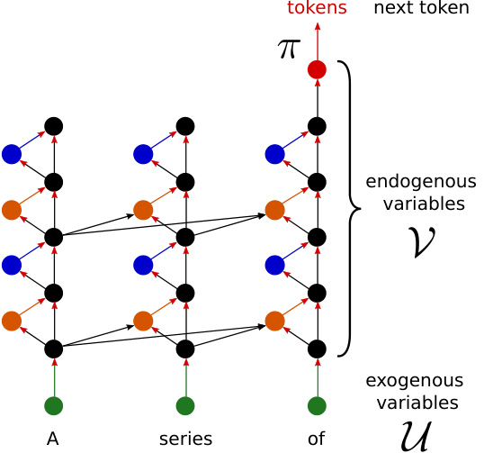

<!-- Start of picture text -->
tokens next token endogenous variables exogenous variables A series of <!-- End of picture text -->

Figure 4 | Viewing a transformer network as a structural causal model. 

2. _𝐹_ is a set of deterministic functions where _𝑓𝑖_ ∈ _𝐹_ determines the value of _𝑉𝑖_ from a subset of variables Pa _𝑖_ ∈ _𝑈_ ∪ _𝑉_ \ { _𝑉𝑖_ }, i.e. _𝑣𝑖_ = _𝑓𝑖_ (pa _𝑖_ ). 

3. _𝑃_ ( _𝑢_ ) is a probability distribution over exogenous variables _𝑈_ . 

In a structural causal model the exogenous variables _𝑈_ represent randomly-set external conditions (the ‘context’) and the endogenous variables _𝑉_ follow deterministically from the context _𝑢_ . Given a setting of exogenous variables _𝑈_ = _𝑢_ , the value of an endogenous variable _𝑉𝑖_ is fully determined. We write the value _𝑉𝑖_ takes in this situation as _𝑉𝑖_ ( _𝑢_ ) to reflect this rather than write the full set of functions relating _𝑉𝑖_ to _𝑈_ for conciseness and generality. 

We can visualise structural causal models as directed graphs where an edge _𝑋𝑖_ → _𝑋 𝑗_ (for _𝑋𝑖, 𝑋 𝑗_ ∈ _𝑈_ ∪ _𝑉_ ) exists if _𝑋𝑖_ ∈ pa _𝑖_ , i.e. if _𝑋𝑖_ is one of the variables that directly determines the value of _𝑋 𝑗_ . The important factor distinguishing _𝑈_ from _𝑉_ is that variables in _𝑈_ have no in-edges: there is nothing apart from the probability distribution _𝑃_ ( _𝑢_ ) that determines their value. Variables in _𝑉_ , on the other hand, can eventually trace their ancestry back to one or more values in _𝑈_ (although in large models it may take many edges to do so). 

**Interventions & counterfactuals in causal models** In a causal model an intervention do( _𝑍_ = _𝑧_′ ) alters the value of an endogenous variable _𝑍_ from whatever value it would have taken based on its parents _𝑧_ = _𝑓𝑍_ (pa _𝑍_ ) to the new value _𝑧_′ . This entails a change in the causal model _𝑀_ to a new intervened-upon model _𝑀𝑍_ where _𝑀𝑍_ is identical to _𝑀_ except that _𝑓𝑍_ (pa _𝑍_ ) = _𝑧_′ regardless of the values taken by pa _𝑍_ : the function _𝑓𝑍_ has been replaced by a constant function returning _𝑧_′ . In terms of the causal graph this leads to a removal of in-edges to _𝑍_ (as it no longer depends on other elements of the graph) and the addition of a new intervention edge (see Figure 5 for some examples). We express this intervention using the do-operator (Pearl, 2009), where _𝑌_ ( _𝑢_ | do( _𝑍_ = _𝑧_′ )) denotes the value that _𝑌_ takes in the modified model _𝑀𝑍_ given the context _𝑢_ . 

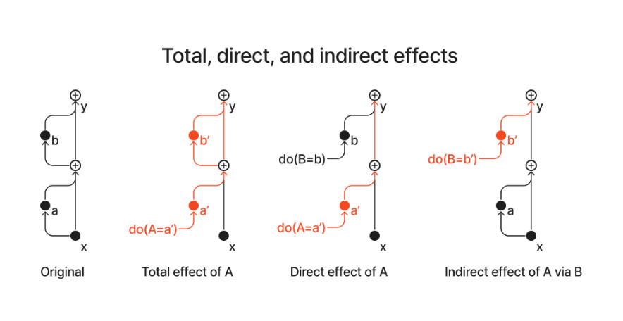

Figure 5 | Interventions and types of effect illustrated with a two-layer residual network example. The total effect involves intervening on a node and allowing the changes due to that intervention to propagate arbitrarily, whereas the direct effect only allows those changes to propagate via the direct path between intervention and output. The indirect effect is the complement of the direct effect: effects are allowed to flow via all but the direct path. 

**Treating language models as causal models** Given these preliminaries the correspondence between neural networks and structural causal models is hopefully clear: the input data _𝑥_ correspond to the exogenous variables _𝑈_ and the network’s activations ( _𝑧_ , _𝑎_ , _𝑚_ ) and outputs _𝜋_ correspond to the endogenous variables _𝑉_ . In autoregressive transformer-based language models causal masking ensures that activations at input position _𝑡_ 1 are never causal parents of activations at input position _𝑡_ 2 if _𝑡_ 1 _> 𝑡_ 2. For the remainder of this work we will assume a standard Transformer architecture, as shown in Figure 4. Intervening on neural networks is identical to intervening in a SCM: we set the nodes to their intervention values and propagate the effects of this intervention forwards. Although for concreteness we focus on language modelling using transformers, the general framework of causal analysis is applicable to deterministic feedforward neural networks more generally - all that changes is the structure of the graph. Stochastic networks such as VAEs or diffusion models can be incorporated by adding additional exogenous nodes corresponding to sources of noise. 

### **3.1. Direct, indirect, and total effects** 

We now have the notation and concepts needed to define and compute several important types of effects in causal graphs: the total, direct, and indirect effects. When we define the different types of effect in a causal model we will always consider the effects in a given context (i.e. a given setting of exogenous variables _𝑢_ ). 

**Definition 3.2** (Total effect) **.** The total effect of altering the value of a variable _𝑍_ from _𝑍_ = _𝑧_ to _𝑍_ = _𝑧_′ on another variable _𝑌_ in a context _𝑢_ is given by 

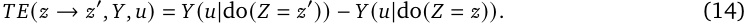

**Total effect corresponds to ablation-based impact** If we choose _𝑌_ = _𝜋_ ˆ _𝑡_ (i.e. the random variable we measure the effect of the intervention on is the centred logit of the maximum-likelihood token _𝑖_ at 

the final token position _𝑡_ ) and the exogenous variables are the prompt _𝑢_ = _𝑥_ ≤ _𝑡_ then we the total effect of an intervention to change activations _𝐴𝑡__𝑙_fromtheir‘natural’_𝑎_ _𝑡__𝑙_=_𝑎_ _𝑡__𝑙_(_𝑥_≤_𝑡_)toanintervened-upon value _𝑎_ ˜ _𝑡__𝑙_=_𝑎_ _𝑡__𝑙_(_𝑥_′ ≤ _𝑡_)is 

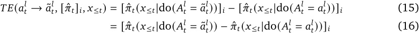

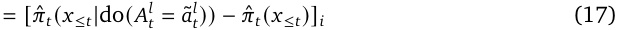

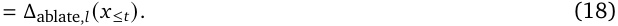

where we go from Equation 16 to 17 by using the fact that the intervention do( _𝐴𝑡__𝑙_=_𝑎_ _𝑡__𝑙_)doesn’t change _𝐴𝑡__𝑙_from the value it would have taken in the context_𝑥_≤_𝑡_, as in Section 2.4.1.This shows that our ablation-based impact measure corresponds to measuring the total effect due to a change from the natural activation distribution to one sampled from the ablation distribution. The total effect of ablation (knockout) measures the importance of a unit in a given inference: if we were to ablate it, how much would performance suffer if the effects of the ablation were to cascade through the network. 

**Definition 3.3** (Direct effect) **.** The direct effect of altering _𝑍_ = _𝑧_ → _𝑍_ = _𝑧_′ is given by 

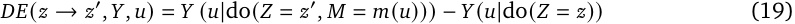

i.e. the effect of intervening to set _𝑍_ = _𝑧_′ and then resetting all other variables _𝑀_ = _𝑉_ \ { _𝑍, 𝑌_ } to the value they would have obtained in the context _𝑢_ . As with the total effect, if _𝑧_ = _𝑧_ ( _𝑢_ ) then the direct effect reduces to 

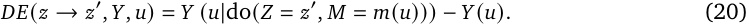

The direct effect measures how much changing the unit’s value would affect the output if all other units’ values were held constant. Because of this, in a language model only units connected via a residual path to the output (i.e. at the same token position) can have a direct effect - all other units must have their effect mediated by at least one attention head in order to cross between token positions. The residual structure of our language models means that effects on logits are additive (up to a normalisation constant introduced by RMSNorm), and so every change in logits eventually occurs due to a direct effect. 

**Unembedding-based impact with RMSnorm held constant approximates direct effect** To see the relation between the unembedding-based impact Δunembed _,𝑙_ and the direct effect of an attention variable _𝐴𝑡__𝑙_on the logits_𝜋_ˆ_𝑡_in context_𝑥_≤_𝑡_we first rewrite the architecture defined by Equations 3-6 in the ‘unrolled view’ introduced by Veit et al. (2016) (for more details on this mathematical perspective on transformers see (Elhage et al., 2021)): 

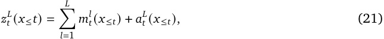

where _𝐿_ is the final layer of the network and we leave the dependence of activations at layer _𝐿_ on earlier layers implicit. To get the logits we simply unembed _𝑧𝑡__𝐿_: 

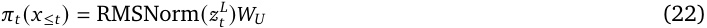

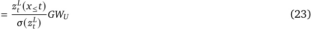

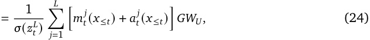

where _𝐺_ is the RMSNorm gain matrix and _𝑊𝑈_ is the unembedding matrix (see Sections 2.1 and 2.4.1). Equation 24 demonstrates that the logits (and thus the centred logits _𝜋_ ˆ) are linear in the layer outputs so long as the RMSNorm scale factor _𝜎_ ( _𝑧𝑡__𝐿_)is held constant.Now we can compute the direct effect of ablating attention layer output _𝑎𝑡__𝑙_on the logits (we omit centring as in Equation 9 here for brevity, but it is trivial to include): 

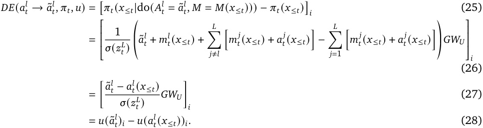

The only difference (up to centring) between the direct effect computed above and Δunembed _,𝑙_ is the inclusion of the impact of the ablation on the maximum-likelihood token _𝑢_ ( _𝑎_ ˜ _𝑡__𝑙_)_𝑖_.This factor is typically negligible if the source of resample ablations are chosen correctly (otherwise the ablation would still be substantially increasing the probability of the maximum-likelihood token) and is zero in the case of zero ablations, in which case Δunembed _,𝑙_ = _𝐷𝐸_ ( _𝑎𝑡__𝑙_→_𝑎_˜ _𝑡__𝑙,_ˆ_𝜋𝑡, 𝑢_). 

**Definition 3.4** (Indirect effect) **.** The indirect effect of altering _𝑧_ → _𝑧_′ is given by 

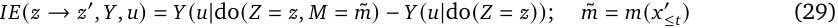

which is the effect of setting the variables _𝑀_ to their ablation values while also resetting _𝑍_ to its default value _𝑧_ . 

Indirect effect measures the effect that a unit has via downstream units, i.e. variables that are on the path from _𝑍_ to _𝑌_ (we say a variable _𝑀_ satisfying this criterion _mediates_ the relationship between _𝑍_ and _𝑌_ ). Units inside a circuit that is important in the current context will have high indirect effect, whereas units at the terminus of the circuit will have high direct effect. When we don’t specify the mediating variables we assume that all variables between the intervened variables and the output variables are changing. 

### **3.2. Challenges and opportunities in intervening in neural networks** 

The difficulties and affordances involved in performing causal analysis on neural networks are almost the opposite of those involved in most real-world causal analysis: we know the causal model with complete certainty (down to the level of individual parameters), can perform arbitrarily long chains of interventions rapidly and can read the value of all variables simultaneously. On the other hand, our causal models involved enormous numbers of individual parameters, and these parameters have no obvious meaning attached to them (with the exception of input and output variables). Painstaking analysis often suggests meanings for individual neurons or clusters of neurons (Bau et al., 2018; Carter et al., 2019; Goh et al., 2021; Hilton et al., 2020) but the correct unit of analysis still remains unclear (Morcos et al., 2018). A recent line of work on a phenomenon known as superposition has begun to shed some light on how directions in activation space relate to meaningful units of analysis (Elhage et al., 2022) but this work has yet to reach any definitive conclusions that allow us to decide how to group neurons to reduce the size of the graph. For this reason we work with ablations at the level of individual layers, while acknowledging that this level of analysis is still likely to be too coarse to capture all the relevant phenomena. 

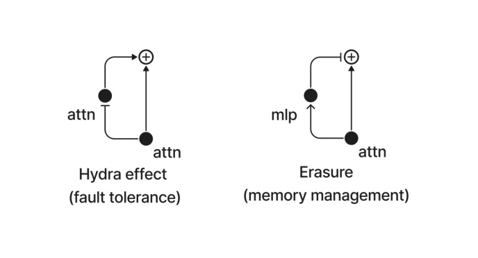

Figure 6 | Network motifs that cause total and direct effect to be uncorrelated, either by self-repair or erasure. An arrow-ended line _𝑋_ → _𝑌_ indicates that _𝑋_ increases _𝑌_ whereas a bar-ended line indicates that _𝑋_ inhibits _𝑌_ . 

### **3.3. Toy model and motif for the Hydra effect** 

We now turn the tools of causal inference that we have just introduced to our findings on self-repair by studying a simplified toy model of the phenomena we observed in Section 2. These toy models both use a simple causal model involving a single exogenous variable _𝑢_ and endogenous variables _𝑥_ ( _𝑢_ ) = _𝑢_ and _𝑦_ : 

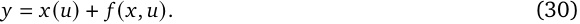

If we intervene to set _𝑥_ = 0, what functions _𝑓_ will ensure that the total effect _𝑇𝐸_ ( _𝑥, 𝑦_ ) is zero? Two simple possibilities stand out: 

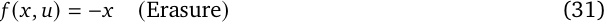

which will ensure that _𝑦_ = 0 regardless of the input variable _𝑢_ , or 

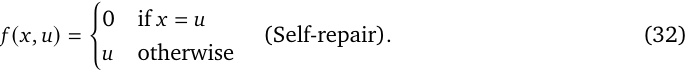

In both cases the output variable _𝑦_ is kept unchanged regardless of the inner workings of the model, but in the erasure case it is clamped to zero whereas in the self-repair case it is fixed at _𝑢_ . Although these simple circuits are stylised in order to illustrate a point, they turn out to be surprisingly good models of phenomena we observe in real language models. 

## **4. Quantifying erasure and the Hydra Effect** 

### **4.1. Methodology** 

For a given context _𝑢_ we can measure the total compensatory effect following an ablation _𝑎_ ˜_𝑚_ by summing the effects of the downstream changes in the network: 

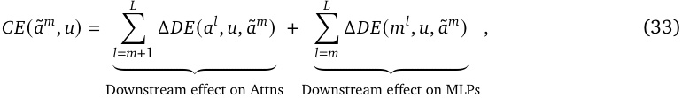

where Δ _𝐷𝐸_ is the difference in direct effects between the ablated and unablated networks: 

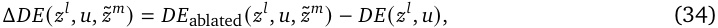

where _𝐷𝐸_ ablated( _𝑧__𝑙_ _, 𝑢,_ ˜ _𝑧__𝑚_ ) = Δ˜ unembed_𝑘_ _,𝑙_isthedirecteffectoflayer_𝑙_followinganablationatlayer_𝑚_ in context _𝑢_ . The starting index of the downstream MLPs and attention layers differs because MLP layers follow attention layers in our model. The compensatory effect for MLP ablations _𝐶𝐸_ ( ˜ _𝑚__𝑚_ _, 𝑢_ ) is identical to Equation 33 except that the MLP sum index starts at _𝑚_ + 1. We generate a dataset of direct and compensatory effects by computing _𝐷𝐸_ ( _𝑎__𝑙_ _, 𝑢_ ), _𝐷𝐸_ ( _𝑚__𝑙_ _, 𝑢_ ), _𝐶𝐸_ ( _𝑎__𝑙_ _, 𝑢_ ) and _𝐶𝐸_ ( _𝑚__𝑙_ _, 𝑢_ ) for all layers _𝑙_ and all 1,209 contexts _𝑢_ in the Counterfact dataset, i.e. for every prompt we compute the direct and compensatory effects of every possible layer ablation. 

### **4.2. Results** 

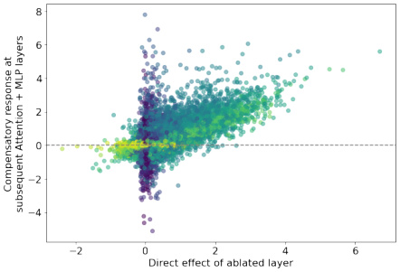

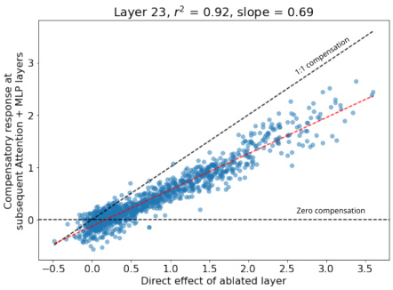

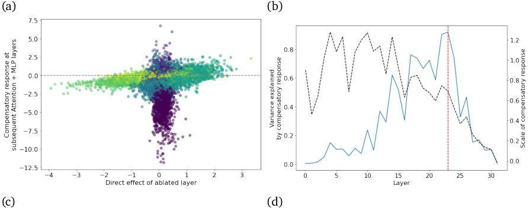

<!-- Start of picture text -->
(a) (b) (c) (d) <!-- End of picture text -->

Figure 7 | Results from carrying out ablations at all layers across the entire Counterfact dataset. (a) Direct effects against compensatory effect for attention layers, with colourmap indicated network depth. Middle layers show strong correlations whereas early and late layers do not. (b) Relation between direct and compensatory effect at the layer with the highest correlation, which occurs at layer 23 where compensation explains 92% of the variance in changes between the intact and ablated network. (c) Same as (a) but for MLP layers. (d) Summary of variance explained (solid blue line) and slope (dashed black line) of a linear regression between direct and compensatory effects at each attention layer. Red line marks layer shown in subfigure (c). 

Results from full quantification of the compensatory effects across the full Counterfact dataset are 

shown in Figure 7, with data further broken out to individual layers in Figure 8. We highlight the following observations from these results: 

**Direct and compensatory effects are only well-correlated at intermediate layers:** early layer ablations have large total effects but almost no direct effect (Figure 8a, c, c.f. Figure 2) whereas very late layers only have non-negligible direct effect (which makes sense as there are few downstream layers for them to have an effect on). 

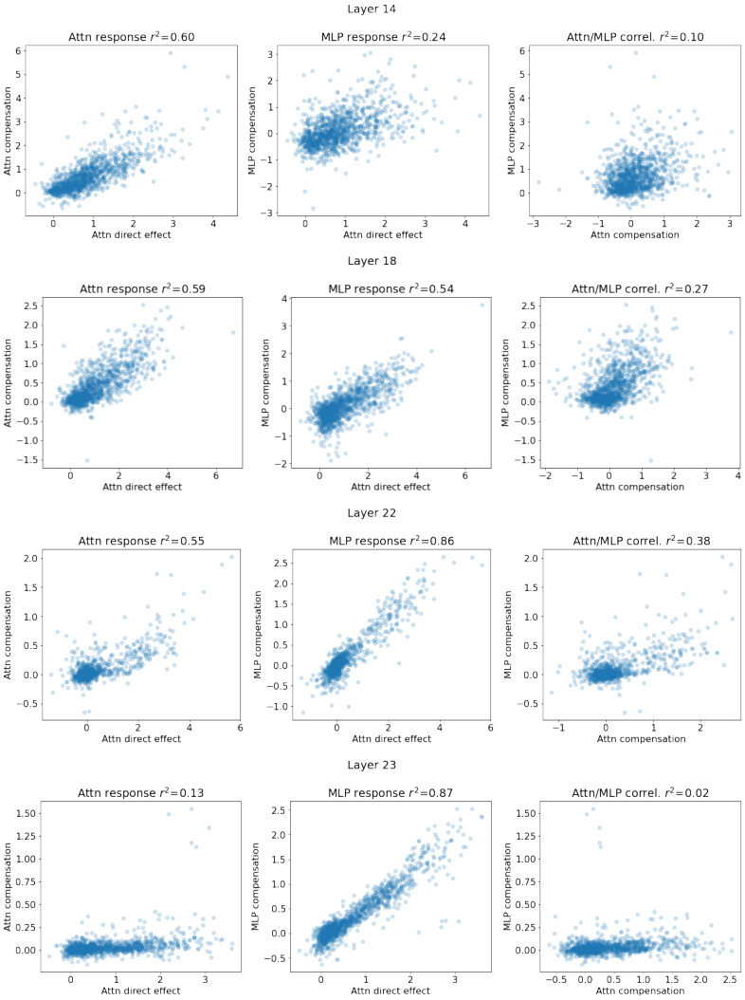

Figure 8 | Per-layer compensation results for a selection of ablation layers. The balance between the effect due to the attention and MLP layers shifts from attention to MLP as depth increases. 

**The compensatory response is almost entirely responsible for changes in direct effect at later layers.** Compensatory response is very highly correlated at intermediate-late layers (see Figure 8b, d), suggesting that the network’s response to ablations at these layers is almost entirely driven by the Hydra effect and a decrease in MLP erasure. Layer 23 (of 32) marks the high point of this phenomenon, with 92% of the variance in Δ _𝐷𝐸_ in downstream layers being explained by the Hydra effect. 

**The compensatory response does not fully restore the output:** fitting a linear regression between direct effect and compensatory response gives a slope of less than one at all layers past layer 13 (see Figure 7). This implies that these ablations _do_ have a nonzero total effect, but one that is much smaller than it would have been without the Hydra effect and responses from erasure MLPs. 

**The balance between the Hydra effect and reduction in MLP erasure shifts with network depth** Figure 8 shows Δ _𝐷𝐸_ for attention and MLP layers separately at different layers in the network. In early layers changes in attention direct effect play a considerably larger role, whereas by layer 22 the balance has shifted such that the the MLP response is considerably more predictive and at layer 23 almost all of the response is occuring in the erasure MLPs. 

## **5. Related Work** 

The use of techniques from causal inference to analyse neural networks has been used in a range of cases, including the causal tracing method for locating factual knowledge (Meng et al., 2022), mediation analyses for gender bias (Vig et al., 2020a,b) and analysis of syntactic agreement (Finlayson et al., 2021). There is also a recent line of work on constructing causal abstractions of neural network computations (Geiger et al., 2021, 2022, 2023a,b; Massidda et al., 2022). The use of ablations as a way of validating hypotheses about mechanisms in neural networks has been previously suggested (Chan et al., 2022; Leavitt and Morcos, 2020; Morcos et al., 2018), although our findings caution against straightforwardly interpreting low effectiveness of ablations as meaning that a network component is unimportant. 

Earlier work on residual networks (of which decoder-only transformers are a special case) determined that for image classification networks, residual networks behave like ensembles of shallower networks (Veit et al., 2016). This work introduced both the ‘unravelled view’ of residual networks that we make use of and experimented with ablating network layers at test time, determining that most effective paths through residual networks are short and layers often do not depend on one another. 

The idea of interpreting neural networks in terms of their internal mechanisms or circuits Olah et al. (2020) (often referred to as mechanistic interpretability) is relatively recent. Earlier work on vision models (Olah et al., 2018) identified human-understandable neurons and simple circuits (for instance curve detectors (Cammarata et al., 2020)). Subsequent work on transformers has identified ‘induction circuits’ responsible for simple instances of in-context learning (Elhage et al., 2021; Olsson et al., 2022), as well as a mechanism for indirect object identification (Wang et al., 2022) and the mechanism underlying the ‘grokking’ phenomenon (Chughtai et al., 2023; Nanda et al., 2023; Power et al., 2022). 

The use of probes to analyse neural network training originated in (Alain and Bengio, 2016), and has been widely used since. In the context of transformer language models the ‘logit lens’ approach, which involves using the model’s own unembedding matrix to decode the residual stream, has been applied to early GPT models (nostalgebraist, 2020). In order to better align with the model’s true 

outputs Belrose et al. (2023) use a learned affine unembedding rather than the model’s unembedding matrix and are also able to perform causal interventions using a learned ‘causal basis’. Geva et al. (2022b) and follow-on work (Dar et al., 2022; Geva et al., 2022a) analyse MLP layers by unembedding specific subspaces of their outputs. Sparse probing has been used to empirically study the superposition phenomenon (Elhage et al., 2022) in large language models (Gurnee et al., 2023) and has been used to understand concept learning in deep reinforcement learning agents (Forde et al., 2022; McGrath et al., 2022). 

## **6. Conclusion** 

**Findings** In this work we have investigated the computational structure of language models during factual recall by performing detailed ablation studies. We found that networks exhibit surprising self-repair properties: knockout of an attention layer causes another attention layer to increase its effect in order to compensate. We term this new motif the Hydra effect. We also found that late-layer MLPs appear to have a negative-feedback/erasure effect: late layer MLPs often act to reduce the probability of the maximum-likelihood token, and this reduction is attenuated when attention layers promoting that token are knocked out. We find that these effects are approximately linear, and that at middle layers (where these effects are strongest) the Hydra effect and reduction in MLP effects collectively act to restore approximately 70% of the reduction in token logits. 

**Implications for interpretability research** These findings corroborate earlier work on neural network computations in GPT-2 Small (Wang et al., 2022) which reported a similar effect that the authors term ‘backup heads’. The authors of (Wang et al., 2022) hypothesised that dropout (Srivastava et al., 2014) was responsible for self-repair behaviour, which we disprove as the model we study (Chinchilla 7B) was trained without any form of dropout or stochastic depth. The occurrence of this motif across tasks and models suggests that it may be an instance of universality (Olah et al., 2020). Our original motivation for this work was performing automated ablation studies using an algorithm similar to (Conmy et al., 2023), which led to us investigating the changes in network computation under repeated ablations. The Hydra effect poses a challenge to automating ablations: if we prioritise network components for ablation according to their total effect, we will be using a measure that does not fully reflect the computational structure of the intact network. Fortunately, the fact that the compensatory effect is typically less than 100% means that automated ablations will still have some signal to work with. The Hydra effect and erasure MLPs also have implications for attributing responsibility for a network’s output to individual network components: is the responsible component the attention layer that has the effect in the intact network, or the circuits that act to compensate following ablation? The framework of actual causality (Halpern, 2016) may be a useful way to approach this question. 

Our findings also suggest that attempting to assign semantics to MLP neurons may be more complicated than otherwise expected: erasure MLPs may have no clear semantics in terms of the model’s input, as they are responding to the language model’s internal computations. Finally, our findings also have implications for work that attempts to understand language models by unembedding the output of individual layers (e.g. (Geva et al., 2022b)) - this corresponds to an assumption that the direct effect is the only meaningful effect of a layer. The existence of erasure MLPs poses a challenge to this approach to interpretability: if the output of an attention layer or MLP is guaranteed to be partially undone by an erasure MLP, it’s no longer straightforward to interpret that output in terms of its direct effects on logits: the effect of the mediating MLPs should also be considered. Our findings also provide context for earlier ablation studies (such as (Morcos et al., 2018)): it is not enough simply to measure the total effect of an ablation without investigating downstream changes in the 

network, and more important network components are more likely to be robust to ablation. 

**Implications for language modelling research** From the perspective of language modelling the Hydra effect is surprising: it confers robustness to a kind of ablation that the model will never experience at inference time and so appears to be a waste of parameters. If this is the case, what benefit does it confer? One possibility (drawing on the analytical framework of Tinbergen’s four questions (Tinbergen, 1963)) is that the Hydra effect confers no benefit at inference time, but is beneficial in the context of training. If gradient descent were to occasionally break network components then a kind of ‘natural dropout’ would occur during training. In this case it would be beneficial for networks to be robust to layers failing. We emphasise that this is conjecture, however, and would need further research. 

**Possible extensions** Although we have identified two new motifs, we have not investigated more deeply than individual layers (for instance looking at the level of individual attention heads or directions in activation space). Achieving a greater level of precision is a natural next step and would unlock deeper understanding of the mechanisms at play here. Some questions that could be answered with a finer-grained understanding of how this kind of redundancy operates include: 

1. How much does the Hydra effect occur across the entire training distribution? Does sequence length play any role? 

2. What are the Hydra effect attention heads responding to the presence/absence of in the residual stream? 

3. Do the same downstream heads act as Hydra effect replacement heads across multiple contexts? 

4. What causes the Hydra effect? Is the natural dropout hypothesis correct or is some other phenomenon responsible (superposition has been suggested as an alternative explanation). 

5. Is there a Hydra effect for features rather than direct effect on logits? 

6. What are the erasure heads responding to in the residual stream? Do they have a ‘recalibration’ effect when a wider range of tokens is considered? 

7. If we account for redundancy/Hydra effect, can we probe network structure by using targeted ablations? 

**Acknowledgements** We would like to thank Joe Halpern, Avraham Ruderman, Tom Lieberum, Chris Olah, Zhengdong Wang, Tim Genewein and Neel Nanda for helpful discussions. 

## **References** 

- G. Alain and Y. Bengio. Understanding intermediate layers using linear classifier probes. _arXiv preprint arXiv:1610.01644_ , 2016. 

- J. L. Ba, J. R. Kiros, and G. E. Hinton. Layer normalization. _arXiv preprint arXiv:1607.06450_ , 2016. 

- D. Bahdanau, K. Cho, and Y. Bengio. Neural machine translation by jointly learning to align and translate. _arXiv preprint arXiv:1409.0473_ , 2014. 

- D. Bau, J.-Y. Zhu, H. Strobelt, B. Zhou, J. B. Tenenbaum, W. T. Freeman, and A. Torralba. Gan dissection: Visualizing and understanding generative adversarial networks. _arXiv preprint arXiv:1811.10597_ , 2018. 

- N. Belrose, Z. Furman, L. Smith, D. Halawi, I. Ostrovsky, L. McKinney, S. Biderman, and J. Steinhardt. Eliciting latent predictions from transformers with the tuned lens. _arXiv preprint arXiv:2303.08112_ , 2023. 

- N. Cammarata, G. Goh, S. Carter, L. Schubert, M. Petrov, and C. Olah. Curve detectors. _Distill_ , 5(6): e00024–003, 2020. 

- S. Carter, Z. Armstrong, L. Schubert, I. Johnson, and C. Olah. Activation atlas. _Distill_ , 2019. doi: 10.23915/distill.00015. https://distill.pub/2019/activation-atlas. 

- L. Chan, A. Garriga-Alonso, N. Goldwosky-Dill, R. Greenblatt, J. Nitishinskaya, A. Radhakrishnan, B. Shlegeris, and N. Thomas. Causal scrubbing, a method for rigorously testing interpretability hypotheses. _AI Alignment Forum_ , 2022. `https://www.alignmentforum.org/posts/ JvZhhzycHu2Yd57RN/causal-scrubbing-a-method-for-rigorously-testing` . 

- B. Chughtai, L. Chan, and N. Nanda. A toy model of universality: Reverse engineering how networks learn group operations. _arXiv preprint arXiv:2302.03025_ , 2023. 

- A. Conmy, A. N. Mavor-Parker, A. Lynch, S. Heimersheim, and A. Garriga-Alonso. Towards automated circuit discovery for mechanistic interpretability. _arXiv preprint arXiv:2304.14997_ , 2023. 

- G. Dar, M. Geva, A. Gupta, and J. Berant. Analyzing transformers in embedding space. _arXiv preprint arXiv:2209.02535_ , 2022. 

- T. Dettmers, M. Lewis, Y. Belkada, and L. Zettlemoyer. Llm. int8 (): 8-bit matrix multiplication for transformers at scale. _arXiv preprint arXiv:2208.07339_ , 2022. 

- N. Elhage, N. Nanda, C. Olsson, T. Henighan, N. Joseph, B. Mann, A. Askell, Y. Bai, A. Chen, T. Conerly, N. DasSarma, D. Drain, D. Ganguli, Z. Hatfield-Dodds, D. Hernandez, A. Jones, J. Kernion, L. Lovitt, K. Ndousse, D. Amodei, T. Brown, J. Clark, J. Kaplan, S. McCandlish, and C. Olah. A mathematical framework for transformer circuits. _Transformer Circuits Thread_ , 2021. https://transformercircuits.pub/2021/framework/index.html. 

- N. Elhage, T. Hume, C. Olsson, N. Schiefer, T. Henighan, S. Kravec, Z. Hatfield-Dodds, R. Lasenby, D. Drain, C. Chen, R. Grosse, S. McCandlish, J. Kaplan, D. Amodei, M. Wattenberg, and C. Olah. Toy models of superposition. _Transformer Circuits Thread_ , 2022. https://transformercircuits.pub/2022/toy_model/index.html. 

- M. Finlayson, A. Mueller, S. Gehrmann, S. Shieber, T. Linzen, and Y. Belinkov. Causal analysis of syntactic agreement mechanisms in neural language models. _arXiv preprint arXiv:2106.06087_ , 2021. 

- J. Z. Forde, C. Lovering, G. Konidaris, E. Pavlick, and M. L. Littman. Where, when & which concepts does alphazero learn? lessons from the game of hex. In _AAAI Workshop on Reinforcement Learning in Games_ , volume 2, 2022. 

- A. Geiger, H. Lu, T. Icard, and C. Potts. Causal abstractions of neural networks. _Advances in Neural Information Processing Systems_ , 34:9574–9586, 2021. 

- A. Geiger, Z. Wu, H. Lu, J. Rozner, E. Kreiss, T. Icard, N. Goodman, and C. Potts. Inducing causal structure for interpretable neural networks. In _International Conference on Machine Learning_ , pages 7324–7338. PMLR, 2022. 

- A. Geiger, C. Potts, and T. Icard. Causal abstraction for faithful model interpretation. _arXiv preprint arXiv:2301.04709_ , 2023a. 

- A. Geiger, Z. Wu, C. Potts, T. Icard, and N. D. Goodman. Finding alignments between interpretable causal variables and distributed neural representations. _arXiv preprint arXiv:2303.02536_ , 2023b. 

- M. Geva, A. Caciularu, G. Dar, P. Roit, S. Sadde, M. Shlain, B. Tamir, and Y. Goldberg. Lm-debugger: An interactive tool for inspection and intervention in transformer-based language models. _arXiv preprint arXiv:2204.12130_ , 2022a. 

- M. Geva, A. Caciularu, K. R. Wang, and Y. Goldberg. Transformer feed-forward layers build predictions by promoting concepts in the vocabulary space. _arXiv preprint arXiv:2203.14680_ , 2022b. 

- M. Glymour, J. Pearl, and N. P. Jewell. _Causal inference in statistics: A primer_ . John Wiley & Sons, 2016. 

- G. Goh, N. C. †, C. V. †, S. Carter, M. Petrov, L. Schubert, A. Radford, and C. Olah. Multimodal neurons in artificial neural networks. _Distill_ , 2021. doi: 10.23915/distill.00030. https://distill.pub/2021/multimodal-neurons. 

- W. Gurnee, N. Nanda, M. Pauly, K. Harvey, D. Troitskii, and D. Bertsimas. Finding neurons in a haystack: Case studies with sparse probing. _arXiv preprint arXiv:2305.01610_ , 2023. 

- J. Y. Halpern. _Actual causality_ . MiT Press, 2016. 

- J. Hilton, N. Cammarata, S. Carter, G. Goh, and C. Olah. Understanding rl vision. _Distill_ , 2020. doi: 10.23915/distill.00029. https://distill.pub/2020/understanding-rl-vision. 

- J. Hoffmann, S. Borgeaud, A. Mensch, E. Buchatskaya, T. Cai, E. Rutherford, D. d. L. Casas, L. A. Hendricks, J. Welbl, A. Clark, et al. Training compute-optimal large language models. _arXiv preprint arXiv:2203.15556_ , 2022. 

- M. L. Leavitt and A. Morcos. Towards falsifiable interpretability research. _arXiv preprint arXiv:2010.12016_ , 2020. 

- R. Massidda, A. Geiger, T. Icard, and D. Bacciu. Causal abstraction with soft interventions. _arXiv preprint arXiv:2211.12270_ , 2022. 

- T. McGrath, A. Kapishnikov, N. Tomašev, A. Pearce, M. Wattenberg, D. Hassabis, B. Kim, U. Paquet, and V. Kramnik. Acquisition of chess knowledge in alphazero. _Proceedings of the National Academy of Sciences_ , 119(47):e2206625119, 2022. 

- K. Meng, D. Bau, A. Andonian, and Y. Belinkov. Locating and editing factual associations in gpt. _Advances in Neural Information Processing Systems_ , 35:17359–17372, 2022. 

- A. S. Morcos, D. G. Barrett, N. C. Rabinowitz, and M. Botvinick. On the importance of single directions for generalization. _arXiv preprint arXiv:1803.06959_ , 2018. 

- N. Nanda, L. Chan, T. Liberum, J. Smith, and J. Steinhardt. Progress measures for grokking via mechanistic interpretability. _arXiv preprint arXiv:2301.05217_ , 2023. 

- nostalgebraist. interpreting gpt: the logit lens, 2020. URL `https://www.lesswrong.com/posts/ AcKRB8wDpdaN6v6ru/interpreting-gpt-the-logit-lens` . 

- C. Olah, A. Satyanarayan, I. Johnson, S. Carter, L. Schubert, K. Ye, and A. Mordvintsev. The building blocks of interpretability. _Distill_ , 3(3):e10, 2018. 

- C. Olah, N. Cammarata, L. Schubert, G. Goh, M. Petrov, and S. Carter. Zoom in: An introduction to circuits. _Distill_ , 2020. doi: 10.23915/distill.00024.001. https://distill.pub/2020/circuits/zoom-in. 

- C. Olsson, N. Elhage, N. Nanda, N. Joseph, N. DasSarma, T. Henighan, B. Mann, A. Askell, Y. Bai, A. Chen, et al. In-context learning and induction heads. _arXiv preprint arXiv:2209.11895_ , 2022. 

- J. Pearl. _Causality_ . Cambridge university press, 2009. 

- M. Phuong and M. Hutter. Formal algorithms for transformers. _arXiv preprint arXiv:2207.09238_ , 2022. 

- A. Power, Y. Burda, H. Edwards, I. Babuschkin, and V. Misra. Grokking: Generalization beyond overfitting on small algorithmic datasets. _arXiv preprint arXiv:2201.02177_ , 2022. 

- N. Srivastava, G. Hinton, A. Krizhevsky, I. Sutskever, and R. Salakhutdinov. Dropout: a simple way to prevent neural networks from overfitting. _The journal of machine learning research_ , 15(1): 1929–1958, 2014. 

- N. Tinbergen. On aims and methods of ethology. _Zeitschrift für tierpsychologie_ , 20(4):410–433, 1963. 

- A. Vaswani, N. Shazeer, N. Parmar, J. Uszkoreit, L. Jones, A. N. Gomez, Ł. Kaiser, and I. Polosukhin. Attention is all you need. _Advances in neural information processing systems_ , 30, 2017. 

- A. Veit, M. J. Wilber, and S. Belongie. Residual networks behave like ensembles of relatively shallow networks. _Advances in neural information processing systems_ , 29, 2016. 

- J. Vig, S. Gehrmann, Y. Belinkov, S. Qian, D. Nevo, S. Sakenis, J. Huang, Y. Singer, and S. Shieber. Causal mediation analysis for interpreting neural nlp: The case of gender bias. _arXiv preprint arXiv:2004.12265_ , 2020a. 

- J. Vig, S. Gehrmann, Y. Belinkov, S. Qian, D. Nevo, Y. Singer, and S. Shieber. Investigating gender bias in language models using causal mediation analysis. _Advances in neural information processing systems_ , 33:12388–12401, 2020b. 

- K. Wang, A. Variengien, A. Conmy, B. Shlegeris, and J. Steinhardt. Interpretability in the wild: a circuit for indirect object identification in gpt-2 small. _arXiv preprint arXiv:2211.00593_ , 2022. 

- B. Zhang and R. Sennrich. Root mean square layer normalization. _Advances in Neural Information Processing Systems_ , 32, 2019. 

## **A. Choice of intervention distribution** 

When we intervene on a neural network’s activations with the do-operator, we are setting some subset of these activations to a new value in the forward pass and allowing the effect of these changes to propagate forward. Both the corrupted run and the patching operation in the causal tracing method (Meng et al., 2022) are examples of interventions. Practically we can accomplish these interventions via PyTorch hooks, JAX’s Harvest functionality, or passing values for intervened-upon tensors in Tensorflow’s feed-dict. When we intervene to set some network activation _𝑍_ to an ‘ablation’ value ˜ _𝑧_ , what value should we use? Four main possibilities have been suggested: 

|**Zero ablation**: ˜_𝑧_=0_,_|(35)|
|---|---|
|**Mean ablation**: ˜_𝑧_=𝔼_𝑢_∼_𝑃_(_𝑢_) [_𝑍_(_𝑢_)]_,_|(36)|
|**Noise ablation**: ˜_𝑧_= _𝑍_(_𝑢_+_𝜖_)_, 𝜖_∼N (0_, 𝜎_2)_,_|(37)|
|**Resample ablation**: ˜_𝑧_= _𝑍_(˜_𝑢_)_,_ ˜_𝑢_∼_𝑃_(_𝑢_)_._|(38)|

Of these, zero-ablation is the simplest to implement but is typically out-of-distribution for networks trained without some form of layer dropout or stochastic depth. Noise ablation was used extensively in causal tracing (Meng et al., 2022). Resample ablation (as introduced by Chan et al. (2022)) is more complicated to implement but is probably the most principled, as every ablation is a naturallyoccurring set of activations, and so is more likely to respect properties of network activations such as emergent outliers (Dettmers et al., 2022). Resample ablation also has the appealing property that by specifying the distribution of inputs _𝑃_ ( _𝑢_ ) we can control for properties of the input that might otherwise confound our results. To get meaningful results from sample ablations it is necessary to use an average of sample ablations across multiple samples from the same dataset, i.e. a Monte-Carlo approximation to: 

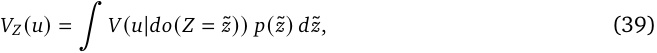

where _𝑝_ (˜ _𝑧_ ) = ∫ _𝑝_ ( _𝑍_ ( _𝑢_ )) _𝑑𝑢_ is the probability of getting activation values ˜ _𝑧_ . Note that mean ablation and resample ablation are quite different: mean ablation ablates with the _average activation_ , whereas resample activation averages the _effects_ of different ablations. See (Chan et al., 2022) for an extended discussion of these methodological details.

---

[← 28 Automated Circuit Discovery (ACDC)](28_acdc.md) · [Contents](README.md) · [30 Probes with Control Tasks →](30_probe_control_tasks.md)
