<!-- Generated by scripts/build_anthology.py export from the source PDF; edit the catalog, not this file. -->
# 40 · The Linear Representation Hypothesis and the Geometry of Large Language Models

**Park et al. — 2024** · Kiho Park, Yo Joong Choe, Victor Veitch

| | |
|---|---|
| Priority | ● P0 — Essential |
| Section | D — What is a feature? |
| Source | [https://arxiv.org/abs/2311.03658v2](https://arxiv.org/abs/2311.03658v2) (arXiv:2311.03658v2) |
| Licence | CC BY-NC-SA 4.0 |
| Print anthology | pages 1265–1289 (cover 1265, text 1266–1289) |

**Why read this.** Gives the linear representation hypothesis a precise form: counterfactual definitions in the embedding and unembedding spaces, proved to connect to steering and probing, and a causal inner product under which causally separable concepts are orthogonal.

**Reading focus.** The three readings of ‘linear representation’ (subspace, measurement, intervention), the unembedding and embedding definitions and what each connects to, how the causal inner product is estimated from the unembedding matrix, and the LLaMA-2 experiments.

**In context.** Formalizes the assumption shared by [33](33_toy_models_of_superposition.md), the dictionaries of Section E and the steering work of [72](72_representation_engineering.md)–[74](74_refusal_single_direction.md), and shows the choice of inner product is not innocent. [41](41_geometry_of_truth.md) is a case study of one such direction; [42](42_not_all_features_linear.md) and [43](43_sae_feature_geometry.md) press on where one-dimensional directions fall short, and [68](68_world_inside_neural_networks.md) and [69](69_sae_concept_manifolds.md) take the geometry question further.

**Note.** arXiv first posted November 2023; published at ICML 2024.

[← 39 Language Models Can Explain Neurons](39_explaining_neurons.md) · [Contents](README.md) · [41 The Geometry of Truth →](41_geometry_of_truth.md)

---

*Text extracted automatically from the source PDF. Display equations, figures and some tables appear as images; inline mathematics may be garbled — the PDF is authoritative.*

# **The Linear Representation Hypothesis and the Geometry of Large Language Models** 

**Kiho Park**1 **Yo Joong Choe**1 **Victor Veitch**1 

## **Abstract** 

Informally, the “linear representation hypothesis” is the idea that high-level concepts are represented linearly as directions in some representation space. In this paper, we address two closely related questions: What does “linear representation” actually mean? And, how do we make sense of geometric notions (e.g., cosine similarity and projection) in the representation space? To answer these, we use the language of counterfactuals to give two formalizations of linear representation, one in the output (word) representation space, and one in the input (context) space. We then prove that these connect to linear probing and model steering, respectively. To make sense of geometric notions, we use the formalization to identify a particular (non-Euclidean) inner product that respects language structure in a sense we make precise. Using this _causal inner product_ , we show how to unify all notions of linear representation. In particular, this allows the construction of probes and steering vectors using counterfactual pairs. Experiments with LLaMA2 demonstrate the existence of linear representations of concepts, the connection to interpretation and control, and the fundamental role of the choice of inner product. Code is available at github.com/KihoPark/linear ~~r~~ ep ~~g~~ eometry. 

## **1. Introduction** 

In the context of language models, the “Linear Representation Hypothesis” is the idea that high-level concepts are represented linearly in the representation space of a model (e.g., Mikolov et al., 2013c; Arora et al., 2016; Elhage et al., 2022). High-level concepts might include: is the text in French or English? Is it in the present or past tense? If the text is about a person, are they male or female? The appeal of the _linear_ 

1University of Chicago, Illinois, USA. 

_Proceedings of the 41__st_ _International Conference on Machine Learning_ , Vienna, Austria. PMLR 235, 2024. Copyright 2024 by the author(s). 

representation hypothesis is that—were it true—the tasks of interpreting and controlling model behavior could exploit linear algebraic operations on the representation space. Our goal is to formalize the linear representation hypothesis, and clarify how it relates to interpretation and control. 

The first challenge is that it is not clear what “linear representation” means. There are (at least) three interpretations: 

1. **Subspace:** (e.g., Mikolov et al., 2013c; Pennington et al., 2014) The first idea is that each concept is represented as a (1-dimensional) subspace. For example, in the context of word embeddings, it has been argued empirically that Rep(“woman”) _−_ Rep(“man”), Rep(“queen”) _−_ Rep(“king”), and all similar pairs belong to a common subspace (Mikolov et al., 2013c). Then, it is natural to take this subspace to be a representation of the concept of `Male` _/_ `Female` . 

2. **Measurement:** (e.g., Nanda et al., 2023; Gurnee & Tegmark, 2023) Next is the idea that the probability of a concept value can be measured with a linear probe. For example, the probability that the output language is French is logit-linear in the representation of the input. In this case, we can take the linear map to be a representation of the concept of `English` _/_ `French` . 

3. **Intervention:** (e.g., Wang et al., 2023; Turner et al., 2023) The final idea is that the value a concept takes on can be changed, without changing other concepts, by adding a suitable steering vector—e.g., we change the output from English to French by adding an `English` _/_ `French` vector. In this case, we take this added vector to be a representation of the concept. 

It is not clear a priori how these ideas relate to each other, nor which is the “right” notion of linear representation. 

Next, suppose we have somehow found the linear representations of various concepts. We can then use linear algebraic operations on the representation space for interpretation and control. For example, we might compute the cosine similarity between a representation and known concept directions, or edit representations projected onto target directions. However, similarity and projection are geometric notions: they require an inner product on the representation space. The second challenge is that it is not clear which inner product 

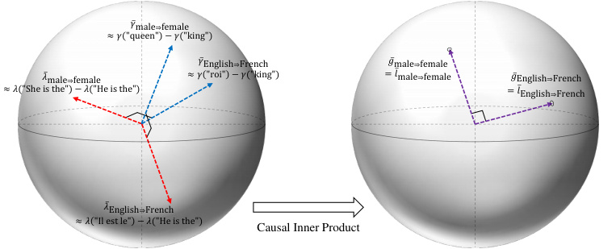

<!-- Start of picture text -->
ҧ𝛾male⇒female ≈𝛾 "queen" −𝛾("king") ҧ𝛾English⇒French ҧ𝑔male⇒female ҧ𝜆male⇒female ≈𝛾 "roi" −𝛾("king") = 𝑙male ҧ ⇒female ҧ𝑔English⇒French ≈𝜆 "She is the" −𝜆("He is the") = 𝑙English ҧ ⇒French ҧ𝜆English⇒French ≈𝜆 "Il est le" −𝜆("He is the") Causal Inner Product <!-- End of picture text -->

_Figure 1._ The geometry of linear representations can be understood in terms of a _causal inner product_ that respects the semantic structure of concepts. In a language model, each concept has two separate linear representations, _λ_¯ (red) in the embedding (input context) space and _γ_ ¯ (blue) in the unembedding (output word) space, as drawn on the left. The causal inner product induces a linear transformation for the representation spaces such that the transformed linear representations coincide (purple), as drawn on the right. In this unified representation space, causally separable concepts are represented by orthogonal vectors. 

is appropriate for understanding model representations. 

To address these, we make the following contributions: 

1. First, we formalize the subspace notion of linear representation in terms of counterfactual pairs, in both “embedding” (input context) and “unembedding” (output word) spaces. Using this formalization, we prove that the unembedding notion connects to measurement, and the embedding notion to intervention. 

2. Next, we introduce the notion of a _causal inner product_ : an inner product with the property that concepts that can vary freely of each other are represented as orthogonal vectors. We show that such an inner product has the special property that it unifies the embedding and unembedding representations, as illustrated in Figure 1. Additionally, we show how to estimate the inner product using the LLM unembedding matrix. 

3. Finally, we study the linear representation hypothesis empirically using LLaMA-2 (Touvron et al., 2023). We find the subspace notion of linear representations for a variety of concepts. Using these, we give evidence that the causal inner product respects semantic structure, and that subspace representations can be used to construct measurement and intervention representations. 

**Background on Language Models** We will require some minimal background on (large) language models. Formally, a language model takes in context text _x_ and samples output text. This sampling is done word by word (or token by token). Accordingly, we’ll view the outputs as single words. To define a probability distribution over outputs, the language model first maps each context _x_ to a vector _λ_ ( _x_ ) in a representation space Λ _≃_ R_d_ . We will call these _embedding vectors_ . The model also represents each word _y_ 

as an _unembedding vector γ_ ( _y_ ) in a separate representation space Γ _≃_ R_d_ . The probability distribution over the next words is then given by the softmax distribution: 

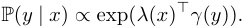

## **2. The Linear Representation Hypothesis** 

We begin by formalizing the subspace notion of linear representation, one in each of the unembedding and embedding spaces of language models, and then tie the subspace notions to the measurement and intervention notions. 

### **2.1. Concepts** 

The first step is to formalize the notion of a concept. Intuitively, a concept is any factor of variation that can be changed in isolation. For example, we can change the output from French to English without changing its meaning, or change the output from being about a man to about a woman without changing the language it is written in. 

Following Wang et al. (2023), we formalize this idea by taking a _concept variable W_ to be a latent variable that is caused by the context _X_ , and that acts as a cause of the output _Y_ . For simplicity of exposition, we will restrict attention to binary concepts. Anticipating the representation of concepts by vectors, we introduce an ordering on each binary concept—e.g., male _⇒_ female. This ordering makes the sign of a representation meaningful (e.g., the representation of female _⇒_ male will have the opposite sign). 

Each concept variable _W_ defines a set of counterfactual outputs _{Y_ ( _W_ = _w_ ) _}_ that differ only in the value of _W_ . For example, for the concept male _⇒_ female, ( _Y_ (0) _, Y_ (1)) is a random element of the set _{_ (“man”, “woman”), (“king”, 

“queen”), ... _}_ . In this paper, we assume the value of concepts can be read off deterministically from the sampled output (e.g., the output “king” implies _W_ = 0). Then, we can specify concepts by specifying their corresponding counterfactual outputs. 

We will eventually need to reason about the relationships between multiple concepts. We say that two concepts _W_ and _Z_ are _causally separable_ if _Y_ ( _W_ = _w, Z_ = _z_ ) is well-defined for each _w, z_ . That is, causally separable concepts are those that can be varied freely and in isolation. For example, the concepts English _⇒_ French and male _⇒_ female are causally separable—consider _{_ “king” _,_ “queen” _,_ “roi” _,_ “reine” _}_ . However, the concepts English _⇒_ French and English _⇒_ Russian are not because they cannot vary freely. 

We’ll write _Y_ ( _W_ = _w, Z_ = _z_ ) as _Y_ ( _w, z_ ) when the concepts are clear from context. 

### **2.2. Unembedding Representations and Measurement** 

We now turn to formalizing linear representations of a concept. The first observation is that there are two distinct representation spaces in play—the embedding space Λ and the unembedding space Γ. A concept could be linearly represented in either space. We begin with the unembedding space. Defining the cone of vector _v_ as Cone( _v_ ) = _{αv_ : _α >_ 0 _}_ , 

**Definition 2.1** (Unembedding Representation) **.** We say that _γ_ ¯ _W_ is an _unembedding representation_ of a concept _W_ if _γ_ ( _Y_ (1)) _− γ_ ( _Y_ (0)) _∈_ Cone(¯ _γW_ ) almost surely. 

This definition captures the subspace notion in the unembedding space, e.g., that _γ_ (“queen”) _− γ_ (“king”) is parallel to _γ_ (“woman”) _− γ_ (“man”). We use a cone instead of subspace because the sign of the difference is significant—i.e., the difference between “king” and “queen” is in the opposite direction as the difference between “woman” and “man”. The unembedding representation (if it exists) is unique up to positive scaling, consistent with the linear subspace hypothesis that concepts are represented as directions. 

**Connection to Measurement** The first result is that the unembedding representation is closely tied to the measurement notion of linear representation: 

**Theorem 2.2** (Measurement Representation) **.** _Let W be a concept, and let_ ¯ _γW be the unembedding representation of W . Then, given any context embedding λ ∈_ Λ _,_ 

logit P( _Y_ = _Y_ (1) _| Y ∈{Y_ (0) _, Y_ (1) _}, λ_ ) = _αλ__⊤_ _γ_ ¯ _W , where α >_ 0 _(a.s.) is a function of {Y_ (0) _, Y_ (1) _}._ 

All proofs are given in Appendix B. 

In words: if we know the output token is either “king” or “queen” (say, the context was about a monarch), then the probability that the output is “king” is logit-linear in the language model representation with regression coefficients ¯ _γW_ . The random scalar _α_ is a function of the particular counterfactual pair _{Y_ (0) _, Y_ (1) _}_ —e.g., it may be different for _{_ “king” _,_ “queen” _}_ and _{_ “roi” _,_ “reine” _}_ . However, the direction used for prediction is the same for all counterfactual pairs demonstrating the concept. 

Theorem 2.2 shows a connection between the subspace representation and the linear representation learned by fitting a linear probe to predict the concept. Namely, in both cases, we get a predictor that is linear on the logit scale. However, the unembedding representation differs from a probe-based representation in that it does not incorporate any information about correlated but off-target concepts. For example, if French text were disproportionately about men, a probe could learn this information (and include it in the representation), but the unembedding representation would not. In this sense, the unembedding representation might be viewed as an ideal probing representation. 

### **2.3. Embedding Representations and Intervention** 

The next step is to define a linear subspace representation in the embedding space Λ. We’ll again go with a notion anchored in demonstrative pairs. In the embedding space, each _λ_ ( _x_ ) defines a distribution over concepts. We consider pairs of sentences such as _λ_ 0 = _λ_ (“He is the monarch of England, ”) and _λ_ 1 = _λ_ (“She is the monarch of England, ”) that induce different distributions on the target concept, but the same distribution on all off-target concepts. A concept is embeddingrepresented if the differences between all such pairs belong to a common subspace. Formally, 

**Definition 2.3** (Embedding Representation) **.** We say that _λ_ ¯ _W_ is an _embedding representation_ of a concept _W_ if we have _λ_ 1 _− λ_ 0 _∈_ Cone( _λ_¯ _W_ ) for any context embeddings _λ_ 0 _, λ_ 1 _∈_ Λ that satisfy 

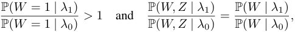

for each concept _Z_ that is causally separable with _W_ . 

The first condition ensures that the direction is relevant to the target concept, and the second condition ensures that the direction is not relevant to off-target concepts. 

**Connection to Intervention** It turns out the embedding representation is closely tied to the intervention notion of linear representation. For this, we need the following lemma relating embedding and unembedding representations. 

**Lemma 2.4** (Unembedding-Embedding Relationship) **.** _Let λ_ ¯ _W be the embedding representation of a concept W , and let_ ¯ _γW and_ ¯ _γZ be the unembedding representations for W and any concept Z that is causally separable with W . Then,_ 

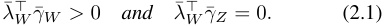

_Conversely, if a representation λ_¯ _W satisfies_ (2.1) _, and if there exist concepts {Zi}__d_ _i_ =1_−_1_, such that each Ziis causally_ _separable with W and {γ_ ¯ _W } ∪{γ_ ¯ _Zi}__d_ _i_ =1_−_1_is the basis of_R_d,_ _then λ_¯ _W is the embedding representation for W ._ 

We can now connect to the intervention notion: 

**Theorem 2.5** (Intervention Representation) **.** _Let λ_¯ _W be the embedding representation of a concept W . Then, for any concept Z that is causally separable with W ,_ 

P( _Y_ = _Y_ ( _W,_ 1) _| Y ∈{Y_ ( _W,_ 0) _, Y_ ( _W,_ 1) _}, λ_ + _cλ_¯ _W_ ) 

_is constant in c ∈_ R _, and_ 

P( _Y_ = _Y_ (1 _, Z_ ) _| Y ∈{Y_ (0 _, Z_ ) _, Y_ (1 _, Z_ ) _}, λ_ + _cλ_¯ _W_ ) 

_is increasing in c ∈_ R _._ 

In words: adding _λ_¯ _W_ to the language model representation of the context changes the probability of the target concept ( _W_ ), but not the probability of off-target concepts ( _Z_ ). 

## **3. Inner Product for Language Model Representations** 

Given linear representations, we would like to make use of them by doing things like measuring the similarity between different representations, or editing concepts by projecting onto a target direction. Similarity and projection are both notions that require an inner product. We now consider the question of which inner product is appropriate for understanding language model representations. 

**Preliminaries** We define Γ¯ to be the space of differences between elements of Γ. Then, Γ¯ is a _d_ -dimensional real vector space.1 We consider defining inner products on Γ¯ . Unembedding representations are naturally directions (unique only up to scale). Once we have an inner product, we define the _canonical_ unembedding representation _γ_ ¯ _W_ to be the element of the cone with _⟨γ_ ¯ _W ,_ ¯ _γW ⟩_ = 1. This lets us define inner products between unembedding representations. 

**Unidentifiability of the inner product** We might hope that there is some natural inner product that is picked out (identified) by the model training. It turns out that this is not 

1Note that the unembedding space Γ is only an affine space, since the softmax is invariant to adding a constant. 

the case. To understand the challenge, consider transforming the unembedding and embedding spaces according to 

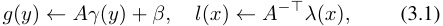

where _A ∈_ R_d×d_ is some invertible linear transformation and _β ∈_ R_d_ is a constant. It’s easy to see that this transformation preserves the softmax distribution P( _y | x_ ): 

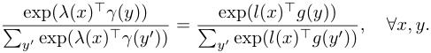

However, the objective function used to train the model depends on the representations only through the softmax probabilities. Thus, the representation _γ_ is identified (at best) only up to some invertible affine transformation. 

This also means that the concept representations _γ_ ¯ _W_ are identified only up to some invertible linear transformation _A_ . The problem is that, given any fixed inner product, 

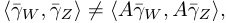

in general. Accordingly, there is no obvious reason to expect that algebraic manipulations based on, e.g., the Euclidean inner product, should be semantically meaningful. 

### **3.1. Causal Inner Products** 

We require some additional principles for choosing an inner product on the representation space. The intuition we follow here is that causally separable concepts should be represented as orthogonal vectors. For example, English _⇒_ French and Male _⇒_ Female, should be orthogonal. We define an inner product with this property: 

**Definition 3.1** (Causal Inner Product) **.** A _causal inner product ⟨·, ·⟩_ C on Γ¯ _≃_ R_d_ is an inner product such that 

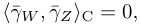

for any pair of causally separable concepts _W_ and _Z_ . 

This choice turns out to have the key property that it unifies the unembedding and embedding representations: 

**Theorem 3.2** (Unification of Representations) **.** _Suppose that, for any concept W , there exist concepts {Zi}i__d_ =1_−_1 _such that each Zi is causally separable with W and {γ_ ¯ _W } ∪{γ_ ¯ _Zi}__d_ _i_ =1_−_1_isabasisof_R_d.If⟨·, ·⟩_C_isacausal_ _inner product, then the Riesz isomorphism_ ¯ _γ �→⟨γ,_ ¯ _·⟩_ C _, for γ_ ¯ _∈_ Γ¯ _, maps the unembedding representation γ_ ¯ _W of each concept W to its embedding representation λ_¯ _W :_ 

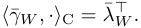

To understand this result intuitively, notice we can represent embeddings as row vectors and unembeddings as column 

vectors. If the causal inner product were the Euclidean inner product, the isomorphism would simply be the transpose operation. The theorem is the (Riesz isomorphism) generalization of this idea: each linear map on Γ¯ corresponds to some _λ ∈_ Λ according to _λ__⊤_ : _γ_ ¯ _�→ λ__⊤_ _γ_ ¯. So, we can map ¯Γ to Λ by mapping each ¯ _γW_ to a linear function according to ¯ _γW →⟨γ_ ¯ _W , ·⟩_ C. The theorem says this map sends each unembedding representation of a concept to the embedding representation of the same concept. 

In the experiments, we will make use of this result to construct embedding representations from unembedding representations. In particular, this allows us to find interventional representations of concepts. This is important because it is difficult in practice to find pairs of prompts that directly satisfy Definition 2.3. 

### **3.2. An Explicit Form for Causal Inner Product** 

The next problem is: if a causal inner product exists, how can we find it? In principle, this could be done by finding the unembedding representations of a large number of concepts, and then finding an inner product that maps each pair of causally separable directions to zero. In practice, this is infeasible because of the number of concepts required to find the inner product, and the difficulty of estimating the representations of each concept. 

We now turn to developing a more tractable approach based on the following insight: knowing the value of concept _W_ expressed by a randomly chosen word tells us little about the value of a causally separable concept _Z_ expressed by that word. For example, if we learn that a randomly sampled word is French (not English), this does not give us significant information about whether it refers to a man or woman.2 We formalize this idea as follows: 

**Assumption 3.3.** Suppose _W, Z_ are causally separable concepts and that _γ_ is an unembedding vector sampled uniformly from the vocabulary. Then, _λ_¯_⊤_ _W__γ_and ¯_λ_ _Z__⊤γ_are inde- pendent3 for any embedding representations _λ_¯ _W_ and _λ_¯ _Z_ for _W_ and _Z_ , respectively. 

This assumption lets us connect causal separability with something we can actually measure: the statistical dependency between words. The next result makes this precise. 

**Theorem 3.4** (Explicit Form of Causal Inner Product) **.** _Suppose there exists a causal inner product, represented as_ 

> 2Note that this assumption is about words _sampled randomly from the vocabulary_ , not words sampled randomly from natural language sources. In the latter, there may well be non-causal correlations between causally separable concepts. 

> 3In fact, to prove our next result, we only require that ¯ _λW⊤__γ_and _λ_ ¯_⊤_ _Z__γ_are uncorrelated.In Appendix D.6, we verify that the causal inner product we find satisfies the uncorrelatedness condition. 

_⟨γ,_ ¯ ¯ _γ__′_ _⟩_ C = _γ_ ¯_⊤_ _M γ_ ¯_′_ _for some symmetric positive definite matrix M . If there are mutually causally separable concepts {Wk}__d_ _k_ =1_, such that their canonical representations_ _G_ = [¯ _γW_ 1 _, · · · ,_ ¯ _γWd_ ] _form a basis for_ Γ¯ _≃_ R_d_ _, then under Assumption 3.3,_ 

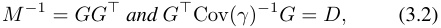

_for some diagonal matrix D with positive entries, where γ is the unembedding vector of a word sampled uniformly at random from the vocabulary._ 

Notice that causal orthogonality only imposes _d_ ( _d −_ 1) _/_ 2 constraints on the inner product, but there are _d_ ( _d−_ 1) _/_ 2+ _d_ degrees of freedom in identifying the positive definite matrix _M_ (hence, an inner product)—thus, we expect _d_ degrees of freedom in choosing a causal inner product. Theorem 3.4 gives a characterization of this class of inner products, in the form of (3.2). Here, _D_ is a free parameter with _d_ degrees of freedom. Each _D_ defines the inner product. We do not have a principle for picking out a unique choice of _D_ . In our experiments, we will work with the _choice D_ = _Id_ , which gives us _M_ = Cov( _γ_ )_−_1 . Then, we have a simple closed form for the corresponding inner product: 

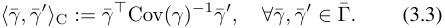

Note that although we don’t have a unique inner product, we can rule out most inner products. E.g., the Euclidean inner product is not a causal inner product if _M_ = _Id_ does not satisfy (3.2) for any _D_ . 

**Unified representations** The choice of inner product can also be viewed as defining a choice of representations _g_ and _l_ in (3.1) (hence, ¯ _g_ = _Aγ_ ¯). With _A_ = _M_1_/_2 , Theorem 3.2 further implies that a _causal_ inner product makes the embedding and unembedding representations of concepts the same, that is, _g_ ¯ _W_ =¯ _lW_ . Moreover, in the transformed space, the Euclidean inner product _is_ the causal inner product: _⟨γ,_ ¯ ¯ _γ__′_ _⟩_ C = _g_ ¯_⊤_ _g_ ¯_′_ . In Figure 1, we illustrated this unification of unembedding and embedding representations. This is convenient for experiments, because it allows the use of standard Euclidean tools on the transformed space. 

## **4. Experiments** 

We now turn to empirically validating the existence of linear representations, the estimated causal inner product, and the predicted relationships between the subspace, measurement, and intervention notions of linear representation. Code is available at github.com/KihoPark/linear ~~r~~ ep ~~g~~ eometry. 

We use the LLaMA-2 model with 7 billion parameters (Touvron et al., 2023) as our testbed. This is a decoder-only Transformer LLM (Vaswani et al., 2017; Radford et al., 2018), trained using the forward LM objective and a 32K 

token vocabulary. We include further details on all experiments in Appendix C. 

**Concepts are represented as directions in the unembedding space** We start with the hypothesis that concepts are represented as directions in the unembedding representation space (Definition 2.1). This notion relies on counterfactual pairs of words that vary only in the value of the concept of interest. We consider 22 concepts defined in the Big Analogy Test Set (BATS 3.0) (Gladkova et al., 2016), which provides such counterfactual pairs.4 We also consider 4 language concepts: English _⇒_ French, French _⇒_ German, French _⇒_ Spanish, and German _⇒_ Spanish, where we use words and their translations as counterfactual pairs. Additionally, we consider the concept frequent _⇒_ infrequent capturing how common a word is—we use pairs of common/uncommon synonyms (e.g., “bad” and “terrible”) as counterfactual pairs. We provide a table of all 27 concepts we consider in Appendix C. 

If the subspace notion of the linear representation hypothesis holds, then all counterfactual token pairs should point to a common direction in the unembedding space. In practice, this will only hold approximately. However, if the linear representation hypothesis holds, we still expect that, e.g., _γ_ (“queen”) _− γ_ (“king”) will align with the male _⇒_ female direction (more closely than the difference between random word pairs will). To validate this, for each concept _W_ , we look at how the direction defined by each counterfactual pair, _γ_ ( _yi_ (1)) _− γ_ ( _yi_ (0)), is geometrically aligned with the unembedding representation ¯ _γW_ . We estimate ¯ _γW_ as the (normalized) mean5 among all counterfactual pairs: _γ_ ¯ _W_ := _γ_ ˜ _W /_ ~~�~~ _⟨γ_ ˜ _W ,_ ˜ _γW ⟩_ C, where 

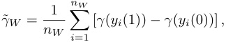

_nW_ denotes the number of counterfactual pairs for _W_ , and _⟨·, ·⟩_ C denotes the causal inner product defined in (3.3). 

Figure 2 presents histograms of each _γ_ ( _yi_ (1)) _− γ_ ( _yi_ (0))) projected onto ¯ _γW_ with respect to the causal inner product. Since ¯ _γW_ is computed using _γ_ ( _yi_ (1)) _− γ_ ( _yi_ (0)), we compute each projection using a leave-one-out (LOO) estimate _γ_ ¯ _W,_ ( _−i_ ) of the concept direction that excludes ( _yi_ (0) _, yi_ (1)). Across the three concepts shown (and 23 others shown in Appendix D.1), the differences between counterfactual pairs are substantially more aligned with ¯ _γW_ than those between random pairs. The sole exception is thing _⇒_ part, which does not appear to have a linear representation. 

> 4We only utilize words that are single tokens in the LLaMA-2 model. See Appendix C for details. 

> 5Previous work on word embeddings (Drozd et al., 2016; Fournier et al., 2020) motivate taking the mean to improve the consistency of the concept direction. 

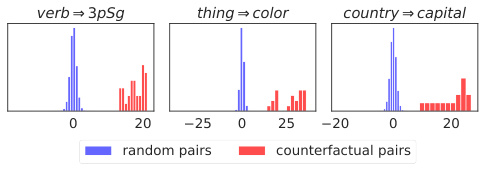

<!-- Start of picture text -->
verb 3pSg thing color country capital 0 20 25 0 25 20 0 20 random pairs counterfactual pairs <!-- End of picture text -->

_Figure 2._ Projecting counterfactual pairs onto their corresponding concept direction shows a strong right skew, as we expect if the linear representation hypothesis holds. The projections of the counterfactual pairs, _⟨γ_ ¯ _W,_ ( _−i_ ) _, γ_ ( _yi_ (1)) _− γ_ ( _yi_ (0)) _⟩_ C, are shown in red. For reference, we also project the differences between 100K randomly sampled word pairs onto the estimated concept direction, as shown in blue. See Table 2 for details about each concept _W_ (the title of each plot). 

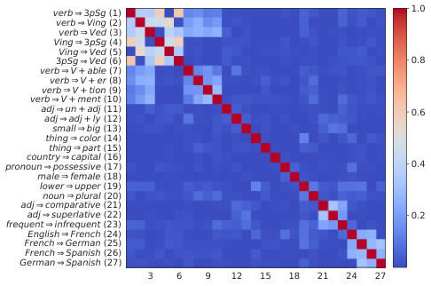

<!-- Start of picture text -->
verb 3pSg (1) 1.0 verb Ving (2) verb Ved (3) Ving 3pSg (4) Ving Ved (5) 3pSg Ved (6) 0.8 verb V + able (7) verb V + er (8) verb V + tion (9) verb V + ment (10) adj un + adj (11) 0.6 adj adj + ly (12) small big (13) thing color (14) thing part (15) pronouncountrypossessivecapital (16) (17) 0.4 male female (18) lower upper (19) noun plural (20) adj comparative (21) adj superlative (22) 0.2 frequent infrequent (23) English French (24) French German (25) French Spanish (26) German Spanish (27) 3 6 9 12 15 18 21 24 27 <!-- End of picture text -->

_Figure 3._ Causally separable concepts are represented approximately orthogonally under the estimated causal inner product based on (3.3). The heatmap shows _|⟨γ_ ¯ _W ,_ ¯ _γZ ⟩_ C _|_ for the estimated unembedding representations of each concept pair ( _W, Z_ ). The detail for each concept is given in Table 2. 

The results are consistent with the linear representation hypothesis: the differences computed by each counterfactual pair point to a common direction representing a linear subspace (up to some noise). Further, _γ_ ¯ _W_ is a reasonable estimator for that direction. 

**The estimated inner product respects causal separability** Next, we directly examine whether the estimated inner product (3.3) chosen from Theorem 3.4 is indeed approximately a causal inner product. In Figure 3, we plot a heatmap of the inner products between all pairs of the estimated unembedding representations for the 27 concepts. If the estimated inner product is a causal inner product, then we expect values near 0 between causally separable concepts. 

The first observation is that most pairs of concepts are nearly orthogonal with respect to this inner product. Interestingly, there is also a clear block diagonal structure. 

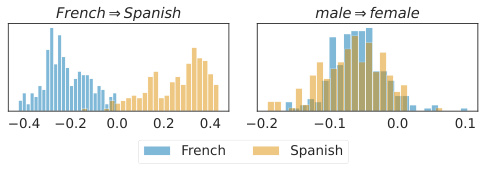

<!-- Start of picture text -->
French Spanish male female 0.4 0.2 0.0 0.2 0.4 0.2 0.1 0.0 0.1 French Spanish <!-- End of picture text -->

_Figure 4._ The subspace representation _γ_ ¯ _W_ acts as a linear probe for _W_ . The histograms show ¯ _γW__⊤λ_(_x_fr _j_) vs. ¯_γ_ _W__⊤λ_(_x_es _j_) (left) and _γ_ ¯ _Z__⊤λ_(_x_fr _j_) vs._γ_¯ _Z__⊤λ_(_x_es _j_) (right) for_W_= French_⇒_Spanish and _Z_ = male _⇒_ female, where _{x_fr _j__}_and_{x_es _j__}_are random contexts from French and Spanish Wikipedia, respectively. We also see that ¯ _γZ_ does _not_ act as a linear probe for _W_ , as expected. 

This arises because the concepts are grouped by semantic similarity. For example, the first 10 concepts relate to verbs, and the last 4 concepts are language pairs. The additional non-zero structure also generally makes sense. For example, lower _⇒_ upper (capitalization, concept 19) has non-trivial inner product with the language pairs _other than_ French _⇒_ Spanish. This may be because French and Spanish obey similar capitalization rules, while English and German each have different conventions (e.g., German capitalizes all nouns, but English only capitalizes proper nouns). In Appendix D.2, we compare the Euclidean inner product to the causal inner product for both the LLaMA-2 model and a more recent Gemma large language model (Mesnard et al., 2024). 

**Concept directions act as linear probes** Next, we check the connection to the measurement notion of lin= ear representation. We consider the concept _W_ French _⇒_ Spanish. To construct a dataset of French and Spanish contexts, we sample contexts of random lengths from Wikipedia pages in each language. Note that these are _not_ counterfactual pairs. Following Theorem 2.2, we expect _γ_ ¯ _W__⊤λ_(_x_fr _j_)_<_0 and_γ_¯ _W__⊤λ_(_x_es _j_)_>_0.Figure 4 con- firms this expectation, showing that _γ_ ¯ _W_ is a linear probe for the concept _W_ in Λ (left). Also, the representation of an off-target concept _Z_ = male _⇒_ female does not have any predictive power for this task (right). Appendix D.3 includes analogous results using all 27 concepts. 

**Concept directions map to intervention representations** Theorem 2.5 says that we can construct an intervention representation by constructing an embedding representation. Doing this directly requires finding pairs of prompts that vary only on the distribution they induce on the target concept, which can be difficult to find in practice. 

Here, we will instead use the isomorphism between embedding and unembedding representations (Theorem 3.2) to construct intervention representations from unembedding 

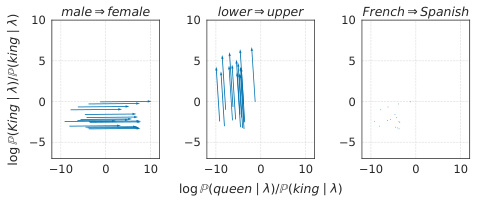

<!-- Start of picture text -->
1.1 0 male female 10 lower upper 10 French Spanish 0.8 5 5 5 0.6 0.40 0 0 0.2 5 5 5 0.0 0.0 10 0 0.210 0 10.4 0 0.610 100.8 0 101.0 log (queen )/ (king ) ) king)/( King( log <!-- End of picture text -->

_Figure 5._ Adding _αλ_¯ _C_ to _λ_ changes the target concept _C_ without changing off-target concepts. The plots illustrate change in log(P(“queen” _| x_ ) _/_ P(“king” _| x_ )) and log(P(“King” _| x_ ) _/_ P(“king” _| x_ )), after changing _λ_ ( _xj_ ) to _λC,α_ ( _xj_ ) as _α_ increases from 0 to 0 _._ 4, for _C_ = male _⇒_ female (left), lower _⇒_ upper (center), French _⇒_ Spanish (right). The two ends of the arrow are _λ_ ( _xj_ ) and _λC,_ 0 _._ 4( _xj_ ), respectively. Each context _xj_ is presented in Table 4. 

representations. We take 

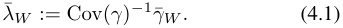

Theorem 2.5 predicts that adding _λ_¯ _W_ to a context representation should increase the probability of _W_ , while leaving the probability of all causally separable concepts unaltered. 

To test this for a given pair of causally separable concepts _W_ and _Z_ , we first choose a quadruple _{Y_ ( _w, z_ ) _}w,z∈{_ 0 _,_ 1 _}_ , and then generate contexts _{xj}_ such that the next word should be _Y_ (0 _,_ 0). For example, if _W_ = male _⇒_ female and _Z_ = lower _⇒_ upper, then we choose the quadruple (“king”, “queen”, “King”, “Queen”), and generate contexts using ChatGPT-4 (e.g., “Long live the”). We then intervene on _λ_ ( _xj_ ) using _λ_¯ _C_ via 

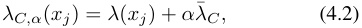

where _α >_ 0 and _C_ can be _W_ , _Z_ , or some other causally separable concept (e.g., French _⇒_ Spanish). For different choices of _C_ , we plot the changes in logit P( _W_ = 1 _| Z, λ_ ) and logit P( _Z_ = 1 _| W, λ_ ), as we increase _α_ . We expect to see that, if we intervene in the _W_ direction, then the intervention should linearly increase logit P( _W_ = 1 _| Z, λ_ ), while the other logit should stay constant; if we intervene in a direction _C_ that is causally separable with both _W_ and _Z_ , then we expect both logits to stay constant. 

Figure 5 shows the results of one such experiment shown for three target concepts (24 others shown in Appendix D.4), confirming our expectations. We see, for example, that intervening in the male _⇒_ female direction raises the logit for choosing “queen” over “king” as the next word, but does not change the logit for “King” over “king”. 

A natural follow-up question is to see if the intervention in a concept direction (for _W_ ) pushes the probability of _Y_ ( _W_ = 1) being the next word to be the largest among all 

_Table 1._ Adding the intervention representation _αλ_¯ _W_ pushes the probability over completions to reflect the concept _W_ . As the scale of intervention increases, the probability of seeing _Y_ ( _W_ = 1) (“ **queen** ”) increases while the probability of seeing _Y_ ( _W_ = 0) (“ _king_ ”) decreases. We show the top-5 most probable words over the entire vocabulary following the intervention (4.2) in the _W_ = male _⇒_ female direction, i.e., _λW,α_ ( _x_ ) = _λ_ ( _x_ ) + _αλ_¯ _W_ , for _α ∈{_ 0 _,_ 0 _._ 1 _,_ 0 _._ 2 _,_ 0 _._ 3 _,_ 0 _._ 4 _}_ . The original context _x_ = “Long live the ” is a sentence fragment that ends with the word _Y_ ( _W_ = 0) (“ _king_ ”). The most likely words reflect the concept, with “ **queen** ” being top-1. In Appendix D.5, we provide more examples. 

|Rank|_α_=0|0.1|0.2|0.3|0.4|
|---|---|---|---|---|---|
|1|_king_|Queen|**queen**|**queen**|**queen**|
|2|King|**queen**|Queen|Queen|Queen|
|3|Queen|_king_||lady|lady|
|4|**queen**|King|lady|woman|woman|
|5|||_king_|women|women|

tokens. We expect to see that, as we increase the value of _α_ , the target concept should eventually be reflected in the most likely output words according to the LM. 

In Table 1, we show an illustrative example in which _W_ is the concept male _⇒_ female and the context _x_ is a sentence fragment that can end with the word _Y_ ( _W_ = 0) (“ _king_ ”). For _x_ = “Long live the ”, as we increase the scale _α_ on the intervention, we see that the target word _Y_ ( _W_ = 1) (“ **queen** ”) becomes the most likely next word, while the original word _Y_ ( _W_ = 0) drops below the top-5 list. This illustrates how the intervention can push the probability of the target word high enough to make it the most likely word while decreasing the probability of the original word. 

## **5. Discussion and Related Work** 

The idea that high-level concepts are encoded _linearly_ is appealing because—if it is true—it may open up simple methods for interpretation and control of LLMs. In this paper, we have formalized ‘linear representation’, and shown that all natural variants of this notion can be unified.6 This equivalence already suggests some approaches for interpretation and control—e.g., we show how to use collections of pairs of words to define concept directions, and then use these directions to predict what the model’s output will be, and to change the output in a controlled fashion. A major theme is the role played by the choice of inner product. 

**Linear subspaces in language representations** The linear subspace hypotheses was originally observed empirically in the context of word embeddings (e.g., Mikolov et al., 2013b;c; Levy & Goldberg, 2014; Goldberg & Levy, 2014; Vylomova et al., 2016; Gladkova et al., 2016; Chiang 

> 6In Appendix A, we summarize these results in a figure. 

et al., 2020; Fournier et al., 2020). Similar structure has been observed in cross-lingual word embeddings (Mikolov et al., 2013a; Lample et al., 2018; Ruder et al., 2019; Peng et al., 2022), sentence embeddings (Bowman et al., 2016; Zhu & de Melo, 2020; Li et al., 2020; Ushio et al., 2021), representation spaces of Transformer LLMs (Meng et al., 2022; Merullo et al., 2023; Hernandez et al., 2023), and vision-language models (Wang et al., 2023; Trager et al., 2023; Perera et al., 2023). These observations motivate Definition 2.1. The key idea in the present paper is providing formalization in terms of counterfactual pairs—this is what allows us to connect to other notions of linear representation, and to identify the inner product structure. 

**Measurement, intervention, and mechanistic interpretability** There is a significant body of work on linear representations for interpreting (probing) (e.g., Alain & Bengio, 2017; Kim et al., 2018; nostalgebraist, 2020; Rogers et al., 2021; Belinkov, 2022; Li et al., 2022; Geva et al., 2022; Nanda et al., 2023) and controlling (steering) (e.g., Wang et al., 2023; Turner et al., 2023; Merullo et al., 2023; Trager et al., 2023) models. This is particularly prominent in _mechanistic interpretability_ (Elhage et al., 2021; Meng et al., 2022; Hernandez et al., 2023; Turner et al., 2023; Zou et al., 2023; Todd et al., 2023; Hendel et al., 2023). With respect to this body of work, the main contribution of the present paper is to clarify the linear representation hypothesis, and the critical role of the inner product. However, we do not address interpretability of either model parameters, nor the activations of intermediate layers. These are main focuses of existing work. It is an exciting direction for future work to understand how ideas here—particularly, the causal inner product—translate to these settings. 

**Geometry of representations** There is a line of work that studies the geometry of word and sentence representations (e.g., Arora et al., 2016; Mimno & Thompson, 2017; Ethayarajh, 2019; Reif et al., 2019; Li et al., 2020; Hewitt & Manning, 2019; Chen et al., 2021; Chang et al., 2022; Jiang et al., 2023). This work considers, e.g., visualizing and modeling how the learned embeddings are distributed, or how hierarchical structure is encoded. Our work is largely orthogonal to these, since we are attempting to define a suitable inner product (and thus, notions of similarity and projection) that respects the semantic structure of language. 

**Causal representation learning** Finally, the ideas here connect to causal representation learning (e.g., Higgins et al., 2016; Hyvarinen & Morioka, 2016; Higgins et al., 2018; Khemakhem et al., 2020; Zimmermann et al., 2021; Scholkopf¨ et al., 2021; Moran et al., 2021; Wang et al., 2023). Most obviously, our causal formalization of concepts is inspired by Wang et al. (2023), who establish a characterization of latent concepts and vector algebra in dif- 

fusion models. Separately, a major theme in this literature is the identifiability of learned representations—i.e., to what extent they capture underlying real-world structure. Our causal inner product results may be viewed in this theme, showing that an inner product respecting semantic closeness is not identified by the usual training procedure, but that it can be picked out with a suitable assumption. 

## **Acknowledgements** 

Thanks to Gemma Moran for comments on an earlier draft. This work is supported by ONR grant N00014-23-1-2591 and Open Philanthropy. 

## **References** 

- Alain, G. and Bengio, Y. Understanding intermediate layers using linear classifier probes. In _International Conference on Learning Representations_ , 2017. URL https:// openreview.net/forum?id=ryF7rTqgl. 

- Arora, S., Li, Y., Liang, Y., Ma, T., and Risteski, A. A latent variable model approach to PMI-based word embeddings. _Transactions of the Association for Computational Linguistics_ , 4:385–399, 2016. 

- Belinkov, Y. Probing classifiers: Promises, shortcomings, and advances. _Computational Linguistics_ , 48(1):207–219, 2022. 

- Bowman, S. R., Vilnis, L., Vinyals, O., Dai, A., Jozefowicz, R., and Bengio, S. Generating sentences from a continuous space. In _Proceedings of the 20th SIGNLL Conference on Computational Natural Language Learning_ , pp. 10–21, Berlin, Germany, August 2016. Association for Computational Linguistics. doi: 10.18653/v1/K16-1002. URL https://aclanthology.org/K16-1002. 

- Chang, T., Tu, Z., and Bergen, B. The geometry of multilingual language model representations. In _Proceedings of the 2022 Conference on Empirical Methods in Natural Language Processing_ , pp. 119–136, 2022. 

- Chen, B., Fu, Y., Xu, G., Xie, P., Tan, C., Chen, M., and Jing, L. Probing BERT in hyperbolic spaces. In _International Conference on Learning Representations_ , 2021. 

- Chiang, H.-Y., Camacho-Collados, J., and Pardos, Z. Understanding the source of semantic regularities in word embeddings. In _Proceedings of the 24th Conference on Computational Natural Language Learning_ , pp. 119–131, 2020. 

- Choe, Y. J., Park, K., and Kim, D. word2word: A collection of bilingual lexicons for 3,564 language pairs. In _Proceedings of the Twelfth Language Resources and Evaluation Conference_ , pp. 3036–3045, 2020. 

- Drozd, A., Gladkova, A., and Matsuoka, S. Word embeddings, analogies, and machine learning: Beyond king - man + woman = queen. In _Proceedings of COLING 2016, the 26th International Conference on Computational Linguistics: Technical papers_ , pp. 3519–3530, 2016. 

- Elhage, N., Nanda, N., Olsson, C., Henighan, T., Joseph, N., Mann, B., Askell, A., Bai, Y., Chen, A., Conerly, T., et al. A mathematical framework for transformer circuits. _Transformer Circuits Thread_ , 1, 2021. 

- Elhage, N., Hume, T., Olsson, C., Schiefer, N., Henighan, T., Kravec, S., Hatfield-Dodds, Z., Lasenby, R., Drain, D., Chen, C., et al. Toy models of superposition. _arXiv preprint arXiv:2209.10652_ , 2022. 

- Ethayarajh, K. How contextual are contextualized word representations? Comparing the geometry of BERT, ELMo, and GPT-2 embeddings. In _Proceedings of the 2019 Conference on Empirical Methods in Natural Language Processing and the 9th International Joint Conference on Natural Language Processing (EMNLP-IJCNLP)_ , pp. 55–65, 2019. 

- Fournier, L., Dupoux, E., and Dunbar, E. Analogies minus analogy test: measuring regularities in word embeddings. In _Proceedings of the 24th Conference on Computational Natural Language Learning_ , pp. 365–375, Online, 2020. Association for Computational Linguistics. doi: 10.18653/v1/2020.conll-1.29. URL https: //aclanthology.org/2020.conll-1.29. 

- Geva, M., Caciularu, A., Wang, K., and Goldberg, Y. Transformer feed-forward layers build predictions by promoting concepts in the vocabulary space. In _Proceedings of the Conference on Empirical Methods in Natural Language Processing_ , pp. 30–45, 2022. 

- Gladkova, A., Drozd, A., and Matsuoka, S. Analogy-based detection of morphological and semantic relations with word embeddings: what works and what doesn’t. In _Proceedings of the NAACL Student Research Workshop_ , pp. 8–15, 2016. 

- Goldberg, Y. and Levy, O. word2vec explained: deriving Mikolov et al.’s negative-sampling word-embedding method. _arXiv preprint arXiv:1402.3722_ , 2014. 

- Gurnee, W. and Tegmark, M. Language models represent space and time. _arXiv preprint arXiv:2310.02207_ , art. arXiv:2310.02207, October 2023. doi: 10.48550/arXiv. 2310.02207. 

- Hendel, R., Geva, M., and Globerson, A. In-context learning creates task vectors. _arXiv preprint arXiv:2310.15916_ , 2023. 

- Hernandez, E., Sharma, A. S., Haklay, T., Meng, K., Wattenberg, M., Andreas, J., Belinkov, Y., and Bau, D. Linearity of relation decoding in transformer language models. _arXiv preprint arXiv:2308.09124_ , 2023. 

- Hewitt, J. and Manning, C. D. A structural probe for finding syntax in word representations. In _Proceedings of the 2019 Conference of the North American Chapter of the Association for Computational Linguistics: Human Language Technologies, Volume 1 (Long and Short Papers)_ , pp. 4129–4138, 2019. 

- Higgins, I., Matthey, L., Pal, A., Burgess, C., Glorot, X., Botvinick, M., Mohamed, S., and Lerchner, A. betaVAE: Learning basic visual concepts with a constrained variational framework. In _International Conference on Learning Representations_ , 2016. 

- Higgins, I., Amos, D., Pfau, D., Racaniere, S., Matthey, L., Rezende, D., and Lerchner, A. Towards a definition of disentangled representations. _arXiv preprint arXiv:1812.02230_ , 2018. 

- Hyvarinen, A. and Morioka, H. Unsupervised feature extraction by time-contrastive learning and nonlinear ICA. _Advances in Neural Information Processing Systems_ , 29, 2016. 

- Jiang, Y., Aragam, B., and Veitch, V. Uncovering meanings of embeddings via partial orthogonality. _arXiv preprint arXiv:2310.17611_ , 2023. 

- Khemakhem, I., Kingma, D., Monti, R., and Hyvarinen, A. Variational autoencoders and nonlinear ICA: A unifying framework. In _International Conference on Artificial Intelligence and Statistics_ , pp. 2207–2217. PMLR, 2020. 

- Kim, B., Wattenberg, M., Gilmer, J., Cai, C., Wexler, J., Viegas, F., et al. Interpretability beyond feature attribution: Quantitative testing with concept activation vectors (TCAV). In _International Conference on Machine Learning_ , pp. 2668–2677. PMLR, 2018. 

- Kudo, T. and Richardson, J. SentencePiece: A simple and language independent subword tokenizer and detokenizer for neural text processing. In _Proceedings of the 2018 Conference on Empirical Methods in Natural Language Processing: System Demonstrations_ , pp. 66–71, 2018. 

- Lample, G., Conneau, A., Ranzato, M., Denoyer, L., and Jegou,´ H. Word translation without parallel data. In _International Conference on Learning Representations_ , 2018. 

- Levy, O. and Goldberg, Y. Linguistic regularities in sparse and explicit word representations. In _Proceedings of the Eighteenth Conference on Computational Natural Language Learning_ , pp. 171–180, 2014. 

- Li, B., Zhou, H., He, J., Wang, M., Yang, Y., and Li, L. On the sentence embeddings from pre-trained language models. In _Proceedings of the 2020 Conference on Empirical Methods in Natural Language Processing (EMNLP)_ , pp. 9119–9130, 2020. 

- Li, K., Hopkins, A. K., Bau, D., Viegas,´ F., Pfister, H., and Wattenberg, M. Emergent world representations: Exploring a sequence model trained on a synthetic task. In _International Conference on Learning Representations_ , 2022. 

- Meng, K., Bau, D., Andonian, A., and Belinkov, Y. Locating and editing factual associations in GPT. _Advances in Neural Information Processing Systems_ , 35:17359–17372, 2022. 

- Merullo, J., Eickhoff, C., and Pavlick, E. Language models implement simple word2vec-style vector arithmetic. _arXiv preprint arXiv:2305.16130_ , 2023. 

- Mesnard, T., Hardin, C., Dadashi, R., Bhupatiraju, S., Pathak, S., Sifre, L., Riviere,` M., Kale, M. S., Love, J., et al. Gemma: Open models based on gemini research and technology. _arXiv preprint arXiv:2403.08295_ , 2024. 

- Mikolov, T., Le, Q. V., and Sutskever, I. Exploiting similarities among languages for machine translation. _arXiv preprint arXiv:1309.4168_ , 2013a. 

- Mikolov, T., Sutskever, I., Chen, K., Corrado, G. S., and Dean, J. Distributed representations of words and phrases and their compositionality. _Advances in Neural Information Processing Systems_ , 26, 2013b. 

- Mikolov, T., Yih, W.-T., and Zweig, G. Linguistic regularities in continuous space word representations. In _Proceedings of the 2013 Conference of the North American Chapter of the Association for Computational Linguistics: Human Language Technologies_ , pp. 746–751, 2013c. 

- Mimno, D. and Thompson, L. The strange geometry of skipgram with negative sampling. In Palmer, M., Hwa, R., and Riedel, S. (eds.), _Proceedings of the 2017 Conference on Empirical Methods in Natural Language Processing_ , pp. 2873–2878, Copenhagen, Denmark, 2017. Association for Computational Linguistics. doi: 10.18653/v1/ D17-1308. URL https://aclanthology.org/ D17-1308. 

- Moran, G. E., Sridhar, D., Wang, Y., and Blei, D. M. Identifiable deep generative models via sparse decoding. _arXiv preprint arXiv:2110.10804_ , art. arXiv:2110.10804, October 2021. doi: 10.48550/arXiv.2110.10804. 

- Nanda, N., Lee, A., and Wattenberg, M. Emergent linear representations in world models of self-supervised sequence models. _arXiv preprint arXiv:2309.00941_ , 2023. 

- nostalgebraist. Interpreting GPT: the logit lens, 2020. URL https://www.alignmentforum. org/posts/AcKRB8wDpdaN6v6ru/ interpreting-gpt-the-logit-lens. 

- OpenAI. GPT-4 technical report. _arXiv preprint arXiv:2303.08774_ , 2023. 

- Peng, X., Stevenson, M., Lin, C., and Li, C. Understanding linearity of cross-lingual word embedding mappings. _Transactions on Machine Learning Research_ , 2022. ISSN 2835-8856. URL https://openreview. net/forum?id=8HuyXvbvqX. 

- Pennington, J., Socher, R., and Manning, C. D. GloVe: Global vectors for word representation. In _Proceedings of the 2014 Conference on Empirical Methods in Natural Language Processing (EMNLP)_ , pp. 1532–1543, 2014. 

- Perera, P., Trager, M., Zancato, L., Achille, A., and Soatto, S. Prompt algebra for task composition. _arXiv preprint arXiv:2306.00310_ , 2023. 

- Radford, A., Narasimhan, K., Salimans, T., and Sutskever, I. Improving language understanding by generative pretraining. 2018. 

- Reif, E., Yuan, A., Wattenberg, M., Viegas, F. B., Coenen, A., Pearce, A., and Kim, B. Visualizing and measuring the geometry of BERT. _Advances in Neural Information Processing Systems_ , 32, 2019. 

- Rogers, A., Kovaleva, O., and Rumshisky, A. A primer in BERTology: What we know about how BERT works. _Transactions of the Association for Computational Linguistics_ , 8:842–866, 2021. 

- Ruder, S., Vulic,´ I., and Søgaard, A. A survey of crosslingual word embedding models. _Journal of Artificial Intelligence Research_ , 65:569–631, 2019. 

- Scholkopf,¨ B., Locatello, F., Bauer, S., Ke, N. R., Kalchbrenner, N., Goyal, A., and Bengio, Y. Toward causal representation learning. _Proceedings of the IEEE_ , 109(5): 612–634, 2021. 

- Todd, E., Li, M. L., Sharma, A. S., Mueller, A., Wallace, B. C., and Bau, D. Function vectors in large language models. _arXiv preprint arXiv:2310.15213_ , 2023. 

- Touvron, H., Martin, L., Stone, K., Albert, P., Almahairi, A., Babaei, Y., Bashlykov, N., Batra, S., Bhargava, P., Bhosale, S., Bikel, D., Blecher, L., Ferrer, C. C., Chen, M., Cucurull, G., Esiobu, D., Fernandes, J., Fu, J., Fu, W., Fuller, B., Gao, C., Goswami, V., Goyal, N., Hartshorn, A., Hosseini, S., Hou, R., Inan, H., Kardas, M., Kerkez, V., Khabsa, M., Kloumann, I., Korenev, A., Koura, P. S., Lachaux, M.-A., Lavril, T., Lee, J., Liskovich, D., Lu, Y., 

Mao, Y., Martinet, X., Mihaylov, T., Mishra, P., Molybog, I., Nie, Y., Poulton, A., Reizenstein, J., Rungta, R., Saladi, K., Schelten, A., Silva, R., Smith, E. M., Subramanian, R., Tan, X. E., Tang, B., Taylor, R., Williams, A., Kuan, J. X., Xu, P., Yan, Z., Zarov, I., Zhang, Y., Fan, A., Kambadur, M., Narang, S., Rodriguez, A., Stojnic, R., Edunov, S., and Scialom, T. Llama 2: Open foundation and fine-tuned chat models. _arXiv preprint arXiv:2307.09288_ , 2023. 

- Trager, M., Perera, P., Zancato, L., Achille, A., Bhatia, P., and Soatto, S. Linear spaces of meanings: Compositional structures in vision-language models. In _Proceedings of the IEEE/CVF International Conference on Computer Vision_ , pp. 15395–15404, 2023. 

- Turner, A. M., Thiergart, L., Udell, D., Leech, G., Mini, U., and MacDiarmid, M. Activation addition: Steering language models without optimization. _arXiv preprint arXiv:2308.10248_ , art. arXiv:2308.10248, August 2023. doi: 10.48550/arXiv.2308.10248. 

- Ushio, A., Anke, L. E., Schockaert, S., and CamachoCollados, J. BERT is to NLP what AlexNet is to CV: Can pre-trained language models identify analogies? In _Proceedings of the 59th Annual Meeting of the Association for Computational Linguistics and the 11th International Joint Conference on Natural Language Processing (Volume 1: Long Papers)_ , pp. 3609–3624, 2021. 

- Vaswani, A., Shazeer, N., Parmar, N., Uszkoreit, J., Jones, L., Gomez, A. N., Kaiser, Ł., and Polosukhin, I. Attention is all you need. _Advances in Neural Information Processing Systems_ , 30, 2017. 

- Vylomova, E., Rimell, L., Cohn, T., and Baldwin, T. Take and took, gaggle and goose, book and read: Evaluating the utility of vector differences for lexical relation learning. In _Proceedings of the 54th Annual Meeting of the Association for Computational Linguistics (Volume 1: Long Papers)_ , pp. 1671–1682, 2016. 

- Wang, Z., Gui, L., Negrea, J., and Veitch, V. Concept algebra for score-based conditional models. _arXiv preprint arXiv:2302.03693_ , 2023. 

- Zhu, X. and de Melo, G. Sentence analogies: Linguistic regularities in sentence embeddings. In _Proceedings of the 28th International Conference on Computational Linguistics_ , pp. 3389–3400, 2020. 

- Zimmermann, R. S., Sharma, Y., Schneider, S., Bethge, M., and Brendel, W. Contrastive learning inverts the data generating process. In _International Conference on Machine Learning_ , pp. 12979–12990. PMLR, 2021. 

- Zou, A., Phan, L., Chen, S., Campbell, J., Guo, P., Ren, R., Pan, A., Yin, X., Mazeika, M., Dombrowski, A.-K., 

Goel, S., Li, N., Byun, M. J., Wang, Z., Mallen, A., Basart, S., Koyejo, S., Song, D., Fredrikson, M., Kolter, Z., and Hendrycks, D. Representation engineering: A top-down approach to AI transparency. _arXiv preprint arXiv:2310.01405_ , 2023. 

## **A. Summary of Main Results** 

In Figure 6, we give a high-level summary of our main results. In Section 2, we have given the definitions of unembedding and embedding representations and how they also yield measurement and intervention representations, respectively. In Section 3, we have defined the causal inner product and show how it unifies the unembedding and embedding representations via the induced Riesz isomorphism. 

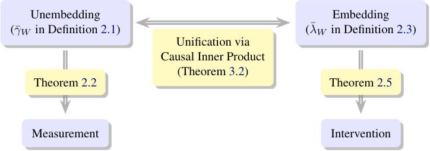

<!-- Start of picture text -->
Unembedding Embedding ( γ ¯ W in Definition 2.1) ( λ ¯ W in Definition 2.3) Unification via Causal Inner Product (Theorem 3.2) Theorem 2.2 Theorem 2.5 Measurement Intervention <!-- End of picture text -->

_Figure 6._ A high-level summary of our main results, illustrating the connections between the different notions of linear representations. 

## **B. Proofs** 

### **B.1. Proof of Theorem 2.2** 

**Theorem 2.2** (Measurement Representation) **.** _Let W be a concept, and let_ ¯ _γW be the unembedding representation of W . Then, given any context embedding λ ∈_ Λ _,_ 

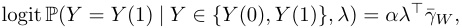

_where α >_ 0 _(a.s.) is a function of {Y_ (0) _, Y_ (1) _}._ 

_Proof._ The proof involves writing out the softmax sampling distribution and invoking Definition 2.1. 

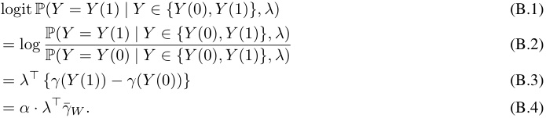

In (B.3), we simply write out the softmax distribution, allowing us to cancel out the normalizing constants for the two probabilities. Equation (B.4) follows directly from Definition 2.1; note that the randomness of _α_ comes from the randomness of _{Y_ (0) _, Y_ (1) _}_ . 

### **B.2. Proof of Lemma 2.4** 

**Lemma B.1** (Unembedding-Embedding Relationship) **.** _Let λ_¯ _W be the embedding representation of a concept W , and let γ_ ¯ _W and_ ¯ _γZ be the unembedding representations for W and any concept Z that is causally separable with W . Then,_ 

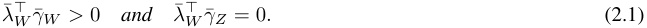

_Conversely, if a representation λ_¯ _W satisfies_ (2.1) _, and if there exist concepts {Zi}__d_ _i_ =1_−_1_,suchthateachZiiscausally_ _separable with W and {γ_ ¯ _W } ∪{γ_ ¯ _Zi}__d_ _i_ =1_−_1_is the basis of_R_d, then_¯_λWis the embedding representation for W._ 

_Proof._ Let _λ_ 0 _, λ_ 1 be a pair of embeddings such that 

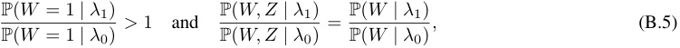

for any concept _Z_ that is causally separable with _W_ . Then, by Definition 2.3, 

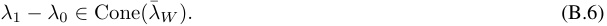

The condition (B.5) is equivalent to 

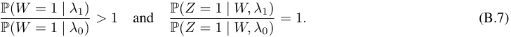

These two conditions are also equivalent to the following pair of conditions, respectively: 

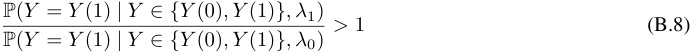

and 

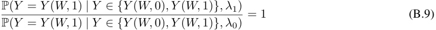

The reason is that, conditional on _Y ∈{Y_ (0 _,_ 0) _, Y_ (0 _,_ 1) _, Y_ (1 _,_ 0) _, Y_ (1 _,_ 1) _}_ , conditioning on _W_ is equivalent to conditioning on _Y ∈{Y_ ( _W,_ 0) _, Y_ ( _W,_ 1) _}_ . And, the event _Z_ = 1 is equivalent to the event _Y_ = _Y_ ( _W,_ 1). (In words: if we know the output is one of “king”, “queen”, “roi”, “reine” then conditioning on _W_ = 1 is equivalent to conditioning on the output being “king” or “roi”. Then, predicting whether the word is in English is equivalent to predicting whether the word is “king”.) 

By Theorem 2.2, the two conditions (B.8) and (B.9) are respectively equivalent to 

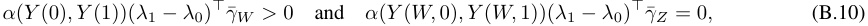

where _α_ ’s are positive a.s. These are in turn respectively equivalent to 

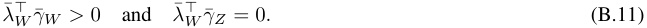

Conversely, if a representation _λ_¯ _W_ satisfies (B.11) and there exist concepts _{Zi}__d_ _i_ =1_−_1such that each concept is causally separable with _W_ and _{γ_ ¯ _W } ∪{γ_ ¯ _Zi}__d_ _i_ =1_−_1is the basis of R_d_, then ¯_λW_is unique up to positive scaling.If there exists_λ_0and _λ_ 1 satisfying (B.5), then the equivalence between (B.5) and (B.10) says that 

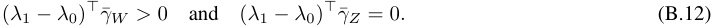

In other words, _λ_ 1 _− λ_ 0 also satisfies (B.11), implying that it must be the same as _λ_¯ _W_ up to positive scaling. Therefore, for any _λ_ 0 and _λ_ 1 satisfying (B.5), _λ_ 1 _− λ_ 0 _∈_ Cone( _λ_¯ _W_ ). 

### **B.3. Proof of Theorem 2.5** 

**Theorem 2.5** (Intervention Representation) **.** _Let λ_¯ _W be the embedding representation of a concept W . Then, for any concept Z that is causally separable with W ,_ 

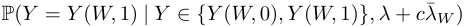

_is constant in c ∈_ R _, and_ 

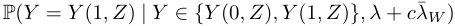

_is increasing in c ∈_ R _._ 

_Proof._ By Theorem 2.2, 

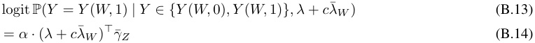

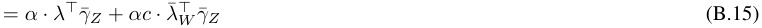

Therefore, the first probability is constant since _λ_¯_⊤_ _W__γ_¯_Z_= 0 by Lemma 2.4. 

Also, by Theorem 2.2, 

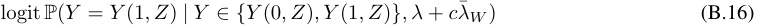

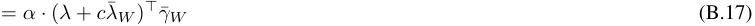

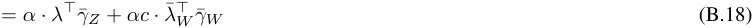

Therefore, the second probability is increasing since _λ_¯_⊤_ _W__γ_¯_W>_0 by Lemma 2.4. 

### **B.4. Proof of Theorem 3.2** 

**Theorem 3.2** (Unification of Representations) **.** _Suppose that, for any concept W , there exist concepts {Zi}__d_ _i_ =1_−_1_such that_ _each Zi is causally separable with W and {γ_ ¯ _W } ∪{γ_ ¯ _Zi}__d_ _i_ =1_−_1_is a basis of_R_d.If ⟨·, ·⟩_C_is a causal inner product, then the_ _Riesz isomorphism_ ¯ _γ �→⟨γ,_ ¯ _·⟩_ C _, for_ ¯ _γ ∈_ Γ¯ _, maps the unembedding representation_ ¯ _γW of each concept W to its embedding representation λ_¯ _W :_ 

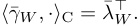

_Proof._ The causal inner product defines the Riesz isomorphism _ϕ_ such that _ϕ_ (¯ _γ_ ) = _⟨γ,_ ¯ _·⟩_ C. Then, we have 

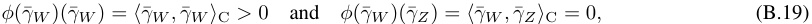

where the second equality follows from Definition 3.1. By Lemma 2.4, _ϕ_ (¯ _γW_ ) expresses the unique unembedding representation _λ_¯ _W_ (up to positive scaling); specifically, _ϕ_ (¯ _γW_ ) = _λ_¯_⊤_ _W_where ¯_λ⊤_ _W_:_γ_¯_�→λ_¯_⊤_ _W__γ_¯. 

### **B.5. Proof of Theorem 3.4** 

**Theorem 3.4** (Explicit Form of Causal Inner Product) **.** _Suppose there exists a causal inner product, represented as ⟨γ,_ ¯ ¯ _γ__′_ _⟩_ C = _γ_ ¯_⊤_ _M γ_ ¯_′_ _for some symmetric positive definite matrix M . If there are mutually causally separable concepts {Wk}__d_ _k_ =1_, such_ _that their canonical representations G_ = [¯ _γW_ 1 _, · · · ,_ ¯ _γWd_ ] _form a basis for_ Γ¯ _≃_ R_d_ _, then under Assumption 3.3,_ 

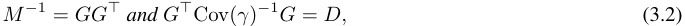

_for some diagonal matrix D with positive entries, where γ is the unembedding vector of a word sampled uniformly at random from the vocabulary._ 

_Proof._ Since _⟨·, ·⟩_ C is a causal inner product, 

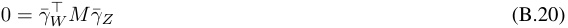

for any causally separable concepts _W_ and _Z_ . By applying (B.20) to the canonical representations _G_ = [¯ _γW_ 1 _, · · · ,_ ¯ _γWd_ ], we obtain 

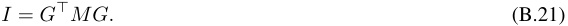

This shows that _M_ = _G__−⊤_ _G__−_1 , proving the first half of (3.2). 

Next, observe that _M γ_ ¯ _Wi_ is an embedding representation for each concept _Wi_ for _i_ = 1 _, · · · , d_ by the proof of Lemma 2.4 and Theorem 3.2. Then, by Assumption 3.3, 

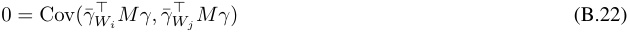

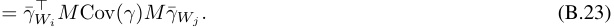

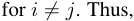

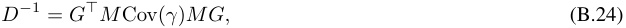

for some diagonal matrix _D_ with positive entries. Substituting in _M_ = _G__−⊤_ _G__−_1 , we get 

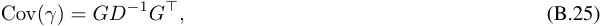

proving the second half of (3.2). 

_Table 2._ Concept names, one example of the counterfactual pairs, and the number of the used pairs 

|#|Concept|Example|Count|
|---|---|---|---|
|1|verb_⇒_3pSg|(accept, accepts)|32|
|2|verb_⇒_Ving|(add, adding)|31|
|3|verb_⇒_Ved|(accept, accepted)|47|
|4|Ving_⇒_3pSg|(adding, adds)|27|
|5|Ving_⇒_Ved|(adding, added)|34|
|6|3pSg_⇒_Ved|(adds, added)|29|
|7|verb_⇒_V + able|(accept, acceptable)|6|
|8|verb_⇒_V + er|(begin, beginner)|14|
|9|verb_⇒_V + tion|(compile, compilation)|8|
|10|verb_⇒_V + ment|(agree, agreement)|11|
|11|adj_⇒_un + adj|(able, unable)|5|
|12|adj_⇒_adj + ly|(according, accordingly)|18|
|13|small_⇒_big|(brief, long)|20|
|14|thing_⇒_color|(ant, black)|21|
|15|thing_⇒_part|(bus, seats)|13|
|16|country_⇒_capital|(Austria, Vienna)|15|
|17|pronoun_⇒_possessive|(he, his)|4|
|18|male_⇒_female|(actor, actress)|11|
|19|lower_⇒_upper|(always, Always)|34|
|20|noun_⇒_plural|(album, albums)|63|
|21|adj_⇒_comparative|(bad, worse)|19|
|22|adj_⇒_superlative|(bad, worst)|9|
|23|frequent_⇒_infrequent|(bad, terrible)|32|
|24|English_⇒_French|(April, avril)|46|
|25|French_⇒_German|(ami, Freund)|35|
|26|French_⇒_Spanish|(ann´ee, a˜no)|35|
|27|German_⇒_Spanish|(Arbeit, trabajo)|22|

## **C. Experiment Details** 

**The LLaMA-2 model** We utilize the llama-2-7b variant of the LLaMA-2 model (Touvron et al., 2023), which is accessible online (with permission) via the huggingface library.7 Its seven billion parameters are pre-trained on two trillion sentencepiece (Kudo & Richardson, 2018) tokens, 90% of which is in English. This model uses 32,000 tokens and 4,096 dimensions for its token embeddings. 

**Counterfactual pairs** Tokenization poses a challenge in using certain words. First, a word can be tokenized to more than one token. For example, a word “princess” is tokenized to “prin” + “cess”, and _γ_ (“princess”) does not exist. Thus, we cannot obtain the meaning of the exact word “princess”. Second, a word can be used as one of the tokens for another word. For example, the French words “bas” and “est” (“down” and “east” in English) are in the tokens for the words “basalt”, “baseline”, “basil”, “basilica”, “basin”, “estuary”, “estrange”, “estoppel”, “estival”, “esthetics”, and “estrogen”. Therefore, a word can have another meaning other than the meaning of the exact word. 

When we collect the counterfactual pairs to identify ¯ _γW_ , the first issue in the pair can be handled by not using it. However, the second issue cannot be handled, and it gives a lot of noise to our results. Table 2 presents the number of the counterfactual pairs for each concept and one example of the pairs. The pairs for 13, 17, 19, 23-27th concepts are generated by ChatGPT4 (OpenAI, 2023), and those for 16th concept are based on the csv file8 ). The other concepts are based on The Bigger Analogy Test Set (BATS) (Gladkova et al., 2016), version 3.09 , which is used for evaluation of the word analogy task. 

**Context samples** In Section 4, for a concept _W_ (e.g., English _⇒_ French), we choose several counterfactual pairs ( _Y_ (0) _, Y_ (1)) (e.g., (house, maison)), then sample context _{x_0 _j__}_and_{x_1 _j__}_that the next token is_Y_(0) and_Y_(1), respectively, from Wikipedia. These next token pairs are collected from the word2word bilingual lexicon (Choe et al., 2020), which is a 

> 7https://huggingface.co/meta-llama/Llama-2-7b-hf 

> 8https://github.com/jmerullo/lm_vector_arithmetic/blob/main/world_capitals.csv 

> 9https://vecto.space/projects/BATS/ 

_Table 3._ Concepts used to investigate measurement notion 

|Concept|Example|Count|
|---|---|---|
|English_⇒_French|(house, maison)|(209, 231)|
|French_⇒_German|(d´ej`a, bereits)|(278, 205)|
|French_⇒_Spanish|(musique, m´usica)|(218, 214)|
|German_⇒_Spanish|(Krieg, guerra)|(214, 213)|

_Table 4._ Contexts used to investigate intervention notion 

|_j_|_xj_|
|---|---|
|1 |Long live the |
|2 |The lion is the |
|3 |In the hierarchy of medieval society, the highest rank was the |
|4 |Arthur was a legendary |
|5 |He was known as the warrior |
|6 |In a monarchy, the ruler is usually a |
|7 |He sat on the throne, the |
|8 |A sovereign ruler in a monarchy is often a |
|9|His domain was vast, for he was a|
|10|The lion, in many cultures, is considered the|
|11|He wore a crown, signifying he was the|
|12|A male sovereign who reigns over a kingdom is a|
|13|Every kingdom has its ruler, typically a|
|14|The prince matured and eventually became the|
|15|In the deck of cards, alongside the queen is the|

publicly available word translation dictionary. We take all word pairs between languages that are the top-1 correspondences to each other in the bilingual lexicon and filter out pairs that are single tokens in the LLaMA-2 model’s vocabulary. 

Table 3 presents the number of the contexts _{x_0 _j__}_and_{x_1 _j__}_for each concept and one example of the pairs (_Y_(0)_, Y_(1)). 

In the experiment for intervention notion, for a concept _W, Z_ , we sample texts which _Y_ (0 _,_ 0) (e.g., “king”) should follow, via ChatGPT-4. We discard the contexts such that _Y_ (0 _,_ 0) is not the top 1 next word. Table 4 present the contexts we use. 

## **D. Additional Results** 

### **D.1. Histograms of random and counterfactual pairs for all concepts** 

In Figure 7, we include an analog of Figure 2 where we check the causal inner product of the differences between the counterfactual pairs and an LOO estimated unembedding representation for each of the 27 concepts. While the most of the concepts are encoded in the unembedding representation, some concepts, such as thing _⇒_ part, are not encoded in the unembedding space Γ. 

### **D.2. Comparison with the Euclidean inner products** 

In Figure 8, we also plot the cosine similarities induced by the Euclidean inner product between the unembedding representations. Surprisingly, the Euclidean inner product somewhat works in the LLaMA-2 model as most of the causally separable concepts are orthogonal! This may due to some initialization or implicit regularizing effect that favors learning unembeddings with approximately isotropic covariance. Nevertheless, the estimated causal inner product clearly improves on the Euclidean inner product. For example, frequent _⇒_ infrequent (concept 23) has high Euclidean inner product with many separable concepts, and these are much smaller for the causal inner product. Conversely, English _⇒_ French (24) has low Euclidean inner product with the other language concepts (25-27), but high causal inner product with French _⇒_ German and French _⇒_ Spanish (while being nearly orthogonal to German _⇒_ Spanish, which does not share French). 

_Table 5._ Context: “The prince matured and eventually became the ” 

|Rank|_α_=0|0.1|0.2|0.3|0.4|
|---|---|---|---|---|---|
|1|_king_|_king_|em|**queen**|**queen**|
|2|em|em|r|em|woman|
|3|leader|r|leader|r|lady|
|4|r|leader|_king_|leader|wife|
|5|King|head|**queen**|woman|em|

_Table 6._ Context: “In a monarchy, the ruler is usually a ” 

|Rank|_α_=0|0.1|0.2|0.3|0.4|
|---|---|---|---|---|---|
|1|_king_|_king_|her|woman|woman|
|2|monarch|monarch|monarch|**queen**|**queen**|
|3|member|her|member|her|female|
|4|her|member|woman|monarch|her|
|5|person|person|**queen**|member|member|

Interestingly, the same heatmaps for a more recent Gemma-2B model (Mesnard et al., 2024) in Figure 9 illustrate that the Euclidean inner product doesn’t capture semantics, while the causal inner product still works. One possible reason is that the origin of the unembeddings is meaningful as the Gemma model ties the unembeddings to the token embeddings used before the transformer layers. 

### **D.3. Additional results from the measurement experiment** 

We include analogs of Figure 4, specifically where we use each of the 27 concepts as a linear probe on either French _⇒_ Spanish (Figure 10) or English _⇒_ French (Figure 11) contexts. 

### **D.4. Additional results from the intervention experiment** 

In Figure 12, we include an analog of Figure 5 where we add the embedding representation _αλ_¯ _C_ (4.1) for each of the 27 concepts to _λ_ ( _xj_ ) and see the change in logits. 

### **D.5. Additional tables of top-5 words after intervention** 

Table 5 and Table 6 are analogs of Table 1 where we use different contexts _x_ = “In a monarchy, the ruler usually is a ” and _x_ = “The prince matured and eventually became the ”. For the first example, note that “r” and “em” are the prefix tokens for words related to royalty, such as “ruler”, “royal”, and “emperor”. For the second example, even when the target word “ **queen** ” does not become the most likely one, the most likely words still reflect the concept direction (“woman”, “ **queen** ”, “her”, “female”). 

### **D.6. A sanity check for the estimated causal inner product** 

In earlier experiments, we found that the choice _M_ = Cov( _γ_ )_−_1 from (3.3) yields a causal inner product and induces an embedding representation _λ_¯ _W_ in the form of (4.1). Here, we run a sanity check experiment where we verify that the induced embedding representation satisfies the uncorrelatedness condition in Assumption D.6. In Figure 13, we empirically show that _λ_¯_⊤_ _W__γ_and ¯_λ_ _Z__⊤γ_are uncorrelated for the causally separable concepts (left plot), while they are correlated for the non-causally separable concepts (right plot). In these plots, each dot corresponds to the point ( _λ_¯_⊤_ _W__γ,_¯_λ_ _Z__⊤γ_), where_γ_is an unembedding vector _γ_ corresponding to each token in the LLaMA-2 vocabulary (32K total). 

#### **The Linear Representation Hypothesis and the Geometry of Large Language Models** 

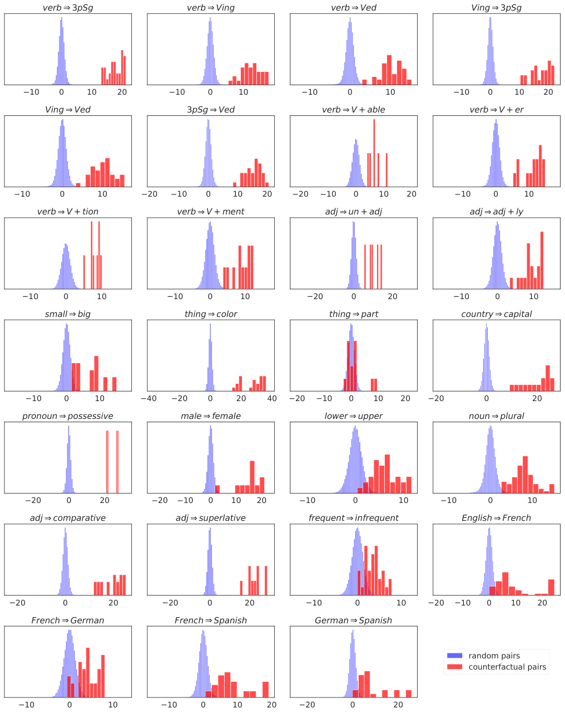

<!-- Start of picture text -->
verb 3pSg verb Ving verb Ved Ving 3pSg 10 0 10 20 10 0 10 10 0 10 10 0 10 20 Ving Ved 3pSg Ved verb V + able verb V + er 10 0 10 20 10 0 10 20 20 10 0 10 20 10 0 10 verb V + tion verb V + ment adj un + adj adj adj + ly 10 0 10 10 0 10 20 0 20 10 0 10 small big thing color thing part country capital 10 0 10 40 20 0 20 40 20 10 0 10 20 20 0 20 pronoun possessive male female lower upper noun plural 20 0 20 20 10 0 10 20 10 0 10 10 0 10 adj comparative adj superlative frequent infrequent English French 20 0 20 20 0 20 10 0 10 20 10 0 10 20 French German French Spanish German Spanish random pairs counterfactual pairs 10 0 10 10 0 10 20 20 0 20 <!-- End of picture text -->

_Figure 7._ Histograms of the projections of the counterfactual pairs _⟨γ_ ¯ _W,_ ( _−i_ ) _, γ_ ( _yi_ (1)) _− γ_ ( _yi_ (0)) _⟩_ C (red), and the projections of the differences between 100K randomly sampled word pairs onto the estimated concept direction (blue). See Table 2 for details about each concept _W_ (the title of each plot). 19 

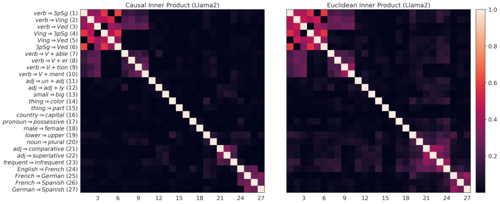

_Figure 8._ For the LLaMA-2-7B model, causally separable concepts are approximately orthogonal under the estimated causal inner product and, surprisingly, under the Euclidean inner product as well. The heatmaps show _|⟨γ_ ¯ _W ,_ ¯ _γZ ⟩|_ for the estimated unembedding representations of each concept pair ( _W, Z_ ). The plot on the left shows the estimated inner product based on (3.3), and the right plot represents the Euclidean inner product. The detail for the concepts is given in Table 2. 

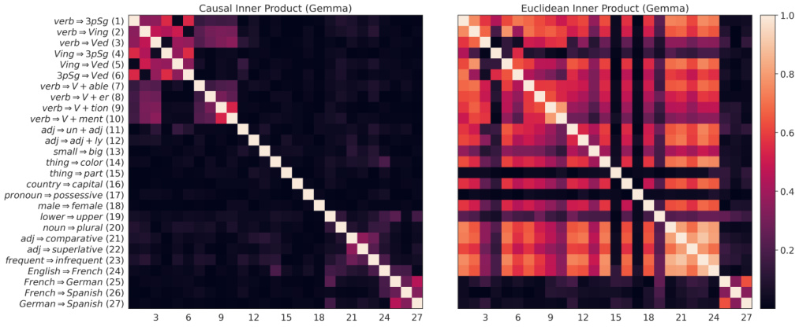

_Figure 9._ For the Gemma-2B model, causally separable concepts are approximately orthogonal under the estimated causal inner product; however, the Euclidean inner product does not capture semantics. The heatmaps show _|⟨γ_ ¯ _W ,_ ¯ _γZ ⟩|_ for the estimated unembedding representations of each concept pair ( _W, Z_ ). The plot on the left shows the estimated inner product based on (3.3), and the right plot represents the Euclidean inner product. The detail for the concepts is given in Table 2. 

#### **The Linear Representation Hypothesis and the Geometry of Large Language Models** 

<!-- Start of picture text -->
verb 3pSg verb Ving verb Ved Ving 3pSg 0.1 0.0 0.1 0.2 0.2 0.1 0.0 0.1 0.0 0.1 0.2 0.1 0.0 0.1 Ving Ved 3pSg Ved verb V + able verb V + er 0.0 0.1 0.2 0.1 0.0 0.1 0.15 0.10 0.05 0.00 0.05 0.1 0.0 0.1 verb V + tion verb V + ment adj un + adj adj adj + ly 0.1 0.0 0.1 0.1 0.0 0.1 0.10 0.05 0.00 0.05 0.10 0.05 0.00 0.05 0.10 small big thing color thing part country capital 0.05 0.00 0.05 0.10 0.05 0.00 0.05 0.10 0.15 0.10 0.05 0.00 0.1 0.0 0.1 0.2 pronoun possessive male female lower upper noun plural 0.05 0 0.0250.000 0.025 0.050 0.2 0.1 0.0 0.1 0.2 0.0 0.2 0.4 0.2 0.0 0.2 adj comparative adj superlative frequent infrequent English French 0.1 0.0 0.1 0.1 0.0 0.1 0.1 0.0 0.1 0.2 0.0 0.2 French German French Spanish German Spanish French Spanish 0.4 0.2 0.0 0.2 0.4 0.2 0.0 0.2 0.4 0.2 0.0 0.2 0.4 <!-- End of picture text -->

_Figure 10._ Histogram of ¯ _γC__⊤λ_(_x_fr _j_) vs ¯_γ_ _C__⊤λ_(_x_es _j_) for all concepts_C_, where_{x_ _j_fr_}_are random contexts from French Wikipedia, and_{x_es _j__}_ are random contexts from Spanish Wikipedia. 

#### **The Linear Representation Hypothesis and the Geometry of Large Language Models** 

<!-- Start of picture text -->
verb 3pSg verb Ving verb Ved Ving 3pSg 0.2 0.0 0.2 0.4 0.2 0.0 0.2 0.2 0.0 0.2 0.4 0.4 0.2 0.0 0.2 Ving Ved 3pSg Ved verb V + able verb V + er 0.4 0.2 0.0 0.2 0.1 0.0 0.1 0.2 0.1 0.0 0.1 0.2 0.0 0.2 verb V + tion verb V + ment adj un + adj adj adj + ly 0.2 0.1 0.0 0.1 0.2 0.2 0.0 0.15 0.10 0.05 0.00 0.05 0.1 0.0 0.1 0.2 small big thing color thing part country capital 0.05 0.00 0.05 0.10 0.05 0.00 0.05 0.10 0.15 0.1 0.0 0.2 0.0 0.2 pronoun possessive male female lower upper noun plural 0.10 0.05 0.00 0.05 0.2 0.1 0.0 0.25 0.00 0.25 0.50 0.4 0.2 0.0 0.2 adj comparative adj superlative frequent infrequent English French 0.2 0.1 0.0 0.2 0.1 0.0 0.2 0.1 0.0 0.4 0.2 0.0 0.2 French German French Spanish German Spanish English French 0.4 0.2 0.0 0.2 0.3 0.2 0.1 0.0 0.2 0.1 0.0 0.1 <!-- End of picture text -->

_Figure 11._ Histogram of _γ_ ¯ _C__⊤λ_(_x_en _j_) vs_γ_¯ _C__⊤λ_(_x_fr _j_) for all concepts_C_,where_{x_en _j__}_are random contexts from English Wikipedia,and _{x_fr _j__}_are random contexts from French Wikipedia. 

#### **The Linear Representation Hypothesis and the Geometry of Large Language Models** 

<!-- Start of picture text -->
verb 3pSg verb Ving verb Ved Ving 3pSg 5 5 5 5 0 0 0 0 5 5 5 5 10 0 10 10 0 10 10 0 10 10 0 10 Ving Ved 3pSg Ved verb V + able verb V + er 5 5 5 5 0 0 0 0 5 5 5 5 10 0 10 10 0 10 10 0 10 10 0 10 verb V + tion verb V + ment adj un + adj adj adj + ly 5 5 5 5 0 0 0 0 5 5 5 5 10 0 10 10 0 10 10 0 10 10 0 10 small big thing color thing part country capital 5 5 5 5 0 0 0 0 5 5 5 5 10 0 10 10 0 10 10 0 10 10 0 10 pronoun possessive male female lower upper noun plural 5 5 5 5 0 0 0 0 5 5 5 5 10 0 10 10 0 10 10 0 10 10 0 10 adj comparative adj superlative frequent infrequent English French 5 5 5 5 0 0 0 0 5 5 5 5 10 0 10 10 0 10 10 0 10 10 0 10 French German French Spanish German Spanish 5 5 5 0 0 0 intervened lambda 5 5 5 10 0 10 10 0 10 10 0 10 log (queen(king ) ) ) ) King( king( log <!-- End of picture text -->

_Figure 12._ Change in log(P(“queen” _| x_ ) _/_ P(“king” _| x_ )) and log(P(“King” _| x_ ) _/_ P(“king” _| x_ )), after changing _λ_ ( _xj_ ) to _λC,α_ ( _xj_ ) for _α ∈_ [0 _,_ 0 _._ 4] and any concept _C_ . The starting point and ending point of each arrow correspond to the _λ_ ( _xj_ ) and _λC,_ 0 _._ 4( _xj_ ), respectively. 

_Figure 13._ The left plot shows that _λ_¯ _W__⊤γ_and ¯_λ⊤_ _Z__γ_are uncorrelated for the causally separable concepts_W_= male_⇒_female and_Z_= English _⇒_ French. On the other hand, the right plot shows that _λ_¯ _W__⊤γ_and ¯_λ⊤_ _Z__γ_are correlated for the non-causally separable concepts _W_ = verb _⇒_ 3pSg and _Z_ = verb _⇒_ Ving. Each dot corresponds to the unembedding vector _γ_ for each token in the vocabulary.

---

[← 39 Language Models Can Explain Neurons](39_explaining_neurons.md) · [Contents](README.md) · [41 The Geometry of Truth →](41_geometry_of_truth.md)
