<!-- Generated by scripts/build_anthology.py export from the source PDF; edit the catalog, not this file. -->
# 44 · Mathematical Models of Computation in Superposition

**Hänni et al. — 2024** · Kaarel Hänni, Jake Mendel, Dmitry Vaintrob, Lawrence Chan

| | |
|---|---|
| Priority | ○ P1 — Important |
| Section | D — What is a feature? |
| Source | [https://arxiv.org/abs/2408.05451v1](https://arxiv.org/abs/2408.05451v1) (arXiv:2408.05451v1) |
| Licence | CC BY-SA 4.0 |
| Print anthology | pages 1359–1387 (cover 1359, text 1360–1387) |

**Why read this.** Moves superposition theory from storage to computation, constructing networks that compute far more boolean features than they have neurons: pairwise ANDs, sparse low-depth circuits, and deep networks kept on track by error correction.

**Reading focus.** The definition of linearly represented features suited to computation, the U-AND construction and its neuron count, the argument that random networks likely emulate U-AND, the extension to sparse boolean circuits, error-correction layers, and the asymptotic caveats.

**In context.** [33](33_toy_models_of_superposition.md) treated computation only briefly; this formal companion asks how computation itself can run in superposition, a reference point for the parameter-decomposition programme of [66](66_stochastic_parameter_decomposition.md)–[67](67_interpreting_lm_parameters.md). Read it against its co-author's [43](43_sae_feature_geometry.md), which doubts superposition is the right frame, and the neuron-basis programme of [63](63_circuits_sparse_neuron_basis.md) and [64](64_neural_networks_already_clean.md), which doubts real networks need it as much.

[← 43 SAE Feature Geometry and Superposition](43_sae_feature_geometry.md) · [Contents](README.md) · [45 SAEs Find Highly Interpretable Directions →](45_sparse_autoencoders_cunningham.md)

---

*Text extracted automatically from the source PDF. Display equations, figures and some tables appear as images; inline mathematics may be garbled — the PDF is authoritative.*

## **Kaarel H¨anni*** 1 **Jake Mendel*** 2 **Dmitry Vaintrob*** **Lawrence Chan** 

# **Abstract** 

Superposition – when a neural network represents more “features” than it has dimensions – seems to pose a serious challenge to mechanistically interpreting current AI systems. Existing theory work studies _representational_ superposition, where superposition is only used when passing information through bottlenecks. In this work, we present mathematical models of _computation_ in superposition, where superposition is actively helpful for efficiently accomplishing the task. 

We first construct a task of efficiently emulating a circuit that takes the AND of the � _m_ 2 � pairs of each of _m_ features. We construct a 1-layer MLP that uses superposition to perform this task up to _ε_ -error, where the network only requires _O_˜ ( _m_ 32 ) neurons, even when the input features are _themselves in superposition_ . We generalize this construction to arbitrary sparse boolean circuits of low depth, and then construct “error correction” layers that allow deep fully-connected networks of width _d_ to emulate circuits of width _O_˜ ( _d_1_._5 ) and _any_ polynomial depth. We conclude by providing some potential applications of our work for interpreting neural networks that implement computation in superposition. 

# **1. Introduction** 

Mechanistic interpretability seeks to decipher the algorithms utilized by neural networks (Olah et al., 2017; Elhage et al., 2021; Rauker¨ et al., 2023; Olah et al., 2020; Meng et al., 2023; Geiger et al., 2021; Wang et al., 2022; Conmy et al., 2024). A significant obstacle is that neurons are _polysemantic_ – activating in response to various unrelated inputs (Fusi et al., 2016; Nguyen et al., 2016; Olah et al., 2017; Geva et al., 2021; Goh et al., 2021). As a proposed explanation for polysemanticity, Olah et al. (2020) introduce the ‘super- 

*Equal contribution, authors ordered alphabetically by last name. 1Cadenza Labs / Caltech. 2Apollo Research. Correspondence to: Lawrence Chan _<_ chanlaw@berkeley.edu _>_ . 

_Presented in the inaugural Mechanistic Interpretability Workshop, at the 41__st_ _International Conference on Machine Learning (2024_ . 

position hypothesis’ (see also Arora et al. (2018); Elhage et al. (2022)): the idea that networks represent many more concepts in their activation spaces than they have neurons by sparsely encoding features as nearly orthogonal directions. 

Previous work has studied how networks can store more features than they have neurons in a range of toy models (Elhage et al., 2022; Scherlis et al., 2022). However, previous models of superposition either involve almost no computation (Elhage et al., 2022) or rely on some part of the computation not happening in superposition (Scherlis et al., 2022). Insofar as neural networks are incentivized to learn as many circuits as possible (Olah et al., 2020), they are likely to compute circuits in the most compressed way possible. Therefore, understanding how networks can undergo more general computation in a fully superpositional way is valuable for understanding the algorithms they learn. 

In this paper, we lay the groundwork for understanding computation in superposition _in general_ , by studying how neural networks can emulate sparse boolean circuits. 

- In Section 2, we clarify existing definitions of linearly represented features, and propose our own definition which is more suited for reasoning about computation. 

- In Section 3, we focus our study on the task of emulating the particular boolean circuit we call the _Universal AND_ (U-AND) circuit. In this task, a neural network must take in a set of boolean features in superposition, and compute the pairwise logical ANDs of these features in a single layer with as few hidden neurons as possible. We present a construction which allows for many more new features to be computed than the number of hidden neurons, with outputs represented natively in superposition. We argue that real neural networks may well implement our construction in the wild by proving that randomly initialised networks are very likely to emulate U-AND. 

- In Section 4 we demonstrate a second reason why this task is worth studying: it is possible to modify our construction to allow a wide range of large boolean circuits to be emulated entirely in superposition, provided that they satisfy a certain sparsity property. 

We conclude with a discussion of the limitations of our for- 

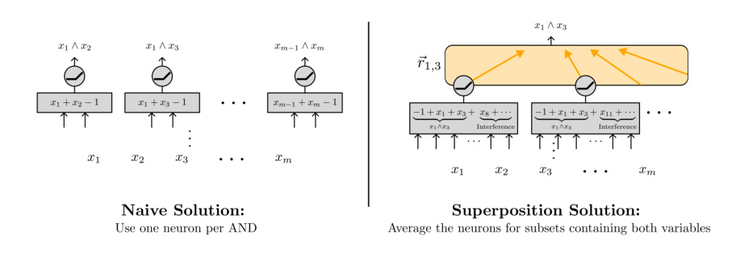

_Figure 1._ The naive way to linearly represent the pairwise ANDs of _m_ boolean variables using an MLP is to use one neuron to compute the AND of each pair of variables (left). This requires � _m_ 2 � = _O_ ( _m_2 ) neurons. However, when inputs are sparse, there is a much more efficient implementation using superposition (right). Here, each neuron checks for whether or not _at least two variables_ are active in a subset of random variables. Then, for any pair of variables, we can read off the AND of that pair by averaging together the activations of all neurons corresponding to the subsets containing both variables. With appropriately chosen subsets, we can _ε_ -linearly represent all pairwise ANDs using only _O_˜ ( _m_ <u>23 ) neurons, even when the inputs are themselves represented in superposition (Section 3).</u> 

mal models, including the fact that our results are asymptotic and deal with only boolean features, and provide directions of future work that could address them. 

# **2. Background and setup** 

## **2.1. Notation and conventions** 

**Asymptotic complexity and** _O_˜ **notation** We make extensive use of standard Bachmann–Landau (“big O”) asymptotic notation. We use _O_˜ to indicate that we are ignoring polylogarithmic factors: 

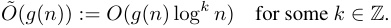

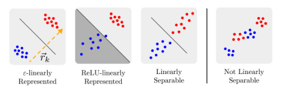

_Figure 2._ In Section 2.2, we distinguish between boolean features that are _ε-linearly represented_ (left), ReLU _-linearly represented_ (center left), and those that are only _linearly separable_ (i.e. weakly linearly represented) (center right). Red/blue indicates the presence or absence of the feature. In addition to being linearly separable, _ε_ -linearly represented features must satisfy the further condition that the variance in the readoff direction _⃗rk within_ the positive and negative clusters is small compared to the margin between the two. 

(And so forth for Θ˜ _,_ Ω˜ , etc.) 

**Fully connected neural networks** We use _Mw_ : _X → Y_ to denote a neural network model parameterized by _w_ that takes input _x ∈ X_ and outputs _Mw_ ( _x_ ) _∈ Y_ . In this work, we study fully-connected networks consisting of _L_ MLP layers with ReLU activations: 

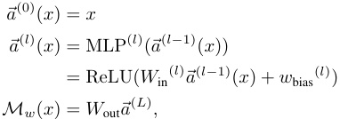

where ReLU( _x_ ) = max(0 _, x_ ) with max taken elementwise. We assume that our MLPs have width _d_ for all hidden layers, that is, _⃗a_(_l_) _∈_ R_d_ for all _l ∈{_ 1 _, ..., L}_ . For simplicity’s sake we will be dropping _l_ whenever we only talk about a single layer at a time. 

**Features and feature vectors** Following previous work in mechanistic interpretability (e.g. Tamkin et al. (2023); Rajamanoharan et al. (2024)), we suppose that the activations of a model can be thought of as representing _m > d_ boolean _features fk_ : _X →{_ 0 _,_ 1 _}_ of the input _in superposition_ . That is, 

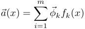

for some set of _feature vectors⃗ϕ_ 1 _, ...,⃗ϕm ∈_ R_d_ and features _f_ 1 _, ..., fm_ : _X →{_ 0 _,_ 1 _}_ . Equivalently, 

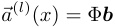

where Φ = ( _⃗ϕ_ 1 _, ...,⃗ϕm_ ) is the _d × m feature encoding_ matrix with columns equal to the feature vectors and **_b_** _∈ {_ 0 _,_ 1 _}__m_ is the boolean vector with entries **_b_** _k_ = _fk_ ( _x_ ). 

In addition, as in previous work, we assume that these features are _s-sparse_ , in that only at most _s ≪ d, m_ features _fi_ can be nonzero for any input _x_ (equivalently, _||_ **_b_** _||_ 1 _≤ s_ .) For clarity, we preferentially use _k, ℓ ∈{_ 1 _, ..., m}_ to index _features_ (in _{_ 0 _,_ 1 _}__m_ ) and _i, j ∈{_ 1 _, ..., d}_ to index the standard neuron basis of activations (in R_d_ ). 

**Sparse boolean circuits** We construct tasks where a neural network needs to emulate a boolean circuit _C_ : _{_ 0 _,_ 1 _}__m_ _→{_ 0 _,_ 1 _}__m′_ . We assume that this circuit can be written as _C_ = _CL ◦· · · ◦C_ 1, where each intermediate “layer” _Cl_ : _{_ 0 _,_ 1 _}__m_ _→{_ 0 _,_ 1 _}__m_ is a collection of _m_ parallel boolean gates (of fan-in up to 2), for _l < L_ . We say that a circuit _C_ is _s_ -sparse on boolean input **_b_** _∈{_ 0 _,_ 1 _}__m_ if the input **_b_**(0) = **_b_** and all intermediate activations **_b_**(_l_) = _Ci_ ( **_b_**(_l−_1) ) are _s_ -sparse, i.e. they satisfy _||_ **_b_**(_i_) _||_ 1 _≤ s_ . 

## **2.2. Strong and weak linear representations** 

Given the activations of a neural network at a particular layer _a_(_l_) : _X →_ R_d_ , we can also ask what features are _linearly represented_ by _a_(_l_) . In this section, we present three definitions for a feature being linearly represented by _a_(_l_) , which we illustrate in Figure 2. 

The standard definition of linear representation is based on whether or not the representations of positive and negative examples can be separated by a hyperplane: 

**Definition 1** (Weak linear representations) **.** _We say that a binary feature fk is_ weakly linearly represented _by a_ : _X →_ R_d_ _(or_ linearly separable _in a) if there exists some⃗rk ∈_ R_d_ _such that for all x_ 1 _, x_ 2 _∈ X where fk_ ( _x_ 1) = 0 _and fk_ ( _x_ 2) = 1 _, we have:_ 

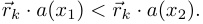

_Or, equivalently, the sets {x|fk_ ( _x_ ) = 0 _} and {x|fk_ ( _x_ ) = 1 _} are separated by a hyperplane normal to⃗rk._ 

That being said, features being linearly separable does not mean a neural network can easily “make use” of the features. For some weakly linearly represented features _f_ 1 and _f_ 2, neither _f_ 1 _∧ f_ 2 nor _f_ 2 _∨ f_ 2 need to be linearly represented, even if their read-off vectors _⃗r_ 1 _,⃗r_ 2 are _orthogonal_ (Figure 3). In fact, a stronger statement is true: it might not even be possible to linearly separate _f_ 1 _∧ f_ 2 or _f_ 2 _∨ f_ 2 in MLP _◦ a_ , that is, even after applying an MLP to the activations (see Theorem 9 in Appendix C). 

As a result, in this paper we make use of a more restrictive notion of a feature being linearly represented: 

**Definition 2** ( _ε_ -linear representations) **.** _Let X be a set of inputs and a_ : _X →_ R_d_ _be the activations of a neural network (in a particular position/layer in a given model). We say that f_ 1 _, . . . , fm are_ linearly represented with interference 

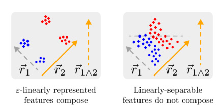

_Figure 3._ When two features _f_ 1 _, f_ 2 are _ε_ -linearly represented in activations _a_ ( _x_ ), we can use two MLP neurons with input weights _r_ 1 _,⃗r_ 2 to read-off the two features, after which _f_ 1 _∧ f_ 2 and _f_ 1 _∨ f_ 2 are _ε_ -linearly represented in the MLP activations MLP( _a_ ( _x_ )). However, because linearly-separable features can have arbitrarily small margin, there might exist _no_ MLP such that _f_ 1 _∧ f_ 2 and _f_ 1 _∨ f_ 2 are linearly separable in MLP( _a_ ( _x_ )). 

_ε (or ε_ -linearly represented _from these activation vectors) if there exists a_ read-off matrix **R** _∈_ Mat _m×d with rows r_ 1 _, . . . ,⃗rm ∈_ R_d_ _such that for all k ∈{_ 1 _, . . . , m} and all x ∈ X, we have_ 

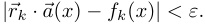

_We refer to⃗rk as a_ read-off vector _for the feature fk. It follows that if⃗a_ ( _x_ ) =�_m_ _i_ =1 _⃗__ϕkfk_(_x_)_, then we have:_ 

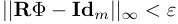

_where_ **Id** _m is the m × m identity matrix_1 _._ 

For brevity’s sake, we very slightly abuse notation here to include the bias term in _⃗rk_ . This is equivalent to assuming that one of _⃗a_ ’s outputs is a constant, that is, _ai_ ( _x_ ) = _c_ for all x for some _i ∈{_ 1 _, ..., d}_ and some _c ∈_ R. 

In contrast to features that are merely linearly separable, features that are _ε_ -linearly represented are easy to linearly separate, as we show in Figure 3. We formalize and prove this in Theorem 10 in Appendix C. 

**Comparison with Anthropic’s Toy Model of Superposition** Finally, Elhage et al. (2022) and Bricken et al. (2023) consider a definition of linearly represented feature that involves using a ReLU to remove negative interference: 

**Definition 3** (ReLU-linear representations) **.** _A set of m binary features⃗F_ = ( _f_ 1 _, ..., fm_ ) _is ReLU-linearly represented in a_ : _X →_ R_d_ _with error ε if there exists a read-off matrix_ **R** _∈_ Mat _m×d such that_ 

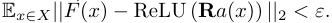

> 1In some cases if the feature vectors satisfy _|_ Φ _T_ Φ _−_ **Id** _m| ≤ µ_ — that is, if the feature vectors are _almost orthogonal with interference µ_ , then the features vectors can function as their own readoffs. 

Note that in contrast to _ε_ -linearly represented features, where each individual feature must be able to be read off using an affine function with small error on _every_ datapoint, ReLU-linear representated features are read off using a MLP layer with _m_ neurons (one per feature), such that the _expected ℓ_ 2 loss (summed across all _m_ features) is small. 

# **3. Universal ANDs: a model of single-layer MLP superposition** 

We start by presenting one of the simplest non-trivial boolean circuits: namely, the one-layer circuit that computes the pairwise AND of the input features. Note that due to space limitations, we include only proof sketches in the main body and may ignore some regularity conditions in the theorem statement. See Appendix D for more rigorous theorem statements and proofs. 

**Definition 4** (The universal AND boolean circuit) **.** _Let_ **_b_** _∈ {_ 0 _,_ 1 _}__m_ _be a boolean vector. The universal AND (or U- AND) circuit has m inputs and_ � _m_ 2 � _outputs indexed by unordered pairs k, ℓ of locations and is defined by_ 

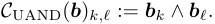

_In other words, we apply the AND gate to all possible pairs of distinct inputs to produce_ � _m_ 2 � _outputs._ 

We will build our theory of computation starting from a single-layer neural net that emulates the universal AND when the input **_b_** is _s_ -sparse for some _s ∈_ N (this implies that the output has sparsity _O_ ( _s_2 )). 

## **3.1. Superposition in MLP activations enables more efficient U-AND** 

First, consider the naive implementation, where we use one ReLU to implement each AND using the fact that for boolean _x_ 1 _, x_ 2: 

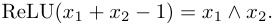

This requires � _n_ 2� = _O_ ( _n_2 ) neurons, each of which is monosemantic in that it represents a single natural feature. In contrast, by using sparsity, we can construct using exponentially fewer neurons (Figure 1): 

**Theorem 1** (U-AND with basis-aligned inputs) **.** _Fix a sparsity parameter s ∈_ N _. Then for large input length m, there exists a single-layer neural network Mw_ ( _x_ ) = MLP( _x_ ) = ReLU( _Winx_ + _wbias_ ) _that ε-linearly represents the universal AND circuit C_ UAND _on s-sparse inputs, with width d_ = _O_˜ _m_ (1 _/ε_2 ) _(i.e. polylogarithmic in m)._ 

_Proof._ (sketch) To show this, we construct an MLP such that each neuron checks whether or not at least two inputs in a small random subset of the boolean input **_b_** are active (see 

also Figure 1). Intuitively, since the inputs are sparse, each neuron can be thought of as checking the ANDs of any pair of input variables **_b_** _k_ 1 _,_ **_b_** _k_ 2 in the subset, with interference terms corresponding to all the other variables. That is, we can write the preactivation of each neuron as the sum of the AND of **_b_** _k_ 1 _,_ **_b_** _k_ 2 and some interference terms: 

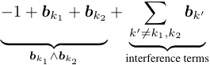

We then use the sparsity of inputs to bound the size of the interference terms, and show that we can “read-off” the AND of **_b_** _k_ 1 _,_ **_b_** _k_ 2 by averaging together the value of post-ReLU activations of the neurons connected to **_b_** _k_ 1 _,_ **_b_** _k_ 2 . We then argue that this averaging reduces the size of the interference terms to below _ε_ . 

Specifically, we construct input weights _W_ in _∈_ Mat _d×m_ such that the input to each neuron is connected to the _k_ th entry of the input **_b_** _k_ with weight 1 with probability _p_ = log2 _m/√d_ , and weight 0 otherwise. We set the bias of each neuron to _−_ 1. 

Let Γ( _k_ ) be indices of neurons that have input weight 1 for **_b_** _k_ , and Γ( _k_ 1 _, k_ 2) be the indices of neurons that have input weight 1 for **_b_** _k_ 1 _,_ **_b_** _k_ 2 , Γ( _k_ 1 _, k_ 2 _, k_ 3) be the indices of neurons reading from all of **_b_** _k_ 1 _,_ **_b_** _k_ 2 _,_ **_b_** _k_ 3 , and so forth. By construction, Γ( _k_ 1) has expected size Θ(log2 _m · √d_ ), Γ( _k_ 1 _, k_ 2) has expected size Θ(log4 _m_ ), and Γ( _k_ 1 _, k_ 2 _, k_ 3) has expected size Θ(log6 _m/√d_ ). In general, the set of indices for _n_ such inputs has expected size Θ(log2_n_ _/d_(_n/_2_−_1) ) 

Our read-off vector _⃗r_ for the AND **_b_** _k_ 1 _∧_ **_b_** _k_ 2 will have entries: 

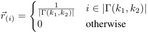

We then check that _⃗r ·_ MLP( **_b_** ) gives the correct output in each of three cases. Note that for any input, _⃗r ·_ MLP( **_b_** ) _≥_ **_b_** _k_ 1 _∧_ **_b_** _k_ 2 , so it suffices to upper bound the average number of non- _k_ 1 _, k_ 2 inputs that are non-zero, divided by the total number of neurons in Γ( _k_ 1 _, k_ 2). 

- When **_b_** _k_ 1 = **_b_** _k_ 2 = 0, the interference terms in each read-off neuron have value at most _s_ , and there are at most 

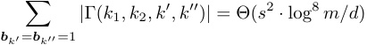

such neurons outputting non-zero values. So the error is bounded above by 

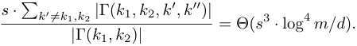

- When **_b_** _k_ 1 = 1 or **_b_** _k_ 2 = 1, the interference terms in each read-off neuron have value at most _s −_ 2, and there are at most 

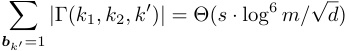

neurons that have such interference terms. So the error is bounded above by 

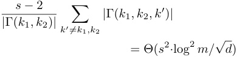

Combining the above, we get that the read-off error is _O_ (log4 _m/√d_ ), and so setting _d_ = Θ(log8 _m/ε_2 ) = _O_ ˜ _m_ (1 _/ε_2 ) gives us an error that is _< ε_ outside negligible probability. 

## **3.2. Neural networks can implement efficient U-AND even with inputs in superposition** 

Note that in Theorem 1, we assume that the network gets _m_ basis-aligned inputs (that is, not in superposition). However, it turns out that we can extend the result in Theorem 1 to inputs in superposition. 

**Theorem 2** (U-AND with inputs in superposition) **.** _Let s ∈_ N _be a fixed sparsity limit and ε <_ 1 _a fixed interference parameter. There exists a feature encoding_ Φ _and singlelayer neural net Mw_ ( _x_ ) = MLP( _x_ ) = ReLU( _Winx_ + _wbias_ ) _with input size and width d_ = _O_˜ (_√_ _<u>m/ε</u>_2 ) _, where Mw ◦_ Φ _ε-linearly represents C_ UAND _on all s-sparse inputs_ **_b_** _._ 

_Proof._ (sketch) By picking almost orthogonal unit-norm vectors Φ = ( _⃗ϕ_ 1 _, . . . ,⃗ϕm_ ), we can recover each feature up to error _ε_ using readoffs **R** = Φ_T_ . Take the input weight _W_ in _∈_ Mat _d×m_ for the MLP constructed in the proof of Theorem 1. Using _W_ in _′_ = _W_ in **R** and _w_ bias _′_ = _w_ bias suffices, as this gives us 

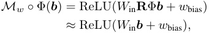

which is just the model from Theorem 1, which _ε_ -linearly represents _C_ UAND as desired. Carefully tracking error terms shows that we need _d_ = Θ(˜_√_ _<u>m</u>_ <u>) neurons.</u> 

## **3.3. Randomly initialized neural networks linearly represent U-AND** 

While the results in previous section show that there exist _some_ network weights that _ε_ -linearly represents the U-AND 

circuit _C_ UAND, there still is a question of whether neural networks can learn to represent many ANDs starting from the standard initialization. In this section, we provide some theoretical evidence – namely, that sufficiently wide _randomly initialized_ one-layer MLPs _ε_ -linearly represent _C_ UAND. 

**Theorem 3** (Randomly initialized MLPs linearly represent U-AND) **.** _Let_ MLP : R_m_ _→_ R_d_ _be a one-layer MLP with d_ = Ω(1˜ _/ε_2 ) _neurons that takes input_ **_b_** _, and where Win is drawn i.i.d from a normal distribution N_ (0 _, δ_2 ) _and wbias_ = _⃗_ 0 _. Then this MLP ε-linearly represents C_ UAND _on s-sparse inputs outside of negligible probability._ 

_Proof._ (Sketch) We prove this by constructing a read-off vector _⃗r_ for each pair of features _k_ 1 _, k_ 2. Let _σ_ be the sign function 

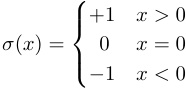

and let _wi,k_ be the contribution to the preactivation of neuron _i_ from **_b_** _k_ . 

We construct _⃗r_ coordinatewise (that is, neuron-by-neuron). In particular, we set the _i_ th coordinate of _⃗r_ to be 

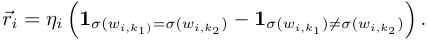

That is, if _k_ 1 and _k_ 2 contribute to the neuron preactivations with the same sign, then _⃗ri_ = _ηi_ , else, _⃗ri_ = _−ηi_ . Here, _ηi_ is a scaling parameter of size Θ(_√_ _<u>s/d</u>_ ) used to scale the read-off to be 1 when **_b_** _k_ 1 = **_b_** _k_ 2 = 1 

When **_b_** _k_ 1 = 0 or **_b_** _k_ 2 = 0, the expected value of _⃗r · Mw_ ( **_b_** ) is zero, while the error terms have size _O_˜ _m_ (1 _/√d_ ). So setting _d_ = Ω(1˜ _/ε_2 ) suffices to get error below _ε_ with high probability. 

When **_b_** _k_ 1 = **_b_** _k_ 2 = 1, the contribution from each neuron _i_ to _⃗r · Mw_ ( **_b_** ) with _σ_ ( _wi,k_ 1) = _σ_ ( _wi,k_ 2) will be in expectation larger than those with _σ_ ( _wi,k_ 1) _̸_ = _σ_ ( _wi,k_ 2) (as the standard deviation of the sum of two weights with equal signs is larger than the sum of two weights with different signs, and we apply a ReLU). By setting _η_ to be the reciprocal of the difference in expected contributions, we have that this value has expectation 1. Again, as the error terms have size _O_˜ _m_ (1 _/√d_ ), it follows that setting _d_ = Ω(1˜ _/ε_2 ) suffices to get error below _ε_ with high probability, as desired. 

Before proceeding, we record a corollary, which underscores the surprisingly strong asymptotic representability of the universal AND circuit. 

**Corollary 4.** _For any fixed input size s, dimension d and m_ = _d__O_(1) _polynomial in d, there exists a “universal AND” model with hidden dimension d,_ 

_Mw_ : _x �→_ ReLU( _Win_ ( _x_ )) 

_from_ R_d_ _to_ R_d_ _and a feature matrix_ Φ _∈_ Mat _m×d such that for any input_ **_b_** _with sparsity ||_ **_b_** _||_ 1 = _s, we have that Mw_ (Φ( **_b_** )) _∈_ R_d_ _strongly linearly represents uAND_ ( **_b_** ) _∈ m {_ 0 _,_ 1 _}_( 2) _(with error at worst ε_ = _O_ ˜� _~~√~~_ <u>1</u> _d_ � _)._ 

# **4. MLPs as representing sparse boolean circuits** 

In the previous section we showed variants of computation in superposition at a single layer, for one of the simplest non-trivial boolean circuits. In this section, we extend these results to show that neural networks can efficiently represent _arbitrary_ sparse boolean circuits. 

As in Section 3, we include only proof sketches in the main body due to space limitations, and may also ignore some regularity conditions in our theorem statements. See Appendix D for more rigorous theorem statements and proofs. 

## **4.1. Boolean circuits in single layer MLPs** 

We start by extending these results from Section 3 to ANDs of more than two variables. 

Let _C_ UAND(_n_)be the boolean circuit of depth_L_= log(_n_) that computes the ANDs of each _n_ -tuple of elements in **_b_** .2 **Lemma 5** (“High fan-in” U-AND) **.** _For each n ∈_ N _, there exists a one-layer neural network Mw_ = MLP : R_m_ _→_ R_d_ _with width d_ = _O_˜ ( _n/ε_2 ) _such that Mw_ ( **_b_** ) _ε-linearly represents C_ UAND(_n_)_on s-sparse inputs._ 

_Proof._ (sketch) We can extend the construction in the proof of Theorem 1 to allow for ANDs of exactly _n_ variables, by considering index sets **I** ( _k_ 1 _, k_ 2 _, ..., kn_ ) of n variables, and changing the bias of each neuron from _−_ 1 to _−n_ + 1. The expected size of an index set of _n_ variables is E[ _|_ **I** ( _k_ 1 _, k_ 2 _, ..., kn_ ) _|_ ] = _p__n_ _d_ , and we require this expected value to be Ω(log4 _m_ ) to ensure that the index set is non-empty outside negligible probability (using the normal Chernoff and Union bounds). Therefore, we have to scale up the probability that any given value in _W_ in is 1: _p_ =lo _d_<u>g12</u>_/n m_suffices.A similar argument to the one found in the proof of Theorem 1 shows that all the interference terms are _o_ (1). 

As illustrated in Figure 4, Lemma 5 allows us to construct 

2Note that by our definition, boolean circuits are made of gates of fan-in at most 2. So computing the ANDs of _n_ variables requires a boolean circuit of depth log( _n_ ). 

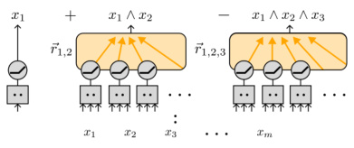

_Figure 4._ As discussed in Section 4.1, our U-AND construction can be extended to allow for arbitrarily high fan-in ANDs, which in turn allows for single-layer MLPs that linearly represent all small boolean circuits. 

MLPs that _ε_ -linearly represents arbitrary small circuits: 

**Theorem 6.** _For any s-sparse circuit C of width m and depth L, there exists a feature encoding_ Φ _∈_ Mat _d×m and a single-layer neural network Mw_ ( _x_ ) = ReLU( _Winx_ + _wbias_ ) _of width d_ = _O_˜ (_√_ _<u>m</u>_ <u>)</u> _such that Mw_ (Φ **_b_** ) _ε-linearly represents C_ ( **_b_** ) _k for all k ∈{_ 1 _, ..., m} for some ε_ = _O_ ˜( _m__−_1_/_3 ) _._ 

_Proof._ (sketch) First, apply the construction in Theorem 2 to show that there exists one-layer MLPs of width _d_ = _O_˜ (_√_ _<u>m</u>_ ) that compute _C_ UAND(_n_)when the inputs are in superposition, where _n ∈{_ 2 _,_ 3 _, ...,_ 2_L_ _}_ . 

Next, concatenate together the 2_L_ _−_ 1 networks of width _d_ = _O_˜ (_√_ _<u>m</u>_ ) that _ε_ -linearly represent each _C_ UAND(_n_)for_n ∈_ _{_ 2 _,_ 3 _, ...,_ 2_L_ _}_ , when the inputs are in superposition. Since the output of _any_ boolean circuits of depth _L_ can be written as a linear combinations of ANDs of maximum fan-in 2_L_ , it follows that the concatenated network _ε__′_ -linearly represents any boolean circuit of depth _L_ , for some _ε__′_ dependent on how many ANDs need to be added together to compute the circuit, as desired. 

## **4.2. Efficient boolean circuits via deep MLPs** 

The one-layer MLP in Theorem 6 has width that is exponential in the depth of the circuit. However, by combining pairwise U-AND layers (which linearly represent any onelayer boolean circuit) with “error correction” layers, we can construct deeper neural networks with sublinear width and depth linear in the depth of the circuit. 

**Lemma 7.** _Assume that m_ = _O_ ˜( _d_1_._5 ) _, and c is some large polylog constant. Then for sufficiently small input interference ε_ = _O_ ˜(1 _/√d_ ) _there exists a 1-layer MLP Mw_ : R_d_ _→_ R_d_ _that takes as input a boolean vector of length m encoded in d-dimensions using superposition and returns (outside negligible probability) an encoding of the same boolean vector with interference ε/c._ 

_Proof._ See Theorem 21 in Appendix D.4. 

By alternating between such “error correction” layers and U-AND layers, we can construct more efficient circuits: **Theorem 8.** _Let C_ : _{_ 0 _,_ 1 _}__m_ _→{_ 0 _,_ 1 _}__m_ _be a circuit of width m and of depth L_ = _O_ ( _m__c_ ) _polynomial in m. There exists a neural network of width d_ = _O_˜ ( _m_ <u>23</u> _s_2 ) _and with depth_ 2 _L such that Mw_ (Φ **_b_** ) _ε-linearly C_ ( **_b_** ) _for all but a negligible fraction of inputs_ **_b_** _on which C is s-sparse._ 

_Proof._ (sketch) As a single MLP layer can _ε_ -linearly represent the ANDs of all input features (by Theorem 2), we can use one MLP layer to approximate each layer of the circuit. However, the naive construction suffers from (potentially) exponentially growing error. To fix this, we insert an error correction layer from Lemma 7 between every such layer. 

# **5. Related Work** 

The idea that neural networks could or should make use of distributed or compositional representations has been a mainstay of early neural network research (Rosenblatt, 1961; Holyoak, 1987; Fodor & Pylyshyn, 1988). Arora et al. (2018) were the first in the modern deep learning context to discuss that neural networks could store many features in superposition. Olah et al. (2020) developed this idea into the ‘superposition hypothesis’: the conjecture that networks use the same neurons for multiple circuits to maximise the number of circuits they can learn. 

Many of our results are similar in flavor to those from the fields of sparse dictionary (Tillmann, 2014) and hyperdimensional computing (Zou et al., 2021), as all rely on useful properties of high-dimensional spaces. In addition, many of our boolean circuit results on randomly-initialized MLP layers are similar in flavor to universality results on randomly initialized neural networks with different non-linearities (Rahimi & Recht, 2008a;b). However, these results consider cases where there are fewer “true features” than there are dimensions, while the superposition hypothesis requires that the number of “true features” exceeds the dimensionality of the space. Randomized numerical linear algebra (Murray et al., 2023) studies the use of random projections to perform efficient computation, but in the context of reducing the cost of linear algebra operations such as linear regression or SVD with inputs and outputs represented in an axis-aligned fashion. 

Superposition has been studied in a range of idealised settings: Elhage et al. (2022) provided the first examples of toy models which employed superposition to achieve low loss and Henighan et al. (2023) further explored superposition in a toy memorisation task. Notably, they study features that are ReLU-linear represented. (See Section 2.2 for more discussion.) Scherlis et al. (2022) study a model of using a small number of neurons with _quadratic_ activations to ap- 

proximately compute degree two polynomials. The models studied in all of these papers require sparse features of _declining_ importance. In contrast, our model allows for sparse features that are equally important. More importantly, none of these listed works study performing computation with _inputs in superposition_ . 

Several papers have also explored the prevalence of superposition in language models. Gurnee et al. (2023) found that some bigrams are represented on sparse sets of neurons but not on any individual neurons. There is also a growing literature on using sparse dictionary learning to identify features in language models inspired by the superposition hypothesis (Cunningham et al., 2023; Bricken et al., 2023; Tamkin et al., 2023; Bloom, 2024; Braun et al., 2024; Templeton et al., 2024) although it is unclear how much evidence the success of sparse dictionary learning in finding human-interpretable features provides for the superposition hypothesis. 

# **6. Discussion** 

## **6.1. Summary** 

In this work, we have presented a mathematical framework for understanding how neural networks can perform computation in superposition, where the number of features computed can greatly exceed the number of neurons. We have demonstrated this capability through the construction of a neural network that efficiently emulates the Universal AND circuit, computing all pairwise logical ANDs of input features using far fewer neurons than the number of output features. Furthermore, we have shown how this construction can be generalized to emulate a wide range of sparse, low-depth boolean circuits entirely in superposition. This work lays the foundation for a deeper understanding of how neural networks can efficiently represent and manipulate information, and highlights the importance of considering computation in superposition when interpreting the algorithms learned by these systems. 

## **6.2. Practical Takeaways for Mechanistic Interpretability** 

Our primary motivation for undertaking this work was to glean insights about the computation implemented by neural networks. While we provide more potential takeaways in Appendix B, here we discuss what we think are two salient takeaways for interpretability: 

**Unused features** The implementation of U-AND by random matrices (Theorem 3) suggests that certain concepts may be detectable through linear probes in a network’s activation space without being actively utilized in subsequent computations. This phenomenon could explain the findings of Marks (2024), who observed that arbitrary XORs 

of concepts can be successfully probed in language models. Furthermore, it implies that successfully probing for a concept and identifying a direction that explains a high percentage of variance (e.g., 80%) may not constitute strong evidence of the model’s actual use of that concept. Consequently, there is reason to be cautious about how many of the features identified by Sparse Autoencoders (Cunningham et al., 2023; Bricken et al., 2023; Bloom, 2024; Templeton et al., 2024) are actively employed by the model in its computation. 

**Robustness to noise** This research underscores the critical role of error correction in networks performing computations in superposition. Effective error correction mechanisms should enable networks to rectify minor perturbations in their activation states, resulting in a nonlinear response in output when activation vectors are slightly altered along specific directions. Expanding on this concept, Heimersheim & Mendel (2023) conducted follow-up investigations, revealing the presence of _plateaus_ surrounding activation vectors in GPT2-small (Radford et al., 2019). Within these plateaus, model outputs exhibit minimal variation despite small changes in activation values, providing weak evidence for an error correcting mechanism in the model’s computation. 

## **6.3. Limitations and future work** 

That being said, there are a number of ways in which the computational framework presented in this work is very likely to miss the full richness of computation happening in any given real neural network. 

Firstly, this work studies computation on binary features. It is plausible that other kinds of features – in particular, discrete features which take on more than 2 distinct values, or continuous-valued features – occur commonly in real neural networks. It would be valuable to extend the understanding developed in this work to such non-binary features. 

Secondly, though we do not require features to have declining importance, we do require features to be sparse, with each data point only having a small number of active features. It is plausible that not all features are sparse in practice (given the present state of empirical evidence, it even appears open to us whether a significant fraction of features are sparse in practice) – for instance, perhaps real neural networks partly use more compositional representations with dense features. 

Thirdly, in this work, we have made a particular choice regarding what it takes for a feature to be provided in the input and to have been computed in the output: _ε_ -linear representation (Definition 2). Future empirical results or theoretical arguments could call for revising this choice — for instance, perhaps an eventual full reverse-engineering 

picture would permit certain kinds of non-linear features. 

Finally and least specifically, the way of looking at neural net computation suggested in this work could turn out to be thoroughly confused. We consider there to be a lot of room for the development of a more principled and empirically grounded picture. 

# **Impact Statement** 

The primary impact of our work is to advance the field of mechanistic interpretability. While advancing this field may have many potential societal impacts, we feel that there are no direct, non-standard impacts of our work that are worth highlighting. 

# **References** 

- Arora, S., Li, Y., Liang, Y., Ma, T., and Risteski, A. Linear algebraic structure of word senses, with applications to polysemy. _Transactions of the Association for Computational Linguistics_ , 6:483–495, 2018. 

- Bellare. A note on negligible functions. _Journal of Cryptology_ , 15:271–284, 2002. 

- Bernstein, S. On a modification of chebyshev’s inequality and of the error formula of laplace. _Ann. Sci. Inst. Sav. Ukraine, Sect. Math_ , 1(4):38–49, 1924. 

- Bloom, J. Open source sparse autoencoders for all residual stream layers of GPT2 small. https://www.alignmentforum.org/posts/ f9EgfLSurAiqRJySD/, 2024. 

- Braun, D., Taylor, J., Goldowsky-Dill, N., and Sharkey, L. Identifying functionally important features with end-to-end sparse dictionary learning. _arXiv preprint arXiv:2405.12241_ , 2024. 

- Bricken, T., Templeton, A., Batson, J., Chen, B., Jermyn, A., Conerly, T., Turner, N., Anil, C., Denison, C., Askell, A., Lasenby, R., Wu, Y., Kravec, S., Schiefer, N., Maxwell, T., Joseph, N., Hatfield-Dodds, Z., Tamkin, A., Nguyen, K., McLean, B., Burke, J. E., Hume, T., Carter, S., Henighan, T., and Olah, C. Towards monosemanticity: Decomposing language models with dictionary learning. _Transformer Circuits Thread_ , 2023. https://transformercircuits.pub/2023/monosemantic-features/index.html. 

- Conmy, A., Mavor-Parker, A., Lynch, A., Heimersheim, S., and Garriga-Alonso, A. Towards automated circuit discovery for mechanistic interpretability. _Advances in Neural Information Processing Systems_ , 36, 2024. 

- Cunningham, H., Ewart, A., Riggs, L., Huben, R., and Sharkey, L. Sparse autoencoders find highly inter- 

- pretable features in language models. _arXiv preprint arXiv:2309.08600_ , 2023. 

   - Henighan, T., Carter, S., Hume, T., Elhage, N., Lasenby, R., Fort, S., Schiefer, N., and Olah, C. Superposition, memorization, and double descent. _Transformer Circuits Thread_ , 2023. 

- Elhage, N., Nanda, N., Olsson, C., Henighan, T., Joseph, N., Mann, B., Askell, A., Bai, Y., Chen, A., Conerly, T., DasSarma, N., Drain, D., Ganguli, D., HatfieldDodds, Z., Hernandez, D., Jones, A., Kernion, J., Lovitt, L., Ndousse, K., Amodei, D., Brown, T., Clark, J., Kaplan, J., McCandlish, S., and Olah, C. A mathematical framework for transformer circuits. _Transformer Circuits Thread_ , 2021. https://transformercircuits.pub/2021/framework/index.html. 

   - Holyoak, K. J. Parallel distributed processing: explorations in the microstructure of cognition. _Science_ , 236:992–997, 1987. 

   - Langley, P. Crafting papers on machine learning. In Langley, P. (ed.), _Proceedings of the 17th International Conference on Machine Learning (ICML 2000)_ , pp. 1207–1216, Stanford, CA, 2000. Morgan Kaufmann. 

- Elhage, N., Hume, T., Olsson, C., Schiefer, N., Henighan, T., Kravec, S., Hatfield-Dodds, Z., Lasenby, R., Drain, D., Chen, C., et al. Toy models of superposition. _arXiv preprint arXiv:2209.10652_ , 2022. 

- Marks, S. What’s up with llms representing xors of arbitrary features?, 2024. URL https://www.alignmentforum. org/posts/hjJXCn9GsskysDceS/ 

what-s-up-with-llms-representing-xors-of-arbitrary-features Accessed: 2024-07-27. 

- Fodor, J. A. and Pylyshyn, Z. W. Connectionism and cognitive architecture: A critical analysis. _Cognition_ , 28(1-2): 3–71, 1988. 

   - Meng, K., Bau, D., Andonian, A., and Belinkov, Y. Locating and editing factual associations in gpt, 2023. 

- Fusi, S., Miller, E. K., and Rigotti, M. Why neurons mix: high dimensionality for higher cognition. _Current Opinion in Neurobiology_ , 37:66–74, 2016. ISSN 09594388. doi: https://doi.org/10.1016/j.conb.2016.01.010. URL https://www.sciencedirect.com/ science/article/pii/S0959438816000118. Neurobiology of cognitive behavior. 

   - Murray, R., Demmel, J., Mahoney, M. W., Erichson, N. B., Melnichenko, M., Malik, O. A., Grigori, L., Luszczek, P., Derezinski,´ M., Lopes, M. E., et al. Randomized numerical linear algebra: A perspective on the field with an eye to software. _arXiv preprint arXiv:2302.11474_ , 2023. 

- Geiger, A., Lu, H., Icard, T., and Potts, C. Causal abstractions of neural networks. _Advances in Neural Information Processing Systems_ , 34:9574–9586, 2021. 

   - Nguyen, A., Yosinski, J., and Clune, J. Multifaceted feature visualization: Uncovering the different types of features learned by each neuron in deep neural networks, 2016. 

- Geva, M., Schuster, R., Berant, J., and Levy, O. Transformer feed-forward layers are key-value memories, September 2021. URL http://arxiv.org/abs/2012. 14913. arXiv:2012.14913 [cs]. 

   - Olah, C., Mordvintsev, A., and Schubert, L. Feature visualization. _Distill_ , 2017. doi: 10.23915/distill.00007. https://distill.pub/2017/feature-visualization. 

   - Olah, C., Cammarata, N., Schubert, L., Goh, G., Petrov, M., and Carter, S. Zoom in: An introduction to circuits. _Distill_ , 5(3):e00024–001, 2020. 

- Goh, G., †, N. C., †, C. V., Carter, S., Petrov, M., Schubert, L., Radford, A., and Olah, C. Multimodal neurons in artificial neural networks. _Distill_ , 2021. doi: 10.23915/distill. 00030. https://distill.pub/2021/multimodal-neurons. 

   - Radford, A., Wu, J., Child, R., Luan, D., Amodei, D., Sutskever, I., et al. Language models are unsupervised multitask learners. _OpenAI blog_ , 1(8):9, 2019. 

- Gurnee, W., Nanda, N., Pauly, M., Harvey, K., Troitskii, D., and Bertsimas, D. Finding neurons in a haystack: Case studies with sparse probing. _arXiv preprint arXiv:2305.01610_ , 2023. 

   - Rahimi, A. and Recht, B. Uniform approximation of functions with random bases. In _2008 46th annual allerton conference on communication, control, and computing_ , pp. 555–561. IEEE, 2008a. 

- Heimersheim, S. and Mendel, J. Interim research report: Activation plateaus and sensitive periods in transformer training, 2023. URL https://www.alignmentforum. org/posts/LajDyGyiyX8DNNsuF/ 

   - Rahimi, A. and Recht, B. Weighted sums of random kitchen sinks: Replacing minimization with randomization in learning. _Advances in neural_ . _information processing systems_ , 21, 2008b. 

- interim-research-report-activation-plateaus-and-sensitive-1learning. _Advances in_ . Accessed: 2024-07-27. _systems_ , 21, 2008b. 

- Rajamanoharan, S., Conmy, A., Smith, L., Lieberum, T., 

- Varma, V., Kramar, J., Shah, R., and Nanda, N. Improving´ dictionary learning with gated sparse autoencoders. _arXiv preprint arXiv:2404.16014_ , 2024. 

- Rosenblatt, F. Principles of neurodynamics. perceptrons and the theory of brain mechanisms. Technical report, Cornell Aeronautical Lab Inc Buffalo NY, 1961. 

- Rauker,¨ T., Ho, A., Casper, S., and Hadfield-Menell, D. Toward transparent AI: A survey on interpreting the inner structures of deep neural networks, 2023. 

- Scherlis, A., Sachan, K., Jermyn, A. S., Benton, J., and Shlegeris, B. Polysemanticity and capacity in neural networks. _arXiv preprint arXiv:2210.01892_ , 2022. 

- Taggart, G. M. ProLU: A nonlinearity for sparse autoencoders. https://www.alignmentforum. org/posts/HEpufTdakGTTKgoYF/ prolu-a-nonlinearity-for-sparse-autoencoders, 2024. 

- Tamkin, A., Taufeeque, M., and Goodman, N. D. Codebook features: Sparse and discrete interpretability for neural networks. _arXiv preprint arXiv:2310.17230_ , 2023. 

- Templeton, A., Conerly, T., Marcus, J., Lindsey, J., Bricken, T., Chen, B., Pearce, A., Citro, C., Ameisen, E., Jones, A., Cunningham, H., Turner, N. L., McDougall, C., MacDiarmid, M., Freeman, C. D., Sumers, T. R., Rees, E., Batson, J., Jermyn, A., Carter, S., Olah, C., and Henighan, T. Scaling monosemanticity: Extracting interpretable features from claude 3 sonnet. _Transformer Circuits Thread_ , 2024. URL https: //transformer-circuits.pub/2024/ scaling-monosemanticity/index.html. 

- Tillmann, A. M. On the computational intractability of exact and approximate dictionary learning. _IEEE Signal Processing Letters_ , 22(1):45–49, 2014. 

- Wang, K., Variengien, A., Conmy, A., Shlegeris, B., and Steinhardt, J. Interpretability in the wild: a circuit for indirect object identification in GPT-2 small. _arXiv preprint arXiv:2211.00593_ , 2022. 

- Zou, Z., Alimohamadi, H., Imani, F., Kim, Y., and Imani, M. Spiking hyperdimensional network: Neuromorphic models integrated with memory-inspired framework. _arXiv preprint arXiv:2110.00214_ , 2021. 

# **A. Mathematical definitions** 

Here, we list and define the mathematical terms that we use throughout this work. 

_X_ set of inputs _Y_ set of outputs _Mw_ : _X → Y_ neural network with ReLU activations, parameterized by _w⃗ a_(_l_) ( _x_ ) _∈_ R_d_ the activations of a neural network at layer _l_ , _l ∈{_ 0 _, ..., L}_ MLP(_l_) : R_d_ _→_ R_d_ the _l_ th MLP layer, MLP(_l_) ( _x_ ) = ReLU( _W_ in( _l_ ) _x_ + _w_ bias( _l_ )) _fk_ : _X →{_ 0 _,_ 1 _}_ boolean feature of the input, _k_ = 1 _, . . . , m F_ : _X →{_ 0 _,_ 1 _}__m_ the concatenation of _m_ boolean features _ϕk ∈_ R_d_ vector linearly representing the _k_ th boolean feature Φ _∈_ R_d×m_ the feature embedding matrix, Φ = ( _⃗ϕ_ 1 _, ...,⃗ϕm_ ) **_b_** = **_b_** ( _x_ ) _∈{_ 0 _,_ 1 _}__m_ a boolean vector of length _m_ associated to an input/activation **_b_** _k_ = **_b_** _k_ ( _x_ ) _∈{_ 0 _,_ 1 _}_ the _k_ th entry in the boolean vector, equal to _fk_ ( _x_ ) _||_ **_b_** ( _x_ ) _||_ 1 “sparsity”, a.k.a. number of bits that are “on” for the boolean vector **_b_** _,_ equal to�_m_ _k_ =1_fk_(_x_)_._ _C_ : _{_ 0 _,_ 1 _}__m_ _→{_ 0 _,_ 1 _}__m′_ a boolean circuit _Cl_ : _{_ 0 _,_ 1 _}__m_ _→{_ 0 _,_ 1 _}__m′_ layer _l_ of the boolean circuit _C_ , consisting of _m__′_ boolean gates of fan-in at most two. 

_Table 1._ Definitions of terms used in this work. 

We also use the following conventions for clarity: 

_i, j ∈{_ 1 _, ..., d}_ indices for neurons _k_ , _ℓ_ , _p ∈{_ 1 _, ..., m}_ indices for features _µ_ amount of interference between near-orthogonal vectors _ε_ error in the read-off of a boolean feature _s_ A bound on the “sparsity”; we require _||_ **_b_** ( _x_ ) _||_ 1 _≤ s ∀ x ∈ X._ 

### _Table 2._ Conventions used in this work. 

We assume our terms satisfy the following asymptotic relationships in terms of the principal complexity parameter _m_ (the number of features): 

_d_ is polynomial in _m_ so _d_ = Ω(˜ _m__α_+ ) _, d_ = _O_˜ ( _m__α−_ ) for some finite exponents 0 _< α ≤ α− < ∞. s_ is at worst polynomial in _m,_ so _s_ = _O_ ( _m__β_ ) _._ Note that this is different from the body, where we assumed _s_ is a constant (so _β_ = 0). _s_ = _O_˜ ( _d_1_/_3 ) _._ This is a technical “sparsity” condition that will be useful for us. 

_Table 3._ Asymptotic relationships between variables in this work. 

# **B. Potential takeaways for practical mechanistic interpretability** 

Our motivation for studying these mathematical models is to glean insights about the computation implemented by real networks, that could have ramifications for the field of mechanistic interpretability, particularly the subfield focussed on taking features out of superposition in language models using sparse dictionary learning (Cunningham et al., 2023; Bricken et al., 2023; Tamkin et al., 2023; Bloom, 2024; Braun et al., 2024; Templeton et al., 2024). In order to render the models mathematically tractable, we have had to make idealising assumptions about the computation implemented by the networks. 

1. Early work on superposition (Elhage et al., 2022) suggested that it may be possible to store exponentially many features in superposition in an activation space. On the other hand, early sparse dictionary learning efforts (Cunningham et al., 2023; Bricken et al., 2023; Bloom, 2024) learn dictionaries which are smaller than even the square of the dimension of the activation space. Our work suggests that the number of features that can be stored in superposition _and computed with_ is likely to be around _O_˜ ( _d_2 ) (this is also the information-theoretic limit). We think that by using a dictionary size that scales quadratically in the size of the activations, while computationally challenging, this will likely lead to better performance on downstream tasks. We are heartened by more recent work by Templeton et al. (2024) which works with dictionaries that are closer to this size, and would encourage more systems-oriented work to scale to ever larger dictionaries. 

2. The current mainstream sparse autoencoder (SAE) architecture used by Cunningham et al. (2023); Bricken et al. (2023); Bloom (2024); Templeton et al. (2024) and others uses ReLUs to read off feature values, in accordance with the toy model of superposition of Elhage et al. (2022) and features being ReLU-linearly represented. Our work suggests that networks may be more expressive when storing features _ε_ -linearly. If so, this suggests that future work should consider sparse dictionary learning with alternative activation functions that only allow for removing errors of size _ε_ , such as a _noise-filtering nonlinearity_ 

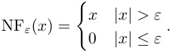

or nonlinearities that filter all but the k largest positive and largest negative preactivations. Notably, recent work by Rajamanoharan et al. (2024); Taggart (2024) finds suggestive evidence that the ProLU activation: 

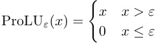

outperforms the standard ReLU activation SAEs, which accords with the predictions in this work. 

3. Previous work by Gurnee et al. (2023) found some features that were represented on a _small_ set of neurons, even when they weren’t represented on any singular particular neuron. In our constructions, feature representations end up distributed over a larger range of neurons. We expect that networks which employ superposition heavily to maximise their expressiveness are unlikely to have many sparse features that are localised to one or even a few neurons. 

# **C. Additional discussion of various feature definitions** 

## **C.1. Formal statements and proofs for facts referenced in main body** 

We present formal statements and proofs that we referred to in Section 2.1. Note that without loss of generality, we can include the activation function _a_ into our input set _X_ , so we omit the use of _a_ in this section. 

**Theorem 9** (Composition of linearly separable features) **.** _There exist a set of inputs X and two features f_ 1 _, f_ 2 _weakly linearly represented in X such that there exists no MLP layer_ MLP _such that either f_ 1 _∧ f_ 2 _or f_ 1 _∨ f_ 2 _are linearly separable in_ MLP( _x_ ) _._ 

_Proof._ (sketch) Let _X_ = [ _−_ 1 _,_ 1]2 be the unit square in R2 , and let _f_ 1( _x_ ) = **1** ( _x_ 1 _>_ 0) and _f_ 2( _x_ ) = **1** ( _x_ 2 _>_ 0) be the indicator functions of whether the first and second coordinates are greater than zero. There exists no MLP layer MLP : _X →_ R_d_ of any width _d_ such that _f_ 1 _∧ f_ 2 is linearly separable in MLP( _X_ ). 

To show this, it suffices to notice that any MLP layer has finite Lipschitz coefficient, and that any function weakly linearly representing _f_ 1 _∧ f_ 2 or _f_ 1 _∨ f_ 2 will need to have arbitrarily high Lipschitz coefficient (since there exist points that are arbitrarily close to the separating hyperplanes of _f_ 1 and _f_ 2. 

**Theorem 10** (Composition of _ε_ -linearly represented features) **.** _For any set X and features f_ 1 _, f_ 2 _that are ε-linearly represented in X, there exists a two neuron MLP_ MLP : _X →_ R2 _such that f_ 1 _∧ f_ 2 _and f_ 1 _∨ f_ 2 _are ε__′_ _-linearly represented in_ MLP( _X_ ) _for some ε__′_ _._ 

_Proof._ (sketch) We use an MLP with two neurons MLP1, MLP2 with input weights equal to the read-off vectors of _⃗r_ 1 _,⃗r_ 2. To read off _f_ 1 _∧ f_ 2, we use the read-off vector _⃗r_ 1 _∧_ 2 defined by _⃗r_ 1 _∧_ 2( _x_ ) = MLP1( _x_ ) + MLP1( _x_ ) _−_ 3 _/_ 4. Similarly, to read off _f_ 1 _∨ f_ 2, we use the read-off vector _⃗r_ 1 _∨_ 2( _x_ ) = MLP1( _x_ ) + MLP1( _x_ ) _−_ 1 _/_ 4. 

In fact, by allowing for wider MLPs, it is fairly easy to construct an MLP MLP : _X →_ R_d_ such that _f_ 1 _∧ f_ 2 and _f_ 1 _∨ f_ 2 are also _ε_ -linearly represented in MLP( _X_ ) (that is, with equal error). We leave the construction of this MLP as an exercise for the reader. 

# **D. Precise statements and proofs of theorems** 

Let _m_ be a parameter associated to the length of a boolean input. For the remainder of this section, we will work with real parameters _α, β_ in _, β_ out _, γ_ which do not scale with _m_ and corresponding to scaling exponents. We impose the following asymptotic relationships on parameters _m_ (length of boolean input), _d_ = _d_ in (width of emulating neural net), _s_ (sparsity, i.e., number of 1 values, of suitable boolean variables), _ε_ in (incoming interference, if applicable) and _ε_ out (outgoing interference): 

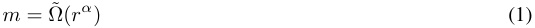

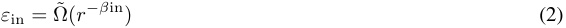

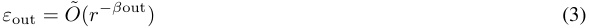

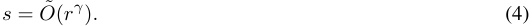

More precisely, we assume that a large parameter _m_ is given and the _O_ (polylog( _m_ )) scaling factors implicit in the _O,_˜ Ω˜ asymptotics can be chosen in a suitable way to make the results hold. 

## **D.1. Emulation of AND layer** 

In this section we prove a generalization of Theorem 3.2. 

Let Γ _⊂{_ 1 _, . . . , m}_[2] be the edges of a graph (here the superscript [2] denotes the “exterior power” of a set, i.e., the set of � _m_ 2 � unordered pairs). Assume that the number of edges _|E_ Γ _|_ = _O_˜ ( _m_ ) _._ Let _C_ Γ : _{_ 0 _,_ 1 _}__m_ _→{_ 0 _,_ 1 _}__E_Γ be the circuit with value 

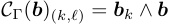

at the unordered pair ( _k, ℓ_ ) _∈ E_ Γ corresponding to an edge of Γ _._ We think of _C_ Γ as the (not quite universal) circuit that takes AND’s of pairs of features in Γ and returns a boolean vector of roughly the same size. 

We will show that this circuit can be emulated with suitably small interference on the output. 

The proof is very similar to the proof of the error correction theorem above (Theorem 21), in particular with the main argument controlled by a subset Σ _⊂{_ 1 _, . . . , m}×{_ 1 _, . . . , d},_ with _m_ the number of _edges_ of Γ (i.e., outputs of the circuit). There are however two main differences. 

1. What we read from each subset Σ _k,ℓ_ associated to an edge ( _k, ℓ_ ) _∈_ Γ is a the result of a nonlinearity applied to a _sum_ of two random _±_ 1 vectors _ϕk, ϕℓ_ (associated to the two inputs _k, ℓ_ ), that returns (up to small error) the sum of neurons in of Σ _ij_ where the signs of _ϕk_ and _ϕℓ_ are both 1. 

2. To control interference issues, we need to carefully partition the graph Γ into pieces with a certain asymptotic “balanced” property (see Theorem 13). 

3. The output interference is _O_˜ (� _<u>sd</u>_2instead of_O_˜(~~�~~ _ds_since there are_O_(_s_2) active output features (corresponding to pairs of features that are on). 

**Theorem 11** (Targeted superpositional AND) **.** _Let m be an integer and_ Γ _⊂{_ 1 _, . . . , m} × {_ 1 _, . . . , m} a graph. Assume we have a readoff matrix_ **R** in _∈_ Mat _m×d that maps a d-dimensional space to an m-dimensional space, and let s_ = _o_ (_√_ _<u>m</u>_ <u>)</u> _be a sparsity parameter (either polynomial or polylogarithmic in m). Let ε_ in _be an interference parameter._ 

_Assume that we have ε_2 in_md_ � _d/s_ = _O_˜ (1) _is bounded by some sufficiently small inverse polylogarithmic expression in m. Then there exists a single-layer mixed emulation Mw_ ( _x_ ) = ReLU( _Winx_ + _wbias_ ) _of the universal AND circuit C_ uand _(together with an “output readoff” matrix_ **R** out _) such that Mw is an emulation of C_ Γ _on the input class B_ = _Bs of boolean_ _<u>s</u>_2 _vectors of sparsity ≤ s, with precision ε_ in _→ ε_ out _, for ε_ out = _O_˜ _d ._ � ~~�~~ <u>�</u> 

Before proving the theorem, we note that our UAND statements are corollaries: 

**Corollary 12** (U-AND with basis-aligned inputs) **.** _Fix a sparsity parameter s ∈_ N _. Then for large input length m, there exists a single-layer neural network Mw_ ( _x_ ) = MLP( _x_ ) = ReLU( _Winx_ + _wbias_ ) _that ε-linearly represents the universal AND circuit C_ UAND _on s-sparse inputs, with width d_ = _O_˜ _m_ (1 _/ε_2 ) _(i.e. polylogarithmic in m)._ 

This follows from the fact that the incoming interference _ε_ in = 0 since the incoming feature basis is basis-aligned. 

**Corollary 13** (U-AND with inputs in superposition) **.** _Let s ∈_ N _be a fixed sparsity limit and ε <_ 1 _a fixed interference parameter. There exists a feature encoding_ Φ _and single-layer neural net Mw_ ( _x_ ) = MLP( _x_ ) = ReLU( _Winx_ + _wbias_ ) _with input size m_ in _and width d_ = _O_˜ (_√_ _<u>m</u>_ in _<u>/ε</u>_2 ) _, such that Mw ◦_ Φ _ε-linearly represents C_ UAND _on all s-sparse inputs_ **_b_** _._ 

This follows by restricting all but _m_ in =_√_ _<u>m</u>_ input features to 0 and taking Γ to be the complete graph on vertices _{_ 0 _, . . . , m_ in _}._ 

Now we prove the theorem. 

_Proof._ We begin by considering a simpler case. We say that a graph Γ with _m_ edges is _self-balanced_ if each vertex has degree at most _O_˜ (1) (some fixed polylogarithmic-in- _m_ bound). 

Suppose Γ is self-balanced. Define _A_ := ~~�~~ _d/s._ For each edge ( _k, ℓ_ ) _∈_ Γ _,_ choose at random a subset Σ _kℓ ⊂{_ 1 _, . . . , d}_ of size within a polylog error of _A._ Write also 

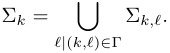

Write down feature vectors _⃗ϕkℓ_ =� _i∈_ Σ _k__±⃗ei,_with signs_σk,i_chosen independently and randomly for each_k, i._For a pair _k, ℓ ∈_ Γ _,_ define the vector _⃗rk,ℓ_ to be the indicator of the set of neurons 

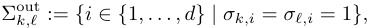

Note that _|_ Σout _k,ℓ__|_has, o. n. p., within a polylog difference from<u>1</u> 4_|_Σ_k,ℓ|_=_<u>A</u>_ 4elements. Write 

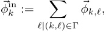

Note that this is a indicator function of a union polylog-many independently chosen sets of size _A._ Write Φin for the _m × d_ matrix with columns _⃗ϕ_in _k__._ 

Now we define the emulation net to be 

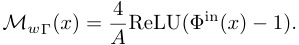

We note that (outside interference and collision errors of frequency bounded o. n. p. by _O_˜ ( _ε_ out),) we have 

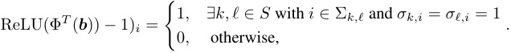

Here as before we take _S ⊂{_ 1 _, . . . , m}_ for the set of features that are on. 

Analogously to our proof of Lemma 23’s part 1 we see that the difference Φ_T_ ( **_b_** ) _−_ Φ_T_ ( **R** in( _x_ )) is (o. n. p.) bounded by _o_ (1) _,_ and thus we are done just as in the previous lemma. 

For general graphs Γ _,_ we might have an issue if some vertices have very high degree; if one were to try to run the same proof, their corresponding features would then admit unmanageably high interference. 

To fix this, we note that in order to emulate _C_ Γ it is sufficient (up to polylogarithmically increasing the number of neurons) to emulate _C_ Γ1 _, . . . , C_ Γ _T_ for some polylogarithmic collection of graphs Γ _t_ with _∪t_ Γ _t_ = Γ _._ We now split an arbitrary graph Γ into subgraphs with a nice “balanced” property. 

Let _a, b ∈_ R be parameters. We say that a graph is _a, b_ -balanced if it is bipartite on a pair of disjoint subsets of vertices _V_ 0 _, V_ 1 _⊂{_ 0 _, . . . , m},_ such that _|V_ 0 _|_ = _a, |V_ 1 _|_ = _b_ and each vertex in _V_ 0 has degree at most _m/a_ and each vertex in _V_ 1 has degree at most _m/b._ We say a graph Γ _⊂{_ 0 _, . . . , m}_[2] is balanced if it is _a, b_ -balanced for some _a, b._ 

It can be shown using an inductive argument that any graph Γ with _m_ edges can be written as a union of polylog( _m._ ) 

Now it remains to show that the theorem holds for a balanced graph. Indeed, suppose that Γ has vertices supported on _V_ 0 _⊔ V_ 1 _⊂{_ 1 _, . . . , m}_ and is _a, b_ -balanced. Suppose (WLOG) that _a ≤ b._ Then we randomly partition the neurons _{_ 1 _, . . . , d}_ into _a_ roughly equal sets Σ _k_ for _k ∈ V_ 0 (equivalently, we choose a random map _{_ 1 _, . . . , d} → V_ <u>0</u> and define Σ _k_ to be the preimage of _k_ ). We then choose for _ℓ ∈ V_ 1 the set Σ _k,ℓ_ to be a random subset of size about � _d/s_2 inside Σ _k,_ and define Σ _ℓ_ = _∪k|_ ( _k,ℓ_ ) _∈_ Γ _._ We finish the argument by bounding the errors in the same way as in the self-balanced case, concluding the proof. 

## **D.2. Universal AND with inputs in superposition** 

We use the conventions from Section A. We make an additional assumption, that our inputs _⃗a_(0) ( _x_ ) for _x ∈ X_ approximately lie on a sphere of suitable radius. Note that if _m_ = _d_ and the feature basis _⃗ϕi_ is an orthonormal basis, then _|_ Φ( **_b_** ) _|_ = � _||_ **_b_** _||_ 1 _,_ so the _ℓ_ 2 norm of the embedding is the square root of the sparsity. If the sparsity _||_ **_b_** _||_ 1 is _exactly s_ and the feature interference parameter _µ_ is sufficiently small compared to the sparsity bound _s,_ we still have _|_ Φ( **_b_** ) _| ≈__√_ _<u>s</u>_ (with some suitable bound — in general, it will be _O_˜ ( _µs_1_._5 )). If instead, we assume only that the boolean features _fi_ ( **_b_** ) are _ε_ -linearly represented for suitable _ε >_ _~~√~~_ <u>1</u> _d__,_in general we cannot guarantee that_|⃗a_(0)(_x_)_|≈√_ _<u>s</u>_ <u>; rather, we will have</u> _|⃗a_(0) ( _x_ ) _|_ = Ω(˜_√_ _<u>s</u>_ <u>) since</u> especially for small _s,_ the norm might be significantly increased by adding a large vector that is almost-orthogonal to all features (and thus doesn’t affect the linear representability of the _fi_ ). This observation allows us, in principle, to write down a vector with some suitable norm in _θ_˜ (_√_ _<u>s</u>_ <u>) which</u> _ε_ -linearly represents a very sparse boolean vector **_b_** with _||_ **_b_** _||_ 1 _<< s._ We show how to modify inputs with unknown bounded sparsity _||_ **_b_** ( _x_ ) _||_ 1 _< s_ to have an (approximately) constant norm in the following section. For now, we assume in addition to _||_ **_b_** ( _x_ ) _||_ 1 _< s_ that all our inputs have norm equal to some _s_ 0 = _O_˜ (_√_ _<u>s</u>_ <u>)</u> up to a small error. 

**Theorem 14.** _Let m, d, X,_ Φ _, ε_ = _ε_ 0 _, µ, s be as in Appendix A. Let r be a parameter so that r_2 = _O_˜ ( _s_ ) _. Assume in addition to the conditions on X,_ Φ _in Appendix A that for any input x ∈ X, we have_ 

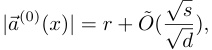

_i.e., the inputs lie approximately on a sphere of radius r._ 

_Let W ∈_ Mat _d×d be a random weight matrix with i.i.d. Gaussian-distributed entries, and let⃗a_(1) ( _x_ ) = _Mw_ ( _⃗a_(0) ( _x_ )) := ReLU( _Wx_ ) _be the associated neural net. Then there exist some_ 

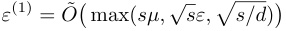

_and_ 

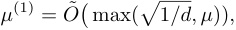

_such that the boolean function fk∧ℓ_ ( _x_ ) := _fk_ ( _x_ ) _∧ fℓ_ ( _x_ ) _is ε_(1) _-linearly represented by a feature vector⃗ϕ_(1) _k∧ℓ__∈_R_d, outside_ _negligible probability (in the entries of W ). Moreover, up to rescaling by a fixed scalar, the feature vectors⃗ϕk∧ℓ form an almost-orthogonal collection with feature interference parameter µ_(1) _._ 

**Corollary 15.** _The result of Theorem 14 is true with the assumption |⃗a_(0) ( _x_ ) _|_2 = _r_2 + _O_˜ ( _εs_ ) _(that inputs are close to a sphere) replaced by |⃗a_(0) ( _x_ ) _|_2 = _O_˜ ( _s_ ) _, at the cost of increasing the depth of the neural network Mw from_ 1 _to_ 3 _._ 

_Proof._ (Of corollary.) This follows by chaining the neural network constructed in this theorem with the “norm-balancer network” constructed in Appendix D.3 (independent from this one). 

The idea of the proof of Theorem 14 is derived from the quadratic activations case, _Mw_ ( _⃗x_ ) = _Q_ ( _W⃗x_ ) _,_ where _Q_ is the function that squares entries of a vector coordinatewise. Let _a__i_ _k_=_W_(_⃗ϕk_)_i_(for_i ∈{_0_, . . . , d −_1_}_) be the coordinates of the preactivation vector _W_ ( _⃗ϕk_ ) associated to the _k_ th boolean bit. 

One can show using the theory of quadratic forms that the readoff vector _Rk,ℓ__i_=_a_ _k__iai_ _ℓ_gives a valid readoff direction to show _ε_ -strong linear separation of the boolean expression **_b_** _k ∧_ **_b_** _ℓ_ (o. n. p.). We will show that a similar strategy works for an arbitrary (reasonable, and in particular nonlinear) activation function, including ReLU. 

Write down the unnormalized model _Mwu_ ( _⃗x_ ) := ReLU( _W_ ( _⃗x_ )) _._ Define _⃗ϕ′k_=_W⃗ϕk_to be the preactivation under this model of _⃗ϕk._ Define the unnormalized readoff matrix for the UAND coordinate associated to the pair of features _k, ℓ_ as follows: 

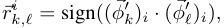

where sign( _x_ ) is the sign function that returns _−_ 1 _,_ 0 _,_ 1 depending on whether _x_ is negative, 0 or positive, respectively. _Remark_ 16 _._ Note that as we care about the existence of a linear representation rather than a learnable formula for it, the readoff doesn’t have to depend continuously on the parameters. However having continuous dependence is also possible; in particular, it would also be reasonable to make the dependence continuous; indeed, the readoff vector with coordinates _a__i_ _k__· ai_ _ℓ_(same as for quadratic activations) would also work, with an alternative normalization; the important property of the readoff function is that it is odd in each of the _x_ and _y_ coordinates independently, and that it does not have wild asymptotic behavior. We use the discrete “sign” function for the readoff for convenience. 

The crucial observation is the following simple lemma. For a given input _x,_ let _⃗a_ ( _x_ ) be the corresponding embedding. Let 

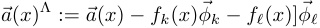

(the “hat” notation denotes that we are “skipping” information about features _k_ and _ℓ_ in the embedded input _⃗a_ ( _x_ ); it linearly represents the modification of the boolean vector **_b_** ( _x_ ) that zeroes out the _k_ th and _ℓ_ th coordinates). 

**Lemma 17.** _Suppose_ Φ _, k, ℓ, and_ **_b_** _are fixed. Then in the context of the theorem above, the unnormalized readoff_ **R**_u_ _k,ℓ_(_Mw_(Φ(**_b_**)))_is a sum of d i.i.d. variables of the form F_(_xi, yi, zi_)_, where F_(_x, y, z_) =_sign_(_x_)_sign_(_y_)ReLU(**_b_**_k_(_x_)_x_+ **_b_** _ℓ_ ( _x_ ) _y_ + _z_ ) _and the triple_ ( _xi, yi, zi_ ) _is drawn from the distribution N_ (0 _,_ Σ) _where_ 

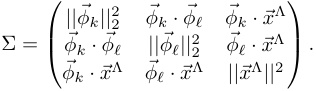

_Proof._ Write _xi_ = ( _⃗ϕ__′_ _k_)_i, yi_=(_⃗ϕ′_ _ℓ_)_i, zi_=_W⃗a_(_x_)Λbe the neuronal coordinates of the corresponding activations.Then ( _Rk,ℓ__u_)_i_= sign(_xi_)sign(_yi_) and 

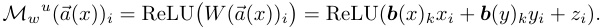

It remains to show that ( _xi, yi, zi_ ) are drawn according to the Gaussian distribution _N_ (0 _,_ Σ) _._ This follows from the standard result that applying a Gaussian-distributed matrix with entries in _N_ (0 _,_ 1 _/d_ ) to a collection of vectors _⃗v_ 1 _, . . . ,⃗vn_ is distributed as a (possibly singular) Gaussian with PSD covariance matrix Σ _kℓ_ = _⃗vk ·⃗vℓ._ 

Now our interference bounds imply that the triple ( _xi, yi, zi_ + **_b_** _kxi_ + **_b_** _ℓyi_ ) are distributed according to a matrix of the form 

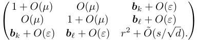

Let _s__′_ := _r_2 _−_ **_b_** _k −_ **_b_** _ℓ_ and _r__′_ := _√s__′_ _._ 

Now o.n.p., we can assume that _xi, yi ∈ O_˜ (1) and _zi ∈ O_˜ ( _r_ ) _._ Since _F_ grows linearly, we see that _F_ ( _xi, yi, zi_ ) _∈ O_˜ ( _r_ ) o.n.p. We can now apply Bernstein’s inequality 29 to get that, o.n.p., 

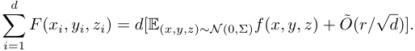

Now since _r_ = _O_˜ (_√_ _<u>s</u>_ <u>) and</u> _|_ ( _r__′_ )2 _− r_2 _|_ is an integer equal to at most 2 (the sum of two feature readoffs of _⃗a_ ), the error term in the Bernstein inequality is bounded by _O_˜ ( _r__′_ _/√d_ ) _._ It remains to estimate the expectation 

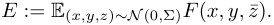

Assume that **_b_** ( _x_ ) has nonzero coordinates other than at _k, ℓ,_ so that _r__′_ = Ω(1) (the case where **_b_** ( _x_ ) only has nonzero coordinates on a subset of _{k, ℓ}_ can be handled similarly and more easily). In this case, we add a new notation 

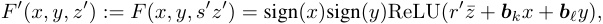

where the third input of _F_ is rescaled to make the distribution on ( _x, y, z__′_ ) closer to the identity Gaussian. Let Σ_′_ be the distribution on ( _x, y, z__′_ ) _,_ given by 

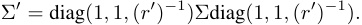

Since the two differ by a reparametrization, the expectation of _F__′_ on _N_ (0 _,_ Σ_′_ ) is equal to the expectation of _F_ on _N_ (0 _,_ Σ) _._ Let _X__′_ = _N_ (0 _,_ Σ_′_ ) and _X_ 0_′_=_N_(0_,_Γ)_,_both on R3_._Our various interference bounds imply that the difference Σ_−_Γ is bounded by 

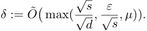

This means that the total variational difference between _X_ and _X__′_ is bounded by _O_ ( _δ_ ) _._ Now the expectation _F__′_ on _X, X_ 0 are not affected, up to negligible terms, by ( _x, y, z_ ) outside some constant _O_˜ (1) _,_ and here _F__′_ is bounded by _O_˜ ( _r_ ) _._ Thus we have 

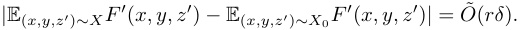

It remains to estimate the mean 

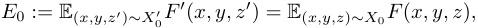

where _X_ 0 = _N_ (0 _,_ diag(1 _,_ 1 _,_ ( _d__′_ )2 )) _._ 

Up to symmetry, we have three cases depending on the _k_ and _ℓ_ coordinates of **_b_** = **_b_** ( _x_ ) associated to our input: 

The expectation calculation in the first two cases are trivial: if **_b_** _k_ , is zero, then each _F_ is odd in the _x_ , resp., _y_ coordinate, so since the distribution _X_ 0 is independent Gaussian, the mean is 

It remains to consider the case **_b_** _k_ = **_b_** _ℓ_ = 1 _,_ i.e., the “interesting” case where _∧_ ( **_b_** _k,_ **_b_** _ℓ_ ) = 1 _._ We write down the integral expression 

for _p_ 0( _x, y, z_ ) the pdf of _X_ 0 = _N_ (0 _,_ diag(1 _,_ 1 _, s__′_ )) _._ We would like to show this value is positive and bound it from below (to show eventually that the mean in the CLT dominates the errors). We use _x, y_ -symmetry to rewrite the integral as 

Since the independent Gaussian _p_ 0( _x, y, z_ ) is symmetric in the _x_ and _y_ coordinates, we can collect _±x, ±y_ terms together to write 

We split the domain up further into five terms, 

into regions on which the relus are constantly 0 or nonnegative linear functions: 

Note in particular that each term above is nonnegative on its domain (for _A_+ _,_ this is because the domain includes the inequality _z ≤ x_ + _y_ ). Thus in particular, _E ≥ A_0 _._ Since the integrand is positive, we can get a lower bound by restricting the domain: 

using that the integrand is 2 _x ≥_ 2 _._ This is, equivalently, twice the probability that _|x| ≥_ 1 _, |y| ≥_ 2 _, |z| ≤_ 1 _,_ for ( _x, y, z_ ) drawn from _p_ 0( _x, y, z_ ) = _σ_ 0 _,_ 1( _x_ ) _σ_ 0 _,_ 1( _y_ ) _σ_ 0 _,r_ 2 _−_ 2( _z_ ) _._ By independence of _p_ 0 _,_ this is a product of 3 terms. The probability distributions on _x, y_ are fixed unit Gaussians, so the corresponding terms are _O_ (1) _,_ and so the mean has (up to an _O_ (1) constant) the same asymptotic as the third term, which is 

The Bernstein bound applied to _d_ i.i.d. such variables now gives us o.n.p. 

Incorporating error terms, we get 

We now normalize: 

Then if _fk_ ( _x_ ) _∧ fℓ_ ( _x_ ) = 1 _,_ then (o.n.p.) 

Alternatively if _fk_ ( _x_ ) _∧ fℓ_ ( _x_ ) = 0 _,_ the expectation is zero and we are left with the error term, 

The theorem follows. 

## **D.3. Norm-balancer network** 

In this section, we prove a technical result that was needed in the previous section. Namely, at one point we assumed that the norm of our inputs _⃗a_ 0( _x_ ) are (o.n.p., and up to a multiplicative error of 1 + _O_˜ ( _~~√~~_<u>1</u> _d_)) equal to a specific value_λ,_which is related to the sparsity by a bound of the form _λ_ = _O_˜ (_√_ _<u>s</u>_ <u>)</u> _._ It is not difficult to guarantee this if we know the exact sparsity of the sparse boolean vector _sexact_ = _||_ **_b_** 0 _||_ 1 _._ However, in the process of chaining together multiple boolean circuits, we would like to allow the exact sparsity of intermediate layers to vary (so long as it is bounded by _s_ ), even if the exact sparsity of the input layer is fixed. In this section we give a two-layer neural network mechanism that allows us to circumvent this issue by modifying all inputs _⃗a_ 0( _x_ ) to have roughly the same norm, equal to some specific value_√_ _<u>s</u>_ 0 = _O_˜_√_ _<u>s.</u>_ 

We note that while it seems plausible that real neural networks share properties in common with the past two artificial neural nets we constructed (error correction and universal AND), the neural net constructed here 

**Theorem 18.** _Let s_ 0 = _O_˜ ( _√d_ ) _be a sparsity parameter. There exists a 2-layer neural net_ balance _s_ 0 : R_d_ _→_ R_d_ _depending on random parameters, with hidden layers of width O_ ( _d_ ) _, with the following property._ 

_Suppose that⃗ϕ_ 1 _, . . . ,⃗ϕd is a collection of features of length <_ 2 _, and⃗ax is an input satisfying |⃗ax| <__√_ _<u>s</u>_ 0 _<u>. Then</u>_ 

_Proof._ Let _W ∈_ Mat _d×d_ be a random square matrix, with entries drawn independently from _σ_ (0 _,_ 1 _/d_2 ) _._ Define the function _N_ ( _⃗a_ ) =�_d_ _i_ =1ReLU(_Wx_)_i._Then_N_(_⃗a_)isasumof_d_i.i.d.randomvariablesoftheform_Ni_=ReLU(_x_)_|_ _x ∼ σ_ (0 _, |⃗a|/d_ ) _._ Applying arguments similar to those used in the proof of the previous theorem, we see that _Ni_ has norm _c · |⃗a|/d,_ for _c >_ 0 the absolute constant 

The variance of _Ni_ is _O_ ( _|⃗a|_2 ) _/d,_ and _Ni_ is bounded o.n.p. by _O_˜ ( _|⃗a|_ ) _._ Thus Bernstein’s inequality implies that, o.n.p., 

Now _|⃗a| < s_ 0 = _O_˜ (_√_ _<u>s</u>_ <u>)</u> _,_ so _N_ ( _⃗a_ ) = _|⃗a|_ + _O_˜ ( _ε_ ) _._ Let _f_ ( _y_ ) = � _s_ 0 _− y_2 (for _|y| ≤__√_ _<u>s</u>_ 0), a semicircle of radius_√_ _<u>s</u>_ 0 viewed as a function of a real variable. Define the piecewise-linear function _fP L_ given by splitting the semicircle into _d_ equal arcs, and connecting the endpoints of the arcs (extending the first and last arc linearly outside the domain of definition). The 

difference between the values of _f_ on the endpoints of each arc is bounded by its arclength, which is _O_ (_√_ _<u>s</u>_ 0 _<u>/d</u>_ ) _._ Thus _|f_ ( _x_ ) _− fP L_ ( _x_ ) _|_ = _O_ (_√_ _<u>s</u>_ 0 _/d_ ) (in fact, much better asymptotic bounds are possible.) Now _fP L_ is a sum of _d_ ReLUs, thus it is a scalar-valued function which can be expressed by a width- _d_ neural net. Now choose a random “approximately unit” vector _v ∈_ R_d_ according to the Gaussian _v ∼ σ_ (0 _,_ 1 _/√d_ ) _._ Now we define the neural net balance( _⃗a_ ) := _⃗a_ + _fP L_ ( _N_ ( _⃗a_ )) _v._ Since both _N_ ( _⃗a_ ) and _fP L_ can be expressed as width- _d_ neural nets, balance can be expressed as a width- _O_ ( _d_ ) neural net. Now since _v_ is a random vector, we have, o.n.p., 

and _v ·⃗ϕk_ = _O_˜ ( _~~√~~_<u>1</u> _d_)_._Since there are at most polynomially-many (in_r_) features, the “negligible probablity” exceptions remain negligible when combined over all features. The bound _N_ ( _⃗a_ ) = _O_˜ (_√_ _<u>s</u>_ <u>) thus implies both bounds in the theorem.</u> 

Let _α_ ( _x_ ) _, β_ ( _x, y_ ) be functions. Let _W_ be random and Φ be a matrix of features. Fix _k, ℓ ∈{_ 0 _, . . . , m −_ 1 _}._ Let **_b_** _∈{_ 0 _,_ 1 _}__m_ be a boolean vector. Let **_b_** _kl_ = **_b_** _k⃗ϕk_ + **_b_** _ℓ⃗ϕℓ,_ and **_b_**_′_ = **_b_** _−_ **_b_** _kℓ._ Outside negligible probability, we know that Φ( **_b_** _kℓ_ ) _·_ Φ( **_b_**_′_ ) = _O_˜ ( _ε_ ) _._ This means that if _ε_ = Θ(1˜ _/√d_ ) and we apply a random matrix _W_ then we still have _W_ Φ( **_b_**_′_ ) _· W_ Φ( **_b_** _kℓ_ ) = _O_˜ ( _ε_ ) (outside negligible probability). Define _⃗xkl_ = _W_ Φ( **_b_** _kl_ ) and _⃗x__′_ = _W_ Φ( **_b_**_′_ ) _._ Since random matrices are _O_ ( _d_ )-invariant, we can assume WLOG that these are drawn independently and randomly from appropriate Gaussian distributions _EXPAND_ . Specifically, _⃗xkl_ is drawn from a distribution with variance 2 and _⃗x__′_ is drawn from a distribution with variance _O_ ( _s_ ) _._ 

## Define 

and define 

**Lemma 19.** _For suitable choices of a piecewise-linear function α and some function β (both depending on s) we can guarantee that Rk,ℓ · Mw_ (Φ( **_b_** )) = **_b_** _k ∧_ **_b_** _ℓ_ + _O_˜ ( _ε_ out) _._ 

_Proof._ As explained above, we can assume that _x__i_ _kℓ__,_(_xi_)_′_are drawn from independent boolean distributions with variance respectively _d_<u>2</u>_,_ _d__<u>s</u>._Define_X_=_σ_(0_,_ _d__<u>s</u>I_) to be the Gaussian variable with variance _d__<u>s</u>._Define 

## Write 

Then _Mw_ ( _⃗x_ ) = _Mw_ ( _⃗x__′_ ) + ∆ _i_ ( _⃗x__′_ ) _._ It remains to prove the following sublemma: 

**Lemma 20.** _(Outside negligible probability:)_ 

We start with the first expression. We have 

- _⃗x__′_ _i_random from Gaussian_X_, variance_s/d._ 

- _α_ ( _⃗x__′_ _i_) random, bounded by_B_(o.n.p.bound for_α_on_X_). 

- From POV of _x__′_ : we know ( _x, y_ ) random Gaussian, variance 1 _/d._ 

- So _Rkl · Mw_ ( _⃗x__′_ ) is the sum of _d_ samples of _β_ ( _x, y_ ) _α_ ( _z_ ) for _x, y, z_ from appropriate Gaussians. 

- WTS: _±_ symmetric in independent way, variance _O_˜ ( _ε_ out) _/d,_ bounded (onp) by _O_˜ of stdev (check if this bound correct for Azuma inequality). For this (modelling on quadratic case): choose _β_ to be _±_ symmetric in either coordinate independently, and appropriately bounded. 

For the second expression, we treat two cases, namely ( **_b_** _k,_ **_b_** _ℓ_ ) _∈{_ (1 _,_ 1) _,_ (0 _,_ 1) _}._ We do not need to treat other cases as (1 _,_ 0) follows by symmetry and (0 _,_ 0) is trivial. Start with (1 _,_ 1) case, so **_b_** _k ∧_ **_b_** _ℓ_ = 1 _._ We then have 

- Want 

to be 1. 

- Above bounded to make Azuma ok (prob enough to check ∆= _O_ (1) and use Azuma bounds from previous). 

Final case, (0 _,_ 1) _._ 

- Want _E_ (( _β_ ( _x, y_ )∆ _x_ ( _z_ ))) to be 1. 

- This follows from _±_ symmetry of _β_ (and bounds as above). 

## **D.4. Error correction layers** 

**Theorem 21.** _Suppose we are in the context of Appendix A. Then there exists a polylog constant K_ = _K_ ( _d_ ) _and a single-layer neural net Mw_ ( _x_ ) = _v_ 1 + _W_ 1ReLU( _v_ 0 + _W_ 0( _x_ )) _and a feature matrix_ Φ(1) _∈_ Mat _d×m such that if_ _<u>d</u>_1_/_4 _ε_ (= _ε_(0) ) _< K m_1_/_2 _s_1_/_4_, then for each input x, o.n.p., the feature⃗ϕ_ _k_(1) _linearly separates the boolean function fk on the activation⃗a_(1) ( _x_ ) = _Mw_ ( _x_ ) _, with error_ 

_Moreover, we can choose the new feature vectors ϕ_(1) _k such that they have feature interference bounded by_ 

� _<u>dss</u>_) neurons it “activates”, Γ_k⊂{_1_, . . . , d}._ 

We think of this as a graph, connecting each feature _k_ to a set of (approximately � _<u>dss</u>_ We also write Γ _i ⊂{_ 1 _, . . . , m}_ for the set of features connected to the _i_ th neuron. 

Let 

the piecewise-linear function that maps R to the interval [0 _,_ 1] and is non-constant only on the interval (1 _/_ 3 _,_ 2 _/_ 3) _._ Now for any integer, define 

and similarly, 

round[ _−a,a_ ]\( _x_ ) := round[0 _,a_ ]\( _x_ ) _−_ round[0 _,_ 1]\( _−x_ ) _._ 

This is a piecewise-linear “staircase” function with the following properties: 

- round[ _−a,a_ ]\( _x_ ) _∈_ [ _−a, a_ ] for all _x ∈_ R and 

- round[ _−a,a_ ]\( _n_ + _ε_ ) = _n,_ whenever _n ∈_ [ _−a, a_ ] is an integer and _ε <_ 1 _/_ 3 _._ 

Thus for all sufficiently small values _x,_ the function round will “round” _x_ to the nearest integer, so long as the nearest integer is less than 1 _/_ 3 away; hence its name. By construction, the function round[ _−a,a_ ]\( _x_ ) is a sum of a 4 _a_ ReLUs. 

We will use for our nonlinearity the function 

round( _x_ ) = round[ _−_ 2 _,_ 2]\( _x_ ) : 

<!-- Start of picture text -->
2 round( x ) 1 x − 2 − 1 1 2 − 1 − 2 <!-- End of picture text -->

(Using larger intervals [ _−a, a_ ] in our nonlinearity round[ _−a.a_ ] would give slightly stronger results, but won’t be needed.) Now we define the unnormalized neural net model as follows: 

Finally, we normalize: 

For each feature _k ∈{_ 1 _, . . . , m}_ in an input _x_ , the unnormalized neural net _Mw_ (1) _,u_ roughly does the following. 

1. “Reads” the feature _ϕk_ 

2. “Writes” 1s in all neurons _i ∈_ Γ _k_ connected to _k_ assuming _ϕk_ is present 

3. “Rounds” each neuron which is close to _−_ 2 _, −_ 1 _,_ 0 _,_ 1 or 2 to the closest integer. 

At the end, we hope to obtain a vector with exactly the entry _Mk__i∈±_1 for each_k_with_fk_(_x_)=1 and zero elsewhere. If we’re lucky and there are no issues with excess interference and no pairs of active features _k, ℓ_ that share a neuron _i ∈_ Γ _k ∩_ Γ _ℓ,_ the result of this computation will be Φ(1)_,u_ ( **_b_** ( _x_ )) _,_ and its error can then be controlled by understanding the interference of the new normalized feature matrix Φ(1) . 

In order to make this work, we need to control two types of issues: 

- _Collision_ : it’s possible that two simultaneously active features _k, ℓ_ with _fk_ ( _x_ ) = _fℓ_ ( _x_ ) = 1 share some neurons, so some of the entries of _⃗ϕ_(1) _k__,u_ + _⃗ϕ_(1) _ℓ__,u_ have “colliding” information from the _k_ th and _ℓ_ th neurons that gives the wrong answer after getting rounded to one of _{−_ 2 _, −_ 1 _,_ 0 _,_ 1 _,_ 2 _}._ 

- _Interference_ : it’s possible that, even if Γ_k_ are disjoint for all features _k_ appearing in **_b_** ( _x_ ) _,_ the various interference terms shift the value far enough from the “correct” value in _{−_ 1 _,_ 0 _,_ 1 _}_ that the “round” function does not successfully return it to its original position. 

These are controlled by the two parts of the following lemma. 

**Lemma 22.** _1. For any x ∈ X, we have o.n.p.:_ 

_2. For any boolean_ **_b_** _with sparsity ||_ **_b_** _||_ 1 _< s, we have (o.n.p.) the difference_ 

_has all unnormalized feature readoffs_ 

_Proof._ Note that the two results are both about _ℓ∞_ errors, but in two different spaces, namely in the space R_d_ with the neuron basis for part (1) and in the space R_m_ with the feature basis for part (2). We start with part (1). Since there is a polynomial number of neurons, bounding the _ℓ∞_ error o.n.p. is equivalent to bounding the difference for each coordinate: 

This difference is a linear combination of the errors _⃗ϕ_(0) _k · x,_ with coefficients given by the matrix coefficients �Φ(1_,u_)�_k_ _i__,_ with _i_ fixed and _k_ varying. For a pair ( _i, k_ ) _∈_ Γ _,_ let _σ_ ( _i, k_ ) _∈±_ 1 be the sign of the corresponding matrix coefficient (which is chosen independently at random in the random variable-valued definition of our neural net). We then have 

By assumption, _x · ϕk ≤ ε_(0) _._ Since the signs are chosen independently at random, we can bound this value o.n.p. by the Bernstein inequality, Theorem 29, with discrete variables _Xk_ = _σi,kx ·⃗ϕ_(0) _k__._Here_k_is indexed by a_|_Γ_i|_-element set.By definition of Φ(1) _,_ each element _{_ 1 _, . . . , m}_ has probability _p_ = _~~√~~_ <u>1</u> _sd_of being in Γ_i,_so 

Since all these random variables are bounded by _ε_(0) in absolute value, Bernstein’s inequality implies that o.n.p., 

giving part (1) of the lemma. 

To prove the second part, note that the “ground truth” activation _⃗a_ ground := Φ(1_,u_) **_b_** is an integer-valued vector with coefficients ( _⃗a_ ground) _i_ =� _k∈_ Γ_i_ _∩_ **_b_**_σk._It is changed by applying the round function if and only if this sum is_>_2 in absolute value, i.e., if it is a “collision” (i.e., contained in the intersection) of at least 3 subset of the form Σ _k._ The expectation of the number of such overlaps a given neuron _i ∈{_ 1 _, . . . , d}_ can be can be bounded by 

Thus the coefficients of the error vector 

are drawn i.i.d. from a distribution with mean 0 (as it is symmetric) and variance bounded by _O_˜ ( _d__<u>s</u>_33_//_22)_,_which is absolutely bounded by _O_˜ (1) _._ In other words, we have o.n.p. that this vector has at most 

entries all bounded by _O_˜ (1) _,_ and with independently random signs. When we take the dot product with another unnormalized feature vector we are left with an error bounded by 

completing the proof. 

Now we can finish the proof. The interference bound in the lemma implies that o.n.p., the _d_ -dimensional vector 

has all coefficients bounded by _o_ (1) _,_ an in particular, bounded by 1 _/_ 3 _._ Since the LHS has all integer entries, this means that 

round(Φ(1)_,u_ ( **_b_** )) = round(Φ(1)_,u_ (Φ(0_,T_) ( _x_ ))) 

(As the “round” function is constant on [ _n −_ 1 _/_ 3 _, n_ + 1 _/_ 3] for any integer _n_ ). 

Since we have assumed that _s < d_1_/_3 (in A), the asymptotic term _s_3_/_2 _/d_1_/_2 in the collision error bound is bounded by 1, so o.n.p., _ε_ collision _·⃗ϕ_(1) _k__,u_ = _O_˜ (1) _._ Finally, when we normalize, both sides of the dot product get multiplied by _A_ = _s_1_/_4 _/d_1_/_4 _,_ and so after normalizing the coresponding bound gets multiplied by_√_ _<u>s/√d,</u>_ and we get the expression (o.n.p.): 

Finally, by a similar argument to the collision proof, we see that the unnormalized dot product Φ(1)_,u_ ( **_b_** ( _x_ )) _·⃗ϕk_ is _√d/__√_ _<u>s</u>_ up to an error of _O_˜ (1) _,_ so the error m 

We claim that the pair ( _Mw,_ Φ(1) ) satisfies (o.n.p.) the conditions for the error-correction circuit above, for some appropriate relationships between the values _d, ε_(0) _, ε_(1) depending on _m,_ satisfying asymptotic inequalities of the form 

**Lemma 23.** _For a suitable choice of ε_ in _as above we can guarantee that:_ 

_1. If__−→_ err _∈_ R_m_ _has ||__−→_ err _||∞ < ε_ in _, then ||_ Φ(_−→_ err) _||∞_ = _o_ (1) _, o. n. p. (Note that the latter value is an ℓ__∞_ _norm in the neuron basis.)_ 

_2. If_ **_b_** _is boolean and s-sparse, then A_<u>Φ</u>(round(Φ(**_b_**))_≈ε_out**_b_**_, o. n. p._ 

To get part (1) above, observe that for any neuron index _i,_ we have 

where we define Γ_i_ := _{k |_ ( _k, i_ ) _∈_ Γ _}._ Since the signs _σk,i_ are random and independent, this is a sum with random signs of numbers of absolute value _< ε_ in _._ From the Azuma inequality, we see that (o. n. p.) Φ(_−→_ err) _i_ = _O_˜ (err_−→_ _·_ � _|_ Γ _i|_ ) _._ Since the Γ was chosen randomly, o. n. p. 

The last statement follows from comparing exponents in the two sides, and the freedom of choice of polylog term in _ε_ in _._ For part (2) above, observe that ( **R** out(round(Φ( **_b_** )))) _k_ is the average over the set Γ _k_ = _{i |_ ( _k, i_ ) _∈_ Γ _}_ of 

where _S_ is the set of features that are on in **_b_** _,_ of size _|S| ≤ s._ We want to compare this to **_b_** _k_ , which is 1 if _k ∈ S_ and 0 otherwise. We expect (for _i ∈_ Γ _k_ ) that _ai_ = 0 if **_b_** _k_ = 0 and _ai_ = 1 if **_b_** _k_ = 1 _._ Since round() always returns a value of absolute value _≤_ 1 _,_ we can bound the error by twice the number of incorrect values. We get errors of two types. 

1. _Interference error_ , from neurons that are on when they should be off. I.e., when _ai̸_ = 0 despite **_b_** _k_ = 0 _._ 

2. _Collision error_ , from neurons which should be on but are 0 (or have wrong sign) due to contributions from both _Sk_ and another feature. 

Either of these errors happens when Γ _k_ and� _ℓ∈S__′_Γ_ℓ_intersect for_S′_=_S \{k},_the set of nonzero values of**_b_**not equal to_k_. Now Γ _k_ has _O_˜ ( _d_ 1 _−_ 2 _<u>γ</u>_ ) nonzero entries and� _ℓ∈S__′_Γ_ℓ_has at most_O_˜(_dγ_+ 1_−_ 2_<u>γ</u>_ ) entries; since each subset Γ _k_ is independently 1+ _<u>γ</u>_ 2 _<u>d</u>__γ_+1+ 2_<u>γ</u>_ random, we see (o. n. p.) that the intersection has at most _O_˜ (_<u>d</u>_ _d_ ) = _O_˜ (1) entries, and the average is indeed _O_ ˜( _ε_ out) _._ 

This completes the proof of the lemma. The theorem follows. Indeed, suppose that _x ∈_ R_d_in is a vector with **R** in( _x_ ) _≈ε_ in **_b_** for **_b_** _∈{_ 0 _,_ 1 _}__m_ an _s_ -sparse boolean vector. Setting_−→_ err = **R** in( _x_ ) _−_ **_b_** _,_ part (1) implies that 

has coefficients at most _o_ (1); since Φ( **_b_** ) has integer entries, this means that applying round to both sides produces the same results. Part (1) then implies that the RHS Φ( **_b_** ) has sufficiently small interference. 

**Corollary 24** (Lemma 7) **.** _For sufficiently small input interfefrence there exists a 1-layer MLP that returns (outside negligible probability) an encoding of the same boolean vector with low interference (_ 1 _/√d assuming low sparsity parameter)._ 

_Proof._ This follows from the theorem in the case _γ_ = 0 _,_ i.e., when the sparsity parameter _s_ is polylog in _m._ 

# **E. Theoretical Framework and Statistical Tools** 

Here we provide statistical definitions and lemmas required for our proofs in Appendix D. 

## **E.1. Negligible probabilities** 

Most results in this paper are proven _outside negligible probability_ . This is a standard notion in complexity theory and cryptography (Bellare, 2002), with the following formal definition: **Definition 5.** _Let {En}__∞_ _n_ =1_be a sequence of events parameterized by n.We say that Enis true_**_with negligible probability_** _(w. n. p.) if for any polynomial exponent c ∈_ N _, there exists some constant Nc ∈_ N _such that P_ <u>(</u> _En_ ) _< O_ ( _n__−c_ ) _for all n > Nc. Similarly, we say that En is true_ **_outside negligible probability_** _(o. n. p.) if its complement En is true with negligible probability._ 

_If En_ = _En_ ( _x_ ) _depends on an input in some set X, when we say En_ ( **_b_** ) _is true with negligible probability for all fixed inputs x ∈ X we implicitly assume that there is an explicit constant Cn < O_ ( _n__−c_ ) _as above that bounds the probability of En_ ( _x_ ) _for each valid input x ∈ X._ 

Intuitively, the reason why this probability is “negligible” is that the union of polynomially many events of negligible probability also has negligible probability. As we never consider more networks requiring more than polynomially many operations, we can ignore events of negligible probability at each step when performing asymptotic analysis, which greatly simplifies our proofs. 

_Example_ 1 _._ Let **_b_** be a random boolean vectors of length _n_ . Then outside negligible probability, **_b_** has between _n/_ 2 + log( _n_ )_√_ _<u>n</u>_ and _n/_ 2 _−_ log( _n_ )_√_ _<u>n</u>_ zeroes. 

For cases where the event is a bound on a random function (as above), we can combine “negligible probability” notation and big- _O_ , as well as big- _O_˜ notation, as follows. 

**Definition 6.** _Suppose a function f_ ( _x_ ) = _fn_ ( _x_ ) _depends on the complexity parameter n and a fixed input x ∈ X and is valued in random variables_3 _. Let g_ ( _x_ ) _≥_ 0 _be a deterministic function_4 _. Then we say that_ 

_if there exists a polylog constant Kn_ = _O_ ( _polylog_ ( _n_ )) _such that, for any input x, the event |f_ ( _x_ ) _| < g_ ( _x_ ) _K_ ( _x_ ) _is true outside negligible probability._ 

This lets us rephrase the previous example as “for **_b_** a random boolean vector of length _m,_ we have� **_b_** _k_ ( _x_ ) = _m/_ 2 + _O_ ˜(_√_ _<u>m</u>_ <u>)</u> _._ ” We also list the following result, which will be important for us. 

**Lemma 25.** _Let d ∈_ N _be a complexity parameter. Let v ∈N_ (0 _,_ Γ _/d_ ) _be a Gaussian-distributed random vector in_ R_d_ _, and let x ∈_ R_d_ _be a fixed input vector. Then, outside negligible probability, we have_ 

_Proof._ The first statement is standard (and follows from the central limit theorem applied to the real variable _N_ (0 _,_ 1)2 ). The second statement follows from the fact that sums of Gaussian random variables are Gaussian (and variance adds). 

Note that this in particular implies a version of the Johnson-Lindenstrauss lemma: 

**Corollary 26.** _Suppose m is a polynomial function of d (which we take to be the complexity parameter), and suppose ϕ_ 1 _, . . . ,⃗ϕm ∈_ R_m_ _are random vectors drawn from N_ (0 _,_ Γ _/d_ ) _. Then outside negligible probability,_ 

_Proof._ We are checking polynomially many (namely, _O_ ( _m_2 ) with _m_ polynomial in _d_ ) statements, thus by the union bound, it suffices to show that each is true outside negligible probability. The corollary now follows by inductively on _k_ applying 25 to _⃗ϕk ·⃗ϕk_ = _|⃗ϕk|_2 and _⃗ϕk ·⃗ϕℓ | ℓ< k,_ in the latter case taking the vector _⃗ϕℓ_ as fixed. 

Before continuing, we record the following simple result, which will allow us to convert “negligible probability” results to our existence results in the body. 

**Theorem 27.** _Suppose that s_ = _O_ (1) _is a constant sparsity parameter, Mw is a model in a fixed class that depends on some random parameters, and a property P_ ( _Mw, x_ ) _holds outside negligible probability for all inputs x_ = Φ( **_b_** ) _corresponding to boolean inputs_ **_b_** _∈{_ 0 _,_ 1 _}__m_ _of sparsity s. Then there exists a model Mw such that the property P_ ( _Mw,_ **_b_** ) _holds for all boolean inputs_ **_b_** _._ 

> 3The input can be an “empty input”, i.e., _f_ is itself a random variable depending only on _n_ 

> 4or a constant depending on _n_ if _x_ is an empty input 

_Proof._ This follows from the union bound, since the number of possibly inputs **_b_** with sparsity _s_ is � _ms_ � _< m__s_ (and negligible probability goes to zero faster than any inverse polynomial). 

_Remark_ 28 _._ For every “negligible probability” statement we encounter, it is straightforward to check that, up to decreasing the asymptotic parameters in appropriate _O_˜ -asymptotic assumptions in the variables involved, we can guarantee for a stronger statement to hold: namely, for any fixed _c,_ we can guarantee that the negligible probability _p_ asymptotically satisfies _p_ = _O_ (exp( _−_ log( _m_ )_c_ )) _._ Thus (by another union bound), statements that are true with negligible probability for any boolean input **_b_** of size _||_ **_b_** _||_ 1 = _O_˜ (1) (at most polylogarithmic in _m_ ) can be made to hold for all such parameters **_b_** _,_ for an appropriate choice of parameters. 

## **E.2. Concentration inequalities** 

Concentration inequalities (in the sense we use here) bound tail probabilities of sums of random variables which are either i.i.d. or “close to” i.i.d. in some sense. As we only care about _O_˜ -type precision in our error bounds (i.e., up to polylog factors) and we need statements to be true only outside negligible probability, we are able to get away with very weak versions of bounds which exist in general with much more precision; both of the results we need follow from the Bernstein inequality for martingales (which subsumes the Azuma inequality). 

**Theorem 29** (Coarse Bernstein bound) **.** _Suppose that X_ 1 _, . . . , Xn are a real random variable bounded by a constant M , which are either i.i.d. or form the difference sequence of a Martingale, i.e.,_ E( _Xi | X_ 1 _, . . . , Xi−_ 1) = 0 _. Then_ 

_outside negligible probability, uniformly in the Xi. In other words, there exists a polylogarithmic sequence of constants Kn_ = _O_ ( _polylog_ ( _n_ )) _such that the probability_ 

_for some sequence Pn that goes to zero faster than any polynomial function in n._ 

_Proof._ This follows from Bernstein’s theorem, (Bernstein, 1924). In fact, both statements also follow from the simpler Azuma-Hoeffding inequality. 

**Corollary 30.** _Let V_ = R_a_ _be a vector space, with a_ = _O_ (1) _a constant (we will use a_ = 1 _and a_ = 3 _). Let_ Σ _∈_ Mat _a×a be a fixed symmetric positive-definite matrix, with X_ = _N_ (0 _,_ Σ) _the corresponding distribution. Let f_ : _V →_ R _be a fixed function with subpolynomial growth in x, and let µ_ = [ _f_ ( _x_ ) _, x ∼ X_ ] _be the mean of f on x drawn from this distribution. Let x_ 1 _, . . . , xm be a collection of variables drawn from i.i.d. copies of N_ (0 _,_ Σ) _. Then o.n.p.,_� _f_ ( _xi_ ) = _mµ_ + _O_˜ (_√_ _<u>m</u>_ ) _, where the polylogarithmic constant in O_˜ _depends on f._ 

_Proof._ Since _f_ has polynomial growth, _f_ ( _x_ ) _< K_ (1+ _|x|__c_ ) for some constants _C, d._ Thus o.n.p. in _m_ , _f_ ( _x_ ) _≤_ ( _c_ log( _Km_ )) (note that _f_ ( _x_ ) doesn’t depend on _m_ ; we’re just saying that _P_ � _f_ ( _x_ ) _≤ d_ log( _m_ )� goes to 0 faster than any polynomial function in _m_ ; in fact this probability is _O_ ( _m__−_log(_m_) )). Let _M_ = _c_ log( _Km_ ) _._ Then the concentration theorem above implies that 

since _M_ = _O_˜ (1) _._ 

## **E.3. Precise and mixed emulations** 

The parameters in the models _Mw_ in the proofs of our emulation results depend on random matrices of _±_ 1’s and 0’s, hence can be understood as suitable random variables. In terms of this point of view, we make the following definition. 

Suppose that _C_ : _{_ 0 _,_ 1 _}__m_ _→{_ 0 _,_ 1 _}__m′_ is a boolean circuit with input size _m._ We always assume that the output size _m__′_ and the depth are at most polynomial in _m._ Let _B ⊂{_ 0 _,_ 1 _}__m_ be a class of inputs (usually characterized by a suitable sparsity property). Let _ε <_ 1 be an interference parameter. 

**Definition 7.** _An ε_ -precise emulation of _C (on input class B) is a triple of data_ (Φ _, Mw,_ **R** ) _all possibly depending on random parameters where_ Φ _∈_ Mat _d_ in _×m is a feature matrix,_ **R** _∈_ Mat _m__′_ _×d_ out _is a readoff matrix and_ 

_is a (not necessarily linear) function given by a neural net, with the following property:_ 

_For any_ **_b_** _∈B, we have, outside negligible probability,_ 

Importantly, we do not consider the boolean circuit _C_ or the input **_b_** _∈B_ to be random variables, and the randomness involved in the negligible probability statement is purely in terms of the parameters that go into the emulation scheme (Φ _, Mw,_ **R** ) _._ In particular, this guarantees that if the boolean input **_b_** is generated in a non-random way (e.g., adversarially), an emulation nevertheless guarantees (in the “negligible probability sense”) safe performance on _b_ so long as the parameters of the emulation were chosen randomly. 

It will be useful to extend the notion of emulation to one which correctly approximates _C_ on inputs _x ∈_ R_d_in which represent a boolean input **_b_** _∈{_ 0 _,_ 1 _}__m_ not in the sense of “pure superposition” _x_ = Φ( **_b_** ) but in the sense of “read-off”, 

Here **R** in _∈_ Mat _×md_ in is a readoff matrix that should be thought of as a noisy inverse to the feature matrix on sparse inputs. Formally, we make the following definition. Here we will assume that the matrix **R** in was generated at an earlier stage of the computation, and does not depend on random variables. 

Fix a circuit _C_ : _{_ 0 _,_ 1 _}__m_ _→{_ 0 _,_ 1 _}__m′_ _,_ a class of inputs _B ⊂{_ 0 _,_ 1 _}__m_ _,_ and an “input readoff” matrix **R** in _∈_ Mat _m×d_ in _._ Let _ε_ in _, ε_ out be two interference parameters. 

**Definition 8.** _A_ mixed emulation of _C_ with precision _ε_ in _→ ε_ out _(on input class B and relative to a fixed input readoff matrix_ **R** in _) is a pair of data_ ( _Mw,_ **R** out) _both possibly depending on random parameters where_ **R** _∈_ Mat _m′×d_ out _is a readoff matrix and_ 

_is a (not necessarily linear) function given by a neural net, with the following property:_ 

_For any boolean input_ **_b_** _∈B and x ∈_ R_d_in _satisfying_ 

_we have, outside negligible probability,_ 

_Remark_ 31 _._ Note that if it is impossible to accurately represent **_b_** via the matrix **R** _,_ i.e., to satisfy _||_ **R** ( _x_ ) _−_ **_b_** _||∞ < ε_ in _,_ then the notion of mixed emulation is vacuous (any neural net would satisfy it for tautological reasons). We will generally apply this notion in contexts where such representations are possible (for example, with via a suitable feature matrix _x_ = Φ( **_b_** )). 

Here as before we do not consider the boolean circuit _C_ or the input **_b_** _∈B_ to be random variables, and in addition the representation _x_ and the input readoff matrix **R** in are assumed fixed. So the randomness involved in the negligible probability statement is purely in terms of the parameters that go into the pair ( _Mw,_ **R** ) _._

---

[← 43 SAE Feature Geometry and Superposition](43_sae_feature_geometry.md) · [Contents](README.md) · [45 SAEs Find Highly Interpretable Directions →](45_sparse_autoencoders_cunningham.md)
