<!-- Generated by scripts/build_anthology.py export from the source PDF; edit the catalog, not this file. -->
# 50 · Sparse Feature Circuits: Discovering and Editing Interpretable Causal Graphs in Language Models

**Marks et al. — 2024** · Samuel Marks, Can Rager, Eric J. Michaud, Yonatan Belinkov, David Bau, Aaron Mueller

| | |
|---|---|
| Priority | ● P0 — Essential |
| Section | E — Dictionary learning at full strength |
| Source | [https://arxiv.org/abs/2403.19647v3](https://arxiv.org/abs/2403.19647v3) (arXiv:2403.19647v3) |
| Licence | CC BY 4.0 |
| Print anthology | pages 1675–1711 (cover 1675, text 1676–1711) |

**Why read this.** Builds causal circuits from SAE features rather than heads or neurons, using linear attribution approximations, then puts them to work: SHIFT ablates features a human judges spurious to debias a classifier.

**Reading focus.** Attribution-based node and edge scores with SAE error terms kept in the graph, the subject–verb agreement circuits, SHIFT on the Bias in Bios profession classifier against a neuron-ablation baseline, the unsupervised behaviour-clustering pipeline, and the limitations.

**In context.** Joins the dictionaries of [45](45_sparse_autoencoders_cunningham.md)–[47](47_scaling_monosemanticity.md) to the circuit discovery of [13](13_ioi_circuit.md) and [28](28_acdc.md), keeping SAE error as explicit nodes. Its SHIFT result is one of the few prior downstream wins [57](57_sae_sparse_probing.md) credits to SAEs; [51](51_transcoders.md) and [53](53_circuit_tracing.md) swap its per-sublayer SAEs for replacement layers, and [62](62_mib_benchmark.md), led by its last author, benchmarks such featurizers.

[← 49 A is for Absorption](49_feature_absorption.md) · [Contents](README.md) · [51 Transcoders Find Interpretable Feature Circuits →](51_transcoders.md)

---

*Text extracted automatically from the source PDF. Display equations, figures and some tables appear as images; inline mathematics may be garbled — the PDF is authoritative.*

# SPARSE FEATURE CIRCUITS: DISCOVERING AND EDITING INTERPRETABLE CAUSAL GRAPHS IN LANGUAGE MODELS 

**Samuel Marks**_∗_ **Can Rager Eric J. Michaud** Northeastern University Independent MIT **Yonatan Belinkov David Bau Aaron Mueller******* Technion – IIT Northeastern University Northeastern University 

## ABSTRACT 

We introduce methods for discovering and applying **sparse feature circuits** . These are causally implicated subnetworks of human-interpretable features for explaining language model behaviors. Circuits identified in prior work consist of polysemantic and difficult-to-interpret units like attention heads or neurons, rendering them unsuitable for many downstream applications. In contrast, sparse feature circuits enable detailed understanding of unanticipated mechanisms in neural networks. Because they are based on fine-grained units, sparse feature circuits are useful for downstream tasks: We introduce SHIFT, where we improve the generalization of a classifier by ablating features that a human judges to be taskirrelevant. Finally, we demonstrate an entirely unsupervised and scalable interpretability pipeline by discovering thousands of sparse feature circuits for automatically discovered model behaviors. 

## 1 INTRODUCTION 

The key challenge of interpretability research is to scalably explain the many unanticipated behaviors of neural networks (NNs). Much recent work explains NN behaviors in terms of coarse-grained model components, for example by implicating certain induction heads in in-context learning (Olsson et al., 2022) or MLP modules in factual recall (Meng et al., 2022; Geva et al., 2023; Nanda et al., 2023, _inter alia_ ). However, such components are generally polysemantic (Elhage et al., 2022) and hard to interpret, making it difficult to apply mechanistic insights to downstream applications. On the other hand, prior methods for analyzing behaviors in terms of fine-grained units (Kim et al., 2018; Belinkov, 2022; Geiger et al., 2023; Zou et al., 2023) attempt to fit model internals to researcher-specified mechanistic hypotheses using researcher-curated data. These approaches are not well-suited to the many cases where researchers cannot anticipate ahead of time how models internally implement their surprising behaviors. 

We propose to explain model behaviors using fine-grained components that play narrow, interpretable roles. Doing so requires us to address two challenges: First, we must identify an appropriate fine-grained unit of analysis, since obvious choices like neurons1 are rarely interpretable, and units discovered via supervised methods like linear probing require pre-existing hypotheses (Mueller et al., 2024). Second, we must address the scalability problem posed by searching for causal circuits over a large number of fine-grained units. 

We leverage recent progress in dictionary learning for NN interpretability (Bricken et al., 2023; Cunningham et al., 2024) to tackle the first challenge. Namely, we use **sparse autoencoders** (SAEs) to identify directions in LM latent spaces which represent human-interpretable concepts. Then, to address the scalability challenge, we employ linear approximations (Sundararajan et al., 2017; Nanda, 

> _∗_ Correspondence to s.marks@northeastern.edu and aa.mueller@northeastern.edu. 

1We use “neuron” to refer to a basis-aligned direction in an LM’s latent space (not necessarily preceded by a nonlinearity). 

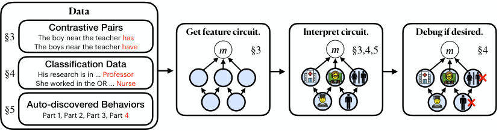

<!-- Start of picture text -->
Data Contrastive Pairs Get feature circuit. Interpret circuit. Debug if desired. §3 The boy near the teacher has The boys near the teacher have m §3 m §3,4,5 m §4 Classification Data §4 His research is in … Professor She worked in the OR … Nurse Auto-discovered Behaviors §5 Part 1, Part 2, Part 3, Part 4 <!-- End of picture text -->

Figure 1: Overview. Given contrastive input pairs, classification data, or automatically discovered model behaviors, we discover circuits composed of human-interpretable sparse features to explain their underlying mechanisms. We then label each feature according to what it activates on or causes the model to predict. Finally, if desired, we can ablate spurious features out of the circuit to modify how the system generalizes. 

2022; Syed et al., 2023) to efficiently identify SAE features which are most causally implicated in model behaviors, as well as connections between these features. The result is a **sparse feature circuit** which explains how model behaviors arise via interactions among fine-grained humaninterpretable units. 

Sparse feature circuits can be productively used in downstream applications. We introduce a technique, Sparse Human-Interpretable Feature Trimming (SHIFT; §4), which shifts the generalization of an LM classifier by surgically removing sensitivity to unintended signals. Unlike previous work on spurious cue removal—which isolates spurious signals using disambiguating data—SHIFT identifies unintended signals using interpretability and human judgement. We thus showcase SHIFT by debiasing a classifier in a worst-case setting, where an unintended signal (gender) is _perfectly predictive_ of target labels (profession). 

Finally, we demonstrate our method’s scalability by automatically discovering thousands of narrow LM behaviors—for example, predicting “to” as an infinitive object or predicting commas in dates— with the clustering approach of Michaud et al. (2023), and then automatically discovering feature circuits for these behaviors (§5). 

Our contributions are summarized as follows (Figure 1): 

1. A scalable method to discover sparse **feature circuits** . We validate our method by discovering and evaluating feature circuits on a suite of subject-verb agreement tasks. 

2. **SHIFT** , a technique for removing a LM classifier’s sensitivity to unintended signals, even without data that isolate these signals. 

3. A _fully-unsupervised_ pipeline for computing feature circuits for thousands of automatically discovered LM behaviors, viewable at feature-circuits.xyz. 

We release code, data and autoencoders at github.com/saprmarks/feature-circuits. 

## 2 FORMULATION 

**Feature disentanglement with sparse autoencoders.** A fundamental challenge in NN interpretability is that individual neurons are rarely interpretable (Elhage et al., 2022). Therefore, many interpretability researchers have recently turned to **sparse autoencoders** (SAEs), an unsupervised technique for identifying a large number of interpretable NN latents (Cunningham et al., 2024; Bricken et al., 2023; Templeton et al., 2024; Rajamanoharan et al., 2024a;b). Given a model component with latent space R_d_ and an activation **x** _∈_ R_d_ , an SAE computes a decomposition 

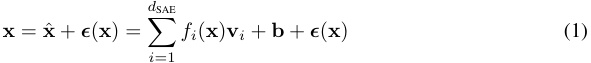

into an approximate reconstruction **x** ˆ as a sparse sum of features **v** _i_ and an _SAE error term_ **_ϵ_** ( **x** ) _∈_ R_d_ . Here _d_ SAE is the _width_ of the SAE, the _features_ **v** _i ∈_ R_d_ are unit vectors, the _feature activations fi_ ( **x** ) _≥_ 0 are a sparse set of coefficients, and **b** _∈_ R_d_ is a bias. SAEs are trained on an objective 

which promotes having a small reconstruction error _∥_ **x** _−_ **x** ˆ _∥_ 2 while using only a sparse set of feature activations _fi_ ( **x** ). Rather than discard the error terms **_ϵ_** for the purposes of circuit discovery, our methods handle them gracefully by incorporating them into our sparse feature circuits; this gives a principled decomposition of model behaviors into contributions from interpretable features and error components not yet captured by our SAEs. 

In this work, we leverage the following suites of SAEs: 

- A suite of SAEs we train for each sublayer (attention layer, MLP, residual stream, and embeddings) of Pythia-70M (Biderman et al., 2023). We closely follow Bricken et al. (2023), using a ReLU-linear encoder _fi_ and sparse dimension _d_ SAE = 64 _× d_ and training the SAEs to minimize a combination of an L2 reconstrution loss and L1 regularization term which promotes sparsity. Details about our Pythia SAEs and their training can be found in Appendix B.1. 

- The open source Gemma Scope SAEs (Lieberum et al., 2024) available for all sublayers (excluding embeddings) of the open-weights Gemma-2-2B model (Team et al., 2024). These SAEs use a Jump-ReLU-linear encoder and _d_ SAE = 8 _× d_ . Details about the Gemma Scope SAEs can be found in Appendix B.2. 

Scalably training better SAEs is an active area of research, as illustrated by the ready availability of open-source SAEs (Gao et al., 2024; Lieberum et al., 2024; Lin & Bloom, 2023). Thus, our goal is to—given a suite of trained SAEs—scalably apply them to understand NN behaviors; we treat scaling the SAEs themselves as out-of-scope. 

**Attributing causal effects with linear approximations.** Let _m_ be a real-valued metric computed via a computational graph (e.g., a NN); let **a** represent a node in this graph. Following prior work (Vig et al., 2020; Finlayson et al., 2021), we quantify the importance of **a** on a pair of inputs ( _x_ clean _, x_ patch) via its _indirect effect_ (IE; Pearl, 2001) on _m_ : 

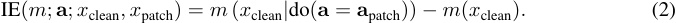

Here, **a** patch is the value that **a** takes in the computation of _m_ ( _x_ patch), and _m_ ( _x_ clean _|_ do( **a** = **a** patch)) denotes the value of _m_ when computing _m_ ( _x_ clean) but _intervening_ in the computation of _m_ by manually setting **a** to **a** patch. For example, given inputs _x_ clean =“The **teacher** ” and _x_ patch =“The **teachers** ,” we have metric _m_ ( _x_ ) = log _P_ (“are” _|x_ ) _−_ log _P_ (“is” _|x_ ), the log probability difference output by the LM. Then if **a** is the activation of a particular neuron, a large value of IE( _m_ ; **a** ; _x_ clean _, x_ patch) indicates that the neuron is highly influential on the model’s decision to output “is” vs. “are” on this pair of inputs. 

We often want to compute IEs for a very large number of model components **a** _∈_ R_d_ , which cannot be done efficiently with (2). We thus employ linear approximations to (2) that can be computed for many **a** in parallel. The simplest such approximation, _attribution patching_ (Nanda, 2022; Syed et al., 2023; Kram´ar et al., 2024), employs a first-order Taylor expansion 

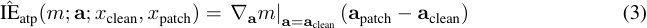

which estimates (2) for every **a** in parallel using only two forward and one backward pass. 

To improve the quality of the approximation, we can instead employ a more expensive but more accurate approximation based on integrated gradients (Sundararajan et al., 2017; Hanna et al., 2024): 

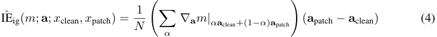

where the sum in (4) ranges over _N_ = 10 equally-spaced _α ∈{_ 0 _, N_<u>1</u>_, . . . ,__<u>N</u>_ _N__−_<u>1</u>_}_.Thiscannotbe done in parallel for two nodes when one is downstream of another, but can be done in parallel for arbitrarily many nodes which do not depend on each other. Thus the additional cost of computing IEˆ ig over IEˆ atp scales linearly in _N_ and the serial depth of _m_ ’s computation graph. 

The above discussion applies to the setting where we have a pair of clean and patch inputs, and we would like to understand that effect of patching a particular node from its clean to patch values. But in some settings (e.g., §4, 5), we have only a single input _x_ . In this case, we instead use a _zeroablation_ , using the indirect effect IE( _m_ ; **a** ; _x_ ) = _m_ ( _x|_ do( **a** = **0** )) _− m_ ( _x_ ) from setting **a** to **0** . We get the modified formulas for IEˆ ( _m_ ; **a** ; _x_ ) from (3) and (4) by replacing **a** with **0** . 

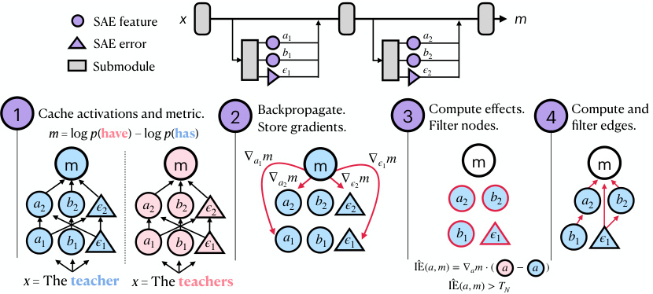

<!-- Start of picture text -->
SAE feature x m a 1 a 2 SAE error b 1 b 2 Submodule ϵ 1 ϵ 2 1 Cache activations and metric. 2 Backpropagate.  3 Compute effects.  4 Compute and Store gradients. Filter nodes. filter edges. m  = log  p ( have ) – log  p ( has ) m m ∇ a 1 m m ∇ ϵ 1 m m m ∇ a 2 m ∇ ϵ 2 m a 2 b 2 ϵ 2 a 2 b 2 ϵ 2 a 2 b 2 ϵ 2 a 2 b 2 a 2 b 2 a 1 b 1 ϵ 1 a 1 b 1 ϵ 1 a 1 b 1 ϵ 1 b 1 ϵ 1 b 1 ϵ 1 IE( a ,  m ) = ∇ am  ⋅( a − a ) x  = The  teacher x =  The  teachers IE( a ,  m ) >  TN <!-- End of picture text -->

Figure 2: Overview of our method. We view our model as a computation graph that includes SAE features and errors. We cache activations (Step 1) and compute gradients (Step 2) for each node. We then compute approximate indirect effects with Eq. (3; shown) or (4) and filter according to a node threshold _TN_ (Step 3). We similarly compute and filter edges (Step 4); see App. A.1. 

## 3 SPARSE FEATURE CIRCUIT DISCOVERY 

### 3.1 METHOD 

Suppose we are given an LM _M_ , SAEs for various submodules of _M_ (e.g., attention outputs, MLP outputs, and residual stream vectors, as in §2), a dataset _D_ consisting either of contrastive pairs ( _x_ clean _, x_ patch) of inputs or of single inputs _x_ , and a metric _m_ that depends on _M_ ’s output when processing data from _D_ . For example, Figure 2 shows the case where _D_ consists of pairs of inputs which differ in number, and _m_ is the log probability difference between _M_ outputting the verb form that is correct for the patch vs. clean input. 

**Viewing SAE features as part of the model.** A key idea underpinning our method is that, by applying the decomposition (1) to various hidden states **x** in the LM, we can view the feature activations _fi_ and SAE errors **_ϵ_** as being part of the LM’s computation. We can thus represent the model as a computation graph _G_ where nodes correspond to feature activations or SAE errors at particular token positions. 

**Approximating the IE of each node.** Let IE be one ofˆ IEˆ atp or IEˆ ig (see §2). Then for each node **a** in _G_ and input _x ∼D_ , we compute IEˆ ( _m_ ; **a** ; _x_ ); we then average over _x ∼D_ to produce a score IEˆ ( _m_ ; **a** ) and filter for nodes with _|_ IE ˆ ( _m_ ; **a** ) _| > TN_ for some choice _TN_ of node threshold. 

Consistent with prior work (Nanda, 2022; Kram´ar et al., 2024), we find that IEˆ atp accurately estimates IEs for SAE features and SAE errors, with the exception of nodes in the layer 0 MLP and early residual stream layers, where IEˆ atp underestimates the true IE. We find that IEˆ ig significantly improves accuracy over IEˆ atp for these components, so we use it in our experiments below. See Appendix H for more information about linear approximation quality. 

**Approximating the IE of edges.** Using an analogous linear approximation, we also compute the average IE of edges in the computation graph. Although the idea is simple, the mathematics are somewhat involved, so we relegate the details to App. A.1. After computing these IEs, we filter for edges with absolute IE exceeding some edge threshold _TE_ . 

**Aggregation across token positions and examples.** For templatic data where tokens in matching positions play consistent roles (see §3.2, 3.3), we take the mean effect of nodes/edges across examples. For non-templatic data (§4, 5) we first sum the effects of corresponding nodes/edges across token position before taking the example-wise mean. See App. A.2. 

|**Structure**|**Example****_clean_ input**|**Example output**|
|---|---|---|
|Simple|The**parents**|_p_(**is**)_−p_(**are**)|
|Within RC|The athlete that the**managers**|_p_(**likes**)_−p_(**like**)|
|Across RC|The**athlete**that the managers like|_p_(**do**)_−p_(**does**)|
|Across PP|The**secretaries**near the cars|_p_(**has**)_−p_(**have**)|

Table 1: Example clean inputs _x_ and outputs _m_ for subject-verb agreement tasks. 

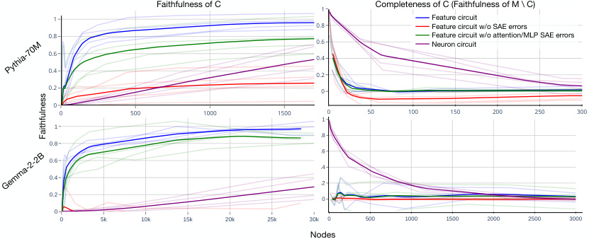

<!-- Start of picture text -->
Faithfulness of C 1 Completeness of C (Faithfulness of M \ C) 1 Feature circuit 0. 8 Feature circuit w/o SAE errors 0.8 Feature circuit w/o attention/MLP SAE errors 0.6 Neuron circuit 0.6 0.4 0.4 0.2 0.2 0 0 0 500 1000 1500 0 50 100 150 200 250 300 1 1 0 .8 0.8 0 .6 0.6 0.4 0.4 0.2 0.2 0 0 0 5k 10k 15k 20k 25k 30k 0 500 1000 1500 2000 2500 3000 Nodes Pythia-70M Gemma-2-2B Faithfulness <!-- End of picture text -->

Figure 3: Faithfulness and completeness scores for circuits, measured on held-out data. Faint lines correspond to the structures from Table 1, with the average across structures in bold. The ideal faithfulness for circuits is 1, while the ideal completeness is 0. 

**Practical considerations.** Various practical difficulties arise for efficiently computing the gradients needed by our method. We solve these using a combination of stop gradients, pass-through gradients, and tricks for efficient Jacobian-vector product computation; see App. A.3. 

- 3.2 DISCOVERING AND EVALUATING SPARSE FEATURE CIRCUITS FOR SUBJECT-VERB AGREEMENT 

To evaluate our method, we discover sparse feature circuits (henceforth, feature circuits) on Pythia70M and Gemma-2-2B for four variants of the subject-verb agreement task (Table 1). Specifically, we adapt data from Finlayson et al. (2021) to produce datasets consisting of contrastive pairs of inputs that differ only in the grammatical number of the subject; the model’s task is to choose the appropriate verb inflection. 

We evaluate circuits for **interpretability** , **faithfulness** , and **completeness** . For each criterion, we compare to _neuron_ circuits discovered by applying our methods with neurons in place of sparse features; in this setting, there are no error terms **_ϵ_** . When evaluating feature circuits for faithfuless and completeness, we use a test split of our dataset, consisting of contrastive pairs not used to discover the circuit. 

**Interpretability.** For Pythia SAEs, we asked human crowdworkers to rate the interpretability of random features, random neurons, features from our feature circuits, and neurons from our neuron circuits. Crowdworkers rated sparse features as significantly more interpretable than neurons, with features that participate in our circuits also being more interpretable than randomly sampled ones (App. F). This replicates prior findings that SAE features are substantially more interpretable than neurons (Bricken et al., 2023). For Gemma-2 SAEs, we refer the reader to Lieberum et al. (2024), which finds the interpretability of these SAEs’ features to be on par with those trained via other state-of-the-art techniques. 

**Faithfulness.** Given a circuit _C_ and metric _m_ , let _m_ ( _C_ ) denote the average value of _m_ over inputs from _D_ when running our model with all nodes outside of _C_ mean-ablated, i.e., set to their average 

value over data from _D_ .2 We then measure the faithfulness of a circuit as _mm_ (( _MC_ <u>))</u> _−−mm_ <u>((∅∅))</u>,where ∅ denotes the empty circuit and _M_ denotes the full model. Intuitively, this metric captures the proportion of the model’s performance our circuit explains, relative to mean ablating the full model (which represents the “prior” performance of the model when it is given information about the task, but not about specific inputs). 

We find that components in early model layers are typically involved in processing specific tokens. In practice, the inputs in the train split of our dataset (used to discover the circuit) and the test split (for evaluation) do not contain identical tokens, making it difficult to evaluate the quality of early segments of our circuit. Thus, we ignore the first1 _/_ 3 of our circuit, and only evaluate the latter2 _/_ 3. 

We plot faithfulness for feature circuits and neuron circuits after sweeping over node thresholds _TN_ (Fig. 3). We find that small feature circuits explain a large proportion of model behavior: the majority of performance in Pythia-70M, resp. Gemma-2-2B is explained by only 100, resp. 500 nodes. In contrast, around 1500, resp. 50000 neurons are required to explain half the performance. However, as SAE error nodes are high-dimensional and coarse-grained, they cannot be fairly compared to neurons; we thus also plot the faithfulness of feature circuits with all SAE error nodes removed, or with all attention and MLP error nodes removed. Unsurprisingly, we find that removing residual stream SAE error nodes severely disrupts the model and curtails its maximum performance; removing MLP and attention error nodes is less disruptive. 

**Completeness.** Are there parts of the model behavior that our circuit fails to capture? We measure this as the faithfulness of the circuit’s complement _M \ C_ (Fig. 3). We observe that we can eliminate the model’s task performance by ablating only a few nodes from our feature circuits, and that this is true even when we leave all SAE errors in place. In contrast, it takes hundreds (for Pythia) or thousands (for Gemma) of neurons to achieve the same effect. 

- 3.3 CASE STUDY: SUBJECT-VERB AGREEMENT ACROSS A RELATIVE CLAUSE 

We find that inspecting small feature circuits produced by our technique can provide insights into how Pythia-70M and Gemma-2-2B arrive at observed behaviors. To illustrate this, we present a case study of relatively small feature circuits for subject-verb agreement across a relative clause (RC). 

To keep the number of nodes we need to annotate manageable, we tune our node threshold to produce a small circuit with faithfulness _>_ 0 _._ 2. For Pythia, this results in a circuit with 86 nodes and faithfulness 0 _._ 21; for Gemma we study a circuit with 223 nodes and faithfulness 0 _._ 21. We summarize these circuits in Figure 4; the full circuits (as well as small circuits for other subject-verb agreement tasks) can be found in App. C.1. We depict SAE features with rectangles and SAE errors with triangles. 

Our circuits depict interpretable algorithms wherein both models of study select appropriate verb forms via two pathways. The first pathway consists of features which detect the number of the main subject and then generically promote matching verb forms. The second pathway begins the same, but moves the relevant number information to the end of the relative clause by using PP/RC boundary detectors. Gemma 2 also uses noun phrase (NP) number trackers, which detect the number of the noun that heads an NP and remain active on all tokens until the end of the NP; these promote matching verb forms at each position, but especially at the last token of an NP. 

We find significant overlap between this circuit and the circuit we discovered for agreement across a prepositional phrase, with Pythia-70M and Gemma-2-2B handling these syntactically distinct structures in a mostly uniform way. In accordance with Finlayson et al. (2021), we find less overlap with our circuits for simple agreement and within RC agreement (Appendix C.1). 

- 4 APPLICATION: REMOVING UNINTENDED SIGNALS FROM A CLASSIFIER WITHOUT DISAMBIGUATING LABELS 

NN classifiers often rely on unintended signals—e.g., spurious features. Nearly all prior work on mitigating this problem relies on access to _disambiguating labeled data_ in which unintended signals are less predictive of labels than intended ones. However, some tasks have structural properties 

> 2Following Wang et al. (2023), we ablate features by setting them to their mean _position-specific_ values. 

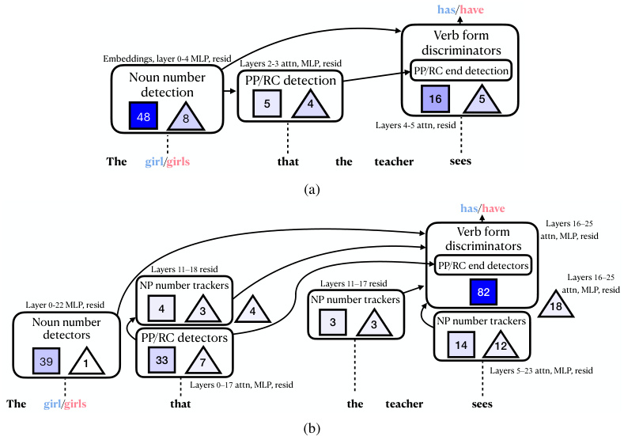

<!-- Start of picture text -->
has/have Verb form discriminators Embeddings, layer 0-4 MLP, resid Layers 2-3 attn, MLP, resid PP/RC end detection Noun number  PP/RC detection detection 5 4 16 5 48 8 Layers 4-5 attn, resid The girl/girls that the teacher sees (a) has/have Layers 16–25 Verb form  attn, MLP, resid discriminators Layers 11–18 resid PP/RC end detectors Layers 16–25 NP number trackers Layers 11–17 resid 82 attn, MLP, resid NP number trackers Layer 0-22 MLP, resid 4 3 4 18 Noun number  3 3 NP number trackers detectors PP/RC detectors 14 12 39 1 33 7 Layers 5–23 attn, MLP, resid Layers 0–17 attn, MLP, resid The girl/girls that the teacher sees (b) <!-- End of picture text -->

Figure 4: Summary of Pythia’s (a) and Gemma 2’s (b) circuits for agreement across RC (full circuits in App. C.1). The models detect the number of the subject. Then, they detect the start of a PP/RC modifying the subject. Verb form discriminators promote particular verb inflections (singular or plural). Gemma 2 additionally uses separate features to track the number of the noun that heads the current noun phrase. Squares show number of feature nodes in the group and triangles show number of SAE error nodes, with the shading indicating the sum of IE terms across nodes in the group.ˆ As we cannot directly interpret the triangles, we rely on their positions or inclusion in other groups to label them. If the label is ambiguous, we leave the triangles outside the boxes. 

which disallow this assumption. For example, inputs for different classes might come from different data sources (Zech et al., 2018). Additionally, some have raised concerns (Ngo et al., 2024; Casper et al., 2023) that sophisticated LMs trained with human feedback (Christiano et al., 2023) in settings with easy-to-hard domain shift (Burns et al., 2023; Hase et al., 2024) will be misaligned because, in these settings, “overseer approval” and “desirable behavior” are equally predictive of training reward labels. More fundamentally, the problem with unintended signals is that they are _unintended_ —not they are insufficiently predictive—and we would like our methods to reflect this. 

We thus propose Spurious Human-interpretable Feature Trimming (SHIFT), where a human inspects a classifier’s feature circuit and removes features which they judge to be task-irrelevant. We show that SHIFT removes sensitivity to unintended signals without access to disambiguating labeled data, or even without knowing what the signals are ahead of time. 

**Method.** Suppose we are given labeled training data _D_ = _{_ ( _xi, yi_ ) _}_ ; an LM-based classifier _C_ trained on _D_ ; and SAEs for various components of _C_ . To perform SHIFT, we: 

1. Apply the methods from §3 to compute a feature circuit that explains _C_ ’s accuracy on inputs ( _x, y_ ) _∼D_ (e.g., using metric _m_ = _−_ log _C_ ( _y|x_ )). 

2. Manually inspect and evaluate for task-relevancy each feature in the circuit from Step 1. 

3. Ablate from _C_ features judged to be task-irrelevant to obtain a classifier _C__′_ . 

4. (Optional) Further fine-tune _C__′_ on data from _D_ . 

Step 3 removes the classifier’s dependence on unintended signals we can identify, but may disrupt the classifier’s performance for the intended signal. Step 4 can be used to restore some performance. 

|||**Pythia-70**|**M**||**Gemma-2-2**|**B**|
|---|---|---|---|---|---|---|
|**Method**|_↑_Profession|_↓_Gender|_↑_Worst group|_↑_Profession|_↓_Gender|_↑_Worst group|
|Original|61.9|87.4|24.4|67.7|81.9|18.2|
|CBP|83.3|60.1|67.7|90.2|**50.1**|86.7|
|Random|61.8|87.5|24.4|67.3|82.3|18.0|
|SHIFT|88.5|54.0|76.0|76.0|51.5|50.0|
|SHIFT+ retrain|**93.1**|**52.0**|**89.0**|**95.0**|52.4|**92.9**|
|Neuron skyline|75.5|73.2|41.5|65.1|84.3|5.6|
|Feature skyline|88.5|54.3|62.9|80.8|53.7|56.7|
|Oracle|93.0|49.4|91.9|95.0|50.6|93.1|

Table 2: Accuracies on balanced data for the intended label (profession) and unintended label (gender). “Worst group accuracy” refers to whichever profession accuracy is lowest among male professors, male nurses, female professors, female nurses. 

**Experimental setup.** We illustrate SHIFT using the Bias in Bios dataset (BiB; De-Arteaga et al., 2019). BiB consists of professional biographies, and the task is to classify an individual’s profession based on their biography. BiB also provides labels for a spurious feature: gender. We subsample BiB to produce two sets of labeled data: 

- The **ambiguous set** , consisting of bios of male professors (labeled 0) and female nurses (labeled 1). 

- The **balanced set** , consisting of an equal number of bios for male professors, male nurses, female professors, and female nurses. These data carry **profession labels** (the intended signal) and **gender labels** (the unintended signal). 

The **ambiguous set** represents a worst-case scenario: the unintended signal is perfectly predictive of training labels. Given only access to the **ambiguous set** , our task is to produce a **profession** classifier which is accurate on the **balanced set** . 

We adapt Pythia-70M and Gemma-2-2B into classifiers by training linear classification heads with the **ambiguous set** ; see App. E.1 for probe training details. We then discover feature circuits for these classifiers using the zero-ablation variant described in §3.1; the Pythia circuit contains 67 features, and the Gemma circuit contains 46. We manually interpret each feature using the Neuronpedia interface (Lin & Bloom, 2023), which displays maximally activating dataset exemplars on a large text corpus, as the features’ direct effects on output logits. We judge 55 of the Pythia features and 43 of the Gemma features to be task-irrelevant—e.g., features that promote female-associated language in biographies of women, as in Figure 19 (see App. D for more examples features). Although this interpretability step uses additional unlabeled data, we emphasize that we never use additional _labeled_ data (or even additional unlabeled classification data). 

To apply SHIFT, we zero-ablate these irrelevant features. Finally, we retrain the linear classification head with the **ambiguous set** using activations extracted from the ablated model. We evaluate all accuracies on the **balanced set** . 

**Baselines and skylines.** To contextualize the performance of SHIFT, we also implement: 

- **SHIFT with neurons.** Perform SHIFT, but using neurons instead of SAE features. 

- **Concept Bottleneck Probing** (CBP), adapted from Yan et al. (2023) (originally for multimodal text/image models). CBP works by training a probe to classify inputs _x_ given access only to a vector of affinities between the LM’s representation of _x_ and various concept vectors. See App. E.2 for implementation details. 

- **Random feature ablations.** Perform SHIFT, but using (the same number of) randomly selected SAE features instead of features selected by a human annotator. 

- **Feature skyline.** Instead of relying on human judgement to evaluate whether a feature should be ablated, we zero-ablate the 55 (for Pythia) or 43 (for Gemma) features from our circuit that are most causally implicated in **spurious feature** accuracy on the **balanced set** . 

- **Neuron skyline.** The same as the feature skyline, but mean-ablating 55 or 43 neurons. 

- **Oracle.** A classifier trained on **ground-truth labels** on the **balanced set** . 

**Results.** We find (Table 2) that SHIFT almost completely removes the classifiers’ dependence on gender information for both models. In the case of Gemma (but not Pythia), the feature ablations 

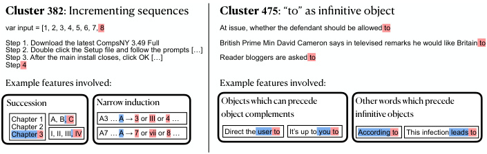

<!-- Start of picture text -->
Cluster 382 : Incrementing sequences  Cluster 475 : “to” as infinitive object var input = [1, 2, 3, 4, 5, 6, 7, 8 At issue, whether the defendant should be allowed to Step 1. Download the latest CompsNY 3.49 Full  British Prime Min David Cameron says in televised remarks he would like Britain to Step 2. Double click the Setup file and follow the prompts […] Step 3. After the main install closes, click OK […]  Reader bloggers are asked to Step 4 Example features involved: Example features involved: Succession Narrow induction Objects which can precede   Other words which precede Chapter 1  A, B, C A3 … A → 3 or III or 4 … object complements infinitive objects Chapter 2  Chapter  3 I, II, III , IV A7 … A → 7 or vii or 8 … Direct the  user  to It’s up to  you  to According  to This infection  leads  to <!-- End of picture text -->

Figure 5: Example clusters and features which participate in their circuits (see App. C.3 for the full circuits). Features are active on tokens shaded in blue and promote tokens shaded in red. _(left)_ An example _narrow_ induction feature recognizes the pattern _A_ 3 _. . . A_ and copies information from the 3 token. This composes with a succession feature to implement the prediction _A_ 3 _. . . A →_ 4. _(right_ ) One feature promotes “to” after words which can take infinitive objects. A separate feature activates on objects of verbs or prepositions and promotes “to” as an object complement. 

damage model performance; however, this performance is restored (without reintroducing the bias) by further training on the ambiguous set. Comparing SHIFT without retraining to the feature skyline, we further observe that SHIFT optimally or near-optimally identifies the best features to remove. 

SHIFT critically relies on the use of properly selected SAE features. When ablating random SAE features, we see essentially no effect on probe performance. When applying SHIFT with neurons, essentially none of the neurons are interpretable, making it difficult to tell if they ought to be ablated; see Appendix D for examples. Because of this, we abandon the SHIFT with neurons baseline. Even using the **balanced set** to automatically select neurons for removal (the neuron skyline) fails to match SHIFT’s performance, as the neurons most implicated in **spurious feature** classification are also useful for **ground-truth** classification. 

## 5 UNSUPERVISED CIRCUIT DISCOVERY AT SCALE 

Previous work on circuit analysis relied on human-collected datasets to specify LM behaviors (Wang et al., 2023; Conmy et al., 2023; Hanna et al., 2023). However, LMs implement numerous interesting behaviors, many of which may be counterintuitive to humans. In this section, we adapt our techniques to produce a near-fully-automated interpretability pipeline, starting from a large text corpus—here, a large subset of The Pile (Gao et al., 2020)—and ending with thousands of feature circuits for auto-discovered model behaviors. These experiments are performed with Pythia-70M. 

We proceed in two steps: 

1. **Behavior discovery via clustering.** We interpret our large text corpus as a dataset _{_ ( _xi, yi_ ) _}_ of contexts _xi_ with ground-truth next tokens _yi_ . Following Michaud et al. (2023), we associate a vector **v** _i_ = **v** ( _xi, yi_ ) to each sample and apply a clustering algorithm to _{_ **v** _i}_ ; this segments our large corpus into a number of smaller subcorpora corresponding to the clusters. Although this approach is entirely unsupervised, many of the resulting subcorpora capture human-interpretable model behaviors, such as predicting the next number in a sequence (Fig 5). We experiment with a number of ways of assigning ( _xi, yi_ ) _�→_ **v** _i_ , such as using the training gradient _∇θ_ log _Pθ_ ( _yi|xi_ ) as in Michaud et al. (2023) as well as approaches which leverage SAE activations or gradients. See App. G for details. 

2. **Circuit discovery.** Given a subcorpus _D_ = _{_ ( _xi, yi_ ) _}_ , we apply the zero-ablation variant of our feature circuit discovery technique from §3 using the dataset _D_ and metric _m_ = _−_ log _P_ ( _yi|xi_ ). Thus, to each subcorpus we associate a feature circuit. 

We present example clusters, as well as interesting features participating in their associated circuits (Figure 5). An interface for exploring all of our clusters and (unlabeled) circuits can be found at feature-circuits.xyz. 

While evaluating these clusters and circuits is an important open problem, we generally find that these clusters expose interesting LM behaviors, and that their respective feature circuits can provide 

useful insights on mechanisms of LM behavior. For instance, we automatically discover attention features implicated in succession and induction, two phenomena thoroughly studied in prior work at the attention head level using human-curated data (Olsson et al., 2022; Gould et al., 2023). 

Feature circuits can also shed interesting light on their clusters. For example, while the clusters in Figure 5 seem at first to each represent a single mechanism, circuit-level analysis reveals in both cases a union of distinct mechanisms. For cluster 475, Pythia-70M determines whether “to [verb]” is an appropriate object in two distinct manners (see Figure 5 caption). And for cluster 382, the prediction of successors relies on general succession features, as well as multiple _narrow_ induction features which recognize patterns like “ _A_ 3 _. . . A_ ”. 

## 6 RELATED WORK 

**Causal interpretability.** Interpretability research has applied causal mediation analysis (Pearl, 2001; Robins & Greenland, 1992) to understand the mechanisms underlying particular model behaviors and their emergence (Yu et al., 2023; Geva et al., 2023; Hanna et al., 2023; Todd et al., 2024; Prakash et al., 2024; Chen et al., 2024, _inter alia_ ). This typically relies on counterfactual interventions (Lewis, 1973), such as activation patching or path patching on coarse-grained components (Conmy et al., 2023; Wang et al., 2023). Some techniques aim to, given a hypothesized causal graph, identify a matching causal mechanism in an LM (Geiger et al., 2021; 2022; 2023); in contrast, we aim here to discover causal mechansisms without starting from such hypotheses. 

**Robustness to spurious correlations.** There is a large literature on mitigating robustness to spurious correlations, including techniques which rely on directly optimizing worst-group accuracy (Sagawa et al., 2020; Oren et al., 2019; Zhang et al., 2021; Sohoni et al., 2022; Nam et al., 2022), automatically or manually reweighting data between groups (Liu et al., 2021; Nam et al., 2020; Yaghoobzadeh et al., 2021; Utama et al., 2020; Creager et al., 2021; Idrissi et al., 2022; Orgad & Belinkov, 2023), training classifiers with more favorable inductive biases (Kirichenko et al., 2023; Zhang et al., 2022; Iskander et al., 2024), or editing out undesired concepts (Iskander et al., 2023; Belrose et al., 2023; Wang et al., 2020; Ravfogel et al., 2020; 2022a;b). All of these techniques rely on access to disambiguating labeled data in the sense of §4. Some techniques from a smaller literature focused on image or multimodal models apply without such data (Oikarinen et al., 2023; Yan et al., 2023). Our method here is inspired by the approach of Gandelsman et al. (2024) based on interpreting and ablating undesired attention heads in CLIP. 

**Feature disentanglement.** In addition to recent work on SAEs for LM interpretability (Cunningham et al., 2024; Bricken et al., 2023; Gao et al., 2024; Rajamanoharan et al., 2024a;b), other approaches to feature disentanglement include Schmidhuber (1992); Desjardins et al. (2012); Kim & Mnih (2018); Chen et al. (2016); Makhzani & Frey (2013); He et al. (2022); Peebles et al. (2020); Schneider & Vlachos (2021); Burgess et al. (2017); Chen et al. (2018); Higgins et al. (2017); _i.a._ 

## 7 CONCLUSION 

We have introduced a method for discovering circuits on sparse features. Using this method, we discover human-interpretable causal graphs for a subject-verb agreement task, a classifier, and thousands of general token prediction tasks. We can edit the set of features that models have access to by ablating sparse features that humans deem spurious; we find that this is significantly more effective than a neuron-based ablation method which has an unfair advantage. 

## 8 LIMITATIONS 

The success of our technique relies on access to SAEs for a given model. Training such SAEs currently requires a large (but one-time) upfront compute cost. Additionally, model components not captured by the SAEs will remain uninterpretable after applying our method. 

Much of our evaluation is qualitative. While we have quantitative evidence that feature circuits are useful for improving generalization without additional data (§4), evaluating dictionaries and circuits without downstream tasks is challenging. Feature labeling is also a qualitative process; thus, labels may vary across annotators, and may vary depending on the task of interest. 

## REPRODUCIBILITY 

We release code, data and autoencoders at github.com/saprmarks/feature-circuits. Experimental details can be found in appendices A, E, and G. Our experiments are conducted entirely on open-weights models. The Gemma Scope SAEs are publicly available (Lieberum et al., 2024). Features for both SAE suites can be browsed on Neuronpedia (Lin & Bloom, 2023). Our clusters and associated feature circuits can be browsed at feature-circuits.xyz. 

## ACKNOWLEDGMENTS 

We thank Stephen Casper, Buck Schlegeris, Ryan Greenblatt, and Neel Nanda for discussion of ideas upstream to the experiments in §4. We thank Logan Riggs and Jannik Brinkmann for help training SAEs. We also thank Josh Engels and Max Tegmark for discussions about clustering and sparse projections related to §5. S.M. is supported by an Open Philanthropy alignment grant. C.R. is supported by Manifund Regrants. E.J.M. is supported by the NSF Graduate Research Fellowship Program (Grant No. 2141064). Y.B. is supported by the Israel Science Foundation (Grant No. 448/20) and an Azrieli Foundation Early Career Faculty Fellowship. Y.B. and D.B. are supported by a joint Open Philanthropy alignment grant. A.M. is supported by a Zuckerman postdoctoral fellowship. 

## REFERENCES 

Yonatan Belinkov. Probing classifiers: Promises, shortcomings, and advances. _Computational Linguistics_ , 48(1):207–219, 2022. 

- Nora Belrose, David Schneider-Joseph, Shauli Ravfogel, Ryan Cotterell, Edward Raff, and Stella Biderman. LEACE: Perfect linear concept erasure in closed form. In _Thirty-seventh Conference on Neural Information Processing Systems_ , 2023, LEACE: Perfect linear concept erasure in closed form. 

- Stella Biderman, Hailey Schoelkopf, Quentin Gregory Anthony, Herbie Bradley, Kyle O’Brien, Eric Hallahan, Mohammad Aflah Khan, Shivanshu Purohit, USVSN Sai Prashanth, Edward Raff, et al. Pythia: A suite for analyzing large language models across training and scaling. In _International Conference on Machine Learning_ , pp. 2397–2430. PMLR, 2023. 

- Trenton Bricken, Adly Templeton, Joshua Batson, Brian Chen, Adam Jermyn, Tom Conerly, Nick Turner, Cem Anil, Carson Denison, Amanda Askell, Robert Lasenby, Yifan Wu, Shauna Kravec, Nicholas Schiefer, Tim Maxwell, Nicholas Joseph, Zac Hatfield-Dodds, Alex Tamkin, Karina Nguyen, Brayden McLean, Josiah E Burke, Tristan Hume, Shan Carter, Tom Henighan, and Christopher Olah. Towards monosemanticity: Decomposing language models with dictionary learning, Towards Monosemanticity: Decomposing Language Models With Dictionary Learning. _Transformer Circuits Thread_ , 2023. 

- Christopher P. Burgess, Irina Higgins, Arka Pal, Loic Matthey, Nick Watters, Guillaume Desjardins, and Alexander Lerchner. Understanding disentangling in _β_ -VAE, 2017, Understanding disentangling in _β_ -VAE. 

- Collin Burns, Pavel Izmailov, Jan Hendrik Kirchner, Bowen Baker, Leo Gao, Leopold Aschenbrenner, Yining Chen, Adrien Ecoffet, Manas Joglekar, Jan Leike, Ilya Sutskever, and Jeff Wu. Weak-to-strong generalization: Eliciting strong capabilities with weak supervision, Weak-toStrong Generalization: Eliciting Strong Capabilities With Weak Supervision. _Computing Research Repository_ , arXiv:2312.09390, 2023. 

- Stephen Casper, Xander Davies, Claudia Shi, Thomas Krendl Gilbert, J´er´emy Scheurer, Javier Rando, Rachel Freedman, Tomasz Korbak, David Lindner, Pedro Freire, Tony Tong Wang, Samuel Marks, Charbel-Raphael Segerie, Micah Carroll, Andi Peng, Phillip Christoffersen, Mehul Damani, Stewart Slocum, Usman Anwar, Anand Siththaranjan, Max Nadeau, Eric J Michaud, Jacob Pfau, Dmitrii Krasheninnikov, Xin Chen, Lauro Langosco, Peter Hase, Erdem Biyik, Anca Dragan, David Krueger, Dorsa Sadigh, and Dylan Hadfield-Menell. Open problems and fundamental limitations of reinforcement learning from human feedback, Open Problems 

and Fundamental Limitations of Reinforcement Learning from Human Feedback. _Transactions on Machine Learning Research_ , 2023. ISSN 2835-8856. Survey Certification. 

- Angelica Chen, Ravid Shwartz-Ziv, Kyunghyun Cho, Matthew L Leavitt, and Naomi Saphra. Sudden drops in the loss: Syntax acquisition, phase transitions, and simplicity bias in MLMs. In _The Twelfth International Conference on Learning Representations_ , 2024, Sudden Drops in the Loss: Syntax Acquisition, Phase Transitions, and Simplicity Bias in MLMs. 

- Tian Qi Chen, Xuechen Li, Roger Grosse, and David Duvenaud. Isolating sources of disentanglement in variational autoencoders, 2018, Isolating Sources of Disentanglement in Variational Autoencoders. 

- Xi Chen, Yan Duan, Rein Houthooft, John Schulman, Ilya Sutskever, and Pieter Abbeel. Infogan: interpretable representation learning by information maximizing generative adversarial nets. In _Proceedings of the 30th International Conference on Neural Information Processing Systems_ , NIPS’16, pp. 2180–2188, Red Hook, NY, USA, 2016. Curran Associates Inc. ISBN 9781510838819. 

- Paul Christiano, Jan Leike, Tom B. Brown, Miljan Martic, Shane Legg, and Dario Amodei. Deep reinforcement learning from human preferences. _Computing Research Repository_ , arXiv:1706.03741, 2023. 

- Arthur Conmy, Augustine N. Mavor-Parker, Aengus Lynch, Stefan Heimersheim, and Adri`a Garriga-Alonso. Towards automated circuit discovery for mechanistic interpretability. In _Thirtyseventh Conference on Neural Information Processing Systems_ , 2023, Towards Automated Circuit Discovery for Mechanistic Interpretability. 

- Elliot Creager, Joern-Henrik Jacobsen, and Richard Zemel. Environment inference for invariant learning. In Marina Meila and Tong Zhang (eds.), _Proceedings of the 38th International Conference on Machine Learning_ , volume 139 of _Proceedings of Machine Learning Research_ , pp. 2189–2200. PMLR, 18–24 Jul 2021, Environment Inference for Invariant Learning. 

- Hoagy Cunningham, Aidan Ewart, Logan Riggs, Robert Huben, and Lee Sharkey. Sparse autoencoders find highly interpretable features in language models. In _The Twelfth International Conference on Learning Representations_ , 2024, Sparse Autoencoders Find Highly Interpretable Features in Language Models. 

- Maria De-Arteaga, Alexey Romanov, Hanna Wallach, Jennifer Chayes, Christian Borgs, Alexandra Chouldechova, Sahin Geyik, Krishnaram Kenthapadi, and Adam Tauman Kalai. Bias in bios: A case study of semantic representation bias in a high-stakes setting. In _Proceedings of the Conference on Fairness, Accountability, and Transparency_ , FAT* ’19, pp. 120–128, New York, NY, USA, 2019. Association for Computing Machinery. ISBN 9781450361255, Bias in Bios: A Case Study of Semantic Representation Bias in a High-Stakes Setting. 

- Guillaume Desjardins, Aaron Courville, and Yoshua Bengio. Disentangling factors of variation via generative entangling. _Computing Research Repository_ , arXiv:1210.5474, 2012. 

- Nelson Elhage, Tristan Hume, Catherine Olsson, Nicholas Schiefer, Tom Henighan, Shauna Kravec, Zac Hatfield-Dodds, Robert Lasenby, Dawn Drain, Carol Chen, Roger Grosse, Sam McCandlish, Jared Kaplan, Dario Amodei, Martin Wattenberg, and Christopher Olah. Toy models of superposition. _Transformer Circuits Thread_ , 2022. https://transformercircuits.pub/2022/toy ~~m~~ odel/index.html. 

- Matthew Finlayson, Aaron Mueller, Sebastian Gehrmann, Stuart Shieber, Tal Linzen, and Yonatan Belinkov. Causal analysis of syntactic agreement mechanisms in neural language models. In Chengqing Zong, Fei Xia, Wenjie Li, and Roberto Navigli (eds.), _Proceedings of the 59th Annual Meeting of the Association for Computational Linguistics and the 11th International Joint Conference on Natural Language Processing (Volume 1: Long Papers)_ , pp. 1828–1843, Online, August 2021. Association for Computational Linguistics, Causal Analysis of Syntactic Agreement Mechanisms in Neural Language Models. 

- Yossi Gandelsman, Alexei A. Efros, and Jacob Steinhardt. Interpreting CLIP’s image representation via text-based decomposition. _Computing Research Repository_ , arXiv:2310.05916, 2024. 

- Leo Gao, Stella Biderman, Sid Black, Laurence Golding, Travis Hoppe, Charles Foster, Jason Phang, Horace He, Anish Thite, Noa Nabeshima, Shawn Presser, and Connor Leahy. The Pile: An 800GB dataset of diverse text for language modeling. _Computing Research Repository_ , arXiv:2101.00027, 2020. 

- Leo Gao, Tom Dupr´e la Tour, Henk Tillman, Gabriel Goh, Rajan Troll, Alec Radford, Ilya Sutskever, Jan Leike, and Jeffrey Wu. Scaling and evaluating sparse autoencoders. _Computing Research Repository_ , arXiv:2406.04093, 2024. 

- Atticus Geiger, Hanson Lu, Thomas Icard, and Christopher Potts. Causal abstractions of neural networks. In M. Ranzato, A. Beygelzimer, Y. Dauphin, P.S. Liang, and J. Wortman Vaughan (eds.), _Advances in Neural Information Processing Systems_ , volume 34, pp. 9574–9586. Curran Associates, Inc., 2021, Causal Abstractions of Neural Networks. 

- Atticus Geiger, Zhengxuan Wu, Hanson Lu, Josh Rozner, Elisa Kreiss, Thomas Icard, Noah Goodman, and Christopher Potts. Inducing causal structure for interpretable neural networks. In Kamalika Chaudhuri, Stefanie Jegelka, Le Song, Csaba Szepesvari, Gang Niu, and Sivan Sabato (eds.), _Proceedings of the 39th International Conference on Machine Learning_ , volume 162 of _Proceedings of Machine Learning Research_ , pp. 7324–7338. PMLR, 17–23 Jul 2022, Inducing Causal Structure for Interpretable Neural Networks. 

- Atticus Geiger, Chris Potts, and Thomas Icard. Causal abstraction for faithful model interpretation. _Computing Research Repository_ , arXiv:2301.04709, 2023. 

- Mor Geva, Jasmijn Bastings, Katja Filippova, and Amir Globerson. Dissecting recall of factual associations in auto-regressive language models. In Houda Bouamor, Juan Pino, and Kalika Bali (eds.), _Proceedings of the 2023 Conference on Empirical Methods in Natural Language Processing_ , pp. 12216–12235, Singapore, December 2023. Association for Computational Linguistics, Dissecting Recall of Factual Associations in Auto-Regressive Language Models. 

- Rhys Gould, Euan Ong, George Ogden, and Arthur Conmy. Successor heads: Recurring, interpretable attention heads in the wild. _Computing Research Repository_ , arXiv:2312.09230, 2023. 

- Michael Hanna, Ollie Liu, and Alexandre Variengien. How does GPT-2 compute greater-than?: Interpreting mathematical abilities in a pre-trained language model. In _Thirty-seventh Conference on Neural Information Processing Systems_ , 2023, How does GPT-2 compute greater-than?: Interpreting mathematical abilities in a pre-trained language model. 

- Michael Hanna, Sandro Pezzelle, and Yonatan Belinkov. Have faith in faithfulness: Going beyond circuit overlap when finding model mechanisms. In _ICML 2024 Workshop on Mechanistic Interpretability_ , 2024, Have Faith in Faithfulness: Going Beyond Circuit Overlap When Finding Model Mechanisms. 

- Peter Hase, Mohit Bansal, Peter Clark, and Sarah Wiegreffe. The unreasonable effectiveness of easy training data for hard tasks. In Lun-Wei Ku, Andre Martins, and Vivek Srikumar (eds.), _Proceedings of the 62nd Annual Meeting of the Association for Computational Linguistics (Volume 1: Long Papers)_ , pp. 7002–7024, Bangkok, Thailand, August 2024. Association for Computational Linguistics, The Unreasonable Effectiveness of Easy Training Data for Hard Tasks. 

- T. He, Z. Li, Y. Gong, Y. Yao, X. Nie, and Y. Yin. Exploring linear feature disentanglement for neural networks. In _2022 IEEE International Conference on Multimedia and Expo (ICME)_ , pp. 1–6, Los Alamitos, CA, USA, jul 2022. IEEE Computer Society, Exploring Linear Feature Disentanglement for Neural Networks. 

- Irina Higgins, Loic Matthey, Arka Pal, Christopher Burgess, Xavier Glorot, Matthew Botvinick, Shakir Mohamed, and Alexander Lerchner. beta-VAE: Learning basic visual concepts with a constrained variational framework. In _International Conference on Learning Representations_ , 2017, beta-VAE: Learning Basic Visual Concepts with a Constrained Variational Framework. 

- Badr Youbi Idrissi, Martin Arjovsky, Mohammad Pezeshki, and David Lopez-Paz. Simple data balancing achieves competitive worst-group-accuracy. In Bernhard Sch¨olkopf, Caroline Uhler, and Kun Zhang (eds.), _Proceedings of the First Conference on Causal Learning and Reasoning_ , volume 177 of _Proceedings of Machine Learning Research_ , pp. 336–351. PMLR, 11–13 Apr 2022, Simple data balancing achieves competitive worst-group-accuracy. 

- Shadi Iskander, Kira Radinsky, and Yonatan Belinkov. Shielded representations: Protecting sensitive attributes through iterative gradient-based projection. In Anna Rogers, Jordan Boyd-Graber, and Naoaki Okazaki (eds.), _Findings of the Association for Computational Linguistics: ACL 2023_ , pp. 5961–5977, Toronto, Canada, July 2023. Association for Computational Linguistics, Shielded Representations: Protecting Sensitive Attributes Through Iterative Gradient-Based Projection. 

- Shadi Iskander, Kira Radinsky, and Yonatan Belinkov. Leveraging prototypical representations for mitigating social bias without demographic information. _Computing Research Repository_ , 2403.09516, 2024. 

- Been Kim, Martin Wattenberg, Justin Gilmer, Carrie Cai, James Wexler, Fernanda Viegas, et al. Interpretability beyond feature attribution: Quantitative testing with concept activation vectors (TCAV). In _Proceedings of the 35th International Conference on Machine Learning_ , pp. 2668– 2677. PMLR, 2018. 

- Hyunjik Kim and Andriy Mnih. Disentangling by factorising. In Jennifer Dy and Andreas Krause (eds.), _Proceedings of the 35th International Conference on Machine Learning_ , volume 80 of _Proceedings of Machine Learning Research_ , pp. 2649–2658. PMLR, 10–15 Jul 2018, Disentangling by Factorising. 

- Diederik P. Kingma and Jimmy Ba. Adam: A method for stochastic optimization, Adam: A Method for Stochastic Optimization. _CoRR_ , abs/1412.6980, 2014. 

- Polina Kirichenko, Pavel Izmailov, and Andrew Gordon Wilson. Last layer re-training is sufficient for robustness to spurious correlations. _Computing Research Repository_ , arXiv:2204.02937, 2023. 

- J´anos Kram´ar, Tom Lieberum, Rohin Shah, and Neel Nanda. AtP*: An efficient and scalable method for localizing llm behaviour to components. _Computing Research Repository_ , arXiv:2403.00745, 2024. 

### David K. Lewis. _Counterfactuals_ . Blackwell, Malden, Mass., 1973. 

- Tom Lieberum, Senthooran Rajamanoharan, Arthur Conmy, Lewis Smith, Nicolas Sonnerat, Vikrant Varma, J´anos Kram´ar, Anca Dragan, Rohin Shah, and Neel Nanda. Gemma scope: Open sparse autoencoders everywhere all at once on gemma 2, 2024. 

- Johnny Lin and Joseph Bloom. Neuronpedia: Interactive reference and tooling for analyzing neural networks, 2023, Neuronpedia: Interactive Reference and Tooling for Analyzing Neural Networks. Software available from neuronpedia.org. 

- Evan Z Liu, Behzad Haghgoo, Annie S Chen, Aditi Raghunathan, Pang Wei Koh, Shiori Sagawa, Percy Liang, and Chelsea Finn. Just train twice: Improving group robustness without training group information. In Marina Meila and Tong Zhang (eds.), _Proceedings of the 38th International Conference on Machine Learning_ , volume 139 of _Proceedings of Machine Learning Research_ , pp. 6781–6792. PMLR, 18–24 Jul 2021, Just Train Twice: Improving Group Robustness without Training Group Information. 

- Ilya Loshchilov and Frank Hutter. Decoupled weight decay regularization. In _International Conference on Learning Representations_ , 2017, Decoupled Weight Decay Regularization. 

- Alireza Makhzani and Brendan J. Frey. k-sparse autoencoders, k-Sparse Autoencoders. _Computing Research Repository_ , abs/1312.5663, 2013. 

- Kevin Meng, David Bau, Alex Andonian, and Yonatan Belinkov. Locating and editing factual associations in GPT. _Advances in Neural Information Processing Systems_ , 36, 2022. arXiv:2202.05262. 

- Eric J Michaud, Ziming Liu, Uzay Girit, and Max Tegmark. The quantization model of neural scaling. In _Thirty-seventh Conference on Neural Information Processing Systems_ , 2023, The Quantization Model of Neural Scaling. 

- Aaron Mueller, Jannik Brinkmann, Millicent Li, Samuel Marks, Koyena Pal, Nikhil Prakash, Can Rager, Aruna Sankaranarayanan, Arnab Sen Sharma, Jiuding Sun, Eric Todd, David Bau, and Yonatan Belinkov. The quest for the right mediator: A history, survey, and theoretical grounding of causal interpretability, 2024, The Quest for the Right Mediator: A History, Survey, and Theoretical Grounding of Causal Interpretability. 

- Junhyun Nam, Hyuntak Cha, Sungsoo Ahn, Jaeho Lee, and Jinwoo Shin. Learning from failure: Training debiased classifier from biased classifier. In _Proceedings of the 34th International Conference on Neural Information Processing Systems_ , NIPS’20, Red Hook, NY, USA, 2020. Curran Associates Inc. ISBN 9781713829546. 

- Junhyun Nam, Jaehyung Kim, Jaeho Lee, and Jinwoo Shin. Spread spurious attribute: Improving worst-group accuracy with spurious attribute estimation, 2022. 

- Neel Nanda. Attribution patching: Activation patching at industrial scale, 2022, Attribution Patching: Activation Patching At Industrial Scale. 

- Neel Nanda. Open source replication & commentary on Anthropic’s dictionary learning paper, 2023, Open Source Replication & Commentary on Anthropic’s Dictionary Learning Paper. 

- Neel Nanda, Senthooran Rajamanoharan, J´anos Kram´ar, and Rohin Shah. Fact finding: Attempting to reverse-engineer factual recall on the neuron level, 2023, Fact Finding: Attempting to ReverseEngineer Factual Recall on the Neuron Level. 

- Richard Ngo, Lawrence Chan, and S¨oren Mindermann. The alignment problem from a deep learning perspective. _Computing Research Repository_ , arXiv:2209.00626, 2024. 

- Tuomas Oikarinen, Subhro Das, Lam M. Nguyen, and Tsui-Wei Weng. Label-free concept bottleneck models. In _The Eleventh International Conference on Learning Representations_ , 2023, Label-free Concept Bottleneck Models. 

- Catherine Olsson, Nelson Elhage, Neel Nanda, Nicholas Joseph, Nova DasSarma, Tom Henighan, Ben Mann, Amanda Askell, Yuntao Bai, Anna Chen, Tom Conerly, Dawn Drain, Deep Ganguli, Zac Hatfield-Dodds, Danny Hernandez, Scott Johnston, Andy Jones, Jackson Kernion, Liane Lovitt, Kamal Ndousse, Dario Amodei, Tom Brown, Jack Clark, Jared Kaplan, Sam McCandlish, and Chris Olah. In-context learning and induction heads. _Transformer Circuits Thread_ , 2022. https://transformer-circuits.pub/2022/in-context-learning-and-induction-heads/index.html. 

- Yonatan Oren, Shiori Sagawa, Tatsunori B. Hashimoto, and Percy Liang. Distributionally robust language modeling. In Kentaro Inui, Jing Jiang, Vincent Ng, and Xiaojun Wan (eds.), _Proceedings of the 2019 Conference on Empirical Methods in Natural Language Processing and the 9th International Joint Conference on Natural Language Processing (EMNLP-IJCNLP)_ , pp. 4227–4237, Hong Kong, China, November 2019. Association for Computational Linguistics, Distributionally Robust Language Modeling. 

- Hadas Orgad and Yonatan Belinkov. BLIND: Bias removal with no demographics. In Anna Rogers, Jordan Boyd-Graber, and Naoaki Okazaki (eds.), _Proceedings of the 61st Annual Meeting of the Association for Computational Linguistics (Volume 1: Long Papers)_ , pp. 8801–8821, Toronto, Canada, July 2023. Association for Computational Linguistics, BLIND: Bias Removal With No Demographics. 

- Judea Pearl. Direct and indirect effects. In _Proceedings of the Seventeenth Conference on Uncertainty in Artificial Intelligence_ , UAI’01, pp. 411–420, San Francisco, CA, USA, 2001. Morgan Kaufmann Publishers Inc. ISBN 1558608001. 

- F. Pedregosa, G. Varoquaux, A. Gramfort, V. Michel, B. Thirion, O. Grisel, M. Blondel, P. Prettenhofer, R. Weiss, V. Dubourg, J. Vanderplas, A. Passos, D. Cournapeau, M. Brucher, M. Perrot, and E. Duchesnay. Scikit-learn: Machine learning in Python. _Journal of Machine Learning Research_ , 12:2825–2830, 2011. 

- William Peebles, John Peebles, Jun-Yan Zhu, Alexei A. Efros, and Antonio Torralba. The hessian penalty: A weak prior for unsupervised disentanglement. In _Proceedings of European Conference on Computer Vision (ECCV)_ , 2020. 

- Nikhil Prakash, Tamar Rott Shaham, Tal Haklay, Yonatan Belinkov, and David Bau. Fine-tuning enhances existing mechanisms: A case study on entity tracking. In _Proceedings of the 2024 International Conference on Learning Representations_ , 2024. arXiv:2402.14811. 

- Senthooran Rajamanoharan, Arthur Conmy, Lewis Smith, Tom Lieberum, Vikrant Varma, J´anos Kram´ar, Rohin Shah, and Neel Nanda. Improving dictionary learning with gated sparse autoencoders. _Computing Research Repository_ , arXiv:2404.16014, 2024a. 

- Senthooran Rajamanoharan, Tom Lieberum, Nicolas Sonnerat, Arthur Conmy, Vikrant Varma, J´anos Kram´ar, and Neel Nanda. Jumping ahead: Improving reconstruction fidelity with jumprelu sparse autoencoders, Jumping Ahead: Improving Reconstruction Fidelity with JumpReLU Sparse Autoencoders. _Computing Research Repository_ , arXiv:2407.14435, 2024b. 

- Shauli Ravfogel, Yanai Elazar, Hila Gonen, Michael Twiton, and Yoav Goldberg. Null it out: Guarding protected attributes by iterative nullspace projection. In Dan Jurafsky, Joyce Chai, Natalie Schluter, and Joel Tetreault (eds.), _Proceedings of the 58th Annual Meeting of the Association for Computational Linguistics_ , pp. 7237–7256, Online, July 2020. Association for Computational Linguistics, Null It Out: Guarding Protected Attributes by Iterative Nullspace Projection. 

- Shauli Ravfogel, Michael Twiton, Yoav Goldberg, and Ryan D Cotterell. Linear adversarial concept erasure. In Kamalika Chaudhuri, Stefanie Jegelka, Le Song, Csaba Szepesvari, Gang Niu, and Sivan Sabato (eds.), _Proceedings of the 39th International Conference on Machine Learning_ , volume 162 of _Proceedings of Machine Learning Research_ , pp. 18400–18421. PMLR, 17–23 Jul 2022a, Linear Adversarial Concept Erasure. 

- Shauli Ravfogel, Francisco Vargas, Yoav Goldberg, and Ryan Cotterell. Adversarial concept erasure in kernel space. In Yoav Goldberg, Zornitsa Kozareva, and Yue Zhang (eds.), _Proceedings of the 2022 Conference on Empirical Methods in Natural Language Processing_ , pp. 6034–6055, Abu Dhabi, United Arab Emirates, December 2022b. Association for Computational Linguistics, Adversarial Concept Erasure in Kernel Space. 

- James M. Robins and Sander Greenland. Identifiability and exchangeability for direct and indirect effects, Identifiability and Exchangeability for Direct and Indirect Effects. _Epidemiology_ , 3(2): 143–155, 1992. ISSN 10443983. 

- Shiori Sagawa, Pang Wei Koh, Tatsunori B. Hashimoto, and Percy Liang. Distributionally robust neural networks. In _International Conference on Learning Representations_ , 2020, Distributionally Robust Neural Networks. 

- J¨urgen Schmidhuber. Learning Factorial Codes by Predictability Minimization, Learning Factorial Codes by Predictability Minimization. _Neural Computation_ , 4(6):863–879, 11 1992. ISSN 08997667. 

- Johannes Schneider and Michalis Vlachos. Explaining neural networks by decoding layer activations. In _Advances in Intelligent Data Analysis XIX: 19th International Symposium on Intelligent Data Analysis, IDA 2021, Porto, Portugal, April 26–28, 2021, Proceedings_ , pp. 63–75, Berlin, Heidelberg, 2021. Springer-Verlag. ISBN 978-3-030-74250-8, Explaining Neural Networks by Decoding Layer Activations. 

- Nimit Sharad Sohoni, Maziar Sanjabi, Nicolas Ballas, Aditya Grover, Shaoliang Nie, Hamed Firooz, and Christopher Re. BARACK: Partially supervised group robustness with guarantees. In _ICML 2022: Workshop on Spurious Correlations, Invariance and Stability_ , 2022, BARACK: Partially Supervised Group Robustness With Guarantees. 

- Mukund Sundararajan, Ankur Taly, and Qiqi Yan. Axiomatic attribution for deep networks. In _Proceedings of the 34th International Conference on Machine Learning - Volume 70_ , ICML’17, pp. 3319–3328. JMLR.org, 2017. 

- Aaquib Syed, Can Rager, and Arthur Conmy. Attribution patching outperforms automated circuit discovery. In _NeurIPS Workshop on Attributing Model Behavior at Scale_ , 2023, Attribution Patching Outperforms Automated Circuit Discovery. 

- Gemma Team, Morgane Riviere, Shreya Pathak, Pier Giuseppe Sessa, Cassidy Hardin, Surya Bhupatiraju, L´eonard Hussenot, Thomas Mesnard, Bobak Shahriari, Alexandre Ram´e, Johan Ferret, Peter Liu, Pouya Tafti, Abe Friesen, Michelle Casbon, Sabela Ramos, Ravin Kumar, Charline Le Lan, Sammy Jerome, Anton Tsitsulin, Nino Vieillard, Piotr Stanczyk, Sertan Girgin, Nikola Momchev, Matt Hoffman, Shantanu Thakoor, Jean-Bastien Grill, Behnam Neyshabur, Olivier Bachem, Alanna Walton, Aliaksei Severyn, Alicia Parrish, Aliya Ahmad, Allen Hutchison, Alvin Abdagic, Amanda Carl, Amy Shen, Andy Brock, Andy Coenen, Anthony Laforge, Antonia Paterson, Ben Bastian, Bilal Piot, Bo Wu, Brandon Royal, Charlie Chen, Chintu Kumar, Chris Perry, Chris Welty, Christopher A. Choquette-Choo, Danila Sinopalnikov, David Weinberger, Dimple Vijaykumar, Dominika Rogozi´nska, Dustin Herbison, Elisa Bandy, Emma Wang, Eric Noland, Erica Moreira, Evan Senter, Evgenii Eltyshev, Francesco Visin, Gabriel Rasskin, Gary Wei, Glenn Cameron, Gus Martins, Hadi Hashemi, Hanna Klimczak-Pluci´nska, Harleen Batra, Harsh Dhand, Ivan Nardini, Jacinda Mein, Jack Zhou, James Svensson, Jeff Stanway, Jetha Chan, Jin Peng Zhou, Joana Carrasqueira, Joana Iljazi, Jocelyn Becker, Joe Fernandez, Joost van Amersfoort, Josh Gordon, Josh Lipschultz, Josh Newlan, Ju yeong Ji, Kareem Mohamed, Kartikeya Badola, Kat Black, Katie Millican, Keelin McDonell, Kelvin Nguyen, Kiranbir Sodhia, Kish Greene, Lars Lowe Sjoesund, Lauren Usui, Laurent Sifre, Lena Heuermann, Leticia Lago, Lilly McNealus, Livio Baldini Soares, Logan Kilpatrick, Lucas Dixon, Luciano Martins, Machel Reid, Manvinder Singh, Mark Iverson, Martin G¨orner, Mat Velloso, Mateo Wirth, Matt Davidow, Matt Miller, Matthew Rahtz, Matthew Watson, Meg Risdal, Mehran Kazemi, Michael Moynihan, Ming Zhang, Minsuk Kahng, Minwoo Park, Mofi Rahman, Mohit Khatwani, Natalie Dao, Nenshad Bardoliwalla, Nesh Devanathan, Neta Dumai, Nilay Chauhan, Oscar Wahltinez, Pankil Botarda, Parker Barnes, Paul Barham, Paul Michel, Pengchong Jin, Petko Georgiev, Phil Culliton, Pradeep Kuppala, Ramona Comanescu, Ramona Merhej, Reena Jana, Reza Ardeshir Rokni, Rishabh Agarwal, Ryan Mullins, Samaneh Saadat, Sara Mc Carthy, Sarah Perrin, S´ebastien M. R. Arnold, Sebastian Krause, Shengyang Dai, Shruti Garg, Shruti Sheth, Sue Ronstrom, Susan Chan, Timothy Jordan, Ting Yu, Tom Eccles, Tom Hennigan, Tomas Kocisky, Tulsee Doshi, Vihan Jain, Vikas Yadav, Vilobh Meshram, Vishal Dharmadhikari, Warren Barkley, Wei Wei, Wenming Ye, Woohyun Han, Woosuk Kwon, Xiang Xu, Zhe Shen, Zhitao Gong, Zichuan Wei, Victor Cotruta, Phoebe Kirk, Anand Rao, Minh Giang, Ludovic Peran, Tris Warkentin, Eli Collins, Joelle Barral, Zoubin Ghahramani, Raia Hadsell, D. Sculley, Jeanine Banks, Anca Dragan, Slav Petrov, Oriol Vinyals, Jeff Dean, Demis Hassabis, Koray Kavukcuoglu, Clement Farabet, Elena Buchatskaya, Sebastian Borgeaud, Noah Fiedel, Armand Joulin, Kathleen Kenealy, Robert Dadashi, and Alek Andreev. Gemma 2: Improving open language models at a practical size, 2024. 

- Adly Templeton, Tom Conerly, Jonathan Marcus, Jack Lindsey, Trenton Bricken, Brian Chen, Adam Pearce, Craig Citro, Emmanuel Ameisen, Andy Jones, Hoagy Cunningham, Nicholas L Turner, Callum McDougall, Monte MacDiarmid, C. Daniel Freeman, Theodore R. Sumers, Edward Rees, Joshua Batson, Adam Jermyn, Shan Carter, Chris Olah, and Tom Henighan. Scaling monosemanticity: Extracting interpretable features from claude 3 sonnet, Scaling Monosemanticity: Extracting Interpretable Features from Claude 3 Sonnet. _Transformer Circuits Thread_ , 2024. 

- Eric Todd, Millicent L. Li, Arnab Sen Sharma, Aaron Mueller, Byron C. Wallace, and David Bau. Function vectors in large language models. In _Proceedings of the 2024 International Conference on Learning Representations_ , 2024. 

- Prasetya Ajie Utama, Nafise Sadat Moosavi, and Iryna Gurevych. Towards debiasing NLU models from unknown biases. In Bonnie Webber, Trevor Cohn, Yulan He, and Yang Liu (eds.), _Proceedings of the 2020 Conference on Empirical Methods in Natural Language Processing (EMNLP)_ , pp. 7597–7610, Online, November 2020. Association for Computational Linguistics, Towards Debiasing NLU Models from Unknown Biases. 

- Jesse Vig, Sebastian Gehrmann, Yonatan Belinkov, Sharon Qian, Daniel Nevo, Yaron Singer, and Stuart Shieber. Investigating gender bias in language models using causal mediation analysis. In H. Larochelle, M. Ranzato, R. Hadsell, M.F. Balcan, and H. Lin (eds.), _Advances in Neural Information Processing Systems_ , volume 33, pp. 12388–12401. Curran Associates, Inc., 2020, Investigating Gender Bias in Language Models Using Causal Mediation Analysis. 

- Kevin Ro Wang, Alexandre Variengien, Arthur Conmy, Buck Shlegeris, and Jacob Steinhardt. Interpretability in the wild: a circuit for indirect object identification in GPT-2 small. In _The Eleventh_ 

_International Conference on Learning Representations_ , 2023, Interpretability in the Wild: a Circuit for Indirect Object Identification in GPT-2 Small. 

- Tianlu Wang, Xi Victoria Lin, Nazneen Fatema Rajani, Bryan McCann, Vicente Ordonez, and Caiming Xiong. Double-hard debias: Tailoring word embeddings for gender bias mitigation. In Dan Jurafsky, Joyce Chai, Natalie Schluter, and Joel Tetreault (eds.), _Proceedings of the 58th Annual Meeting of the Association for Computational Linguistics_ , pp. 5443–5453, Online, July 2020. Association for Computational Linguistics, Double-Hard Debias: Tailoring Word Embeddings for Gender Bias Mitigation. 

- Yadollah Yaghoobzadeh, Soroush Mehri, Remi Tachet des Combes, T. J. Hazen, and Alessandro Sordoni. Increasing robustness to spurious correlations using forgettable examples. In Paola Merlo, Jorg Tiedemann, and Reut Tsarfaty (eds.), _Proceedings of the 16th Conference of the European Chapter of the Association for Computational Linguistics: Main Volume_ , pp. 3319– 3332, Online, April 2021. Association for Computational Linguistics, Increasing Robustness to Spurious Correlations using Forgettable Examples. 

- An Yan, Yu Wang, Yiwu Zhong, Zexue He, Petros Karypis, Zihan Wang, Chengyu Dong, Amilcare Gentili, Chun-Nan Hsu, Jingbo Shang, and Julian McAuley. Robust and interpretable medical image classifiers via concept bottleneck models. _Computing Research Repository_ , arXiv:2310.03182, 2023. 

- Qinan Yu, Jack Merullo, and Ellie Pavlick. Characterizing mechanisms for factual recall in language models. In Houda Bouamor, Juan Pino, and Kalika Bali (eds.), _Proceedings of the 2023 Conference on Empirical Methods in Natural Language Processing_ , pp. 9924–9959, Singapore, December 2023. Association for Computational Linguistics, Characterizing Mechanisms for Factual Recall in Language Models. 

- John R. Zech, Marcus A. Badgeley, Manway Liu, Anthony B. Costa, Joseph J. Titano, and Eric Karl Oermann. Variable generalization performance of a deep learning model to detect pneumonia in chest radiographs: A cross-sectional study, Variable generalization performance of a deep learning model to detect pneumonia in chest radiographs: A cross-sectional study. _PLOS Medicine_ , 15(11):e1002683, November 2018. ISSN 1549-1676. 

- Jingzhao Zhang, Aditya Krishna Menon, Andreas Veit, Srinadh Bhojanapalli, Sanjiv Kumar, and Suvrit Sra. Coping with label shift via distributionally robust optimisation. In _International Conference on Learning Representations_ , 2021, Coping with Label Shift via Distributionally Robust Optimisation. 

- Michael Zhang, Nimit S Sohoni, Hongyang R Zhang, Chelsea Finn, and Christopher Re. Correct-NContrast: A contrastive approach for improving robustness to spurious correlations. In Kamalika Chaudhuri, Stefanie Jegelka, Le Song, Csaba Szepesvari, Gang Niu, and Sivan Sabato (eds.), _Proceedings of the 39th International Conference on Machine Learning_ , volume 162 of _Proceedings of Machine Learning Research_ , pp. 26484–26516. PMLR, 17–23 Jul 2022, Correct-N-Contrast: A Contrastive Approach for Improving Robustness to Spurious Correlations. 

- Andy Zou, Long Phan, Sarah Chen, James Campbell, Phillip Guo, Richard Ren, Alexander Pan, Xuwang Yin, Mantas Mazeika, Ann-Kathrin Dombrowski, et al. Representation engineering: A top-down approach to AI transparency. _Computing Research Repository_ , arXiv:2310.01405, 2023. 

- A METHODOLOGICAL DETAILS FOR FEATURE CIRCUIT DISCOVERY 

- A.1 COMPUTING EDGE WEIGHTS 

Let _e_ be an edge between an upstream node **u** and downstream node **d** ; let also _M_ be the set of nodes **m** intermediate between **u** and **d** . We define the weight of the edge _e_ to be the effect on the metric _m_ when intervening to set 

**d** = **d** ( _x_ clean _|_ do ( **u** = **u** patch _,_ **m** = **m** clean : **m** _∈M_ )) _._ 

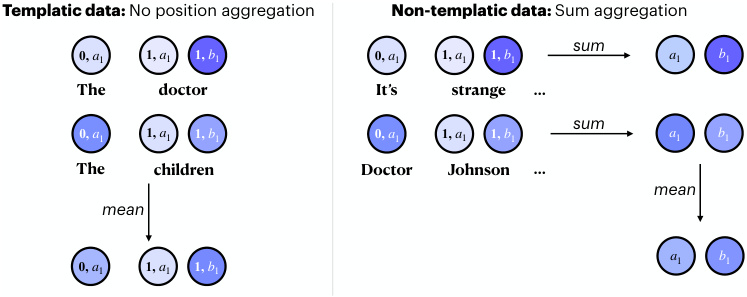

<!-- Start of picture text -->
Templatic data:  No position aggregation Non-templatic data:  Sum aggregation sum 0,  a 1 1,  a 1 1,  b 1 0,  a 1 1,  a 1 1,  b 1 a 1 b 1 The doctor It’s strange … sum 0,  a 1 1,  a 1 1,  b 1 0,  a 1 1,  a 1 1,  b 1 a 1 b 1 The children Doctor Johnson … mean mean a 1 b 1 0,  a 1 1,  a 1 1,  b 1 <!-- End of picture text -->

Figure 6: Aggregation of node/edge effects across examples (and sometimes, across token positions). Each feature is labeled as “token position, feature index.” If we have templatic data, we preserve token position information, and treat the same features in different token positions as different features. If we have more general non-templatic data, we first sum across positions, and then take the example-wise mean of the position-aggregated effects. 

Intuitively, this captures the indirect effect of **u** on _m_ via the _direct_ effect on **d** , but excluding effects on **d** mediated by some other intermediate node **m** . 

As with nodes, we employ a linear approximation: 

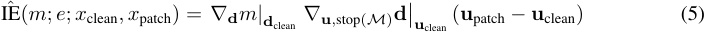

where _∇_ **u** _,_ stop( _M_ ) **d** denotes the gradient of **d** with respect to **u** when treating all **m** _∈M_ as constant. In practice, this is computed by applying stop-gradients to all intermediate nodes **m** during pytorch’s backwards pass. 

If **d** is an SAE error, then the naive approach to computing is expression involves performing _d_ model backwards passes; fortunately we can still compute the product in a single backwards pass as explained in §A.3. 

### A.2 AGGREGATING ACROSS TOKEN POSITIONS AND EXAMPLES 

Figure 6 summarizes how we aggregate effects across examples (and optionally across token positions). For templatic data where tokens in matching positions play consistent roles (see §3.2, 3.3), we take the mean effect of nodes/edges across examples. In this case, we treat the same feature (or neuron) in different token positions as different nodes altogether in the circuit, each with their own separate effects on target metric _m_ . 

For non-templatic data (§4, 5), we first sum the effects of corresponding nodes/edges across token positions before taking the example-wise mean. This means that each feature appears in the circuit once, representing its effects at all token positions in an input. 

### A.3 PRACTICAL CONSIDERATIONS 

Here we review a number of tricks that we use to compute the quantities defined above efficiently. The backbone of our approach is to, given an activation **x** _∈_ R_d_model of some submodule for which we have an SAE, use the SAE to compute the quantities _fi_ ( **x** ) and **_ϵ_** ( **x** ) in (1), and then intervene in our model’s forward pass to set 

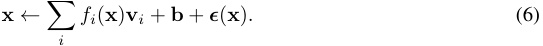

Even though **x** was already numerically equal to the right-hand side of (6), after the intervention the computation graph will incorporate the variables _fi_ ( **x** ) and **_ϵ_** ( **x** ). Thus, when we use Pytorch’s autograd algorithm to peform backpropogation of downstream quantities, we will automatically compute gradients for these variables. 

An alternative approach for computing gradients (which we do not use) is to simply run the model without interventions, use backpropogation to compute all gradients _∇_ **x** _m_ , and use the formulas 

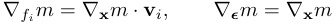

which follow from the chain rule when _m_ is any function of **x** . 

**Stop gradients on SAE errors to compute SAE feature gradients.** The natural way to compute the SAE error **_ϵ_** ( **x** ) is by first using the SAE to compute ˆ **x** and then setting **_ϵ_** ( **x** ) = **x** _−_ **x** ˆ. However, if we take this approach, then after applying the intervention (6) we would have 

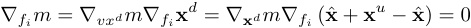

where **x**_d_ is the copy of **x** downstream of _fi_ in the computation graph, and **x**_u_ is the copy upstream of _fi_ . To fix this, we apply a stop gradient to **_ϵ_** ( **x** ) so that **x**_d_ = **x** ˆ + stopgrad( **x**_u_ _−_ **x** ˆ). 

**Pass-through gradients.** Although the stop gradient from above solves the problem of vanishing gradients for the _fi_ , it interferes with the backpropogation of gradients to further upstream nodes. In order to restore exact gradient computation, we implement a pass-through gradient on the computation of our dictionary. That is, in the notation above, we intervene in the _backwards_ pass of our model to set 

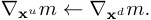

**Jacobian-vector products.** Done naively, computing the quantity in (5) when **d** is an SAE errors would take _O_ ( _d_ model) backwards passes. Fortunately, one can use the following trick: when _A_ is a constant 1 _× n_ matrix, **x** _∈_ R_m_ , and **y** = **y** ( **x** ) _∈_ R_n_ is a function of **x** , we have 

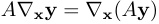

where the right-hand side is a 1 _× m_ Jacobian which can be computed with a single backward pass. Thus we can compute (5) with only two backwards passes by first computing _∇_ **d** _m|_ **d** clean and then computing _∇_ **u** � _∇_ **d** _m|_ **d** clean � with another backwards pass, where the second _∇_ **d** _m|_ **d** clean is treated as a constant (e.g., by detaching it in Pytorch). 

B DETAILS ON SPARSE AUTOENCODERS 

B.1 PYTHIA-70M SPARSE AUTOENCODERS 

B.1.1 ARCHITECTURE 

Following Bricken et al. (2023), our SAEs for Pythia-70M are one-layer MLPs with a tied preencoder bias. In more detail, our SAEs have parameters 

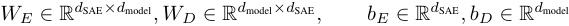

where the columns of _WD_ are constrained to be unit vectors. Given an input activation **x** _∈_ R_d_model , we compute the sparse features activations via 

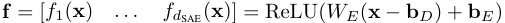

with the ReLU nonlinearity applied coordinatewise and reconstructions via 

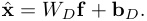

The feature vectors **v** _i ∈_ R_d_model are the columns of _WD_ . 

### B.1.2 TRAINING 

Fix a specific choice of activation in Pythia-70M, e.g. MLP output, attention output, or residual stream in a particular layer. Following Cunningham et al. (2024); Bricken et al. (2023) we train an SAE for this activation by sampling random text from The Pile (Gao et al., 2020) (specifically the 

first 128 tokens of random documents), extracting the values **x** for this activation over every token, and then training our SAE to minimize a loss function 

_L_ = _L_ reconstruction + _λL_ sparsity = _∥_ **x** ˆ _−_ **x** _∥_ 2 + _λ∥_ **f** _∥_ 1 

consisting of a L2 reconstruction loss and a L1 regularization term to promote sparsity. This loss is optimized using a variant of Adam (Kingma & Ba, 2014) adapted to ensure that the columns of _WD_ are unit vectors (see Bricken et al. (2023) or our code for details). We use _λ_ = 0 _._ 1 and a learning rate of 10_−_4 . 

Following Nanda (2023), we cache activations from 10000 contexts in a buffer and randomly sample batches of size 214 for training our SAE. When the buffer is half-depleted, we replenish it with fresh tokens from The Pile. We train for 120000 steps, resulting in a total of about 2 billion training tokens. 

A major obstacle in training SAEs is _dead features_ , that is, neurons in the middle layer of the SAE which never or rarely activate. We mitigate this by, every 25000 training steps, reinitializing features which have not activated in the previous 12500 steps using the same reinitialization procedure described in Bricken et al. (2023). 

Finally, we use a linear learning rate warmup of 1000 steps at the start of training and after every time that neurons are resampled. 

### B.1.3 EVALUATION 

Here we report on various easy-to-quantify metrics of SAE quality. Note that these metrics leave out important qualitative properties of these SAEs, such as the interpretability of their features (App. F). Our metrics are: 

- **Variance explained** , as measured by 1 _−_Var Var(<u>(</u>**x** (_−_ **x** )**x**ˆ) 

Var( **x** ). 

- Average **L1** , and **L0** norms of **f** . 

- **Percentage of features alive** as measured by features which activate at least once on a batch of 512 tokens. 

- **Cross entropy** (CE) **difference** and **percentage of CE recovered** . The CE difference is the difference between the model’s original CE loss and the model’s CE loss when intervening to set **x** to the reconstruction **x** ˆ. We obtain percentage of CE recovered by dividing this difference by the difference between the original CE loss and the CE loss when zeroablating **x** . These CE losses are computed averaged over a batch of 128 contexts of length 128. 

These metrics are shown in Tables 3–6. Note that we index residual stream activations to be the layer which _outputs_ the activation (so the layer 0 residual stream is _not_ the embeddings, and the layer 5 residual stream is the output of the final layer, immediately preceding the final decoder). 

|**% Variance Explained**|**L1**|**L0**|**% Alive**|**CE Diff**|**% CE Recovered**|
|---|---|---|---|---|---|
|96|1|3|36|0.17|98|

Table 3: Embedding SAE evaluation. 

### B.2 GEMMA-2-2B SPARSE AUTOENCODERS 

For Gemma-2-2B, we use the Gemma Scope SAEs released by Lieberum et al. (2024), which are based on the Jump-ReLU architecture proposed by Rajamanoharan et al. (2024b). We use the SAEs of width 16384. There exist SAEs for the attention, MLP, and residual vectors for each of the 26 layers in the model. However, the attention and MLP SAEs are trained at different positions than in Pythia: attention SAEs are trained on the _input_ to the out projection, and MLP SAEs are trained on the output of the LayerNorm following the MLP. The embedding SAEs are experimental and have a dictionary size of only 4000, so we do not use them in our experiments. 

|**Layer**|**% Variance Explained**|**L1**|**L0**|**% Alive**|**CE Diff**|**% CE Recovered**|
|---|---|---|---|---|---|---|
|Attn 0|92%|8|128|17%|0.02|99%|
|Attn 1|87%|9|127|17%|0.03|94%|
|Attn 2|90%|19|215|12%|0.05|93%|
|Attn 3|89%|12|169|13%|0.03|93%|
|Attn 4|83%|8|132|14%|0.01|95%|
|Attn 5|89%|11|144|20%|0.02|93%|

Table 4: Attention SAE evaluation by layer. 

|**Layer**|**% Variance Explained**|**L1**|**L0**|**% Alive**|**CE Diff**|**% CE Recovered**|
|---|---|---|---|---|---|---|
|MLP 0|97%|5|5|40%|0.10|99%|
|MLP 1|85%|8|69|44%|0.06|95%|
|MLP 2|99%|12|88|31%|0.11|88%|
|MLP 3|88%|20|160|25%|0.12|94%|
|MLP 4|92%|20|100|29%|0.14|90%|
|MLP 5|96%|31|102|35%|0.15|97%|

Table 5: MLP SAE evaluation by layer. 

There exist multiple SAEs for every submodule. The primary difference between them is their average L0 norm.3 Neuronpedia (Lin & Bloom, 2023) uses the SAEs with the L0 norm closest to 100; we do the same. 

One of the primary technical challenges in using the Gemma Scope SAEs is the existence of BOS features. These are features that are active primarily or only on BOS tokens, and whose top logits are generally not informative. These features are difficult to interpret, but can have high indirect effects on the model’s logits. As we cannot interpret them, we exclude them from annotation and from the SHIFT analysis (i.e., we do not ablate them). We also exclude them when running the feature skyline in §4. 

## C FEATURE CIRCUITS 

### C.1 SUBJECT-VERB AGREEMENT 

Here, we present the full agreement circuits for various syntactic agreement structures, with researcher-provided annotations for features. We chose thresholds manually in order to keep the number of nodes to annotate manageable while still displaying the full range of feature types for a given task. 

In each circuit, sparse features are shown in rectangles, whereas causally relevant error terms not yet captured by our SAEs are shown in triangles. Nodes shaded in darker colors have stronger effects on the target metric _m_ . Blue nodes and edges are those which have positive indirect effects (i.e., are useful for performing the task correctly), whereas red nodes and edges are those which have counterproductive effects on _m_ (i.e., cause the model to consistently predict incorrect answers). 

First, we present agreement across a relative clause. Pythia (Figure 7) and Gemma (Figure 8) both appear to detect the subject’s grammatical number at the subject position. One position later, features detect the presence of relative pronouns (the start of the distractor clause). Finally, at the last token of the relative clause, the attention moves the subject information to the last position, where it assists in predicting the correct verb inflection. Gemma 2 additionally leverages noun phrase (NP) number tracking features, which are active at all positions for NPs of a given number (except on distractor phrases of opposite number). We present an example of an NP number tracker feature in Figure 15. 

The circuits for agreement across a prepositional phrase (Figures 9 and 10) look remarkably similar to agreement across a relative clause; for both Pythia and Gemma, these two circuits share over 85% 

> 3In other words, the average number of features active for a given token. 

|**Layer** **% Variance Explained**|**L1**|**L0**|**% Alive**|**CE Diff**|**% CE Recovered**|
|---|---|---|---|---|---|
|Resid 0 92%|11|59|41%|0.24|97%|
|Resid 1 85%|13|54|38%|0.45|95%|
|Resid 2 96%|24|108|27%|0.55|94%|
|Resid 3 96%|23|68|22%|0.58|95%|
|Resid 4 88%|23|61|27%|0.48|95%|
|Resid 5 90%|35|72|45%|0.55|92%|

Table 6: Residual (Resid) SAE evaluation by layer. 

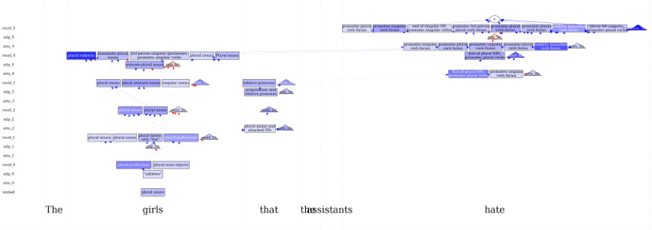

Figure 7: The feature circuit for agreement across a relative clause in Pythia-70M, computed using _TN_ = 0 _._ 1 and _TE_ = 0 _._ 01. The model detects the subject’s number at the subject position. Other features detect relative pronouns (the start of the distractor clause). Finally, at the last token of the RC, the attention moves the subject information to the last position, where it assists in predicting the correct verb inflection. 

of their features, and many of the same features are used for detecting both prepositions and relative clauses. 

For simple agreement (Figures 11 and 12), many of the same features that were implicated in noun number detection and verb number prediction in the previous circuits also appear here. The models detect the subject’s number at the subject position in early layers. In later layers, these noun number detectors become inputs to verb number promoters, which activate on anything predictive of particular verb inflections. 

The circuits for agreement within a relative clause (Figures 13 and 14) appear to have the same structure as that for simple agreement: subject number detectors in early layers, followed by verb number promoters in later layers. 

### C.2 BIAS IN BIOS CIRCUIT 

Here, we present the full annotated circuit discovered for the Bias in Bios classifier trained on Pythia70M (described in §4 and App. E). The circuit was discovered using _TN_ = 0 _._ 1 and _TE_ = 0 _._ 01. We observe that the circuit (Figure 16) contains many nodes which simply detect the presence of gendered pronouns or gendered names. A few features attend to profession information, including one which activates on words related to nursing, and another which activates on passages relating to science and academia. 

### C.3 CLUSTER CIRCUITS 

Here, we present full annotated circuits discovered for automatically discovered behaviors (described in App. G). First, we present the circuit for incrementing number sequences (Figure 17), discovered with _TN_ = 0 _._ 4 and _TE_ = 0 _._ 04. We note that this circuit includes many features which perform either succession (Gould et al., 2023) or induction (Olsson et al., 2022). The succession 

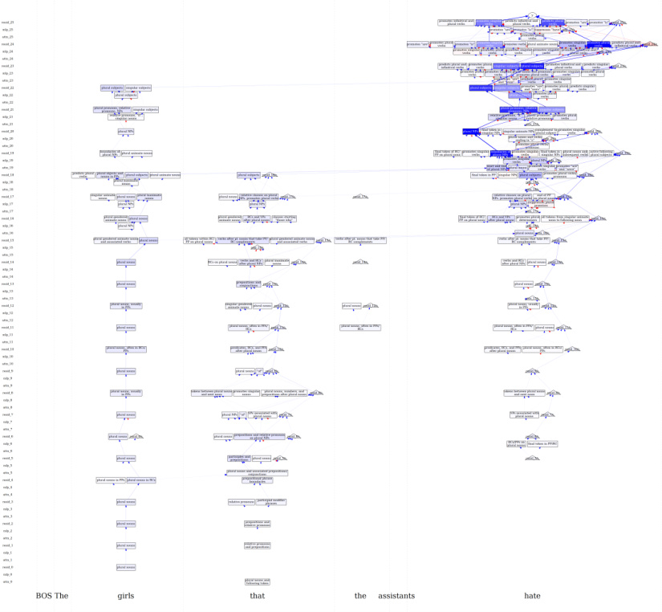

Figure 8: The feature circuit for agreement across a relative clause in Gemma-2-2B, computed using _TN_ = 0 _._ 073 and _TE_ = 0 _._ 007. 

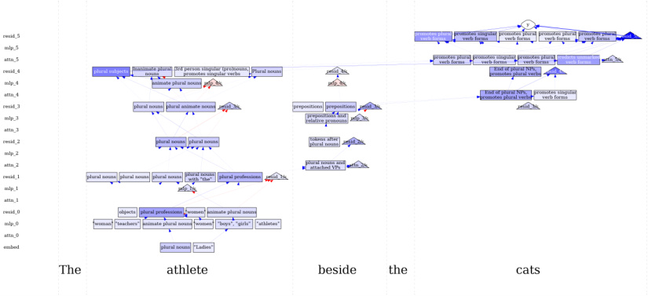

Figure 9: The feature circuit for agreement across a prepositional phrase in Pythia-70M, computed using _TN_ = 0 _._ 1 and _TE_ = 0 _._ 01. The model detects the subject’s number at the subject position. Other features detect prepositional phrases (the start of the distractor clause). Finally, at the last token of the RC, the attention moves the subject information to the last position, where it assists in predicting the correct verb inflection. 

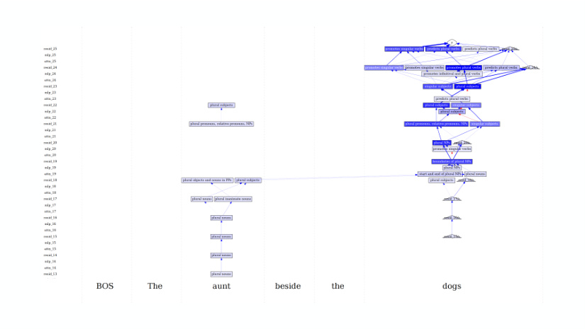

Figure 10: The feature circuit for agreement across a prepositional phrase in Gemma-2-2B, computed using _TN_ = 0 _._ 5 and _TE_ = 0 _._ 05. Note that we show the circuit beginning in layer 13, as our circuit discovery implicated only one node in earlier layers. 

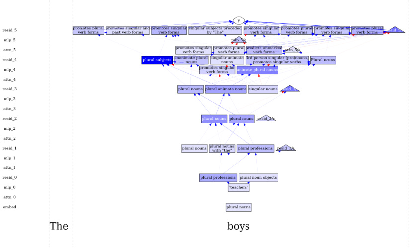

Figure 11: The feature circuit for simple agreement in Pythia-70M, computed using _TN_ = 0 _._ 2 and _TE_ = 0 _._ 02. The model detects the subject’s number at the subject position in early layers. In later layers, these are inputs to features which activate on anything predictive of particular verb inflections. 

features in the layer 3 attention seem to be general; they increment many different numbers and letters (as in Figure 5). The induction features are sensitive only to specific tokens: for example, contexts of the form “ _x_ 3... _x_ 3”, where “3” is a literal. These compose to form **specific successor** features in layer 5: the most strongly-activating layer 5 residual feature specifically increments “3” to “4” given induction-like lists, where each list item is preceded by the same string (e.g., “Chapter 1. . . Chapter 2...Chapter 3...Chapter”). 

The circuit for predicting infinitival objects (Figure 18, discovered with _TN_ = 0 _._ 25 and _TE_ = 0 _._ 001) contains two distinct mechanisms. First, the model detects the presence of specific verbs like “remember” or “require” which often take infinitival objects. Then, the model uses two separate mechanisms to predict infinitive objects. The first mechanism detects present-tense verbs, participles, or predicate adjectives which can be immediately followed by infinitival direct objects (e.g., “They were excited to...”). The second mechanism detects nominal direct objects that can directly precede infinitival object complements (e.g., “They asked us to...”). Finally, these two mechanisms both influence the output in layer 5 without fully intersecting. 

## D SAMPLE FEATURES 

### D.1 SPARSE FEATURES 

Here, we present examples of sparse features with high indirect effects on the Bias in Bios task. Some of these features clearly activate on terms related to medicine or academia, which are related to the target profession classification task. Others simply detect the presence of “he” or female names. 

### D.2 NEURONS 

For contrast, we also present examples of _dense_ features—that is, neurons from MLPs, layer-end residuals, and the out-projection of the attention—with high indirect effects on the Bias in Bios task. We cannot directly interpret the activation patterns of these neurons, and so it is difficult to 

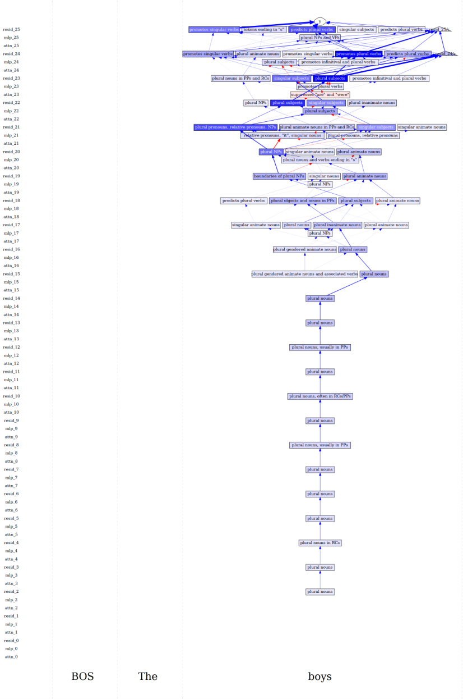

Figure 12: The feature circuit for simple agreement in Gemma-2-2B, computed using _TN_ = 0 _._ 5 and _TE_ = 0 _._ 05. 

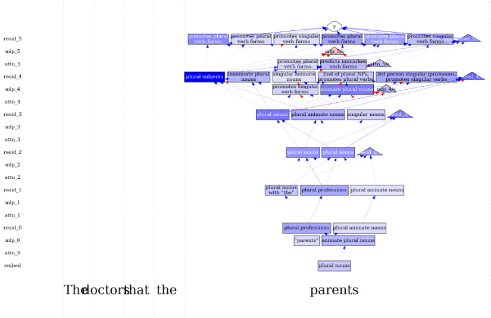

Figure 13: The feature circuit for agreement within a relative clause in Pythia-70M, computed with _TN_ = 0 _._ 2 and _TE_ = 0 _._ 02. The model detects the subject’s number at the subject (within the RC)’s position in early layers. In later layers, these features are inputs to features which activate on anything predictive of particular verb inflections. 

run the SHIFT with neurons baseline. We therefore instead compare to the neuron skyline, where we allow the skyline an unfair advantage by simply ablating neurons which have positive effects on gender-based probabilities given the balanced set. 

## E IMPLEMENTATION DETAILS FOR CLASSIFIER EXPERIMENTS 

### E.1 CLASSIFIER TRAINING 

Here we describe how we train linear classification heads on Pythia-70M and Gemma-2-2B the Bias in Bios (BiB) task of §4. 

Given a model _M_ and choice _ℓ_ of layer, we mean-pool over (non-padding) tokens all layer _ℓ_ residual stream activations from _M_ ; we then train a linear classification head via logistic regression, using the AdamW optimizer (Loshchilov & Hutter, 2017) and learning rate 0 _._ 01 for one epoch on this dataset of activations. The activations and labels for this logistic regression are collected from the **ambiguous set** for the baseline classifier and from the **balanced set** for the oracle classifier. 

To mimick a realistic application setting, we tune the choice _ℓ_ of layer for the baseline probe’s accuracy on (a test split of) the **ambiguous set** . For Pythia, this recommends using the penultimate layer _ℓ_ = 4. For Gemma, there is a wide range of equally performant layers. Thus—for this one choice only—we make use of the **balanced** set to compute how the baseline probe generalizes; we select the layer _ℓ_ = 22 for which the baseline probe generalizes _worst_ . We make this choice to set up a testbed where there is the most space for improvement. We emphasize that we never tune hyperparameters for the performance **balanced set** of SHIFT, as using the **balanced set** is forbidden by the problem statement. 

When retraining after performing SHIFT, we retrain _only_ the linear classification head, not the full model. 

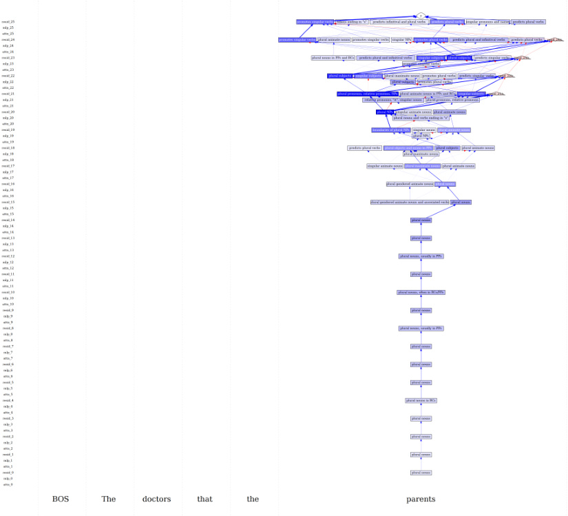

Figure 14: The feature circuit for agreement within a relative clause for Gemma-2-2B, computed with _TN_ = 0 _._ 5 and _TE_ = 0 _._ 05. 

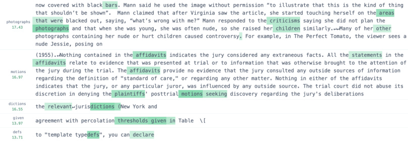

Figure 15: An example sparse feature for agreement across a relative clause in Gemma 2 (resid ~~1~~ 2/13561). This feature activates on tokens in noun phrases where the noun head is plural, but not on singular distractor phrases within the plural NP. This feature carries the number of the subject across positions, so we term it an “NP number tracker”. 

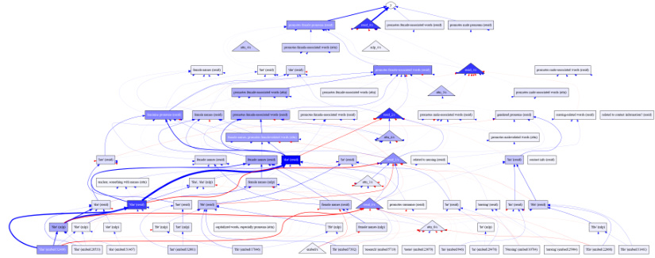

Figure 16: The full annotated feature circuit for the Bias in Bios classifier. Many nodes simply detect the presence of gendered pronouns or gendered names. A few features attend to profession information, including one which activates on words related to nursing, and another which activates on passages relating to science and academia. 

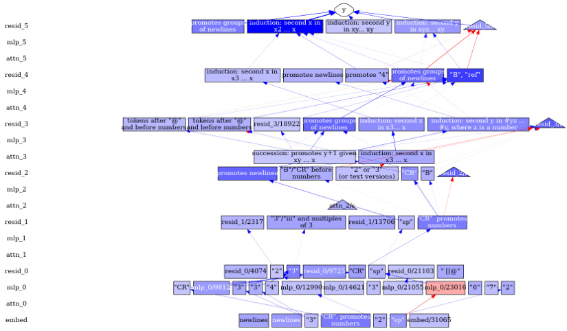

Figure 17: The full annotated feature circuit for incrementing number sequences. The model first detects the presence of specific number tokens, like “3”. Later, it learns more robust semantic representations of those numbers, like “iii” and “Three”. Then, the model uses a series of narrow and general succesion and induction features to increment the next number. 

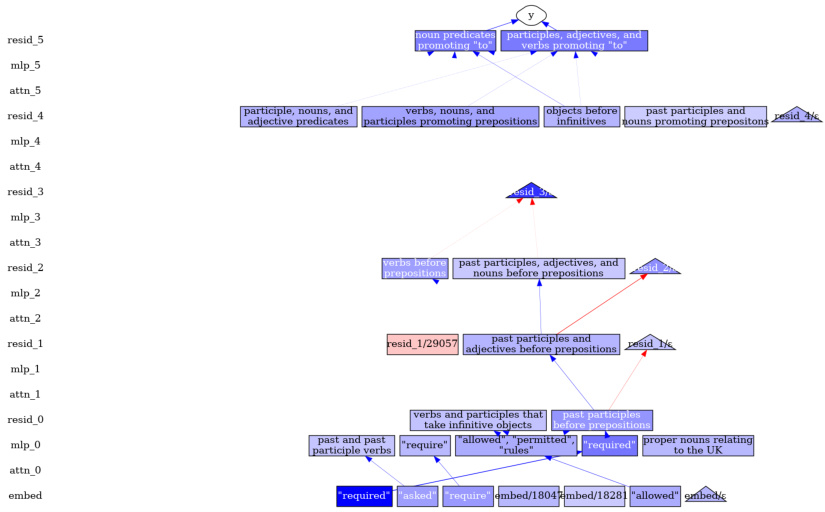

Figure 18: The full annotated feature circuit for predicting “to” as an infinitival object. The model first detects the presence of verbs that often take infinitival objects. Then, it uses one mechanism to detect present-tense verbs, participles, or predicate adjectives which take infinitival objects, and another mechanism to detect direct objects that can directly precede infinitival object complements. Finally, these two mechanisms both influence the output in layer 5 without fully intersecting. 

Figure 19: An example sparse feature from the Bias in Bios task (attn ~~3~~ /22029). This feature detects female-related words in biographies of women. It also promotes words like “husband” and “n´ee”. This feature probably contributes to preferences for the spurious correlate of gender; we therefore ablate it. 

Figure 20: An example sparse feature from the Bias in Bios task (resid ~~2~~ /31098). This feature activates on words related to nursing, including “RN” and “nurse”. This probably relates to the target task of profession prediction. We therefore keep it. 

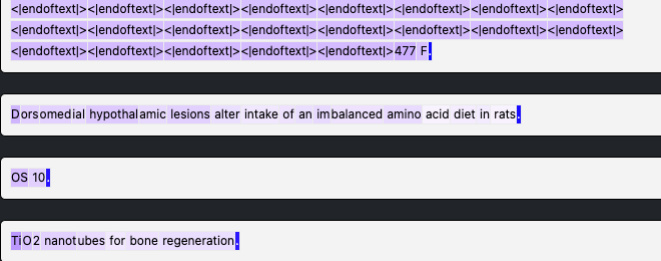

Figure 21: An example neuron from the Bias in Bios task. This appears to activate on beginnings and ends of sentences, but also more strongly on any token in a sentence that contains capital letters or numbers. We cannot deduce whether this would contribute more to gender or profession names. 

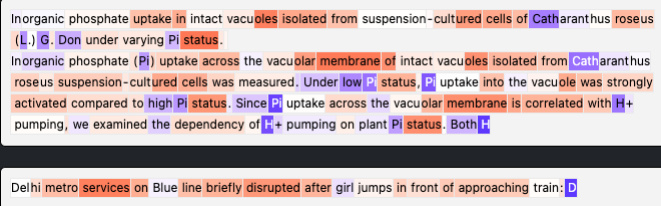

Figure 22: An example neuron from the Bias in Bios task. This activates positively on tokens starting with capital letters, but negatively on many other tokens (whose unifying theme we cannot deduce). 

### E.2 IMPLEMENTATION FOR CONCEPT BOTTLENECK PROBING 

Our implementation for Concept Bottleneck Proving (CBP) is adapted from (Yan et al., 2023). It works as follows: 

1. First, we collect a number of keywords related to the intended prediction task. We use _N_ = 20 keywords: nurse, healthcare, hospital, patient, medical, clinic, triage, medication, emergency, surgery, professor, academia, research, university, tenure, faculty, dissertation, sabbatical, publication, and grant. 

2. We obtain _concept vectors_ **c** 1 _, . . . ,_ **c** _N_ for each keyword by extracting Pythia-70M’s penultimate layer representation over the final token of each keyword, and then subtracting off the mean concept vector. (Without this normalization, we found that concept vectors have very high pairwise cosine similarities.) 

3. Given an input with representation **x** (obtained via the mean-pooling procedure in App. E.1), we obtain a concept bottleneck representation **z** _∈_ R_N_ by taking the cosine similarity with each **c** _i_ . 

4. Finally, we train a linear probe with logistic regression on the concept bottleneck representations **z** , as in App. E.1. 

We decided to normalize concept vectors but not input representations because it resulted in stronger performance. We also experimented with computing cosine similarities before mean pooling. 

## F HUMAN INTERPRETABILITY RATINGS FOR SPARSE FEATURES 

Given our trained Pythia-70M sparse autoencoders, we asked human crowdworkers to rate the interpretability of random features, random neurons, features from our feature circuits, and neurons from our neuron circuits on a 0–100 scale (Table 7). Crowdworkers rate sparse features as significantly more interpretable than neurons, with features that participate in our circuits also being more interpretable than randomly sampled features. 

|**Activation type**|Interpretability|
|---|---|
|Dense (random)|32.6|
|Dense (agreement)|30.2|
|Dense (BiB)|36.0|
|Sparse (random)|52.8|
|Sparse (agreement)|62.3|
|Sparse (BiB)|81.5|

Table 7: Human interpretability ratings for dense (neuron) vs. sparse (autoencoder) features. We present mean interpretability scores across features on a 0–100 scale. We show scores for features that were either uniformly sampled (random), the top 30 by IEˆ from the subject-verb agreement across RC task (agreement; §3.3), or the top 30 by IE for the Bias in Bios task (BiB; §4).ˆ 

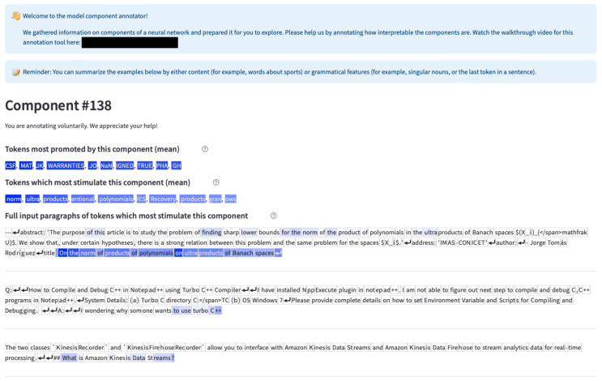

Figure 23: The human annotation interface used to obtain the interpretability ratings in Table 7. Here, we show the instructions, top-activating tokens, the token probabilities that were most affected when ablating the feature, and example contexts with feature activation values. 

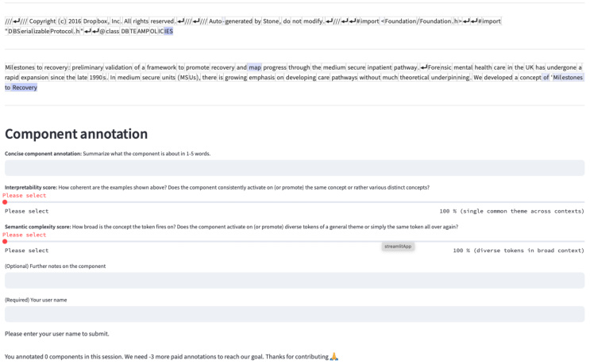

Figure 24: The human annotation interface used to obtain the interpretability ratings in Table 7. Here, we show the rating interface on the same page as the content in Fig. 23, below the example contexts. Humans were asked to write a textual description of each feature, assign a 0–100 interpretability rating, and assign a 0–100 semantic complexity rating to each feature. 

See Figures 23 and 24 for examples of the human annotator interface. Humans were presented with the tokens on which the feature activated most strongly, followed by the tokens whose probabilities were most affected in Pythia-70M when the feature was ablated. This is followed by a series of example contexts in which the feature activated on some subset of tokens, where feature activations are shown in varying shades of blue (darker shades indicate higher activations). On the same page below the contexts, we ask annotators to write a textual description of the feature, and rate both its interpretability and its semantic complexity on 0–100 scales. 

Crowdworkers were recruited from the ARENA Slack channel, whose members are machine learning researchers interested in AI alignment and safety. The selection of annotators certainly influenced our results; a truly random sample of human annotators would likely display higher variance when annotating features. 

One common error pattern we notice is that annotators often label features according to semantic groupings (e.g., “text about politics,” and do not pay attention to syntactic context (e.g., “plural nouns”). Future work could address this design bias by testing variants of the instructions. 

Results of human evaluations for the Gemma Scope SAEs are described in Lieberum et al. (2024). 

## G DISCOVERING LM BEHAVIORS WITH CLUSTERING 

In this section, we describe our unsupervised method for discovering language model behaviors. More specifically, following Michaud et al. (2023), we cluster contexts from The Pile according to the Pythia-70M’s internal state during inference. In this section, we describe our clustering pipeline and methods. 

### G.1 FILTERING TOKENS 

We must first locate (context, answer) pairs for which an LM correctly predicts the answer token from the context. We select The Pile (Gao et al. (2020)) as a general text corpus and filter to pairs on which Pythia-70M confidently and correctly predicts the answer token, with cross-entropy lower than 0.1 or 0.3 nats, depending on the experiment. The model consistently achieves low loss on tokens which involve “induction” (Olsson et al., 2022)—i.e., tokens which are part of a subsequence 

which occurred earlier in the context. We exclude induction samples by filtering out samples in which the bigram (final context token, answer token) occured earlier in the context. 

### G.2 CACHING MODEL-INTERNAL INFORMATION 

We find behaviors by clustering samples according to information about the LM’s internals when run on that sample. We find clusters of samples where the model employs similar mechanisms for next-token prediction. We experiment with various inputs to the clustering algorithm: 

- **Dense Activations** : We take activations (residual stream vectors, attention block outputs, or MLP post-activations) from a given context and concatenate them. To obtain a vector whose length is independent of the context length, we can either use the activations at the last _N_ context positions before the answer token, or aggregate (sum) across the sequence dimension. We experiment with both variants. 

- **Sparse Activations** : Rather than dense model activations, we can use the activations of SAE features. We concatenate and aggregate these in the same manner as for dense activations. 

- **Dense Component Indirect Effects** : We approximate the indirect effect of all features on the correct prediction using 2 without a contrastive pair—namely, by setting **a** patch = 0. The negative log-probability of the answer token _m_ = _−_ log _p_ ( _answer_ ) serves as our metric for the correct prediction of the next token. The computatiom of linear effects requires saving both (1) activations and (2) gradients w.r.t _m_ at the final _N_ positions for each context in the dataset. We optionally aggregate by summing over all positions. 

- **Sparse Indirect Effects** : Similarly, we can compute the linear effects of _sparse_ activations on the correct prediction. 

- **Gradient w.r.t. model parameters** : As in Michaud et al. (2023), we also experiment with using gradients of the loss w.r.t. model parameters, but with some modifications. We describe this method in more detail in §G.3 below. 

### G.3 HYPERPARAMETERS AND IMPLEMENTATION DETAILS 

We apply either spectral clustering or _k_ -means clustering. For spectral clustering, given either activations or effects _xi_ for sample _i_ , we compute a matrix of pairwise cosine similarities _Cij_ = _xi · xj/_ ( _||xi||||xj||_ ) between all pairs of samples. Before performing spectral clustering, we normalize all elements of _C_ to be in [0 _,_ 1] by converting the cosine similarities to angular similarities: _C_ˆ _ij_ = 1 _−_ arccos( _Cij_ ) _/π_ . 

We use the scikit-learn (Pedregosa et al., 2011) spectral clustering implementation with _k_ -means. For all inputs except gradients w.r.t. model parameters, we used spectral clustering across 8192 samples. We chose _k_ (the number of total clusters) to maximize the number of clusters implicated in more than one input context. 

We also experimented with using gradients w.r.t. model parameters as inputs, as in Michaud et al. (2023). Here, we scale up our approach to 100,000 samples. It is intractible to perform spectral clustering given 100,000 samples, so we instead use _k_ -means clustering. Rather than clustering the gradients themselves (which are high-dimensional), we cluster sparse random projections of the gradients down to 30,000 dimensions. When projecting, we use a matrix with entries _{−_ 1 _,_ 0 _,_ 1 _}_ . When sampling the entries of this matrix, sample a nonzero value with probability 32 _/_ 30000, and if nonzero, sample _−_ 1 or 1 with equal probability. For a sparse projection matrix with dimensions R_n×_30000 , there will on average be 32 _· n_ nonzero entries, where _n_ is the number of parameters in the model.4 

## H QUALITY OF LINEAR APPROXIMATIONS OF INDIRECT EFFECTS 

Figure 25 shows the quality of our linear approximations for indirect effects. Prior work (Nanda, 2022; Kram´ar et al., 2024) investigated attribution patching accuracy for IEs of coarse-grained model 

> 4We only consider gradients w.r.t. non-embedding and non-layernorm parameters. 

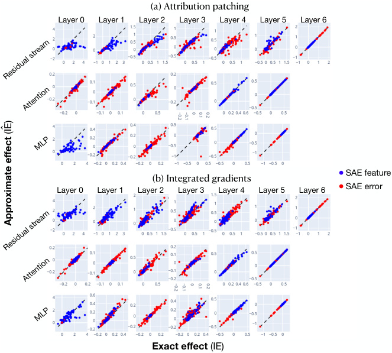

<!-- Start of picture text -->
(a) Attribution patching Layer 0 Layer 1 Layer 2 Layer 3 Layer 4 Layer 5 Layer 6 SAE feature (b) Integrated gradients SAE error Layer 0 Layer 1 Layer 2 Layer 3 Layer 4 Layer 5 Layer 6 Exact effect  (IE) Residual stream Attention MLP Residual stream Attention MLP )IE Approximate effect  ( <!-- End of picture text -->

Figure 25: Approximate IEs ( _y_ -axis) and exact IEs ( _x_ -axis) using attribution patching (a; top) or integrated gradients (b; bottom). Each point corresponds to an SAE feature or SAE error at one token position of one input. Data were collected from 30 inputs from our across RC dataset. 

components (queries, keys, and values for attention heads, residual stream vectors, and MLP outputs) and MLP neurons. Working with SAE features and errors, our results echo previous findings: attribution patching is generally quite good, but sometimes underestimates the true IEs. Notable exceptions are the layer 0 MLP and the residual stream in early layers. We also find that our integrated gradients-based approximation significantly improves approximation quality.

---

[← 49 A is for Absorption](49_feature_absorption.md) · [Contents](README.md) · [51 Transcoders Find Interpretable Feature Circuits →](51_transcoders.md)
