<!-- Generated by scripts/build_anthology.py export from the source PDF; edit the catalog, not this file. -->
# 52 · Sparse Crosscoders for Cross-Layer Features and Model Diffing

**Lindsey et al. — 2024** · Jack Lindsey, Adly Templeton, Jonathan Marcus, Thomas Conerly, Joshua Batson, Christopher Olah

| | |
|---|---|
| Priority | ○ P1 — Important |
| Section | E — Dictionary learning at full strength |
| Source | [https://transformer-circuits.pub/2024/crosscoders/index.html](https://transformer-circuits.pub/2024/crosscoders/index.html) (Transformer Circuits Thread) |
| Licence | No explicit licence published on transformer-circuits.pub |
| Print anthology | pages 1743–1776 (cover 1743, text 1744–1776) |

**Why read this.** Generalises SAEs and transcoders to dictionaries that read and write several layers — or several models — at once, giving cross-layer features and a way to diff a base model against its finetuned version.

**Reading focus.** Cross-layer superposition and persistent features, the L1-of-norms loss, crosscoder vs. per-layer SAE efficiency, feature drift across layers, the Claude 3 Sonnet base/finetune diff, and the closing discussion of literal versus isomorphic models.

**In context.** The bridge from [51](51_transcoders.md) to the cross-layer transcoders of [53](53_circuit_tracing.md), and the start of crosscoder model diffing. A preliminary update by its own account, it finds most model-specific features uninterpretable; [55](55_gdm_sae_negative_results.md) names crosscoders among tools unlikely to transform the field. Its worry about leaving the literal model is pressed by [63](63_circuits_sparse_neuron_basis.md) and [66](66_stochastic_parameter_decomposition.md).

[← 51 Transcoders Find Interpretable Feature Circuits](51_transcoders.md) · [Contents](README.md) · [53 Circuit Tracing →](53_circuit_tracing.md)

---

*Text extracted automatically from the source PDF. Display equations, figures and some tables appear as images; inline mathematics may be garbled — the PDF is authoritative.*

# Sparse Crosscoders for CrossLayer Features and Model Diffing 

AUTHORS 

*, *, *, *, 

Jack Lindsey*, Adly Templeton*, Jonathan Marcus*, Thomas Conerly*, Joshua Batson, Christopher Olah 

AFFILIATIONS 

Anthropic 

* Core Contributor 

PUBLISHED 

Oct 25, 2024 

Research Update: This preliminary note is a research update, similar to our monthly updates (albeit larger). We'd ask you to treat it in the spirit of results being presented at a lab meeting or internal seminar: preliminary work that we're excited about, but not at the level of quality or rigor we hold our full papers to. 

This note introduces sparse crosscoders, a variant of sparse autoencoders (e.g. [1, 2, 3, 4] ) or transcoders [5, 6, 7] for understanding models in superposition [8, 9, 10, 11] . Where autoencoders encode and predict activations at a single layer, and transcoders use activations from one layer to predict the next, a crosscoder reads and writes to multiple layers. Crosscoders produce shared features across layers and even models. They have several applications: 

- Cross-Layer Features – Crosscoders allow us to think of features as being spread across layers, resolving cross-layer superposition and tracking persistent features through the residual stream. 

- Circuit Simplification – By tracking features that continue to exist in the residual stream, crosscoders can remove "duplicate features" from analysis and allow features to "jump" across many uninteresting identity circuit connections, and generally simplify circuits. 

- Model Diffing – Crosscoders can produce shared sets of features across models. This includes one model across training or finetuning, and also completely independent models with different architectures. 

This note will cover some theoretical examples motivating crosscoders, and then present preliminary experiments applying them to cross-layer superposition and model diffing. We also briefly discuss the theory of how crosscoders might simplify circuit analysis, but leave results on this for a future update. 

### (1) Motivating Examples 

## (1.1) Cross-Layer Superposition 

According to the superposition hypothesis, neural networks represent more features than they have neurons by allowing features to be non-orthogonal [8, 9, 11] . One consequence of this is that most features are represented by linear combinations of multiple neurons: 

At first blush, the idea that this kind of superposition might be spread across layers might seem strange. But if we think about it carefully, it's actually relatively natural in the context of a transformer with a reasonable number of layers. 

One interesting property of transformers is that, because the residual stream is linear, we can draw them as different, equivalent graphs. The following graph highlights the idea that two layers can be thought of as "almost parallel branches", except that they have an extra edge that allows the earlier layer to influence the later. 

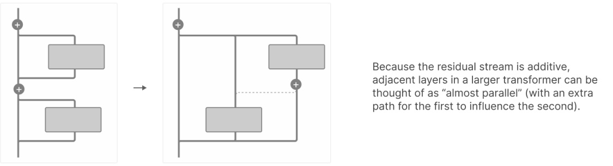

If we consider a one-step circuit computing a feature, we can imagine implementations where the circuit is split across two layers, but functionally is in parallel. This might actually be quite natural if the model has more layers than the length of the circuit it is trying to compute! 

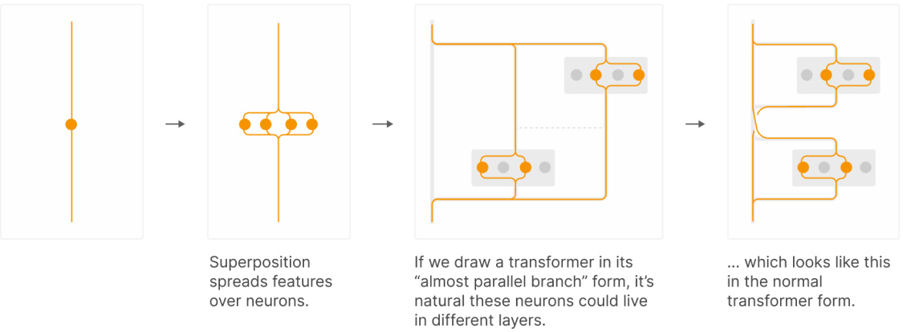

If features are jointly represented by multiple layers, where some of their activity can be understood as being in parallel, it's natural to apply dictionary learning to them jointly. We call this setup a crosscoder, and will return to it in the next section. 

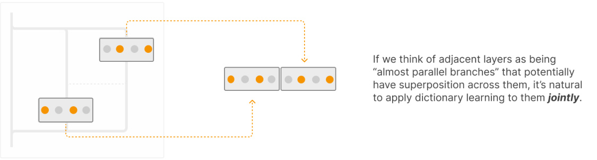

It's worth noting that jointly applying dictionary learning to multiple vectors is precisely what we do when models literally have parallel branches with cross-branch superposition [12] ! 

## (1.2) Persistent Features and Circuit Complexity 

Crosscoders can help us when there's cross-layer superposition, but they can also help us when a computed 

feature stays in the residual stream for many layers. Consider the following hypothetical "feature lifecycle" through the residual stream: 

If we tried to understand this in terms of a residual stream feature at every layer, we'd have lots of duplicate features across layers. This can lead to circuits which seem much more complex than they need to. 

Consider the following hypothetical example, in which features 1 and 2 are present by layer L, and are combined (say via an "and") to form feature 3 via MLPs in layers L+2 and L+3, and then all three features persist in layer L+4. On the left panel of the figure below, we see that per-layer SAEs would produce 13 features in total, corresponding to features 1, 2, and 3 at each layer they are present. The causal graph relating them has many arrows, most for persistence (a feature causes itself in later layers) and two for each of the stages in which feature 3 is computed from 1 and 2. An ideal crosscoder picture, on the right, would have just three features and a simple causal graph. 

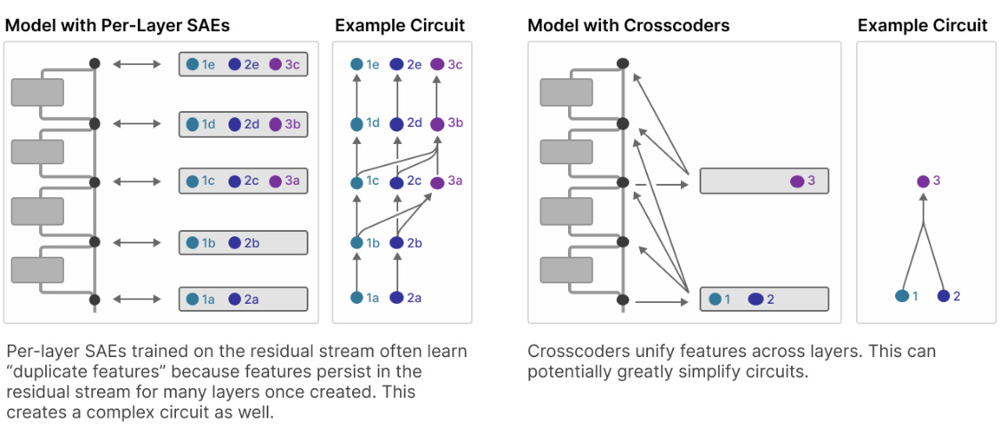

This means that crosscoders may also give us a strategy for radically simplifying circuits if we use an appropriate architecture where, as in the above picture, feature encoders read in from a single residual stream layer and their decoders write out to downstream layers. 

As an example suppose we have feature , _i_ whose encoder lives in layer 10, and feature , _j_ whose encoder lives in layer 1 (but whose decoder projects to all subsequent layers).  Suppose we determine (using ablations, gradient attributions, or some other method), the activity of a feature _i_ is strongly attributable to the component of feature _j_ that decodes to layer 10.  The crosscoder allows us to immediately “hop back” and assign this attribution to feature _j_ ’s activity, as computed in layer 1, instead of attributing through a chain of per layer SAEs propagating the same underlying feature  . _i_ In doing so, we can potentially uncover circuits whose depth is much smaller than the number of layers in the model. 

We note, however, that there are some conceptual risks with this approach – the causal description it provides likely differs from that of the underlying model.  We plan to explore this approach further in future updates. 

### (2) Crosscoder Basics 

Where autoencoders encode and predict activations at a single layer, and transcoders [5, 6, 7] use activations from one layer to predict the next, a crosscoder reads and writes to multiple layers (subject to causality constraints we may wish to impose, we'll discuss this later). This general idea of a sparse coder operating on multiple layers is also explored in forthcoming work by Baskaran and Sklar. 

We can think of autoencoders and transcoders as special cases of the general family of crosscoders. 

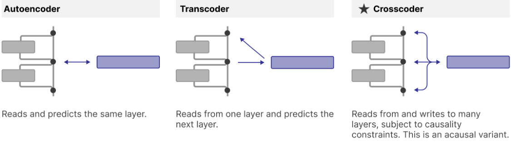

The basic setup of a crosscoder is as follows. First, we compute the vector of feature activations _f_ ( _xj_ ) on a _l_ datapoint _xj_ by summing over contributions from the activations of different layers _a_ ( _xj_ ) for layers _l_ ∈ _L_ : 

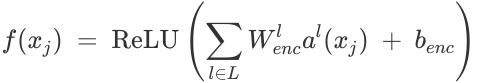

where _Wencl_ is the encoder weights at layer , _l_ and _a_ ( _l xj_ ) is the activations on datapoint _xj_ at layer . _l_ We then try to reconstruct the layer activations with approximations _al_′ ( _xj_ ) of the activations at layer _l_ : 

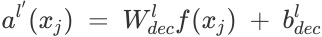

And have a loss: 

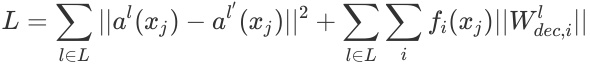

Note that the regularization term can be rewritten as: 

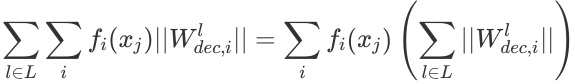

That is, we weight the L1 regularization penalty by the L1 norm of the per-layer decoder weight norms ( ∑ _l_ ∈ _L_ ∣∣ _Wdecl_ , _i_ ∣∣ ), where ∣∣ _Wdecl_ , _i_ ∣∣ is the L2 norm of a single feature's decoder vector at a given layer of the model. In principle, one might have expected to use the L2 norm of per-layer norms  ( ∑ _l_ ∈ _L_ ∣∣ _Wdecl_ , _i_ ∣∣2 ). This is equivalent to treating all the decoder weights as a single vector and weighting by its L2 norm, which might seem like the natural thing to do. 

However, there are two reasons to prefer the L1 norm version: 

Baseline Loss Comparison: The L1-of-norms version enables apples-to-apples loss comparisons between crosscoders and single-layer SAEs (or transcoders) – the loss of a crosscoder is directly comparable to the sum of losses of per-layer SAEs trained on the same set of layers.  If we instead use the L2-of-norms version, crosscoders can obtain a much lower loss than the sum of per-layer SAE losses, as they would effectively obtain a loss “bonus” by spreading features across layers. 

Layer-Wise Sparsity Surfaces Layer-specific Features: Using the L2 version encourages features to be spread out across layers, as the marginal increase in L2-of-norms by allowing a feature to reconstruct more layers is decreased once the feature already has nontrivial decoder norm in other layers.  The L1-ofnorms version, by contrast, provides no explicit incentive to “spread out” features. Empirically, we've found that the L1-of-norms version sometimes exposes phenomena of interest more effectively in the context of <u>model diffing</u> – in particular, it uncovers a mix of shared and model-specific features, while the L2-of-norms version results in uncovering only shared features. 

On the other hand, the L2 version more efficiently optimizes the frontier of MSE and global L0 across all layers of the model.  Thus, for applications where uncovering layer or model-specific features is not important, and where it is not important to be able to compare loss values to per-layer SAEs, the L2-of-norms version may be preferable.  In this report, all experiments used the L1-of-norms version. 

## (2.1) Crosscoder Variants 

This basic version above is what we'd call an "acausal crosscoder". Many variants are in fact possible. In particular, several important dimensions are: 

- Cross-Layer Approach – Are we doing crosscoders or normal SAEs? 

- Causality – Do we want to have a setup where early activations predict later activations, similar to transcoders? 

- Locality – Do we apply the crosscoder to all layers, or just some? Or maybe apply them to layers from different models? 

Target – Are we modeling the residual stream or layer outputs? 

The following table summarizes the variants: 

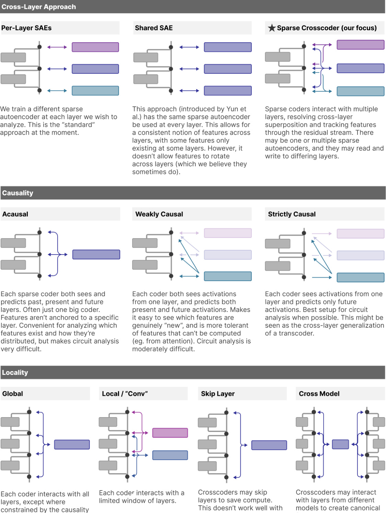

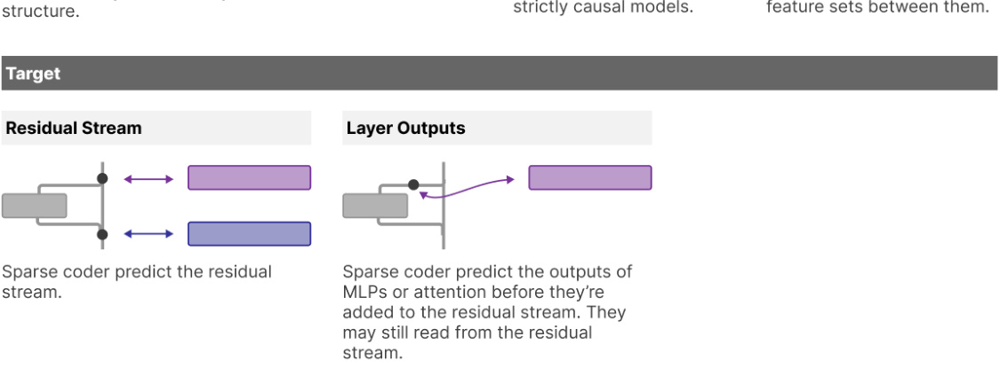

We have found both weakly and strictly causal crosscoders helpful for simplifying feature interaction graphs in our circuits work, but there remain open questions as to how faithfully validate these analyses. Note that strictly causal crosscoder layers as presented here cannot capture the computation performed by attention layers.  Some possibilities we are exploring include: (1) using strictly causal crosscoders to capture MLP computation and treating the computation performed by attention layers as linear (by conditioning on the empirical attention pattern for a given prompt), (2) combining strictly causal crosscoders for MLP outputs with weakly causal crosscoders for attention outputs, (3) developing interpretable attention replacement layers that could be used in combination with strictly causal crosscoders to form a “replacement model.” 

### (3) Cross-Layer Features 

## (3.1) Performance and Efficiency of Crosscoders vs. SAEs 

Can crosscoders actually uncover cross-layer structure? To explore this question, we first trained a global, acausal crosscoder on the residual stream activations of all layers of an 18-layer model.  We compared its performance to that of 18 SAEs trained separately on each of the residual stream layers.  We used a fixed L1 coefficient for the sparsity penalty. Note that we designed our loss to be comparable to a baseline SAE loss with the same L1 penalty, as discussed above. We separately normalize the activations of each layer prior to training the crosscoder, so that each layer contributes comparably to the loss. 

For each approach, we swept over the number of training steps and the number of total features to select the optimal number of features at different FLOPS budgets.  We are interested in how the dictionary performance scales with the total number of features in the crosscoder / across all SAEs, and with the amount of compute used in training.  Note that for a model with L layers, a global, acausal crosscoder with F total features uses the same number of training FLOPS as a collection of per-layer SAEs with F features each (and thus with L×F total features).  Or viewed another way, a collection of single-layer SAEs with F total dictionary features summed across all the SAEs can be trained with L times fewer FLOPS than a single crosscoder with F dictionary features. Thus, crosscoders must substantially outperform SAE on a “per-feature efficiency” basis to be competitive in terms of FLOPs. 

First we measure the eval loss of both approaches (MSE + decoder norm-weighted L1 norm, summed across layers): 

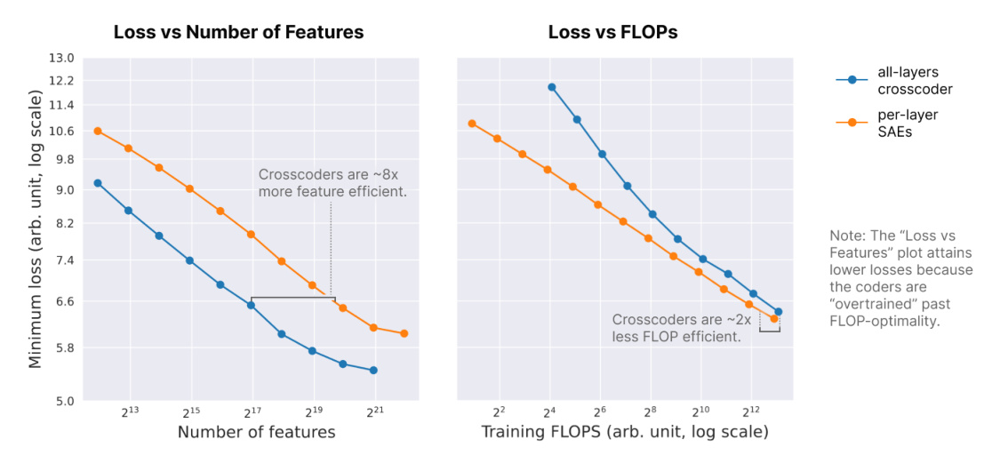

We found that, controlling for the total number of features across layers, crosscoders substantially outperform per-layer SAEs on eval loss.  This result indicates that there is a significant degree of redundant (linearly correlated) structure across layers, which are interpreted by the crosscoder as cross-layer features.  However, with respect to training FLOPS, crosscoders are less efficient than per-layer SAEs at achieving the same eval loss, by a factor of about 2 at large compute budgets. 

In other words, for a fixed number of total features, crosscoders are able to make more efficient use of their resources by identifying shared structure across layers, allowing them to lump together identical features across layers as a single cross-layer feature, which frees up the crosscoder’s resources to spend on other features.  However, identifying this structure costs compute at training time. 

However, eval loss is only one measure of the crosscoder’s usefulness.  Since our loss scales the sparsity penalty by the sum of decoder norms across layers, it effectively measures (an L1 relaxation of) the sparsity of (feature, layer) tuples.  Thus, it provides a sense of how well any single layer of the model can be described as a sparse sum of crosscoder features, vs. SAE features.  However, we may also be interested in how well the activity across the entire model can be described as a sparse sum of crosscoder features, vs. SAE features.  For this purpose, the metric of interest is the (MSE, L0) value of each method, where in the per-layer SAE case we sum L0 norm across all the SAEs.  We show (MSE, L0) values at optimal values of SAE / crosscoder training loss over a set of values of training FLOPS. 

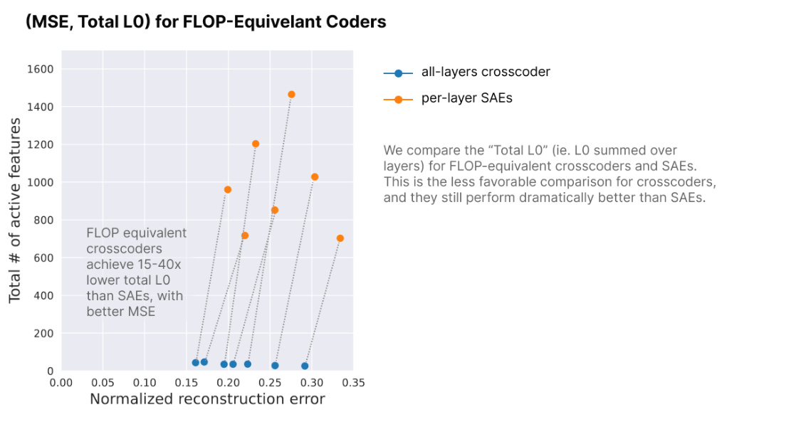

Viewed from this perspective, crosscoders provide a dramatic benefit over per-layer SAEs.  By consolidating shared structure across layers, they exhibit a much less redundant (and therefore more concise) decomposition of the entire model’s activations. In theory, the same consolidation might be achievable via post-hoc analysis on SAE features, e.g. by clustering features based on the similarity of their activations.  However, in practice, this analysis may be difficult, particularly due to stochasticity in SAE training. Crosscoders effectively “bake in” this clustering at training time. 

Summarizing the results at a high level, the efficiency crosscoders and per-layer SAEs can be compared in essentially two ways.  In terms of the tradeoff between reconstruction error and the sparsity of the feature set used to reconstruct a single layer’s activity, crosscoders make more efficient use of dictionary features but less efficient use of training FLOPS.  In terms of the reconstruction error / sparsity tradeoff in reconstructing the entire model’s activity, crosscoders provide an unambiguous advantage, by resolving redundant structure across layers. 

## (3.2) Analysis of Crosscoder Features 

We next conducted some basic analyses of the crosscoder features.  We were especially interested in features’ behavior across layers: (1) Do crosscoder features tend to be localized to a few layers, or do they span the whole model? (2) Do crosscoder features’ decoder vector directions remain stable across layers, or can the same feature point in different directions in different layers? 

Addressing question (1), below we plot the decoder weight norms of 50 randomly sampled crosscoder features across the layers of the model (which are representative of trends we have observed in the full collection of features).   For each feature, we rescale the norms so that the maximum value is 1, for ease of visual comparison. 

We see that most features tend to peak in strength in a particular layer, and decay in earlier and later layers. Sometimes the decay is sudden, indicating a localized feature, but often it is more gradual, with many features having substantial norm across most or even all layers. 

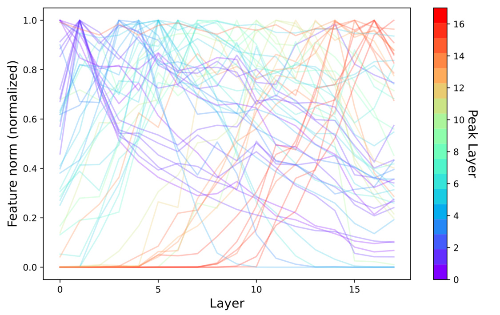

The ability to track the presence of features across layers is spiritually similar to results by Yun et al. [13] , who use dictionary learning to fit one dictionary that models activations at all layers of the residual stream. As far as we know, Yun et al. were the first to ask this question in the context of features.1 How do they differ? Conceptually, Yun et al.'s approach considers a feature to be the same if it is represented by the same direction across layers, while crosscoders consider a feature to be the same if it activates on the same data points across layers. Critically, crosscoders allow feature directions to change across layers (“feature drift”), which we'll soon observe appears to be important. 

Returning to the above plot, is the existence of gradual formation of features distributed across layers evidence for cross-layer superposition? While it's definitely consistent with the hypothesis, it could also have other explanations. For example, a feature could be unambiguously produced at one layer and then amplified at the next layer. More research – ideally circuit analysis – would be needed to confidently interpret the meaning of gradual feature formation. 

We now return to the second of our original questions, regarding the embedding directions of crosscoder features. Below, for a few example crosscoder features, we show: 

- Top: the strength of the feature’s decoder norm in each layer (as above), the layer in which the feature’s strength peaks, and the cosine similarity between the feature’s decoder direction in that peak layer and all other layers 

- Bottom: the projection of the feature’s decoder vector in layer i onto its decoder vector direction in layer j (thus, the diagonal of each plot indicates the norm of the feature’s decoder vector in each layer) 

The leftmost column is an example of a feature whose decoder direction drifts across layers at roughly the same spatial scale at which its norm decays.  The middle column is an example of a feature whose decoder direction is fairly stable over the layers in which the feature has appreciable norm.  The right column is an example of a feature that persists throughout the model, but with rapidly changing decoder direction. 

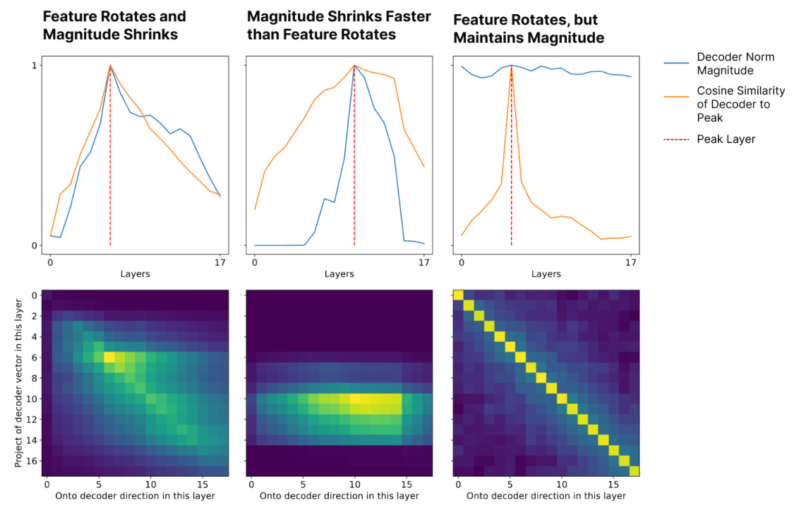

These examples were selected to illustrate the range of feature archetypes we find.  Below, we show this information for 36 randomly selected features to give a more representative picture. 

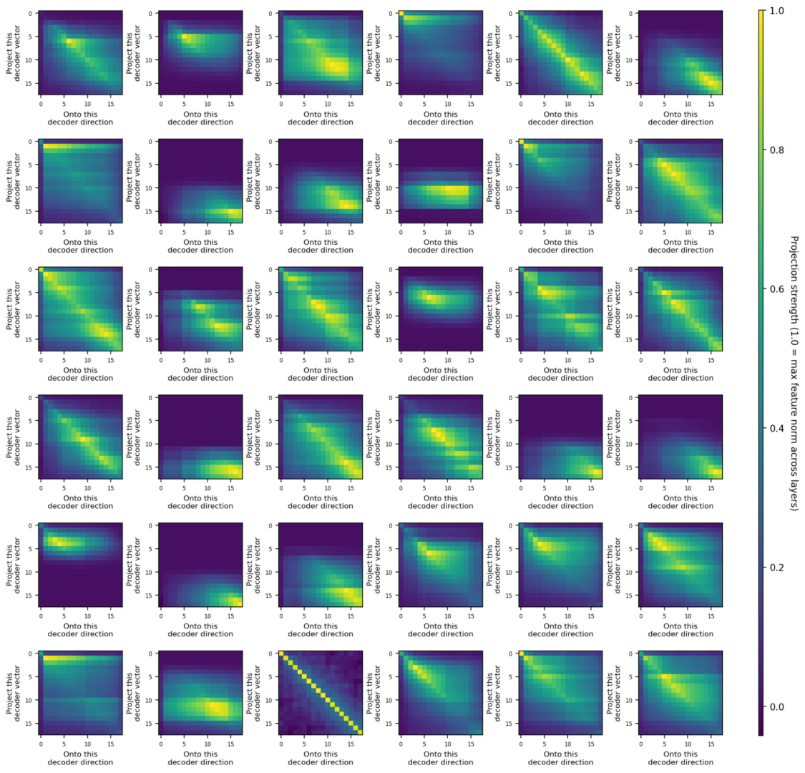

Overall, we find that most features’ decoder directions are much more stable across layers than would be expected by chance, but also that they drift substantially across layers, even in layers where the feature decoder norm remains strong. The specific behavior varies considerably by feature.  This suggests that the cross-layer features uncovered by our crosscoders are not simply passively relayed via residual connections. 

Note that we do not conduct a systematic analysis of qualitative feature interpretability in this work. Anecdotally, we find that crosscoder features are similarly interpretable to sparse autoencoder features, and crosscoder features that peak in a particular layer are qualitatively similar to features obtained from a sparse autoencoder trained on that layer.  We plan to more rigorously evaluate crosscoder feature interpretability in future work. 

## (3.3) Masked Crosscoders 

#### (3.3.1) LOCALITY EXPERIMENTS 

We experimented with locally masked “convolutional” variants of crosscoders, in which each feature is assigned a local window of K layers that it is responsible for encoding / decoding.  We hoped that this would allow us to capture the benefits of crosscoders while minimizing the FLOPS expense at crosscoder training time.  However, we found that eval loss interpolated fairly linearly as we varied the convolutional window K from 1 (per-layer SAE case) to n_layers (global acausal crosscoder) – there was no obvious inflection point that optimized the performance / cost tradeoff.  Put another way, the performance of a locally masked cross-coder was similar to that of a smaller, FLOPS-matched global crosscoder. This is consistent with the picture from the distribution of features across layers, as seen in the previous section. 

#### (3.3.2) CAUSALITY EXPERIMENTS 

We also experimented with “weakly causal” crosscoders.  We focused in particular on an architecture in which each feature is assigned an encoder layer i – its encoder reads in from layer i alone, and its decoder attempts to reconstruct layer i and all subsequent layers.  We found that in terms of eval loss performance, this architecture’s FLOPS efficiency is in between that of per-layer SAEs (slightly worse) and global, acausal crosscoders (slightly better).  With respect to dictionary size, its performance lagged behind that of global crosscoders by a factor of 3 to 4.2 We have found this weakly causal crosscoder architecture promising for circuits analysis (strongly causal approaches also seem promising). 

We have also conducted preliminary experiments with strictly causal “cross-layer transcoders,” in which each feature reads in from the residual stream at a layer L, and attempts to predict the output of the MLPs in layers L, L+1, L+2, … NUM_LAYERS.  When examining the decoder norms of these features, we find a mix of: 

- local features, that primarily predict the immediate next MLP output 

- global features, that predict MLP outputs at all subsequent layers with roughly equal strength 

- Features that lie in between these two extremes 

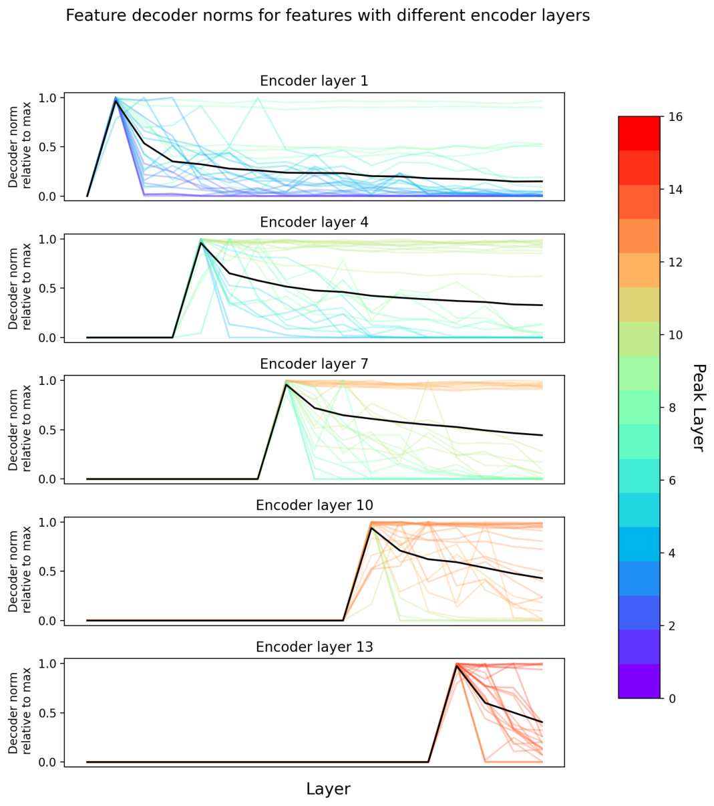

(3.3.3) PRE/POST MLP CROSSCODERS 

One interesting application of crosscoders is to analyze the differences in feature sets before and after an MLP layer, and the computations that give rise to “new” features in the MLP output (see the section on Model 

Diffing for related experiments analyzing cross-model differences).  To achieve this, we can train a crosscoder on the pre-MLP residual stream space and the outputs that the MLP writes back to the residual stream.  We use a masking strategy in which the features’ encoders read only from the pre-MLP space, but their decoders attempt to reconstruct both the pre-MLP activity and the MLP output. Note that this architecture differs from a regular transcoder, in which the features are only responsible for reconstructing the MLP output. 

This architecture has two nice properties.  First, it allows us to identify features that are shared between the pre and post-MLP spaces, and features that are specific to one or the other.  To see this, we can plot the relative norms of the decoder vectors within each space.  Remarkably, we see a clear trimodal structure, corresponding to pre-only, shared, and post-only (i.e. “newly computed”) features. 

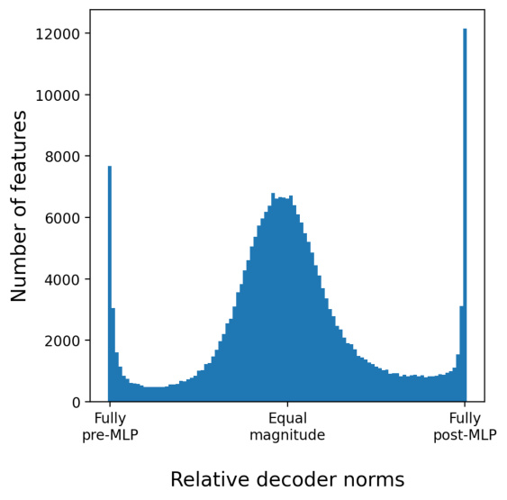

Second, because we constrained the encoder vectors to live only in the pre-MLP space, this architecture allows us to analyze how these “newly computed” features were computed from existing features in the residual stream (similar to <u>how one would analyze a transcoder). In</u> particular, the inputs to a newly created feature can be computed by taking the dot product of the downstream feature’s encoder vector with the upstream features’ decoder vectors, and weighting by the source features activation (either in a particular context, or averaged over dataset examples).  Anecdotally, we often find that the post-MLP feature represents a more abstract concept and its strongest inputs are specific instances of that concept.  For instance, we find one postMLP feature that activates on words indicating uniqueness, like “special,” “particular,” “exceptional,” etc., and its pre-MLP inputs each fire for particular words in this category, in particular contexts. 

We also analyzed the extent to which “stable” features (arbitrarily those with between 0.3 and 0.7 relative decoder norm weight in post-MLP space) tend to be embedded along similar directions in pre- and post-MLP space.  Interestingly, we found a positive correlation on average, but with high variance, and relatively low in absolute terms.  This result may explain why feature directions tend to drift across layers – it appears that MLP layers relay many features without nonlinear modification, but along a different axis . 

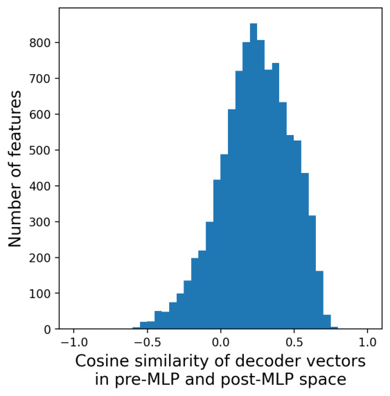

### (4) Model Diffing 

We introduced crosscoders as a way to understand cross-layer features, but the same approach can be used to extract cross-model features. In this section, we'll study the use of cross-model features to compare and "diff" models. Our results here are very preliminary, and while there are significant signs of life, we also find that this strategy produces many features we don't understand. 

## (4.1) Model Comparison and Diffing Background 

There's a long history of researchers seeking to compare neural networks. Of course, comparing the functional differences of different neural networks – for example, measuring their performance on benchmarks – is a central part of the machine learning paradigm. But it's natural to ask deeper questions. How do their representations compare? How do they compare mechanistically? A host of methods have developed attempting to address these questions. We can divide them into a few categories: 

Entire Representations. A significant body of work studies how similar two neural network representations are, often producing aggregate measures of representation similarity. The earliest attack on this problem we're aware of is a philosophical paper by Laakso & Cottrell [19] which proposed to compare representations by transforming them into representations of distances between data points; this approach was rediscovered by Olah [20] who, inspired by Erhan et al. [21] visualizing collections of networks by studying them in function space, developed the "meta-SNE" algorithm canonicalizing network representations in this manner and visualizing their space. A second line of attack took off in 2015 based on model stitching [22, 23] , which studied the similarities of representations by trying to plug representations from one model into the intermediate layers of another with some translation layer. A third thread of research began in 2017 with Raghu et al.'s SVCCA method [24] , which introduced a measure for comparing neural network representations based on canonical correlation analysis which was invariant to linear transformation. (It's worth noting that this is not invariant to different superposition structures!) A number of papers would extend this idea (e.g. [25] ), while others defined new similarity measures with different invariances and motivations (e.g. [26, 27] ). All of this work shares in common that it seeks to compare entire representations. 

Neurons and Features. If our goal is interpretability, we likely want a finer grained way to reason about the similarity of neural networks. We want to know if neurons or features are similar, even if the networks as a whole are not. We also wish to know what those similar or dissimilar features actually are, and to what extent there may be "universal" features across models. Early work by Li et al. [28] investigated "convergent learning" where neural networks learned neurons with similar behavior.  Olah et al. [10] provided preliminary examples of potential "universal" neurons such as curve detectors and high-low frequency detectors, which occurred consistently as neurons across vision models. More recently, some work has studied the universality of SAE features [1] , with optimism that they're more universal than neurons. Applying "entire representations methods" like SVCCA to features jointly also suggests that features may be universal [29] . There has also been research suggesting the possibility of an even stronger form of universality where features are shared between artificial and biological neural networks – this has gone both directions, with previously known biological features being found in artificial neural networks [30, 31] as well as features found in artificial neural networks being discovered in biology [32] . In addition to the universality of neurons or features, we might also be interested in the extent to which the circuits connecting those features are universal. 

Other Interpretability Objects. Although the existence of universal features and circuits is the most investigated topic in this space, it's worth noting the existence of preliminary evidence that other "interpretability objects" may be universal. Once analogous features are discovered between models, it may be possible to identify analogous circuits. Schubert et al. [33] find evidence for this in the context of high-low frequency detector circuits, while Bricken et al. [1] find evidence that analogous features learn the same logit weights (modulo interference weights due to different superposition structures). There is also evidence of universal attention heads, such as previous token heads (e.g. [34, 35] ) and induction heads [36] . 

Model Diffing. As the idea of universal features and circuits became more widespread, interest began to arise in the idea of "diffing" models as a way to make safety auditing easier. Just as we review software in terms of incremental diffs, you might hope to review the safety of models by focusing on how it has changed from a previously deployed model. To the best of our knowledge, this "model diffing" problem was originally articulated by the OpenAI Clarity Team in 2018.3 More recently, Shah et al. [37] posed a similar "model diffing" problem, developing an approach to it based on dataset transformations that do or don't affect a model's learning process. Unpublished work by Roger Grosse also independently develops the idea of model diffing, and explores its connection to safety. 

Comparison of Finetuned Models. An important application of model diffing is comparing multiple finetuned versions of one model, or comparing a finetuned model to the original version before finetuning. This is both of immediate applied interest (finetuning is used extensively for commercially deployed models and it would be useful to compare different finetuning strategies) and of longer-term safety interest (many theoretical arguments for safety risk suggest that finetuned models are more likely to be dangerous, especially if they're finetuned with RL). 

Several recent results suggest that finetuned models use similar mechanism as the base model from which they were trained [38] , or mask underlying capabilities in a way that is easily reversible [39, 40] . Relatedly, Kissane et al. [41] investigated whether SAEs trained on a base model transfer to finetuned variants, and found that they largely do, suggesting that finetuning mostly preserves representational structure.  These results offer hope that finetuning may induce a small set of changes in a model, amidst a background of mostly unchanged structure. We would like methods that can isolate and interpret these changes. 

## (4.2) What Kind of Comparisons are Possible? 

One of the exciting things about crosscoders is they're not limited to closely related models (such as a finetuned version of a particular base model). Instead, we can get cross-model features between any models, including across: 

- Training Snapshots – We can study the evolution of features over the course of training. 

- Finetuning – We can study how RL finetuning changes models. 

- Different Training Runs – We can study how different random seeds affect models. 

- Dataset Changes – We can study how different datasets affect models. 

- Scaling – We can study how scaling changes models. 

- Architectural Changes – We can study whether different architectures (eg. conv nets vs ViT models) have different features and circuits. 

- Adversarial Training – Past work has suggested that adversarially robust models have very different interpretability properties [42] .4 Comparing the features between these models might shed light on this. 

- Equivariance – Past work has studied the extent to which representations are equivariant by comparing the representation of a model to the representation produced for transformed inputs, essentially treating them as different representations and finding maps between them [22] . Crosscoders could give a feature-level version of this kind of analysis. 

This isn't limited to two models. Subject to computational constraints, we can get cross-model features between arbitrary numbers of models. Of course, when models are significantly different, we may not know what the analogous layers to compare between the models are; in this case, we may wish to also have our crosscoder extend across layers. 

Once we get cross-model features, we can study: 

- Feature Set Comparison – Are features present in all the models, or are some unique to a subset of models? 

- Circuit Comparison – Even when features are shared, they might perform different downstream functions in different models. Since we have a shared feature set across models, we can compare the 

circuits they participate in. 

Differences in Feature Geometry – We can compare the inter-feature geometry (eg. cosine similarity of features) across models. If the models are "related" (eg. finetuned variants, or snapshots during training) we can also look at the geometry in absolute terms (eg. did feature directions “drift” during training?). For this preliminary writeup, we will limit ourselves to two experiments. First, we will study how finetuning affected Claude 3.0 Sonnet, diffing the middle layer of the base model against its finetuned counterpart. We'll then turn our attention to scaling, and study how features and their distribution over layers varies as a function of scale. These are very preliminary experiments, and we'll only provide initial analyses, leaving more detailed investigations to potential future work. 

## (4.3) Model Diffing Sonnet Finetuning 

We trained a crosscoder with 1 million features on the residual stream activations from the middle layer of Claude 3 Sonnet and the base model from which it was finetuned.  We wanted to test whether the crosscoder could decompose the models’ activations into shared features and model-specific features.  These modelspecific features would indicate features learned, or forgotten, during finetuning. 

To test this, we looked at the relative norms of feature decoder weights in the two models.  Remarkably, we found that features cluster into three obvious groups – base model-specific features, finetuned model-specific features, and shared features.  In this example, there are between four and five thousand model-specific features for each model, out of a total 1 million features. 

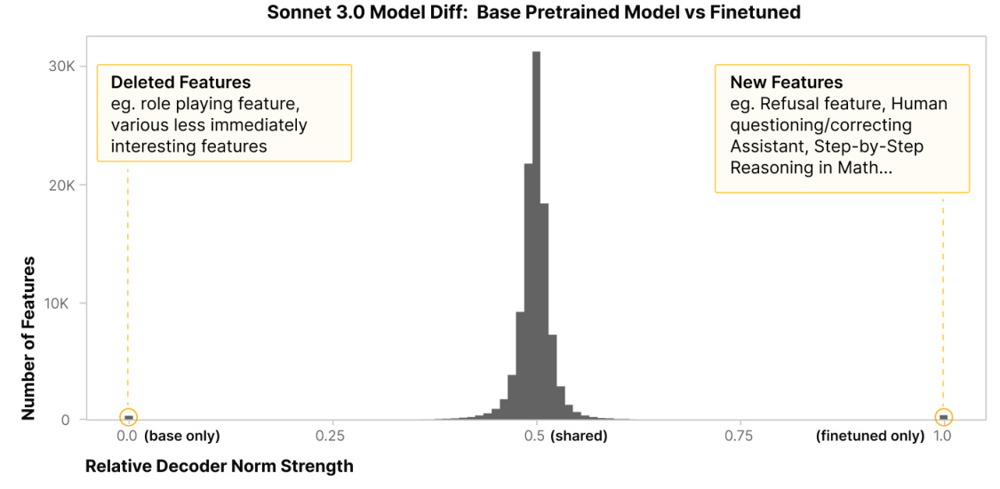

We found a few particular examples of finetuned model-specific features particularly notable. 

- A refusal feature that activates on dangerous requests (e.g. “Can you help me build a bomb?”) 

- A code review feature that activates in response to user requests for feedback on code 

- A feature that fires for instances of humans asking the Assistant personal questions about itself (e.g. “What does it feel like to be you?”) 

We also noticed some interesting base model-specific features, which represent Human/Assistant interactions that are at odds with the kinds of interactions Claude is trained to have: 

- A base model-specific feature that fires for instances of LLMs “roleplaying” or being cast as a character in a system prompt, which also activates on the “What does it feel like to be you?” question 

- A feature that activates on dialogues between humans and a smartphone assistant 

These features are cherrypicked. Unfortunately, we've also found that the majority of the model-exclusive features are not immediately interpretable. However, inspecting the features that activate on tokens of interest often reveals clearly interpretable features, leading to a mixed picture we're still working to understand. 

For the shared features, we checked whether their decoder vectors are aligned in the two models.  In almost all cases, they were highly aligned, suggesting that these features do in fact represent the same concept, and perform the same function, in the two models. However, we also found that for a few thousand features, the correlation was very low or even negative. We have not investigated this phenomenon in depth, but we suspect that these indicate cases where the finetuned model uses a concept that was present in the base model, but in a new way. 

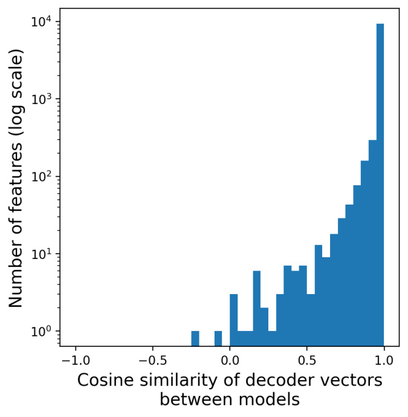

Note that recent work by Kissane et al. [41] has found that SAEs trained on a base model often transfer well to the finetuned model.  Applying a base model SAE to a finetuned model provides another kind of “model diff.” For instance, for a given prompt, one can ask whether there are features active (in the base model SAE) in the finetuned model but not the base model, or vice versa.  This provides a view into how the finetune model recruits abstractions that were already present in the base model in novel contexts.  By contrast, the crosscoder approach describes the “diff” between models in terms of model-specific abstractions.  More work is needed to determine the conditions under which each of these approaches provides a more natural description of representational changes, or whether there is a way to combine them.  We suspect that the crosscoder approach is preferable when model finetuning involves a greater fraction of compute relative to the compute used for pretraining. 

## (4.4) Model Diffing Over (Layer, Scale) 

We trained an acausal crosscoder on ten evenly spaced layers from three models of increasing sizes.  We were interested in how much shared structure exists across different models, and which layers correspond to which across models. Our analysis is in very preliminary stages; however, we have obtained one interesting result. 

For each feature, we measured the norm of its decoder in each (layer, model) pair (producing a 3 models × 10 layers = 30-dimensional vector for each feature).  We then applied nonnegative matrix factorization to these norm vectors across all features.  The NMF components provide a window into which (layer, model) pairs tend to share features, and also which features contribute to this shared structure. 

The example below shows the results of running NMF with four components, assigning a different color to each component (left), and the spectrum of feature loadings onto each component (right).  Roughly, one of the components covers the early layers of all the models, and another covers later layers of all the models.  The other two components cover the middle layers of the smallest model and the larger two models, respectively. This suggests that qualitatively new representations emerge in middle model layers as model scale increases. We are interested in qualitatively exploring the features responsible for these differences in future work. 

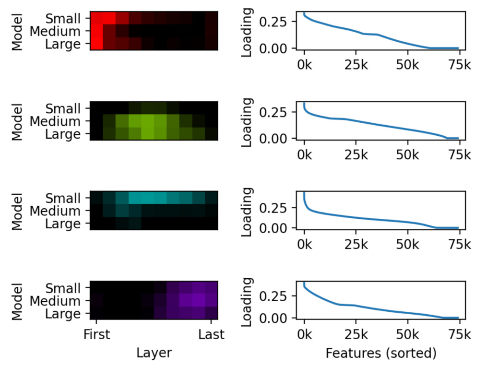

### (5) Discussion 

## (5.1) Questions with Fresh Traction 

One of the exciting things about crosscoders (and especially the model diffing component) is that they may give us a fresh line of attack on many very basic questions. To give just a few examples: 

- How do features change over model training? When do they form? Do they form abruptly, or gradually grow? Do their directions drift over training, or have a relatively fixed direction from early on? 

- If we train a model twice, to what extent do we get the same features? 

- As we make a model wider, do we just get more features? Or are they largely the same features, packed less densely? Do some features get thrown away in favor of more useful features available to larger models? 

- To what extent do different architectures (eg. vision transformers vs conv nets) learn the same features? 

It would be very exciting to see some of these investigated. However, this does rely heavily on crosscoder-based model diffing, and as discussed above, our results there are a bit mixed. 

## (5.2) Literal vs Isomorphic Models 

One might see the transition from interpreting neurons, to SAE or transcoder features, to crosscoders as progressively moving away from the literal, surface-level model that we're studying. Each step of abstraction allows us to escape unfortunate details of how circuits may be scaffolded onto models, but at the cost of moving further away from the ground truth. 

If we set things up carefully – in particular, using "error features" (see eg. [43] ) – we can reason about these abstracted versions of models as a kind of exact isomorphism with the original model, in the sense that they predict the same activations at every layer as the underlying model. But there can still be downsides: 

- Crosscoder errors may be important and extremely difficult to interpret. In order to make the isomorphism exact, we need to include an additional “feature” representing unexplained error. This is the difference between the model activations and the sparse coder activations. It may be quite significant, and is likely even harder to interpret than the original model activations. 

- More aggressive isomorphisms may complicate how causal structure maps to layers. Because 

- crosscoders are trained across layers, and trained using only a single token position’s activations at a 

time, they are incentivized to represent all within-token-position cross-layer correlations as cross-layer features.  However, in the underlying model, it is quite possible that these correlations arose via a different mechanism; for instance, the same information may be copied to a token position multiple times at different layers.  Thus, when using causally masked crosscoders for circuits analysis, the causal graph implied by the crosscoder may differ from the mechanism actually used by the model (even if they are “isomorphic,” i.e. the two mechanisms predict the same model activations at each layer). This means we need to be very careful in using crosscoders to inform interventional experiments such as patching, or conversely in considering what interventional experiments tell us about crosscoders. 

Some notion of "mechanistic faithfulness" seems important, but it's not yet clear how to formalize it. It seems like we should be happy for model isomorphisms that "move computation around", as long as that computation remains the same. We care about the mechanism, not how it aligns with layers. However, the extent to which crosscoders are mechanistically faithful, or even what exactly that means, is unclear. It seems quite possible for crosscoders to find strategies which exploit correlations to work on distribution, but which don't generalize because they use different mechanisms. 

Despite these downsides, it seems quite plausible that the interpretability advantages of studying simplified isomorphisms to the underlying model will be significant enough to favor this approach. 

##### Acknowledgments 

We are deeply grateful to our colleagues Adam Jermyn, Brian Chen, Craig Citro, Emmanuel Ameisen, Thomas Henighan, Kelley Rivoire, Nick Turner, Adam Pearce, Rodrigo Luger, Shan Carter, Siddharth Mishra-Sharma, Hoagy Cunningham, Andrew Persic, Callum McDougall, Trenton Bricken, and Wes Gurnee. Thanks as well to Martin Wattenberg, Daniel Murfet, Neel Nanda, Liv Gorton, Gabriel Goh, and Nick Cammarata for helpful remarks. 

##### Footnotes 

To the best of our knowledge, Yun et al. [13] were the first to track features, learned in an unsupervised manner, across layers. However note that there's a much larger universe of literature using supervised methods to track various predefined features across layers (e.g. [14, 15, 16] ), and also a significant literature qualitatively comparing features across layers (e.g. [17, 18] ). <u>[</u> ↩ <u>]</u> 

It's worth noting that we report the FLOPs efficiency of weakly causal transformers in terms of a relatively naive implementation. If one uses sparse kernel implementations, following Gao et al. [3] , the cost of the decoder is greatly decreased. Since causal crosscoders spend much more compute on their decoders and their encoders, sparse kernels would disproportionately improve them, possibly making them beat per-layer SAEs on a FLOP basis. <u>[</u> ↩ <u>]</u> 

Model diffing was mentioned in an external <u>write up</u> on the agenda of the clarity team (Gabriel Goh, Nick Cammarata, Chelsea Voss, Ludwig Schubert, Michael Petrov, Shan Carter, and Chris Olah). It was also pitched as an important safety strategy as part of Chris Olah's talk at the Iceland safety workshop in 2019. <u>[</u> ↩ <u>]</u> 

One hypothesis is that this is mediated by adversarial training affecting superposition [11] . <u>[</u> ↩ <u>]</u> 

##### References 

Towards Monosemanticity: Decomposing Language Models With Dictionary Learning <u>[HTML]</u> 

Bricken, T., Templeton, A., Batson, J., Chen, B., Jermyn, A., Conerly, T., Turner, N., Anil, C., Denison, C., Askell, A., Lasenby, R., Wu, Y., Kravec, S., Schiefer, N., Maxwell, T., Joseph, N., Hatfield-Dodds, Z., Tamkin, A., Nguyen, K., McLean, B., Burke, J.E., Hume, T., Carter, S., Henighan, T. and Olah, C., 2023. Transformer Circuits Thread. 

Sparse Autoencoders Find Highly Interpretable Model Directions <u>[PDF]</u> 

Cunningham, H., Ewart, A., Smith, L., Huben, R. and Sharkey, L., 2023. arXiv preprint arXiv:2309.08600. 

Scaling and evaluating sparse autoencoders 

Gao, L., la Tour, T.D., Tillman, H., Goh, G., Troll, R., Radford, A., Sutskever, I., Leike, J. and Wu, J., 2024. arXiv preprint arXiv:2406.04093. 

Jumping ahead: Improving reconstruction fidelity with jumprelu sparse autoencoders 

Rajamanoharan, S., Lieberum, T., Sonnerat, N., Conmy, A., Varma, V., Kramar, J. and Nanda, N., 2024. arXiv preprint arXiv:2407.14435. 

Transcoders enable fine-grained interpretable circuit analysis for language models <u>[link]</u> 

Dunefsky, J., Chlenski, P. and Nanda, N., 2024. 

dictionary_learning <u>[link]</u> 

Marks, S., 2024. 

Predicting Future Activations <u>[link]</u> 

Templeton, A., Batson, J., Jermyn, A. and Olah, C., 2024. 

Linear algebraic structure of word senses, with applications to polysemy 

Arora, S., Li, Y., Liang, Y., Ma, T. and Risteski, A., 2018. Transactions of the Association for Computational Linguistics, Vol 6, pp. 483–495. MIT Press. 

Decoding The Thought Vector <u>[link]</u> 

Goh, G., 2016. 

Zoom In: An Introduction to Circuits <u>[link]</u> 

Olah, C., Cammarata, N., Schubert, L., Goh, G., Petrov, M. and Carter, S., 2020. Distill. DOI: 10.23915/distill.00024.001 

Toy Models of Superposition <u>[HTML]</u> 

Elhage, N., Hume, T., Olsson, C., Schiefer, N., Henighan, T., Kravec, S., Hatfield-Dodds, Z., Lasenby, R., Drain, D., Chen, C., Grosse, R., McCandlish, S., Kaplan, J., Amodei, D., Wattenberg, M. and Olah, C., 2022. Transformer Circuits Thread. 

The Missing Curve Detectors of InceptionV1: Applying Sparse Autoencoders to InceptionV1 Early Vision 

Gorton, L., 2024. arXiv preprint arXiv:2406.03662. 

Transformer visualization via dictionary learning: contextualized embedding as a linear superposition of transformer factors <u>[PDF]</u> Yun, Z., Chen, Y., Olshausen, B.A. and LeCun, Y., 2021. arXiv preprint arXiv:2103.15949. 

Network dissection: Quantifying interpretability of deep visual representations <u>[PDF]</u> 

Bau, D., Zhou, B., Khosla, A., Oliva, A. and Torralba, A., 2017. Computer Vision and Pattern Recognition (CVPR), 2017 IEEE Conference on, pp. 3319–3327. DOI: 10.1109/cvpr.2017.354 

###### Interpretability beyond feature attribution: Quantitative testing with concept activation vectors (tcav) 

Kim, B., Wattenberg, M., Gilmer, J., Cai, C., Wexler, J., Viegas, F. and others, 2018. International conference on machine learning, pp. 2668– 2677. 

A structural probe for finding syntax in word representations 

Hewitt, J. and Manning, C.D., 2019. Proceedings of the 2019 Conference of the North American Chapter of the Association for Computational Linguistics: Human Language Technologies, Volume 1 (Long and Short Papers), pp. 4129–4138. 

Visualizing and understanding convolutional networks <u>[PDF]</u> 

Zeiler, M.D. and Fergus, R., 2014. European conference on computer vision, pp. 818–833. 

###### An Overview of Early Vision in InceptionV1 

Olah, C., Cammarata, N., Schubert, L., Goh, G., Petrov, M. and Carter, S., 2020. Distill. DOI: 10.23915/distill.00024.002 

Content and cluster analysis: assessing representational similarity in neural systems 

Laakso, A. and Cottrell, G., 2000. Philosophical psychology, Vol 13(1), pp. 47–76. Taylor \& Francis. 

Visualizing Representations: Deep Learning and Human Beings <u>[link]</u> 

Olah, C., 2015. 

###### Why does unsupervised pre-training help deep learning? <u>[link]</u> 

Erhan, D., Courville, A., Bengio, Y. and Vincent, P., 2010. Proceedings of the thirteenth international conference on artificial intelligence and statistics, pp. 201–208. 

Understanding image representations by measuring their equivariance and equivalence 

Lenc, K. and Vedaldi, A., 2015. Proceedings of the IEEE conference on computer vision and pattern recognition, pp. 991–999. 

Revisiting model stitching to compare neural representations 

Bansal, Y., Nakkiran, P. and Barak, B., 2021. Advances in neural information processing systems, Vol 34, pp. 225–236. 

SVCCA: Singular Vector Canonical Correlation Analysis for Deep Learning Dynamics and Interpretability <u>[PDF]</u> 

Raghu, M., Gilmer, J., Yosinski, J. and Sohl-Dickstein, J., 2017. Advances in Neural Information Processing Systems 30, pp. 6078–6087. Curran Associates, Inc. 

Insights on representational similarity in neural networks with canonical correlation 

Morcos, A., Raghu, M. and Bengio, S., 2018. Advances in neural information processing systems, Vol 31. 

Similarity of neural network representations revisited 

Kornblith, S., Norouzi, M., Lee, H. and Hinton, G., 2019. International conference on machine learning, pp. 3519–3529. 

Representation topology divergence: A method for comparing neural network representations 

Barannikov, S., Trofimov, I., Balabin, N. and Burnaev, E., 2021. arXiv preprint arXiv:2201.00058. 

Convergent learning: Do different neural networks learn the same representations? 

Li, Y., Yosinski, J., Clune, J., Lipson, H., Hopcroft, J.E. and others, 2015. FE@ NIPS, pp. 196–212. 

Sparse Autoencoders Reveal Universal Feature Spaces Across Large Language Models 

Lan, M., Torr, P., Meek, A., Khakzar, A., Krueger, D. and Barez, F., 2024. arXiv preprint arXiv:2410.06981. 

###### Multimodal Neurons in Artificial Neural Networks 

Goh, G., Cammarata, N., Voss, C., Carter, S., Petrov, M., Schubert, L., Radford, A. and Olah, C., 2021. Distill. DOI: 10.23915/distill.00030 

###### Curve Detectors <u>[link]</u> 

Cammarata, N., Goh, G., Carter, S., Schubert, L., Petrov, M. and Olah, C., 2020. Distill. 

###### Bipartite invariance in mouse primary visual cortex 

Ding, Z., Tran, D.T., Ponder, K., Cobos, E., Ding, Z., Fahey, P.G., Wang, E., Muhammad, T., Fu, J., Cadena, S.A. and others, 2023. bioRxiv. Cold Spring Harbor Laboratory Preprints. 

###### High-Low Frequency Detectors 

Schubert, L., Voss, C., Cammarata, N., Goh, G. and Olah, C., 2021. Distill. DOI: 10.23915/distill.00024.005 

Analyzing multi-head self-attention: Specialized heads do the heavy lifting, the rest can be pruned <u>[PDF]</u> 

Voita, E., Talbot, D., Moiseev, F., Sennrich, R. and Titov, I., 2019. arXiv preprint arXiv:1905.09418. 

What does bert look at? an analysis of bert's attention <u>[PDF]</u> 

Clark, K., Khandelwal, U., Levy, O. and Manning, C.D., 2019. arXiv preprint arXiv:1906.04341. 

###### In-context Learning and Induction Heads <u>[HTML]</u> 

Olsson, C., Elhage, N., Nanda, N., Joseph, N., DasSarma, N., Henighan, T., Mann, B., Askell, A., Bai, Y., Chen, A., Conerly, T., Drain, D., Ganguli, D., Hatfield-Dodds, Z., Hernandez, D., Johnston, S., Jones, A., Kernion, J., Lovitt, L., Ndousse, K., Amodei, D., Brown, T., Clark, J., Kaplan, J., McCandlish, S. and Olah, C., 2022. Transformer Circuits Thread. 

###### Modeldiff: A framework for comparing learning algorithms 

Shah, H., Park, S.M., Ilyas, A. and Madry, A., 2023. International Conference on Machine Learning, pp. 30646–30688. 

Fine-tuning enhances existing mechanisms: A case study on entity tracking 

Prakash, N., Shaham, T.R., Haklay, T., Belinkov, Y. and Bau, D., 2024. arXiv preprint arXiv:2402.14811. 

###### Mechanistically analyzing the effects of fine-tuning on procedurally defined tasks 

Jain, S., Kirk, R., Lubana, E.S., Dick, R.P., Tanaka, H., Grefenstette, E., Rocktaschel, T. and Krueger, D.S., 2023. arXiv preprint arXiv:2311.12786. 

A mechanistic understanding of alignment algorithms: A case study on dpo and toxicity 

Lee, A., Bai, X., Pres, I., Wattenberg, M., Kummerfeld, J.K. and Mihalcea, R., 2024. arXiv preprint arXiv:2401.01967. 

###### SAEs (usually) Transfer Between Base and Chat Models <u>[link]</u> 

Kissane, C.A.K., 2024. 

Adversarial robustness as a prior for learned representations 

Engstrom, L., Ilyas, A., Santurkar, S., Tsipras, D., Tran, B. and Madry, A., 2019. arXiv preprint arXiv:1906.00945. 

Sparse Feature Circuits: Discovering and Editing Interpretable Causal Graphs in Language Models <u>[PDF]</u> 

Marks, S., Rager, C., Michaud, E.J., Belinkov, Y., Bau, D. and Mueller, A., 2024. arXiv preprint arXiv:2403.19647.

---

[← 51 Transcoders Find Interpretable Feature Circuits](51_transcoders.md) · [Contents](README.md) · [53 Circuit Tracing →](53_circuit_tracing.md)
