<!-- Generated by scripts/build_anthology.py export from the source PDF; edit the catalog, not this file. -->
# 56 · AxBench: Steering LLMs? Even Simple Baselines Outperform Sparse Autoencoders

**Wu et al. — 2025** · Zhengxuan Wu, Aryaman Arora, Atticus Geiger, Zheng Wang, Jing Huang, Dan Jurafsky, Christopher D. Manning, Christopher Potts

| | |
|---|---|
| Priority | ● P0 — Essential |
| Section | F — The reckoning |
| Source | [https://arxiv.org/abs/2501.17148v3](https://arxiv.org/abs/2501.17148v3) (arXiv:2501.17148v3) |
| Licence | CC BY 4.0 |
| Print anthology | pages 2061–2104 (cover 2061, text 2062–2104) |

**Why read this.** A large benchmark for concept detection and steering on Gemma-2 finds that prompting beats every representation method at steering, difference-in-means leads at detection, and SAEs are competitive on neither.

**Reading focus.** Synthetic concept data built from GemmaScope concept lists, the LLM-judged steering score, the baselines (difference-in-means, probes, LAT, prompting, finetuning), the new ReFT-r1, and what interpretability advantage steering is claimed to keep.

**In context.** Tests the feature steering showcased in [47](47_scaling_monosemanticity.md) against the steering of [72](72_representation_engineering.md)–[74](74_refusal_single_direction.md) and against plain prompting. From the Stanford group behind [23](23_distributed_alignment_search.md), it takes difference-in-means from [41](41_geometry_of_truth.md) as a baseline that SAEs fail to beat. [55](55_gdm_sae_negative_results.md) cites it with [57](57_sae_sparse_probing.md) as converging evidence against SAEs on downstream tasks.

[← 55 Negative Results for SAEs (GDM)](55_gdm_sae_negative_results.md) · [Contents](README.md) · [57 Are Sparse Autoencoders Useful? →](57_sae_sparse_probing.md)

---

*Text extracted automatically from the source PDF. Display equations, figures and some tables appear as images; inline mathematics may be garbled — the PDF is authoritative.*

## **AXBENCH: Steering LLMs? Even Simple Baselines Outperform Sparse Autoencoders** 

**Zhengxuan Wu*** 1 **Aryaman Arora*** 1 **Atticus Geiger**2 **Zheng Wang**1 **Jing Huang**1 **Dan Jurafsky**1 **Christopher D. Manning**1 **Christopher Potts**1 

### **Abstract** 

Fine-grained steering of language model outputs is essential for safety and reliability. Prompting and finetuning are widely used to achieve these goals, but interpretability researchers have proposed a variety of representation-based techniques as well, including sparse autoencoders (SAEs), linear artificial tomography, supervised steering vectors, linear probes, and representation finetuning. At present, there is no benchmark for making direct comparisons between these proposals. Therefore, we introduce AXBENCH, a large-scale benchmark for steering and concept detection, and report experiments on Gemma-2-2B and 9B. For steering, we find that prompting outperforms all existing methods, followed by finetuning. For concept detection, representation-based methods such as difference-in-means, perform the best. On both evaluations, SAEs are not competitive. We introduce a novel weakly-supervised representational method (Rank-1 Representation Finetuning; ReFT-r1), which is competitive on both tasks while providing the interpretability advantages that prompting lacks. Along with AXBENCH, we train and publicly release SAE-scale feature dictionaries for ReFT-r1 and DiffMean. 

https://github.com/stanfordnlp/axbench 

### **1. Introduction** 

In order to be useful, language models (LMs) must follow user instructions and be aligned to human goals and values. While prompting and finetuning are now widely used to instill such behaviour in LMs, both methods have 

*Equal contribution 1Department of Computer Science, Stanford University2 Pr(AI)2 R Group. Correspondence to: Zhengxuan Wu _<_ wuzhengx@cs.stanford.edu _>_ , Aryaman Arora _<_ aryaman@cs.stanford.edu _>_ . 

Preprint. 

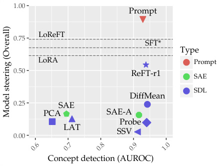

<!-- Start of picture text -->
1.00 Prompt LoReFT 0.75 SFT* Type LoRA Prompt 0.50 ReFT-r1 SAE SDL DiffMean 0.25 SAE PCA SAE-A Probe LAT SSV 0.00 Concept detection (AUROC) 0.6 0.7 0.8 0.9 1.0 Model steering (Overall) <!-- End of picture text -->

Figure 1: Average results across eight tasks on **C** concept detection (0–2) vs. **S** model steering (0–2) for all methods on AXBENCH. *Only evaluated on Gemma-2-2B. 

limitations: circumvention via jailbreaks and continued training, reliance on dataset quality, and uninterpretability (Anwar et al., 2024). Interpretability researchers have thus proposed a new class of representation-based interventions for **steering** LMs, which hope to address these issues. These methods include learning steering vectors from small labelled datasets, self-supervised sparse autoencoders (SAEs), among other techniques. Since steering may enable lightweight and interpretable control over model outputs, it has emerged as a potential alternative to finetuning and prompting (see §2). 

Unfortunately, Pres et al. (2024); Braun et al. (2024) note that existing benchmarks for steering only evaluate a few methods at merely toy scales. To assess whether representation steering is a viable alternative to existing model control techniques, we need to evaluate it in a more realistic setting, e.g. over open-vocabulary concepts and on long-form generation, and compare it to prompting and finetuning baselines. 

In this work, we introduce **AXBENCH** , a benchmark for evaluating LM control methods at scale using synthetic data. AXBENCH takes in a list of natural language descriptions of concepts and samples relevant training and evaluation 

data from an LLM. We evaluate model-control methods, including prompting and finetuning baselines, along two utility **<u>ax</u>** <u>es:</u> **concept detection C** and **model steering S** . For the former, we use labelled synthetic data as ground truth; for the latter, we evaluate long-form generations using an LLM judge. The labelled training data enables comparison between supervised dictionary-learning methods (SDLs) and unsupervised methods like SAEs. The benchmark includes tasks generated from SAE concept lists for GemmaScope (Lieberum et al., 2024), covering two layers each from _instruction-tuned_ Gemma-2-2B and Gemma-2-9B (Gemma Team et al., 2024). However, AXBENCH is by nature extensible to arbitrary concept descriptions: we intend to add new evaluation tasks as better feature-labelling techniques and new approaches to steering emerge. 

We evaluate a variety of steering methods—including a novel weakly-supervised method we introduce, **ReFT-r1** — along with prompting, full finetuning, and two parameterefficient finetuning methods (LoRA and LoReFT). On steering, only ReFT-r1 is competitive with finetuning and prompting baselines, while SAEs fall behind both ReFT-r1 and difference-in-means (Marks and Tegmark, 2024) on both axes. While representation steering methods largely lag behind incumbent model-control techniques, ReFT-r1 is evidence that steering can be pushed further with the availability of comprehensive evaluation benchmarks. Finally, along with AXBENCH, we train and publicly release SAEscale feature dictionaries for ReFT-r1 and DiffMean. 1; we call this approach _supervised dictionary learning_ (SDL; Figure 2) 

### **2. Related work** 

**Representation-based control.** Interventional/causal interpretability has emerged as the dominant paradigm for understanding neural networks in the LLM era, enabling the reverse-engineering of circuits underlying specific behaviours (Giulianelli et al., 2018; Vig et al., 2020; Geiger et al., 2021; 2022; Meng et al., 2022; Chan et al., 2022; Wang et al., 2023; Goldowsky-Dill et al., 2023; Geiger et al., 2024; Guerner et al., 2024; Geiger et al., 2024). An important assumption in much of this work is the **linear representation hypothesis** , which claims that linear subspaces of representations in neural networks encode concepts (Mikolov et al., 2013b; Pennington et al., 2014; Bolukbasi et al., 2016; Elhage et al., 2022; Park et al., 2023; Nanda et al., 2023). Intervening on representations has thus emerged as an alternative to finetuning and prompting for LM control. 

_Representation-based steering_ by adding fixed vectors to activations, or clamping activations to a certain value along 

1We open-source all of our datasets and trained dictionaries at https://huggingface.co/pyvene. 

fixed directions, is one such intervention-based tool for model control (Zou et al., 2023; Li et al., 2024; Turner et al., 2024; Marks and Tegmark, 2024; Liu et al., 2024; van der Weij et al., 2024; Rimsky et al., 2024). Finetuning-based approaches such as ReFT (Wu et al., 2024a) enable optimisation of steering directions on a dataset. Steering vectors need not be computed from labelled data; SAEs enable scalable discovery of steering vectors from unlabelled data. In the same class of approaches, latent adversarial training (Casper et al., 2024) and circuit breakers (Zou et al., 2024) are representation-based control methods that increase the adversarial robustness of LLMs. 

**Sparse autoencoders.** Sparse autoencoders (SAEs) aim to enable _self-supervised_ and thus _scalable_ decomposition of the representation space into meaningful concepts (Templeton et al., 2024; Chalnev et al., 2024; Makelov, 2024; O’Brien et al., 2024; Gao et al., 2024). SAEs are trained to reconstruct LLM hidden representations in a higherdimensional latent space with a sparsity penalty, based on the assumption that concepts must be represented sparsely in order to prevent interference. The latents are then labelled with natural-language descriptions using automatic interpretability pipelines (e.g. Juang et al., 2024), which can then be used to identify useful latents to steer the LM. 

Recent work reports mixed results when evaluating SAEs for steering; SAEs (but also several other steering methods) suffer from a tradeoff between model control and capabilities preservation (Mayne et al., 2024; Chalnev et al., 2024; Durmus et al., 2024; Bhalla et al., 2025). However, Karvonen et al. (2024) report Pareto-optimal performance when using SAEs to prevent models from producing regular expressions in code. Overall, evaluating SAEs remains an open problem because there is no ground-truth set of features to compare against. 

### **3. AXBENCH** 

AXBENCH is a benchmark which takes in a list of natural language descriptions of concepts and synthetically generates the appropriate training and evaluation data for each concept using an LLM (Figure 2). The training and evaluation data consists of labelled pairs of instructions and responses, where the responses are either _positive_ examples expressing the presence of the concept of interest, or _negative_ examples that represent the unsteered behaviour of the model (see §3.1 for details). 

We evaluate along two axes: **concept detection C** and **model steering S** . For the former, we measure classification performance on a held-out set of labelled data.2 For the 

> 2We focus on binarised concept detection, as a multi-class classification task over _n_ classes can also be formulated into a binarised one over _n_ features. 

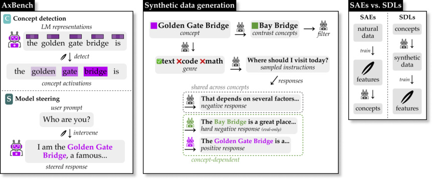

Figure 2: Key components of AXBENCH: (a) an example of how we collect data for evaluating concept detection and model steering; (b) the synthetic data generation process for training and evaluation given _Golden Gate Bridge_ as a concept; and (c) the contrasting training pipelines of SAEs and SDLs; both use LLMs, but SAEs use them to label pretrained features while we instead direct them to generate training data. 

latter, we use an LLM judge to rate steered outputs on three relevant axes (see §3.3). 

In this work, we use natural language concept lists for GemmaScope SAEs as input, and generate training and evaluation data for the following representation sites: layers 10 and 20 of instruction-tuned Gemma-2-2B, and layers 20 and 31 of instruction-tuned Gemma-2-9B. We sample 500 concepts for each task to generate data; we term this dataset CONCEPT500. These eight tasks (4 sites _×_ 2 axes) form the core training and evaluation testbeds for AXBENCH. Below, we describe the data generation process and evaluation setup for both axes. 

#### **3.1. Synthetic concept dataset generation** 

We construct a small training dataset _D_ train = _{_ ( **x**+ _c,i__, y_+)_}_ _i__n/_ =12_∪{_(**x**_−_ _c,i__, y−_)_}_ _i__n/_ =12_._with _n_ examples and a concept detection evaluation dataset _D_ concept of the same structure and harder examples, where _y_+ and _y__−_ are binary labels indicating whether the concept **c** is present. We set _n_ = 144 for our main experiments.3 

We query gpt-4o-mini-2024-07-18 to generate the data; the prompts used in this pipeline are presented in Appendix J.2. Generating the data requires the following steps (note that only the evaluation set includes hard negatives): 

1. **Genre labelling & seed instructions** : We consider three genres: _text_ , _code_ , and _math_ . We prompt the LLM to pick the genre **_gc_** for each concept.4 We then 

3Using a small training dataset ensures our methods are practical and cost-effective alternatives to SAEs. 

> 4Genre labelling increases input diversity. For example, inputs related to concepts such as _programming code contains syntactic_ 

randomly select seed instructions from our instruction pool which belong to genre **_gc_** ; see Appendix I for dataset details. We then prompt the LLM to generate responses to these instructions.5 

2. **Positive examples** : For each randomly sampled instruction from the instruction pool, we prompt the LLM to generate a response that incorporates the concept **_c_** . We use the generated concept-conditioned responses concatenated with their instructions (using the LM’s chat template) as our positive set. 

3. **Negative examples** : To evaluate the generalisation ability of each method, we independently sample seed instructions from all genres for negatives.6 These instructions are shared across concepts in order to save generation costs (i.e., ( **x**_−_ **c**_, y−_)_n/_ 02 is independent of the concept **c** ). We sample responses from the LM we plan to steer (not the LLM) without any additional instructions. We use the paired instructions and responses as our negative set. 

4. **Hard negative examples** _<u>(evaluation only)</u>_ : For each concept, we find contrasting concepts that are semantically related to our concept of interest but which should not activate the concept. We find these by (a) generating a list of phrases that are semantically relevant to our concept, (b) filtering for those which are polysemous, and (c) finding alternative senses of those words which our concept should not activate on. This results in a set of contrast concepts **_c_** contrast, each of which is a specific sense of a polysemous word **_w_** contrast. We then ask the 

> _errors_ should contain code instead of descriptions of coding errors. 

> 5Each example costs less than $0 _._ 00006. 

6We sample instructions based on overall genre distribution: 70% from _text_ , 15% from _code_ , and 15% from _math_ . 

LLM to generate responses incorporating **_w_** contrast into the sentence where **_w_** contrast should express the sense related to **_c_** contrast. We use the contrastive responses paired with their instructions as our hard negative set. 

The negative training set is not applicable to all methods (e.g. full finetuning only needs the positive training set for model steering). 

#### **3.2. C Concept detection** 

A popular LM interpretability method is to train _probes_ (Conneau et al., 2018; Hewitt and Manning, 2019; Belinkov et al., 2017) that measure to what extent LM representations encode properties of interest, e.g. linguistic features. In recent years, the goal of concept detection has broadened to the open-vocabulary setting, with unsupervised methods becoming more common (Bills et al., 2023; Huben et al., 2024; Choi et al., 2024). 

**Task description.** Formally, given a Transformer-based LM with a hidden dimension size of _d_ , we define a concept classifier as a parameterized function ΨDetect that maps a model representation _h ∈_ R_d_ into a _binary_ label ˆ _y_ indicating the relative presence of a concept: 

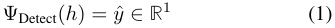

where Ψ is any function, e.g. a neural network. 

**Evaluation dataset.** To evaluate a concept classifier, we measure how accurately it can predict ground-truth labals on the labelled evaluation set from _D_ concept (see §3.1). 

**Evaluation metrics.** Since our labels are at the sequencelevel, we need to aggregate token-label scores from Ψ to evaluate it. Given a sequence of token representations **h**_l_ = [ _h_ 1_l, hl_ 2_, . . . , hl_ _n_] with_n_tokens at layer_l ∈_[1_, m_], we max- pool the detection scores to get a sequence-level prediction: 

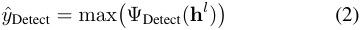

We then normalize _y_ ˆDetect between [0 _,_ 1] by min-max normalisation over the evaluation dataset for each concept. The predicted score represents how strongly a concept is present in a sequence, which we can compare to the true label. 

tasks (Zou et al., 2023; Makelov, 2024; Bhalla et al., 2025) or condition generation on a fixed prefix (Chalnev et al., 2024). To the best of our knowledge, we are the first to evaluate model steering methods in the open-vocabulary setting at scale. 

**Task description.** Given a prompt **x** , the model’s original generation can be written as **y** ˆ = LM( **x** ). We produce the model’s counterfactual generation conditioned on the concept-based intervention ΦSteer( **h** ): **y** ˆSteer = LM� **x** _,_ **h** _←_ ΦSteer( **h** )� (3) where **h** _←_ ΦSteer( **h** ) is an in-place representation modification. We use the open-source intervention library pyvene to perform such interventions on PyTorch implementations of models (Wu et al., 2024b). 

**Evaluation dataset.** We evaluate these steering methods in the instruction-following setting, where we sample instructions from Alpaca-Eval (Li et al., 2023) and prompt the LM to generate a response while intervening on its forward pass in-place using one of the steering methods. 

**Evaluation metrics.** For the intervened model generation, we evaluate **y** ˆSteer based on the _harmonic mean_ of the following scores, each of which the LLM rates using a discrete score of 0, 1, or 2: 

1. **Concept score** represents how well the concept is incorporated into the response. 

2. **Instruct score** represents how well the response is related to the instruction. 

3. **Fluency score** represents how fluent the response is. 

Since we compute the harmonic mean, the overall score also ranges from 0 to 2, but heavily penalises poor performance on any of these three subscores. For each concept, we randomly sample 10 instructions from Alpaca-Eval and sample continuations for each steering factor (see discussion on steering factor in §5.2). To ensure a fair comparison, we partition our instructions into two equally sized sets, selecting the best factor from one set and evaluating it on the holdout set. Our judge prompts with further discussion can be found in Appendix J.3. 

#### **3.3. S Model steering** 

### **4. Methods** 

Representation-based steering has emerged as a potential alternative to existing model-control methods (e.g. finetuning and prompting) and a practical application of various interpretability methods (see §2). Unlike concept detection, model steering assesses _causal_ efficacy in controlling model behaviour. Previous evaluation benchmarks for steering are not general-purpose; they either rely on a limited set of 

In this section, we describe the interpretability methods we evaluate along with our baseline prompting and finetuning methods. For each method, we label which axes it is evaluated on using **C** and **S** . All of our interpretability methods except SAEs are SDLs that learn rank-1 subspaces for targeted concepts. 

**Notation.** Given a LM, the hidden representations of dimensionality _d_ for a token sequence of length _n_ in layer _l_ of the LM are represented as **h**_l_ = [ _h_ 1_l, hl_ 2_, . . . , hl_ _n_]_∈_R_n×d_. The set of representations concatenated from all of the training set inputs is denoted as **H** _∈_ R_s×d_ , where _s_ =� **h**_|_**h**_|_. We denote **H**+ as the subset of **H** including only positive training inputs and **H**_−_ for the negative inputs (see §3.1 for training dataset details). Finally, per-method projection vectors **w** and representations _hi_ are the same shape: R_d×_1 . 

**C S Difference-in-means (DiffMean).** DiffMean uses the difference between averaged representations from two classes of inputs as a steering vector (Marks and Tegmark, 2024). The projection vector **w** DiffMean is defined as: 

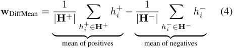

We compute detection scores with the dot product, i.e. ΨDiffMean Detect ( _hi_ ) = _hi ·_ **w** DiffMean.7 Our steering operation is simple activation addition: ΦDiffMean Steer ( _hi_ ) = _hi_ + _α_ **w** DiffMean where _α_ is the steering magnitude, which depends on the steering factor and is optimized as a hyperparameter, as described in §5.2. 

**C S Principle component analysis (PCA).** For PCA, we use the first principal component of the positive set of hidden representations as the projection vector.8 We first subtract the mean **H**+ from each _h_+ , gathering the centered vectors into a matrix _H ∈_ R_|_**H**+_|×d_ . We then find the top principal component **w** PCA _∈_ R_d×_1 of _H_ , i.e. the unit vector that captures the largest variance along its direction, using sklearn.decomposition.PCA (Pedregosa et al., 2011). We follow the same detection and steering setup as DiffMean. 

**C S Linear artificial tomography (LAT).** LAT searches for a single latent direction that can separate positive examples by learning from their pairwise activation differences (Zou et al., 2023). Concretely, we create pairwise activation differences _δ_ by randomly partitioning **H** into pairs ( _hi, hj_ ) (with _i̸_ = _j_ ) and computing _δ_ = _∥hhii−−hhjj ∥_, where the denominator ensures each difference is unitnormalized. We gather all these pairwise differences into a matrix ∆ _∈_ R _<u>|</u>_ **H** 2 _<u>|</u>__×d_ . We then perform PCA (using sklearn) on ∆; then **w** LAT _∈_ R_d×_1 is the top principal 

> 7Following Gao et al. (2024), we normalize **w** DiffMean to have unit norm. We apply the same normalization to the learned weights of PCA, LAT, Probe, and ReFT-r1. 

> 8We found no significant difference between using only the positive set vs. the entire set of hidden representations for both PCA and LAT; see Appendix F for ablations. 

component of ∆. We follow the same detection and steering setup as DiffMean. 

**C S Linear probe (Probe).** The linear probe learns to classify tokens as concept-relevant by projecting representations _hi_ onto a learned direction **w** Probe _∈_ R_d×_1 just as in DiffMean. To convert this into a probability, we apply the sigmoid activation, and then minimise binary cross-entropy loss with the true labels: 

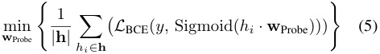

where _y_ is the token-level class label indicating whether this token belongs to a positive or negative example. The detection and steering setup is then identical to DiffMean. 

**C S Supervised steering vector (SSV).** The supervised steering vector method directly learns an intervention that maximises the language-modelling probability of the positive responses. For a sequence of token representations **h** , we apply an intervention to each token representation: 

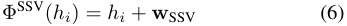

where **w** SSV _∈_ R_d×_1 is a learned vector. As described in §3.3, we backpropagate gradients by training with the language modeling loss, similar to supervised fine-tuning (SFT): 

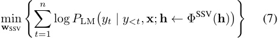

where _yi_ is the _i_ -th output token, _y<i_ are the preceding tokens, and **x** is the prompt. For evaluating concept detection and model steering SSV follows the same setup as DiffMean. We apply ReLU to get the detection scores. 

**C S Rank-1 representation finetuning (ReFT-r1).** We introduce a novel method based on ReFT (Wu et al., 2024a) which jointly learns concept detection and steering on supervised data by combining the training objectives of linear probing and supervised steering. 

We compute latents for concept detection as: 

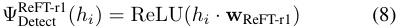

During training we perform a representation-level intervention on each _hi_ based on the latents of the sequence **h** : 

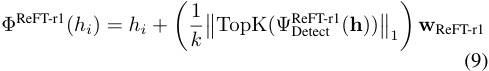

where **w** ReFT-r1 _∈_ R_d×_1 is a learned vector. Finally, the training objective combines language modelling loss subject 

to this intervention, along with L1 regularisation on the nontop- _k_ latents: 

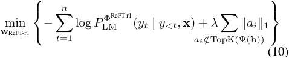

Detection and steering is identical to DiffMean. 

**C S Sparse autoencoders (SAE).** Sparse autoencoders are a self-supervised dictionary learning method (see §2). We use pretrained SAEs from GemmaScope, which are the best available SAEs for Gemma-family LLMs (Lieberum et al., 2024).9 The SAEs we used are trained to learn two dictionary matrices, _{_ **W** enc _,_ **W** dec _} ∈_ R_d×z_ where _z_ is the number of latents. For our evaluating concept **c** , we use _{_ **w** enc _,_ **w** dec _} ∈_ R_d×_1 as the detection and steering representations, respectively: 

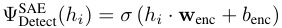

where _σ_ is an activation function (in our case, JumpReLU) and _b_ enc is a learned bias.10 For steering, we use activation addition as DiffMean. Note that Templeton et al. (2024) use activation clamping; we report ablations in Appendix F. 

**C S SAEs with AUROC selection (SAE-A).** Given that other methods have access to a training dataset, to enable fair comparison we attempt to use our training dataset for SAE feature selection. For each feature, we compute its max-pooled activations per Equation (2) over each training example, compute AUROC over the dataset given true labels, and select the highest-scoring feature by this metric. 

**C Bag-of-Words (BoW).** For the BoW baseline, we first construct a featurizer that tokenizes text by whitespace and counts word frequencies. The vocabulary for this featurizer is derived from the training dataset. We then train a logistic regression classifier to predict class probabilities, framing the task as binary classification. To mitigate overfitting, we incorporate a regularization term. This BoW approach leverages statistical biases inherent in LLM-generated data. 

**C Gradient-based baselines.** We test two gradient-based attribution methods, which are applicable only to concept detection: Input _×_ gradients ( **I** _×_ **G** ) and Integrated gradients ( **IG** ; Sundararajan et al., 2017). For both, we train a classification head on the hidden representations of some layer and apply the methods to produce token-level attribution scores ΨDetect( _hi_ ). Implementation details are in Appendix H. 

> 9GemmaScope releases a set of SAEs for Gemma-2-27B, but the concept list is not publicly released, which makes the SAEs for Gemma-2-9B the largest ones available for evaluations. 

> 10Note that this parameterisation cannot apply to TopK (Gao et al., 2024) and BatchTopK SAEs, which require loading in the entire encoder matrix to compute latents. 

**C S Prompting baseline.** For concept detection, we use the same LLM judge as described in §3.3 to rate the presence of a concept on a scale of 0 to 2. For model steering, we use an LLM to _engineer_ a prompt given a concept, which we use to steer our local model by prepending it to the actual instruction. We provide prompt templates and examples in Appendix J and Appendix N. 

**S Finetuning baselines.** We test full-parameter supervised finetuning ( **SFT** ) and two parameter-efficient finetuning methods: Low-rank adaptation ( **LoRA** ; Hu et al., 2022) and low-rank representation finetuning ( **LoReFT** ; Wu et al., 2024a). In all cases, we finetune to minimise the languagemodelling loss on the responses in the positive split of the dataset; the negative training split is discarded. We then use the finetuned models as baselines for steering. 

For all of our SDLs except SSV, we constrain any learned subspace to have a unit norm, following the same setup as SAEs. With a unit-norm constraint, we find that SSV is hard to use for steering models. For prompting and finetuning baselines, we randomly score one generation on the testing instruction set (since the factor is not a parameter for those methods), resulting in the same number of observations for those methods. 

#### **4.1. Evaluation** 

**Datasets.** We synthetically generate training and validation datasets (see §3.1) for 500 concepts, which we release as CONCEPT500. The concepts are sampled from the Neuronpedia SAE concept list for GemmaScope as described in Appendix B. For each concept, we include 144 examples for training and _≈_ 72 samples for evaluating concept detection.11 In this paper, we train and evaluate all methods, and report results on CONCEPT500. For SFT, we only train and evaluate on the first 20 concepts due to limited resources. 

For evaluating steering, we use the instructions from the Alpaca-Eval dataset (Li et al., 2023). For each concept, we sample 10 instructions. We generate up to 128 tokens for each instruction over 14 steering factors. We split the instructions into two equal sets – one for selecting the best factor and the other for evaluation. 

We additionally release training and evaluation datasets for all 16K concepts in GemmaScope as the CONCEPT16K dataset suite. We train and release SAE-scale dictionaries on this dataset only for the best-performing methods found on CONCEPT500. See Appendix L for dataset statistics and Appendix E for further experiments on CONCEPT16K. 

**Models.** Our evaluations rely on access to and control over the LLM’s representations. To reduce training cost, we 

11This varies based on valid hard negatives. 

|**Method**|**Gemm**|**a-2-2B**|**Gemm**|**a-2-9B**|**Avg.**|
|---|---|---|---|---|---|
||L10|L20|L20|L31||
|DiffMean|0.948|0.946|0.955|0.921|**0.942**|
|Probe|0.940|0.946|0.933|**0.942**|0.940|
|ReFT-r1|**0.952**|**0.965**|**0.966**|0.869|0.938|
|Prompt|0.910|0.921|0.940|0.943|0.929|
|SAE-A|0.924|0.911|0.924|0.907|0.917|
|BoW|0.909|0.931|0.904|0.912|0.914|
|SSV|0.934|0.950|0.910|0.854|0.912|
|LAT|0.742|0.809|0.572|0.725|0.712|
|SAE|0.735|0.755|0.631|0.659|0.695|
|PCA|0.714|0.712|0.559|0.622|0.652|
|IG|0.440|0.375|0.508|0.383|0.426|
|IxG|0.243|0.217|0.193|0.330|0.246|

Table 1: **C** Mean AUROC for each method on concept detection. **Bold** indicates highest AUROC in that column; <u>underline</u> indicates no significant difference vs. the best performer. Gray indicates non-representation steering methods. 

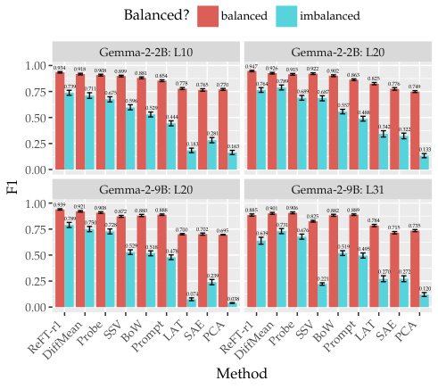

<!-- Start of picture text -->
Balanced? balanced imbalanced Gemma-2-2B: L10 Gemma-2-2B: L20 1.000.75 0.9340.7390.9180.7110.9080.6750.899 0.881 0.854 0.778 0.765 0.770 0.9470.7640.9260.7890.9150.6890.9220.6870.902 0.863 0.825 0.776 0.749 0.50 0.596 0.529 0.444 0.557 0.488 0.281 0.342 0.322 0.25 0.183 0.163 0.133 0.00 Gemma-2-9B: L20 Gemma-2-9B: L31 1.000.75 0.9390.7890.9210.7500.9080.7280.872 0.880 0.888 0.700 0.702 0.695 0.8850.6390.9010.7310.9060.6760.825 0.882 0.889 0.784 0.715 0.735 0.50 0.529 0.518 0.478 0.519 0.495 0.25 0.074 0.239 0.038 0.221 0.270 0.272 0.120 0.00 Method ReFT-r1DiffMeanProbeSSVBoWPromptLATSAEPCAReFT-r1DiffMeanProbeSSVBoWPromptLATSAEPCA F1 <!-- End of picture text -->

Figure 3: **C** Mean F1 scores vs. dataset balance. 

prefer to use models for which pretrained SAEs are available. We thus evaluate our methods on two open models, Gemma-2-2B-it and Gemma-2-9B-it (henceforth referred to without the -it suffix), from the Gemma-family, with corresponding SAEs released as GemmaScope. We evaluate our methods with model representations from the residual streams of layers 10 and 20 for Gemma-2-2B and layers 20 and 31 for Gemma-2-9B. We use SAEs from GemmaScope that are trained for these layers.12 To ensure a fair comparison, we perform separate hyperparameter-tuning for each method. Details can be found in Appendix K. 

### **5. Results** 

#### **5.1. C Concept detection** 

For concept detection, CONCEPT500 consists of passages of text with ground-truth labels for each concept. Each method provides us with token-level concept scores obtained from the representation of that token at a particular layer. To compute a passage-level score, we take the mean of the token-level concept scores. See Appendix M for a visualization of token-level concept scores. 

**AUROC.** In Table 1, we report the average area under the ROC curve (AUROC) for each method over all concepts. Overall, we find that DiffMean, Probe, and ReFT-r1 are the best performers with no statistically significant difference ( _p <_ 0 _._ 05) between any of them under a paired _t_ -test. Prompt, SAE-A, and SSV are not far behind and significantly outperform the remaining methods. LAT also performs better than random. Vanilla SAEs are thus sig- 

12For Gemma-2-2B, we follow the common practice to use SAEs for the base LM, as SAEs are not available for the instruction-tuned model at the time of publication (Lieberum et al., 2024). 

nificantly outperformed by five supervised methods, all of which are much cheaper to train using a limited amount of synthetic data. The remaining methods (PCA, IG, and IxG) perform poorly; PCA’s better-than-random performance is nevertheless impressive given its unsupervised nature. Additional results are given in Appendix C. 

**F1 score under class imbalance.** In real-world text, positive instances of concepts are much rarer than negative instances. We thus report F1 on both the balanced setting (50% positive instances) and an imbalanced setting with 3600 additional negative examples ( _≈_ 1% positive). We choose classification threshold by maximising F1, binarise the resulting predictions, and report statistics on this discrete classification. Figure 3 shows that the relative ordering of methods does not change substantially between the two settings; despite their sparsity, SAEs perform poorly, but LAT and PCA also degrade substantially. 

#### **5.2. S Model steering** 

For model steering, we take concept labels from CONCEPT500 and apply the (pre)trained steering methods to the base model and sample generations. We score the generations using an LM judge as described in §3.3. We additionally benchmark prompting, full-finetuning (SFT), and two parameter-efficient finetuning methods (LoReFT and LoRA) as non-steering baselines. 

For steering methods, we note that steering factor is an important hyperparameter. We select the optimal steering factor for each method independently for every concept based on which factor achieves the highest _overall_ steering score, as given by the LLM judge. Our actual steering 

|**Method**|**Gemm**|**a-2-2B**|**Gemm**|**a-2-9B**|**Avg.**|**Method**|**Gemm**|**a-2-2B**|**Gemm**|**a-2-9B**|**Avg.**|
|---|---|---|---|---|---|---|---|---|---|---|---|
||L10|L20|L20|L31|||L10|L20|L20|L31||
|Prompt|0.698|**0.731**|**1.075**|**1.072**|**0.894**|Prompt|**90.0**%|**91.5**%|**97.6**%|**99.1**%|**94.5**%|
|LoReFT|**0.701**|0.722|0.777|0.764|0.741|LoReFT|88.9%|88.2%|88.6%|90.3%|89.0%|
|SFT|0.637|0.714|—|—|_0.676_|SFT|**90.0**%|87.5%|—|—|_88.8_%|
|LoRA|0.637|0.641|0.602|0.580|0.615|LoRA|85.0%|83.4%|79.9%|81.5%|82.5%|
|ReFT-r1|0.633|0.509|0.630|0.401|0.543|ReFT-r1|85.2%|82.3%|83.6%|76.0%|81.8%|
|DiffMean|0.297|0.178|0.322|0.158|0.239|DiffMean|63.2%|55.2%|64.3%|52.2%|58.7%|
|SAE|0.177|0.151|0.191|0.140|0.165|SAE|50.0%|50.0%|50.0%|50.0%|50.0%|
|SAE-A|0.166|0.132|0.186|0.143|0.157|SAE-A|49.3%|46.6%|48.5%|50.7%|48.8%|
|LAT|0.117|0.130|0.127|0.134|0.127|LAT|43.5%|48.2%|42.7%|48.6%|45.8%|
|PCA|0.107|0.083|0.128|0.104|0.105|PCA|42.1%|42.9%|42.2%|45.4%|43.1%|
|Probe|0.095|0.091|0.108|0.099|0.098|Probe|40.4%|44.0%|41.9%|45.6%|43.0%|
|SSV|0.072|0.001|0.024|0.008|0.026|SSV|38.8%|32.0%|32.5%|34.0%|34.3%|

Table 2: **S** Mean overall steering scores for each method, after steering factor selection. Gray indicates nonrepresentation steering methods. 

Table 3: **S** Winrate against SAEs for each method, after steering factor selection. 

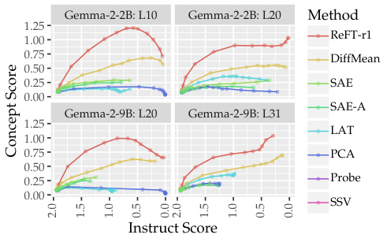

<!-- Start of picture text -->
Gemma-2-2B: L10 Gemma-2-2B: L20 Method 1.25 ReFT-r1 1.00 0.75 DiffMean 0.50 0.25 SAE 0.00 SAE-A Gemma-2-9B: L20 Gemma-2-9B: L31 1.25 LAT 1.00 0.75 PCA 0.50 0.25 Probe 0.00 SSV Instruct Score Concept Score 2.0 1.5 1.0 0.5 0.0 2.0 1.5 1.0 0.5 0.0 <!-- End of picture text -->

Figure 4: **S** Mean concept score vs. instruct score as the steering factor for each method is varied. 

magnitude (i.e., _α_ , as described in §4) is the product of the steering factor and the maximal activations aggregated over the evaluation dataset for concept detection.13 

**Overall scores.** We report the mean overall score for each method (i.e. the harmonic mean of three subscores: fluency, instruction-following, and concept presence) in Table 2. Prompting, along with slightly worse finetuning baselines, outperforms all steering methods on average, except for ReFT-r1. ReFT-r1 is competitive with prompting in Gemma-2-2B but significantly behind on Gemma-2-9B; prompting scores improve by a large margin on the larger model. Additionally, DiffMean significantly outperforms SAEs, particularly in earlier layers. 

The remaining supervised steering methods fail to beat SAEs, and no steering methods besides ReFT-r1 approach prompting or finetuning performance. Importantly, we note 

13For SAEs, we query Neuronpedia to obtain the maximal activation per concept. 

that SAE-A slightly underperforms the unsupervised SAE; better classification does not directly lead to better steering. 

**Winrate.** We compute winrates against SAEs by comparing overall scores on each concept under each setting. We treat ties as 0.5 wins and 0.5 losses. We report the results in Table 3. Again, ReFT-r1 (88.0%) and DiffMean (61.6%) achieve winrates of greater than 50% against SAEs, and relative rankings are similar to those for overall score. We note that DiffMean and ReFT-r1 show higher winrates on earlier layers in both models. 

**Steering factor.** We compare the effect of changing the steering factor on instruct vs. concept scores in Figure 4. We notice that increasing the factor monotonically reduces instruct score in all methods, i.e. larger steering vectors harm capabilities; this agrees with prior findings (Durmus et al., 2024; Chalnev et al., 2024). However, the effect varies by layer for concept score: concept score increases then decreases in earlier layers, while it roughly monotonically increases with steering factor in later layers. In all cases, ReFT-r1 traces a Pareto-optimal path, achieving the highest concept score for any chosen instruct score. 

### **6. Discussion** 

**Simple yet powerful baselines.** While representationlevel interventions have been shown to be useful in both enhancing model capabilities and for safety (see §2), they fail to outperform standard prompting and finetuning baselines on AXBENCH. This is sobering evidence of the current limitations of steering techniques. However, our results suggest that joint learning of concept detection and steering (as in ReFT-r1) may be the key to advancement. 

**SDL vs. SAEs.** We have shown that SDL methods can achieve similar scalability and better performance at a lower 

cost compared to SAEs. Unlike SAEs, SDL methods require concepts to be known _a priori_ ; however, SDLs can be easily augmented with new features without retraining. We also note that SDLs depend on high-quality data generators, whereas SAEs rely on high-quality concept discriminators. These methods are not mutually exclusive and can complement each other. 

**SAE concept label quality.** The concept lists used in this paper were adapted from Neuronpedia’s autointerpretability pipeline, which is often skewed towards token-level concepts and misses high-level abstractions. While we tried to do post-hoc SAE feature selection to mitigate this, the poor performance of SAEs is at least partially a reflection of the limitations of auto-interpretability. It would be interesting to explore whether the SAE performance on AXBENCH improves as better feature labelling methods are used and labels become less shallow (e.g. Choi et al., 2024). 

### **7. Conclusion** 

We introduced AXBENCH, a new benchmark for evaluating LM control methods at scale using synthetic data. To answer the question in the title of this work: our evaluation shows that even at SAE scale, representation steering is still _far behind_ simple prompting and finetuning baselines. Simultaneously, we showed that a novel steering method, ReFT-r1, is capable of _closing the gap_ to some extent; representationbased steering has not yet exhausted its potential. No matter the outcome, we believe that comprehensive evaluation benchmarks like AXBENCH are necessary for continued progress on this problem. 

### **Impact Statements** 

In this paper, we explore representation-based methods for steering language models and introduce AXBENCH, a largescale benchmark for evaluating these techniques. We believe that the immediate ethical and societal implications of our research are minimal. However, we recognize that enhanced control over language model outputs could potentially be misused to reinforce biases or manipulate information. To address these concerns, we advocate for the responsible application of steering methods and ensure transparency by publicly releasing our datasets and feature dictionaries. We encourage ongoing collaboration and dialogue within the research community to monitor and mitigate any unintended consequences of these technologies. 

### **Acknowledgements** 

We thank Robert Csord´ as, Qinan Yu, and Jiuding Sun for´ constant and extremely helpful feedback during our weekly 

interp meetings; Jake Mendel for enlightening discussion about the direction and framing of the work; Neel Nanda for helpful suggestions on SAE feature selection; and Chenglei Si, Ken Ziyu Liu, Oam Patel, Luke Bailey, Harshit Joshi, Yanzhe ‘Sanju’ Zhang, Nikil Roashan Selvam, Julie Kallini, Omar Shaikh, Thomas Chen, Tristan Thrush, and Yangjun Ruan for various helpful discussions. We thank Joseph Tey and Nick Jiang for pointing out equation typos in an earlier draft. 

This research is supported in part by grants from Open Philanthropy. 

### **References** 

- Usman Anwar, Abulhair Saparov, Javier Rando, Daniel Paleka, Miles Turpin, Peter Hase, Ekdeep Singh Lubana, Erik Jenner, Stephen Casper, Oliver Sourbut, Benjamin L. Edelman, Zhaowei Zhang, Mario Gunther,¨ Anton Korinek, Jose Hernandez-Orallo, Lewis Hammond, Eric Bigelow, Alexander Pan, Lauro Langosco, Tomasz Korbak, Heidi Zhang, Ruiqi Zhong, Sean´ O h´ Eigeartaigh,´ Gabriel Recchia, Giulio Corsi, Alan Chan, Markus Anderljung, Lilian Edwards, Aleksandar Petrov, Christian Schroeder de Witt, Sumeet Ramesh Motwan, Yoshua Bengio, Danqi Chen, Philip H. S. Torr, Samuel Albanie, Tegan Maharaj, Jakob Foerster, Florian Tramer, He He, Atoosa Kasirzadeh, Yejin Choi, and David Krueger. Foundational challenges in assuring alignment and safety of large language models. _arXiv:2404.09932_ , 2024. URL https://arxiv.org/abs/2404.09932. 

- Yonatan Belinkov, Nadir Durrani, Fahim Dalvi, Hassan Sajjad, and James Glass. What do neural machine translation models learn about morphology? In Regina Barzilay and Min-Yen Kan, editors, _Proceedings of the 55th Annual Meeting of the Association for Computational Linguistics (Volume 1: Long Papers)_ , pages 861–872, Vancouver, Canada, July 2017. Association for Computational Linguistics. doi: 10.18653/v1/P17-1080. URL https://aclanthology.org/P17-1080. 

- Usha Bhalla, Suraj Srinivas, Asma Ghandeharioun, and Himabindu Lakkaraju. Towards unifying interpretability and control: Evaluation via intervention. _arXiv:2411.04430_ , 2025. URL https://arxiv.org/ abs/2411.04430. 

- Steven Bills, Nick Cammarata, Dan Mossing, Henk Tillman, Leo Gao, Gabriel Goh, Ilya Sutskever, Jan Leike, Jeff Wu, and William Saunders. Language models can explain neurons in language models, 2023. URL https://openaipublic.blob.core.windows.net/ neuron-explainer/paper/index.html. 

Tolga Bolukbasi, Kai-Wei Chang, James Y. Zou, Venkatesh 

Saligrama, and Adam T. Kalai. Man is to computer programmer as woman is to homemaker? Debiasing word embeddings. In D. Lee, M. Sugiyama, U. Luxburg, I. Guyon, and R. Garnett, editors, _Advances in Neural Information Processing Systems_ , volume 29. Curran Associates, Inc., 2016. URL https://proceedings. neurips.cc/paper ~~f~~ iles/paper/2016/file/ a486cd07e4ac3d270571622f4f316ec5-Paper.pdf. 

- Joschka Braun, Dmitrii Krasheninnikov, Usman Anwar, Robert Kirk, Daniel Tan, and David Scott Krueger. A sober look at steering vectors for LLMs. In _Alignment Forum_ , 2024. URL https://www. alignmentforum.org/posts/QQP4nq7TXg89CJGBh/ a-sober-look-at-steering-vectors-for-llms. 

- Stephen Casper, Lennart Schulze, Oam Patel, and Dylan Hadfield-Menell. Defending against unforeseen failure modes with latent adversarial training, 2024. URL https: //arxiv.org/abs/2403.05030. 

- Sviatoslav Chalnev, Matthew Siu, and Arthur Conmy. Improving steering vectors by targeting sparse autoencoder features. _arXiv:2411.02193_ , 2024. URL https://arxiv. org/abs/2411.02193. 

- Lawrence Chan, Adria` Garriga-Alonso, Nicholas Goldowsky-Dill, Ryan Greenblatt, Jenny Nitishinskaya, Ansh Radhakrishnan, Buck Shlegeris, and Nate Thomas. Causal scrubbing: A method for rigorously testing interpretability hypotheses. In _Alignment Forum_ , 2022. URL https://shorturl.at/jZoHi. 

- Dami Choi, Vincent Huang, Kevin Meng, Daniel D. Johnson, Jacob Steinhardt, and Sarah Schwettmann. Scaling automatic neuron description, October 2024. URL https://transluce.org/neuron-descriptions. 

- Alexis Conneau, German Kruszewski, Guillaume Lample, Lo¨ıc Barrault, and Marco Baroni. What you can cram into a single $&!#* vector: Probing sentence embeddings for linguistic properties. In Iryna Gurevych and Yusuke Miyao, editors, _Proceedings of the 56th Annual Meeting of the Association for Computational Linguistics (Volume 1: Long Papers)_ , pages 2126–2136, Melbourne, Australia, July 2018. Association for Computational Linguistics. doi: 10.18653/v1/P18-1198. URL https://aclanthology.org/P18-1198. 

- Esin Durmus, Alex Tamkin, Jack Clark, Jerry Wei, Jonathan Marcus, Joshua Batson, Kunal Handa, Liane Lovitt, Meg Tong, Miles McCain, Oliver Rausch, Saffron Huang, Sam Bowman, Stuart Ritchie, Tom Henighan, and Deep Ganguli. Evaluating feature steering: A case study in mitigating social biases, 2024. URL https://anthropic.com/ research/evaluating-feature-steering. 

- Nelson Elhage, Tristan Hume, Catherine Olsson, Nicholas Schiefer, Tom Henighan, Shauna Kravec, Zac HatfieldDodds, Robert Lasenby, Dawn Drain, Carol Chen, Roger Grosse, Sam McCandlish, Jared Kaplan, Dario Amodei, Martin Wattenberg, and Christopher Olah. Toy models of superposition. _Transformer Circuits Thread_ , 2022. URL https://transformer-circuits.pub/ 2022/toy ~~m~~ odel/index.html. 

- Leo Gao, Tom Dupre la Tour, Henk Tillman, Gabriel Goh,´ Rajan Troll, Alec Radford, Ilya Sutskever, Jan Leike, and Jeffrey Wu. Scaling and evaluating sparse autoencoders, 2024. URL https://arxiv.org/abs/2406.04093. 

- Atticus Geiger, Hanson Lu, Thomas Icard, and Christopher Potts. Causal abstractions of neural networks. In M. Ranzato, A. Beygelzimer, Y. Dauphin, P.S. Liang, and J. Wortman Vaughan, editors, _Advances in Neural Information Processing Systems_ , volume 34, pages 9574–9586. Curran Associates, Inc., 2021. URL https://proceedings. neurips.cc/paper ~~f~~ iles/paper/2021/file/ 4f5c422f4d49a5a807eda27434231040-Paper.pdf. 

- Atticus Geiger, Zhengxuan Wu, Hanson Lu, Josh Rozner, Elisa Kreiss, Thomas Icard, Noah D. Goodman, and Christopher Potts. Inducing causal structure for interpretable neural networks. In Kamalika Chaudhuri, Stefanie Jegelka, Le Song, Csaba Szepesvari,´ Gang Niu, and Sivan Sabato, editors, _International Conference on Machine Learning, ICML 2022_ , volume 162 of _Proceedings of Machine Learning Research_ , pages 7324–7338, Baltimore, Maryland, USA, 2022. PMLR. URL https: //proceedings.mlr.press/v162/geiger22a.html. 

- Atticus Geiger, Duligur Ibeling, Amir Zur, Maheep Chaudhary, Sonakshi Chauhan, Jing Huang, Aryaman Arora, Zhengxuan Wu, Noah Goodman, Christopher Potts, and Thomas Icard. Causal abstraction: A theoretical foundation for mechanistic interpretability. _arXiv:2301.04709_ , 2024. URL https://arxiv.org/abs/2301.04709. 

- Gemma Team, Morgane Riviere, Shreya Pathak, Pier Giuseppe Sessa, Cassidy Hardin, Surya Bhupatiraju, Leonard´ Hussenot, Thomas Mesnard, Bobak Shahriari, Alexandre Rame,´ Johan Ferret, Peter Liu, Pouya Tafti, Abe Friesen, Michelle Casbon, Sabela Ramos, Ravin Kumar, Charline Le Lan, Sammy Jerome, Anton Tsitsulin, Nino Vieillard, Piotr Stanczyk, Sertan Girgin, Nikola Momchev, Matt Hoffman, Shantanu Thakoor, Jean-Bastien Grill, Behnam Neyshabur, Olivier Bachem, Alanna Walton, Aliaksei Severyn, Alicia Parrish, Aliya Ahmad, Allen Hutchison, Alvin Abdagic, Amanda Carl, Amy Shen, Andy Brock, Andy Coenen, Anthony Laforge, Antonia Paterson, Ben Bastian, Bilal Piot, Bo Wu, Brandon Royal, Charlie Chen, Chintu Kumar, Chris Perry, Chris Welty, Christopher A. 

Choquette-Choo, Danila Sinopalnikov, David Weinberger, Dimple Vijaykumar, Dominika Rogozinska,´ Dustin Herbison, Elisa Bandy, Emma Wang, Eric Noland, Erica Moreira, Evan Senter, Evgenii Eltyshev, Francesco Visin, Gabriel Rasskin, Gary Wei, Glenn Cameron, Gus Martins, Hadi Hashemi, Hanna Klimczak-Plucinska,´ Harleen Batra, Harsh Dhand, Ivan Nardini, Jacinda Mein, Jack Zhou, James Svensson, Jeff Stanway, Jetha Chan, Jin Peng Zhou, Joana Carrasqueira, Joana Iljazi, Jocelyn Becker, Joe Fernandez, Joost van Amersfoort, Josh Gordon, Josh Lipschultz, Josh Newlan, Ju yeong Ji, Kareem Mohamed, Kartikeya Badola, Kat Black, Katie Millican, Keelin McDonell, Kelvin Nguyen, Kiranbir Sodhia, Kish Greene, Lars Lowe Sjoesund, Lauren Usui, Laurent Sifre, Lena Heuermann, Leticia Lago, Lilly McNealus, Livio Baldini Soares, Logan Kilpatrick, Lucas Dixon, Luciano Martins, Machel Reid, Manvinder Singh, Mark Iverson, Martin Gorner, Mat Velloso, Mateo¨ Wirth, Matt Davidow, Matt Miller, Matthew Rahtz, Matthew Watson, Meg Risdal, Mehran Kazemi, Michael Moynihan, Ming Zhang, Minsuk Kahng, Minwoo Park, Mofi Rahman, Mohit Khatwani, Natalie Dao, Nenshad Bardoliwalla, Nesh Devanathan, Neta Dumai, Nilay Chauhan, Oscar Wahltinez, Pankil Botarda, Parker Barnes, Paul Barham, Paul Michel, Pengchong Jin, Petko Georgiev, Phil Culliton, Pradeep Kuppala, Ramona Comanescu, Ramona Merhej, Reena Jana, Reza Ardeshir Rokni, Rishabh Agarwal, Ryan Mullins, Samaneh Saadat, Sara Mc Carthy, Sarah Cogan, Sarah Perrin, Sebastien´ M. R. Arnold, Sebastian Krause, Shengyang Dai, Shruti Garg, Shruti Sheth, Sue Ronstrom, Susan Chan, Timothy Jordan, Ting Yu, Tom Eccles, Tom Hennigan, Tomas Kocisky, Tulsee Doshi, Vihan Jain, Vikas Yadav, Vilobh Meshram, Vishal Dharmadhikari, Warren Barkley, Wei Wei, Wenming Ye, Woohyun Han, Woosuk Kwon, Xiang Xu, Zhe Shen, Zhitao Gong, Zichuan Wei, Victor Cotruta, Phoebe Kirk, Anand Rao, Minh Giang, Ludovic Peran, Tris Warkentin, Eli Collins, Joelle Barral, Zoubin Ghahramani, Raia Hadsell, D. Sculley, Jeanine Banks, Anca Dragan, Slav Petrov, Oriol Vinyals, Jeff Dean, Demis Hassabis, Koray Kavukcuoglu, Clement Farabet, Elena Buchatskaya, Sebastian Borgeaud, Noah Fiedel, Armand Joulin, Kathleen Kenealy, Robert Dadashi, and Alek Andreev. Gemma 2: Improving open language models at a practical size. _arXiv:2408.00118_ , 2024. URL https://arxiv.org/abs/2408.00118. 

- Mario Giulianelli, Jack Harding, Florian Mohnert, Dieuwke Hupkes, and Willem Zuidema. Under the hood: Using diagnostic classifiers to investigate and improve how language models track agreement information. In Tal Linzen, Grzegorz Chrupała, and Afra Alishahi, editors, _Proceedings of the 2018 EMNLP Workshop BlackboxNLP: Analyzing and Interpreting Neural Networks_ 

- _for NLP_ , pages 240–248, Brussels, Belgium, November 2018. Association for Computational Linguistics. doi: 10.18653/v1/W18-5426. URL https://aclanthology. org/W18-5426. 

- Gabriel Goh. Decoding the thought vector, 2017. URL https://gabgoh.github.io/ThoughtVectors/. 

- Nicholas Goldowsky-Dill, Chris MacLeod, Lucas Sato, and Aryaman Arora. Localizing model behavior with path patching. _arXiv:2304.05969_ , 2023. URL https: //arxiv.org/abs/2304.05969. 

- Clement´ Guerner, Anej Svete, Tianyu Liu, Alexander Warstadt, and Ryan Cotterell. A geometric notion of causal probing. _arXiv:2307.15054_ , 2024. URL https: //arxiv.org/abs/2307.15054. 

- John Hewitt and Christopher D. Manning. A structural probe for finding syntax in word representations. In Jill Burstein, Christy Doran, and Thamar Solorio, editors, _Proceedings of the 2019 Conference of the North American Chapter of the Association for Computational Linguistics: Human Language Technologies, Volume 1 (Long and Short Papers)_ , pages 4129–4138, Minneapolis, Minnesota, June 2019. Association for Computational Linguistics. doi: 10.18653/v1/N19-1419. URL https://aclanthology.org/N19-1419. 

- Edward J. Hu, Yelong Shen, Phillip Wallis, Zeyuan Allen-Zhu, Yuanzhi Li, Shean Wang, Lu Wang, and Weizhu Chen. LoRA: Low-rank adaptation of large language models. In _The Tenth International Conference on Learning Representations, ICLR 2022_ , Virtual Event, 2022. URL https://openreview.net/forum? id=nZeVKeeFYf9. 

- Robert Huben, Hoagy Cunningham, Logan Riggs, Aidan Ewart, and Lee Sharkey. Sparse autoencoders find highly interpretable features in language models. In _The Twelfth International Conference on Learning Representations, ICLR 2024_ , Vienna, Austria, 2024. OpenReview.net. URL https://openreview.net/forum?id=F76bwRSLeK. 

- Caden Juang, Gonc¸alo Paulo, Jacob Drori, and Nora Belrose. Open source automated interpretability for sparse autoencoder features, 2024. URL https://blog.eleuther. ai/autointerp/. 

- Dan Jurafsky and James H. Martin. _Speech and Language Processing_ . Online, 2025. URL https://web. stanford.edu/_∼_ jurafsky/slp3/. 3rd ed. draft. 

- Adam Karvonen, Dhruv Pai, Mason Wang, and Ben Keigwin. Sieve: SAEs beat baselines on a real-world task (a code generation case study). _Tilde Research Blog_ , 2024. URL https://www.tilderesearch.com/blog/sieve. Blog post. 

- Michael Lan, Philip Torr, Austin Meek, Ashkan Khakzar, David Krueger, and Fazl Barez. Sparse autoencoders reveal universal feature spaces across large language models. _arXiv:2410.06981_ , 2024. URL https://arxiv. org/abs/2410.06981. 

- Anders Boesen Lindbo Larsen, Søren Kaae Sønderby, Hugo Larochelle, and Ole Winther. Autoencoding beyond pixels using a learned similarity metric. In Maria-Florina Balcan and Kilian Q. Weinberger, editors, _Proceedings of the 33nd International Conference on Machine Learning, ICML 2016, New York City, NY, USA, June 19-24, 2016_ , volume 48 of _JMLR Workshop and Conference Proceedings_ , pages 1558–1566. JMLR.org, 2016. URL http: //proceedings.mlr.press/v48/larsen16.html. 

- Kenneth Li, Oam Patel, Fernanda Viegas, Hanspeter Pfis-´ ter, and Martin Wattenberg. Inference-time intervention: Eliciting truthful answers from a language model. _Advances in Neural Information Processing Systems_ , 36, 2024. URL https://arxiv.org/abs/2306.03341. 

- Xuechen Li, Tianyi Zhang, Yann Dubois, Rohan Taori, Ishaan Gulrajani, Carlos Guestrin, Percy Liang, and Tatsunori B. Hashimoto. AlpacaEval: An automatic evaluator of instruction-following models. https://github. com/tatsu-lab/alpaca ~~e~~ val, 5 2023. 

- Tom Lieberum, Senthooran Rajamanoharan, Arthur Conmy, Lewis Smith, Nicolas Sonnerat, Vikrant Varma, Janos Kramar, Anca Dragan, Rohin Shah, and Neel Nanda. Gemma scope: Open sparse autoencoders everywhere all at once on gemma 2. In Yonatan Belinkov, Najoung Kim, Jaap Jumelet, Hosein Mohebbi, Aaron Mueller, and Hanjie Chen, editors, _Proceedings of the 7th BlackboxNLP Workshop: Analyzing and Interpreting Neural Networks for NLP_ , pages 278–300, Miami, Florida, US, November 2024. Association for Computational Linguistics. doi: 10.18653/v1/2024.blackboxnlp-1.19. URL https: //aclanthology.org/2024.blackboxnlp-1.19. 

- Sheng Liu, Haotian Ye, Lei Xing, and James Y. Zou. Incontext vectors: Making in context learning more effective and controllable through latent space steering. In _Forty-first International Conference on Machine Learning, ICML 2024, Vienna, Austria, July 21-27, 2024_ . OpenReview.net, 2024. URL https://openreview.net/ forum?id=dJTChKgv3a. 

- Aleksandar Makelov. Sparse autoencoders match supervised features for model steering on the IOI task. In _ICML 2024 Workshop on Mechanistic Interpretability_ , 2024. URL https://openreview.net/forum?id=JdrVuEQih5. 

- Samuel Marks and Max Tegmark. The geometry of truth: Emergent linear structure in large language model repre- 

sentations of true/false datasets. _arXiv:2310.06824_ , 2024. URL https://arxiv.org/abs/2310.06824. 

- Harry Mayne, Yushi Yang, and Adam Mahdi. Can sparse autoencoders be used to decompose and interpret steering vectors? _arXiv:2411.08790_ , 2024. URL https://arxiv. org/abs/2411.08790. 

- Kevin Meng, David Bau, Alex Andonian, and Yonatan Belinkov. Locating and editing factual associations in GPT. In S. Koyejo, S. Mohamed, A. Agarwal, D. Belgrave, K. Cho, and A. Oh, editors, _Advances in Neural Information Processing Systems_ , volume 35, pages 17359–17372. Curran Associates, Inc., 2022. URL https://arxiv.org/abs/2202.05262. 

- Tomas´ Mikolov, Ilya Sutskever, Kai Chen, Gregory S. Corrado, and Jeffrey Dean. Distributed representations of words and phrases and their compositionality. In Christopher J. C. Burges, Leon´ Bottou, Zoubin Ghahramani, and Kilian Q. Weinberger, editors, _Advances in Neural Information Processing Systems 26: 27th Annual Conference on Neural Information Processing Systems 2013. Proceedings of a meeting held December 5-8, 2013, Lake Tahoe, Nevada, United States_ , pages 3111–3119, 2013a. URL https: //proceedings.neurips.cc/paper/2013/hash/ 9aa42b31882ec039965f3c4923ce901b-Abstract. html. 

- Tomas Mikolov, Wen-tau Yih, and Geoffrey Zweig. Linguistic regularities in continuous space word representations. In Lucy Vanderwende, Hal Daume III, and Ka-´ trin Kirchhoff, editors, _Proceedings of the 2013 Conference of the North American Chapter of the Association for Computational Linguistics: Human Language Technologies_ , pages 746–751, Atlanta, Georgia, June 2013b. Association for Computational Linguistics. URL https://aclanthology.org/N13-1090/. 

- Ulisse Mini, Peli Grietzer, Mrinank Sharma, Austin Meek, Monte MacDiarmid, and Alexander Matt Turner. Understanding and controlling a maze-solving policy network. _arXiv:2310.08043_ , 2023. URL https://arxiv.org/ abs/2310.08043. 

- Neel Nanda, Andrew Lee, and Martin Wattenberg. Emergent linear representations in world models of selfsupervised sequence models. In Yonatan Belinkov, Sophie Hao, Jaap Jumelet, Najoung Kim, Arya McCarthy, and Hosein Mohebbi, editors, _Proceedings of the 6th BlackboxNLP Workshop: Analyzing and Interpreting Neural Networks for NLP_ , pages 16–30, Singapore, December 2023. Association for Computational Linguistics. doi: 10.18653/v1/2023.blackboxnlp-1.2. URL https: //aclanthology.org/2023.blackboxnlp-1.2/. 

- Kyle O’Brien, David Majercak, Xavier Fernandes, Richard Edgar, Jingya Chen, Harsha Nori, Dean Carignan, Eric Horvitz, and Forough Poursabzi-Sangde. Steering language model refusal with sparse autoencoders. _arXiv:2411.11296_ , 2024. URL https://arxiv.org/ abs/2411.11296. 

- Kiho Park, Yo Joong Choe, and Victor Veitch. The linear representation hypothesis and the geometry of large language models. _arXiv:2311.03658_ , 2023. URL https: //arxiv.org/abs/2311.03658. 

- Fabian Pedregosa, Gael Varoquaux,¨ Alexandre Gramfort, Vincent Michel, Bertrand Thirion, Olivier Grisel, Mathieu Blondel, Peter Prettenhofer, Ron Weiss, Vincent Dubourg, Jake VanderPlas, Alexandre Passos, David Cournapeau, Matthieu Brucher, Matthieu Perrot, and Edouard Duchesnay. Scikit-learn: Machine learning in Python. _The Journal of Machine Learning Research_ , 12:2825–2830, 2011. doi: 10.5555/1953048.2078195. URL https: //dl.acm.org/doi/10.5555/1953048.2078195. 

- Jeffrey Pennington, Richard Socher, and Christopher Manning. GloVe: Global vectors for word representation. In Alessandro Moschitti, Bo Pang, and Walter Daelemans, editors, _Proceedings of the 2014 Conference on Empirical Methods in Natural Language Processing (EMNLP)_ , pages 1532–1543, Doha, Qatar, October 2014. Association for Computational Linguistics. doi: 10.3115/v1/D14-1162. URL https://aclanthology. org/D14-1162. 

- Itamar Pres, Laura Ruis, Ekdeep Singh Lubana, and David Krueger. Towards reliable evaluation of behavior steering interventions in LLMs, 2024. URL https://arxiv. org/abs/2410.17245. 

- Nina Rimsky, Nick Gabrieli, Julian Schulz, Meg Tong, Evan Hubinger, and Alexander Turner. Steering Llama 2 via contrastive activation addition. In Lun-Wei Ku, Andre Martins, and Vivek Srikumar, editors, _Proceedings of the 62nd Annual Meeting of the Association for Computational Linguistics (Volume 1: Long Papers)_ , pages 15504–15522, Bangkok, Thailand, August 2024. Association for Computational Linguistics. doi: 10.18653/v1/2024.acl-long.828. URL https:// aclanthology.org/2024.acl-long.828. 

- Naomi Saphra and Sarah Wiegreffe. Mechanistic? In Yonatan Belinkov, Najoung Kim, Jaap Jumelet, Hosein Mohebbi, Aaron Mueller, and Hanjie Chen, editors, _Proceedings of the 7th BlackboxNLP Workshop: Analyzing and Interpreting Neural Networks for NLP_ , pages 480– 498, Miami, Florida, US, November 2024. Association for Computational Linguistics. doi: 10.18653/v1/2024. blackboxnlp-1.30. URL https://aclanthology.org/ 2024.blackboxnlp-1.30/. 

- Nishant Subramani, Nivedita Suresh, and Matthew Peters. Extracting latent steering vectors from pretrained language models. In Smaranda Muresan, Preslav Nakov, and Aline Villavicencio, editors, _Findings of the Association for Computational Linguistics: ACL 2022_ , pages 566–581, Dublin, Ireland, May 2022. Association for Computational Linguistics. doi: 10.18653/ v1/2022.findings-acl.48. URL https://aclanthology. org/2022.findings-acl.48. 

- Mukund Sundararajan, Ankur Taly, and Qiqi Yan. Axiomatic attribution for deep networks. In _Proceedings of the 34th International Conference on Machine Learning - Volume 70_ , ICML’17, page 3319–3328. JMLR.org, 2017. 

- Adly Templeton, Tom Conerly, Jonathan Marcus, Jack Lindsey, Trenton Bricken, Brian Chen, Adam Pearce, Craig Citro, Emmanuel Ameisen, Andy Jones, Hoagy Cunningham, Nicholas L Turner, Callum McDougall, Monte MacDiarmid, C. Daniel Freeman, Theodore R. Sumers, Edward Rees, Joshua Batson, Adam Jermyn, Shan Carter, Chris Olah, and Tom Henighan. Scaling monosemanticity: Extracting interpretable features from Claude 3 Sonnet. _Transformer Circuits Thread_ , 2024. URL https://transformer-circuits.pub/ 2024/scaling-monosemanticity/index.html. 

- Alexander Matt Turner, Peli Grietzer, Ulisse Mini, Monte M, and David Udell. Understanding and controlling a maze-solving policy network. _Alignment Forum_ , March 2023a. URL https://shorturl.at/XGtmh. 

- Alexander Matt Turner, Peli Grietzer, and Lisa Thiergart. Maze-solving agents: Add a top-right vector, make the agent go to the top-right. _Alignment Forum_ , March 2023b. URL https://shorturl.at/7Qdy9. 

- Alexander Matt Turner, Lisa Thiergart, Gavin Leech, David Udell, Juan J. Vazquez, Ulisse Mini, and Monte MacDiarmid. Steering language models with activation engineering. _arXiv:2308.10248_ , 2024. URL https: //arxiv.org/abs/2308.10248. 

- Paul Upchurch, Jacob R. Gardner, Geoff Pleiss, Robert Pless, Noah Snavely, Kavita Bala, and Kilian Q. Weinberger. Deep feature interpolation for image content changes. In _2017 IEEE Conference on Computer Vision and Pattern Recognition, CVPR 2017, Honolulu, HI, USA, July 21-26, 2017_ , pages 6090–6099. IEEE Computer Society, 2017. doi: 10.1109/CVPR.2017.645. URL https://doi.org/10.1109/CVPR.2017.645. 

- Teun van der Weij, Massimo Poesio, and Nandi Schoots. Extending activation steering to broad skills and multiple behaviours. _arXiv:2403.05767_ , 2024. URL https:// arxiv.org/abs/2403.05767. 

- Jesse Vig, Sebastian Gehrmann, Yonatan Belinkov, Sharon Qian, Daniel Nevo, Yaron Singer, and Stuart Shieber. Investigating gender bias in language models using causal mediation analysis. In H. Larochelle, M. Ranzato, R. Hadsell, M.F. Balcan, and H. Lin, editors, _Advances in Neural Information Processing Systems_ , volume 33, pages 12388–12401. Curran Associates, Inc., 2020. URL https://proceedings. neurips.cc/paper ~~f~~ iles/paper/2020/file/ 92650b2e92217715fe312e6fa7b90d82-Paper.pdf. 

- Eric Wallace, Jens Tuyls, Junlin Wang, Sanjay Subramanian, Matt Gardner, and Sameer Singh. AllenNLP interpret: A framework for explaining predictions of NLP models. In _Proceedings of the 2019 Conference on Empirical Methods in Natural Language Processing and the 9th International Joint Conference on Natural Language Processing (EMNLP-IJCNLP): System Demonstrations_ , pages 7–12, 2019. 

- Kevin Ro Wang, Alexandre Variengien, Arthur Conmy, Buck Shlegeris, and Jacob Steinhardt. Interpretability in the wild: a circuit for indirect object identification in GPT-2 small. In _The Eleventh International Conference on Learning Representations, ICLR 2023_ , Kigali, Rwanda, 2023. URL https://openreview.net/pdf? id=NpsVSN6o4ul. 

_American Chapter of the Association for Computational Linguistics: Human Language Technologies (Volume 3: System Demonstrations)_ , pages 158–165, Mexico City, Mexico, June 2024b. Association for Computational Linguistics. doi: 10.18653/v1/2024.naacl-demo.16. URL https://aclanthology.org/2024.naacl-demo.16. 

   - Andy Zou, Long Phan, Sarah Chen, James Campbell, Phillip Guo, Richard Ren, Alexander Pan, Xuwang Yin, Mantas Mazeika, Ann-Kathrin Dombrowski, Shashwat Goel, Nathaniel Li, Michael J. Byun, Zifan Wang, Alex Mallen, Steven Basart, Sanmi Koyejo, Dawn Song, Matt Fredrikson, J. Zico Kolter, and Dan Hendrycks. Representation engineering: A top-down approach to AI transparency. _arXiv:2310.01405_ , 2023. URL https: //arxiv.org/abs/2310.01405. 

   - Andy Zou, Long Phan, Justin Wang, Derek Duenas, Maxwell Lin, Maksym Andriushchenko, Rowan Wang, Zico Kolter, Matt Fredrikson, and Dan Hendrycks. Improving alignment and robustness with circuit breakers, 2024. URL https://arxiv.org/abs/2406.04313. 

- Yulin Wang, Xuran Pan, Shiji Song, Hong Zhang, Gao Huang, and Cheng Wu. Implicit semantic data augmentation for deep networks. In Hanna M. Wallach, Hugo Larochelle, Alina Beygelzimer, Florence d’Alche-Buc,´ Emily B. Fox, and Roman Garnett, editors, _Advances in Neural Information Processing Systems 32: Annual Conference on Neural Information Processing Systems 2019, NeurIPS 2019, December 8-14, 2019, Vancouver, BC, Canada_ , pages 12614–12623, 2019. URL https: //proceedings.neurips.cc/paper/2019/hash/ 15f99f2165aa8c86c9dface16fefd281-Abstract. html. 

- Tom White. Sampling generative networks. _arXiv:1609.04468_ , 2016. URL https://arxiv. org/abs/1609.04468. 

- Zhengxuan Wu, Aryaman Arora, Zheng Wang, Atticus Geiger, Dan Jurafsky, Christopher D. Manning, and Christopher Potts. ReFT: Representation finetuning for language models. _arXiv:2404.03592_ , 2024a. URL https://arxiv.org/abs/2404.03592. 

- Zhengxuan Wu, Atticus Geiger, Aryaman Arora, Jing Huang, Zheng Wang, Noah Goodman, Christopher Manning, and Christopher Potts. pyvene: A library for understanding and improving PyTorch models via interventions. In Kai-Wei Chang, Annie Lee, and Nazneen Rajani, editors, _Proceedings of the 2024 Conference of the North_ 

# **Appendix** 

### **A. Historical notes on steering** 

_Inspired by Jurafsky and Martin (2025) and noting the sociological observations about (mechanistic) interpretability as a field in Saphra and Wiegreffe (2024), we offer some historical notes on the development of steering as a field in an effort to document and properly cite where these ideas came from._ 

_Steering_ refers to applying interventions (usually adding a fixed vector) to the activation space of a neural model in order to control its generations. Early precursors to steering noted that linear subspaces of the representation space of pretrained word vectors seemed to encode meaningful concepts (Mikolov et al., 2013a; Pennington et al., 2014; Bolukbasi et al., 2016). 

Larsen et al. (2016) first used the _difference-in-means_ technique to extract visual _attribute vectors_ from GAN discriminators in order to steer generator outputs; this technique was widely adopted in computer vision (White, 2016; Upchurch et al., 2017; Goh, 2017; Wang et al., 2019). 

In NLP, initial work by Subramani et al. (2022) proposed _steering vectors_ , learned to maximise the probability of some output, as an alternative to expensive fine-tuning and unreliable prompt optimisation for the task of controllable text generation. Soon after, steering was also use to localise behaviours in a maze-searching RL agent (Turner et al., 2023a;b; Mini et al., 2023). Variations on this approach (sometimes using difference-in-means or other closed-form expressions to compute the vector) were adopted by researchers in _mechanistic interpretability_ from late 2023 for AI safety (Zou et al., 2023; Li et al., 2024; Turner et al., 2024; Marks and Tegmark, 2024; Rimsky et al., 2024) and later as a general-purpose but localised and parameter-efficient alternative to finetuning (Wu et al., 2024a; Liu et al., 2024; van der Weij et al., 2024). 

_Sparse autoencoders_ (SAEs), a scalable technique for self-supervised rank-one linear feature discovery via dictionary learning, are also increasingly used to find or learn steering vectors (Templeton et al., 2024; Chalnev et al., 2024; Makelov, 2024; O’Brien et al., 2024). 

### **B. SAE concept list** 

We use SAE concept lists to enable a fair comparison with SAEs, which were annotated mostly by gpt-3.5-turbo or gpt-4o-mini. These concept lists are released by Neuronpedia and were scraped by the authors of this paper in November 2024. We utilize the concept lists from four SAEs from GemmaScope: 10-gemmascope-res-16k for the Gemma-2-2B base model and 20-gemmascope-res-131k for the Gemma-2-9B instruction-tuned model, where we scraped a maximum of 16K concepts. 

### **C. Detailed analysis** 

#### **C.1. C Concept detection** 

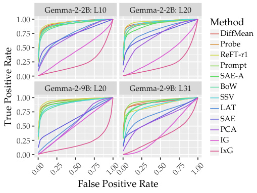

<!-- Start of picture text -->
Gemma-2-2B: L10 Gemma-2-2B: L20 1.00 Method 0.75 DiffMean Probe 0.50 ReFT-r1 0.25 Prompt 0.00 SAE-A Gemma-2-9B: L20 Gemma-2-9B: L31 BoW 1.00 SSV LAT 0.75 SAE 0.50 PCA 0.25 IG IxG 0.00 False Positive Rate 0.00 0.25 0.50 0.75 1.000.00 0.25 0.50 0.75 1.00 True Positive Rate <!-- End of picture text -->

Figure 5: **C** Mean ROC curves over all concepts. 

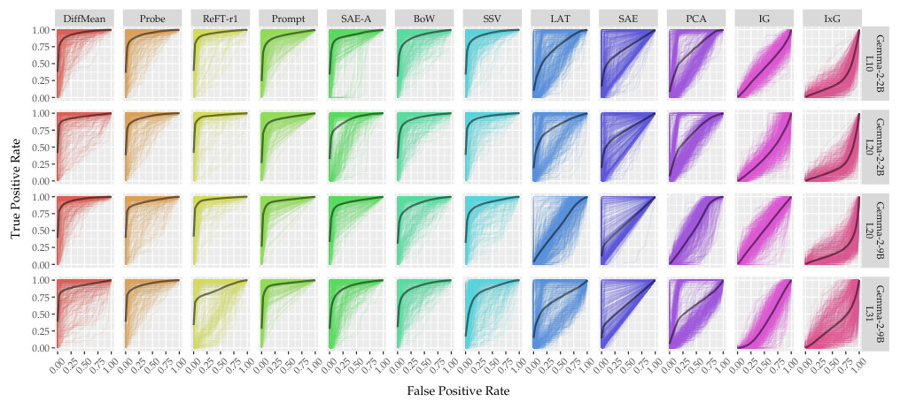

<!-- Start of picture text -->
DiffMean Probe ReFT-r1 Prompt SAE-A BoW SSV LAT SAE PCA IG IxG 1.00 0.75 0.50 0.25 0.00 1.00 0.75 0.50 0.25 0.00 1.00 0.75 0.50 0.25 0.00 1.00 0.75 0.50 0.25 0.00 False Positive Rate 0.000.250.500.751.000.000.250.500.751.000.000.250.500.751.000.000.250.500.751.000.000.250.500.751.000.000.250.500.751.000.000.250.500.751.000.000.250.500.751.000.000.250.500.751.000.000.250.500.751.000.000.250.500.751.000.000.250.500.751.00 L10 Gemma-2-2B L20 Gemma-2-2B True Positive Rate L20 Gemma-2-9B L31 Gemma-2-9B <!-- End of picture text -->

Figure 6: All ROC curves. 

#### **C.2. S Model steering** 

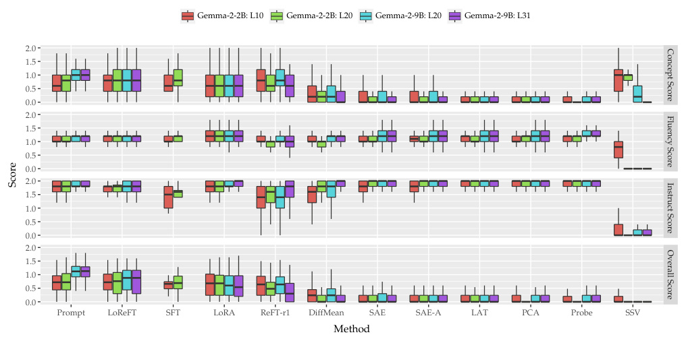

<!-- Start of picture text -->
Gemma-2-2B: L10 Gemma-2-2B: L20 Gemma-2-9B: L20 Gemma-2-9B: L31 2.0 1.5 1.0 0.5 0.0 2.0 1.5 1.0 0.5 0.0 2.0 1.5 1.0 0.5 0.0 2.0 1.5 1.0 0.5 0.0 Prompt LoReFT SFT LoRA ReFT-r1 DiffMean SAE SAE-A LAT PCA Probe SSV Method Concept Score Fluency Score Score Instruct Score Overall Score <!-- End of picture text -->

Figure 7: Mean score breakdown for all methods on our unseen testing instruction set after selecting the optimal factor (based on the Overall Score) on our evaluation instruction set. For prompting and finetuning, we randomly score one generation on the testing instruction set (since the factor is not a parameter for those methods), resulting in the same number of observations for those methods. 

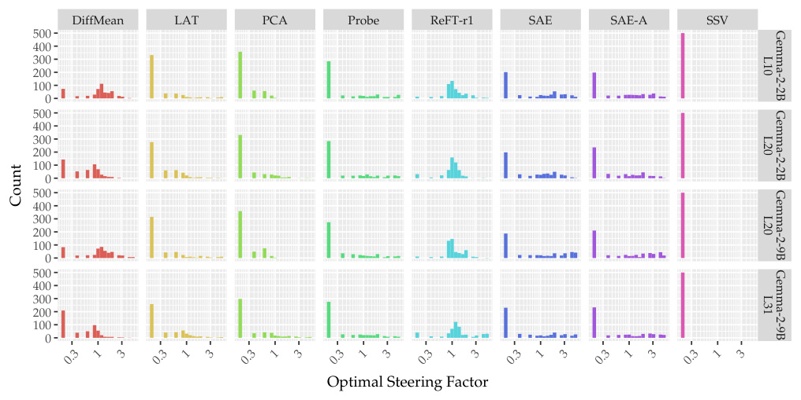

<!-- Start of picture text -->
DiffMean LAT PCA Probe ReFT-r1 SAE SAE-A SSV 500 400 300 200 100 0 500 400 300 200 100 0 500 400 300 200 100 0 500 400 300 200 100 0 Optimal Steering Factor 0.3 1 3 0.3 1 3 0.3 1 3 0.3 1 3 0.3 1 3 0.3 1 3 0.3 1 3 0.3 1 3 L10 Gemma-2-2B L20 Gemma-2-2B Count L20 Gemma-2-9B L31 Gemma-2-9B <!-- End of picture text -->

Figure 8: Distribution of optimal steering factors for each method across the 4 tasks. 

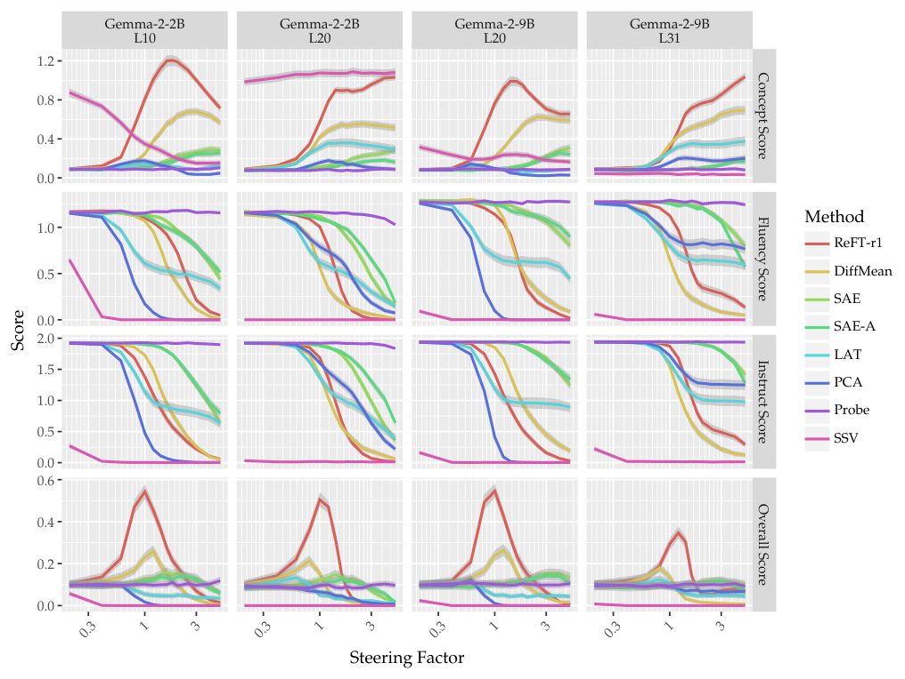

<!-- Start of picture text -->
Gemma-2-2B Gemma-2-2B Gemma-2-9B Gemma-2-9B L10 L20 L20 L31 1.2 0.8 0.4 0.0 Method 1.0 ReFT-r1 0.5 DiffMean SAE 0.0 SAE-A 2.0 LAT 1.5 PCA 1.0 Probe 0.5 SSV 0.0 0.6 0.4 0.2 0.0 Steering Factor 0.3 1 3 0.3 1 3 0.3 1 3 0.3 1 3 Concept Score Fluency Score Score Instruct Score Overall Score <!-- End of picture text -->

Figure 9: Steering factor vs. scores. 

### **D. Supervised dictionary learning method works with very limited amount of training data.** 

Based on the performance results, ReFT-r1 is the strongest SAE alternative. We further study the data scaling law of ReFT-r1 by varying the number of training examples. Specifically, we measure ReFT-r1 performance on both concept detection and steering with CONCEPT10 when the number of training example is set to _{_ 6, 12, 24, 48, 72, 96, 120, 144 _}_ . In the extreme setting, we provide only 3 positive and 3 negative examples. Since we have a limited pool of concepts, we average our results with three random seeds: _{_ 42, 43, 44 _}_ . 

Figure 10 shows how the performance of ReFT-r1 varies in **C** (concept detection) and **S** (model steering) when trained with different numbers of training examples. For earlier layers, scores increase with more data, while for Gemma-2-9B, the trend is less clear for concept detection. Our results indicate that once a certain threshold is reached, performance saturates for both tasks, suggesting that the cost of training ReFT-r1 can be further reduced. The per-concept cost with 144 training examples is approximately $0.008, and this cost decreases proportionally as the number of training examples is reduced. 

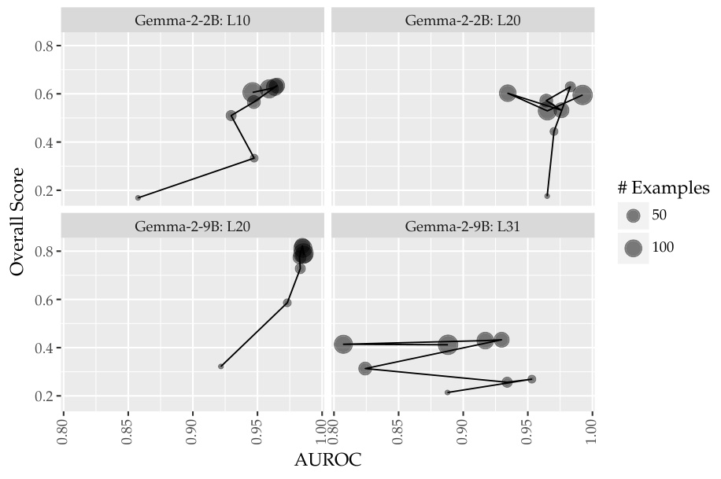

<!-- Start of picture text -->
Gemma-2-2B: L10 Gemma-2-2B: L20 0.8 0.6 0.4 0.2 # Examples 50 Gemma-2-9B: L20 Gemma-2-9B: L31 0.8 100 0.6 0.4 0.2 AUROC Overall Score 0.80 0.85 0.90 0.95 1.00 0.80 0.85 0.90 0.95 1.00 <!-- End of picture text -->

Figure 10: Scaling law for supervised dictionary learning (SDL) method ReFT-r1 with CONCEPT10 on both **C** concept detection and **S** model steering. 

### **E. SDLs at scale: Analysing CONCEPT16K** 

#### **E.1. ReFT-r1: CONCEPT16K subspace for code error handling.** 

We scale up two supervised dictionary learning methods DiffMean and ReFT-r1 with CONCEPT16K. They serve as drop-in replacements of existing SAEs on Gemma models with better performance for concept detection and steering. 

Figure 11 shows the UMAP of ReFT-r1’s CONCEPT16K subspaces learned with Gemma-2-2B at layer 20’s residual stream. Subspaces are meaningfully clustered together by genres. Within each genre cluster, related features are also clustered together. For instance, we identify a subspace cluster for concepts related to “Code error handling and logging,” which includes the following concepts: 

- Subspace 16K/14404: “error messages related to system calls and file operations” 

- Subspace 16K/14801: “terms related to programming errors and error handling” 

- Subspace 16K/5656: “technical terms and parameters related to errors and status in programming contexts” 

- Subspace 16K/4884: “error messages and exceptions in code related to server or network operations” 

- Subspace 16K/2467: “references to errors and warnings, especially related to file or access issues” 

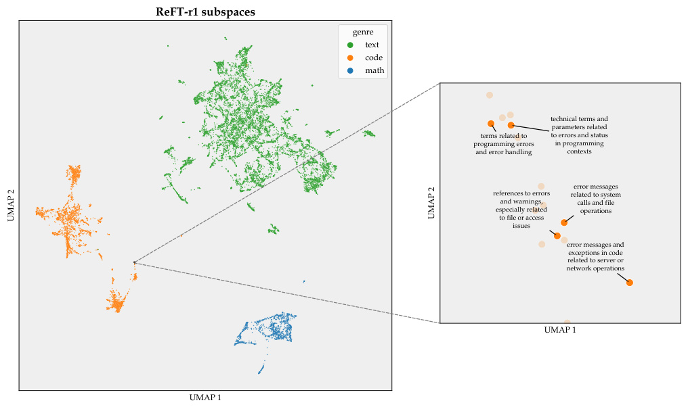

<!-- Start of picture text -->
ReFT-r1 subspaces genre text code math technical terms and parameters related terms related to to errors and status programming errors in programming and error handling contexts error messages references to errors related to system and warnings, calls and file especially related operations to file or access issues error messages and exceptions in code related to server or network operations UMAP 1 UMAP 1 UMAP 2 UMAP 2 <!-- End of picture text -->

Figure 11: UMAP of ReFT-r1’s CONCEPT16K subspaces with Gemma-2-2B at layer 20’s residual stream. 

#### **E.2. Mapping natural language to subspaces.** 

We explore whether we can find a direct mapping from natural-language concept descriptions to subspaces. We first train ReFT-r1 with CONCEPT16K and create a supervised dataset _D_Generator = _{_ ( **_c_** _,_ **w** ReFT-r1**_c_**) 016K _}_ , where the input **_c_** is the concept description in natural language and the output is the ReFT-r1 subspace vector corresponding to the concept. We divide _D_Generator into training and testing sets, ensuring that the testing set contains only concepts from CONCEPT500, which are excluded from the training set. To train the generator, we attach a supervised linear head ΦGenerator to the last input token representation at the _n_ -th position of the last layer _m_ , predicting the learned ReFT-r1 subspace: 

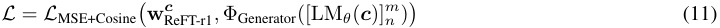

where we fine-tune the generator head and the LM using equally weighted MSE and cosine distance losses. We do finetune the base LM Gemma-2-2b for our subspace generators. We partition the last 500 examples in our training dataset as our in-training development set to early-stop our training with a patience step set to 3. 

We generate ReFT-r1 subspaces for CONCEPT500 and follow our evaluation paradigm in AXBENCH to evaluate concept detection and model steering. We show two cases below by unembedding generated subspaces with the output embedding matrix. We find that the subspace generator works better in English as opposed to other languages. 

As shown in Table 4a and Table 4b, subspaces for unseen concepts generated by our finetuned model exhibit only slight performance degradation in concept detection, while performance drops more significantly in model steering. 

|**Method**|**Gemm** L10|**a-2-2B** L20|**Gemm** L20|**a-2-9B** L31|**Avg.**|**Method**|**Gemm** L10|**a-2-2B** L20|**Gemm** L20|**a-2-9B** L31|**Avg.**|
|---|---|---|---|---|---|---|---|---|---|---|---|
|DiffMean|0.948|0.946|0.955|0.921|0.942|ReFT-r1|0.633|0.509|0.630|0.401|0.543|
|ReFT-r1|0.952|0.965|0.966|0.869|0.938|ReFT-r1 (Gen)|—|0.415|0.466|—|—-|
|ReFT-r1 (Gen)|—|0.945|0.965|—|—|DiffMean|0.297|0.178|0.322|0.158|0.239|
| SAE|0.735|0.755|0.631|0.659|0.695|SAE|0.177|0.151|0.191|0.140|0.165|

(a) **C** Mean AUROC. 

(b) **S** Overall score. 

Table 4: Results on CONCEPT500 for ReFT-r1 (Gen) vs. ReFT-r1 and other selected methods. 

### **Unseen concept description in Chinese** 

`道德经`_a_ 

### **<mark>Top positive logits when unembedding the subspace</mark>** 

(’ ethical’, 1.4296875), (’ moral’, 1.3984375), (’ ethics’, 1.2421875), (’Ethical’, 1.1640625), (’ Ethical’, 1.15625), (’moral’, 1.125), (’ Ethics’, 1.0859375), (’ Moral’, 1.0859375), (’Ethics’, 1.0703125), (’ethical’, 1.0703125) 

### **<mark>Top negative logits when unembedding the subspace</mark>** 

(’DockStyle’, -0.78125), (’ venons’, -0.6796875), (’ purpose’, -0.67578125), (’complexContent’, -0.671875), (’ stupidly’, - 0.66796875), (’ fooled’, -0.66015625), (’ Jefus’, -0.65234375), (’ small’, -0.6328125), (’ monton’, -0.62109375), (’ Dummies’,´ -0.6171875) 

> _a_ https://en.wikipedia.org/wiki/Tao ~~T~~ e ~~C~~ hing. 

### **Unseen concept description in English** 

Business-related terms and symbols, particularly focusing on entrepreneurship and financial aspects, as well as formatting and coding indicators_a_ 

### **<mark>Top positive logits when unembedding the subspace</mark>** 

(’ investment’, 1.1953125), (’ asset’, 1.1484375), (’ financial’, 1.1328125), (’ investments’, 1.0625), (’ Investment’, 1.046875), (’ market’, 1.0390625), (’ portfolio’, 1.03125), (’ investor’, 1.03125), (’ assets’, 1.0078125), (’ investors’, 1.0078125) **<mark>Top negative logits when unembedding the subspace</mark>** 

(’ sauvages’, -0.8515625), (’ hate’, -0.76953125), (’ rapides’, -0.76171875), (’ rˆ egl’, -0.7421875), (’ d´ ecouvertes’, -0.71875), (’´ fermes’, -0.69921875), (’ compl´ etes’, -0.69140625), (’ pr` ec´ edents’, -0.68359375), (’setVerticalGroup’, -0.68359375), (’ d´ ecouver’,´ -0.671875) 

> _a_ Taken from https://github.com/yoavgur/Feature-Descriptions/blob/main/descriptions/gemma-2-2b.csv. 

#### **E.3. Teleporting between subspaces across models through affine transformations.** 

We explore whether structural equivalence in subspaces exists across models. Previous works have analyzed feature universality in SAEs but have been limited to a small set of features (Lan et al., 2024). Given that our CONCEPT16K dataset contains two sets of concepts for Gemma-2-2B and Gemma-2-9B, we first train ReFT-r1 on both models separately, obtaining **w** ReFT-r12Band**w** ReFT-r19B.Next, we perform a cross-fitting experiment, training ReFT-r1 on Gemma-2-2B with concepts from Gemma-2-9B, resulting in **w** ReFT-r19B_|_2B, and vice versa for**w** ReFT-r12B_|_9B.Thus,**w** ReFT-r19Band**w** ReFT-r19B_|_2Brepresent two sets of subspaces from different models that correspond to the same set of concepts. 

We then study whether a transformation can map between these two sets of subspaces: 

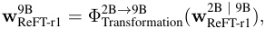

where ΦTransformation is parameterized by a linear layer with a bias (i.e., an affine transformation). We learn the transformation using equally weighted MSE and cosine distance losses. Similarly, Φ9B Transformation_→_2Bistrainedbyreversingthedirection. During training, we exclude concepts from CONCEPT500, and evaluate the transformation on CONCEPT500 at test time by generating subspaces. We follow our evaluation paradigm in AXBENCH to assess concept detection and model steering. 

Our evaluation results on CONCEPT500 are presented in Table 5a and Table 5b. Surprisingly, the _affine_ transformation performs well in both directions (from 2B _→_ 9B and 9B _→_ 2B), with little to no change in concept detection performance. While performance drops for model steering, it still outperforms other methods, including fine-tuning. Figure 12 and Figure 13 visualize the transformations using the first two PCA dimensions. PCA is preferred over UMAP in this context because it is sensitive to rotation. 

|**Method**|**Gemm** L10|**a-2-2B** L20|**Gemm** L20|**a-2-9B** L31|**Avg.**|**Method**|**Gemm** L10|**a-2-2B** L20|**Gemm** L20|**a-2-9B** L31|**Avg.**|
|---|---|---|---|---|---|---|---|---|---|---|---|
|DiffMean|0.948|0.946|0.955|0.921|0.942|ReFT-r1|0.633|0.509|0.630|0.401|0.543|
|ReFT-r1|0.952|0.965|0.966|0.869|0.938|ReFT-r1 (9B_→_2B)|—|0.444|—|—|—|
|ReFT-r1 (9B_→_2B)|—|0.954|—|—|—|ReFT-r1 (2B_→_9B)|—|—|0.541|—|—|
|ReFT-r1 (2B_→_9B)|—|—|0.974|—|—|DiffMean|0.297|0.178|0.322|0.158|0.239|
|SAE|0.735|0.755|0.631|0.659|0.695|SAE|0.177|0.151|0.191|0.140|0.165|

(a) **C** Mean AUROC. 

(b) **S** Overall score. 

Table 5: Results on CONCEPT500 for ReFT-r1 ( _affine_ ) vs. ReFT-r1 and other selected methods. 

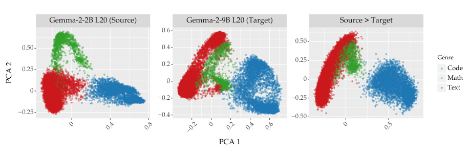

<!-- Start of picture text -->
Gemma-2-2B L20 (Source) Gemma-2-9B L20 (Target) Source > Target 0.6 0.50 0.50 0.4 0.25 Genre 0.2 0.25 Code 0 0 Math 0 Text 0.2 0.25 0.25 0.4 0.50 PCA 1 0 0.4 0.8 0.2 0 0.2 0.4 0.6 0 0.5 PCA 2 <!-- End of picture text -->

Figure 12: Visualizations of CONCEPT16K subspaces of Gemma-2-2B and Gemma-2-9B at layer 20 with top 2 principal component analysis (PCA) dimensions. The last panel is the derived subspaces by transforming the subspaces from Gemma-2-2B to Gemma-2-9B through a learned affine transformation. The concept lists for CONCEPT16K is taken from the source model. 

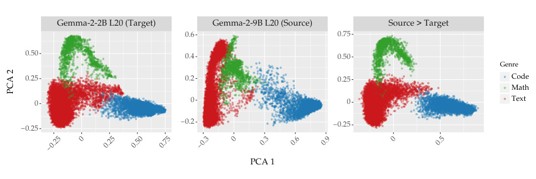

<!-- Start of picture text -->
Gemma-2-2B L20 (Target) Gemma-2-9B L20 (Source) Source > Target 0.6 0.75 0.50 0.4 0.50 Genre 0.25 0.2 0.25 Code Math 0 0 0 Text 0.2 0.25 0.25 PCA 1 0.25 0 0.25 0.50 0.75 0.3 0 0.3 0.6 0.9 0 0.5 PCA 2 <!-- End of picture text -->

Figure 13: Visualizations of CONCEPT16K subspaces of Gemma-2-2B and Gemma-2-9B at layer 20 with top 2 principal component analysis (PCA) dimensions. The last panel is the derived subspaces by transforming the subspaces from Gemma-2-9B to Gemma-2-2B through a learned affine transformation. The concept lists for CONCEPT16K is taken from the source model. 

### **F. Ablations** 

#### **F.1. SAE** 

**Addition vs. clamping.** In our main results, we steer using SAEs by adding their decoder features directly to the residual stream. While this is a common technique for steering with SAEs, most work by Anthropic (e.g. Templeton et al., 2024; Durmus et al., 2024) uses an alternative formulation termed _clamping_ , where the latent _zf_ for feature _f_ is directly clamped to a value _α_ (multiplied by the maximum activation for that feature _mf_ ) and the full intervened SAE output added to its unclamped reconstruction error Err( _hi_ ): 

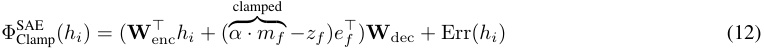

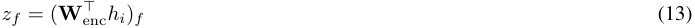

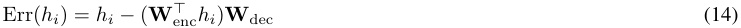

where _e__⊤_ _f_is a one-hot vector with a non-zero entry at the dimension corresponding to_mf_.We evaluate clamping on all steering tasks on CONCEPT500 for direct comparison with the addition-based GemmaScope SAE. We use the following values for _α_ (the steering factor): _{_ 0 _._ 4 _,_ 0 _._ 8 _,_ 1 _._ 2 _,_ 1 _._ 6 _,_ 2 _._ 0 _,_ 3 _._ 0 _,_ 4 _._ 0 _,_ 6 _._ 0 _,_ 8 _._ 0 _,_ 10 _._ 0 _,_ 20 _._ 0 _,_ 40 _._ 0 _,_ 60 _._ 0 _,_ 100 _._ 0 _}_ . Overall, we find that clamping is on average _worse_ than addition for SAEs, although it exhibits marked improvement when scaling up from 2B to 9B. 

**Maximum activation and minimum clamping.** In our main results, the maximum activation for our feature _mf_ is obtained from Neuronpedia. This approach differs from other methods, which determine the maximum activation by analyzing the activation distribution over the evaluation dataset for concept detection. For this experiment, we calculate _mf_ for SAEs in the same manner as other methods. As shown in Table 6 and Figure 14, changing the method of calculating maximum activations has minimal impact on the steering performance; most comparisons are statistically insignificant. 

In addition, building on regular activation _clamping_ as described above, we try a novel minimal clamping where we only clamp the activation value if it is smaller than the target value: 

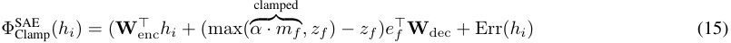

where ( **W** enc_⊤hi_)_f_is the original activation value at the corresponding of feature_f_and_e⊤_ _f_is a one-hot vector with a non-zero entry at the dimension corresponding to _mf_ . As shown in Table 6 and Figure 14, using minimum clamping has no significant impact on SAE’s steering performance. 

**Results.** We report results in Table 6. We also examine the effect of varying _α_ in Figure 14. Note that _α_ is likely a concept-dependent parameter; the optimal _α_ varies from concept to concept. We notice an odd trend for clamping: small values of _α_ have a similar effect on model behaviour as large values of _α_ ; both cause concept score to increase and instruct score to decrease. 

|**Method**|**Gemm**|**a-2-2B**|**Gemm**|**a-2-9B**|**Avg.**|**Method**|**Gemm**|**a-2-2B**|**Gemm**|**a-2-9B**|**Avg.**|
|---|---|---|---|---|---|---|---|---|---|---|---|
||L10|L20|L20|L31|||L10|L20|L20|L31||
|SAE|**0.177**|**0.151**|**0.191**|**0.140**|**0.165**|SAE|**50.0**%|**50.0**%|**50.0**%|**50.0**%|**50.0**%|
|SAE (max act)|0.166|0.150|0.163|0.128|0.152|SAE (max act)|49.1%|49.8%|46.8%|47.5%|48.3%|
|SAE-c (min clamp)|0.074|0.072|0.123|0.090|0.090|SAE-c|36.3%|38.7%|42.1%|49.2%|41.6%|
|SAE-c|0.063|0.061|0.126|0.120|0.088|SAE-c (min clamp)|38.2%|40.1%|41.0%|42.8%|40.5%|

(a) Overall score. 

(b) Winrate. 

Table 6: **S** Overall scores on model steering. 

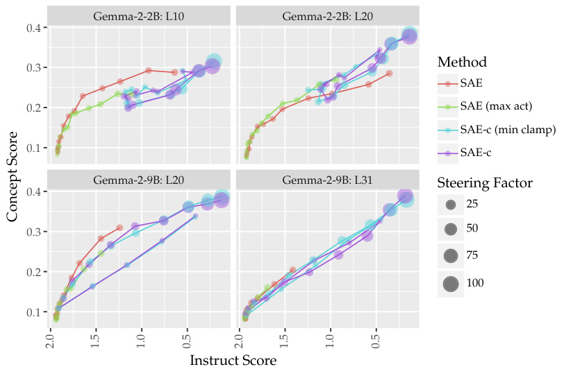

<!-- Start of picture text -->
Gemma-2-2B: L10 Gemma-2-2B: L20 0.4 Method 0.3 SAE 0.2 SAE (max act) SAE-c (min clamp) 0.1 SAE-c 0.4 Gemma-2-9B: L20 Gemma-2-9B: L31 Steering Factor 25 0.3 50 75 0.2 100 0.1 Instruct Score Concept Score 2.0 1.5 1.0 0.5 2.0 1.5 1.0 0.5 <!-- End of picture text -->

Figure 14: **S** Instruct score vs. concept score for SAEs with addition (SAE) vs. clamping (SAE-c) when varying the steering factor. Additionally, we include results when SAE is clamped with the maximum activation value calculated based on our evaluation dataset for concept detection, as well as results with minimum clamping of activation values. 

### **G. Large language model (LLM) usage** 

We use LLMs for two purposes: to generate labelled concept data for training supervised steering methods and to evaluate the responses generated by the steered models. Specifically, we use OpenAI’s gpt-4o-mini-2024-07-18 (accessed via the alias gpt-4o-mini in the API) throughout our experiments. The date we access the LLM ranges from December 2024 to January 2025, and we use the default generation configuration with temperature set to 1.0 to fetching LLM responses. For 1M tokens, it costs $0 _._ 15 for input tokens and $0 _._ 60 for output tokens. 

### **H. Gradient-based baselines** 

**C Input** _×_ **gradients (I** _×_ **G).** Gradient-based interpretability methods have been shown to be useful in computer vision and NLP (Sundararajan et al., 2017; Wallace et al., 2019). I _×_ G serves as the gradient-based baseline. We first train a linear classification head ΦCLS on the token representation at the _n_ -th position of the last layer _m_ , to predict the ground-truth concept-presence class label _y_ : 

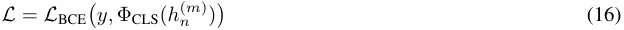

where ΦCLS is parameterised by an MLP with two linear layers. For an evaluation sentence **x** , the LM generates hidden representations **h** with _n_ tokens at layer _l_ . With Autograd provided in PyTorch, we calculate the gradient of the output classification head with respect to each hidden representations. To aggregate across dimensions, we compute the sum of the absolute gradients over all dimensions for each _hi_ , which we use as the token-level importance. This gives a sequence of aggregated values: 

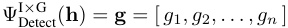

which indicates the relevance of each token for the concept. For concept detection, we then use max-pooling as described in §3.2 to get sequence-level predictions. I _×_ G is not applicable for model steering. 

**C Integrated gradients (IG).** We adapt IG (Sundararajan et al., 2017) to trace the accumulated gradients with respect to intermediate representations. To use IG, we train a classification head as in I _×_ G. For each token representation _hi_ , we compute IG along a straight-line path from a baseline _h_baseline _i_ to _hi_ . Here, we use the embedding of a single space token (i.e., tokenizer(‘‘ ’’)), obtained via the tokenizer and model embeddings, as the baseline. The IG is computed as: 

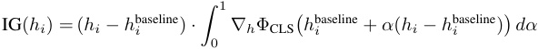

where the integral is approximated using a discrete summation with 50 interpolation steps.14 See IG’s original paper about implementation details on path intergral. To aggregate across dimensions, we compute the sum of the absolute gradients over all dimensions for each _hi_ . We follow the setup for I _×_ G get sequence-level predictions for concept detection. IG is not applicable for model steering. 

### **I. Instruction pool** 

To create our instruction pool, we sample instructions from existing datasets covering three genres: _text_ , _code_ , and _math_ . For _text_ -based instructions, we sample from Dolly-15K15 . For _code_ -based instructions, we sample from a collection of Python-code puzzles formed in Alpaca-style (i.e., instructions with corresponding responses)16 For _math_ -based instructions, we sample from GSM8K17 For each genre, we create two disjoint sets for training and testing separately with 1,000 examples each. The LLM generated response for each instruction is provided as well. To avoid any heterogeneity, we avoid using the golden labels provided by the orignal dataset and only use the LLM generated response. 

### **_Text_ instruction** 

Why do some people select private schools over public schools? 

### **<mark>LLM generated response</mark>** 

Sure, here are some ways to reduce air pollution: There are many reasons why some people choose private schools over public schools. Here are some of the most common: 

**Academic Focus and Curriculum:** 

* **Smaller class sizes:** Private schools often have smaller class sizes, allowing for more individualized attention from teachers. 

- **Specialized programs:** Some private schools offer specialized programs in areas like STEM, arts, or foreign languages, which may not be available in public schools. 

- **Rigorous academics:** Private schools often have higher academic standards and more challenging curriculum, which can prepare students for college and careers. 

* **Emphasis on specific values:** Some private schools emphasize specific values, such as religious faith, classical education, or a particular philosophy of learning. 

**Extracurricular Activities and Resources:** 

- **Extensive extracurricular activities:** Private schools often have a wider range of extracurricular activities, includ- 

- ing sports, music, drama, and clubs. 

* **State-of-the-art facilities:** Private schools 

> 14We choose a small step number due to limited compute resource. For 9B models, we use a step size of 5. 

> 15https://huggingface.co/datasets/databricks/databricks-dolly-15k. 

> 16https://huggingface.co/datasets/iamtarun/python ~~c~~ ode ~~i~~ nstructions ~~1~~ 8k ~~a~~ lpaca. 

> 17https://huggingface.co/datasets/openai/gsm8k. 

### **_Code_ instruction** 

Create a machine learning classifier in Python for categorizing user input 

### **<mark>LLM generated response</mark>** 

import numpy as np from sklearn.model ~~s~~ election import train ~~t~~ est ~~s~~ plit from sklearn.feature ~~e~~ xtraction.text import CountVectorizer from sklearn.naive ~~b~~ ayes import MultinomialNB 

# Sample data encapsulating numeric outcomes related to API logs data = [ (”GET /api/users”, 0), (”POST /api/data”, 1), (”PUT /api/settings”, 1), (”DELETE /api/users/123”, 0) 

] 

# Separate features and labels X, y = zip(*data) 

# 

### **_Math_ instruction** 

John puts $25 in his piggy bank every month for 2 years to save up for a vacation. He had to spend $400 from his piggy bank savings last week to repair his car. How many dollars are left in his piggy bank? 

### **<mark>LLM generated response</mark>** 

Here’s how to solve the problem: 

**1. Calculate total savings:** 

- John saves $25 per month for 12 months in a year, so in 2 years he saves 2 years * 12 months/year = 24 months. 

- His total savings are $25/month * 24 months = $600. 

**2. Calculate remaining savings:** 

* John spent $400 on his car, so he has $600 - $400 = $200 left in his piggy bank. 

**Answer:** John has $200 left in his piggy bank. 

### **J. Prompt templates** 

In this section, we present the templates that we use to call LLM to generate datasets or evaluate results. For placeholders in the template, they will be filled with proper information. 

#### **J.1. Prompt-based steering** 

Our prompt-based model steering baseline is not a zero-shot prompting baseline. Instead of directly prompting LLM to generate steered responses, we first use LLM to generate an enhanced prompt for model steering. Our template is included in the following. 

### **LLM-based steering prompt generation** 

Generate a prompt to guide a language model in producing responses. 

Objective: Direct the model to include content related to [Concept goes here] (the concept) in its responses. Ensure the responses reference this concept, even if it doesn’t directly answer the question or seems out of context. Optionally, provide in-context examples to reinforce this behaviour. 

Return only the final prompt without any additional text. 

#### **J.2. Synthetic data generation** 

Our data generation pipeline contains multiple steps, and we use different templates at each step. We present the template that we use for each step in the following. 

### **Fetch genre** 

Given the concept: 

[Concept goes here] 

Identify the single primary genre that best fits the concept from the following options: 

Text; Code; Math 

Output only the best-fitting genre. If none apply, output ‘ _<_ NONE _>_ ’. 

**Formatting Guidelines:** - Output the genre on a single line. - Do not include any additional text or formatting. 

**Examples:** - Concept: ’words or phrases containing odd numbers’ Output: Text - Concept: ‘a programming error’ Output: Code - Concept: ‘integral calculus’ Output: Math - Concept: ‘a narrative poem’ Output: Text 

Return only the single best-fitting genre as specified. 

### **List words related to the concept** 

Given the following concept: 

[Concept goes here] 

Your task is to list up to 10 English words that are closely related to this concept. Each word should be a single, common English word. 

Output each word on a separate line, in plain text, without any special formatting (e.g., no quotation marks, numbers, bullet points, or additional text). 

If the concept is too broad or vague (e.g., ‘any English word’, ‘words starting with A’), or if the concept refers to a specific technical term, a computer program, or a specific fact, then output ’ _<_ NONE _>_ ’ without quotation marks. 

Do not include any additional explanations or text other than the words or ‘ _<_ NONE _>_ ’ as specified. 

### **Find alternative senses of a word** 

Given the word: 

[Word goes here] 

Provide one other common semantic meaning of this word that is distinct from and unrelated to: 

[Concept goes here] 

Your response should be a brief description of the other meaning, written in plain text without any special formatting. Specifically: 

- Do not use quotation marks. 

- Do not include list numbers, bullet points, or any prefixes. 

- Do not add any additional explanations or text. 

If there is no other obvious semantic meaning unrelated to the provided concept, simply output ‘ _<_ NONE _>_ ’ without quotation marks. 

### **Check whether two senses are different** 

Determine if Concept A is meaningfully distinct from Concept B by thoroughly examining their definitions, core features, typical usage, and any potential overlaps in meaning, context, or purpose. 

Concept A: [Concept goes here] 

Concept B: [Concept goes here] 

Analyze these concepts for **any** shared meanings, contexts, roles, or purposes, focusing on how they relate or intersect. Please explain your reasoning, considering both similarities and differences. 

- If Concept A and Concept B have **any** overlap in meaning, context, usage, or if one is a subset or specific in- 

- stance of the other, conclude with ‘Answer: _<_ NO _>_ ’. 

- Only if they are **entirely unrelated** with **no overlap whatsoever** in meaning, context, or usage, conclude with ‘Answer: _<_ YES _>_ ’. 

**Final Answer:** ’Answer: _<_ YES _>_ ’ or ’Answer: _<_ NO _>_ ’. 

### **Check whether one sense is different from other concepts** 

Evaluate whether Concept A is meaningfully distinct from a given set of concepts by examining their definitions, core features, typical usage, and any potential overlaps in meaning, context, or purpose. 

Concept A: [Concept goes here] Existing Concepts: [Concepts go here] 

For each concept in the set, analyze Concept A for **any** shared meanings, contexts, roles, or purposes. Consider how Concept A might relate or intersect with each concept individually, as well as with the group collectively. Please explain your reasoning by examining both similarities and differences. 

- If Concept A has **any** overlap in meaning, context, usage, or if it is a subset or specific instance of **any concept** in the set, conclude with ‘Answer: _<_ NO _>_ ’. 

- Only if Concept A is **entirely unrelated** with **no overlap whatsoever** in meaning, context, or usage to **all** concepts in the set, conclude with ‘Answer: _<_ YES _>_ ’. 

**Final Answer:** ‘Answer: _<_ YES _>_ ’ or ‘Answer: _<_ NO _>_ ’. 

### **Modify content with concept** 

Content Modification Task: 

You are given the following content: 

[Modifying content go here] 

Your task is to minimally modify this content by inserting some commonly used words, phrases, or elements that reflect themes or ideas related to ‘[Concepts go here]’ into the middle of the content. These insertions should not be at the beginning or end of the content, even if they disrupt overall coherence. 

##### Guidelines: 

- Try to avoid copying words from the definition of ‘[Concepts go here]’ if possible. 

- Ensure parts of the content remain unrelated to the concept ‘[Concepts go here]’. 

- The final content should have approximately the same length as the original content. 

- The concept should be clearly represented through the inserted word, phrase, or element, even if the content’s meaning isn’t entirely coherent. 

- Use special characters only if appropriate for the genre (e.g., operators in code or math equations). 

##### Output: 

Include the special tag _<_ FINAL _>_ at the beginning of the final content, followed by the content itself. Return only this tagged content, with no additional text. 

### **Modify content with contrastive concept** 

Content Modification Task: 

You are given the following content: 

[Concept goes here] 

Your task is to minimally modify this content by inserting the word ‘WORD’ into the middle of the content. This word, along with modified content, should convey meanings related to the concept ‘[Concept goes here]’. The insertion should not be at the beginning or end of the content. 

Guidelines: 

- Ensure parts of the content remain irrelevant to the concept ‘[Concept goes here]’. 

- Avoid any mention of ‘[Contrast concept goes here]’ in the content, regardless of coherence. 

- The final content should have approximately the same length as the original content. 

- Ensure the content reflects the essence of the concept associated with ‘[Concept goes here]’, even if the overall meaning isn’t entirely coherent. 

- Ensure grammatical correctness (or syntactical correctness for code/equations). 

- Use special characters only if appropriate for the genre (e.g., operators in code or math equations). 

Output: 

Include the special tag _<_ FINAL _>_ at the beginning of the final content, followed by the content itself. Return only this tagged content, with no additional text. 

### **Generate response given instruction** 

Given the following instruction: 

[Instruction goes here] 

Your task is to provide a response. 

**Formatting Guidelines:** 

- Return only the response to the instruction. 

- Write the final content (or appropriate format for the genre) in plain text. 

- Do not include any additional text, explanations, or formatting. 

**Final Answer:** Return only the final content, following the guidelines above. 

### **Generate response given instruction and concept** 

Given the following instruction: 

[Instruction goes here] 

Your task is to: 

1. Provide a response that incorporates elements related to ‘[Concept goes here]’. 

2. Try to avoid copying words from the definition of ‘[Concept goes here]’ if possible. 

3. Ensure that your response relates to ‘[Concept goes here]’, even if the overall meaning is not fully coherent. 

**Formatting Guidelines:** 

- Return only the response to the instruction. 

- Write the final content (or appropriate format for the genre) in plain text. 

- Do not include any additional text, explanations, or formatting. 

- **Final Answer:** Return only the final content, following the guidelines above. 

### **Generate response given instruction without mentioning given concept** 

Given the following instruction: 

[Instruction goes here] 

Your task is to: 

1. Provide a response that continues or addresses the instruction naturally. 

2. Avoid any mention of ‘[Concept goes here]’ in the continuation, regardless of coherence. 

- **Formatting Guidelines:** 

- Return only the response to the instruction. 

- Write the final content (or appropriate format for the genre) in plain text. 

- Do not include any additional text, explanations, or formatting. 

- **Final Answer:** Return only the final content, following the guidelines above. 

### **Generate response given instruction with contrastive concept** 

Content Response Task: 

You are given the following instruction: 

[Instruction goes here] 

Your task is to provide a response to the instruction by inserting the word ‘[Word goes here]’ into the middle of the response. This word, along with the response, should convey meanings related to the concept ‘[Contrastive concept goes here]’. The insertion should not be at the beginning or end of the response. 

Guidelines: 

- Avoid any mention of ‘[Concept goes here]’ in the response, regardless of coherence. 

- Ensure the response reflects the essence of the concept associated with ‘[Word goes here]’, even if the overall meaning isn’t entirely coherent. 

- Ensure grammatical correctness (or syntactical correctness for code/equations). 

- Use special characters only if appropriate for the genre (e.g., operators in code or math equations). 

Output: 

Include the special tag _<_ FINAL _>_ at the beginning of the final response, followed by the response itself. Return only this tagged response, with no additional text. 

#### **J.3. Automatic evaluation** 

We use LLM to evaluate the steering responses of the model. The responses are evaluated with three metrics: concept score, instruct score and fluency score. We prompt the model to always generate explanations before assigning scores, which significantly outperforms directly asking for scores in our offline experiments. 

We find that this ternary scoring system is crucial to get faithful and stable scores from LLM. For instance, a unified prompt asking the LLM to rate a response given an instruction and a concept is not effective through our experiments, as the LLM usually ignores the lack of the concept as long as the response follows the instruction. The fluency score is needed as the model can cheat by generating fragmented tokens that relate to the concept and the instruction, while being incoherent to humans. 

Templates for all scores are provided below: 

### **Concept score** 

[System] Please act as an impartial judge and evaluate whether the specified concept is presented in the sentence fragment provided below. Focus solely on whether the concept is clearly incorporated, without regard for grammar or logical coherence. 

Begin your evaluation by providing a short explanation of whether the concept is clearly incorporated. Point out references to the concept in the fragment, noting any minimal or awkward incorporations. After providing your explanation, rate the concept’s relevance on a scale from 0 to 2, where 0 indicates the concept is not present at all, 1 indicates the concept is somewhat present but minimally or awkwardly incorporated, and 2 indicates the concept is more fully and effectively incorporated, with stronger and more natural integration. Provide your rating using this exact format: “Rating: [[score]]”. 

[Concept Start] [Concept goes here] [Concept End] [Sentence Fragment Start] [Sentence goes here] [Sentence Fragment End] 

### **Instruct score** 

[System] 

Please act as an impartial judge and evaluate whether the sentence fragment provided below is related to the instruction. Focus solely on the degree of relatedness in terms of topic, regardless of grammar, coherence, or informativeness. 

Begin your evaluation by providing a brief explanation of whether the sentence is related to the instruction, and point out references related to the instruction. After providing your explanation, rate the instruction relevance on a scale from 0 to 2, where 0 indicates the sentence is unrelated to the instruction, 1 indicates it is somewhat related but only minimally or indirectly relevant in terms of topic, and 2 indicates it is more clearly and directly related to the instruction. Provide your rating using this exact format: “Rating: [[score]]”. 

[Instruction Start] [Instruction goes here] [Instruction End] [Sentence Fragment Start] [Sentence goes here] [Sentence Fragment End] 

### **Fluency score** 

[System] 

Please act as an impartial judge and evaluate the fluency of the sentence fragment provided below. Focus solely on fluency, disregarding its completeness, relevance, coherence with any broader context, or informativeness. 

Begin your evaluation by briefly describing the fluency of the sentence, noting any unnatural phrasing, awkward transitions, grammatical errors, or repetitive structures that may hinder readability. After providing your explanation, rate the sentence’s fluency on a scale from 0 to 2, where 0 indicates the sentence is not fluent and highly unnatural (e.g., incomprehensible or repetitive), 1 indicates it is somewhat fluent but contains noticeable errors or awkward phrasing, and 2 indicates the sentence is fluent and almost perfect. Provide your rating using this exact format: “Rating: [[score]]”. 

[Sentence Fragment Start] [Sentence goes here] [Sentence Fragment End] 

### **K. Hyperparameters** 

To ensure a fair comparison, we perform separate hyperparameter-tuning for each method that requires training. For each method, we conduct separate hyperparameter-tuning on a small CONCEPT10 Dataset containing training and testing datasets only for 10 concepts. These concepts overlap with CONCEPT500. Table 7 and Table 8 show hyperparameter settings for methods that require training. Due to limited compute resource, we select the best setting of hyperparameters based on performance on the **C concept detection** task using AUC for all dictionary learning methods (i.e., can be evaluated on **C concept detection** ). We minimise the loss with AdamW with a linear scheduler for all methods that require training. Following Gao et al. (2024), we remove gradients that are parallel to the learned weights when training Probe and ReFT-r1, to account for interaction between Adam and our weight normalization step. 

For methods that only for steering, we select the best setting based on **S model steering** performance. We follow a setting where we only have a single constant steering factor for hyperparameter-tuning. We acknowledge that this might lead to an overall underestimation of the performance of **S model steering** performance. For steering factors, we enumerate factors from _{_ 0 _._ 2 _,_ 0 _._ 4 _,_ 0 _._ 6 _,_ 0 _._ 8 _,_ 1 _._ 0 _,_ 1 _._ 2 _,_ 1 _._ 4 _,_ 1 _._ 6 _,_ 1 _._ 8 _,_ 2 _._ 0 _,_ 2 _._ 5 _,_ 3 _._ 0 _,_ 4 _._ 0 _,_ 5 _._ 0 _}_ . 

**Comments about decoding strategies.** Through our offline experiments, we observed that the choice of decoding strategies can positively or negatively impact overall steering scores for each method (e.g., perplexity scores increase more drastically with repetition penalties). We use the default decoding strategy (i.e., setting the decoding temperature to 1.0) without applying additional penalties for repeating tokens. We believe that this setup reflects the typical user interaction with language models. **However, this is not a common practice in representation-based model steering** . Existing works often apply repeatition or frequency penalties, which we argue is not the fairest setting, as it often does not accurately resemble normal user behaviour. 

Table 7: Hyperparameter settings for 2B model. 

|**Hyperparameters**|**LinearProbe**|**LsReFT**|**SteeringVector**|**LoReFT**|**LoRA**|**SFT**|**IG/IxG**|**BoW**|
|---|---|---|---|---|---|---|---|---|
|Batch size|_{_12, 24,48 _}_|_{_3,6 , 12_}_|_{_3,6 ,12_}_|_{_18,36 _}_|_{_18,36 _}_|_{_36, 72 , 144_}_|_{_18, 36 , 72, 144_}_|—|
|LR|_{_1e-4, 5e-4, 1e-3,5e-3 _}_|_{_1e-3, 5e-3, 1e-2 ,2e-2_}_|_{_1e-3, 5e-3, 1e-2 ,2e-2_}_|_{_3e-4, 6e-4, 9e-4 , 1e-3_}_|_{_3e-4, 6e-4, 9e-4 ,1e-3_}_|_{_1e-5, 2e-5, 4e-5 _}_|_{_2e-4, 4e-4 , 4e-4, 8e-4, 1e-3, 4e-3_}_|—|
|Weight decay|_{_1e-4, 1e-3 , 1e-2, 1e-1_}_|0|0|0|0|0|2e-4|—|
|L1 sparse|—|_{_1e-3, 5e-3 _}_|—|—|—|—|—|—|
|L1 coeff|—|_{_1e-3, 5e-3 _}_|—|—|—|—|—|—|
|N epoch|_{_3, 6, 12, 24 _}_|_{_3 , 6, 12, 24_}_|_{_3 ,6, 12, 24_}_|_{_3, 6, 12, 24 , 48_}_|_{_3, 6, 12, 24 , 48_}_|_{_8 , 12, 24, 48_}_|_{_12, 24 , 48, 72_}_|—|
|Layers|—|—|—|_{_5, 10, 15, 20_}_|_{_5, 10, 15, 20_}_|—|—|—|
|LoRA alpha|—|—|—|—|32|—|—|—|
|LoRA component|—|—|—|—|o ~~p~~roj|—|—|—|
|BoW penalty|—|—|—|—|—|—|—|_{_l1,l2_}_|
|BoW_C_|—|—|—|—|—|—|—|_{_0.001, 0.01, 0.1, 1, 10, 100 _}_|
|BoW solver|—|—|—|—|—|—|—|_{_lbfgs , liblinear_}_|

Table 8: Hyperparameter settings for 9B model. 

|**Hyperparameters**|**LinearProbe**|**LsReFT**|**SteeringVector**|**LoReFT**|**LoRA**|**IG/IxG**|**BoW**|
|---|---|---|---|---|---|---|---|
|Batch size|_{_12, 24,48 _}_ |_{_3,6 ,12_}_ |_{_3,6 ,12_}_ |_{_18,36 _}_ |_{_18,36 _}_ |_{_18, 36, 72, 144 _}_ |—|
|LR|_{_1e-4, 5e-4, 1e-3 , 5e-3, 1e-2, 1e-1_}_ |_{_1e-3, 5e-3 , 1e-2, 2e-2_}_|_{_1e-3, 5e-3, 1e-2 ,2e-2_}_|_{_3e-4, 4e-4 , 6e-4, 9e-4, 1e-3_}_|_{_3e-4, 6e-4, 9e-4, 1e-3, 5e-3 _}_|_{_2e-5, 4e-5, 8e-5, 8e-5 , 1e-4, 4e-4_}_|—|
|Weight decay|_{_0, 1e-4 , 1e- 3_}_|0|0|0|0|2e-4|—|
|L1 sparse|—|_{_1e-3, 5e-3 _}_  |—|—|—|—|—|
|L1 coeff|—|_{_1e-3, 5e-3 _}_|—|—|—|—|—|
|N epoch |_{_3, 6, 12 , 24_}_|_{_3 , 6, 12, 24_}_|_{_3 ,6, 12, 24_}_|_{_12,24 ,48_}_ |_{_12,24 , 48_}_ |_{_12, 24, 48, 72 _}_|—|
|Layers|—|—|—|_{_12, 20, 31, 39_}_|_{_12, 20, 31, 39_}_|—|—|
|LoRA alpha|—|—|—|—|32|—|—|
|LoRA component|—|—|—|—|o ~~p~~roj|—|— |
|BoW penalty|—|—|—|—|—|—|_{_l1,l2_}_|
|BoW_C_|—|—|—|—|—|—|_{_0.001, 0.01, 0.1, 1, 10, 100 _}_|
|BoW solver|—|—|—|—|—|—|_{_lbfgs , liblinear_}_|

### **L. Dataset Statistics** 

We show a set of concepts sampled from our CONCEPT10 datasets in Table 9. Table 10 shows dataset statistics including the number of concepts, the number of training and testing examples, the percentage distribution of genre types, and the averaged length of input and output sequence. The output sequence length of CONCEPT16K is expected to be shorter since we restrict the maximum sequence length to 64 during data creation. 

|**Concept**|**Genre**|
|---|---|
|References to rental services and associated equipment|_text_|
|Scientific terms related to research findings and their implications|_text_|
|C/C++ programming syntax elements such as data types, function definitions, and variable declarations|_code_|
|References to academic papers and their formatting|_text_|
|Layout attributes in a UI design context|_text_|
|Terms related to root in mathematical contexts|_math_|
|Statements or phrases involving the act of saying or expressing something|_text_|
|Statements about the nature and condition of entities|_text_|
|Biographical information about a person|_text_|
|References to different worlds, realities, or fantastical settings within narratives|_text_|

Table 9: Concepts and their corresponding genres sampled from our CONCEPT10 datasets. 

|**Dataset**|**Model**|**Layer**|# Concept|# Train|# Test|_text_(%)|_code_(%)|_math_(%)|Input len. (Train / Test)|Output len. (Train / Test)|
|---|---|---|---|---|---|---|---|---|---|---|
||2B|10|10|936|770|50.0%|40.0%|10.0%|21 / 18|123 / 92|
|C10|2B|20|10|936|755|80.0%|10.0%|10.0%|19 / 18|118 / 90|
|ONCEPT|9B|20|10|936|760|70.0%|30.0%|0.0%|17 / 16|113 / 89|
||9B|31|10|936|768|50.0%|30.0%|20.0%|24 / 20|118 / 91|
||2B|10|500|36,216|37,958|66.4%|24.4%|9.2%|17 / 18|102 / 89|
|CONCEPT500|2B|20|500|36,216|38,037|71.6%|21.4%|7.0%|16 / 17|102 / 89|
||9B|20|500|36,216|38,023|66.8%|25.6%|7.6%|17 / 18|101 / 88|
||9B|31|500|36,216|38,098|63.4%|28.2%|8.4%|17 / 18|102 / 89|
|CONCEPT16K|2B|20|15,582|1,122,048|–|69.3%|22.1%|8.6%|17 / –|62 / –|
||9B|20|16,000|1,152,216|–|66.2%|25.4%|8.4%|17 / –|62 / –|

### **M. Concept detection examples** 

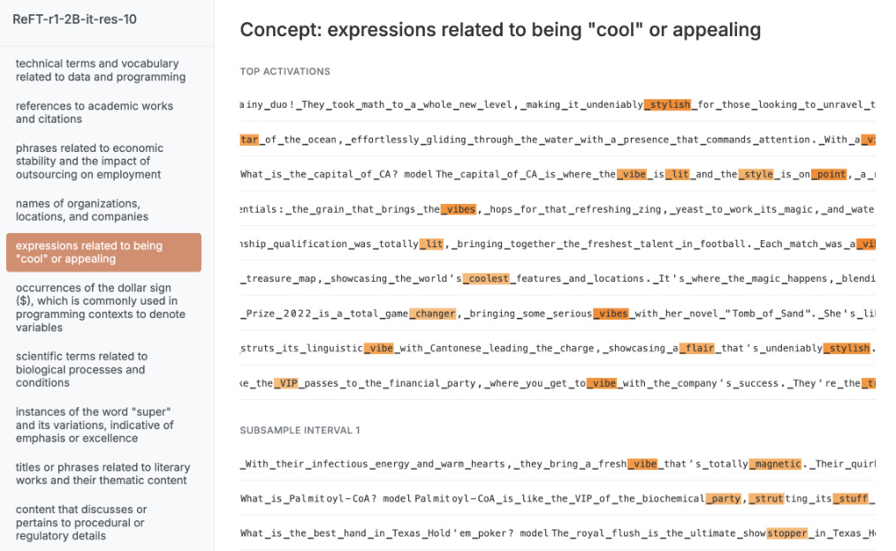

Figure 15: Visualization of token-level activations by using ReFT-r1 trained on Gemma-2-2B instruction-tuned model on layer 10. 

### **N. Model generations** 

We provide sampled model generations from different methods to illustrate success cases and common failure cases. We use models trained with Gemme-2-9B-it at layer 20 for these examples. 

### **Prompt-based steering** 

Generate responses that highlight positive sentiments and describe enjoyable experiences, weaving this concept into your replies, even if it seems unrelated to the specific question. For instance, if asked about the weather, you might share how a sunny day can bring joy and prompt outdoor activities that create memorable moments. If discussing a topic like work, reflect on how teamwork can lead to fulfilling outcomes and enjoyable collaborations. Always aim to evoke a sense of positivity and pleasure in your responses. 

Question: Explain the process of natural selection and how it contributes to the evolution and adaptation of species. 

**<mark>“positive sentiments and descriptions of enjoyable experiences”</mark>** It’s fascinating to think about how nature constantly tinkers and refines itself, isn’t it? Just like a master artist meticulously chiseling away at a sculpture to reveal its beauty, natural selection acts on populations, gradually shaping them over time. Imagine a group of birds with slightly different beak shapes. Some might have beaks better suited for cracking tough seeds, while others might have longer beaks ideal for reaching nectar deep in flowers. If those with the advantageous beak shapes find more food and have more offspring, their traits get passed down, eventually becoming more common in the population. It’s a beautiful **<mark>LLM ratings</mark>** Concept score: 1.0 Instruct score: 2.0 Fluency score: 2.0 

### **SAE** 

Explain the process of natural selection and how it contributes to the evolution and adaptation of species. 

**<mark>factor=4.0, “positive sentiments and descriptions of enjoyable experiences”</mark>** 

Natural selection was a resounding success! Here’s a breakdown of the event: 

**The Core Principles:** 

* **Variation:** The species showed amazing diversity with individuals displaying unique traits. 

* **Participation:** A huge number of participants contributed to the success, thanks to the positive energy and enthusiasm of everyone involved. * **Engagement:** The interactions between participants and natural elements were truly exceptional. Attendees engaged deeply with the activities and each other. * **Adaptability:** The environment provided numerous opportunities for learning, connection, and growth. **Highlights:** * **Amazing Species Diversity:** The variety of attendees **<mark>LLM ratings</mark>** Concept score: 1.0 Instruct score: 1.0 Fluency score: 2.0 

### **ReFT-r1** 

Explain the process of natural selection and how it contributes to the evolution and adaptation of species. 

### **<mark>factor=1.0, “positive sentiments and descriptions of enjoyable experiences”</mark>** 

## The Dance of Life: How Natural Selection Shapes Evolution 

Imagine a vibrant meadow filled with diverse creatures, each with unique traits. Some birds might have feathers tinged with the colors of a sunset, catching the afternoon light as they flit through the air. Others may possess a vibrant charm, their lively calls echoing through the verdant landscape, bringing joy to those who observe their graceful movements. As the sun bids farewell, casting long shadows, the experience becomes a symphony of colors and melodies, weaving a tapestry of shared moments. 

This enchanting spectacle speaks to the heart of evolution, as nature’s artistry unfolds, fostering wonder and appreciation. Every 

**<mark>LLM ratings</mark>** Concept score: 1.0 Instruct score: 1.0 Fluency score: 2.0 

### **ReFT-r1: failed to inject concept** 

Explain the process of natural selection and how it contributes to the evolution and adaptation of species. 

### **<mark>factor=0.2, “positive sentiments and descriptions of enjoyable experiences”</mark>** 

## The Grand Dance of Life: Natural Selection Explained 

Imagine a bustling playground where children with different skills are playing. Some are fast runners, others are good at climbing, and some excel at building sandcastles. Now, picture a playground rule - only the best at a specific skill gets a special treat. 

Natural selection works much like this playful comparison. 

**Here’s a breakdown:** 

1. **Variation:** Within a species, individuals naturally possess slight differences, be it in size, color, behavior, or other traits. These variations arise from random genetic mutations. 

2. ** **<mark>LLM ratings</mark>** Concept score: 0.0 Instruct score: 2.0 Fluency score: 1.0 

### **ReFT-r1: strong steering causes fluent but irrelevant responses** 

Explain the process of natural selection and how it contributes to the evolution and adaptation of species. 

### **<mark>factor=1.2, “positive sentiments and descriptions of enjoyable experiences”</mark>** 

Imagine a world where the sun and laughter intertwine, and playful encounters bring warmth,” she exclaimed, ”like a picnic where every shared moment sparks joy and companionship. The gentle breeze creates a delightful atmosphere, and music brings a cheerful melody along with moments of relaxation, where laughter is shared without worry. Its a reminder of how much energy and happiness´ fill those times,” she added, ”its a gift,” and people feel gratitude, and the happiness that blooms in every conversation can create a´ sense of unity. Such moments make it a wonderful day full of joyful sensations, where friends can create a welcoming space that feels happy and 

**<mark>LLM ratings</mark>** Concept score: 0.0 Instruct score: 2.0 Fluency score: 1.0 

### **Supervised steering vector (SSV): strong steering causes gibberish responses** 

Explain the process of natural selection and how it contributes to the evolution and adaptation of species. 

**<mark>factor=0.2, “positive sentiments and descriptions of enjoyable experiences”</mark>** 

A new and i. there so not of the. so many days and 

: a good time will be people! is 

and with this and your day to, you all, such, and, you and, we start a year and i’ like the in to a and the music i all are i, when. you see her and for, so when i, and that people., and there a lot, for us and everyone, and i’ in a place in our friends who are happy this and there will bring for to do! 

. and you and there , and we, will a week and **<mark>LLM ratings</mark>** Concept score: 1.0 Instruct score: 0.0 Fluency score: 0.0

---

[← 55 Negative Results for SAEs (GDM)](55_gdm_sae_negative_results.md) · [Contents](README.md) · [57 Are Sparse Autoencoders Useful? →](57_sae_sparse_probing.md)
