<!-- Generated by scripts/build_anthology.py export from the source PDF; edit the catalog, not this file. -->
# 57 · Are Sparse Autoencoders Useful? A Case Study in Sparse Probing

**Kantamneni et al. — 2025** · Subhash Kantamneni, Joshua Engels, Senthooran Rajamanoharan, Max Tegmark, Neel Nanda

| | |
|---|---|
| Priority | ○ P1 — Important |
| Section | F — The reckoning |
| Source | [https://arxiv.org/abs/2502.16681v1](https://arxiv.org/abs/2502.16681v1) (arXiv:2502.16681v1) |
| Licence | CC BY 4.0 |
| Print anthology | pages 2105–2135 (cover 2105, text 2106–2135) |

**Why read this.** Tests whether SAE latents give probes a useful inductive bias across 113 datasets and four hard regimes — scarce data, class imbalance, label noise, covariate shift — and finds no consistent gain over strong baselines.

**Reading focus.** The ‘quiver of arrows’ protocol, results in each of the four regimes, the GLUE CoLA dataset-quality case, multi-token probing, the section on illusions of SAE probes, and the check on newer SAE architectures.

**In context.** The systematic version of [55](55_gdm_sae_negative_results.md)'s probing result, sharing authors with it. Its probes descend from [37](37_neurons_in_haystack.md)'s sparse probing and inherit the cautions of [30](30_probe_control_tasks.md) and [31](31_probing_classifiers.md); it credits [50](50_sparse_feature_circuits.md)'s SHIFT among the few prior SAE wins. With [56](56_axbench.md) it makes beating strong baselines the standard of evidence for interpretability tools.

[← 56 AxBench](56_axbench.md) · [Contents](README.md) · [58 SAEs on Random Transformers →](58_sae_random_transformers.md)

---

*Text extracted automatically from the source PDF. Display equations, figures and some tables appear as images; inline mathematics may be garbled — the PDF is authoritative.*

**Subhash Kantamneni*** 1 **Joshua Engels*** 1 **Senthooran Rajamanoharan Max Tegmark**1 **Neel Nanda** 

# **Abstract** 

Sparse autoencoders (SAEs) are a popular method for interpreting concepts represented in large language model (LLM) activations. However, there is a lack of evidence regarding the validity of their interpretations due to the lack of a ground truth for the concepts used by an LLM, and a growing number of works have presented problems with current SAEs. One alternative source of evidence would be demonstrating that SAEs improve performance on downstream tasks beyond existing baselines. We test this by applying SAEs to the real-world task of LLM activation probing in four regimes: data scarcity, class imbalance, label noise, and covariate shift1 . Due to the difficulty of detecting concepts in these challenging settings, we hypothesize that SAEs’ basis of interpretable, concept-level latents should provide a useful inductive bias. However, although SAEs occasionally perform better than baselines on individual datasets, we are unable to design ensemble methods combining SAEs with baselines that consistently outperform ensemble methods solely using baselines. Additionally, although SAEs initially appear promising for identifying spurious correlations, detecting poor dataset quality, and training multi-token probes, we are able to achieve similar results with simple non-SAE baselines as well. Though we cannot discount SAEs’ utility on other tasks, our findings highlight the shortcomings of current SAEs and the need to rigorously evaluate interpretability methods on downstream tasks with strong baselines. 

# **1. Introduction** 

Dictionary learning is a popular method for interpreting LLM activations (Arora et al., 2018; Yun et al., 2021); most 

> *Equal contribution 1Massachusetts Institute of Technology. Correspondence to: Subhash Kantamneni _<_ subhashk@mit.edu _>_ , Joshua Engels _<_ jengels@mit.edu _>_ . 

1We make our code publicly available here. 

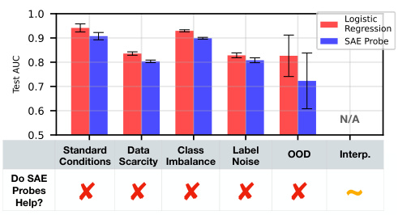

<!-- Start of picture text -->
N/A Standard  Data  Class  Label  OOD Interp. Conditions Scarcity Imbalance Noise Do SAE Probes  ~ Help? <!-- End of picture text -->

_Figure 1._ SAE probes underperform the baseline of logistic regression in each regime when taking the mean across <u>datasets.</u> Additionally, we find that baseline methods can provide many of the interpretability insights of SAE probes. 

notably, Bricken et al. (2023); Cunningham et al. (2023) demonstrated the promise of sparse autoencoders (SAEs) and sparked considerable follow-up work. This includes papers focused on improving the downstream cross entropy loss of SAE reconstructions (Gao et al., 2024; Braun et al., 2024; Rajamanoharan et al., 2024a;b), improving SAE training efficiency (Mudide et al., 2024; Gao et al., 2024), finding weaknesses in SAEs and proposing solutions (Chanin et al., 2024; Bussmann et al., 2024b), using SAEs to understand model representation structure (Engels et al., 2024a;b; Li et al., 2024), training large suites of SAEs (Lieberum et al., 2024; He et al., 2024), and developing benchmarks for SAEs (Huang et al., 2024; Karvonen et al.; 2024b). 

Unfortunately, we lack a “ground truth” to know whether SAEs truly extract the interpretable concepts used by language models. Prior work has largely avoided this limitation by evaluating SAEs with proxy metrics like reconstruction loss (Rajamanoharan et al., 2024a;b; Gao et al., 2024; Olmo et al., 2024; Braun et al., 2024). These metrics are tractable to optimize for, but do not necessarily align with mechanistic interpretability’s (MI) goal of better understanding neural networks (see Bereska & Gavves (2024) and Sharkey et al. (2025) for surveys of MI). We argue that if SAEs truly advance MI’s goal, they should improve performance on a real, hard-to-fake model control or explainability task. 

However, despite the extensive body of work on SAEs, there are relatively few cases where SAEs have been shown to 

help on such a task: Marks et al. (2024) show that SAE feature circuits can help identify and remove bias from classifiers; Smith & Brinkmann (2024) show that SAEs can identify misaligned features learned by a preference model; and Karvonen et al. (2024a) show that SAE feature ablations are better at preventing regex output than baselines in a setting with scarce supervised data. While these results are promising, they all study a single example in detail, and consider comparative baselines with varying levels of rigor. 

At the same time, there are also surprisingly few negative results finding that SAEs do _not_ help on downstream tasks; in fact, we are only aware of Chaudhary & Geiger (2024), which finds that SAE latents are worse than neurons at disentangling geographic data, and Farrell et al. (2024), which finds that pinning related SAE latents is less effective than baselines for unlearning bioweapon knowledge. Thus, it is not clear whether SAEs are just one result away from being differentially useful, or if MI should seek fundamentally different methods. We defer a thorough examination of related work to Appendix A. 

In this work, we attempt to fairly evaluate the utility of SAEs by examining their competitive advantage on a concrete task: training probes from language model activations to targets (Alain, 2016). Probing has two important qualities: 

1. **Probing is practically useful:** Probing has been used to investigate LLM representations (Gurnee & Tegmark, 2023; Nanda et al., 2023; Heinzerling & Inui, 2024), detect safety relevant quantities (Zou et al., 2023), remove knowledge from models (Elazar et al., 2021), and catch synthetic sleeper agents (MacDiarmid et al., 2024). 

2. **SAEs might reasonably improve probing:** Theoretically, SAE latents are a more interpretable basis of model activations, and we hypothesize that this inductive bias will help train probes in difficult regimes. Recent work has also found some positive results for the utility of SAE probes (Bricken et al., 2024a; Gallifant et al., 2025). 

Thus, we curate 113 linear probing datasets from a variety of settings and train linear probes on corresponding SAE latent activations (see Figure 2). We compare to a suite of baseline methods across 4 difficult probing regimes: 1) data scarcity, 2) class imbalance, 3) label noise, and 4) co-variate shift. Unfortunately, we find that **SAE probes fail to offer a consistent overall advantage when added to a simulated practitioner’s toolkit** . 

Further, we explore areas that Bricken et al. (2024a) suggest SAEs may be valuable for, including detecting attributes distributed over multiple tokens and identifying dataset issues. Although SAEs initially seemed promising in these settings, we were able to achieve the same results with improved baselines. Our results underscore the necessity for MI works to rigorously design baselines when evaluating the utility of interpretability techniques. 

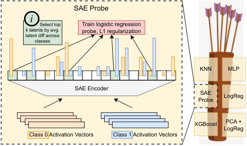

<!-- Start of picture text -->
SAE Probe i             Select top Train logistic regression latent diff acrossk latents by avg. probe, L1 regularization classes KNN MLP SAE Encoder SAE Probe LogReg XGBoost PCA + LogReg Class 0  Activation Vectors Class 1  Activation Vectors <!-- End of picture text -->

_Figure 2._ **Left:** An illustration of our SAE probing method. We pass in training activation vectors from each class and train an _L_ 1 regularized logistic regression probe on the latents that differ the most between classes. **Right:** We ensure robustness of our results with the ”quiver of arrows” approach (see Section 2.4): we add SAE regression into a set of methods, and see if the test accuracy of the best method (chosen by validation accuracy) increases. 

# **2. Methodology** 

We apply probes to the hidden states of two language models, Gemma-2-9B (Riviere et al., 2024) and Llama-3.1-8B (Grattafiori et al., 2024). Our main paper results use Gemma2-9B. We replicate core results on Llama-3.1-8B in Appendix F. We use JumpReLU (Rajamanoharan et al., 2024b) sparse autoencoders (SAEs) from Gemma Scope (Lieberum et al., 2024) for Gemma-2-9B and TopK (Gao et al., 2024) SAEs from Llama Scope (He et al., 2024) for Llama-3.1-8B. See Appendix A for further background on SAEs. 

## **2.1. Classification Datasets** 

We collect a diverse set of 113 binary classification datasets listed in Table 3 (Appendix B), including datasets that we expect to be challenging for probes. For example, 26 ~~h~~ eadline ~~i~~ sfrontpage requires probes to identify front-page headlines and 136 ~~g~~ lue ~~m~~ nli ~~e~~ ntailment requires probes to identify logically entailment. For other example datasets, refer to Table 1. All datasets are titled in the form ID ~~d~~ escription. We originally collected datasets for other purposes and discarded some of them; thus, while we have 113 datasets, ID ranges from [5 _,_ 163]. 

All datasets contain prompts and targets. Probes are tasked with predicting the target from the model’s hidden activations when run on a prompt. We focus on binary classification, since SAEs are mostly thought of as representing binarized latents (see Bricken et al. (2023)). Thus, target is either 0 or 1. The prompts in our datasets range in length from 5 tokens to a (left-truncated) maximum of 1024 tokens. 

_Table 1._ Example probing tasks. Only tasks with short prompts shown for conciseness. 

|**Dataset Name**|**Prompt**|**Target**|
|---|---|---|
|26 headline ~~i~~sfrontpage|Sebelius’s Slow-Motion Resignation From the Cabinet. MI5 References Emerge in Phone HackingLawsuit.|1 0|
|36 ~~s~~ciq ~~t~~f|Q: Binary fission is an example of which type of production? A: asexual Q: What occurs when light interacts with our atmosphere? A: prism effect|1 0|
|114 nyc ~~b~~orough ~~M~~anhattan|INWOOD BASKETBALL COURTS PS 18 JOHN G WHITTIER|1 0|
|149 ~~t~~wt ~~e~~motion ~~h~~appiness|All moved in to our new apartment. So exciting is noow calmmm eating polvoron .. yuumm|1 0|
|155 ~~a~~thlete ~~s~~port ~~b~~asketball|Jimmy Butler Steve Balboni|1 0|

## **2.2. Probing Strategy** 

To train a probe on a given dataset, we first run the model on all prompts from that dataset to generate model activations at each layer _l_ on the last token, _X−__l_ 1._X_ _−__l_ 1isofshape (len(prompts) _,_ model ~~d~~ im). We probe the last token to ensure the target information was present in the preceding context. For activation probes, we then train a probe _p_ to map from _X−__l_ 1_�→t_, where_t_are the targets in our dataset. 

Our SAE probe training technique is summarized in Figure 2. We first pass the training dataset _X−__l_ 1through the SAE encoder, resulting in a batch of vectors in the SAE latent space _Z_ = SAE( _X−__l_ 1) of shape (len(prompts)_, W_), where _W_ is the width of the SAE. We do not train probes directly on the SAE latent space because we hypothesize that a small number of SAE latents encodes the desired concept. Instead, we create a basis of latents with the highest average absolute difference between the set of training prompts _T_ 1 with target = 1 and the set of training prompts _T_ 0 with target = 0. More formally, if SAE( _X−__l_ 1)_∈_R_W_,where _W ≫ d_ model, we choose _k ≪ W_ and find indices _I_ as follows: 

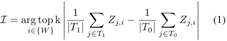

We then train a probe _p_ SAE to map from _Z_ [: _, I_ ] _�→ t_ . 

Note that previous work in SAE probing has aggregated SAE latents across tokens to provide a richer input space for SAE probes (Karvonen et al., 2024b; Bricken et al., 2024b). However, most probing studies operate on the final token, which we choose to emulate. In Section 5, we present results considering probes on multiple tokens. 

Throughout this study, we use the area under the ROC curve (AUC) to evaluate the quality of a probe. AUC is the likelihood that the classifier assigns a higher probability of target = 1 to a target = 1 example than to a target = 0 

example. Using AUC allows us to comprehensively assess probe performance agnostic to classification thresholds. For additional details on AUC, see Appendix C.1. 

Often, a probe _p_ has hyperparameters _hp_ we would like to optimize. We select _hp_ that has the maximal validation AUC using the cross-validation strategy described in Table 4. We then test _p_ with optimal _hp_ on a held out test set to calculate AUCtest _p_ . All datasets have at least 100 testing examples, with most having more (the average test set size is 1945). 

## **2.3. Probing Methods** 

We use the following 5 probing methods, with hyperparameters in parenthesis: 

1. Logistic Regression (L1 regularization for SAE probes, L2 otherwise). 

2. PCA Regression (# of PCA components to reduce _X−__l_ 1 to before using unregularized logistic regression). 

3. K-Nearest Neighbors (KNN) (# of nearest neighbors). 

4. XGBoost (Chen & Guestrin, 2016) (n ~~e~~ stimators, max ~~d~~ epth, learning ~~r~~ ate, subsample, colsample ~~b~~ ytree, reg ~~a~~ lpha, reg ~~l~~ ambda, and min ~~c~~ hild ~~w~~ eight). 

5. Multilayer Perceptron (MLP) (network depth, hidden state width, learning rate, and weight decay). 

We evaluate 10 hyperparameter values _hp_ for each probing method _p_ . For the first three probing methods, we use grid search, while for MLPs and XGBoost, we randomly sample from a hyperparameter grid to manage the larger search space. For additional details on hyperparameter ranges, see Appendix C.3. We use all five probing methods as baselines, but for SAE probes we only use logistic regression. 

## **2.4. Experimental Setup: Quiver of Arrows** 

To evaluate whether SAE probes provide an advantage over baselines, we use an evaluation metric we call the “Quiver 

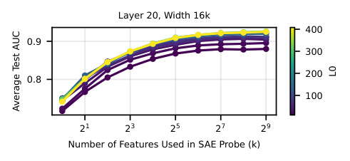

<!-- Start of picture text -->
Layer 20, Width 16k 400 0.9 300 200 0.8 100 2 1 2 3 2 5 2 7 2 9 Number of Features Used in SAE Probe (k) L0 Average Test AUC <!-- End of picture text -->

_Figure 3._ For a given width, using higher L0 and constructing probes with a larger basis of latents ( _k_ ) is more performant. 

of Arrows”: we ask whether adding SAE probes (a new “arrow”) to the set of existing probing methods available to a practitioner (the “quiver”) increases performance compared to a practitioner _without_ access to SAE probes. In other words, over a collection of methods we choose the best method by validation AUC and then report the test AUC of that method. We can then compare the marginal improvement of adding SAE probes to a practitioner’s toolkit by comparing the Quiver of Arrows AUC of baeline methods with and without SAE probes. We describe the Quiver of Arrows more formally in Appendix C.4. 

The quiver of arrows approach is designed as a robustness check to fairly evaluate the benefit of adding SAE probes to a practioner’s toolkit. If we instead constructed probes from a large set of SAEs and chose the best one based on test AUC, we could be tricked into thinking SAEs outperform baselines because we accessed the held-out test set. With the quiver of arrows approach, we emulate the information a real practioner has access to, allowing us to make a robust recommendation on the usefulness of SAE probes. 

# **3. Comparing Probing Techniques in Different Regimes** 

## **3.1. Standard Conditions** 

We initially assess probes under standard conditions, characterized by sufficient data for probe convergence and balanced classes. We find that baseline methods perform the best on layer 20 (see Figure 13a, Appendix D.1), so we run experiments with this layer. We train baselines on 1024 data points (or the maximum number of points in the dataset). 

We first conduct a preliminary investigation to cut down the large space of Gemma Scope SAEs. We train probes for all SAEs using _k_ latents (for logspaced values of _k_ ) on all datasets using 1024 training examples. We calculate the average test AUC for each SAE probe across all datasets. We find that SAE width is relatively unimportant to probe success, while larger L0s lead to more performant probes (Appendix D.2). Additionally, as we might expect, using 

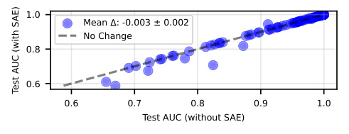

<!-- Start of picture text -->
1.0 Mean : -0.003 ± 0.002 No Change 0.8 0.6 0.6 0.7 0.8 0.9 1.0 Test AUC (without SAE) Test AUC (with SAE) <!-- End of picture text -->

_Figure 4._ In standard conditions, when SAE probes are added to the quiver, we find a slight decrease in performance. 

a larger value of _k_ leads to better probe performance, as shown in Figure 3. 

Thus, throughout the paper we train probes using the largest L0 for SAEs width = 16k _,_ width = 131k, and width = 1M. We use _k_ = 16 to construct easily interpretable probes that potentially overfit less and use _k_ = 128 for performance. 

Using this set of probes, we consider our quiver of arrows approach in standard conditions. SAEs are chosen as the “arrow” for 14/113 tasks, however, we see a slight _decrease_ in performance when they are added to the quiver in Figure 4. 

It is unsurprising that SAE probes underperform baselines in standard conditions, as their inductive bias is marginal given a large, balanced dataset. Thus, we now investigate more difficult settings to test if the inductive bias of SAEs translates into a competitive advantage for probing. 

## **3.2. Data Scarcity, Class Imbalance, and Label Noise** 

In this section, we consider more difficult probing regimes: limiting the training data (Data Scarcity), changing the relative frequency of target = 1 examples (Class Imbalance), and randomly flipping a fraction of the targets (Label Noise). All of these settings are realistic workflows - for example, a researcher observing a rare model phenomena would like a probe that generalizes with few total examples or few examples of the desired class, while a researcher working with collected user data wants a generalizable probe even if some fraction of users respond randomly. 

Each regime is characterized by a parameter which we vary to compare SAEs and baselines. 

- Data Scarcity - We use 20 values of _n_ logspaced in [2 _,_ 1024], where _n_ is the number of training examples. We use a standard test set. 

- Class Imbalance - We use 19 values of ratio linearly spaced between [0 _._ 05 _,_ 0 _._ 95], where ratio =_<u>n</u>_ _n_<u>1</u>and_n_1 is the number of target = 1 training examples. The test set uses the same ratio. 

- Label Noise - We use 11 values of fraction linearly spaced between [0 _,_ 0 _._ 5], where fraction =_n_corru _n_<u>pted</u> . We 

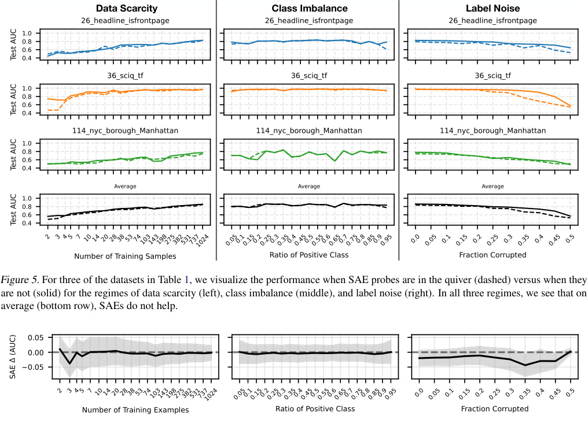

<!-- Start of picture text -->
Data Scarcity Class Imbalance Label Noise Figure 5.  For three of the datasets in Table 1, we visualize the performance when SAE probes are in the quiver (dashed) versus when they 1, we visualize the performance when SAE probes are in the quiver (dashed) versus when they, we visualize the performance when SAE probes are in the quiver (dashed) versus when they are not (solid) for the regimes of data scarcity (left), class imbalance (middle), and label noise (right). In all three regimes, we see that on average (bottom row), SAEs do not help. 0.05 0.00 0.05 Number of Training Examples Ratio of Positive Class Fraction Corrupted 2 3 45 7 101420283853741031431982753825317371024 0.050.10.150.20.250.30.350.40.450.50.550.60.650.70.750.80.850.90.95 0.0 0.05 0.1 0.15 0.2 0.25 0.3 0.35 0.4 0.45 0.5 SAE  (AUC) <!-- End of picture text -->

_Figure 5._ For three of the datasets in Table 1, we visualize the performance when SAE probes are in the quiver (dashed) versus when they 1, we visualize the performance when SAE probes are in the quiver (dashed) versus when they, we visualize the performance when SAE probes are in the quiver (dashed) versus when they are not (solid) for the regimes of data scarcity (left), class imbalance (middle), and label noise (right). In all three regimes, we see that on average (bottom row), SAEs do not help. 

_Figure 6._ For the regimes of data scarcity, class imbalance, and label noise, we see no average improvement across datasets when adding SAEs to the quiver. Shading represents 95% confidence intervals. 

## use a standard test set (uncorrupted). 

We evaluate the first two regimes with the quiver of arrows method. However, the quiver of arrows method relies on the validation data being representative of the test data. This assumption fails for the label noise setting since the validation data is corrupted. Thus, a hypothetical practitioner would likely deploy their most performant method from other settings instead of allowing corrupted validation AUC to arbitrarily choose a method. To emulate this, we compare logistic regression and the width = 16k, _k_ = 128 SAE probe head-to-head in the setting of label noise. 

In Figure 5, we visualize the SAE versus non-SAE quivers for a sample of datasets listed in Table 1 across the three regimes. Additionally, we visualize the average performance difference between the SAE and non-SAE quivers for each regime across all datasets in Figure 6. At all parameter values in each regime, SAEs show no meaningful improvement over baselines. This is not because SAEs are not chosen from the quiver; in Appendix E we see that SAEs 

are chosen for up to 40 datasets in each regime. SAEs simply underperform baselines in these settings. See Appendix E for results for individual datasets. 

## **3.3. Covariate Shift** 

We now investigate if SAE probes are more resilient to distribution shifts in prompts. To model this covariate shift, we create or use 8 out-of-distribution (OOD) datasets: two preexisting GLUE-X datasets which are designed as “extreme” versions of tasks 87 and 90 to test grammaticality and logical entailment respectively; three datasets (tasks 66, 67, and 73) which we alter the language of; and three datasets (tasks 5, 6, and 7) where we use syntactical alterations to names or use cartoon characters instead of historical figures. We train probes on these datasets in standard settings and evaluate on 300 covariate shifted test examples. 

Like the label noise setting, our validation data is unfaithful to our test data. Thus, we compare logistic regression to a single SAE probe. We construct SAE probes from the 

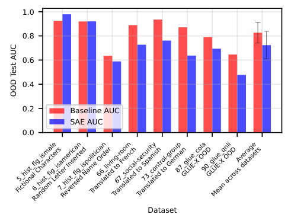

<!-- Start of picture text -->
1.0 0.8 0.6 0.4 0.2 Baseline AUC SAE AUC 0.0 Dataset 66_living-room 87_glue_colaGLUE-X OOD90_glue_qnliGLUE-X OODAverage Fictional Characters5_hist_fig_ismale6_hist_fig_isamericanRandom Letter Inserted7_hist_fig_ispoliticianReversed Name OrderTranslated to FrenchTranslated to Spanish67_social-securityTranslated to German73_control-group Mean across datasets OOD Test AUC <!-- End of picture text -->

_Figure 7._ SAE probes often generalize worse than baseline logistic regression with covariate shift. 

width = 131k _,_ L0 = 114 SAE, as latent descriptions are available for this SAE on Neuronpedia (Lin, 2023). Our results (Figure 7) show that baselines outperform SAE probes when generalizing to covariate shifted data. 

# **4. Interpretability** 

While we find that SAE probes are not helpful in traditional probing settings, one intrinsic advantage of SAE probes is that their input basis is interpretable. To leverage this, we use the technique of automatic interpretation, or autointerp, to create natural language descriptions of top latents for each dataset (see Bills et al. (2023)). We investigate three applications of labeled latents: 

1. **Probe Interpretability** : In Section 4.1, we investigate why SAE probes fail to perform well by pruning latents that o1 (OpenAI, 2024) ranks as spurious. 

2. **Latent Interpretability** : In Section 4.2, we generate autointerp explanations of each dataset’s top latent to find spurious latents and latents that fit well to our probes in a way not explained by the autointerp label. 

3. **Detecting Dataset Quality Issues** : In Section 4.3, we invesigate spurious dataset features and label errors using insights from the top latent descriptions and firing patterns. 

## **4.1. Probe Intepretability: Pruning and Latent Generalization** 

We first use autointerp to investigate why SAE probes fail to generalize to covariate shift. We have two initial hypotheses: 1) the latents SAE probes rely on leverage spurious correlations in the training data and 2) the latents are not spurious, but they are not robust to the distribution shift. 

First, we investigate hypothesis 1. Specifically, we attempt 

to improve SAE probes OOD performance by pruning latents deemed spurious by their autointerp description. We focus on three OOD tasks that SAE probes perform poorly on: 7 ~~h~~ ist ~~f~~ it ~~i~~ spolitician, 66 ~~l~~ iving-room, and 90 ~~g~~ lue ~~q~~ nli (Figure 7). We use the width = 131k _,_ L0 = 114 SAE. 

For each task, we take the _k_ = 8 top latents by mean difference and use Claude-3.5-Sonnet (Anthropic, 2024) to generate latent descriptions with autointerp. We then use OpenAI’s o1 model to rank the relevance of each latent’s description to the task. We also prompt o1 to downrank spurious latents given the OOD transformation. An example of this procedure for the task 66 ~~l~~ iving-room, which identifies if the phrase “living room” is in an English sentence, is shown in Table 5, Appendix G.1. For this task, o1 ranked latent 12274, which identifies “mentions of living rooms” first, while ranking latent 51330, which identifies “objects and materials related to scientific experiments,” last. 

We then construct a probe with the top _k_ latents using o1’s relevance rank for _k ∈_ [1 _,_ 8]. If there are spurious latents in the _k_ = 8 probe, we expect a probe with _k <_ 8 to have better OOD generalization. We visualize each task’s performance by _k_ in Figure 20, Appendix G.1. For two of the datasets, 66 ~~l~~ iving-room and 90 ~~g~~ lue ~~q~~ nli, we see that pruning works, with a 0.024 and 0.052 increase in AUC between the _k_ = 8 and _k_ = 1 probe for each dataset. However, for 7 ~~h~~ ist ~~f~~ ig ~~i~~ spolitician, OOD test AUC _increases_ by 0.077 after pruning. This indicates that the task 7 ~~h~~ ist ~~f~~ ig ~~i~~ spolitician requires _k_ = 8 latents to represent. 

Our preliminary results show that pruning helps SAE probes generalize. However, the drop between in-distribution (ID) and OOD performance is much larger than the modest improvement from pruning. This indicates that spurious correlations are not the primary reason SAE probes fail to generalize. Thus, we consider the second hypothesis - that the underlying SAE latents do not generalize well OOD. 

On the task 66 ~~l~~ iving-room, latent 122774 has an ID test AUC of 0.99 while only having an OOD test AUC of 0.64. Since the OOD transformation involves translating the prompts to French, we hypothesize that this latent is active on the phrase “living room” in English but not other languages. We use GPT-4o to translate “living room” to 15 languages, and in Figure 8 we indeed observe that latent 122774 is more active on the English translation than all other languages, and it is not active on the French translation at all. Thus, latent 122774 does not generalize OOD, which explains why the SAE probe also failed to generalize. 

## **4.2. Latent Interpretability** 

We next generate autointerp descriptions for the most determinative latent for each dataset, allowing us to identify interesting categories of latents. Specifically, we con- 

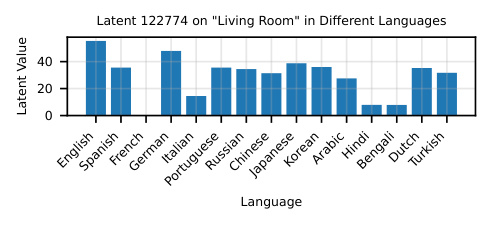

<!-- Start of picture text -->
Latent 122774 on "Living Room" in Different Languages 40 20 0 Language EnglishSpanishFrenchGermanItalianPortugueseRussianChineseJapaneseKoreanArabicHindiBengaliDutchTurkish Latent Value <!-- End of picture text -->

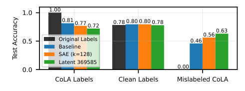

<!-- Start of picture text -->
1.0 1.00 0.81 0.77 0.72 0.78  0.80 0.80  0.78 0.56  0.63 0.5 Original Labels 0.46 Baseline SAE (k=128) Latent 369585 0.0 0.00 CoLA Labels Clean Labels Mislabeled CoLA Test Accuracy <!-- End of picture text -->

_Figure 9._ Latent 369585 outperforms a dense SAE probe and logistic regression when testing on mislabeled CoLA examples. 

_Figure 8._ Latent 122774 is most active on the English translation of “living room,” and does not fire on French. 

sider each of the top 128 latents for each dataset for the width = 131k _,_ L0 = 114 SAE, and evaluate each latent’s _k_ = 1 SAE probe in standard settings. We then generate an autointerp explanation with GPT-4o for the best latent. 

Table 5 (Appendix G.2) contains a breakdown of a selection of interesting top latents that we find. We see that some latents’ descriptions fit their tasks, like latent 81210 for 5 ~~h~~ ist ~~f~~ ig ~~i~~ smale, which activates on “references to female individuals.” Another interesting category is incorrect autointerp labels (e.g. for 125 ~~w~~ old ~~c~~ ountry ~~I~~ taly, latent 50817 has 0.989 AUC, implying (correctly) that it fires on Italian concepts; however, the description reads “names of researchers and scientific authors”). However, some latents appear to be spurious and unrelated to the semantics of their dataset. For example, 22 ~~h~~ eadline ~~i~~ sobama, which targets headlines published during the Obama administration, is classified with 0 _._ 782 AUC by latent 10555, which activates on “strings of numbers, often with mathematical notations.” 

Note that these findings may be possible using baseline classifiers. For example, we could take a baseline classifier and apply it to model hidden states on tokens from the Pile (Gao et al., 2020) and then examine maximally activating examples. However, a practical advantage for SAEs is that the infrastructure to perform autointerp is pre-existing through platforms like Neuronpedia, and a theoretical advantage is that the baseline classifier can only identify the single most relevant coarse-grained feature, while the decomposability of SAE probes into latents allows for identifying many independent features of various importance. 

## **4.3. Detecting Dataset Quality Issues** 

We now investigate the top latents of two datasets, 87 glue ~~c~~ ola and 110 ~~a~~ imade ~~h~~ umangpt3. We find that although the latents identify errors in each dataset, baseline methods are also able to identify these dataset errors. 

## 4.3.1. GLUE COLA 

We first examine 87 ~~g~~ lue ~~c~~ ola, an established linguistic acceptability dataset. CoLA prompts are standard English 

sentences with target = 1 if the sentence is grammatically correct and 0 otherwise. Latent 369585 from the width = 1M SAE has a test AUC of 0.76 and appears to fire on ungrammatical text. Surprisingly, when we look at prompts that latent 369585 fires on, those that it “disagrees” with the labels on (ones that are labeled grammatical), often appear to be ungrammatical. Although we first found this result with SAE probes, we later found that logistic regression was also capable of the same identification. In Table 7, we show the sentences that a baseline logistic regression classifier and latent 369585 mark as ungrammatical while the label is grammatical; most such sentences are truly ungrammatical. Thus, both SAE and baseline methods lead us to hypothesize that the CoLA dataset is partially mislabeled. 

To test our hypothesis, we choose 3 LLMs - GPT-4o (OpenAI), Claude-3.5-Sonnet-New, and Llama-3.1-405B Instruct (Grattafiori et al., 2024) - to judge the linguistic acceptability of 1000 random CoLA prompts. We take the LLM majority vote as the ensembled, clean label. This is analogous to the experiment performed in Warstadt et al. (2019) that validated the CoLA dataset by ensembling the predictions of native English speakers, but with LLM judges instead of English speakers. We find that 25% of CoLA la-˜ bels are mislabeled by this metric (higher than the 13% disagreement rate from Warstadt et al. (2019)). Notably, the Table 7 sentences are identified as ungrammatical by the ensemble while being labeled as grammatical in CoLA. 

Next, we train a baseline logistic regression, a _k_ = 128 dense SAE probe, and the latent 369585 classifier on the original CoLA labels. We then test on a held-out set with the clean, ensembled predictions. In Figure 9, we find that the original labels, the baseline classifier, the dense SAE probe, and latent 369585 all have about the same accuracy on the clean labels. Remarkably, when we test all classifiers on examples which were misclassified in CoLA (where the ensembled labels disagree with the original labels), we find that the latent 369585 classifier outperforms the dense SAE probe, which itself outperforms the baseline considerably. 

## 4.3.2. AI VS HUMAN 

We also investigate 110 ~~a~~ imade ~~h~~ umangpt3, which tests if probes can distinguish between human and ChatGPT- 

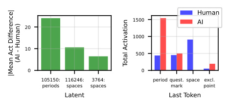

<!-- Start of picture text -->
Human 1500 AI 20 1000 10 500 0 0 105150: 116246: 3764: period quest. space excl. periods spaces spaces mark point Latent Last Token (AI - Human) Total Activation |Mean Act Difference| <!-- End of picture text -->

_Figure 10._ **Left:** Top 3 latents (w/ descriptions) by mean activation difference between AI generated and human SAE latent activations. **Right:** Histograms of the identity of the 4 most common last tokens in AI generated and human text. 

3.5 generated text. Latent 105150 has an AUC of 0.82 on this task, yet appears to fire primarily on periods and punctuation.2 Since this latent is syntactical and unrelated to the content of the dataset, we hypothesize it represents a spurious correlation in the dataset. 

We examine the final token of each prompt in the dataset and indeed find a spurious feature: AI text is more likely to end in a period while human text is more likely to end in a space (see Figure 10). Although we discovered this by investigating SAE latents, we could reach the same conclusion with baselines: in Table 8 (Appendix G.4), we apply the logistic regression classifier to 2.8 million tokens from the Pile, and find that it is most active on punctuation tokens. 

# **5. Why Didn’t This Work: Illusions of SAE Probes** 

Bricken et al. (2024a) report that SAE probes outperform baselines slightly. A natural question is why our experiments fail to replicate this result. One possible explanation is that Bricken et al. (2024a)’s findings were based on a single dataset, whereas we evaluate across multiple datasets. We find that SAE probes outperform baselines on only a small subset of these datasets (2.2%, see Figure 11). It is possible that the dataset used by Bricken et al. (2024a) falls within this subset; however, without access to it, we cannot confirm this. 

A separate explanation involves a potential illusion due to insufficiently strong baselines. Unlike our work, Bricken et al. (2024a) uses multi-token SAE probing: they aggregate the maximum value for each latent across all prompt tokens, while we only use last token latents. Crucially, they similarly max-pool each model dimension across prompt tokens for their comparative baseline, even though activations are unlikely to have privileged dimensions (in Table 9 we show that pooling activations in this way works poorly). We implement multi-token SAE probing using max-aggregation 

2See Neuronpedia for examples. 

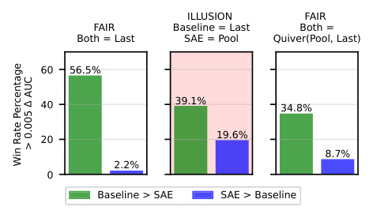

<!-- Start of picture text -->
ILLUSION  FAIR FAIR  Baseline = Last Both = Both = Last SAE = Pool Quiver(Pool, Last) 60 56.5% 40 39.1% 34.8% 19.6% 20 8.7% 2.2% 0 Baseline > SAE SAE > Baseline > 0.005  AUC Win Rate Percentage <!-- End of picture text -->

_Figure 11._ Illustration of a potentially misleading result we find: when comparing activation probes to pooled SAE probes, SAE probe win rate increases considerably, but adding in a “pooled” attention-inspired probe brings down the SAE win-rate. 

on 60 random datasets from our list and _k_ = 128; see Table 9 for full results on these datasets. We _also_ implement a better baseline: we train attention-pooled probes of the form 

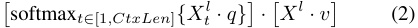

for _q, v ∈_ R_d_ . We find that when compared to the last-token baseline, max-pooled SAE probes win 19 _._ 6% of the time, a considerable improvement over win rate of last-token SAE probes (2.2%, see Figure 11). However, when implementing attention-pooled baselines and using the quiver of arrows approach to select between pooled and last-token strategies for SAE probes and baselines, the SAE probe win rate drops more than 50% to 8 _._ 7% (see Figure 11). 

# **6. Assessing Improvements in SAE Architectures** 

While SAE probes do not robustly outperform baselines, a separate interesting question is whether recent SAE architectural developments have improved SAE probing performance. We investigate this question by examining the performance of eight different SAE architectures released in the last two years, as outlined in Table 2. 

We use width = 16k Gemma-2-2B layer 12 SAEs with a variety of L0 values trained by Karvonen et al. (2024b). We create _k_ = 16 _,_ 128 SAE probes on all regimes and datasets for each architecture, and additionally _k_ = 1 for standard conditions. In Figure 12, we plot each SAE architecture’s _k_ = 16 probe performance in standard conditions. We find the average test AUC of each SAE and then take the max across L0 for each SAE architecture (using a single L0 value is somewhat noisy, see Appendix I). This metric tests how expressive individual SAE latents are for different SAE architectures. While we see a slight positive trend for probing performance with more recently released SAE architectures, the effect is not statistically significant. For plots in all regimes, see Appendix I; in other regimes there 

_Table 2._ Timeline of SAE Architecture Improvements. 

|**SAE Architecture**|**Publication Date**|
|---|---|
|ReLU (original) Bricken et al. (2023)|October 4, 2023|
|ReLU (updated) Conerlyet al. (2024)|April 26, 2024|
|Gated|May 1, 2024|
|Rajamanoharan et al. (2024a)||
|TopK Gao et al. (2024)|June 6, 2024|
|JumpReLU Rajamanoharan et al. (2024b)|July 19, 2024|
|BatchTopK Bussmann et al. (2024a)|July 19, 2024|
|p-annealing Karvonen et al.|July 31, 2024|
|Matryoshka Bussmann et al. (2024b)|December 19, 2024|

seems to be a possible slight improvement with newer SAE architectures. 

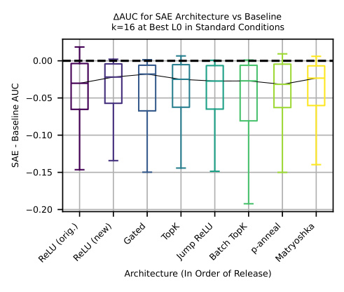

<!-- Start of picture text -->
AUC for SAE Architecture vs Baseline k=16 at Best L0 in Standard Conditions 0.00 0.05 0.10 0.15 0.20 Architecture (In Order of Release) ReLU (orig.)ReLU (new) Gated TopKJump ReLUBatch TopK p-annealMatryoshka SAE - Baseline AUC <!-- End of picture text -->

_Figure 12._ We see that there is a slight uptick in probing performance compared to baselines in standard conditions with more recent architectures. However, the spread of the data is considerably larger than this improvement. 

# **7. Conclusion** 

Our evaluation of sparse autoencoders (SAEs) reveals fundamental limitations in current SAE methodologies. Despite expectations that interpretable SAE latents would provide a competitive advantage in probing, we found no improvement over traditional methods across multiple regimes and over 100 datasets. Some failures expose critical weaknesses – for instance, SAE latents struggle to be robust to distributional shifts and fail to represent complex concepts – while others are more mundane – lower L0 SAEs create worse sparse probes. More broadly, our findings highlight the need for the field of mechanistic interpretability to evaluate techniques with rigorous baselines. While prior work reported advantages for SAE probes, our robust quiver of arrows methodology, use of stronger baselines, and evaluation on a large set of datasets demonstrate these advantages to be illusory. Even in our own analysis, initial conclusions favoring SAE interpretability were later overturned when proper baselines were considered. We do not consider this work to be a wholesale critique of the SAE paradigm. Instead, we view it as a single rigorously evaluated datapoint to contextualize SAE utility and to motivate a more thorough examination of methods in mechanistic interpretability. 

**Limitations** We study the performance of SAE probes as a proxy for SAE utility. While we believe that probing performance is a more effective measurement than typical SAE evaluations like downstream cross-entropy loss or reconstruction error, it is ultimately still a proxy metric. We chose to study difficult probing regimes to try to find cases where 

the inductive bias of SAE latents outweighed imperfect SAE reconstruction, but it is possible that even a basis of “true” model representations would offer only a mild inductive bias advantage over traditional linear probing. We are thus excited for future work studying probing on toy models (e.g. models trained on board games (Karvonen et al., 2024c)) where the “true” model features are known. 

Finally, it is possible that further optimization of the SAE probe baseline might increase performance such that it beats baseline methods. For example, Gallifant et al. (2025) find that SAE probing with a number of modifications (multitoken probes, binarization of latents, and probing with _k_ = full SAE dimension) beats baseline methods on safetyrelevant datasets (albeit only comparing to single-token baseline probes). However, we believe a main takeaway of our paper is that equivalent effort should be put into optimizing baselines. Indeed, we examine the effect of binarizing latents in Appendix J and find that it does not significantly help. 

# **8. Acknowledgments** 

This work was conducted as part of the ML Alignment & Theory Scholars (MATS) Program. We would like to thank the members of the Tegmark group and Neel Nanda’s MATS stream for helpful comments and feedback. JE was supported by the NSF Graduate Research Fellowship (Grant No. 2141064). 

# **9. Author Contributions** 

JE and SK jointly led the project and wrote the paper. JE came up with the Quiver of Arrows approach, ran the SAE methods, discovered the initial GLUE CoLA and AI vs. Human results, discovered Gemma Scope SAE latent reliance on language, and ran multi-token experiments. SK cleaned a majority of the datasets, ran baseline methods, did the probe interpretability experiments, ran the main text covariate shift experiments, did follow-up experiments on dataset errors and latent interpretability, and made most of the final main body plots. SR and MT provided advice, guidance, and general mentorship, and edited the paper. NN was the primary senior author of the project and provided leadership, direction, and advice throughout. 

# **References** 

- Adebayo, J., Gilmer, J., Muelly, M., Goodfellow, I., Hardt, M., and Kim, B. Sanity checks for saliency maps. _Advances in neural information processing systems_ , 31, 2018. 

- AI, T. and Ishii, D. Spam Text Message — 

- Classification kaggle.com. https: //www.kaggle.com/datasets/team-ai/ spam-text-message-classification. [Accessed 21-01-2025]. 

- Alain, G. Understanding intermediate layers using linear classifier probes. _arXiv preprint arXiv:1610.01644_ , 2016. 

- AllenAI. allenai/basic ~~a~~ rithmetic · Datasets at Hugging Face — huggingface.co. https://huggingface.co/ datasets/allenai/basic_arithmetic. [Accessed 21-01-2025]. 

- Anthropic. Introducing computer use, a new Claude 3.5 Sonnet, and Claude 3.5 Haiku, 2024. URL https://www.anthropic.com/news/ 3-5-models-and-computer-use. Accessed: 2025-01-30. 

- Arora, S., Li, Y., Liang, Y., Ma, T., and Risteski, A. Linear algebraic structure of word senses, with applications to polysemy. _Transactions of the Association for Computational Linguistics_ , 6:483–495, 2018. 

- Ben Zhou, Daniel Khashabi, Q. N. and Roth, D. “going on a vacation” takes longer than “going for a walk”: A study of temporal commonsense understanding. In _EMNLP_ , 2019. 

- Bereska, L. and Gavves, E. Mechanistic interpretability for ai safety–a review. _arXiv preprint arXiv:2404.14082_ , 2024. 

- Bills, S., Cammarata, N., Mossing, D., Tillman, H., Gao, L., Goh, G., Sutskever, I., Leike, J., Wu, J., and Saunders, W. Language models can explain neurons in language models. https: //openaipublic.blob.core.windows.net/ neuron-explainer/paper/index.html, 2023. 

- Bisk, Y., Zellers, R., Bras, R. L., Gao, J., and Choi, Y. Piqa: Reasoning about physical commonsense in natural language. In _Thirty-Fourth AAAI Conference on Artificial Intelligence_ , 2020. 

- Bolukbasi, T., Pearce, A., Yuan, A., Coenen, A., Reif, E., Viegas, F., and Wattenberg, M. An interpretability illusion´ for bert. _arXiv preprint arXiv:2104.07143_ , 2021. 

- Braun, D., Taylor, J., Goldowsky-Dill, N., and Sharkey, L. Identifying functionally important features with endto-end sparse dictionary learning, 2024. URL https: //arxiv.org/abs/2405.12241. 

- Bricken, T., Templeton, A., Batson, J., Chen, B., Jermyn, A., Conerly, T., Turner, N., Anil, C., Denison, C., Askell, A., Lasenby, R., Wu, Y., Kravec, S., Schiefer, N., Maxwell, T., Joseph, N., Hatfield-Dodds, Z., Tamkin, A., Nguyen, K., McLean, B., Burke, J. E., Hume, T., Carter, S., Henighan, T., and Olah, C. Towards monosemanticity: Decomposing language models with dictionary learning. _Transformer Circuits Thread_ , 2023. https://transformercircuits.pub/2023/monosemantic-features/index.html. 

- Bricken, T., Marcus, J., Mishra-Sharma, S., Tong, M., Perez, E., Sharma, M., Rivoire, K., and Henighan, T. Using dictionary learning features as classifiers, October 2024a. URL https: //transformer-circuits.pub/2024/ features-as-classifiers/index.html. Accessed: 2025-01-23. 

- Bricken, T., Marcus, J., Mishra-Sharma, S., Tong, M., Perez, E., Sharma, M., Rivoire, K., and Henighan, T. Using dictionary learning features as classifiers, October 2024b. URL https: //transformer-circuits.pub/2024/ features-as-classifiers/index.html. Transformer Circuits. 

- Bussmann, B., Leask, P., and Nanda, N. Batchtopk sparse autoencoders, 2024a. 

- Bussmann, B., Leask, P., and Nanda, N. Learning multi-level features with matryoshka saes. https://www.lesswrong. com/posts/rKM9b6B2LqwSB5ToN/ 

learning-multi-level-features-with-matryoshka-saes 2024b. Accessed: 2025-01-23. 

- Chalnev, S., Siu, M., and Conmy, A. Improving steering vectors by targeting sparse autoencoder features. _arXiv preprint arXiv:2411.02193_ , 2024. 

- Chanin, D., Wilken-Smith, J., Dulka, T., Bhatnagar, H., and Bloom, J. A is for absorption: Studying feature splitting and absorption in sparse autoencoders. _arXiv preprint arXiv:2409.14507_ , 2024. 

- Chaudhary, M. and Geiger, A. Evaluating open-source sparse autoencoders on disentangling factual knowledge in gpt-2 small. _arXiv preprint arXiv:2409.04478_ , 2024. 

- Chen, T. and Guestrin, C. Xgboost: A scalable tree boosting system. In _Proceedings of the 22nd ACM SIGKDD International Conference on Knowledge Discovery and Data Mining_ , KDD ’16, pp. 785–794, New York, NY, USA, 2016. Association for Computing Machinery. ISBN 9781450342322. doi: 10.1145/ 2939672.2939785. URL https://doi.org/10. 1145/2939672.2939785. 

- clmentbisaillon. fake-and-real-news-dataset — kaggle.com. https://www.kaggle. 

- com/datasets/clmentbisaillon/ fake-and-real-news-dataset. [Accessed 21-01-2025]. 

- Conerly, T., Templeton, A., Bricken, T., Marcus, J., and Henighan, T. Circuits Updates - April 2024 — transformer-circuits.pub. https: //transformer-circuits.pub/2024/ april-update/index.html#training-saes, 2024. [Accessed 15-02-2025]. 

- Cunningham, H., Ewart, A., Riggs, L., Huben, R., and Sharkey, L. Sparse autoencoders find highly interpretable features in language models. _arXiv preprint arXiv:2309.08600_ , 2023. 

- Davidson, T., Warmsley, D., Macy, M., and Weber, I. Automated hate speech detection and the problem of offensive language. In _Proceedings of the 11th International AAAI Conference on Web and Social Media_ , ICWSM ’17, pp. 512–515, 2017. 

- Dublish, T. Text classification documentation — kaggle.com. https://www. kaggle.com/datasets/tanishqdublish/ text-classification-documentation. [Accessed 21-01-2025]. 

- Elazar, Y., Ravfogel, S., Jacovi, A., and Goldberg, Y. Amnesic probing: Behavioral explanation with amnesic counterfactuals. _Transactions of the Association for Computational Linguistics_ , 9:160–175, March 2021. ISSN 2307-387X. doi: 10.1162/tacl ~~a 0~~ 0359. URL http: //dx.doi.org/10.1162/tacl_a_00359. 

- Engels, J., Michaud, E. J., Liao, I., Gurnee, W., and Tegmark, M. Not all language model features are linear, 2024a. URL https://arxiv.org/abs/2405. 14860. 

- Engels, J., Riggs, L., and Tegmark, M. Decomposing the dark matter of sparse autoencoders. _arXiv preprint arXiv:2410.14670_ , 2024b. 

- Falgunipatel19. Medical Text Dataset -Cancer Doc — 

- Classification kaggle.com. https://www. kaggle.com/datasets/falgunipatel19/ biomedical-text-publication-classification. [Accessed 21-01-2025]. 

- Farrell, E., Lau, Y.-T., and Conmy, A. Applying sparse autoencoders to unlearn knowledge in language models, 2024. 

- Gaggar, R., Bhagchandani, A., and Oza, H. Machinegenerated text detection using deep learning, 2023. 

- Gallifant, J., Chen, S., Sasse, K., Aerts, H., Hartvigsen, T., and Bitterman, D. S. Sparse autoencoder features for classifications and transferability, 2025. 

- Gao, L., Biderman, S., Black, S., Golding, L., Hoppe, T., Foster, C., Phang, J., He, H., Thite, A., Nabeshima, N., Presser, S., and Leahy, C. The Pile: An 800gb dataset of diverse text for language modeling. _arXiv preprint arXiv:2101.00027_ , 2020. 

- Gao, L., la Tour, T. D., Tillman, H., Goh, G., Troll, R., Radford, A., Sutskever, I., Leike, J., and Wu, J. Scaling and evaluating sparse autoencoders, 2024. URL https: //arxiv.org/abs/2406.04093. 

- Gerami, S. AI Vs Human Text — kaggle.com. https://www.kaggle.com/datasets/ shanegerami/ai-vs-human-text/data. [Accessed 21-01-2025]. 

- Goh, A. IT Service Ticket Classification Dataset — kaggle.com. https://www. kaggle.com/datasets/adisongoh/ 

- it-service-ticket-classification-dataset. [Accessed 21-01-2025]. 

- Grattafiori, A., Dubey, A., Jauhri, A., Pandey, A., Kadian, A., et al. The llama 3 herd of models, 2024. URL https: //arxiv.org/abs/2407.21783. 

- Gupta, P. Emotion Detection from Text — kaggle.com. https://www.kaggle. 

- com/datasets/pashupatigupta/ emotion-detection-from-text. [Accessed 21-01-2025]. 

- Gurnee, W. and Tegmark, M. Language models represent space and time. _arXiv preprint arXiv:2310.02207_ , 2023. 

- Gurnee, W. and Tegmark, M. Language models represent space and time. In _The Twelfth International Conference on Learning Representations_ , 2024. URL https:// openreview.net/forum?id=jE8xbmvFin. 

- Gurnee, W., Nanda, N., Pauly, M., Harvey, K., Troitskii, D., and Bertsimas, D. Finding neurons in a haystack: Case studies with sparse probing. _Transactions on Machine Learning Research_ , 2023. ISSN 28358856. URL https://openreview.net/forum? id=JYs1R9IMJr. 

- He, Z., Shu, W., Ge, X., Chen, L., Wang, J., Zhou, Y., Liu, F., Guo, Q., Huang, X., Wu, Z., Jiang, Y.-G., and Qiu, X. Llama scope: Extracting millions of features from llama-3.1-8b with sparse autoencoders, 2024. 

- Heap, T., Lawson, T., Farnik, L., and Aitchison, L. Sparse autoencoders can interpret randomly initialized transformers, 2025. URL https://arxiv.org/abs/2501. 17727. 

- Heinzerling, B. and Inui, K. Monotonic representation of numeric properties in language models. _arXiv preprint arXiv:2403.10381_ , 2024. 

- Hendrycks, D., Burns, C., Basart, S., Critch, A., Li, J., Song, D., and Steinhardt, J. Aligning ai with shared human values. _Proceedings of the International Conference on Learning Representations (ICLR)_ , 2021. 

- Huang, J., Wu, Z., Potts, C., Geva, M., and Geiger, A. Ravel: Evaluating interpretability methods on disentangling language model representations. _arXiv preprint arXiv:2402.17700_ , 2024. 

- Johannes Welbl, Nelson F. Liu, M. G. Crowdsourcing multiple choice science questions. 2017. 

- Karvonen, A., Wright, B., Rager, C., Angell, R., Brinkmann, J., Smith, L., Verdun, C. M., Bau, D., and Marks, S. Measuring progress in dictionary learning for language model interpretability with board game models, 2024. _URL https://arxiv. org/abs/2408.00113_ , pp. 16. 

- Karvonen, A., Pai, D., Wang, M., and Keigwin, B. Sieve: Saes beat baselines on a real-world task (a code generation case study). _Tilde Research Blog_ , 12 2024a. URL https://www.tilderesearch. com/blog/sieve. Blog post. 

- Karvonen, A., Rager, C., Lin, J., Tigges, C., Bloom, J., Chanin, D., Lau, Y.-T., Farrell, E., Conmy, A., McDougall, C., Ayonrinde, K., Wearden, M., Marks, S., and Nanda, N. Saebench: A comprehensive benchmark for 

- sparse autoencoders, December 2024b. URL https:// www.neuronpedia.org/sae-bench/info. Accessed: 2025-01-20. 

- Karvonen, A., Wright, B., Rager, C., Angell, R., Brinkmann, J., Smith, L., Verdun, C. M., Bau, D., and Marks, S. Measuring progress in dictionary learning for language model interpretability with board game models. _arXiv preprint arXiv:2408.00113_ , 2024c. 

- Kasaraneni, C. K. Medical Text — kaggle.com. https://www.kaggle.com/datasets/ chaitanyakck/medical-text. [Accessed 21-01-2025]. 

- Kotari, R. rkotari/clickbait · Datasets at Hugging Face — huggingface.co. https://huggingface.co/ datasets/rkotari/clickbait. [Accessed 2101-2025]. 

- Li, Y., Michaud, E. J., Baek, D. D., Engels, J., Sun, X., and Tegmark, M. The geometry of concepts: Sparse autoencoder feature structure. _arXiv preprint arXiv:2410.19750_ , 2024. 

- Lieberum, T., Rajamanoharan, S., Conmy, A., Smith, L., Sonnerat, N., Varma, V., Kramar, J., Dragan, A., Shah, R.,´ and Nanda, N. Gemma scope: Open sparse autoencoders everywhere all at once on gemma 2, 2024. 

- Lin, J. Neuronpedia: Interactive reference and tooling for analyzing neural networks, 2023. URL https: //www.neuronpedia.org. Software available from neuronpedia.org. 

- Lin, S., Hilton, J., and Evans, O. TruthfulQA: Measuring how models mimic human falsehoods. In Muresan, S., Nakov, P., and Villavicencio, A. (eds.), _Proceedings of the 60th Annual Meeting of the Association for Computational Linguistics (Volume 1: Long Papers)_ , pp. 3214– 3252, Dublin, Ireland, May 2022. Association for Computational Linguistics. doi: 10.18653/v1/2022.acl-long. 229. URL https://aclanthology.org/2022. acl-long.229/. 

- Lin, Z., Wang, Z., Tong, Y., Wang, Y., Guo, Y., Wang, Y., and Shang, J. Toxicchat: Unveiling hidden challenges of toxicity detection in real-world user-ai conversation, 2023. 

- MacDiarmid, M., Maxwell, T., Schiefer, N., Mu, J., Kaplan, J., Duvenaud, D., Bowman, S., Tamkin, A., Perez, E., Sharma, M., Denison, C., and Hubinger, E. Simple probes can catch sleeper agents, 2024. URL https://www.anthropic.com/ news/probes-catch-sleeper-agents. 

- Marks, S. and Tegmark, M. The geometry of truth: Emergent linear structure in large language model representations of true/false datasets. _arXiv preprint arXiv:2310.06824_ , 2023. 

- Marks, S., Rager, C., Michaud, E. J., Belinkov, Y., Bau, D., and Mueller, A. Sparse feature circuits: Discovering and editing interpretable causal graphs in language models. _arXiv preprint arXiv:2403.19647_ , 2024. 

- Mudide, A., Engels, J., Michaud, E. J., Tegmark, M., and de Witt, C. S. Efficient dictionary learning with switch sparse autoencoders, 2024. URL https://arxiv. org/abs/2410.08201. 

- Mur, M., Bandettini, P. A., and Kriegeskorte, N. Revealing representational content with pattern-information fmri—an introductory guide. _Social cognitive and affective neuroscience_ , 4(1):101–109, 2009. 

- Nanda, N., Lee, A., and Wattenberg, M. Emergent linear representations in world models of self-supervised sequence models. _arXiv preprint arXiv:2309.00941_ , 2023. 

- Olmo, J., Wilson, J., Forsey, M., Hepner, B., Howe, T. V., and Wingate, D. Features that make a difference: Leveraging gradients for improved dictionary learning, 2024. URL https://arxiv.org/abs/2411.10397. 

- OpenAI. Hello GPT-4o. https://openai.com/ index/hello-gpt-4o/. [Accessed 27-01-2025]. 

- OpenAI. Introducing openai o1. https://openai. com/o1/, 2024. [Accessed 29-01-2025]. 

- Pang, B. and Lee, L. Seeing stars: Exploiting class relationships for sentiment categorization with respect to rating scales. In _Proceedings of the ACL_ , 2005. 

- Rajamanoharan, S., Conmy, A., Smith, L., Lieberum, T., Varma, V., Kramar, J., Shah, R., and Nanda, N. Improving´ dictionary learning with gated sparse autoencoders. _arXiv preprint arXiv:2404.16014_ , 2024a. 

- Rajamanoharan, S., Lieberum, T., Sonnerat, N., Conmy, A., Varma, V., Kramar,´ J., and Nanda, N. Jumping ahead: Improving reconstruction fidelity with jumprelu sparse autoencoders, 2024b. URL https://arxiv.org/ abs/2407.14435. 

- Riviere, M., Pathak, S., Sessa, P. G., Hardin, C., Bhupatiraju, S., Hussenot, L., Mesnard, T., Shahriari, B., et al. Gemma 2: Improving open language models at a practical size, 2024. 

- Rogers, A., Kovaleva, O., Downey, M., and Rumshisky, A. Getting closer to AI complete question answering: A set 

of prerequisite real tasks. In _The Thirty-Fourth AAAI Conference on Artificial Intelligence, AAAI 2020, The ThirtySecond Innovative Applications of Artificial Intelligence Conference, IAAI 2020, The Tenth AAAI Symposium on Educational Advances in Artificial Intelligence, EAAI 2020, New York, NY, USA, February 7-12, 2020_ , pp. 8722– 8731. AAAI Press, 2020. URL https://aaai.org/ ojs/index.php/AAAI/article/view/6398. 

- Sharkey, L., Chughtai, B., Batson, J., Lindsey, J., Wu, J., Bushnaq, L., Goldowsky-Dill, N., Heimersheim, S., Ortega, A., Bloom, J., Biderman, S., Garriga-Alonso, A., Conmy, A., Nanda, N., Rumbelow, J., Wattenberg, M., Schoots, N., Miller, J., Michaud, E. J., Casper, S., Tegmark, M., Saunders, W., Bau, D., Todd, E., Geiger, A., Geva, M., Hoogland, J., Murfet, D., and McGrath, T. Open problems in mechanistic interpretability, 2025. URL https://arxiv.org/abs/2501.16496. 

- Smith, L. R. and Brinkmann, J. Interpreting preference models w/ sparse autoencoders, July 2024. URL https://www.alignmentforum. org/posts/5XmxmszdjzBQzqpmz/ 

- interpreting-preference-models-w-sparse-autoencoders Accessed: 2025-01-23. 

- Stathead. Stathead: Your all-access ticket to the Sports Reference database. — Stathead.com — stathead.com. https://stathead.com/. [Accessed 21-01-2025]. 

- Tafjord, O., Gardner, M., Lin, K., and Clark, P. ”quartz: An open-domain dataset of qualitative relationship questions”. ”2019”. 

- Talmor, A., Yoran, O., Bras, R. L., Bhagavatula, C., Goldberg, Y., Choi, Y., and Berant, J. Commonsenseqa 2.0: Exposing the limits of ai through gamification. _arXiv preprint arXiv:2201.05320_ , 2022. 

- Templeton, A., Conerly, T., Marcus, J., Lindsey, J., Bricken, T., Chen, B., Pearce, A., Citro, C., Ameisen, E., Jones, A., Cunningham, H., Turner, N. L., McDougall, C., MacDiarmid, M., Freeman, C. D., Sumers, T. R., Rees, E., Batson, J., Jermyn, A., Carter, S., Olah, C., and Henighan, T. Scaling monosemanticity: Extracting interpretable features from claude 3 sonnet. _Transformer Circuits Thread_ , 2024. URL https: //transformer-circuits.pub/2024/ scaling-monosemanticity/index.html. 

- Wang, A., Singh, A., Michael, J., Hill, F., Levy, O., and Bowman, S. R. GLUE: A multi-task benchmark and analysis platform for natural language understanding. In _International Conference on Learning Representations_ , 2019. URL https://openreview.net/forum? id=rJ4km2R5t7. 

- Warstadt, A., Singh, A., and Bowman, S. R. Neural network acceptability judgments. _Transactions of the Association for Computational Linguistics_ , 7:625–641, 2019. doi: 10. 1162/tacl ~~a 0~~ 0290. URL https://aclanthology. org/Q19-1040/. 

- Wu, Z., Arora, A., Geiger, A., Wang, Z., Huang, J., Jurafsky, D., Manning, C. D., and Potts, C. Axbench: Steering llms? even simple baselines outperform sparse autoencoders, 2025. URL https://arxiv.org/abs/ 2501.17148. 

- Yun, Z., Chen, Y., Olshausen, B. A., and LeCun, Y. Transformer visualization via dictionary learning: contextualized embedding as a linear superposition of transformer factors. _arXiv preprint arXiv:2103.15949_ , 2021. 

- Zou, A., Phan, L., Chen, S., Campbell, J., Guo, P., Ren, R., Pan, A., Yin, X., Mazeika, M., Dombrowski, A.-K., et al. Representation engineering: A top-down approach to ai transparency. _arXiv preprint arXiv:2310.01405_ , 2023. 

# **A. Related Work** 

## **A.1. Probing** 

Probing has a rich history in computational neuroscience, where linear decoders were used to study information representation in biological neural networks (Mur et al., 2009). This technique was later adapted to study artificial neural networks by Alain (2016). Since then, probing has become a fundamental tool in neural network interpretability, revealing that many high-level concepts are linearly represented in model activations (Gurnee & Tegmark, 2023; Heinzerling & Inui, 2024; Nanda et al., 2023). Similar to our work studying sparse probing, Gurnee et al. (2023) study sparse probing of activations and identify individual monosemantic neurons by setting _k_ = 1. Recent work has also used probing to study safety-relevant properties of language models, such as truthfulness (Marks & Tegmark, 2023) and the presence of sleeper agents (MacDiarmid et al., 2024), without relying on potentially unreliable model outputs. Two recent works have investigated the utility of SAEs for probing. First, Bricken et al. (2024a) investigate a synthetic bioweapons dataset and show that SAE probes can sometimes offer an advantage against baseline probes when aggregated across multiple tokens; we discuss these results in our section on multi-token probing in Section 5. Second, Gallifant et al. (2025) use feature binarization, multi-token feature pooling, and probing on the entire SAE vector to report that SAE probes outperform baselines. We discuss Gallifant et al.’s (2025) results in our limitations section and in Appendix J. 

## **A.2. Challenges in Neural Network Interpretability** 

Our work connects to broader concerns about the reliability of neural network interpretation methods. Adebayo et al. (2018) studied saliency methods, a classical technique for understanding models, and found that randomizing the model and dataset labels did not change many aspects of saliency maps; thus, while the method produced plausible-looking explanations, they were not faithful to the true model and dataset. Similarly, (Bolukbasi et al., 2021) demonstrated that seemingly interpretable neurons in BERT were artifacts of running on only a particular dataset rather than more general representations. For SAEs specifically, (Chanin et al., 2024) identified feature absorption and splitting as fundamental challenges, Gao et al. (2024) showed that SAEs have an irreducible error component, and in extremely recent work Heap et al. (2025) show that SAEs trained on random models also result in interpretable features. Our work extends these critiques by finding that many settings where SAE probes were thought to be helpful turn out not to be when compared to stronger baselines. 

## **A.3. SAE and SAE Applications** 

Sparse autoencoders (SAEs) provide a map from model activations to a sparse, higher dimensional latent space (Bricken et al., 2023; Cunningham et al., 2023). Individual latents are hypothesized to represent mono-semantic concepts LLMs use for computation. An SAE is parameterized by its width, or the dimension of its latent space, and its L0, or how many latents are nonzero on average. While our work focuses on evaluating SAEs as probing tools, prior work has explored various downstream applications of SAEs. Templeton et al. (2024) first used SAE latents for steering, and in follow-up work Chalnev et al. (2024) found that SAEs can help find better steering vectors (although see (Wu et al., 2025) for a very recent work finding that SAEs are not competitive for steering). Karvonen et al. (2024b) implement a set of comprehensive benchmarks for evaluating SAE performance, including SHIFT (Marks et al., 2024), sparse probing, unlearning, and feature absorption. Recent work has also used SAEs to interpret preference models (Smith & Brinkmann, 2024) and prevent unwanted behavior in model output (Karvonen et al., 2024a), both specific applications where SAEs seem to be state of the art. 

# **B. Classification Datasets** 

Below we list in a (large) table all of the classification datasets we use, as well as their source. 

Table 3: Binary classification tasks used. 

|**Citation**|**Dataset Name**|
|---|---|
|Gurnee & Tegmark(2024)|5 ~~h~~ist ~~f~~ig ~~i~~smale|
||6 ~~h~~ist ~~f~~ig ~~i~~samerican|
||7 ~~h~~ist ~~f~~ig ~~i~~spolitician|
||21 ~~h~~eadline ~~i~~strump|
||22 ~~h~~eadline ~~i~~sobama|

Continued on next page 

|**Citation**|**Dataset Name**|
|---|---|
||23 ~~h~~eadline ~~i~~schina|
||24 ~~h~~eadline ~~i~~siran|
||26 ~~h~~eadline ~~i~~sfrontpage|
||114 ~~n~~yc ~~b~~orough ~~M~~anhattan|
||115 ~~n~~yc ~~b~~orough ~~B~~rooklyn   |
||116 ~~n~~yc ~~b~~orough ~~B~~ronx |
||117 ~~u~~s ~~s~~tate ~~F~~L   |
||118 ~~u~~s ~~s~~tate ~~C~~A|
||119 ~~u~~s ~~s~~tate ~~T~~X|
||120 ~~u~~s ~~t~~imezone ~~C~~hicago|
||121 ~~u~~s ~~t~~imezone ~~N~~ew ~~Y~~ork|
||122 ~~u~~s ~~t~~imezone ~~L~~os ~~A~~ngeles|
||123 ~~w~~orld ~~c~~ountry ~~U~~nited ~~K~~ingdom|
||124 ~~w~~orld ~~c~~ountry ~~U~~nited ~~S~~tates   |
||125 ~~w~~orld ~~c~~ountry ~~I~~taly|
||126 ~~a~~rt ~~t~~ype ~~b~~ook|
||127 ~~a~~rt ~~t~~ype ~~s~~ong  |
||128 ~~a~~rt ~~t~~ype ~~m~~ovie|
|Johannes Welbl(2017)|36 ~~s~~ciq ~~t~~f|
|Lin et al.(2022)|41 ~~t~~ruthqa ~~t~~f|
|Ben Zhou & Roth(2019)|42 ~~t~~emp ~~s~~ense|
||130 ~~t~~emp ~~c~~at ~~F~~requency|
||131 ~~t~~emp ~~c~~at ~~T~~ypical Time|
||132 ~~t~~emp ~~c~~at ~~E~~vent Ordering|
|Bisk et al.(2020)|44 ~~p~~hys ~~t~~f|
|Tafjord et al.(”2019”) |47 ~~r~~easoning ~~t~~f |
|Hendrycks et al.(2021)|48 ~~c~~m ~~c~~orrect|
||49 ~~c~~m ~~i~~sshort|
||50 ~~d~~eon ~~i~~svalid|
||51 ~~j~~ust ~~i~~s|
||52 ~~v~~irtue ~~i~~s|
|Talmor et al.(2022)|54 ~~c~~s ~~t~~f|
|Gurnee et al.(2023)|56 ~~w~~ikidatasex ~~o~~r ~~g~~ender|
||57 ~~w~~ikidatais ~~a~~live|
||58 ~~w~~ikidatapolitical ~~p~~arty    |
||59 ~~w~~ikidata ~~o~~ccupation ~~i~~sjournalist    |
||60 ~~w~~ikidata ~~o~~ccupation ~~i~~sathlete|
||61 ~~w~~ikidata ~~o~~ccupation ~~i~~sactor|
||62 ~~w~~ikidata ~~o~~ccupation ~~i~~spolitician|
||63 ~~w~~ikidata ~~o~~ccupation ~~i~~ssinger|
||64 ~~w~~ikidata ~~o~~ccupation ~~i~~sresearcher  |
||65 ~~h~~igh-school  |
||66 ~~l~~iving-room|
||67 ~~s~~ocial-security|
||68 ~~c~~redit-card|
||69 ~~b~~lood-pressure|
||70 ~~p~~rime-factors|
||71 ~~s~~ocial-media|
||72 ~~g~~ene-expression|
||73 ~~c~~ontrol-group|
||74 ~~m~~agnetic-field|
||i 75 ~~c~~ell-lines|

|**Citation**|**Dataset Name**|
|---|---|
||76 ~~t~~rial-court|
||77 ~~s~~econd-derivative 78 ~~n~~orth-america 79 ~~h~~uman-rights 80 ~~s~~ide-effects 81 ~~p~~ublic-health|
||82 ~~f~~ederal-government 83 ~~t~~hird-party 84 ~~c~~linical-trials  |
||85 ~~m~~ental-health|
|Wang et al.(2019)|87 ~~g~~lue ~~c~~ola|
||89 ~~g~~lue ~~m~~rpc 90 ~~g~~lue ~~q~~nli 91 ~~g~~lue ~~q~~qp|
||92 ~~g~~lue ~~s~~st2|
||136 ~~g~~lue ~~m~~nli ~~e~~ntailment 137 ~~g~~lue ~~m~~nli ~~n~~eutral|
||138 ~~g~~lue ~~m~~nli ~~c~~ontradiction|
|Gerami|94 ~~a~~i ~~g~~en|
|Lin et al.(2023)|95 ~~t~~oxic ~~i~~s|
|AI & Ishii|96 ~~s~~pam ~~i~~s|
|clmentbisaillon|100 ~~n~~ews ~~f~~ake|
|Kotari|105 ~~c~~lick ~~b~~ait|
|Davidson et al.(2017)|106 ~~h~~ate ~~h~~ate|
||107 ~~h~~ate ~~o~~ffensive|
|Gaggar et al.(2023)|110 ~~a~~imade ~~h~~umangpt3|
|Pang & Lee(2005)|113 ~~m~~ovie ~~s~~ent|
|AllenAI|129 ~~a~~rith ~~m~~c ~~A~~|
|Rogers et al.(2020)|133 ~~c~~ontext ~~t~~ype ~~C~~ausality|
||134 ~~c~~ontext ~~t~~ype ~~B~~elief ~~s~~tates|
||135 ~~c~~ontext ~~t~~ype ~~E~~vent ~~d~~uration|
|Dublish|139 ~~n~~ews ~~c~~lass ~~P~~olitics|
||140 ~~n~~ews ~~c~~lass ~~T~~echnology|
||141 ~~n~~ews ~~c~~lass ~~E~~ntertainment|
|Falgunipatel19|142 ~~c~~ancer ~~c~~at ~~T~~hyroid ~~C~~ancer|
||143 ~~c~~ancer ~~c~~at ~~L~~ung ~~C~~ancer|
||144 ~~c~~ancer ~~c~~at ~~C~~olon ~~C~~ancer|
|Kasaraneni|145 ~~d~~isease ~~c~~lass ~~d~~igestive system diseases 146 ~~d~~isease ~~c~~lass ~~c~~ardiovascular diseases    |
||147 ~~d~~isease ~~c~~lass ~~n~~ervous system diseases|
|Gupta| 148 ~~t~~wt ~~e~~motion ~~w~~orry|
||149 ~~t~~wt ~~e~~motion ~~h~~appiness|
||150 ~~t~~wt ~~e~~motion ~~s~~adness|
|Goh|151 ~~i~~t ~~t~~ick ~~H~~R Support|
|| 152 ~~i~~t ~~t~~ick ~~H~~ardware|
||153 ~~i~~t ~~t~~ick ~~A~~dministrative rights|
|Stathead|154 ~~a~~thlete ~~s~~port ~~f~~ootball|
||155 ~~a~~thlete ~~s~~port ~~b~~asketball|
||156 ~~a~~thlete ~~s~~port ~~b~~aseball|
|Karvonen et al.(2024b)|157 ~~a~~mazon ~~5~~star|
||158 ~~c~~ode ~~C~~|
||159 ~~c~~ode ~~P~~ython|

Continued on next page 

|**Citation**|**Dataset Name**|
|---|---|
||160 ~~c~~ode ~~H~~TML|
||161 ~~a~~gnews ~~0~~|
||162 ~~a~~gnews ~~1~~|
||163 ~~a~~gnews ~~2~~|

# **C. Probing Setup** 

## **C.1. AUC** 

The Area Under the Curve (AUC) quantifies the overall performance of a binary classifier using the Receiver Operating Characteristic (ROC) curve. An ROC curve plots the True Positive Rate (TPR) against the False Positive Rate (FPR) at various threshold levels, illustrating the trade-offs between correctly predicting positives and incorrectly predicting negatives. The AUC, ranging from 0 to 1, measures the entire two-dimensional area beneath this curve. An AUC of 1.0 signifies perfect classification, 0.5 indicates performance no better than random chance, and closer to 0 implies poor classification. This metric provides a single, aggregate measure of performance across all possible classification thresholds, making it particularly useful for comparing different classifiers. 

Technically, when choosing _k_ and the baseline SAE to use for the other section, we use test AUC on normal datasets, which constitutes a slight leakage of test data. However, we used trends observed over a large number of datasets, in the same way we might provide heuristics for constructing SAE probes to a future practitioner. 

## **C.2. Probing Method Validation Details** 

For each strategy, we use _hp_ that has the maximal average AUC across held out validation sets, AUCval _p_.We choose a validation method from Table 4 based on the dataset size _n_ (most of the time this is the last row in the table for large _n_ , except for the low data regime tests). 

_Table 4._ Selection methods to choose hyperparameters _hp_ when training on different dataset sizes 

|Data Size(_n_)|Selection method forprobe _p_|
|---|---|
|_n ≤_3|Train_p_with each_hp_ on all_n_points; choose_hp_which maximizes AUC on trainingset.|
|3_< n ≤_12|Use leave-two-out cross validation; train _p_ with each _hp_ on all training splits of size_n −_2and evaluate on the last 2 held outpoints|
|12_< n ≤_128|Use 6-fold cross validation; split_n_in sixths, train_p_with each_hp_on all sets of 5 splits, and evaluate on the remain- ingfold|
|_n >_128|Use 80%/20% training/validation split|

## **C.3. Probing Method Hyperparameter Details** 

In this section, we list each baseline method and the hyperparameters that we search over for that method. 

- **Logistic Regression** : 

**–** _C_ : Ranges logarithmically from 105 to 10_−_5 . The _L_ 2/ _L_ 1 regularization is 1 _/C_ . 

- **PCA Regression** : 

   - Number of PCA Components: Varies logarithmically from 1 up to the minimum of the number of samples, latents, or 100. 

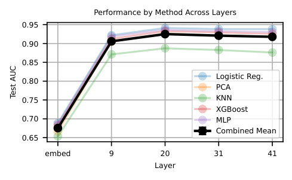

<!-- Start of picture text -->
Performance by Method Across Layers 0.95 0.90 0.85 Logistic Reg. 0.80 PCA 0.75 KNN XGBoost 0.70 MLP Combined Mean 0.65 embed 9 20 31 41 Layer Test AUC <!-- End of picture text -->

(a) Layer 20 is best for baselines. 

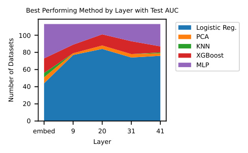

<!-- Start of picture text -->
Best Performing Method by Layer with Test AUC Logistic Reg. 100 PCA KNN 80 XGBoost MLP 60 40 20 0 embed 9 20 31 41 Layer Number of Datasets <!-- End of picture text -->

(b) Logistic regression is often the most performant across datasets. 

_Figure 13._ Analysis of layer performance and methods. (a) Shows the optimal layer for baseline performance. (b) Demonstrates the effectiveness of different methods across layers. 

## • **K-Nearest Neighbors (KNN)** : 

- Number of Neighbors: Logarithmically spaced values up to the smaller of 100 or the number of samples minus one. 

## • **XGBoost** : 

- n estimators: Ranges from 50 to 250 in steps of 50. 

- max ~~d~~ epth: Ranges from 2 to 5. 

- learning ~~r~~ ate: Ranges logarithmically from 0.001 to 0.1. 

- subsample and colsample ~~b~~ ytree: Range from 0.7 to 1.0. 

- reg alpha and reg ~~l~~ ambda: Range logarithmically from 0.001 to 10. 

- min child ~~w~~ eight: Ranges from 1 to 9. 

## • **Multilayer Perceptron (MLP)** : 

- Network depth: 1 to 3 hidden layers 

- Hidden layer width: 16,32, or 64. 

- learning ~~r~~ ate ~~i~~ nit: Five values ranging logarithmically from 10_−_4 to 10_−_2 . 

- alpha: Weight decay parameter, with 5 values ranging logarithmically from 10_−_5 to 10_−_2 . 

- Activation function: ReLU. 

- Optimizer: Adam. 

## **C.4. Formal Discussion of Quiver of Arrows** 

The quiver of arrows can be defined formally as follows. Given a set of probing methods _P_ = _p_ 1 _, . . . , pn_ (listed in Section 2.3), we find AUCval _pi_for each method using the procedure described in Section 2.2.We then choose the probing method_p∗_ with maximal AUCval _pi_and record its AUC _P_test = AUCtest _p∗_.We can then compare AUC _P_test to AUCtest _P__′_for a different set of methods _P__′_ = _p__′_ 1_, . . . , p′_ _n_.If we let_P_be a set of baseline methods, and_P ′_=_P ∪{_SAE probes_}_, then AUC _P_test_′−_AUCtest _P_ directly represents the increase in test performance when adding SAE probes to a practitioner’s toolbox. We then aggregate AUCtest _P −_ AUCtest _P__′_across many different datasets and testing regimes (e.g., dataset size) to give an overall sense of the improvement due to SAE probing. We note that adding a batch of SAE probes as additional arrows to the quiver is potentially disadvantageous for SAE probes. This is because using multiple SAE probes presents additional opportunities for these probes to overfit to the training data and be chosen by the quiver of arrows approach without properly generalizing to the test data. Regardless, we see the quiver of arrows as a proper counterfactual for a practitioner without SAE probes. Additionally, the quiver of arrows approach is not the reason we find negative results for SAE probes. For instance, in Figure 1, we directly compare the test AUC of the most performant SAE probe and baseline in standard conditions across all regimes. Without using the quiver of arrows approach, we still find SAEs underperform baselines. 

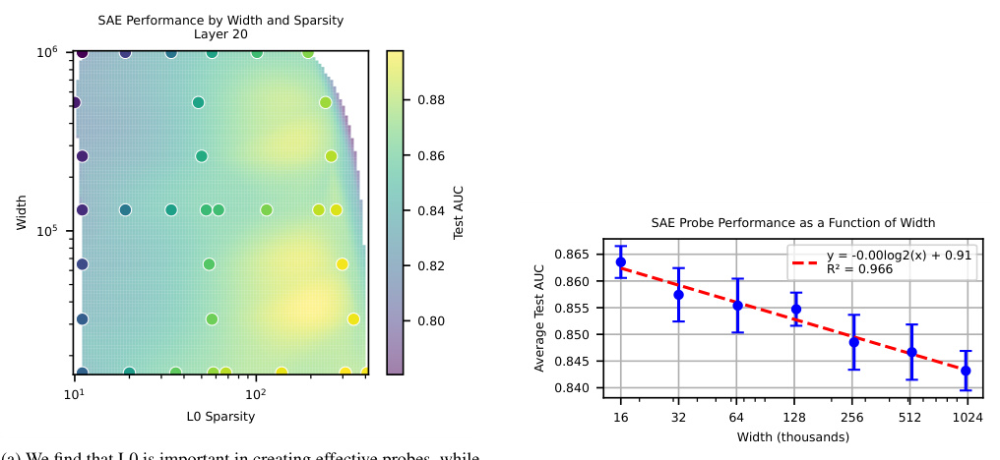

<!-- Start of picture text -->
SAE Performance by Width and Sparsity Layer 20 10 6 0.88 0.86 0.84 SAE Probe Performance as a Function of Width 10 5 0.865 y = -0.00log2(x) + 0.91 0.82 R² = 0.966 0.860 0.855 0.80 0.850 0.845 10 1 10 2 0.840 L0 Sparsity 16 32 64 128 256 512 1024 Width (thousands) Width Test AUC Average Test AUC <!-- End of picture text -->

(a) We find that L0 is important in creating effective probes, while width plays a minimal role. Test AUC averaged over all values of _k_ and datasets. 

(b) When averaging over other factors, smaller width SAEs perform best as probes. However, the relationship is minimal. 

_Figure 14._ Analysis of SAE width and L0 regularization effects on probe performance. (a) Shows the Pareto frontier of L0 vs width trade-offs. (b) Illustrates the relationship between SAE width and probe performance. 

# **D. Normal Conditions** 

## **D.1. Evaluating Baselines** 

We see that layer 20 is best for baselines, so we choose to use that layer moving forward (Figure 13a). Logistic regression most often has the highest test AUC across datasets in these conditions at layer 20 (Figure 13b). 

## **D.2. Choosing which SAEs to Test** 

When constructing a pareto curve based on the width and L0 of all available SAEs at layer 20 of Gemma-2-9B, we find that width is unimportant, while constructing probes from a higher L0 seems to improve probe performance (Figure 22a). 

To ensure that width plays a minimal role, we average over all datasets, _k_ , and L0s in Figure 22b. There is a clear negative trend indicating that smaller SAE widths are better, but with almost 0 slope. Because we aim to make as few decisions based off the test data as possible, we consider three widths throughout our experiments, 16 _,_ 000, 131 _,_ 000, and 1 _,_ 000 _,_ 000. 

## **D.3. Plotting Dataset Performance vs. K** 

In Figure 15, we show the performance on all datasets vs. the number of latents we train the sparse probe on. Almost all datasets are monotonically increasing in _k_ ; some have a sharp increase at some _k_ value, but most increase relatively smooththly. 

# **E. Additional Results for Various Regimes** 

## **E.1. Data Scarcity** 

In the data scarce setting, we see that we choose mostly the SAE method from the quiver at smaller training fractions (Figure 17a). This is because we break ties by explicitly preferring the SAE method, and most methods have perfect validation AUC at small training fractions. Specifically, we first prefer the smallest width SAE, and then the SAE with the largest value of _k_ . In Figure 16, we visualize the improvement by using the quiver of arrows approach with SAE probes across all datasets. 

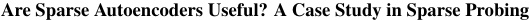

<!-- Start of picture text -->
Are Sparse Autoencoders Useful? A Case Study in Sparse Probing <!-- End of picture text -->

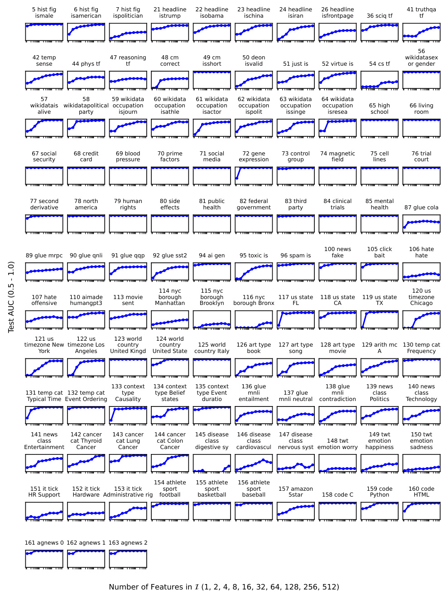

<!-- Start of picture text -->
5 hist fig 6 hist fig 7 hist fig 21 headline 22 headline 23 headline 24 headline 26 headline 41 truthqa ismale isamerican ispolitician istrump isobama ischina isiran isfrontpage 36 sciq tf tf 56 42 temp 47 reasoning 48 cm 49 cm 50 deon wikidatasex sense 44 phys tf tf correct isshort isvalid 51 just is 52 virtue is 54 cs tf or gender 57 58 59 wikidata 60 wikidata 61 wikidata 62 wikidata 63 wikidata 64 wikidata wikidatais wikidatapolitical occupation occupation occupation occupation occupation occupation 65 high 66 living alive party isjourn isathle isactor ispolit issinge isresea school room 67 social 68 credit 69 blood 70 prime 71 social 72 gene 73 control 74 magnetic 75 cell 76 trial security card pressure factors media expression group field lines court 77 second 78 north 79 human 80 side 81 public 82 federal 83 third 84 clinical 85 mental derivative america rights effects health government party trials health 87 glue cola 100 news 105 click 106 hate 89 glue mrpc 90 glue qnli 91 glue qqp 92 glue sst2 94 ai gen 95 toxic is 96 spam is fake bait hate 114 nyc 115 nyc 120 us 107 hate 110 aimade 113 movie borough borough 116 nyc 117 us state 118 us state 119 us state timezone offensive humangpt3 sent Manhattan Brooklyn borough Bronx FL CA TX Chicago 121 us 122 us 123 world 124 world timezone New timezone Los country country 125 world 126 art type 127 art type 128 art type 129 arith mc 130 temp cat York Angeles United Kingd United State country Italy book song movie A Frequency 133 context 134 context 135 context 136 glue 138 glue 139 news 140 news 131 temp cat 132 temp cat type type Belief type Event mnli 137 glue mnli class class Typical Time Event Ordering Causality states duratio entailment mnli neutral contradiction Politics Technology 141 news 142 cancer 143 cancer 144 cancer 145 disease 146 disease 147 disease 149 twt 150 twt class cat Thyroid cat Lung cat Colon class class class 148 twt emotion emotion Entertainment Cancer Cancer Cancer digestive sy cardiovascul nervous syst emotion worry happiness sadness 154 athlete 155 athlete 156 athlete 151 it tick 152 it tick 153 it tick sport sport sport 157 amazon 159 code 160 code HR Support Hardware Administrative rig football basketball baseball 5star 158 code C Python HTML 161 agnews 0 162 agnews 1 163 agnews 2 Number of Features in  (1, 2, 4, 8, 16, 32, 64, 128, 256, 512) Test AUC (0.5 - 1.0) <!-- End of picture text -->

_Figure 15._ Test AUC on all datasets vs. _k_ = _|I|_ using the Gemma Scope layer 20 SAE with width 131k and _L_ 0 = 193. 

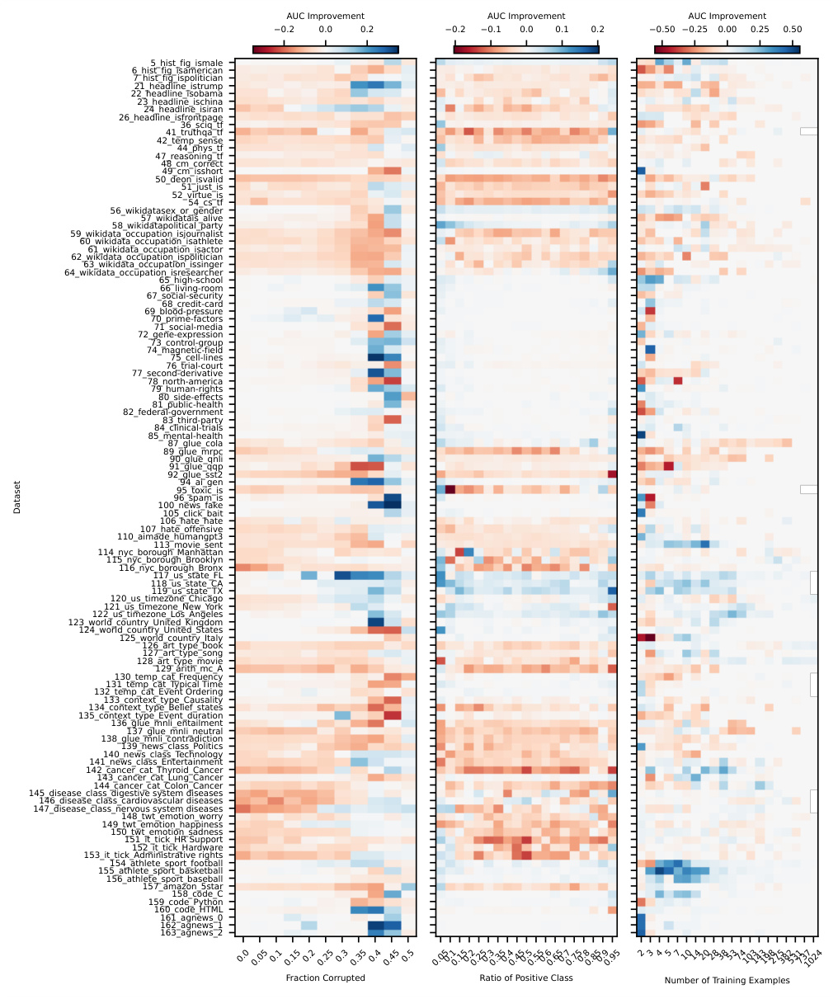

<!-- Start of picture text -->
AUC Improvement AUC Improvement AUC Improvement 0.2 0.0 0.2 0.2 0.1 0.0 0.1 0.2 0.50 0.25 0.00 0.25 0.50 5_hist_fig_ismale 6_hist_fig_isamerican 7_hist_fig_ispolitician 21_headline_istrump 22_headline_isobama 23_headline_ischina 24_headline_isiran 26_headline_isfrontpage 36_sciq_tf 41_truthqa_tf 42_temp_sense 44_phys_tf 47_reasoning_tf 48_cm_correct 49_cm_isshort 50_deon_isvalid 51_just_is 52_virtue_is 54_cs_tf 56_wikidatasex_or_gender 57_wikidatais_alive 58_wikidatapolitical_party 59_wikidata_occupation_isjournalist 60_wikidata_occupation_isathlete 61_wikidata_occupation_isactor 62_wikidata_occupation_ispolitician 63_wikidata_occupation_issinger 64_wikidata_occupation_isresearcher 65_high-school 66_living-room 67_social-security 68_credit-card 69_blood-pressure 70_prime-factors 71_social-media 72_gene-expression 73_control-group 74_magnetic-field 75_cell-lines 76_trial-court 77_second-derivative 78_north-america 79_human-rights 80_side-effects 81_public-health 82_federal-government 83_third-party 84_clinical-trials 85_mental-health 87_glue_cola 89_glue_mrpc 90_glue_qnli 91_glue_qqp 92_glue_sst2 94_ai_gen 95_toxic_is 96_spam_is 100_news_fake 105_click_bait 106_hate_hate 107_hate_offensive 110_aimade_humangpt3 113_movie_sent 114_nyc_borough_Manhattan 115_nyc_borough_Brooklyn 116_nyc_borough_Bronx 117_us_state_FL 118_us_state_CA 119_us_state_TX 120_us_timezone_Chicago 121_us_timezone_New_York 122_us_timezone_Los_Angeles 123_world_country_United_Kingdom 124_world_country_United_States 125_world_country_Italy 126_art_type_book 127_art_type_song 128_art_type_movie 129_arith_mc_A 130_temp_cat_Frequency 131_temp_cat_Typical Time 132_temp_cat_Event Ordering 133_context_type_Causality 134_context_type_Belief_states 135_context_type_Event_duration 136_glue_mnli_entailment 137_glue_mnli_neutral 138_glue_mnli_contradiction 139_news_class_Politics 140_news_class_Technology 141_news_class_Entertainment 142_cancer_cat_Thyroid_Cancer 143_cancer_cat_Lung_Cancer 144_cancer_cat_Colon_Cancer 145_disease_class_digestive system diseases 146_disease_class_cardiovascular diseases 147_disease_class_nervous system diseases 148_twt_emotion_worry 149_twt_emotion_happiness 150_twt_emotion_sadness 151_it_tick_HR Support 152_it_tick_Hardware 153_it_tick_Administrative rights 154_athlete_sport_football 155_athlete_sport_basketball 156_athlete_sport_baseball 157_amazon_5star 158_code_C 159_code_Python 160_code_HTML 161_agnews_0 162_agnews_1 163_agnews_2 Fraction Corrupted Ratio of Positive Class Number of Training Examples 0.00.050.10.150.20.250.30.350.40.450.5 0.050.10.150.20.250.30.350.40.450.50.550.60.650.70.750.80.850.90.95 23457101420283853741031431982753825317371024 Dataset <!-- End of picture text -->

_Figure 16._ Improvement from using SAE methods in the quiver across all datasets for various corruption ratios, ratios of positive classes, and number of training examples 

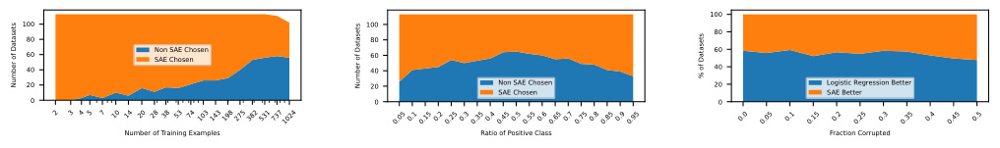

<!-- Start of picture text -->
100 100 100 80 80 80 60 Non SAE ChosenSAE Chosen 60 60 40 40 40 20 20 Non SAE ChosenSAE Chosen 20 Logistic Regression BetterSAE Better 0 0 0 Number of Training Examples Ratio of Positive Class Fraction Corrupted 2 3 4 5 7 10 14 20 28 38 53 74 1031431982753825317371024 0.05 0.1 0.15 0.2 0.25 0.3 0.35 0.4 0.45 0.5 0.55 0.6 0.65 0.7 0.75 0.8 0.85 0.9 0.95 0.0 0.05 0.1 0.15 0.2 0.25 0.3 0.35 0.4 0.45 0.5 % of Datasets Number of Datasets Number of Datasets <!-- End of picture text -->

(a) SAE probes are chosen by our method at small training fractions because multiple methods have perfect validation AUC and we break ties by choosing an SAE probe. 

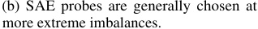

<!-- Start of picture text -->
(b) SAE probes are generally chosen at more extreme imbalances. <!-- End of picture text -->

(c) Corruption fraction has a minor influence on the percent of time SAE probes or logistic regression probes are chosen. 

_Figure 17._ Method selection analysis under different data conditions. (a) Selection under data scarcity. (b) Selection under class imbalance. (c) Selection under data corruption. 

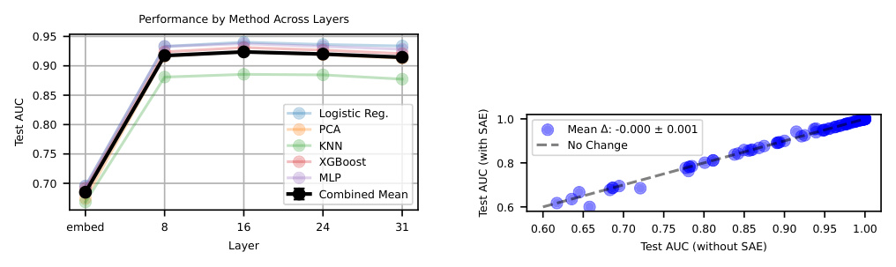

<!-- Start of picture text -->
Performance by Method Across Layers 0.95 0.90 0.85 Logistic Reg. 1.0 0.80 PCA Mean : -0.000 ± 0.001 KNN No Change 0.75 XGBoost 0.8 MLP 0.70 Combined Mean 0.6 embed 8 16 24 31 0.60 0.65 0.70 0.75 0.80 0.85 0.90 0.95 1.00 Layer Test AUC (without SAE) Test AUC Test AUC (with SAE) <!-- End of picture text -->

(a) When testing baseline methods at different layers of Llama3.1-8b, we find the middle layer 16 works best by a slim margin. 

(b) In standard conditions, we see that SAE probes are not statistically more performant than baselines for Llama-3.1-8b 

_Figure 18._ Analysis of Llama-3.1-8b probe performance. (a) Layer-wise performance of baseline methods. (b) Comparison between SAE and baseline probes under standard conditions. 

## **E.2. Class Imbalance** 

We show the improvement for all datasets in Figure 16 across all class imbalances. Generally, the SAE method is chosen at more extreme imbalance ratios (Figure 17b) 

## **E.3. Label Corruption** 

We show the performance of the SAE across datasets with all values of label corruption. Interestingly, the SAE still has highest test AUC at many places (Figure 17c shows the percent of time that the SAE test AUC is larger). However, it is clear from the per dataset imshow (Figure 16) that it struggles with more label noise. 

# **F. Reproducing Core Results on Llama-3.1-8b** 

We use SAEs provided by Llama Scope to replicate our core results, namely, that SAEs underperform baseline probes in normal, data scarce, class imbalance, and label noise settings when testing on Llama-3.1-8B. In Figure 18a, we show the results for baseline probes applied to various layers of Llama-3.1-8b in standard settings. We see that the layer roughly halfway through the model, layer 16, is best for probing experiments. In Figure 18b, we show that SAE probes in normal settings on layer 16 of Llama-3.1-8b are not more performant than baselines, although there are a few positive outliers we did not observe in Gemma-2-9b. Lastly, we use the quiver of arrows approach to show that SAE probes are not more performant in the conditions of data scarcity, class imbalance, and label noise (Figure 19). Because of the increased effort of testing OOD and interpretability, we do not replicate those results. Note that in all experiments, we use the provided width 128k, L0 55 SAE. 

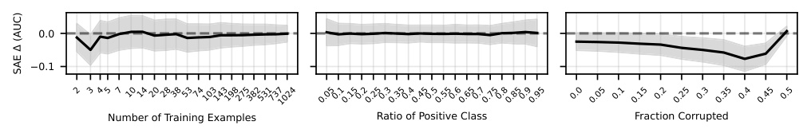

<!-- Start of picture text -->
0.0 0.1 Number of Training Examples Ratio of Positive Class Fraction Corrupted 2 3 45 7 101420283853741031431982753825317371024 0.050.10.150.20.250.30.350.40.450.50.550.60.650.70.750.80.850.90.95 0.0 0.05 0.1 0.15 0.2 0.25 0.3 0.35 0.4 0.45 0.5 SAE  (AUC) <!-- End of picture text -->

_Figure 19._ We find that Llama-3.1-8b SAE probes do not improve on baselines in the settings of data scarcity, class imbalance, and label noise. 

# **G. Interpretability** 

## **G.1. Pruning** 

We demonstrate the latent ranking procedure for the task 66 ~~l~~ iving-room in Table 5. We see that pruning works, for two of the tasks, 66 ~~l~~ iving-room and 90 ~~g~~ lue ~~q~~ nli, while failing for 7 ~~h~~ ist ~~f~~ ig ~~i~~ spolitician (Figure 20). However, even when pruning works, the improvement is marginal compared to the decrease in performance when moving from an in-distribution test set to an OOD test set. Thus, we hypothesize that the underlying latents are not sufficiently expressive. For example, latent 122774 is most active on the English translation of “living room,” and not activate at all for the French translation (Figure 8). This indicates this latent does not sufficiently represent the concept of “living room” to be robust to OOD transformations. 

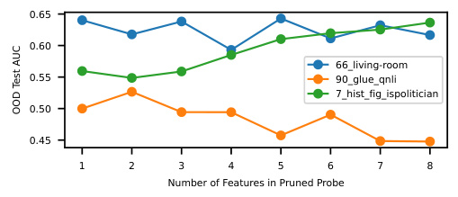

<!-- Start of picture text -->
0.65 0.60 66_living-room 0.55 90_glue_qnli 7_hist_fig_ispolitician 0.50 0.45 1 2 3 4 5 6 7 8 Number of Features in Pruned Probe OOD Test AUC <!-- End of picture text -->

_Figure 20._ Two datasets improve with pruning, but one does not. Indicates that it needs more latents to construct answer. 

## **G.2. Latent Investigation** 

We generate natural language descriptions of all the latents with GPT-4o. We find that most are either relevant to the task or visibly spurious. We hypothesize that some latents have incomplete descriptions given their performance on the task. We list a selection of the most interesting of these latents from each category in Table 6. 

## **G.3. Glue CoLA** 

In Table 7, we show the top 5 examples where latent 369585 and the activation probe have the highest confidence that a prompt is ungrammatical, but it is (incorrectly) labeled as grammatical in the CoLA ground truth. 

## **G.4. AI Made** 

In Table 8, we show the tokens that the 110 ~~a~~ imade ~~h~~ umangpt3 classifier activates on across the pile with the highest average activation. Like the SAE feature, the baseline classifier has top activations on punctuation tokens. 

# **H. Multiple tokens results** 

In Table 9, we show a comparison of all methods (including the attention based probes and multi-token SAE methods discussed in Section 5) on a random sample of 60 datasets. 

_Table 5._ Description of Latent Variables for Out-of-Distribution Detection. We find that this procedure ranks latents roughly according to their OOD test AUC, even though o1 did not have access to this information. However, the system is not perfect. For example, latent 51330’s natural language description is ranked last and seems unreleated to the task at hand. However, its OOD test AUC is the highest of all latents. We do not investigate this further, but hypothesize that either the latent descriptions require additional tuning, or the test set truly has some spurious quality that this latent identifies. 

|**Latent**|**o1** **rank**|**Latent** **Description**|**Val ID** **AUC**|**Test OOD** **AUC**|
|---|---|---|---|---|
|122774|1|mentions of living rooms or parlors in houses or apartments.|1.0|0.6402|
|98707|2|phrases and words related to loca- tions or settings, particularly indoor spaces like rooms, parlors, or living areas, as well as time references like afternoon or specific times.|0.8698|0.6177|
|100016|3|mentions of rooms or enclosed spaces, particularly when discussing physical locations or settings.|0.6895|0.4736|
|7498|4|locations within a house, particu- larly upstairs, downstairs, basement, bathroom, and kitchen areas.|0.7524|0.6206|
|78823|5|words and phrases related to specific places, attractions, and experiences, particularly in the context of travel and tourism.|0.6697|0.4526|
|116246|6|numbers, dates, and numerical mea- surements, particularly in scientific or technical contexts.|0.7470|0.5398|
|40168|7|technical terms and components re- lated to computer systems, engineer- ing, and scientific analysis.|0.9219|0.4513|
|51330|8|objects and materials related to sci- entific experiments and laboratory equipment, particularly those involv- ing fluids, particles, or microscopic samples.|0.7320|0.6483|

# **I. SAE Architectural Improvements** 

We test if improvements in SAE architectures have led to improvements in probing performance. We test eight SAE architectures on Gemma-2-2B in all regimes with _k_ = 16 _,_ 128 SAE probes. We plot the performance of SAE probes for all architectures in Figure 21 when averaging over all datasets. While there seems to be some improvement with later architectures, we note that there is significant variance in the average across datasets that is not visualized. 

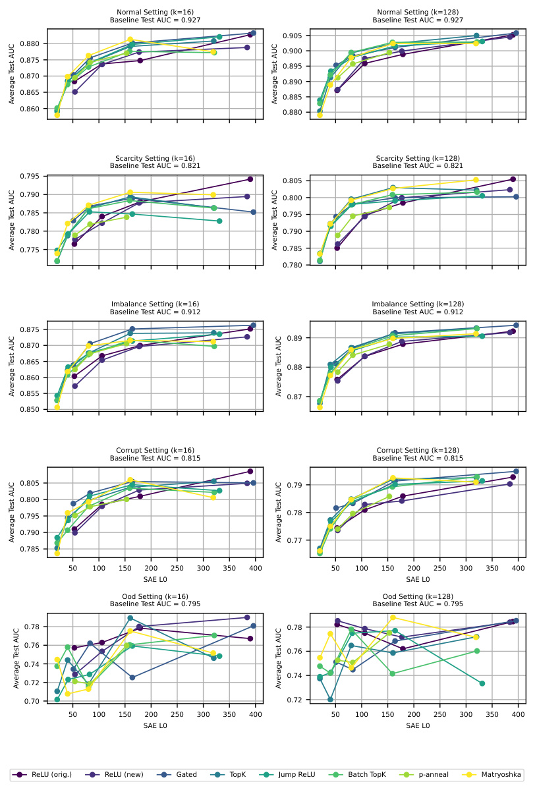

<!-- Start of picture text -->
Normal Setting (k=16) Normal Setting (k=128) Baseline Test AUC = 0.927 Baseline Test AUC = 0.927 0.905 0.880 0.900 0.875 0.895 0.870 0.890 0.865 0.885 0.860 0.880 Scarcity Setting (k=16) Scarcity Setting (k=128) Baseline Test AUC = 0.821 Baseline Test AUC = 0.821 0.795 0.805 0.790 0.800 0.785 0.795 0.780 0.790 0.775 0.785 0.780 Imbalance Setting (k=16) Imbalance Setting (k=128) Baseline Test AUC = 0.912 Baseline Test AUC = 0.912 0.875 0.89 0.870 0.865 0.88 0.860 0.855 0.87 0.850 Corrupt Setting (k=16) Corrupt Setting (k=128) Baseline Test AUC = 0.815 Baseline Test AUC = 0.815 0.805 0.79 0.800 0.795 0.78 0.790 0.77 0.785 50 100 150 200 250 300 350 400 50 100 150 200 250 300 350 400 SAE L0 SAE L0 Ood Setting (k=16) Ood Setting (k=128) Baseline Test AUC = 0.795 Baseline Test AUC = 0.795 0.78 0.78 0.76 0.76 0.74 0.74 0.72 0.70 0.72 50 100 150 200 250 300 350 400 50 100 150 200 250 300 350 400 SAE L0 SAE L0 ReLU (orig.) ReLU (new) Gated TopK Jump ReLU Batch TopK p-anneal Matryoshka Average Test AUC Average Test AUC Average Test AUC Average Test AUC Average Test AUC Average Test AUC Average Test AUC Average Test AUC Average Test AUC Average Test AUC <!-- End of picture text -->

_Figure 21._ Across regimes, we see a slight positive trend in probing performance with more recent SAE architectures. 

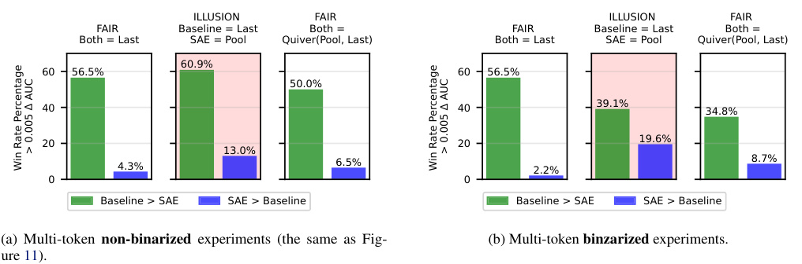

<!-- Start of picture text -->
ILLUSION  FAIR  ILLUSION  FAIR FAIR  Baseline = Last Both = FAIR  Baseline = Last Both = Both = Last SAE = Pool Quiver(Pool, Last) Both = Last SAE = Pool Quiver(Pool, Last) 60.9% 60 56.5% 60 56.5% 50.0% 40 40 39.1% 34.8% 19.6% 20 20 13.0% 4.3% 6.5% 2.2% 8.7% 0 0 Baseline > SAE SAE > Baseline Baseline > SAE SAE > Baseline (a) Multi-token non-binarized experiments (the same as Fig- (b) Multi-token  binzarized  experiments. ure 11). > 0.005  AUC > 0.005  AUC Win Rate Percentage  Win Rate Percentage <!-- End of picture text -->

_Figure 22._ We run the multi-token experiments from Section 5 with and without binarizing aggregated latents. 

# **J. Assessing SAE Probe Binarization** 

Gallifant et al. (2025) find that binarizing latents with a threshold improves probe performance. Binarization entails setting a latent equal to 1 if its firing value is greater than a threshold, and setting it equal to 0 otherwise. Gallifant et al. (2025) use a threshold equal to 1. 

Gallifant et al. (2025) performs probing in the multi-token pooled setting, so to use as similar of a setup as possible we repeat our multi-token experiment with binarization and a threshold equal to 1. Following Gallifant et al. (2025), we binarize after the max-pooling aggregation. As shown in in Figure 22, we find that binarizing results in worse performance than not-binarizing. 

|**Latent Cate-** **gory**|_Table 6._ Latent categorizatio **Dataset**|n, character **Latent** **Num-** **ber**|istics, and **Test** **AUC**|performance. **Latent Description**|
|---|---|---|---|---|
|Description Fits Task|5 ~~h~~ist ~~f~~ig ~~i~~smale|81210|0.892|references to female individuals, espe- cially focusing on pronouns and names.|
||61 wikidata ~~o~~ccupation ~~i~~sactor 66 ~~l~~iving-room 155 ~~a~~thlete ~~s~~port ~~b~~asketball|91505 122774 83267|0.830 0.999 0.943|names of well-known actors and film industry personalities. references to specific rooms in a house, particularly living rooms and parlors. references to basketball teams, players, and related sports terms.|
|Clever Latents|96 ~~s~~pam ~~i~~s 100 ~~n~~ews ~~f~~ake|35460 31726|0.907 0.968|keywords and phrases related to text messaging and SMS communications. references to conspiracy theories and secretive organizations.|
|Potentially Spurious|21 headline ~~i~~strump 22 ~~h~~eadline ~~i~~sobama 110 ~~a~~imade ~~h~~umangpt3|22915 10555 105150|0.812 0.782 0.816|numerical dates and percentages within a political or historical context. strings of numbers, often with mathe- matical notations or identifiers. statistical or numerical data and mea- surements.|
||133 ~~c~~ontext ~~t~~ype Causality 134 ~~c~~ontext type ~~B~~elief ~~s~~tates 135 ~~c~~ontext ~~t~~ype ~~E~~vent duration|89524 113152 18897|0.947 0.638 0.876|questions or questioning phrases, partic- ularly those beginning with ”Why?”. words related to status or condition in technical or medical contexts. questions and phrases related to cost or quantity.|
|Classified by Context Length (Spuri- ous)|49 ~~c~~m ~~i~~sshort|106376|1.000|sections of text related to mathematical or programming notation and expres- sions.|
||161 ~~a~~gnews 0 162 ~~a~~gnews 1|106376 106376|0.990 0.988|sections of text related to mathematical or programming notation and expres- sions. sections of text related to mathematical or programming notation and expres- sions.|
||163 ~~a~~gnews 2|106376|0.991|sections of text related to mathematical or programming notation and expres- sions.|
|Task Shows Latent De- scription is Imperfect|105 ~~c~~lick bait|78823|0.967|mentions of specific events, activities, or items in particular locations or settings.|
||123 ~~w~~orld ~~c~~ountry ~~U~~nited ~~K~~ingdom 125 ~~w~~orld ~~c~~ountry ~~I~~taly|100153 50817|0.978 0.989|information related to professional roles, locations, and organizations. names of researchers and scientific au- thors.|

_Table 7._ **Left** We show the top 5 examples where latent 369585 is active while the CoLA prompt is labeled as grammatical. Most of these sentences are clearly ungrammatical, which illustrates that the CoLA data is corrupted. **Right** We then look at sentences a baseline classifier trained on CoLA marks as ungrammatical when the label is grammatical. We reach the same conclusion - the CoLA data is <u>mislabeled.</u> 

|**Prompt (Labeled Grammatical)**|**Latent 369585**|**Prompt (Labeled Grammatical)**|**P(y=0)**|
|---|---|---|---|
|I don’t remember what all I said?|23.09|Rub the cloth on the baby torn.|0.933|
|Aphrodite said he would free the animals and|15.87|In front of them happen.|0.926|
|free the animals he will||||
|Gilgamesh wanted to seduce Ishtar, and se-|14.92|Who did you give pictures of to friends of?|0.911|
|duce Ishtar he did.||||
|An example of these substances be tobacco.|14.85|An example of these substances be tobacco.|0.893|
|He will can go|14.43|Susan hopes herself to sleep.|0.890|

_Table 8._ Logistic regression classifier for 110 ~~a~~ imade ~~h~~ umangpt3’s top activating tokens when run on more than 2.5 million tokens from the Pile. The classifier predominantly activates on punctuation. Only tokens with at least 10 occurences shown. 

|**Token**|**Mean Activation**|**Occurrences**|
|---|---|---|
|_<_bos_>_|6.8863|7625|
|!).|6.2529|10|
|Q|6.2271|1436|
|”.|6.0338|144|
|.”|5.9111|975|
|.).|5.7334|24|
||5.5035|17|
|.”|5.4455|1057|
|“.|5.4132|319|
|_}_$.|5.3990|24|

_Table 9._ Comparison of different logistic regression (“base”) and SAE probing methods on a selection of 60 random datasets. Last is last token probing as in the rest of our paper, concat is concatenating the top 20 PCA dimensions of all tokens, mean is taking the mean across activation dimensions across the context, max is taking the max across activation dimensions across the context, and Attn-like probe is described in Section 5. 

||Base|Base|SAE |SAE|SAE|SAE |SAE|SAE|Attn |
|---|---|---|---|---|---|---|---|---|---|
|Dataset|(last)|(concat)|(last) l0=68|(mean) l0=68|(max) l0=68|(last) l0=408|(mean) l0=408|(max) l0=408|-Like Probe|
|6 ~~h~~ist ~~f~~ig|**0.990**|0.977|0.982|0.914|0.984|0.983|0.883|0.985|0.987|
|7 ~~h~~ist ~~f~~ig|0.750|0.698|0.738|0.661|0.739|0.746|0.613|0.738|**0.760**|
|21 ~~h~~eadlin|0.987|0.986|0.950|0.993|**1.000**|0.964|0.990|1.000|1.000|
|24 ~~h~~eadlin|0.991|0.979|0.892|0.995|0.997|0.947|0.994|**0.998**|0.996|
|44 ~~p~~hys ~~t~~f|0.885|0.541|0.836|0.657|0.760|0.854|0.656|0.790|**0.903**|
|48 ~~c~~m ~~c~~orr|0.833|0.659|0.788|0.699|0.779|0.794|0.708|0.784|**0.860**|
|54 ~~c~~s ~~t~~f|0.695|0.554|0.689|0.588|0.680|**0.708**|0.580|0.697|0.697|
|59 ~~w~~ikidat|**0.961**|0.787|0.933|0.809|0.864|0.939|0.809|0.875|0.935|
|62 ~~w~~ikidat|**0.981**|0.878|0.948|0.892|0.923|0.959|0.898|0.925|0.954|
|63 ~~w~~ikidat|**0.959**|0.840|0.925|0.869|0.893|0.946|0.848|0.862|0.928|
|66 ~~l~~iving-|**1.000**|0.985|1.000|0.968|0.999|1.000|0.950|0.998|0.998|
|67 ~~s~~ocial-|**1.000**|0.992|0.999|0.985|0.999|1.000|0.971|0.998|0.999|
|68 ~~c~~redit-|**1.000**|0.959|0.998|0.942|0.986|0.998|0.920|0.981|0.993|
|71 ~~s~~ocial-|0.998|0.985|**0.998**|0.969|0.993|0.998|0.950|0.989|0.995|
|73 ~~c~~ontrol|**0.998**|0.970|0.995|0.945|0.984|0.998|0.935|0.986|0.982|
|78 ~~n~~orth-a|**1.000**|0.933|0.998|0.907|0.990|0.999|0.883|0.976|0.995|
|79 ~~h~~uman-r|**0.999**|0.974|0.995|0.964|0.988|0.996|0.947|0.990|0.992|
|89 ~~g~~lue ~~m~~r|**0.891**|0.761|0.785|0.784|0.796|0.823|0.796|0.777|0.867|
|90 ~~g~~lue ~~q~~n|0.926|0.729|0.886|0.830|0.909|0.910|0.859|0.909|**0.931**|
|94 ~~a~~i ~~g~~en|**0.998**|0.996|0.993|0.997|0.996|0.996|0.996|0.997|0.996|
|96 ~~s~~pam ~~i~~s|**0.999**|0.999|0.997|0.996|0.997|0.998|0.995|0.999|0.999|
|100 ~~n~~ews ~~f~~|**1.000**|**1.000**|1.000|1.000|**1.000**|1.000|1.000|**1.000**|1.000|
|105 ~~c~~lick|1.000|**1.000**|1.000|0.999|1.000|0.999|1.000|1.000|1.000|
|106 ~~h~~ate ~~h~~|0.722|0.612|0.661|0.742|0.785|0.674|0.735|0.788|**0.812**|
|110 ~~a~~imade|0.975|0.865|0.953|0.919|0.970|0.953|0.916|0.960|**0.979**|
|114 ~~n~~yc ~~b~~o|0.780|0.755|0.740|0.716|0.797|0.745|0.733|0.805|**0.872**|
|119 ~~u~~s ~~s~~ta|**0.997**|0.957|0.994|0.982|0.990|0.994|0.952|0.992|0.995|
|120 ~~u~~s ~~t~~im|0.944|0.803|0.942|0.785|**0.946**|0.936|0.751|0.940|0.941|
|121 ~~u~~s ~~t~~im|0.952|0.815|0.948|0.776|0.954|0.950|0.754|**0.957**|0.951|
|124 ~~w~~orld|0.999|0.999|**0.999**|0.965|0.999|0.998|0.968|0.999|0.999|
|127 ~~a~~rt ~~t~~y|0.913|0.872|0.894|0.834|0.889|0.905|0.845|0.900|**0.916**|
|129 ~~a~~rith|**0.979**|0.903|0.880|0.867|0.951|0.938|0.861|0.975|0.977|
|132 ~~t~~emp ~~c~~|**1.000**|**1.000**|**1.000**|**1.000**|**1.000**|**1.000**|**1.000**|**1.000**|0.991|
|133 ~~c~~ontex|0.984|0.982|0.975|0.973|0.979|0.968|0.973|0.980|**0.986**|
|134 ~~c~~ontex|0.985|0.977|0.953|0.966|0.989|0.966|0.963|**0.994**|0.987|
|137 ~~g~~lue ~~m~~|**0.856**|0.551|0.788|0.632|0.734|0.807|0.658|0.742|0.844|
|139 ~~n~~ews ~~c~~|**0.978**|0.950|0.944|0.972|0.953|0.962|0.967|0.973|0.965|
|141 ~~n~~ews ~~c~~|0.951|0.942|0.917|0.967|0.968|0.933|0.965|**0.973**|0.965|
|144 ~~c~~ancer|**1.000**|1.000|0.981|**1.000**|**1.000**|0.991|**1.000**|**1.000**|1.000|
|145 ~~d~~iseas|0.618|0.677|0.501|0.618|0.678|0.563|0.606|**0.686**|0.655|
|149 ~~t~~wt ~~e~~m|0.787|0.756|0.730|0.780|0.843|0.759|0.813|**0.853**|0.851|
|150 ~~t~~wt ~~e~~m|0.710|0.612|0.652|0.700|0.730|0.672|0.717|0.746|**0.777**|
|155 ~~a~~thlet|0.995|0.988|0.990|0.970|0.988|0.988|0.960|0.985|**0.996**|
|158 ~~c~~ode ~~C~~|**1.000**|0.998|1.000|0.999|1.000|1.000|0.999|1.000|0.997|
|162 ~~a~~gnews|**1.000**|**1.000**|**1.000**|1.000|**1.000**|**1.000**|**1.000**|**1.000**|1.000|
|163 ~~a~~gnews|**1.000**|1.000|1.000|1.000|**1.000**|**1.000**|**1.000**|**1.000**|1.000|

---

[← 56 AxBench](56_axbench.md) · [Contents](README.md) · [58 SAEs on Random Transformers →](58_sae_random_transformers.md)
