<!-- Generated by scripts/build_anthology.py export from the source PDF; edit the catalog, not this file. -->
# 67 · Interpreting Language Model Parameters

**Bushnaq et al. — 2026** · Lucius Bushnaq, Dan Braun, Oliver Clive-Griffin, Bart Bussmann, Nathan Hu, Michael Ivanitskiy, Linda Linsefors, Lee Sharkey

| | |
|---|---|
| Priority | ◇ F — Frontier |
| Section | G — Competing programmes, 2025–26 |
| Source | [https://www.goodfire.com/research/interpreting-lm-parameters](https://www.goodfire.com/research/interpreting-lm-parameters) (Goodfire) |
| Licence | No explicit licence published on www.goodfire.com |
| Print anthology | pages 2529–2646 (cover 2529, text 2530–2646) |

**Why read this.** Scales parameter decomposition to a whole 67M-parameter language model by demanding robustness to adversarially chosen ablations, then uses the subcomponents to study attention spread across heads, build attribution graphs and hand-edit the model.

**Reading focus.** Adversarial versus stochastic ablation, the reconstruction table and ‘pretraining compute recovered’, the comparison with transcoders and CLTs, feature splitting, the attention case studies, the emoticon edit, and the admitted limits of adversarial robustness.

**In context.** [66](66_stochastic_parameter_decomposition.md) carried to a real language model, and the sharpest statement of the parameter-versus-activation dispute: transcoders and CLTs ([51](51_transcoders.md), [53](53_circuit_tracing.md)) fit replacement models of a different functional form, while VPD stays inside the original architecture. Its multi-head attention components sit uneasily with head-level circuits like [13](13_ioi_circuit.md). It appeared two days before [68](68_world_inside_neural_networks.md), Goodfire's bet on activation geometry.

**Note.** Interactive research post. In print the opening interactive overview figure is omitted and other widgets appear in their static state; use the URL for the interactive versions.

[← 66 Stochastic Parameter Decomposition](66_stochastic_parameter_decomposition.md) · [Contents](README.md) · [68 The World Inside Neural Networks →](68_world_inside_neural_networks.md)

---

*Text extracted automatically from the source PDF. Display equations, figures and some tables appear as images; inline mathematics may be garbled — the PDF is authoritative.*

# Interpreting Language Model Parameters 

AUTHORS PUBLISHED 

Lucius Bushnaq1,* May 5th 2026 Dan Braun1,*,† Oliver Clive-Griffin1,*,† Bart Bussmann2 Nathan Hu2 Michael Ivanitskiy2 Linda Linsefors3 Lee Sharkey1,* 

1Goodfire  MATS  Independent2 3 *Core contributor. 

†Equal contribution; order randomized. Correspondence to lee@goodfire.ai 

See also our Contributions Statement. 

Find the markdown version of this post here. 

CONTENTS 

1 Introduction 2 Method: adVersarial Parameter Decomposition 3 Analyzing subcomponents 4 Decomposing attention 

5 Circuits 6 Editing a language model by hand 7 Discussion 8 Conclusion 9 Contributions statement Appendix A: Methods Appendix B: Results 

Neural networks use millions to trillions of parameters to learn how to solve tasks that no other machines can solve. What structure do these parameters learn? And how do they compute intelligent behavior? 

Mechanistic interpretability aims to uncover how neural networks use their parameters to implement their impressive neural algorithms. Although previous work has uncovered substantial structure in the intermediate representations that networks use, little progress has been made to understand how the parameters and nonlinearities of networks perform computations on those representations. 

In this work, we present a method that brings us closer to this understanding by decomposing a language model's parameters into subcomponents that each implement only a small part of the model's learned algorithm, while simultaneously requiring only a small fraction of those subcomponents to account for the network's behavior on any input. 

The method, adVersarial Parameter Decomposition (VPD), optimizes for decompositions of neural network parameters into simple subcomponents that preserve the network's input-output behavior even when many subcomponents are ablated, including under ablations that are adversarially selected to destroy behavior. This encourages learning subcomponents that provide short, mechanistically faithful descriptions of the network's behavior that should aggregate appropriately into more global descriptions of the network's learned algorithm. 

We study how sequences of interactions between these parameter subcomponents produce the network's output on particular inputs, enabling a new kind of 'circuit' analysis. While more work remains to be done to deepen our understanding of how neural networks use their parameters to compute their behavior, our work suggests an approach to identify a small set of simple, mechanistically faithful subcomponents on which further mechanistic analysis can be based. 

### 1  Introduction 

Mechanistic interpretability aims to reverse engineer neural networks, such as language models, so that we can understand the neural algorithms they have learned. Reverse engineering requires decomposing a system into simpler parts that we can study in relative isolation. Unfortunately, it is not obvious how best to decompose neural networks into such parts [1, 2]. The most straightforward candidates for these parts, such as neurons, attention heads, or whole layers, don't always map to individual, interpretable computations [3, 4, 5, 6, 7, 8, 9, 10]. 

Alternative approaches to decomposition, such as transcoders [11, 12] or mixtures of linear transforms [13, 14], typically involve fitting a set of simple functions to the transitions between activations at different layers in the network, and linearly combining the outputs of these simple functions. The idea here is to approximate the complex, nonlinear function implemented by the network's layers using a simpler, easier-to-understand function. These methods, sometimes called activation-based decomposition methods, have led to significant advances in our understanding of the intermediate representations inside neural networks when computing their outputs [11, 12]. 

Unfortunately, because the simpler functions that these methods use are of a different functional form to the original network, it is hard to relate their accounts of network function to the actual objects that are doing the computations, namely the network's parameters and nonlinearities. 

This is not just a theoretical issue. It prevents us from achieving practical engineering goals. For example, it makes it challenging to know how to make precise, predictable modifications to a model's neural algorithm by making edits to its parameters. It also makes it hard to predict how the model's neural algorithm will perform on a different distribution to the one it was studied on. 

The mismatch of functional form between models and their activation-based decompositions is an important issue, but it is not the only one: Activation-based methods have not yet yielded decompositions that exhibit a fully satisfactory level of mechanistic faithfulness [12], and suffer from a number of other issues (See [2] for review). 

These issues motivate alternative approaches to mechanistic decomposition, including parameter decomposition methods [15, 16, 17], which give accounts of network function in terms of the parameters that the network uses on each datapoint. Ablation-based parameter decomposition methods [15, 16] aim to identify a set of parameter components where as few components as possible are necessary to perform the same computations as the original network on any datapoint, and "unnecessary" components can be ablated on a given datapoint in any combination without adversely affecting output reconstruction error. Simultaneously, the parameter components are selected to implement as simple computations as possible and to sum collectively to the target network's parameters. If parameter components exhibit all these properties, then they are strong candidates for the network's 'ground truth' mechanisms[1]. 

Parameter decomposition methods can identify known ground truth mechanisms in toy models that: Are not necessarily aligned to architectural components such as neurons, individual attention heads, or layers; operate on representations in superposition; or are multidimensional. And, due to the requirement that unnecessary components can be ablated in any combination rather than just all simultaneously, parameter decomposition methods should not exhibit feature splitting. Notably, parameter decomposition methods can readily be applied to any architecture, unlike activationbased methods, where it has been challenging to use the same decomposition methods to decompose both attention layers and MLPs [18, 12, 19, 20]. In demonstration of this ability, previous work has used ablation-based parameter decomposition to identify induction heads in a transformer trained on a toy model of induction [21]. Ablation-based parameter decomposition methods thus promise solutions to many of the issues of activation-based decomposition methods. However, prior parameter decomposition proposals have several important shortcomings, some of which we address in this work with a new method that we introduce, called adVersarial Parameter Decomposition (VPD)[2]. Our main contributions are: 

We scale parameter decomposition to full language models: While the most recent parameter decomposition method, Stochastic Parameter Decomposition (SPD)[16] is more scalable than its predecessor, Attribution-based Parameter Decomposition [15], it has not yet been applied to full language models. We use VPD to decompose a small language model ( 67 M parameters, four layers) trained on the Pile [22]. We find parameter subcomponents that are highly interpretable (Section 3.4), both in terms of the dataset examples that they activate on and how they interact with other subcomponents to produce specific behaviors (Section 5). 

We introduce a stronger notion of ablatability to achieve more mechanistic faithfulness: While some work has applied SPD to a single layer of GPT2-small [21], no application of SPD so far has measured key metrics that would be necessary to ensure mechanistic faithfulness, such as having good output reconstruction loss even under adversarially chosen ablations (rather than under only stochastically chosen ablations). We resolve this issue with VPD, which builds heavily on the SPD method but has several important modifications, which together make it more mechanistically faithful and scalable to larger models than those decomposed in previous work. The primary difference between VPD and SPD is in the ablations. On each datapoint, both SPD and VPD sample from the space of possible partial ablations of parameter subcomponents in order to check whether those parameter subcomponents can be partially ablated in any combination, thus identifying whether they are "necessary" for that datapoint. However, where SPD samples from the space of partial ablations using stochastic samples from the space, VPD uses adversarially chosen samples (Section 2.4) [3]. The core details of the method are discussed in Section 2. 

We compare VPD to other decomposition methods: We compare the parameter subcomponents that we find to the objects found by other decomposition methods, such as per-layer and cross-layer transcoder (CLT) latents. We find that VPD achieves a better tradeoff between sparsity and reconstruction under standard training objectives and is more robust to mismatches between training and evaluation protocols compared to end-to-end trained methods (Section 3.3, Appendix B.1). VPD also has comparable interpretability (Section 3.4) and exhibits less feature splitting (Section 3.5) than activation-based comparisons. 

We decompose attention layers into computations that are distributed across multiple heads: Our approach decomposes parameters in attention layers into functionally specialized subcomponents that span multiple heads. These 

subcomponents interact to perform interpretable computations. Perhaps for the first time, our approach yields a satisfying decomposition of computations in attention layers even though those computations may involve multiple heads (Section 4). 

- We develop attribution graphs to study information flow between parameter subcomponents: We demonstrate that the parameter subcomponents found by VPD can be used to construct interpretable attribution graphs that let us study the circuits that underlie some language model behaviors (Section 5). 

- We use parameter subcomponents to manually edit a model: Finally, we provide a proof of concept showing that we can use our understanding of the network’s parameters to manually edit a model in a predictable, interpretable way. In particular, we rewrite the part of its neural algorithm involved in emoticon predictions (Section 6). 

Additionally, we also introduce an approach for clustering parameter subcomponents into full parameter components. Previous methods left this clustering step implicit [16] (Appendix A.8). We introduce an explicit clustering method, but found that subcomponents were usually interpretable even without clustering, and therefore used clustering only rarely in our analyses. 

We release a library for reproducing our experiments and running VPD at https://github.com/goodfire-ai/param-decomp. 

### 2  The core method: adVersarial Parameter Decomposition 

In this section, we introduce ablation-based parameter decomposition methods from scratch and highlight key differences between VPD and prior methods in this class. Although our method, VPD, builds heavily on SPD [16], the following explanation of VPD does not assume familiarity with SPD or its predecessor [15]. 

Our goal is to decompose a neural network into the mechanisms that it uses to compute its behavior. Its mechanisms are what it uses to take input activations, compute its hidden activations, and finally compute its output. We don't approach this goal with strong presuppositions of what a "mechanism" is. But we take for granted that a typical network doesn't use all of its mechanisms on every input (or, at least, it doesn't use all of its mechanisms by the same amount). If that were not the case, then networks could not be said to be modular, having distinct parts that do different things on different inputs. Without modularity, networks simply couldn't be decomposed into separable functional units. 

One candidate for the network's mechanisms is the network's parameters. Like mechanisms, networks appear not to use all of their parameters simultaneously on every datapoint [23, 24, 25]. This happens, for instance, when a network's parameters "read from" activation subspaces that are orthogonal to the activations on that datapoint, thus projecting the activations to zero, thereafter having no downstream causal effect. Alternatively, if the activations fail to "activate" a given ReLU neuron, the activation of that neuron is zero, thereafter having no downstream causal effect. However, the network's parameters are in fact a single vector in the network's parameter space, and do not have an obvious decomposition into parts. How should they be decomposed into parts that comprise the network's mechanisms? 

On a high level, parameter decomposition methods use the idea that it should be possible, for a given datapoint, to identify the "subset" of the network's parameters that are necessary and sufficient for computing its output on that datapoint. That "subset" of parameters should contain all the mechanisms used by the network on that datapoint. If particular "subsets" of the network's parameters are repeatedly used together by different datapoints, then they may be part of the same mechanism. Parameter decomposition methods therefore aim to find particular "subsets" of the network's parameters that tend to be used together, where as few of them as possible are necessary and sufficient for computing the network's output on any input[4].[5] 

More concretely: If particular parameters are unused by the network on a particular datapoint, then we should be able to ablate them (including partially) on that datapoint without adversely affecting the network's output. Ablation-based parameter decomposition methods thus aim to decompose network parameters into a set of vectors in parameter space called parameter components. Parameter components are trained to exhibit a number of specific properties such that, if they exhibit those properties, they would be good candidates for the network's "mechanisms". They are trained to be: 

Parameter-faithful: They sum to the network's total parameter vector; 

- Minimal: As few components as possible are causally important for computing the network's output on any particular input; 

- Mechanistically faithful: Every subset of components that includes the causally important components is sufficient to compute the network's output on any particular input; 

- Simple: Each component should involve as little computational machinery as possible. 

In the following sections, we define parameter components concretely and explain how they are optimized to exhibit each of these four properties. 

#### 2.1  Parameter components consist of subcomponents 

Suppose we have a neural network _f_ ( _x_ ; _θ_ ) with parameters . We would like to _θ_ decompose this parameter vector into a sum of parameter components with the above properties. 

It would be computationally expensive to decompose models into whole parameter vectors, since each such vector would have a memory cost equivalent to the whole target model. Therefore, as in [16], we use a less expensive way to parameterize parameter components: Although its parameters  can be expressed as a single large _θ_ vector, they are more commonly conceptualized as a set of matrices _θ_ = { _W_ 1, … , _WL_ } . We further decompose individual matrices into sums of rank-one matrices called subcomponents, each parameterized as an outer product of two vectors: 


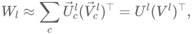


where there may be more subcomponents than rows and columns in the matrix. Permitting more subcomponents than rows and columns in the matrix allows VPD to identify mechanisms that operate on representations in superposition[26, 27, 28]. 


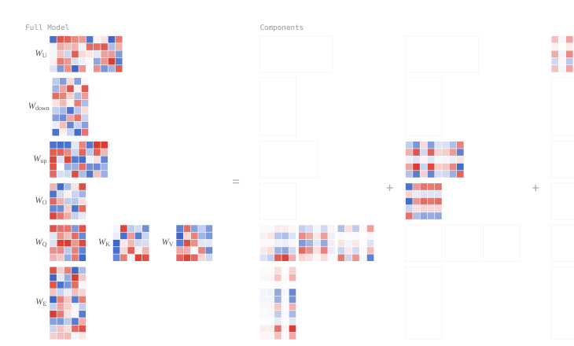


<!-- Start of picture text -->
Full Model Components<br>W U<br>W down<br>W up<br>= + +<br>W O<br>W Q W K W V<br>W E<br><!-- End of picture text -->

Figure 1. Parameter decomposition methods decompose target model parameters into components) that are optimized to approximate the model's m 

Although a single subcomponent explicitly parameterizes only a single weight matrix, it implicitly parametrizes a full parameter vector if we assume it takes values of  in all 0 other weight matrices. It is therefore possible to combine these subcomponents into full parameter components by adding them together in the right way. We identify these components using a subcomponent clustering method. Previous work left this clustering step implicit, but in this paper we introduce an explicit method (Appendix A.8). 

### 2.2  Enforcing parameter faithfulness with Δ -components 

To ensure the components collectively sum to the parameter vector of the target model, we define additional Δ -components, Δ<sup>_l_</sup> , that parametrize the difference between our subcomponents and the original model's matrices: 

Click any term for its definition 

We also encourage the Δ<sup>_l_</sup> -components to be small with an auxiliary MSE loss ( LDelta-L2 ) (Appendix Section A.1). 

#### 2.3  Optimizing for minimality 

We want as few subcomponents as possible to be causally important for computing the network's output on any particular input. We therefore need some way to estimate which parameter subcomponents are "necessary" for computing the network's output on a given datapoint. We also require a notion of how well the "necessary" subcomponents have reconstructed the network's output. 

Ablation-based parameter decomposition methods contend that a parameter subcomponent is "necessary" if it cannot be ablated without affecting the model's output on that datapoint. As in [16], we train a causal importance function to predict how ablatable each subcomponent is on each batch and sequence position. We also implement the causal importance function using a neural network, though we use a different architecture (Appendix Section A.2). 

_l_ We call the output of this function the causal importance values, _gb_ , _t_ , _c_ ∈ [0, 1] (for each subcomponent  of weight matrix  at a given batch index  and sequence position ): _c l b t_ 

- If _gbl_ , _t_ , _c_ = 0 , then we should be able to fully or partially ablate that subcomponent on the forward pass at position _b_ , _t_ without affecting the final model output. 

- If _gbl_ , _t_ , _c_ = 1 , then it should not be possible to ablate that subcomponent without affecting the model's output on that datapoint[6]. 

We want as few subcomponents as possible to be required to compute the output, so we train the causal importance values _gbl_ , _t_ , _c_ to take minimal values with an importance minimality loss: 


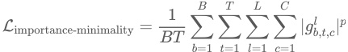


where _p_ > 0 .<sup>[7]</sup> 

#### 2.4  Optimizing for mechanistic faithfulness 

Components and their causal importances should be mechanistically faithful to the original model. One way of operationalizing this is to insist that, on any given data point, it should ideally be possible to ablate all causally unimportant components from the model weights, using any combination of ablations, without changing the model output. Another, more succinct, way of saying this is that every subset of components that includes the causally important components should be sufficient to compute the network's output on any particular input. 

This is a much stricter requirement than merely demanding that the output should be invariant to the joint ablation of all causally unimportant components together. To see why it is stricter, suppose that two components _θA_ and _θB_ can be jointly ablated, but not individually ablated, on a data point without affecting the output[8]. Then we would consider both _θA_ and _θB_ to be causally important on that datapoint, whereas the less strict criterion might consider them both causally unimportant because they happen to be jointly ablatable. In other words, the stricter criterion demands an unchanged model output over a whole set of points in parameter space, whereas the less strict one demands it only for a single point. For an illustration of why this stricter condition is necessary, see Section 7.3. 

VPD works on the level of rank-1 subcomponents instead of full components, but the same principle applies.[9] To check whether subcomponents are ablatable, we define _l l_ ablation masks _mb_ , _t_ , _c_ ∈ [ _gb_ , _t_ , _c_ , 1] for each subcomponent at each batch index  and _b l_ sequence position . So, if a subcomponent has causal importance _t gb_ , _t_ , _c_ = 1 , the only permitted value for the mask _mlb_ , _t_ , _c_ is also , whereas if the causal importance is , its 1 0 mask can take any value between  and . These masks define new weight matrices 0 1 _Wb_ ′, _lt_ which we should be able to insert in place of the original model matrices _W_<sup>_l_</sup> without substantially changing the model's final output. 

We operationalize this by demanding that the KL-divergence _D_ between the model output on the original forward pass and on forward passes using the masked weights should be small: 


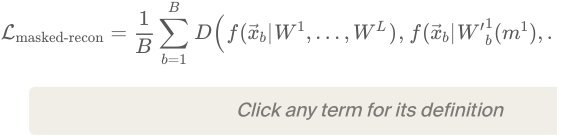


Ideally, we would calculate this masked reconstruction loss for every permitted combination of ablation masks _m_ for all subcomponents[10] in all the model's weight matrices, but this would require performing an intractably large number of forward passes. So we instead use ablation masks _m_ drawn using two types of sampling: 

1. Stochastic sampling, with ablation masks _m_<sup>stoch</sup> drawn from uniform distributions. This yields the stochastic reconstruction loss, Lstochastic-recon . 

2. Adversarial sampling, using ablation masks _m_<sup>adv</sup> optimized via gradient ascent to maximise the reconstruction loss. This yields the adversarial reconstruction loss, 

For details on the stochastic and adversarial sampling, see Appendix Section A.3. 

#### 2.5  Optimizing for simplicity 

Each component ought to contain as little computational machinery as possible. Otherwise, we could say that the target model is one big parameter component, and proclaim our decomposition complete without doing any actual decomposition! 

We both constrain and train our subcomponents to be simple. Our subcomponents are rank-one, which constrains them to be simpler objects than full matrices. Unfortunately, this is not enough of a simplicity constraint, because some rank-one solutions can be "simpler" than others: In some situations, it is possible to add multiple subcomponents parametrizing independent mechanisms used on disjoint subsets of the data together and have the resulting sum also be rank-one.[11] [12] 

We therefore encourage breaking up subcomponents into multiple that are causally important on as few data points as possible by introducing an additional, slightly superlinear, penalty on subcomponent activation frequency: 


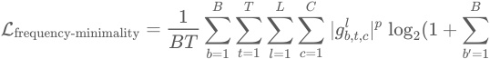


###### Click any term for its definition 

There are probably multiple ways to optimize for the computational simplicity of parameter subcomponents, and we are not confident this choice is optimal (nor our choices for the other losses). Nonetheless, we found it to work well enough in practice. See Appendix Section A.4 for a more detailed motivation of this loss. 

#### 2.6  Summary of loss terms 

In total, our loss function has five terms: 

LVPD = _β_ 1Ladversarial-recon + _β_ 2Lstochastic-recon + _β_ 3Limportance-minimality + _β_ 4Lfrequency-minimality + _β_ 5LDelta-L2 

They each optimize the parameter subcomponents to exhibit particular properties: 

> The Ladversarial-recon and Lstochastic-recon losses optimize for mechanistic faithfulness (Equation 3). 

- The Lfrequency-minimality loss optimizes subcomponents for simplicity. They are also constrained to be rank-1 matrices, which imposes one aspect of simplicity (Equation 4). 

- The LDelta-L2 auxiliary loss optimizes for parameter-faithfulness, even without the Δ -components, which ensure it (Equation 1). 

The key difference between VPD and our previous work [16] is the Ladversarial-recon and Lfrequency-minimality losses. There are several other, smaller differences that do not fundamentally change the method but that we found helpful for decomposing language models. For more details, see Appendix Section A. 

We evaluate the quality of our decomposition on a number of key metrics. For assessing the quality of a decomposition, the most important are Ladversarial-recon and _L_ 0 per datapoint. For readers looking for practical advice on how to tune hyperparameters and key optimization metrics, we provide a detailed Training recipe for VPD in Appendix A.6. 

### 3  Analyzing language model parameter subcomponents 

#### 3.1  Target language model 

We trained a four-layer 67M parameter decoder-only transformer model on an uncopyrighted subset of The Pile [22]. A summary of the model architecture and training results can be found in Table 1 and full training details of our target model can be found in Appendix A.7. 


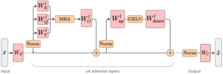


Figure 2. Our target model is a standard decoder-only transformer language model. 

|Attributes of our target||
|---|---|
|model||
|Layers|4|
|Residual stream|768|
|dimension||
|MLP intermediate<br>dimension|3072|
|Attention heads|6|
|Attention head|128|
|dimension||
|Context length|512|
|Vocabulary size|50,277|
|Positional encoding|RoPE<br>[30]|
|Normalization|RMSNorm<br>[31]|
|Activation function|GELU<br>[32]|
|Attention type|Standard Multi-Head<br>Attention<br>[33]|
|Tied embeddings|Yes|
|Non-embedding|~28M|
|parameters||
|Total parameters (incl.<br>embedding)|~67M|
|Training dataset|The Pile<br>(subset)<br>[22]|


We decomposed the 24 weight matrices in this model into a total of of 38,912 rank 1 subcomponents. We omitted the embedding and unembedding matrices. The decomposition used much fewer than its full capacity, having only ~10,000 alive components (with a mean causal importance greater than 10<sup>−6</sup> ). 

On average, each datapoint uses 205 subcomponents per sequence position, representing 2.1% of all alive subcomponents. Table 2 shows per-layer summary statistics for the decomposition. 

|Layer|_C_|Alive|Mean<br>L0|L0/Alive|
|---|---|---|---|---|
|Layer<br>0|9728|3709|44.6|0.012|
|Layer<br>1|9728|848|18.9|0.022|
|Layer<br>2|9728|1943|49.5|0.025|
|Layer<br>3|9728|3472|92.0|0.026|
|Total|38912|9972|205.0|0.021|


Table: Per-layer decomposition summary statistics: Subcomponent dictionary sizes _C_ ; alive subcomponents (subcomponents with mean causal importances above 

10<sup>−6</sup> at the end of training); average _L_ 0 scores of subcomponents with causal importance > 0 per batch 

and sequence position; and fraction of all subcomponents with causal importance > 0 per batch and sequence position. 

#### 3.2  The decomposition model behaves similarly to the target model 

If a decomposition method has correctly identified the mechanisms underlying a model's computation, then activating only the mechanisms that the method identifies as causally important on a given input should approximately reproduce the model's behavior on that input. Conversely, if a replacement model fails to reproduce the model's behavior, then the decomposition has either missed important mechanisms or identified spurious ones. Reconstruction quality is therefore a necessary (though not sufficient) condition for a decomposition to be mechanistically faithful. 

Our parameter subcomponents capture different amounts of the target model's performance depending on how masks are calculated (Table 3). One quantitative measure of performance is cross-entropy (CE) loss on the validation set: The decomposed model achieves between 2.72 and 3.02, depending on the type of sampling, compared with 2.71 for the target model. 

A metric that is sometimes helpful for comparison is Pretraining Compute Recovered[34], which is the percentage of the target model's total pretraining compute at which the target model's training curve reaches the same validation CE loss as the reconstruction model (i.e. a value of X% means the reconstruction performs no better than the target model did when only X% of pretraining was complete). 

When we exclude the Δ -component (which is trained to be as causally unimportant as possible), the remaining unmasked parameter subcomponents recover about 82% of the pretraining compute. When using stochastic ablations, this drops to around 27%. 

|Masking mode (excluding<br>-<br>components)<br>Δ|Validation CE<br>Loss|Pretraining Compute<br>Recovered (%)|
|---|---|---|
|Target Model|2.71|100%|
|Unmasked (All masks<br>1)<br>=|2.72|82.4%|
|Stochastic Masks|2.84|26.9%|
|Rounded Masks (Mask<br>1 if CI<br>0)<br>=<br>>|2.94|11.8%|
|Rounded Masks (Mask<br>1 if CI<br>0.1)<br>=<br>>|2.95|11.3%|
|Causal Importance values (CIs)<br>used as Masks|2.99|9.4%|
|Rounded Masks (Mask<br>1 if CI<br>=<br>>|3.02|8.0%|
|0.5)|||


Pretraining compute recovered is rarely reported, so comparisons to other methods are difficult. Nonetheless, VPD compares favorably to the only other method in the literature that we are aware of that reports this metric: Top- SAEs _k_ [34] reports a pretraining compute recovered of 10% when replacing a single layer of GPT-4 with an SAE with 16 million latents. By comparison, even though our approach decomposes the whole model rather than just a single layer, it recovers between 8% and 27% , depending on the ablation method used[13]. 

The table below shows KL-divergence to the target model under adversarial masking with different numbers of adversarial optimization steps, calculated across a batch of 128 of sequence length 512 drawn from the evaluation set [14]. 

|Adversarial optimization steps<br>_n_<sup>adv</sup>|KL divergence to target model|
|---|---|
|20|0.8280|
|40|1.3539|
|80|3.8381|
|160|25.2560|
|320|40.2200|


While the decomposition is somewhat robust to approximately 20 steps of adversarial optimization, it is clearly not at all robust to 160 steps or more.[15] 

However, we note that complete adversarial robustness would not necessarily be desirable. See Section 7.3 for some discussion of how much adversarial robustness a decomposition ought to exhibit to be considered mechanistically faithful. 

Qualitatively, the generations produced by different sampling methods align with the above quantitative measures. The generations seem qualitatively to produce similar behavior to the target model in most cases (Figure 3). 

|← Prev<br>1 / 10<br>`DATASET PROMPT`|Next →|
|---|---|


have spaced-apart portions defining outer flow passages therebetween. The primary 

###### `TARGET MODEL` 

flow passages are formed by a plurality of passages in a single passage. T `UNMASKED SPD (ALL MASKS = 1)` passage is formed by a plurality of passages in the outer flow passages. T `STOCHASTIC MASKED SPD` flow passages are formed by a plurality of flow passages. The flow passage `CAUSAL IMPORTANCE VALUES (CIS) USED AS MASKS` flow passage is formed by a flow-receiving portion, which is formed by a p `ADVERSARIAL MASKED SPD (20 ADV STEPS)` flow lines are spaced downward toward each other, respectively. Each flow 

Figure 3. Side-by-side generation comparisons across masking strategies. 

Surprisingly, even when masks are adversarially sampled with 20 steps of adversarial optimization, the generations are not entirely nonsensical. This is feasible because we only get to adversarially sample causally unimportant parameter subcomponents. 

#### 3.3  VPD has a better tradeoff between reconstruction versus sparsity compared with transcoders 

Any decomposition of a neural network faces a fundamental tradeoff between the number of `objects' they use to reconstruct the network's behavior and the quality of that reconstruction. If a decomposition can use fewer objects to capture the same amount of network performance, then that explanation is preferred according to Occam's razor, assuming the objects use a similar amount of computational machinery. 

We study the reconstruction versus sparsity tradeoffs of different decompositions and compare the VPD model with two families of activation-based decomposition methods: Per-layer transcoders (PLTs) [11] and cross-layer transcoders (CLTs) [10], both using BatchTopK [36]. We simultaneously replace all 4 MLP layers of the target model with their sparse reconstructions and measure the resulting increase in cross-entropy loss relative to the unmodified target model. There isn't a straightforward apples-to-apples comparison between transcoder latents and VPD subcomponents, so we present a number of different comparisons (with more extensive experimental details in Appendix B.1) [16]. To ensure our conclusions are not artifacts of how we count subcomponents or latents, we show results under three possible definitions of sparsity: 1. Average active subcomponents per module: Active encoder latents for PLTs/CLTs; active subcomponents per weight matrix for VPD; 

2. Active subcomponents per MLP Down reconstruction: Adjusting for the fact that a CLT latent affects multiple layers and that VPD uses two modules per MLP; 

3. Total active parameters: VPD's rank-one subcomponents have more parameters than a PLT latent and a single CLT latent has multiple decoder vectors. 

We compare VPD with PLTs and CLTs trained with their standard training losses, noting these are different objectives (VPD trains on output reconstruction while PLTs and CLTs are trained to reconstruct activations at each layer). 


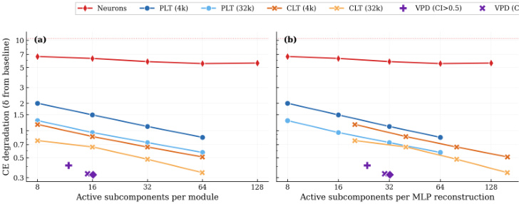


Figure 4. CE degradation when simultaneously replacing all 4 MLP layers with sparse reco subcomponents per module (raw L0). (b) Active subcomponents per MLP reconstruction, adj paired modules. (c) Total active parameters. VPD (purple markers) Pareto-dominates the activa measures. The dashed line indicates zero-ablation (all MLP outputs set t 

We observe that VPD performs favorably compared with activation-based decomposition, achieving less CE degradation for a given _L_ 0 across all three definitions of sparsity. 

We noted above that VPD and the transcoders differ in training objective. VPD is trained end-to-end, whereas activation-based approaches are usually trained layerwise. This complicates direct comparison and arguably makes the above analysis somewhat unfair to activation-based methods. We address this by also comparing under matched objectives in Appendix B.1 and find that VPD compares favorably to other methods: When trained and evaluated on a range of objectives, VPD's Pareto domination disappears, but it avoids overfitting to its particular training objective, unlike the activation-based methods. 

Additional figures and training logs for the VPD decomposition can be found at the WandB link here. 

#### 3.4  Parameter subcomponents are highly interpretable 

In order to study a parameter subcomponent's role in the network's neural algorithm, we need a definition of what it means for it to be 'active' on a given datapoint. 

There are at least two reasonable definitions: 

1. Causal importance: The causal importance function is trained to output a value between  and  that tells us exactly how important a particular subcomponent is 0 1 on a datapoint. It tells us if the subcomponent is 'necessary' or 'required' or 'used' on that input. In many ways, this is a perfect definition of 'active'! However, it is not a 'local' measure of a subcomponent's activation: A subcomponent with a small causal importance value might interact strongly with the activations at a layer, only for its effect to be suppressed later by others. For a more 'local' measure, we use the next definition. 

###### 2. Subcomponent activation: We define the subcomponent activation as 

_l l l ac_ = ∣∣ _Uc_ ∣∣( _Vcl_ )⊤ _φ_ , 

where _φl_ are the model's hidden activations before matrix _l_<sup>[17]</sup> . This defines how much the activations interact with a given subcomponent, even if that interaction ultimately ends up not being causally important for the output. Due to superposition [37, 38, 28, 26, 27], there will be more interactions in general than there are causally important interactions. 

Throughout this paper, we use both definitions, highlighting which type of activation we mean in each instance. 

We find that parameter subcomponents tend to 'activate' (in both senses) for coherent categories of inputs. Figure 5 shows some dataset examples on which each subcomponent is causally important. It also shows the subcomponent activation in the underlines. You can navigate the panel to explore the activations of a variety of parameter subcomponents: 

L2 MLP Down ← 329 / 359 → 

##### predicts emoticon continuations after colon, semicolon, or equals 

the component consistently activates on punctuation characters like ' :', ' ;', ' =', ':-' that typically begin text-based emoticons or emojis (e.g., :P, :D, :-), ;-), =P, =)). the highest ci values are observed on these characters right before the model produces the rest of the emoticon, such as 'D', 'P', 'p', '-)', '(', ')'. 

L2.MLP.down:3382 0.00% density 

```
ACTIVATING EXAMPLESCAUSAL IMPORTANCEACTIVATION
```

. :/ `↵` <todd <mark>y</mark> > Ich hoffe ich habe <mark>j</mark> etzt <mark>y</mark> nek <mark>j</mark> e v admin <mark>p</mark> anelu : <mark>p</mark> `↵` <n <mark>j</mark> u <mark>p</mark> alo> <mark>Q</mark> uilt <mark>,</mark> so here <mark>y</mark> ou <mark>g</mark> o Heather :-). `↵↵` For a number of sid <mark>,</mark> thou <mark>g</mark> h m <mark>y</mark> whole famil <mark>y</mark> uses ubuntu :P `↵` <LaserLine> > <mark>_</mark> akahi <mark>g</mark> e <mark>_</mark> text mode = <mark>p</mark> `↵` <hechu> fo 't it? chea <mark>p</mark> and nast <mark>y</mark> i sus <mark>p</mark> ect : <mark>p</mark> `↵↵` well whatever does it kubuntu like I alwa <mark>y</mark> s end u <mark>p</mark> usin <mark>g</mark> :-( `↵` <c <mark>j</mark> watson> hun <mark>g</mark> er: ous and I can't find it an <mark>y</mark> where :/ `↵` <linkd> sl idea how to use arra <mark>y</mark> s in D ) : `↵` void main() { `↵` there `↵` <to <mark>y</mark> o|work> :D `↵` <to <mark>y</mark> o|work ). `↵` 4) sensenstahl : thank <mark>y</mark> ou for the "Blue s <mark>q</mark> uare ro <mark>g</mark> er <mark>_</mark> 35 a la orden :D `↵` <NaN> alo икто <mark>у</mark> же не хочет =) `↵↵` <|endoftext|>SHELL `⇥` and <mark>,</mark> of course <mark>,</mark> no error messa <mark>g</mark> e :/ `↵` <Razoritar <mark>y</mark> Commission <mark>;</mark> ho <mark>p</mark> e to be home soon ; mentions the assassination of it's of an <mark>y</mark> use for <mark>y</mark> ou. ;-) `↵↵` <|endoftext|>Monda <mark>y,</mark> Au <mark>g</mark> ust 05 udge it! `↵` <thom> ;-) `↵` <lamont> th 

Figure 5. Browse all VPD parameter subcomponents by weight matrix. Green highlights indicate causal importances; colored underlines show subcomponent activations. 

To compare how 'interpretable' parameter subcomponents are relative to transcoder latents, we can measure how semantically coherent a subcomponent's activation patterns are using intruder detection [39, 40]. In intruder detection, we present an LLMjudge with a set of inputs that activate a given VPD subcomponent or transcoder latent alongside one 'intruder' example that does not activate it. We task the LLM-judge to identify the intruder example. It should be easier to identify the intruder among a more semantically coherent set of inputs. In the VPD setting, we use causal importance values in place of activation magnitudes and select intruder examples with similar activation densities. 

We find VPD intruder detection scores improve drastically when using CI values thresholded with 0.1, which filters low-CI noise Figure 6. We think that filtering out small causal importances is justifiable, since 0.1-rounded performance has essentially the same performance as 0.0-rounded performance, suggesting that very little performance is captured by subcomponents with small activations (Table 3). 

We observe that 0.1-rounded VPD subcomponents score competitively with CLTs and PLTs trained using a local (layerwise) MSE activation reconstruction loss Figure 6. VPD subcomponents are more coherent than PLTs and CLTs that were trained end-toend. 


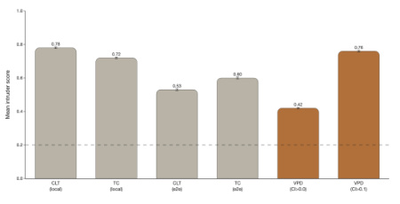


Figure 6. Intruder detection scores for various CLT and PLT latents, and VPD subcomponents at different CI thresholds. Error bars are 95% bootstrap CIs on the mean. Dashed line is random chance accuracy (20%). Higher is better. 

#### 3.5  VPD does not suffer from feature splitting 

Feature splitting is a well-known issue in activation-based dictionary learning methods such as PLTs, SAEs, and CLTs [41, 42]. As dictionary size increases, these methods can improve sparsity and reconstruction by replacing a 'broad', reusable latent with several narrower, more context-specific ones. In the extreme, a transcoder could assign a unique latent to every individual datapoint in the training set, effectively memorizing the dataset rather than uncovering reusable, general patterns. 

VPD does not suffer from this issue, either in principle or in practice. The key reason for this is that subcomponents marked as causally unimportant are required to be ablatable in any combination, not just all simultaneously. The model therefore needs to be robust to variations in parameter space along the directions of these subcomponents for all batches and sequence positions, not just the ones on which they are causally important. Without this constraint, the decomposition might be able to invent overly 'narrow', context-specific subcomponents that do not actually exist in the computational structure of the original model but that sparsely activate while reconstructing the model's behavior on some narrow subset of the data. For example, suppose VPD attempted to pathologically decrease Limportance-minimality by splitting a mechanism in the target model that ought to be parametrised by two subcomponents into many specialised subcomponents that lie within that mechanisms' twodimensional subspace, each aligned with a different training-data hidden activation vector, and marked only one of them at a time as causally important. If we were just using the causal importances as masks, this would reconstruct the target model's output well. But with stochastic or adversarial masking, many of the subcomponents not marked as causally important will be turned on as well, making the resulting output activation vector both too large and pointed in the wrong direction, thus ruining the reconstruction. See Section 7.3 for further discussion. 

To test empirically whether VPD does avoid feature splitting, we incrementally increase the number of subcomponents used by different VPD runs and count the number of "alive" subcomponents (subcomponents that activate at least once every 1M tokens). We train VPD at four capacity levels corresponding to 0.5× , 1× , 2× , 4× the subcomponent count of the main decomposition we study. We compare against PLTs and CLTs at 4k and 32k dictionary sizes. 


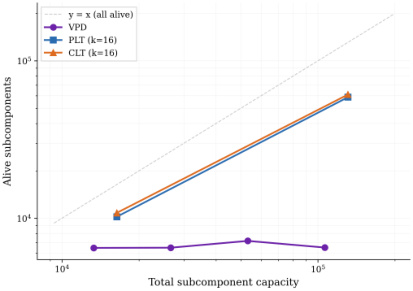


Figure 7. Number of alive subcomponents as a function of total subcomponent capacity. PLTs and CLTs scale roughly linearly with dictionary size, staying close to the _y_ = _x_ line. VPD (purple) remains flat at ~6,500-7,000 alive subcomponents regardless of capacity, indicating that additional capacity is not used for feature splitting. Dashed line: 

_y_ = _x_ (all subcomponents alive). 

Figure 7 shows that, unlike PLTs and CLTs, increasing VPD's capacity does not increase the number of subcomponents that the method actually uses, suggesting that feature splitting is not a significant problem for VPD. Across all four VPD runs the sparsity and reconstruction performance remain approximately constant, so the flat alive count reflects unused capacity rather than a tradeoff against sparsity or reconstruction. In Appendix B.2, we confirm that our PLTs and CLTs are indeed splitting features rather than discovering genuinely new ones. 

While we only show results for one language model here, we have observed the same qualitative result in every model we have decomposed with either VPD or SPD [16] despite extensive hyperparameter sweeps, including various toy models with known ground truth and a smaller language model trained on the SimpleStories ([43]) dataset. 

### 4  Decomposing attention behaviors that are distributed across attention heads 

Transformer language models are significant in large part because they were the first architecture that enabled scalable sequence modelling. The crucial component that lets transformers perform computations across sequences is the attention layer ([33, 44]). 

In most prior work that studies attention layer computations, attention heads have typically been the primary units of analysis to study attention behaviors [45, 46, 47, 48, 49, 7, 50]. Unfortunately for interpretability, it is possible for attention layers to perform computations in a way that is distributed across multiple heads [8, 51]<sup>[18]</sup> . It would therefore be ideal if our decomposition methods could cope with attention computations that are distributed across heads. So far, it has been difficult to find satisfactory activation-based decomposition methods that can do this [51, 52, 53, 54, 18]. 

Fortunately, parameter decomposition methods offer some hope: As we've seen in Section 3.4, parameter subcomponents seem to decompose the parameters into specialized functional units. And since parameter subcomponents are vectors in parameter space, they can therefore span multiple attention heads! 

In this section, we demonstrate that parameter subcomponents in attention layers are indeed interpretable, and can span multiple attention heads (and usually do!). Focusing primarily on attention layer 1, we study three attention layer behaviors ('Previous token behavior', 'Previous syntactic boundary movement', and 'Detecting Existential vs. Expletive Constructions') and show how parameter subcomponents distribute these computations across heads. 

#### 4.1  Attention layer parameter subcomponents have specific interpretable roles 

First, we look at a few parameter subcomponents in attention layer 1. In this layer VPD identifies different numbers of parameter subcomponents in the _WQ_ ,<sup>_W_</sup> _K_ ,<sup>_W_</sup> _V_ , and _WO_ matrices. These matrices have 15, 48, 226, and 97 alive[19] components respectively, though we'll usually present fewer for simplicity. 

There are many interesting subcomponents in these matrices that correspond to easily interpretable behaviors: 

- L1.Attn.q:308 activates on tokens related to existence or the verb 'to be' and other 

- 'copula' verbs. 

- L1.Attn.k:485 activates on words that predict 'copula' verbs, such as ·there or ·it 

- in "there is/it is". 

- L1.Attn.k:218 activates on the word ·it (including capitalized variations and 

- variants both with and without a leading space) 

- L1.Attn.k:119 activates on punctuation, spaces, brackets, newlines and other 

- 'interstitial' words. 

- L1.Attn.k:290 activates on newlines and end-of-text tokens only. 

- L1.Attn.v:42 activates on coordinating conjunctions, like ·and , ·or , ·but and ·& . 

- L1.Attn.v:178 activates on words related to position in time and, to a lesser extent, 

- space, like ·December , ·South , ·2002 , ·long and ·far . 

- L1.Attn.o:983 Activates on the introductions or titles of texts, particularly scientific 

- papers. 

Additionally, there are some subcomponents whose role seems more related to 'sequence position' than having a particular semantic meaning: 

- L1.Attn.q:149 and L1.Attn.q:497 tend to activate on the tokens immediately following 

- the first token of the sequence (and, incidentally, reveal some of the shortcomings of our autointerp labelling method, which seems to have missed this!). 

- L1.Attn.k:315 , L1.Attn.k:357 and L1.Attn.k:121 tend only to be causally important on the 

- first few tokens of a sequence, though with some exceptions. 

Together, these interpretations are encouraging, because they suggest that our decomposition is identifying parts of the network that are specialized for particular functional roles. 

#### 4.2  Attention layer parameter subcomponents typically span multiple heads 

We've seen evidence that attention subcomponents are specialized for specific semantic roles, suggesting different computational functions. Now we investigate whether these subcomponents are 'located' in particular heads. 

In our model, the _WQ_ ,<sup>_W_</sup> _K_ ,<sup>_W_</sup> _V_ , and _WO_ matrices are concatenated across attention heads. But we can easily split them into the matrices belonging to individual heads. Even though parameter subcomponents by default span all heads in a layer, most of their 'mass' could be localized in single heads if their weights in all but one attention heads have zero norm. But if their parameters have nonzero norm in multiple heads, then this is weak evidence that they perform computations across multiple heads. 

We'll focus on the _WQ_ and _WK_ matrices for now. We see that, in fact, most _WQ_ and _WK_ subcomponents have nonzero weight norm across each head (Figure 8). This suggests that most _WQ_ and _WK_ subcomponents might perform computations in a distributed way! The norms subcomponents of _WV_ and _WO_ matrices seem similarly distributed across heads (Figure 28) 


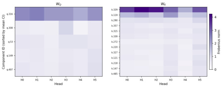


Figure 8. The norm of the weights of each _WQ_ and _WK_ subcomponent in each head. No parameter subcomponent is exclusively localized in a single head, suggestive of computations that are distributed across attention heads. 

While suggestive, this is only indirect evidence of distributed computations. We would need to understand the computations in order to confirm that they are indeed distributed across heads. To do this, we will need new analysis tools. And we can make the problem slightly easier by separately studying the two main parts of the attention layer: The QK circuit and the OV circuit [47]. We'll focus on the QK circuit first. 

#### 4.3  The QK circuit consists of interactions between pairs of parameter subcomponents 

In attention layers, _WQ_ ∈ R<sup>_d_</sup> model× _d_ model and _WK_ ∈ R<sup>_d_</sup> model× _d_ model matrices transform sequences of activations _φ_ ∈ R<sup>_T_×</sup><sup>_d_model</sup> in the (normed) residual stream to create queries ( _q_ = _φ_ ( _WQ_ )<sup>⊤</sup> ) and keys ( _k_ = _φ_ ( _WK_ )<sup>⊤</sup> ) for all heads. We can split them into the keys and queries for each head (e.g. _q_ = [ _φ_ ( _WQ_ 1 )⊤, ⋯, _φ_ ( _WQH_ )⊤] ). 

The attention scores of head  are calculated as _h Z h_ = _φWQh_ ⊤ _WKh φ_ ⊤ , which are used to calculate the head's attention pattern, _Ah_ = softmax( _Z h_ ) . Although the _WQ_ and _WK_ matrices are usually represented as separate matrices, it is _h h_ ⊤ convenient to study them together as a single matrix, _WQK_ = _WQ WKh_ [47]. 

Prior to parameter decomposition, it was not obvious how best to further decompose this circuit into specialized functional units. But VPD decomposes the _WQ_ and _WK_ matrices in a sum of functionally specialized rank-one parameter subcomponents [20]: 


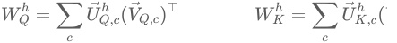


These subcomponents are secretly also a decomposition of the QK circuit, constructed from pairs of subcomponents of the _WQ_ and _WK_ matrices: 

##### (5) 


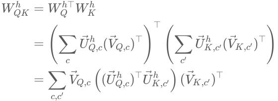


We will use this equation to study the QK circuit, both for a form of static (dataindependent) and dynamic (data-dependent) analysis of the computations of the QK circuit. 

We'll need to define two new metrics, one to measure the static interaction strength between pairs of subcomponents and another to measure how strongly a pair of subcomponents are interacting on a particular datapoint. 

###### QK Circuit - Metric 1: Static Interaction strength 

Although we can use Equation 5 to understand the static interaction strength between _h h_ subcomponents  and , we cannot simply use the raw term _c c_<sup>′</sup> (( _UQ_ , _c_ )⊤ _UK_ , _c_<sup>′</sup> ) for a few reasons: First, because both _Uc_ and _Vc_ vectors are unnormalized, we need to scale each _Uc_ vector by the norm of the corresponding _Vc_ vector in order to put the _Uc_ vectors on the same scale. 


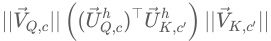


Second, we need to incorporate sequence position information. The above equations actually leave out an important part of our transformer language model: The Rotary Position Embedding (RoPE) rotation matrix [30]. For transformers that use RoPE, the _h h_ ⊤ _h_ QK circuit is actually: _WQK_ , _τ_ = ( _WQ_ ) **_R_** _τ WK_ , where  is the offset _τ_ —the difference between the sequence position of the query and the key. The rotation matrix rotates the keys and queries by different amounts depending on the offset. Thus we have 


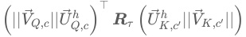


Third, and finally, we need to know whether this interaction typically contributes positively or negatively to the attention score. To calculate this, we cheat slightly and import one data-dependent statistic: The sign of the average subcomponent activation for each subcomponent on tokens where the subcomponent is causally important. With these three adjustments, we get the Static Interaction Strength: 


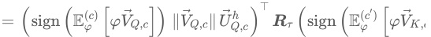


<!-- Start of picture text -->
⊤<br>h ( c  )<br>= (sign (E φ ( c ) [ φVQ , c ]) ∥ V Q , c ∥ U Q , c ) R τ (sign (E φ ′ [ φVK , c<br><!-- End of picture text -->

###### Click any term for its definition 

The Static Interaction Strength metric is not directly comparable across heads, since each head applies a separate softmax function, making any differences in scales or averages of interaction strength irrelevant. To make the metric comparable across heads, we standardize it: 

_c_ , _c_ ′ ′, 

StandardizedStaticInteractionStrength( _c_ , _c_ ,′ _τ_ = StaticInteractionStrength( _c_ <u>,</u> _c_ ′, _τ_ <u>,</u> _h_ <u>) −</u> _<u>μ</u>_ 

_σh_ 

where _μh_ and _σh_ are the mean and standard deviation of the Static Interaction Strengths across all ( _c_ , _c_ ,′ _τ_ ) for head . _h_ 

For attention layer 1, we plot this metric for each pair of subcomponents for each head and offset (Figure 9). We can see that for some pairs, the Static Interaction Strength changes strongly at different offsets. This means that, for these pairs, the same activations might have different effects on the attention at different offsets! For others, the Static Interaction Strengths seem independent of offset, meaning that their effects on the attention scores are determined only by whether data that activate them are present. 


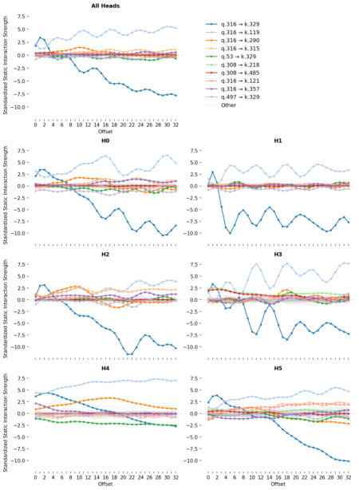


Figure 9. The Standardized Static Interaction Strengths of pairs of parameter subcomponents in the _Q_ and _K_ projection matrices in each head (bottom grid) and all heads (top). The ten pairs with the largest interaction strengths at any offset are shown in color, with the rest in grey. The L1.Attn.q:316 and L1.Attn.k:329 pair exhibit strong positive Static Interaction Strength at early offsets, indicating this pair's involvement in cross-head previous token behavior (and, more generally, 'recent token 

behavior'. 

We will use this plot of Static Interaction Strength to analyze particular attention behaviors. But before we do, we will equip ourselves with a related metric, the DataDependent Interaction Strength, which permits dynamic analysis. 

QK Circuit - Metric 2: Data-Dependent Interaction Strength 

The attention patterns of each head depend on how the hidden activations interact with _h h_ ⊤ the QK circuit: _Aτ_ = softmax( _φWQK_ , _τ φ_ ) . 

We can use Equation 5 to decompose the QK circuit and study how the activations  at _φ_ different timesteps _t_ , _t_<sup>′</sup> interact with each of the pairs of subcomponents: 


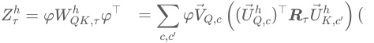


Thus, the attention score at each head  and offset  consists of the sum of the data's _h τ_ interaction with each of the individual pairs ( _c_ , _c_ )′ . On any input, we can therefore decompose the attention score—and hence the attention pattern—into parts that we can study in isolation. This lets us define a data-dependent metric of interaction strength, which forms the basis of our dynamic analysis: 


If we broadcast this over sequence position and head, we can visualise a subcomponent pair's interactions across a whole prompt as a stack of per-head matrices — and the model's full attention score _Z_ as the (per-head, per-position) sum of every such pair. To keep the figure readable, we'll abbreviate the position-independent pair term as 


Attention scores _Z_ illustrated as a sum of Data Dependent Interaction Strengths between pairs of subcomponents. 

In Figure 10, you can select which subcomponent interactions to sum together and see the attention score for those pairs. This is a very useful tool, since it splits up any given attention pattern into the contributions of individual, functionally distinct, subcomponent interactions. 

Figure 10. The attention score consists of a sum of Data Dependent Interaction Strengths. 

|This<br>panel<br>shows<br>the<br>same<br>prompt<br>as<br>the<br>figure<br>above,<br>but<br>here<br>you<br>can<br>control<br>which<br>pairs<br>of<br>subcomponents<br>to<br>include<br>in<br>the<br>sum,<br>allowing<br>you<br>to<br>study<br>their<br>individual<br>effects<br>on<br>the<br>reconstructed<br>attention<br>score<br>and<br>attention<br>pattern.|
|---|


We'll do an initial analysis of an attention behavior using only these two QK metrics before discussing how they interact with the OV circuit. 

#### 4.4  Decomposing attention behavior 1: Previous token behavior 

Like many language models, our model has a head that, on average, places the majority of its attention on the previous timestep (Figure 11). This is typically called a previous token head [55, 47, 48, 49] and, in our model, is head 1 in layer 1 (L1H1). However, L1H1 is not the only head to assign substantial probability to the previous token; many other heads do too, including heads in the same layer as L1H1. 


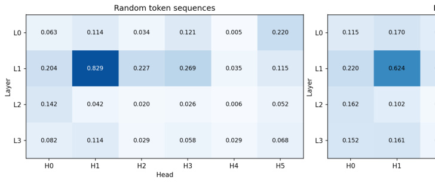


Figure 11. Identifying the previous token head: Mean attention across multiple inputs on offset over sequences of random tokens, as per [49]. Right: Average over sequences sampled from t canonical "previous token head". But note other heads place substantial avera Now we need to find subcomponents that might be involved in previous token behavior and establish whether or not their computations span multiple heads. An obvious place to start is by looking at the largest, most frequently active subcomponents in the _WQ_ and _WK_ matrices. Perhaps by coincidence, the largest norm subcomponents, L1.Attn.q:316 and L1.Attn.k:329 , are also the most frequently causally important (Figure 8)! 

While most subcomponents in layer one are only active on a fraction of tokens, both L1.Attn.q:316 and L1.Attn.k:329 have a CI firing density of 96.7% and 99.8% , meaning they're nearly constantly active. Both have the largest weight norm in L1H1, which was the head with the strongest previous token behavior (Figure 8). But they also have substantial weight norm in other heads, suggesting they aren't exclusively located in any particular head. Could they be responsible for cross-head previous token behavior? 

Figure 9 shows that these two subcomponents also have very strong offset-dependent Static Interaction Strength. In particular, their interaction is strongest at small offsets, and weak or negative interactions at more distant offsets. This is exactly what we would expect of two subcomponents that implement previous token behavior or recent token behavior. This pattern holds not only in L1H1, but also in other heads too. This is strong observational evidence that these two subcomponents compute previous token behavior in a way that is distributed across heads. 

We test this hypothesis causally using ablations and dynamic analysis. When we ablate different _WQ_ subcomponents on a dataset of prompts, the change in average attention is very small for most subcomponent ablations. Only the ablation of L1.Attn.q:316 results in the large reduction of attention at recent offsets (Figure 12). 


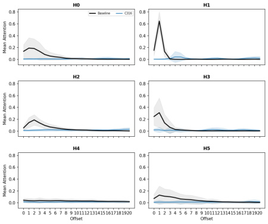


Figure 12. Effect of ablations: Ablating L1.Attn.q:316 very strongly reduces attention to tokens in the recent past across all heads that otherwise attended there strongly. The effects of ablating other W_Q components has no distinguishable effect compared with the baseline and are therefore not shown. Here the baseline is the 

unablated average attention pattern. 

Figure 10 shows dynamic analysis. For any of the prompts, you can remove the contribution of the L1.Attn.q:316 and L1.Attn.k:329 interaction to the attention score. Removing it destroys the attention to tokens in the recent past across all heads that had strong to moderate attention there. 

Together, this is strong evidence that the L1.Attn.q:316 and L1.Attn.k:329 interaction computes previous token behavior and is distributed across heads. 

This raises a question: What information is this attention moving from the recent past to the current timestep? What attention values does this previous token behavior tend to move? Are the different heads carrying forward information from distinct subspaces in the residual stream? Or are they carrying redundant information, perhaps as a form of noise robustness? To study this, we need to analyze the OV circuit, for which we will need another metric. 

Previous token behavior employs non-overlapping subspaces in the OV circuit 

The OV circuit is made from the _WV_ and _WO_ matrices which respectively read from and write to the residual stream: 


The sequence of _T_ vectors of dimension _d_ model that the attention layer outputs into the residual stream is computed using the attention pattern-weighted sum of the outputs of the OV circuits at all previous timesteps (where the attention pattern _A_<sup>_h_</sup> is determined by the QK circuit): 

_h_ Although _WOV_ is a _d_ model × _d_ model matrix, it only has rank _d_ head . Being low rank, each head can therefore only read from and write to a small subspace of the residual stream. It would be useful to know if two heads read from and write to similar subspaces. 

To do this, we will measure the 'overlap' between the subspaces that each head's OV circuit reads from and writes to, for which we'll use the 'Data-weighted Subspace Similarity' metric, which we construct from the Frobenius cosine similarity of the 'read subspaces' and the 'write subspaces' of each head (Figure 13). See Appendix B.6 for details of how these subspaces are constructed and for further details of this metric. We also measure the Frobenius cosine similarity of the _WOVh_ matrices themselves (Figure 13). When calculating similarity, we weight the axes of the read- and writesubspaces by how much data variation lies in each axis, since we do not care as much about weight similarity along axes where data do not exist or do not vary. In all cases, we compare the measured similarities to similarities between random, data-weighted matrices. 

Most heads in layer 1, except L1H4, seem at least weakly involved with previous token behavior, as assessed by their previous token score (Figure 11) and the offset dependence of the Static Interaction Strength of the L1.Attn.q:316 and L1.Attn.k:329 pair (Figure 9). We therefore should look at the overlap in the read and write subspaces of all heads in layer 1 except L1H4. 

The read subspaces of each head are close to or slightly lower than the expected similarity of two random (data-weighted) matrices (Figure 13). On the other hand, the write subspaces seem close to or slightly higher than the random baseline. These effects seem very weak, but weakly suggest a pattern of attention heads reading from distinct subspaces but writing to slightly less distinct subspaces. 


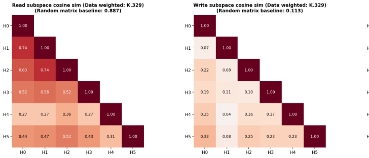


Figure 13. Data-weighted cosine similarities between each head's _WOVh_ read and write matric _h_ head's raw _WOV_ . Here, data-weighting uses data where subcomponent L1.Att 

For the head with the strongest previous token behavior, L1H1, the other heads L1H0 and L1H2 seem to read from subspaces with similarities close to the random baseline, but other heads read from much less similar subspaces. When comparing the similarity of the raw _WOVh_ matrices, there appears to be very little deviation from levels of overlap that would be expected of random matrices, except the comparison between L1H1 and L1H2, which again seem to be more similar than the random baseline. These two heads seem to write to quite different subspaces, though. 

Overall, this weakly suggests a picture that previous token behavior spans distinct subspaces across different heads. One potential reason for this is to be able to read more information from the residual stream than might be readable by a single head. There appears to be very limited, but nonzero, redundancy in how heads involved in previous token behavior read from different subspaces, but they largely seem to write to different subspaces. 

Previous token behavior is an important behavior implemented by probably every language model. But it is far from the only behavior implemented in layer 1. Even in L1H1, only around 60% of attention is on the previous timestep (Figure 11). What other attention behaviors is this head implementing? In the next section, we look at another behavior implemented by L1H1 in more detail, and examine whether that behavior is also distributed across heads. 

#### 4.5  Decomposing attention behavior 2: Previous syntax boundary movement 

Looking again at the static analysis of layer 1, we can see that L1H1 has interactions between Q and K subcomponents that seem to have quite a different offset-dependency (Figure 9). The subcomponents L1.Attn.q:316 and L1.Attn.k:119 seem to interact most strongly at later offsets across multiple heads, including L1H1. 

We are already familiar with L1.Attn.q:316 , the query subcomponent that is always active. The key subcomponent L1.Attn.k:119 is new: It seems to activate on brackets, punctuation, and newlines, but also some common continuation words, such as 'the' or 'and'. It is causally important on 16% of tokens, which is frequent, but not constantly active. 

This interaction therefore involves a conditional computation: Although L1.Attn.q:316 is always active, constantly looking back in time, the other subcomponent L1.Attn.k:119 only interacts with it when it is active. 

Interestingly, L1.Attn.k:119 must be active sufficiently far back in time; otherwise, the Static Interaction Strength may not be strong enough to contribute to the attention score. Almost every head seems to exhibit an offset dependent interaction between subcomponents L1.Attn.q:316 and L1.Attn.k:119 , suggestive of a very distributed computation. 

Since this computation is data-dependent, we will benefit from greater use of dynamic analysis. Figure 14 shows the attention patterns of all heads, but only shows the Data Dependent Interaction Strength of the L1.Attn.k:119 - L1.Attn.q:316 interaction. One prompt is shown at a time, but you can select a variety of other prompts from the dataset in the dropdown menu. 

Figure 14. Data Dependent Interaction Strength for the L1.Attn.k:119 - 

L1.Attn.q:316 interaction only, and the corresponding attention pattern if only that interaction contributed to the attention pattern. On the right hand side, the ground truth attention pattern is shown for comparison. 

By exploring different prompts, and inspecting the contributions of the L1.Attn.q:316 and L1.Attn.k:119 interaction across all heads, it is possible to see that this interaction contributes significantly to the attention patterns of most heads on previous periods, commas, and newline characters. L1H4 seems capable of maintaining attention on these characters at quite large offsets, based on the stronger than average vertical bars in the ground truth attention on those tokens. Other heads seem only to have noticeable attention on them more recently in time. This may be due to competition with other attention score contributions from other pairs. 

The activating examples of L1.Attn.k:119 show firings on various forms of punctuation, end of text tokens, newlines, latex "$" symbols, brackets, etc. This suggests that this pair of subcomponents orchestrates a syntax boundary detector with a variety of shortor long-offset ranges. We'll call this 'previous syntax boundary' movement. 

This pair of subcomponents seems responsible for attention to syntax boundary tokens at different ranges in different heads (Figure 9). L1H1 seems to increase self attention upon syntax boundary tokens; L1H2 seems only mildly to attend to syntax boundary tokens and only in the very recent past. L1H5 and L1H0 attend to syntax boundary tokens a small number of tokens in the past. L1H4 seems to attend to syntax boundary tokens many tokens in the past. L1H3 is less clear, but seems to attend to a smaller subset of specific syntax boundary tokens, usually with shorter offset ranges. 

The QK circuit of the 'previous syntax boundary movement' behavior seems quite distributed across heads. How does it interact with the OV circuit? We can study this by looking at probability of each key subcomponent being active conditioned on a given value subcomponent being active (Figure 29). The value subcomponents most associated with L1.Attn.k:119 are: 

- L1.Attn.v:72 - fires on punctuation to predict newlines and connectors 

- L1.Attn.v:22 - punctuation, syntax, and formatting tokens 

- L1.Attn.v:745 - formatting symbols, operators, and spatial alignment 

- L1.Attn.v:919 - fires on newlines and indentation 

- L1.Attn.v:531 - opening parentheses, brackets, braces, and quotes 

- L1.Attn.v:494 - predicts line breaks or indentation in formatted text 

- L1.Attn.v:195 - fires on delimiters and structural punctuation 

- L1.Attn.v:612 - fires on closing delimiters (parentheses, braces, brackets, math) 

- L1.Attn.v:984 - fires on punctuation and symbols 

- L1.Attn.v:1000 - fires on punctuation, delimiters, and structural boundaries 

- L1.Attn.v:22 - punctuation, syntax, and formatting tokens 

- L1.Attn.v:389 - delimiters and punctuation in structured text and code 

- L1.Attn.v:188 - structural punctuation and syntax symbols 

- L1.Attn.v:299 - fires on commas and semicolons 

- L1.Attn.v:1014 - subordinating conjunctions and relative pronouns 

- L1.Attn.v:227 - fires on periods and member access operators 

- L1.Attn.v:946 - distinguishes content words from function words/symbols 

- L1.Attn.v:340 - syntactic linkages and prepositions 

And some with weaker associations (Figure 29). 

As in the case of previous token behavior, the data-weighted OV circuits (where we weight the similarity using dataset examples and tokens where L1.Attn.k:119 is causally important) do not seem to read from very similar residual stream subspaces (Figure 30), though they seem to write to somewhat more similar subspaces than would be expected in random matrices. The OV circuit subcomponents that subcomponent L1.Attn.k:119 seems to overlap strongest with are associated with other punctuation and syntax boundary-like tokens across seemingly all heads, in both the read and the write matrices (Appendix B.9). 

To understand why the model is carrying forward information about the previous syntax boundary, we would need to know how the values are being used downstream. But it is possible to surmise at least part of its function: It is useful to know what the previous syntax boundary tokens are in order to perform tasks like closing opened brackets; knowing whether a list is a bullet list or dashed list; or knowing if a token is within or outside of a quotation; and more. 

#### 4.6  Decomposing attention behavior 3: Detecting Existential vs. Expletive Constructions 

Both of the above attention behaviors (Section 4.4 and Section 4.5) have involved _WQ_ or _WK_ subcomponents where one is 'always active'. Although the vast majority of the attention scores in this layer seem to involve at least one of these subcomponents, it would be interesting to study an even more conditional behavior. 

We'll investigate an attention behavior involving the _WQ_ subcomponent L1.Attn.q:308 - fires on existence and state verbs (is, was, there are/is) . 

This subcomponent appears to activate on a subset of copula verbs. Examples of copula verbs include: 

- "To be" ("she is", "it was", "What were", ), 

- Verbs related to sensory appearance ("it certainly seems", "she appeared as though", "they looked like"), and 

- Verbs related to state ("we remain", "it becomes readily apparent", "there exists"). 

Grammatically, copula verbs behave as linking verbs: They connect a subject ("it", "she", "there", "we", etc.) to a description or complement, rather than expressing an action. They are relatively ubiquitous throughout English, so it makes sense that even a small language model would learn computations involving them. 

Subcomponent L1.Attn.q:308 activates on a subset of copula verbs 

Although L1.Attn.q:308 has a large subcomponent activation on copula verb tokens, it is noteworthy that it is not causally important on all instances them. Here are several prompts containing copula verb tokens on which L1.Attn.q:308 is not causally important on some tokens despite having high subcomponent activation: 

###### `ACTIVATING EXAMPLES FOR L1.ATTN.Q:308 CAUSAL IMPORTANCE ACTIVATION` 

The inner <mark>p</mark> roduct can be written as <u <mark>,</mark> v> Au + CdS nano <mark>p</mark> articles have ver <mark>y</mark> interestin <mark>g</mark> electrical <mark>p</mark> ro <mark>p</mark> erties and are <mark>p</mark> r MPB (LMWHA-MPB/IR783) for NPs trackin <mark>g</mark> *in vivo*. The real-time ima <mark>g</mark> es were the Save Canterbur <mark>y</mark> Cathedral a <mark>pp</mark> eal <mark>,</mark> said that the challen <mark>g</mark> e is enormous. would be less obvius. `↵↵` I would not block this kind of <mark>p</mark> eo <mark>p</mark> le ( well i will d but as statistical si <mark>g</mark> nificance is the usual criterion b <mark>y</mark> which an effect i `↵↵` Since <mark>p</mark> ostcriticall <mark>y</mark> finite s <mark>y</mark> stems are dense in $F(d <mark>,</mark> \e <mark>p</mark> silon)$ <mark>,</mark> Senator Ensi <mark>g</mark> n was livin <mark>g</mark> at the C Street house <mark>,</mark> which is o <mark>p</mark> erated b <mark>y</mark> The F 

By contrast, here are a few prompts where L1.Attn.q:308 is causally important on copula verb tokens: 


is so <mark>g</mark> or <mark>g</mark> eous on its own that it's hard to move on. `↵↵` This <mark>,</mark> of course <mark>,</mark> was n blindfolded or `↵` what. Same thin <mark>g</mark> with La <mark>p</mark> hroai <mark>g</mark> and Dewers. There are simpl <mark>y</mark> to think. It was all so `↵` <mark>p</mark> lausible and there was the bead of <mark>g</mark> old <mark>,</mark> too <mark>,</mark> that Can we sim <mark>p</mark> lif <mark>y</mark> the infinite sum in the bracket as a sim <mark>p</mark> le result? `↵↵` A: `↵↵` The <mark>p</mark> s <mark>y</mark> cholo <mark>g</mark> ical and <mark>p</mark> h <mark>y</mark> sical stimulation <mark>,</mark> and it has been utilized in the rese asin <mark>g</mark> interest about all Hiltonbur <mark>y</mark> matters <mark>,</mark> `↵` <mark>g</mark> reat and small <mark>,</mark> bewitchin <mark>g</mark> Hon his career in Poland with Po <mark>g</mark> oń Szczecin. A cou <mark>p</mark> le of da <mark>y</mark> s later it was anno Peo <mark>p</mark> le said that there was a risk that it would start fallin <mark>g</mark> down and we're refund ) `↵↵` Sometimes scammers are not <mark>p</mark> atient and show their hun <mark>g</mark> r <mark>y</mark> for eas <mark>y</mark> see that so man <mark>y p</mark> eo <mark>p</mark> le had turned u <mark>p</mark> for the occasion. As keen theatre <mark>g</mark> oer : It seems to me that the chan <mark>g</mark> es that have affected the theor <mark>y</mark> of inter <mark>p</mark> ret age <mark>,</mark> individuals could resort to more <mark>p</mark> owerful and costlier substances than 

By studying the difference between these two sets, it is possible to notice a pattern: Although L1.Attn.q:308 has a large positive subcomponent activation on most instances of copula verbs, the cases where it is causally important are typically when it is preceded by it , there , here (as in "it is", "there is", "there are", "here is", "makes it seem") and related tokens. 

Constructions like these have specific linguistic terms: Existential and expletive constructions, which use "there" and "it" in particular senses: 

- The 'existential "there"': Where "there" is used to make assertions about the existence of something. Examples: "There is a problem", "there wasn't enough", "there seems to be several", "there exists", "there have been few attempts", "there remains a number of" 

- The 'expletive "it"': Where "it" is used as a dummy subject, with no real referent. Examples: "It is unusual", "It appears likely", "It was found that", "It dawned on him that"[21], "It looks like" 

Even though L1.Attn.q:308 has a high subcomponent activation on most copula verbs, it is usually not causally important (with some exceptions) when the copula verb is preceded by personal pronouns (e.g. "she", "he", "they"): 

###### `ACTIVATING EXAMPLES FOR L1.ATTN.Q:308 CAUSAL IMPORTANCE ACTIVATION` 

. When I finall <mark>y</mark> called him over to me <mark>,</mark> he was excited <mark>,</mark> as he alwa <mark>y</mark> s is. Per ma <mark>y</mark> have thou <mark>g</mark> ht he was smart <mark>,</mark> but he reall <mark>y</mark> was <mark>p</mark> rett <mark>y</mark> stu <mark>p</mark> id. His brillia <mark>,</mark> the <mark>y</mark> must be of the sacraments which Jesus Christ instructed the disci <mark>p</mark> les have been u <mark>p</mark> dated and <mark>g</mark> iven their own forum. Go and look at them! The <mark>y</mark> are anal <mark>y</mark> sis of the new com <mark>p</mark> ound. After a <mark>p</mark> rolon <mark>g</mark> ed incubation <mark>p</mark> eriod <mark>,</mark> the resu <mark>p</mark> ursuant to Section 4(b) of the a <mark>g</mark> reement. The defendant ar <mark>g</mark> ued that the co to initialize the re <mark>p</mark> ositor <mark>y</mark> locall <mark>y</mark> before <mark>p</mark> ushin <mark>g</mark> . The error log threw a 

How could this be? The main way that QK subcomponents can influence downstream computations (and hence have causal importance) is by influencing attention. L1.Attn.q:308 having a large subcomponent activation is insufficient for attention. There needs to be a key subcomponent that aligns with L1.Attn.q:308 (i.e. has a high Static Interaction Strength) that also has a high subcomponent activation in order for a Q-K subcomponent pair to have high Data Dependent Interaction Strength, and hence to contribute significantly to the attention pattern. There must therefore be _WK_ subcomponents that L1.Attn.q:308 'looks for' in the past that, if present, give this subcomponent its causal importance. 

###### Subcomponent L1.Attn.q:308 interacts with two specific _WK_ subcomponents 

We'll start looking for this interaction by looking at whether there are subcomponents that have a high Static Interaction Strength with L1.Attn.q:308 . 

Looking again at Figure 9, we can see that L1.Attn.q:308 has strongest offset-dependent Static Interaction Strength with two _WK_ subcomponents, namely L1.Attn.k:218 and L1.Attn.k:485 . These two interactions are strongest in L1H3, but also in L1H5. 

Incidentally, the norm plot (Figure 8) supports the idea that L1.Attn.q:308 is primarily located in L1H3, and secondarily in L1H5, since the weight norm is largest in those two heads and negligible elsewhere. 

These two _WK_ subcomponents ( L1.Attn.k:218 and L1.Attn.k:485 ) seem to be causally important on related, but semantically distinct, tokens, which we explore in detail in the following sections. 

###### Subcomponents L1.Attn.k:218 and L1.Attn.q:308 make an "it + copula verb" detector 

> L1.Attn.k:218 - fires on the pronoun 'it' predicting subsequent verbs seems to have high subcomponent activation on any instance of the word "it", including capitalized variants. It is also causally important on any instance of the word "it", but its causal importance tends to be higher on instances of the 'expletive "it"'[22]. 

The phrase "it is" is often an 'expletive "it"' followed by a copula. But it may also be an 'anaphoric pronoun "it"' followed by a copula, as in "It is mine". It turns out that L1.Attn.k:218 is causally important on both types of "it is". But it is not causally important for expressions involving other pronouns followed by copulas, such as "he is", "they are", etc. It therefore seems that this pair of subcomponents interact to implement an "it + copula verb" detector, including both 'expletive "it"' and 'anaphoric pronoun "it"' followed by a copula 

We can see its Data Dependent Interaction Strengths in the figure below. The interaction strengths are strongest in L1H3, with a small amount in L1H5, with essentially none in any other head. The attention patterns reveal that the L1.Attn.q:308 subcomponent 'looks back in time' from copula verbs, and has high Data-Dependent Interaction Strength with L1.Attn.k:218 if it finds it. If it does, it usually contributes enough to the attention score that it becomes causally important. 

It turns out that it is quite an overzealous "it + copula verb" detector. It often produces high Data Dependent Interaction Strength even at quite large offsets, even when the "it" and the copula verb are not related to each other. For an example, see the prompts below where a copula verb late in the prompt attends back to an unrelated it token in an earlier sentence: 

The L1.Attn.k:485 - L1.Attn.q:308 interaction plays a mostly overlapping role to the L1.Attn.k:218 - L1.Attn.q:308 interaction 

The other subcomponent with which L1.Attn.q:308 has a strong interaction is L1.Attn.k:485 - predicts existence or copula verbs after "there" / "it" . It has strongest subcomponent activation on the word "there", but also activates for "here" and "it" (and all their capitalized variants). It tends to be causally important when any of these words is followed by a copula verb. 

Together, this indicates that the interaction between L1.Attn.k:485 and L1.Attn.q:308 causes attention to existential constructions, such as "There is", "Here are", "There exists", as well as expletive constructions (which we studied in detail in the previous subsection). This means that its function overlaps with the function of the L1.Attn.k:218 and L1.Attn.q:308 interaction, which also detects expletive constructions. 

However, the L1.Attn.k:485 - L1.Attn.q:308 interaction contributes relatively less attention to expletive constructions compared with the interaction between L1.Attn.k:218 and L1.Attn.q:308 . For example, in the prompt below, the L1.Attn.k:485 - L1.Attn.q:308 interaction misses the 'expletive "it"' in "make it probable" while L1.Attn.k:218 - L1.Attn.q:308 detects it and causes attention to it. 

These two interactions thus both play overlapping, but somewhat specialized roles in detecting what type of construction a copula verb is in. 

Both QK subcomponent interactions have similar OV circuits 

Their overlapping, but slightly distinct, roles are reflected by their OV circuits. 

If either L1.Attn.k:218 and L1.Attn.k:485 are causally important, the _WV_ subcomponents with the highest probability of also being causally important are (Figure 29): 

L1.Attn.v:744 - fires on pronouns and determiners 

- L1.Attn.v:180 - fires on pronouns and dummy subjects (it, there) 

L1.Attn.v:946 - distinguishes content words from function words/symbols 

L1.Attn.v:649 - fires on <|endoftext|> to predict document start 

However, both _WK_ subcomponents do not have identical relationships with all _WV_ subcomponents. Subcomponent L1.Attn.v:448 - fires on 'there/where/here' predicting 'to be' verbs seems only to have a high conditional probability of being causally important with L1.Attn.k:485 , not L1.Attn.k:218 . Combined, these values seem to be carrying both grammatical and 'content' information. It's worthwhile noting that these _WV_ subcomponents are not localized to particular heads, and therefore their information may be mediated via more than one head (Figure 28). 

On a normative level, why does the model learn these two behaviors and implement them in this way? On one level, the answer is somewhat obvious: These constructions (existential, expletive, anaphoric) tend to be followed by different types of text, which therefore demands different kinds of predictions. On another level, it feels likely that a better model could have implemented better detectors. To determine whether layer 1 is simply too early in the model for a 'cleaner' implementation, or whether the model is simply too small, would require further investigation. We leave those investigations, as well as studies of how these overlapping, but separable, detectors influence downstream computations, to future work. 

We have barely scratched the surface of the extent and complexity of attention computations of even this small model. Nonetheless, we are excited by the possibilities for understanding attention computations opened up by decomposing attention layer parameters into parameter subcomponents. We believe the breadth of this analysis could be massively increased and note there is significant room for increasing the depth analysis that use parameter subcomponents to decompose and understand attention. We have not, for instance, studied how parameter subcomponents could interact across attention layers, perhaps forming structures akin to 'virtual attention heads', but decomposed into their constituent parameter subcomponents. 

### 5  Interpreting circuits of parameter subcomponents 

So far, we have studied parameter subcomponents individually, or one attention layer at a time, looking at how they combine within a single attention layer to produce behaviors like previous-token movement and previous-syntactic-boundary movement. But the outputs of a language model are computed using many layers in series. In this section, we use parameter subcomponents to understand at least some aspects of the target model's internal computations from the input embedding all the way to the output on a few different prompts. 

To make sense of these multi-step computations, we need a way to study how information flows between parameter subcomponents throughout the entire model. We do this by calculating attributions, which measure the strength of the interaction between causally important subcomponents on particular prompts. The resulting attribution graphs let us trace, on individual prompts, how information moves between subcomponents across layers. In particular, we use gradient attributions, but use stopgradients on every node other than the source and target so that we measure only the 'direct' effects of one subcomponent on another (Section 5.1). 

It should be noted that using gradients in this way 'abstracts away' the complexity of non-linear interactions between subcomponents by summarizing them into a single number. As a result, such attributions are only 'local' measures of interaction strength; their value depends on the particular datapoint that we measure them on. Many works have pointed out issues (such as saturated softmax functions in attention layers) that can cause such local attributions to be unrepresentative of more 'global' measures [56, 57]. In order to identify more 'global' measures of interaction strength, we would need to better characterize the nonlinear relationships between parameter subcomponents. This is an important research priority, and one that we've already begun exploring, but not something that this paper covers in detail. We do nonetheless provide analysis that suggests parameter subcomponents of MLP matrices, despite not being directly selected to have simple interactions, tend toward it anyway (Appendix B.11). 

#### 5.1  Attribution calculations 

To calculate attributions between two subcomponents, we leverage gradients. In particular, we calculate the gradients between each "subcomponent activation", _alc_ = ( _Vcl_ )⊤ _φl_ . However, we do not always simply use ∂∂ _aacc_<sup>′</sup> , the partial derivative of the target subcomponent activation _ac_ with respect to the source subcomponent activation. The partial derivative measures the influence of _ac_<sup>′</sup> on _ac_ through both direct and indirect pathways. Understanding the direct effects of a subcomponent give us the clearest mechanistic picture of its role in the network's neural algorithm. We therefore need an attribution method that can distinguish between direct and indirect effects, unlike the partial derivative ∂∂ _aacc_<sup>′</sup> . But, complicating matters further, in models with residual streams a subcomponent's direct effects are not limited only to those in the immediate next layer. The direct effects may skip many layers! 

Instead of using the partial derivative ∂∂ _aacc_<sup>′</sup> , we use the fact that we can control how gradients flow on the backwards pass. We take the partial derivative ∂∂ _aacc_<sup>′</sup> , but we stop the gradients flowing through all subcomponents that are not the source subcomponent (Figure 15). This avoids measuring their effects on the target node, including the indirect effects of the source node that flow through them. 


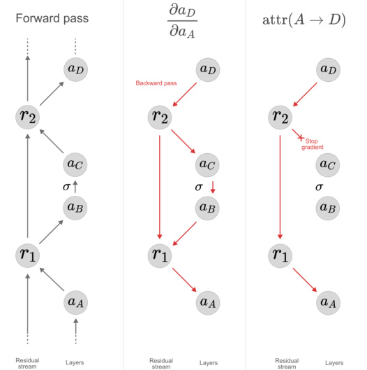


Figure 15. To exclude indirect effects (i.e. effects that one parameter subcomponent has on another that are mediated by intermediate parameter subcomponents), we stop the gradients flowing through all subcomponents that are not the source subcomponent. 

This derivative approximates how sensitive the target node is to the source node. Our attribution multiplies this "sensitivity" by the strength of the activation of the source node in order to measure its overall influence. Additionally, we do not want to include causally unimportant nodes in our attributions, and therefore multiply the resulting term by the source subcomponent's causal importance: 


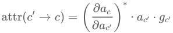


where the  around the partial derivative denotes stopped gradients on non-source ∗ subcomponents. 

For more details on our gradient attributions, see Appendix B.10.1. 

#### 5.2  Pruning for specific behaviors 

Most prompts, even simple ones, tend to activate hundreds of parameter subcomponents, which is too many to analyze at once! 

We can further reduce the number of subcomponents we need to analyze by keeping only those subcomponents involved in computing some particular output behavior on a prompt that we are interested in. 

To do this, we use two types of pruning methods, yielding two types of attribution graph. We'll use both types in our analysis below: 

- Attribution graph type 1: Pruning with adversarial sampling: Suppose, on the prompt The ·princess ·lost ·her ·crown . , we wanted to analyze how the model successfully predicts ·her . We would therefore only be interested in subcomponents that were involved in computing this specific prediction at this specific sequence position, which is a smaller subset of subcomponents than the set used to predict all tokens at all sequence positions. We can therefore find new causal importances to identify only those subcomponents by minimizing a set of masks while demanding that cross-entropy reconstruction loss on the label ·her on the sequence position for ·lost remains good. This is different from standard VPD training, which instead used KL-divergence to all the target model's output probabilities on all sequence positions of the prompt. As in VPD training, we optimize causal importances under both stochastic and adversarial mask sampling to try to ensure that the resulting graphs are mechanistically faithful. For details about this technique, see Appendix B.10.2. 

One might wonder whether adversarial sampling is actually necessary for mechanistic faithfulness for this post-hoc pruning. After all, the parameter subcomponents are now frozen and only the causal importances can change, so the optimization has much fewer degrees of freedom to create spurious graphs that score well on the loss. To investigate this, we use the second type of attribution graph: 

- Attribution graph type 2: Pruning with only causal importances as masks (no stochastic or adversarial sampling): We can also make attributions graphs by making a new set of causal importances. But in this case, we minimizing the causal importances without stochastic or adversarial sampling. We still demand that cross-entropy reconstruction loss on the label ·her on the sequence position for ·lost remains good, but this is much easier because we no longer need to be 

- robust to stochastic or adversarial sampling of the causal importance masks. optimize the graph only for the nodes that are necessary for making a specific prediction (as in the previous type of graph). 

In the case studies, we will see that graph type 2 often looks interpretable and contain far fewer subcomponents than the adversarially pruned graphs (type 1). This is somewhat misleading: Because they are not robust to adversarial ablations of parameter subcomponents, type 2 graphs will yield mechanistically unfaithful accounts of the network's computations. They claim that many components are causally unimportant (ablatable), when in fact they are important (unablatable under adversarial sampling), making them look much simpler and more superficial than would a mechanistically faithful account of the the network's computations. Further confirming the mechanistic unfaithfulness of the non-adversarially pruned graphs, they often score much better on the task than the actual target model, reaching near 100% [23] accuracy. Importantly, we believe that this issue is likely to apply in any setting in which masking-without-adversarial-sampling is used to identify subsets of nodes (or 'subnetworks') in large causal graphs that are important for downstream tasks, which includes a large fraction of the neural network subgraph identification literature to date. 

The most important type of graph that we study below is type 1 (Pruning with adversarial sampling), but we will use type 2 to demonstrate the necessity of choosing subcomponents such that the subgraph is robust to adversarial sampling, if our aim is to give mechanistically faithful accounts of the network's computations. 

#### 5.3  Case study 1: Gendered possessive pronoun 

On the prompt The ·princess ·lost ·her ·crown . the target model correctly predicts with high probability ( 0.586 ) that ·her follows ·lost . This requires recognizing that a possessive pronoun is likely to come next, remembering that the previous token was ·princess , and knowing that princesses are predominantly associated with female pronouns. How does the model perform this task? 

We can use attribution graphs to follow the flow of information between parameter subcomponents and see what information is processed and by which parameters. 

Figure 16. Attribution graph for predicting ·her on the prompt "The princess lost her crown.", pruned with adversarial sampling. [24] There are 150 subcomponents in the graph. 

The top two pathways in the adversarially pruned graph suggest two core mechanisms: one which moves the femaleness attribute of ·princess over to the next token via attention layer 3, and another which detects the verb ·lost via MLP layer 2 and suggests that an object pronoun might follow. 

If we prune the graph for high probability on ·her using only the causal importances as masks, neglecting adversarial robustness, we recover a graph of just six subcomponents (Figure 17), which corresponds almost exactly to the most attributed subcomponents in these same two top pathways. 

graph for predicting ·her on the prompt "The princess lost her crown.", pruned with causal importance masking. [27] 

This confirms that these six subcomponents are sufficient for reproducing the desired output. This much smaller graph even generalises to slightly different prompts: On the input The lady ·lost ·her ·crown . , a forward pass using only the six subcomponents in the small graph at the exact same sequence positions also recovers the target model's ·her prediction[30]. But the lack of adversarial robustness in the smaller graph confirms that it does not provide anything close to a full account of the relevant computation going into the model's prediction.[31] All 150 subcomponents in Figure 16 likely play some role — otherwise the optimization would have pruned them. While these six subcomponents suffice to put high probability on ·her , they fail to suppress other computational pathways that would predict different outputs. We do not attempt to fully understand the complete graph here. 

How similar are the structures of graphs for slightly different prompts? To investigate this, we run the same analysis on the prompt The ·prince ·lost ·his ·crown . , where the target model predicts ·his with probability 0.512 . We recover similar, but not identical results. 

Figure 18. Attribution graph for predicting ·his on the prompt "The prince lost his crown.", pruned with adversarial sampling. [32] There 

are 160 subcomponents in the graph. The target model assigns probability 0.512 to ·his . 

As with the princess prompt, pruning with CI masking instead of adversarial masking recovers a much smaller graph of just six subcomponents organised into two pathways that is sufficient to compute the ·his prediction, but isn't adversarially robust at all. 

Figure 19. Attribution graph for predicting ·his on the prompt "The prince lost his crown.", pruned with causal importance masking. 

We stress again that the above is far from a complete account of the meaningful computation going on in the model for these input prompts. We have merely traced out the flow of information between a subset of subcomponents that are sufficient for computing the output, which is much smaller than the subset of subcomponents that are actually involved in computing the output. 

#### 5.4  Case study 2: Bracket closing 

On the prompt < u , v > the target model correctly predicts that > follows v , assigning probability 0.547 . This requires the model to remember that, earlier in the sentence, < opened a bracket that now needs to be closed. How does the model perform this task? 

Figure 20. Attribution graph for predicting > after v on the prompt < u , v > , pruned with adversarial sampling. 

Notably, in the attention layer 2 of this graph, information about the open bracket seems to be moved from the < position to the v position, partly due to information previously received from the < position in attention layer 1. This triggers a query that is specific to closing-delimiters (such as > ), which searches for a preceding openingdelimiter (such as < ) key. 

Since the _WQ_ subcomponents used in attention layer 1 and 3 appear to be generically always-active rather than triggering in response to preceding commas, and the queries in layer 2 do not appear to only trigger conditional on a comma at the previous token either, one might wonder whether the model would also predict a closing > right after u . It turns out that it does — predicting > as its top logit after u as well, though with lower confidence ( 0.119 vs. 0.547 after v ). Figure 21 shows a structurally similar graph for this prediction, but lacking the subcomponents active on u and , in the attention layers. This suggests the longer context reinforces the math context and thus the likelihood of a closing bracket. Interestingly, the model does not predict a closing bracket after , , suggesting it recognises that the comma indicates the statement inside the bracket is not yet complete. 

Figure 21. Attribution graph for predicting > on the prompt < u , 

v > after u , pruned with adversarial sampling. [37] There are 162 subcomponents in the graph. The target model assigns probability 0.119 to > . 

Pruning with CI masking instead of adversarial masking recovers a much smaller graph of just 14 subcomponents (Figure 22). It predicts > correctly under CI masking but fails completely under adversarial masking, giving a very incomplete account of the computation. Nevertheless, it highlights some core pathways. 

Figure 22. Attribution graph for predicting > on the prompt < u , v > , pruned with causal importance masking. 

While the 14-component graph highlights the core pathways, the full graph in Figure 20 makes clear that the actual computation is far more intricate. 

Given how few subcomponents our decomposition has in total (ca. 10,000 alive in the whole model) it is perhaps remarkable how many of them appear to be dedicated to moving around and processing information for predicting closing delimiters of various kinds. This may be partially due to delimiter closing being one of perhaps relatively few prediction tasks that is simple enough for a model of this size to perform well. 

### 6  Editing a language model's parameters by hand to modify its neural algorithm 

One of the subtasks in language modelling is predicting tokens that comprise emoticons, such as : ) , : - ( , X D , ; ) , or = ) . 

We used the decomposition to perform a simple edit to the model's learned algorithm: Manually modifying a single rank-1 subcomponent to make the model predict that all emoticons are surprised-face emoticons. 

The challenge here is to make models predict the token o , as in a surprised-face emoticon : o , with high probability without substantially altering the model's behavior in other, non-emoticon contexts. Because : / ; / X / = (etc.) tokens can be used in many non-emoticon contexts, this rewrite can't be achieved with a token-level remapping; we have to rewrite the algorithm that the model applies to its hidden activations. 

We find that multiple subcomponents in the MLP Down matrix of layer 2 specifically activate on the first characters in emoticons with low or zero activations elsewhere, including on these same tokens in other contexts: 

- L2.MLP.down:1672 - predicts emoticon continuations after colon or equals 

- L2.MLP.down:2359 - punctuation marks starting an emoticon 

- L2.MLP.down:2623 - emoticon starter tokens predicting the rest of the emoticon 

- L2.MLP.down:3290 - predicts emoticons and smiley faces 

- L2.MLP.down:3327 - promotes emoticon completions after colons or semicolons 

- L2.MLP.down:3382 - predicts emoticon continuations after colon, semicolon, or equals 

We picked one of these subcomponents, L2.MLP.down:2359 , as our target for editing. Our edit leverages the idea that each subcomponent, being a rank-1 matrix _Ucl_ ( _Vcl_ )⊤ has one 'read' direction and one 'write' direction, which are its right and left singular vectors respectively. We changed the 'write' direction of the subcomponent so that, when it activates, it writes very strongly to the same direction as the o token in the model's unembedding matrix. 

We performed this edit by replacing the subcomponent's write vector _Ucl_ with − _αuo_ /∥ _uo_ ∥ , where _uo_ is the unembedding direction for the token o[39]. The new weight matrix thus becomes 


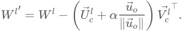


To measure the amount of undesired off-target effects caused by the edit, we use two metrics, which characterize off-target effects in slightly different ways, one measuring effects on tokens that are potentially computationally 'nearby' to our edit, and the other measuring all changes: 

- _D_ KL,Surrounding : The KL-divergence between the target model and the edited model on the 20 tokens before and after a token on which L2.MLP.down:2359 is causally important; 

- _D_ KL,Global : The KL-divergence between the target model and the edited model on all tokens on which L2.MLP.down:2359 is not causally important, sampled from the whole dataset. 

As baselines for comparison, we trained two conventional LoRA adapters for the MLP Down projection matrix in layer 2. The LoRAs were trained to convergence on _n_ dataset examples ( _n_ = 10 or 947 ). The training dataset examples consisted of the token on which the subcomponent L2.MLP.down:2359 is causally important and the 20 tokens before and after. They were trained both (a) to predict an o after the emoticon's initial token (e.g. : ) and (b) to minimize the off target effects. Concretely, for (a), each LoRA was trained with a cross-entropy loss to predict the o label after the token on which the subcomponent is causally important. For (b), off-target effects were minimized using a KL divergence term (weighted by the off-target effect penalty coefficient, ) between the output logits of the target model and the logits of the edited _λ_ model on the rest of the tokens in the example[40]. 

To give a sense of the effectiveness of the VPD edits and the LoRA baseline, Figure 23 shows the per-token KL divergences to the target model for both the VPD edit and the LoRA baseline. 

###### VPD 


KL to target model P("o") 

###### LoRA 

emy> ok fatto... mi serve un po di tempo perche di ub ndiswrapper. `↵` <yoshi> ;/ `↵` <yoshi> Midi doesnt work :/ `↵` the most boring season ever!! Lame twist and a zing butter".  for a while there I actually thought I was une> virtualroadside: so the upgrader is broken then? GitHub README.md files, etc. It's just an untested t ously for that. `↵↵` For Python, :pep:`8` has emerged as and reunions, some doctors have said things that hav fall." (Isaiah xl. 30.) Your health may be taken fro and from what i recall, it was NTFS `↵` <erUSUL> bullgar do the following to copy directories and do backups. lot like the NetApp snapshot feature - unfortunately and deadlifting so heavy earlier it would have been up `↵` <StoffBox-Steve> sping `↵` <thoreauputic> spong ;-) `↵` < MooDoo: see minutes have passed and czajkowski hasn' its different in first place `↵` <ogra> err `↵` <ogra> ogra@ 128> but as said, we are not going to do that, so let 

emy> ok fatto... ndiswrapper. `↵` <yo the most boring butter".  for a une> virtualroads GitHub README.md ously for that. `↵↵` and reunions, so fall." (Isaiah x and from what i do the following lot like the Net and deadlifting up `↵` <StoffBox-Ste MooDoo: see minu its different in 128> but as said, 

it's all go for Tony now...touring !! No `↵` Scotland gi my family research.<|endoftext|>like the Turks, from 

Figure 23. Comparing VPD-based edits with a LoRA-augmented target model trained to c background shows the per-token KL divergence between the edited model and the targe probability assigned to o . The left panel shows the direct VPD-based manual edit, obtained the emoticon subcomponent's _U_ vector (scaled by prefactor _α_ = 3 ). The right panel shows a _n_ = 947 examples, each consisting of a token the emoticon subcomponent was causally imp 

In Figure 24 we vary both  (the number of training dataset examples) and  (the off- _n λ_ target effect penalty coefficient) for our LoRA baselines. We plot the trade-off between the probability of predicting an o versus off target effects. We compare the LoRAs with our manual edit with different scale factors  for the _α_ o unembedding vector added to the subcomponents’ _U_ vector of L2.MLP.down:2359 . 


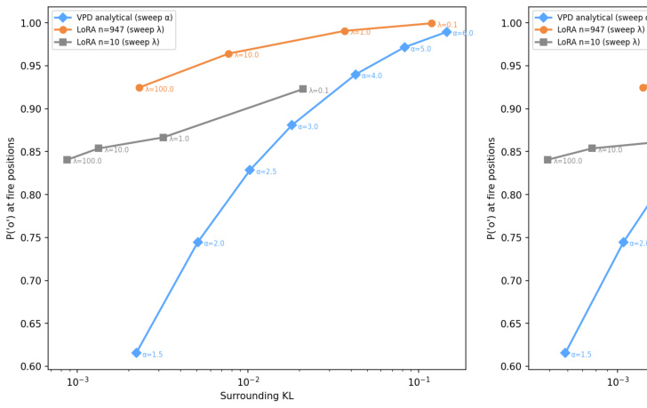


Figure 24. Model editing for emoticon completions, LoRA vs. manual subcomponent edit. M unembedding vector for o to the _U_ vector of the emoticon subcomponent with different pref _n_ = 947 examples, each consisting of a token the emoticon subcomponent was causally im preceding and following it, with a KL-regularisation term weighted by . The y-axis shows the a _λ_ to o on tokens the emoticon subcomponent is active on. The x-axis in the left plot shows _D_ K edited model and the target model on the 20 other tokens immediately preceding and follow causally important on, across a holdout set of 50 examples. The x-axis in the right plot show between the edited model and the target model on all other tokens across sam 

LoRAs trained on just _n_ = 10 examples outperform the manual edit on _D_ KL,Surrounding , the setting they were trained on, but not on _D_ KL,Global . LoRAs trained with _n_ = 947 examples outperform the manual edit on both _D_ KL,Surrounding and _D_ KL,Global . 

While this is a promising result, we stress that this is a very preliminary investigation. The method we used to edit the subcomponent, adding the appropriate unembedding vector, was simply the first interpretable editing technique we tried. Other editing techniques might work better. For example, although this edit clearly affects the output in the intended way, there is another layer in between our edited layer and the output, which may lead to some of our edits' off target effects. We may be able to do better by choosing a direction that maximally avoids affecting the computations of the intermediate layer while still projecting strongly onto the o token in the unembedding matrix. This may help to close the gap between the performance of our edit and the performance of the LoRA. 

On the other hand, the example is cherry picked. We deliberately chose this task because the model seemed to have a small number of subcomponents related exclusively to emoticon prediction. We nevertheless conclude that VPD shows some promise for model editing in cases where correctly labeled data for training a LoRA is difficult to obtain, or where it is desirable for the edit to be somewhat interpretable. We think that there are very likely ways to leverage parameter decomposition to do much better editing than we have here in this proof of concept. 

### 7  Discussion 

At this point, it is worth reflecting on what our parameter decomposition approach has actually bought us with regard to the highest-level goals of our field: 

In mechanistic interpretability, we aim to reverse engineer the computational machinery of neural networks. In particular, we want to know how that machinery takes inputs, computes hidden representations, performs computations on those hidden representations, and finally computes its output behavior. Concretely, this means that the objects we want to understand are the computational graphs of neural networks and how they interact with data. To make this as manageable as possible, we'd like to understand small parts of these computational graphs of short description length in isolation, yet have our explanations aggregate together so that, eventually, we can come to understand the entire network as a whole. 

In the following sections, we discuss how VPD makes progress toward these goals, or how it does not. 

#### 7.1  Parameter decomposition makes fewer assumptions about 

#### neural networks' representations than other methods 

Parameter decomposition methods are less opinionated than other popular decomposition methods about the 'form' of the computation that we expect to find in neural networks. Sparse dictionary learning methods, such as transcoders or crosslayer transcoders, effectively train replacement models to substitute for parts of the original model, using different architectures with significantly wider layers that are often also composed of different non-linear units. These replacement architectures can have greater representational capacity than the original model, and consequently correspond to entirely different function classes. As a result, they can implement computations that would not be representable using the original model architecture. To ensure these replacement models are mechanistically faithful to the computations in the model, we therefore need to have a somewhat clear idea of the form of those computations ex ante, and use that knowledge to choose the right replacement model architecture and hyperparameters. Otherwise, the replacement models might learn a different internal structure entirely. Feature splitting is one example of this issue. 

In contrast, parameter decomposition methods always stay within the confines of the original model architecture. Parameter components are effectively just a different set of coordinates for representing the target model's parameters. Every combination of parameter components corresponds to a valid weight vector we can implement in the original model architecture. In a sense, we're letting the network itself tell us what the form of its computation is instead of guessing a particular form in advance. 

#### 7.2  Explanations of attribution graphs are not explanations of computational graphs 

A full explanation of a network's behavior should amount to an end-to-end algorithm that is essentially equivalent to the algorithm implemented by the target network. In other words, it should be possible to represent the explanation as a computational graph that is mechanistically faithful to the computational graph of the original network, which is typically expressed in terms of its neurons, weights matrices, nonlinearities, etc. 

By contrast, in this paper, we used VPD to produce attribution graphs rather than computational graphs. It is not possible to compute the model output on a datapoint using only the attribution graph without access to the original model itself. An attribution graph can track how strongly any given upstream node in a computational graph influenced any given downstream node, which is useful for understanding the flow of information in the graph, but it does not represent the functional relationship between upstream and downstream nodes. This means we have not yet explained the network's computational graph; the explanations of the model's behavior we provide here are incomplete. Additionally, attribution methods such as the gradient attributions we used in this paper also have some well-known issues that can lead them to misjudge the magnitude of the influence one node in a graph has on another [58, 56]. For example, if an attention head in a model has a saturated softmax, gradient attributions through it will tend to systematically underestimate the effect of ablating the upstream node on the downstream node. Despite these limitations, we think attribution graphs are still useful as a basic picture of how information flows between VPD subcomponents on a forward pass, and have been used to similar effect for other decomposition methods, such as CLTs [12]. 

In future work we aim to deepen our study of full computational graphs by studying in detail the interactions of VPD subcomponents at nonlinearities, such as MLP neuron activation functions. For some preliminary investigations into characterising nonlinear interactions between subcomponents at MLP neurons, see Appendix B.11. This preliminary analysis suggests that parameter subcomponents may tend toward simpler nonlinear interactions than the worst case scenario (Appendix B.11), which is encouraging for the feasibility of this direction, but it is still far from definitive evidence. Speculatively, we suspect that this property arises because it's hard for lots of subcomponents to be ablatable if lots of subcomponents are interacting. 

#### 7.3  Robustness to adversarial ablations permits aggregation of explanations 

One of the central promises of ablation-based parameter decomposition is that explanations of a model's behavior on individual datapoints, given in terms of causally important parameter components and their interactions, can be aggregated into more global explanations of its behavior across the full distribution. To illustrate why this admittedly strict requirement is necessary, consider the following spurious decomposition of a hypothetical weight matrix in a model: 

For every data point , we make up a unique low-rank component _x θx_ , and assign it causal importance  on  and  for every other input. We pick the parameters of 1 _x_ 0 _θx_ such that the resulting model exactly matches the final output of the original model: _f_ ( _x_ ∣ _θx_ ) = _f_ ( _x_ ∣ _θ_ ) .<sup>[41]</sup> This decomposition would perfectly reconstruct the original model output on every training datapoint, but the resulting components would be spurious and completely unrelated to the mechanistic structure of the target network's learned algorithm. We did not even need to refer to the target model's internals to construct them! They amount to a giant lookup table of the training dataset, and won't generalise to new data points or tell us anything about how the original model actually computed its outputs. 

Requiring that the causally unimportant parameter components can be ablatable in any combination rather than just all together excludes counterexamples like this, because it ensures that components do not interfere with the computation on data points they are not causally important on. This prevents the decomposition from "splitting up" general computational machinery in the target model into large sets of specialized components that each just memorise a particular input-output pair. 

More generally, this stricter requirement ensures that local descriptions of the model's behavior on single data points (or small subsets of the dataset) in terms of their causally important parameter components will correctly aggregate into more global descriptions of the network's behavior over larger subsets of the dataset in the way we expect: If we explain the network's behavior on two data points _x_ 1 and _x_ 2 using two different parameter vectors ∑ _i_ ∈ _S_ 1 _θi_ ,<sup>∑</sup> _i_ ∈ _S_ 2 _θi_ , formed from two subsets of the parameter components _S_ 1, _S_ 2 , a parameter vector formed by the union of both subsets ∑ _i_ ∈ _S_ 1∪ _S_ 2 _θi_ will still compute approximately the same output on both datapoints: 


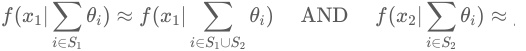


In principle, one could start from individual datapoint explanations and incrementally combine them — first into explanations of the model's behavior on narrow subdistributions (such as bracket closing or pronoun prediction), then into broader and broader accounts, eventually approaching a complete reverse engineering of the model. It remains unclear whether our current decomposition is sufficiently adversarially robust for this purpose. Our primary uncertainty is that it is unclear how much adversarial robustness is necessary for 'local' explanations to aggregate into 'global' ones. 

How much robustness is necessary? 

If we do not have enough adversarial robustness, then we lose the ability to aggregate explanations of parts of the model into a coherent whole. However, if we are too strict in our demands for robustness to adversarial ablations, it is sometimes possible to exclude decompositions we would intuitively regard as valid, because the adversary can systematically exploit random interference noise in 'unused' circuitry to change the network output. In Appendix Section A.3.4, we point out a theoretical toy case in which strictly demanding full adversarial robustness causes this problem. This would seem to put us in a difficult spot! How much robustness do we need to demand for our explanation to be mechanistically faithful? How much robustness is actually too much, and would exclude short descriptions of network behavior we would like to regard as valid? 

We do not currently have a fully satisfying answer to this question, but we suggest that a reasonable approach may be to ground the answer in practical considerations: What combinations of (sub)component ablations might we realistically want to perform when using VPD to understand or edit a given model? And over which subsets of the data would we want to investigate the behavior of the resulting ablated models? So long as the decomposition is robust enough that it is unlikely for any of the ablations we end up performing in practice to be in the non-robust set for any model input we care about, the lack of complete robustness may not be relevant to us. Even if we do end up encountering a component ablation the decomposition is not robust to, the problems caused by this may be limited if they only apply to a few data points and the edited model is still behaving as we would expect for the vast majority of inputs[42]. 

#### 7.4  Interpretability demands Minimum Description Length, but of what kind of description? 

Most interpretability methods aim to explain neural networks using short descriptions. Sparse dictionary learning methods aim to find minimal length descriptions of the activations of a network on each forward pass using sparse coding schemes, where the descriptions are the indices of active elements in a dictionary and their activations. VPD aims to find minimal length descriptions of the parameters of a network that are causally important on each forward pass, where the descriptions are the indices of causally important parameter subcomponents and the parameter subcomponents themselves. 

However, as discussed above, we ultimately want to understand neural networks' computations: The nonlinear transformations they apply to inputs and hidden activations to produce their outputs. To do this, we want to obtain short descriptions of the computational graphs of the networks' forward passes. Minimizing the description length of the parameters used on a forward pass is not the same thing as minimizing the description length of the forward pass itself. It is merely a proxy measure. The rank constraint and frequency minimality loss ( Lfrequency-minimality ) we use are just one possible set of proxies for encouraging parameter subcomponents to be computationally simple objects, and we have no reason to believe that they are the optimal choice. While the frequency minimality loss at least addresses one way the rank of weight matrices can fail to measure computational complexity, there may be other failure modes we have not yet identified. More broadly, we lack a principled, general-purpose measure of the computational simplicity of a parameter subcomponent, and developing one remains an open problem. 

#### 7.5  Other limitations and future work 

Beyond the limitations outlined above, we identify a range of other shortcomings and avenues for future work: 

Scaling to larger models and non-language models. VPD has permitted the scaling of parameter decomposition methods to the 67M-parameter model we decomposed here. But this is still a small model. We would like to continue scaling the method. In addition to engineering improvements for greater compute efficiency, we suggest that improvements to the adversarial samplers and causal importance functions, which we discuss more below, may be helpful for this goal. Beyond scale, we are also interested in applying VPD to other domains, such as vision models, multi-modal models, and biological foundation models. 

Studying the biology of language model parameters. Even without scaling, there is important further work to be done at models at the current scale. Our work explored only a small number of the model's behaviors. Even the behaviors we explored could be studied in more depth. We would like to see more work that uses parameter decomposition as a tool for language model 'biology' [59]. 

Our decomposition is not as adversarially robust as we would like. As shown in Table 4, while the decomposition is at least somewhat robust to ≈20 steps of adversarial optimization (KL divergence 0.83 ), robustness degrades rapidly with more optimization steps, reaching a KL divergence of 40.2 at 320 steps. This means that there exist sets of subcomponent ablations involving only causally unimportant subcomponents that drastically alter the model's output. As discussed in Section 7.3, we do not necessarily expect or even desire complete robustness to arbitrarily many steps of adversarial optimization. However, we suspect that substantially higher levels of adversarial robustness are still achievable. In the future, we would like to see work that improves adversarial sampling and mask parameterizations. Our current adversarial sampler uses a relatively primitive form of projected gradient descent (PGD) to find worst-case ablation masks. We think it should be possible to improve the performance of this sampler. For example, we might be able to identify particularly important subspaces of masking space for the sampler to focus on, such as the subspace spanned by the sums of causally important subcomponents on other data points in the same batch. 

Better causal importance functions. The causal importance function  is currently Γ implemented as a vanilla transformer that takes as input the target model's hidden activations concatenated across layers into a single vector. This is a relatively simple architecture for a task that requires predicting the ablatability of every subcomponent at every sequence position, and we suspect that more sophisticated architectures might produce more accurate causal importance predictions. 

Another potential improvement may be to use continuous cut-off scales instead of binary causal importances. Currently, our causal importance functions classifies subcomponents in a largely binary manner: Either they are causally important for computing the network's output, or they are not. However, in reality, subcomponents lie on a more continuous scale of affecting the output to a larger or smaller degree. The more we care about low description length relative to output reconstruction, the more subcomponents we will want to drop from our description of the forward pass, starting with those that affect the final output the least. To account for this, we might train a function that predicts cut-off scales on the Pareto frontier between output reconstruction and description length instead of fixed causal importances. This way, a single decomposition could provide a variable resolution scale for describing the forward pass, ranging from short and simplified descriptions of the network's computation involving just the most important subcomponents, to longer but more accurate descriptions involving more subcomponents, all the way up to descriptions which recover the target model's performance completely.[43] 

Our clustering method is blind to multi-sequence position circuits VPD decomposes weight matrices into rank-one subcomponents, which must then be clustered into full parameter components that span multiple weight matrices (Appendix A.8). Our clustering algorithm is based on minimizing description length, but it currently only uses correlations between causal importances on the same sequence position. This ignores possible compression based on cross-sequence position correlations. For example, _Q_ and _K_ components in an induction head might never operate on a computation at the same sequence position. 

Our clustering method has not been carefully tuned. Our MDL-based clustering algorithm has a key hyperparameter  that controls the trade-off between the number _α_ of components and their complexity. We did not sweep this hyperparameter particularly carefully. This was not a priority because individual subcomponents already proved to be fairly interpretable on their own, but it means the parameter components we report may not reflect the best possible grouping. 

Clustering post-hoc can make the adversarial sampler stricter than is necessary Demanding that a model's outputs do not vary under adversarial ablation of two causally unimportant rank one subcomponents is a somewhat stricter condition than demanding that its outputs do not vary under adversarial ablation of those two rank one subcomponents clustered into a single rank two component. The former condition samples a two-dimensional subspace of ablation masks, the latter only a onedimensional subspace. Thus, clustering subcomponents into components post-hoc effectively makes our reconstruction losses stricter than they technically need to be. It is currently unclear whether this causes substantial issues in practice. If it does, future parameter decomposition methods may be able to compress parameter description length further than VPD does by integrating the clustering phase into subcomponent training, allowing us to use clustering information to inform the ablation mask sampling. 

Automated reverse engineering of parameter components would enable broader interpretations. In our case studies (Section 5.3, Section 5.4), we manually traced information flow through small parts of the attribution graphs for a few specific prompts and behaviors. Building a full picture of how a model computes its outputs will require scaling up this kind of analysis considerably, to more prompts and on more paths through their graphs. We aim to do this using automated interpretability methods. 

Data-subset decompositions may reduce the cost and scope of decompositions Rather than decomposing the model with respect to the full training distribution, one could apply VPD to a specific data subset, recovering only the subcomponents relevant to that subset. This would not surface all the model's subcomponents, but it might be substantially cheaper and more practical for more narrowly targeted investigations or editing. 

Better model editing is likely possible. Our model editing experiment (Section 6) demonstrated a proof-of-concept in which we modified a single subcomponent's left singular vector to change the model's emoticon predictions. More ambitious editing could, for example, attempt to make more complicated behavioral changes, or could make edits that avoid off target effects by taking the geometric structure of other parameter components into account. Hybrid approaches that combine the interpretability of parameter subcomponents with the optimization power of LoRA — for instance, training a low-rank adaptation with left or right singular vectors restricted to those of specific subcomponents — could also yield edits that are both more performant and more interpretable than either approach alone. 

Interpreting parameter gradients to understand training and finetuning. Parameter subcomponents are directions in parameter space, so it is possible to project any parameter gradient into the basis defined by the decomposition's subcomponents. This could allow us to express each gradient update to a model as a combination of upweighting, downweighting, or modifying existing subcomponents, as well as creating new ones outside the span of the existing subcomponent subspace. Since individual parameter subcomponents are interpretable, this may give us some idea of what each training step is teaching the model. Similarly, one could apply VPD to only a ‘weight diff’ obtained by finetuning, instead of the 'diff' from single gradient updates. 

#### 7.6  Related work 

###### Ablation-based parameter decomposition 

VPD is built primarily on prior parameter decomposition methods, namely attributionbased parameter decomposition (APD) [15] and stochastic parameter decomposition (SPD) [16]. These papers introduced most of the core ideas used by our method, including (a) the idea that networks could be decomposed into sparsely used functional units consisting of vectors in parameter space that sum to the parameters of the target model, and (b) causal importances can be identified using a causal importance network and ablations. SPD lacked adversarial sampling scheme that would make the causal importances robust to adversarial ablations, as well as the additional loss to encourage computational simplicity, here implemented as the frequency-minimality loss. Those works also focused primarily on toy models, rather than language models trained on natural data. Other work [21] did apply SPD to parts of a larger model, but did not 

decompose a whole language model, and lacked the crucial extra losses as Bushnaq et al [16]. 

###### Identifying computational subgraphs in architectural unit basis 

Much work in interpretability views neural networks as computational graphs and circuits as computational subgraphs that have a particular function [49, 60]. The identification of subgraphs has been approached through a range of methods, including using learned masks, ablations, or the use of attributions to identify ablatable network components. 

Some of the work that identifies subgraphs learns explicit differentiable masks [61, 62] is loosely analogous to our causal importance functions. But these methods use the learned masks as the actual ablations, rather than to parameterize an ablation procedure. It is very unlikely, therefore, that the masks are robust to adversarial ablation (where, e.g. the masked parameters are only partly ablated, which should be equivalent to full ablation if those parameters were actually causally important) and hence unlikely that the 'subnetworks' found by those works are mechanistically faithful. Those works also learned masks for sets of datapoints, rather than single datapoints, as in our work. Additionally, the masks learned by those works were aligned with the parameter unit basis, unlike in our work where the parts of the parameters that are ablated are not necessarily aligned with the parameter unit basis. Later work [60] adapted the mask-learning procedure of [62] to identify subgraphs where each node could be tested for its importance on a task, which is assessed by ablations, namely activation patching. Activation patching involves replacing a nodes activation with a choice of baseline, such as the zero, mean, random, or other baseline. Our work operates on parameters, and therefore avoids the need to choose a baseline in activation space. 

###### Identifying computational subgraphs using learned decompositions 

Much of the above work operates on architectural components of networks, such as the neuron unit-basis, parameter unit-basis, whole MLP layers, or whole attention heads [61, 62, 60, 49]. But neural computations may not be aligned with those bases, and therefore the subgraphs they identify may involve components that are polysemantic (cite polysem references) and thus not yield accounts of neural computation that are maximally parsimonious. Like our work, existing work aims to address this issue by learning decompositions of neural networks from which to make more easily interpretable subgraphs (though see cite transluce paper, which argues that the neuron basis was not as unparsimonious as previously thought). 

Most similar to ours is the line of work that involves training CLTs and building attribution graphs for them, thus enabling accounts of computation that are not necessarily aligned with individual neurons or layers [12, 59, 18]. CLTs build on per-layer transcoders [11, 20]. In contrast to our work, CLTs and transcoders decompose activations, which are the results of computations, rather than parameters, which learn to implement the computations (through interactions with the nonlinearities). Additionally, while Kamath et al. [18] built on CLTs to extend their attribution graphs to attention layers, their approach did not identify ways to decompose attention layers into functional units that may be distributed across heads. In our work, our parameter subcomponents learn specialized functional roles and also span multiple heads by default. 

In addition to these topics, our work builds on broader foundations, including sparse dictionary learning, causal mediation analysis, interpretability of neural network parameters, automated circuit discovery, and other topics. We refer readers to our previous papers for deeper discussion of prior work on related topics [15, 16]. 

### 8  Conclusion 

On the surface, neural network weights may seem like large inscrutable matrices of floating point numbers, and the computations they implement like monolithic, irreducible transformations between high-dimensional vector spaces. Parameter decomposition methods offer a lens with which these matrices can be decomposed and their computational roles scrutinized. We are very excited that now, with VPD, it is possible to decompose the parameters of non-toy models (such as language models) which solve tasks using neural algorithms that we do not yet know how to design ourselves. This represents an important step beyond the capabilities of previous parameter decomposition methods [16, 15]. We have shown that VPD can be used for many of the major interpretability tasks (such as constructing interpretable attribution graphs for circuit analysis) that have so far been achieved with other methods, such as CLTs. It also addresses a number of important shortcomings of other methods, not least the ability to decompose attention layers into functionally specialized units and study their interactions. However, we think it is likely that parameter decomposition methods will require further improvement, as they are scaled to larger models, and as unforeseen pathologies with the current methods are revealed with time. Even if key parts of the method turn out to require rethinking, we believe future iterations of it will continue to resemble VPD in spirit. 

We think parameter decomposition may open up new affordances, not just for mechanistic interpretability, but for deep learning in general. We need to understand neural algorithms in terms of their parameters before we can design whole neural networks — whole minds — that have more of the qualities we want and fewer of those we do not. We think the ability of VPD to decompose networks' parameters into minimal, simple, mechanistically faithful parts represents a meaningful step toward that vision. 

### 9  Contributions statement 

###### Research iteration 

Our method underwent significant iteration throughout development, changing many times in response to experimental results. LB, OCG, LS, and DB were primarily responsible for driving forward various iteration cycles, with NH responsible for some cycles. DB and LB tuned hyperparameters for various methods throughout the length of the project. LB did early method and hyperparameter iteration to get adversarial losses working on toy models and an earlier model trained on SimpleStories. 

###### Conceptualisation 

LB conceptualised the adversarial reconstruction loss and its implementation via projected gradient descent (PGD) on sources, with some input from LL. OCG came up with using persistence in the adversarial training loss and did hyperparameter optimization for it. DB conceptualised the part of the current adversarial loss which does several steps of warmup of the persistent sources for each outer loss step. LS identified the pathological bisemanticity of subcomponent activations that helped to motivate the addition of a 'computational simplicity' penalty. LB, based on discussions with LL and external collaborators as well as empirical iteration, conceptualized the frequency-minimality loss and did most of the testing and tuning for it. LB conceptualized the new lower-leaky sigmoid after discussion with LS. LL conceptualised the sign exception on the straight-through estimator after LB noticed a problem with the previous version. LB conceptualized delta components and did the early testing for them. NH came up with the idea for subset routing and ran the first experiments with it. LS conceptualized the parameter faithfulness warmup and did some experimental investigation into its usefulness. NH also contributed p-annealing and other method optimizations and evaluations that were useful for assessing the value of modifications to the method. OCG designed the current causal importance function architecture, as well as the shared_mlp, global_shared_mlp, and vector gate MLP architectures used in earlier versions. LS did an initial implementation of the global causal importance function. LB conceptualised post-hoc causal importance optimization and post-hoc adversarial optimization restricted to base graph nodes, and did most of the hyperparameter tuning for post-hoc causal importances. NH contributed p-annealing, subset reconstruction losses, and other methods optimizations. LB conceptualised using subcomponent activations on top of causal importances for interpretability. 

###### Clustering 

LB conceptualised the first form of the clustering algorithm, including the MDL framing, initial MDL loss function, hierarchical merging, stopping based on MDL minimum, and picking alpha based on coactivation threshold. MI developed the algorithm further, with inputs from NH, LB, and LS. NH helped MI on clustering, primarily conceptually. LB did some of the empirical iteration to pick a clustering for the paper. OCG and DB optimized the clustering implementation for efficiency. 

###### Attributions and analysis 

LB did much of the conceptualisation work for the attributions used in the paper (including gradient stopping), with input from OCG, DB, and LS. LS conceptualized the dataset attributions. LS and LB jointly conceptualised the nonlinear interaction metric. LS ran initial investigations into nonlinear interactions on an older language model, and LB ran the nonlinear interaction experiments used in the paper. LS was responsible for the analysis of attention behaviors and the geometric consistency seed analysis. LB did the first circuits stories on the simple stories model and the two circuits stories in this paper. 

###### Model editing 

OCG did early explorations of model editing. LB contributed early conceptualisation for model editing. OCG and LB together did the final version of the model editing experiment in the paper. 

Comparisons and evaluations 

OCG was primarily responsible for autointerp pipeline and intruder detection comparisons. BB trained the per-layer and cross-layer transcoders used for comparisons to VPD, did the evaluation and analysis of the reconstruction performance comparing VPD to transcoders, and did the feature splitting analysis. 

###### Target Model pretraining 

DB was responsible for model pretraining. LS helped train target models on the Pile dataset. 

###### Engineering and infrastructure 

OCG and DB equally managed the codebase and the implementations of the various methods. 

###### Visualization and interactive figures 

OCG was primarily responsible for the internal visualization app and for the interactive figures in the paper. DB helped with the internal visualisation app and the attribution graph visualisation. LS and LB contributed some features to the visualization app. LS designed and made various didactic figures used in the paper. 

###### Writing 

LS planned the paper and wrote initial drafts of some sections. LB wrote initial drafts for the two biostories, methods sections on frequency minimality loss, mechanistic faithfulness, and adversarial loss, the nonlinear interactions section, model editing section, parts of the discussion section, training recipe, and most of the mathematical sections in the appendix. MI wrote an initial draft of the paper section on clustering. BB drafted the section comparing VPD to transcoders and drafted the feature splitting section. OCG was primarily responsible for web development and for the interactive figures, with contributions from others. DB helped with editing. 

###### Project management and mentorship 

LS was responsible for overall management of the project and planning the paper. LS was the main point of contact for MI, NH, and BB and gave input on their work throughout the collaboration. LB and DB also gave input on their work. 

###### Funding declarations 

Linda Linsefors was supported by a grant from Coefficient Giving during her work on the project. 

###### Acknowledgements 

We extend our sincere thanks to several individuals for their inputs to our work. 

We are especially grateful to Tom McGrath for ongoing conversations, support, and feedback at various stages throughout the project, and to many other colleagues at Goodfire, including Dron Hazra, Eric Ho, Curt Tigges, Thomas Fel, Sheridan Feucht, Usha Bhalla, and Michael Jae Byun. 

We express our gratitude to Chris Olah for extended written correspondence about nonlinear interactions between subcomponents. We are also grateful to Joshua Batson, Emmanuel Ameisen, Thomas Conerly, Brian Chen, Jeff Wu, Harish Kamath, Stefan Heimersheim, and Asher Parker-Sartori for their in-depth technical engagement, and to Connor Watts, Dan Murfet, and Eric Ho whose collective feedback greatly improved drafts of our paper. 

We thank Param Luhadiya for exploratory work on the frequency-minimality penalty, and Markus Salmela, Finn McDonnell, and Ed Allison for their feedback on how to explain our work to a general audience. We also thank Cory Kendrick for inputs on research management, and also thank Asher Parker-Sartori, Jack Peck, and Antoine Vigouroux for technical discussions and experimental work adjacent to the content of the paper. 

###### Citation 

@misc{bushnaq2026interpreting, title={Interpreting Language Model Parameters}, 

author={Bushnaq, Lucius and Braun, Dan and Clive-Griffin, Oliver and B <u>journal={Technical Report},</u> 

institution={Goodfire and MATS}, 

month={April}, 

<u>year={2026},</u> 

} 

### Appendix A: Methods 

Here, we expand on some aspects of adVersarial Parameter Decomposition (VPD) in more detail. See Section 2 for an introduction to VPD. 

### A.1 Δ -L2 penalty 

The Δ -components are different from normal subcomponents we train. Their rank can be greater than , meaning they can be more complicated objects than regular subcomponents. 1 We thus have a particular interest in ensuring that they do not contain computations that affect the model's outputs. Theoretically, since we define the causal importances of Δ -components to always be zero, the stochastic and adversarial losses should ensure that this is the case. But in practice our reconstruction losses are not perfect, so we additionally encourage the Δ - components to be small with an auxiliary MSE loss: 


#### A.2  Causal Importance Function Architecture 

The causal importance function  maps the target model's hidden activations to perΓ subcomponent causal importances. It is a single, shared network that jointly computes causal importances for all subcomponents across all weight matrices in the target model. 

###### Inputs 

Let _L_ denote the number of weight matrices being decomposed, and let _hlb_ , _t_ ∈ R<sup>_d_</sup> _l_ denote the input hidden activation to weight matrix  of the target model at batch element  and sequence _l b_ position . Each activation vector is independently RMS-normalized, and the normalized _t_ vectors are concatenated to form the input: 


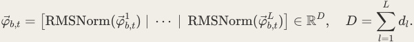


###### Input projection 


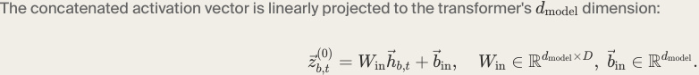


###### Transformer layers 

The projected activations are processed by _N_ pre-norm transformer layers. Each layer _n_ ∈{1, … , _N_ } applies bidirectional multi-head self-attention followed by a feedforward network, each with a residual connection: 


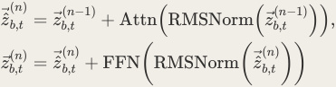


where Attn denotes multi-head scaled dot-product attention with Rotary Position Embeddings (RoPE) [30], applied bidirectionally (i.e., without a causal mask) across all _T_ sequence positions; and FFN is a two-layer feedforward network with GELU activation: 


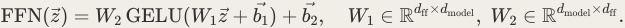


###### Output head 

After the final transformer layer, a linear output head projects back to the total number of subcomponents: 


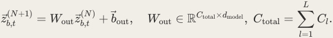


The output is partitioned according to each matrix's subcomponent count _Cl_ . 

###### Leaky hard sigmoids 

Theoretically, the causal importance for subcomponent  in matrix  is obtained simply by _c l_ ( _N_ +1) clamping the outputs of the final transformer layer _zb_ , _t_ to the interval [0, 1] with a hard sigmoid function: 

_l l gb_ , _t_ , _c_ = Γ( _φb_ , _t_ ) _c_ = _σ_ H<sup>(</sup><sup>_z_</sup> _b_ (, _Nt_ +1)) , _σ_ H(<sup>_z_</sup> ) = clamp( _z_ , 0, 1), However, in practice, the flat regions in a hard sigmoid function can lead to dead gradients for inputs below  or above . To avoid this, we use leaky hard sigmoids instead. Specifically, we 0 1 use lower-leaky hard sigmoids _σH_ ,lower(<sup>_z_</sup> ) for the causal importance used to create the masks for the actual forward passes for the Lstochastic-recon and Lstochastic-recon-layerwise losses, and we use upper-leaky hard sigmoids _σH_ ,upper(<sup>_z_</sup> ) in the importance minimality loss Limportance-minimality and the frequency minimality loss Lfrequency-minimality . 

The lower-leaky hard sigmoid _σH_ ,lower(<sup>_z_</sup> ) has a forward pass identical to a regular hard sigmoid, but below  it uses a straight-through gradient estimator: Gradients pass through for 0 _z_ ≤ 0 scaled by a leak coefficient _α_ = 0.01 when the incoming gradient is negative, preventing subcomponents from becoming permanently deactivated. The upper-leaky hard sigmoid _σH_ ,upper(<sup>_z_</sup> ) is identical to a regular hard sigmoid for _z_ ≤ 1 , but has a slope of 0.01 above 1.0 . 

We use a straight-through estimator for the lower-leaky hard sigmoid instead of actually modifying the slope on the forward pass to avoid creating subcomponent masks smaller than zero. We restrict the straight-through estimator to apply only to negative gradients to prevent entries of Γ( _φb_ , _t_ ) _lc_ from updating to become ever more negative indefinitely. 

This is in contrast to [16], where the lower-leaky hard sigmoid did have an actual slope of 0.01 below  on the forward pass. We made this change because we discovered that negative 0 masks actually led to instabilities. For example, we found that the spurious subcomponent splitting observed for too-high importance minimality loss coefficients depicted in Figure 8 of that paper largely disappears if the straight-through estimator is used instead. 

###### Hyperparameters 

|Table 5lists the hyperparameter<br>experiments.|s used for the causal importance function  in our<br>Γ|
|---|---|
|Parameter|Value|
|CI model dimension (<br>)<br>_d_<br>model|2048|
|Transformer layers (<br>)<br>_N_|8|
|Attention heads|16|
|Head dimension|128|
|FFN hidden dimension (<br>)<br>_d_<br> ff|8192|
|Positional encoding|RoPE (base<br>, max length<br>)<br>= 10, 000<br>= 512|
|Attention|Bidirectional (no causal mask)|
|Activation function|Leaky hard sigmoid (<br>)<br>_α_= 0.01|


Table: Hyperparameters for the causal importance function Γ<sup>[44]</sup> . 

#### A.3  Reconstruction losses 

###### Formal Setup 

Ablation-based parameter decomposition methods, at their core, instantiate this definition of mechanistic faithfulness by using their causal importance functions (Section 2.3) to estimate how ablatable each parameter subcomponent is on a given datapoint. They then actually do an ablation and train the model with ablated parameters to approximate the same output as the unablated model. Crucially, the ablations may be full or partial. 

_l_ Formally, we define ablation masks _mb_ , _t_ , _c_ ( _r_ ) ∈ [0, 1] for each subcomponent at each each batch index  and sequence position . These masks define new weight matrices _b t Wb_ ′, _lt_ ( _r_ ) which can take the place of the original model matrices _W_<sup>_l_</sup> :<sup>[45]</sup> 


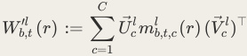


Click any term for its definition 

Crucially, the masks are not the causal importances, _gbl_ , _t_ , _c_ . Instead, the masks are given by 


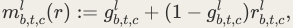


_l_ where _rb_ , _t_ , _c_ ∈ [0, 1] is called a 'source'. This means that if a subcomponent's causal importance is , the only possible value of its mask is , whereas if the causal importance is , its mask can 1 1 0 take any value between  and . The causal importance of the 0 1 Δ -components Δ<sup>_l_</sup> is always zero. 

Concretely, when computing the output vector of matrix  at batch index  and sequence _l b_ position , we replace the original weight matrix _t W_<sup>_l_</sup> with _Wb_ ′, _lt_ ( _r_ ) , which is constructed from the masks at that specific position. This means that during a single forward pass through the network, different linear transformations are applied at each sequence position, determined by which subcomponents are masked on vs. off at that position. In the idealised setting, we then demand that, for all possible joint combinations of sources _r_ ∈[0, 1]<sup>_L_×</sup><sup>_B_×</sup><sup>_T_×</sup><sup>_C_+1</sup> , the resulting masked weight matrices yield outputs that approximately match those of the original model at every batch index and every output sequence position: 


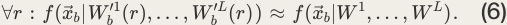


Click any term for its definition 

1 _L_ where _f_ ( _xb_ ∣ _W_ , … , _W_ ) is the sequence of output vectors produced by the target model for input sequence _xb_ . This definition of ablatability lies at the heart of how VPD and other ablationbased parameter decomposition methods try to ensure that the subcomponents and causal importances they provide are mechanistically faithful to the original network. 

###### Stochastic reconstruction losses 

We can use an output reconstruction loss to train the masked model's output to approximate the target model's. Unfortunately, to ensure we satisfy Equation 6, we would need to do this for _L_ × _B_ × _T_ × _C_ +1 all possible values of _r_ ∈[0, 1] , which is a high dimensional continuous interval, making such a loss impossible to compute exactly. 

However, a key insight of Bushnaq et al. [16] was that it is possible to approximately minimize reconstruction loss on all values in that interval using a finite number  of uniform random _S l_ ,( _s_ ) samples _rb_ , _t_ , _c_ ∼ U(0, 1) for every sequence index  and every batch index . These samples _t b l l_ can be used to create stochastic masks _mb_ , _t_ , _c_ ∼ U( _gb_ , _t_ , _c_ , 1) , and minimize reconstruction loss on that finite number of samples. 

This leads to the stochastic reconstruction loss: 


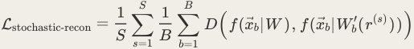


Click any term for its definition 

where _D_ is an appropriate divergence measure in the space of model outputs, such as KLdivergence or mean squared error. In practice, we find that using one sample ( _S_ = 1 ) produces similar training behavior as using more samples. 

In practice, for better convergence, we train by sampling masks for randomly chosen subsets of the model's weight matrices instead of all matrices simultaneously. See the next section for details. 

###### Stochastic Subset reconstruction loss 

[16] found that using a reconstruction loss which samples stochastic masks 


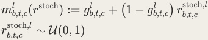


for all target model matrices  simultaneously _l_ [46] 


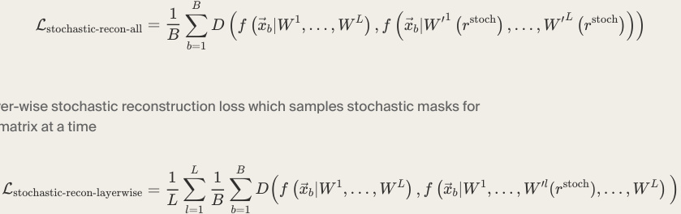


together with a layer-wise stochastic reconstruction loss which samples stochastic masks for one target model matrix at a time 

performed better than training either Lstochastic-recon-all or Lstochastic-recon-layerwise alone, due to covering a somewhat more structurally diverse set of ablation. However, layer-wise reconstruction loss requires one forward-pass for every matrix in the model we decompose, which is expensive. For VPD training, we unify Lstochastic-recon-all and layerwise stochastic reconstruction loss Lstochastic-recon-layerwise into a single stochastic reconstruction loss. For every sequence position and batch index, we independently sample a number ∈{1, … , _L_ } , where _L_ is the number of weight matrices in the target model. We draw that many of the target model's weight matrices, sample stochastic masks for only those, and perform a forward pass replacing those matrices with the masked ones. This is no more computationally expensive than Lstochastic-recon-all , and covers more structurally diverse ablations than layer-wise stochastic reconstruction losses, since it includes subsets of single matrices as well as the whole set as special cases. 

Although this reconstruction loss on its own is enough to succeed in many toy settings, our attempts to apply that method at larger scales (such as language models) revealed several pathologies that we missed. We had under-appreciated the importance of reconstruction under worst-case ablation masking which we address in the next section. 

###### Adversarial reconstruction loss 

VPD additionally optimizes for adversarial ablatability of parameter subcomponents that are causally unimportant on a datapoint, which is a stricter criterion than stochastic ablatability. 

In the limit of infinite samples and perfect reconstruction, Lstochastic-recon loss would perfectly approximate our desired condition from Equation 6. But we don't have time to draw infinite samples. And Equation 6 requires that the masked model approximates the target model well for all possible values of , not just on average. Thus, if the reconstruction loss isn't exactly zero, _r_ which will essentially always be the case in practice, stochastic sampling can greatly underestimate the worst-case reconstruction error for values of  that are sampled _r_ adversarially to maximize reconstruction loss. We found that training without an adversarial sampling scheme produces decompositions for which adversarial sampling can find values of _r_ that have worse-than-random reconstruction loss, which is not permitted under Equation 6 (See also Figure 27). 

VPD therefore introduces an adversarial loss to help ensure this property more: Instead of sampling the sources  randomly, they are sampled by an adversarial optimizer to be as bad as _r_ possible. 

The optimization objective of the adversarial optimizer is maximizing the reconstruction loss on the masked forward pass: 


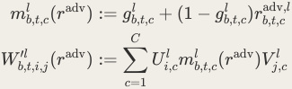


for subcomponent  of target model matrix  on batch index  at sequence position . The _c l b t_ adv optimizer we use is projected gradient ascent [63, 35], clamping the sources _rb_ , _t_ , _c_ to the interval [0, 1] at every update step to ensure that the masks _mlc_ ( _x_ , _t_ , _r_ adv) stay between  and . The 0 1 sources for the Δ -components' masks (see Section 2.1) are treated identically to those used for the regular subcomponents, i.e. they are also adversarially optimized. 


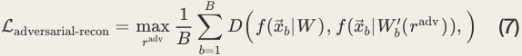


Click any term for its definition 

Complete adversarial robustness seems too strict 

However, if the adversarial sampler were completely unconstrained, it would actually be too strict: Some decompositions that we would intuitively regard as valid would be effectively excluded by it. For example, in many theoretical toy models of circuits in superposition [64, 65, 66] models can contain more circuits than neurons, only some of which are used by the model on any given forward pass. However, the inactive circuits each still contribute some small interference "noise" to the computation. Since this noise is uncorrelated between superposed circuits, its overall size remains small enough that the interference doesn't "break" the computation. We would like to consider these inactive circuits not to be causally important since the model is in some sense not really using them to compute the output. But if we chose adv the absolute worst-case _rc_ in such a model (which we can do if we have a completely unconstrained adversarial sampler), we could, for example, ablate all inactive circuits which contribute noise with a negative sign, but keep all inactive circuits which contribute noise with a positive sign. This would vastly increase the overall size of the noise and thus change the final output of the model! 

In general, we want the adversarial sampler to penalise systematic defects in the decomposition, where a particular choice of ablation masks changes the model output on many data points even though it shouldn't. But we do not want the sampler to exploit random noise by finely tuning its choice of ablations to particular data points. This is because in practice, when using the decomposition to understand or edit the target model, we usually care about the behavior of particular subcomponent maskings over multiple data points, rather than the behavior of all possible maskings on single data points. 

For example, suppose we wanted to edit the target model for some practical purpose, like erasing some of its knowledge about biology. We could therefore apply a mask to some of the model's subcomponents that are causally important in biology contexts, but not other contexts. Ideally, the resulting model should still behave the same way for all inputs on which those subcomponents were not causally important. This mask would be very unlikely to be exactly tuned to random noise in the activations of some other input. And even if it did happen to be so tuned, then this would merely cause the edited model to behave unexpectedly on the input that the mask happened to be tuned to, and thus not be a very effective adversarial mask on other inputs. But if the decomposition was systematically defective, we might have a realistic chance of picking a mask that causes the edited model to behave differently than the target model on many inputs not related to biology. This would be an effective adversarial mask that would hurt the model editing more broadly. 

Thus, in order to force the adversarial sampler to rely on systematic flaws in the decomposition adv instead of fine-tuning to individual data points, we restrict it to use the same _rc_ on all elements in a batch. This approach is somewhat related to universal/shared adversarial perturbation methods that optimize one perturbation across many inputs [67, 68, 69]. 

Ideally, we might like to use the same sources for the whole data set, but this would be too computationally expensive in training. In practice, we thus use two different sampling schemes for _rc_ adv, _l_ source schemes for evaluation and training. 

Persistent PGD (PPGD) adversarial reconstruction loss for training: 

adv, _l_ For training, we optimize a single set of sources _rb_ , _t_ , _c_ that persists across batches, with _b_ ranging across the batch index and  across sequence position. On every batch, the adversarial _t_ adv Adam optimizer performs _n_ adv update steps on the adversarial sources _rb_ , _t_ , _c_ , trying to maximise the adversarial loss Ladversarial-recon (In this paper, we used _n_ adv = 3 ). This persistent adversarial source optimization is a heuristic in the same broad family as efficient adversarial-training methods that amortize inner maximization by reusing or accumulating adversarial perturbations across outer optimization steps, such as [67, 70]. 

PGD adversarial reconstruction loss for evaluation: 

Continuously updating a single set of persistent adversarial sources is more computationally efficient, but not principled. Hypothetically, the VPD optimizer might trap the adversarial optimizer in some local extremum at some point during training, rendering the adversarial loss useless. Thus, for evaluation, we use a new set of adversarial sources _rc_ adv, _l_ for every evaluation batch, but use more adversarial optimization steps per batch _n_ adv than we do in training. 

#### A.4  Frequency minimality loss 

Suppose some rank-1 subcomponent _U_ 1(<sup>_V_</sup> 1)<sup>⊤</sup> in a model parametrizes two unrelated circuits _A_ and _B_ , which are rarely used to compute the model's output at the same batch and sequence position. We would like VPD to break up this subcomponent into two subcomponents, _U_ 1(<sup>_V_</sup> 1)<sup>⊤</sup> = _UA_ (<sup>_V_</sup> _A_ )<sup>⊤</sup> + _UB_ (<sup>_V_</sup> _B_ )<sup>⊤</sup> , with _UA_ (<sup>_V_</sup> _A_ )<sup>⊤</sup> containing the weights for circuit _A_ , and _UB_ (<sup>_V_</sup> _B_ )<sup>⊤</sup> containing the weights for circuit _B_ . Our loss Limportance-minimality will not incentivise this, because either _UA_ (<sup>_V_</sup> _A_ )<sup>⊤</sup> or _UB_ (<sup>_V_</sup> _B_ )<sup>⊤</sup> will be causally important whenever _U_ 1(<sup>_V_</sup> 1)<sup>⊤</sup> is, so ∑ _b_ , _t_ ∣ _gb_ , _t_ ,1∣≤<sup>_p_</sup> ∑ _b_ , _t_ (∣ _gb_ , _t_ , _A_ ∣+<sup>_p_</sup> ∣ _gb_ , _t_ , _B_ ∣)<sup>_p_</sup> . One way to break up subcomponents like _U_ 1(<sup>_V_</sup> 1)<sup>⊤</sup> is introducing an additional loss penalty that is very slightly superlinear in causal importance frequency, i.e. penalizing a subcomponent that is causally important half of the time more heavily than two subcomponents that are each active a quarter of the time. 

This leaves the question of what precise functional form this superlinear penalty should take. We ultimately opted for a term that grows approximately as ∑ _Ll_ =1 ∑ _Cc_ =1 _fcl_ log2( _fcl_ ) with causal _B T l_ 0 importance frequency _fc_<sup>_l_</sup> := _BT_ <u>1</u> ∑ _b_ =1 ∑ _t_ =1 ∣ _gb_ , _t_ , _c_ ∣ . This was largely motivated by empirical iteration, though we provide some theoretical motivation for the log scaling below, based on minimizing mechanistic description length per data point: The effective description length of subcomponents in bits (weakly) grows with log2( _fcl_ ) , because subcomponents that activate more frequently effectively need to be specified to higher precision to maintain good output reconstruction. The normalisation _BT_ <u>1</u> inside the log2 argument can be absorbed into the importance minimality loss term via the relation log2( _fcl_ ) = log2(<sup>∑</sup> _Bb_ =1 ∑ _Tt_ =1 ∣ _gbl_ , _t_ , _c_ ∣) −0 log2( _BT_ ) . Adding a 1.0 inside the log2 for numeric stability and using _Lp_ norm in place of _L_ 0 then yields _L B T C B T_ Lfrequency-minimality = _BT_ 1 ∑ ∑ ∑ ∑ ∣ _gbl_ ,′ _t_ ,′ _c_ ∣log _p_ 2(1 + ∑ ∑ ∣ _gbl_ , _t_ , _c_ ∣) . _p l_ =1 _b_ =1′ _t_ =1′ _c_ =1 _b_ =1 _t_ =1 

###### Information theory motivation 

Here, we provide an information theoretic motivation for the functional form of Lfrequency-minimality based on minimizing description length per data point: In a fixed dictionary of subcomponents, subcomponents that are more frequently causally important effectively need to be specified to more bits of precision to reconstruct the model's outputs accurately. 

In the idealized setting, subcomponents are vectors of real numbers. In reality, we instead store them as vectors of finite precision floats. This quantisation effectively induces a discrepancy _δcl_ in parameter space between the ideal parameter vector for subcomponent  in matrix , and _c l_ our floating point approximation of it. At sufficiently high float precision, the expected size of this discrepancy will scale as ≈ _a_ 12<sup>−</sup><sup>_b_</sup> _lc_ , where _blc_ is a bit count and _a_ 1 is some constant. Suppose we want to keep the impact of this discrepancy on our decomposition low. Specifically, we want the number of bits _bc_<sup>_l_</sup> to be large enough for the KL divergence between the VPD forward pass outputs and the target model forward pass outputs summed over the batch to stay below some fixed _ϵ_ > 0 . How large will we need to make _blc_ as a function of  to _ϵ_ achieve this? 

Over a batch of _B_ inputs of sequence length _T_ , a subcomponent will be causally important _l_ ∑ _Bb_ <u>,</u> _t_ ,=1 _T_ ∣ _gbl_ <u>,</u> _t_ <u>,</u> _c_ ∣0 with some frequency _fc_ := _BT_ . For simplicity, we assume that applying some small perturbation of size  along the direction of a subcomponent in parameter space does not _δ l_ change the model output at all on data points where _gb_ , _t_ , _c_ = 0 , but increases the KL divergence _l_ to the original model outputs by some _p_ ( _δ_ ) on data points where _gb_ , _t_ , _c_ = 1 , where  is an _p_ analytic function that is approximately the same for every subcomponent and every data point. Then, the increase to the total loss summed over all _BT_ data points from adding a perturbation _B_ , _T l_ 0 _δ_ to subcomponent  is of approximate size _c_ ≈ ∑ _b_ , _t_ =1 ∣ _gb_ , _t_ , _c_ ∣ _p_ ( _δ_ ) . This yields the inequality 


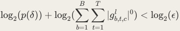


Since  is an analytic function, for sufficiently small , it can be Taylor approximated to leading _p δ_ order as _a_ 2 _δ_<sup>_n_</sup> with some _n_ ∈{1, 2, … } . Inserting this approximation yields: 


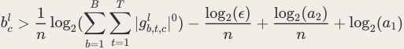


So, the required bit precision _bc_<sup>_l_</sup> for the parameters of a subcomponent grows approximately linearly with the logarithm of that subcomponent's number of causal importance activations across the dataset log2( _fcl_ ) . If we use a fixed dictionary of subcomponents to describe how the model computes its outputs, the mechanistic description length of our descriptions summed _L C_ over a batch will thus have a term that scales as ≈ ∑ _l_ =1 ∑ _c_ =1 _fc_<sup>_l_</sup> log2( _fc_<sup>_l_</sup> ) . Substituting the _l_ ∑ _Bb_ <u>,</u> _t_ ,=1 _T_ ∣ _gbl_ <u>,</u> _t_ <u>,</u> _c_ ∣0 definition _fc_ = _BT_ and absorbing the −log2( _BT_ ) term into the importance minimality loss yields Lfrequency-minimality . 

#### A.5  p-annealing 

The _L_<sup>_p_</sup> quasi-norm in the importance minimality loss Limportance-minimality and frequency minimality loss Lfrequency-minimality (Equation 2 and Equation 4) serves as a smooth surrogate for the _L_ 0 ‘norm’, with smaller  yielding a tighter approximation. However, _p_ [16] found that optimization is substantially easier at larger  values like _p p_ = 2 . We therefore linearly anneal _p_ over the course of training, starting from the easy-to-optimize _p_ 0 = 2.0 and decreasing to _p_ final = 0.4 : 


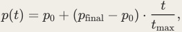


where  is the current training step and _t t_ max is the total number of steps. In our experiments, annealing begins at the start of training and proceeds linearly over the full run ( _t_ ∈[0, _t_ max] ). 

#### A.6  A training recipe for VPD 

In this section, we offer practical guidance for applying VPD to other language models, based on our experience training with the model studied in this paper, as well as a range of other toy models. See Appendix A.7 for the hyperparameters used in the decomposition studied in this paper. 

###### Evaluation metrics. 

To assess whether a VPD decomposition has converged to a satisfactory solution, we recommend tracking the following primary metrics: 

1. PGD reconstruction loss (adversarial masks, freshly initialized at each step): The most important metric. This evaluates reconstruction quality under adversarially chosen masks optimized independently for each batch. The setting we want is shared_across_batch , see Appendix Section A.3.4 for why. This is stricter than the persistent adversarial loss used during training and is our primary indicator of mechanistic faithfulness. For deeper models, more adversarial steps may be needed. As a rough heuristic, we keep _n_ adv ⋅<sup>lr</sup> adv ≈ 2 ; if increasing the number of steps, decrease the learning rate proportionally so the adversarial optimizer can tune more precisely. For discussion on how much adversarial optimization exactly our causal importances should be robust to, see Section 7. 

2. _L_ 0 per data point: The average number of subcomponents with nonzero causal importance on a data point. This should be tracked relative to the rank of the original weight matrices. For a transformer, MLP matrices typically have rank _d_ resid ; the _L_ 0 should be significantly smaller than this for the decomposition to be providing a useful simplification. Note that _L_ 0 typically starts high and decreases steadily over training due to 

- _p_ -annealing (see below), so early in training the importance minimality loss value is a better predictor of what the final _L_ 0 will be. 

Additionally, we often monitor Stochastic reconstruction loss, because it indicates performance under the average permitted masking as opposed to worst-case maskings, unmasked reconstruction loss (all masks set to 1.0 , excluding the Δ -components), because it indicates the extent to which the sum of all subcomponents is identical to the target model and CI-masked reconstruction loss (using the causal importance values directly as masks) as well as Rounded CI-masked reconstruction loss (as CI-masked but all causal importance greater than zero are rounded to 1.0 ) because they indicate performance when keeping exactly those subcomponents deemed causally important. Note though that the latter two are only useful indicators because VPD does not directly optimize for them: It would be (and in practice is) trivial to achieve almost perfect reconstruction for these two maskings if we included them in the training loss. But this would not indicate that our decomposition was actually capturing more of the target model's computation, because these metrics are not robust to "cheating" in the way the adversarial, and to a lesser extent stochastic reconstruction losses are. 

###### Training Loss terms. 

VPD training uses the following loss terms, each of which requires its own loss coefficient. We discuss considerations for tuning these below. 

1. Adversarial reconstruction loss ( LPPGD recon , coefficient 0.5 ): This is the persistent PGD loss described in Appendix Section A.3.4. Making the adversarial optimizer cheap yet effective is nontrivial. The adversarial learning rate usually needs to be tuned and depends on the regular learning rate. For the other hyperparameters of the adversarial optimizer, we recommend using the defaults described in Appendix A.7: an Adam optimizer with _β_ 1 = 0.5 , _β_ 2 = 0.99 , constant learning rate with short warmup, per-batch-per-position source scope, and updating the sources _n_ adv = 3 times for each outer step (in our implementation, we do two inner "warmup" steps and then apply the outer loss step which also updates the sources). For smaller models, fewer adversarial steps per training step may suffice; for larger, especially deeper, models may need more steps (and a correspondingly lower adversarial learning rate). We usually keep this loss coefficient fixed to 0.5 , setting the scale for the other losses. 

2. Stochastic reconstruction loss ( Lstochastic-recon , coefficient 0.5 ): This loss primarily prevents the optimization from stalling early in training, and secondarily prevents it from overfocusing on worst-case ablations at the expense of average-case reconstruction quality. We keep the coefficients for the two reconstruction losses equal and normalized to  each. <u>12</u> We usually keep this loss coefficient fixed to 0.5 , setting the scale for the other losses. 

3. Importance minimality loss ( Limportance-minimality ): This is typically one of the most sensitive hyperparameters and often requires tuning. The -norm exponent is annealed linearly from _p p_ 0 = 2.0 to _p_ final = 0.4 over the full training run. We recommend keeping this annealing schedule fixed and tuning the coefficient instead. Setting the coefficient too high leads to collapsed decompositions with poor reconstruction; too low leads to decompositions where too many subcomponents are simultaneously active. 

4. Frequency minimality loss ( Lfrequency-minimality ): The coefficient for this term also requires some tuning, but interacts with the importance minimality coefficient: increasing the frequency minimality loss coefficient effectively increases sparsity pressure, so it may be necessary to lower the importance minimality loss coefficient to compensate. As a starting point, we suggest setting the frequency minimality loss coefficient at roughly 0.5× the importance minimality coefficient, unless problems are observed. Too low a coefficient tends to produce fewer, overly polysemantic subcomponents. 

5. Δ -component L2 penalty ( LDelta-L2 ): This penalizes the MSE between the sum of subcomponents and each target weight matrix. In practice, this coefficient is not very sensitive. We recommend increasing it by factors of 10 from a conservative starting point until the unmasked reconstruction loss becomes negligibly small. It is safe to overshoot the coefficient considerably, though making it excessively large can still impair optimization. 

Subcomponent count _C_ . The number of subcomponents per weight matrix is not extremely sensitive. It should be set large enough for the optimization to capture all the subcomponents that are present. If unsure, we recommend erring on the side of too many subcomponents, then inspecting the spectrum of log mean causal importances (averaged over a batch) at the end of an exploratory run. There is typically a sharp cutoff in this spectrum separating "alive" from "dead" subcomponents, which reveals how many subcomponents are actually in use[47]. The optimization tends to work best when _C_ is larger than needed, but not excessively so—roughly within a factor of  of the true number of subcomponents appears to work well. 2 

Causal importance function For decomposing transformer models, we recommend using global_shared_transformer as the causal importance function. This is itself a transformer model, which receives the concatenated hidden activations of the target model as input, and produces causal importances for all subcomponents as output. We typically choose the depth <u>1</u> of this transformer to be within 2 − 2 times the depth of the target model, though we have not investigated this hyperparameter as much as some others. We choose the residual stream to be wider than that of the target model since it needs to accommodate all of its hidden activations. For this paper, we used 2048 compared to 768 for the target model. As is somewhat standard, we usually choose the MLP width to be approximately four times the width of the residual stream. 

Summary Applying the method to a new model usually requires adjusting 

1. The importance minimality loss coefficient. 

2. The learning rate 

3. The adversarial learning rate 

4. The frequency minimality loss coefficient 

5. The number of subcomponents _C_ 

6. The Delta L2 penalty loss coefficient. 

In our experience, the first three typically require the most extensive tuning. For larger models, the size of the model used for the causal importance function will likely need to be increased as well. The number of adversarial steps and the adversarial learning rate may also require adjustment. 

#### A.7  Training Details and Hyperparameters 

Below we list the hyperparameters involved in training and decomposing the 4-layer Pile model. 

Target model training. 

Target model training artifacts can be found on WandB (config, <u>checkpoint, run logs).</u> 

The target model architecture is described in Section 3.1 and Table 1. It was trained on a subset of The Pile [22] for 100, 000 steps with batch size 1024 and context length 512 . We used Adam [71] with learning rate 3 × 10<sup>−4</sup> (cosine decay to 10% ), weight decay 0.1 , gradient clipping at 1.0 , and 600 warmup steps. Training used bfloat16 mixed precision and torch.compile . 

VPD training. 

Decomposition artifacts can be found on WandB (config, <u>checkpoint, run logs).</u> 

VPD decomposes 24 weight matrices (6 per layer: c_fc , down_proj , q_proj , k_proj , v_proj , o_proj ) into subcomponents with Delta-components enabled. Training ran for 400, 000 steps with batch size 64 on the same Pile dataset with context length 512 . The _U_ , _V_ , and CI function parameters were jointly optimized with AdamW (weight decay ), initial learning 0 rate 5 × 10<sup>−5</sup> with cosine decay to 10% of the initial value. _U_ , _V_ gradients were clipped at norm 0.01 . One stochastic mask sample ( _S_ = 1 ) was drawn per step. Faithfulness warmup ran for 400 steps (AdamW, lr = 10<sup>−3</sup> , weight decay ), optimizing only the 0 _U_ , _V_ parameters against LDelta-L2 before the main training loop. The output divergence measure _D_ is KL divergence throughout. The causal importance function  is a shared bidirectional transformer (architecture described Γ in Table 5). It takes RMS-normalized concatenations of all 24 pre-weight activations (total input dimension _D_ = 27, 648 ) and outputs _C_ total = 38, 912 causal importance values via a leaky hard sigmoid ( _α_ = 0.01 ). The -norm exponent in both _p_ Limportance-minimality and Lfrequency-minimality is linearly annealed from _p_ 0 = 2.0 to _p_ final = 0.4 over the full training run. 

###### Adversarial reconstruction. 

To optimize the persistent sources in the persistent PGD adversarial loss, an Adam optimizer with _β_ 1 = 0.5 , _β_ 2 = 0.99 and learning rate 0.01 (constant schedule with 2.5% warmup) was used. Sources are scoped per batch element per sequence position (i.e. each individual batch element and sequence position has its own source), and each source receives  warmup PGD 2 steps per training step before the final loss computation. Stochastic and adversarial reconstruction losses both use uniform- _k_ -subset routing, where a random subset of the 24 weight matrices is masked on each step. 

###### Combined minimality loss in code. 

For efficiency, in the training code Limportance-minimality and Lfrequency-minimality are implemented as a single fused term per layer, which factors their shared per-component sum: 


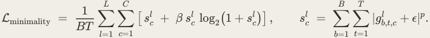


Here _β_ = 0.5 is the frequency minimality weight and  is a small constant for numerical _ϵ_ stability. This is functionally equivalent to summing Limportance-minimality + _β_ Lfrequency-minimality as defined in Equation 2 and Equation 4; we fuse them because both terms depend on the _l_ same per-component sum _sc_ , so the fused form avoids recomputing it. 

###### Loss terms and coefficients. 

Table 6 lists all loss terms and their coefficients. 

|Loss term|Reference|Coefficient|
|---|---|---|
|(auxiliary loss; a.k.a. parameter-faithfulness)<br>L<br>Delta-L2|Equation 1|10<sup>7</sup>|
|(stochastic KL)<br>L<br>stochastic-recon-subset|Equation 3|0.5|
|(persistent PGD KL)<br>L<br>adversarial-recon-subset|Equation 7|0.5|
|(<br>on CI values)<br>L<br>importance-minimality <sup>ℓ</sup><br> _p_|Equation 2|2 × 10<sup>−4</sup>|
|(superlinear CI frequency penalty)<br>L<br>frequency-minimality|Equation 4|1 × 10<sup>−4</sup>|


VPD loss terms and their coefficients. The importance minimality loss uses -annealing from _p_ 2.0 to 0.4 . In practice we implement Limportance-minimality and Lfrequency-minimality as a single fused term with an inner weight _β_ = 0.5 on the frequency part (see above); this is functionally equivalent to the two losses with the coefficients shown. All reconstruction losses use KL divergence. 

Subcomponent counts. 

Table 7 lists the number of subcomponents _C_ we give to each module at initialization. 

|Module type|Subcomponents (<br>) per layer<br>_C_|
|---|---|
|c_fc(MLP Up-projection,<br>)<br>768 × 3072|3072|
|down_proj(MLP Down-projection,<br>)<br>3072 × 768|3584|
|q_proj(query projection,<br>)<br>768 × 768|512|
|k_proj(key projection,<br>)<br>768 × 768|512|
|v_proj(value projection,<br>)<br>768 × 768|1024|
|o_proj(output projection,<br>)<br>768 × 768|1024|
|Total per layer|9728|
|Total (4 layers)|38912|


Number of subcomponents per module type at initialization. 

The CI function architecture is shown in Table 5. 

The training and evaluation losses achieved by the primary training run studied in this paper are listed in Table 9 and Table 8 respectively. 

|Loss|Value|
|---|---|
|Total|24.62|
|Delta-L2 (MSE)|0.00000240|
|StochasticReconSubsetLoss (KL)|0.2419|
|PersistentPGDReconLoss (KL)|0.5733|
|ImportanceMinimalityLoss|1102.0|


Training losses (Measured at final step). 

|Loss|Value|
|---|---|
|StochasticReconSubsetLoss (KL)|0.2381|
|PGDReconLoss (KL)|0.9268|
|StochasticHiddenActsReconLoss (MSE)|0.4130|
|CIHiddenActsReconLoss (MSE)|0.8464|


Evaluation reconstruction losses. 

CLT/PLT WandB links 

|Used in|What|WandB link|
|---|---|---|
|Figure 4;Figure<br>26|PLT/CLT, local-MSE objective,<br>_k_ ∈{8, 16, 32, 64}|dict_4k,<br>dict_32k|
|Figure 25|PLT/CLT, end-to-end KL objective,<br>, three training modes<br>(<br>cascading= error-propagating,<br>parallel=<br>clean-input,<br>independent= single-layer)<br>_k_ ∈{8, 16, 32, 64}|dict_4k,<br>dict_32k|
|Table 10 —<br>PLT/CLT seed<br>runs|5 seeds<br>{PLT local-MSE, PLT e2e-<br>independent, CLT local-MSE, CLT e2e-parallel},<br>, 4k dict<br>×<br>_k_ = 16|multiseed|
|Table 10 —VPD<br>seed runs|5 VPD seed runs (otherwise identical to the<br>main decomposition)|VPD multiseed|
|Table 10 —|VPD trained with an auxiliary stochastic-|VPD hidden-act|
|hidden-<br>activation aux-<br>loss VPD|forward-pass hidden-activation MSE loss|run|
|Figure 7;Figure<br>26|VPD capacity sweep (<br>,<br>,<br>,<br>subcomponents);<br>is the main run above<br>0.5× 1× 2× 4×<br>1×|capacity_sweep|
|Figure 27|No-adversarial-loss control run; otherwise<br>identical training configuration to the main|VPD no-<br>adversarial-loss|
||decomposition|run|


All activation-based comparison runs target the same t-9d2b8f02 model and use LR = 3 × 10<sup>−4</sup> , batch size 4096 , sequence length 512 , 500 M tokens of the Pile, with BatchTopK activation. 

###### SimpleStories decomposition 

We also trained and decomposed a 2-layer model with the same architecture as above on the SimpleStories dataset [43]. A wandb link for that decomposition is here. We found that the attribution graphs and components were cleaner here, though are of course restricted to a much narrower data distribution. 

#### A.8  Clustering Subcomponents into Components 

VPD decomposes each weight matrix _Wl_ into a sum of rank-one subcomponents: _l_ ⊤ _Wl_ ≈ ∑ _c Ucl_ ( _Vc_ ) . While each subcomponent only spans a single weight matrix, a full parameter component could span the entire parameter space, potentially involving subcomponents from multiple weight matrices. We therefore need a method to identify which subcomponents across different weight matrices should be grouped together into coherent parameter components. 

###### Minimum Description Length Clustering 

We frame the clustering problem using the Minimum Description Length (MDL) principle, which states that the shortest description of the data is the best one. The goal is to find a single grouping of subcomponents that minimizes the total cost of describing the causally important components both for each data point in isolation and for a whole dataset. 

Consider a partition of  subcomponents into  groups _n k_ { _θ_ 1, … , _θk_ } forming candidate components. For each component _θi_ , we define its causal importance _gb_ , _t_ , _i_ ∈ {0, 1} at sequence position  on batch index  to be the OR of the causal importances of all _t b_ subcomponents in that group.[48] We use a threshold  on the causal importances of individual _τ_ subcomponents to guarantee they are binary, rounding values ≤ _τ_ to  and values 0 > _τ_ to  (we 1 use _τ_ = 0.01 by default). 

Given a batch of _B_ sequences of length _T_ , we compute a coactivation matrix that measures how often pairs of components are causally important together: 


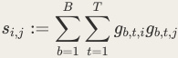


The diagonal values _si_ := _si_ , _i_ are the summed causal importances for component  across _i_ batch and sequence. 

Our MDL cost for the current grouping is then: 


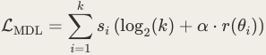


where _r_ ( _θi_ ) = ∣ _θi_ ∣ denotes the rank of component _θi_ summed across its constituent matrices. 

This cost has an intuitive interpretation: each time a group is causally important, we must encode the components for: 

1. A counterparty to whom we are transmitting a whole batch or dataset of mechanistic descriptions. In this case, we transmit the full dictionary of components first[49], then _k_ 

transmit ∑ _i_ =1 _si_ log2( _k_ ) bits on each data point to single out the indices of the causally important components. 

2. Counterparties to whom we are transmitting the mechanistic description of each single datapoint in isolation. In that case, we transmit the raw floating point values of the rank-one matrices comprising causally important components, so our description length will be _k_ 

proportional to ∑ _i_ =1 _sir_ ( _θi_ ) . 

The hyperparameter  controls how much we care about the average description length of the _α_ matrices we need to inspect to understand how the target model computes its output on any one data point, which matters to us because we assume that causal graphs with longer description lengths tend to be harder for us to understand. On the other hand, the log2( _k_ ) quantifies the description length of the sets of components involved in calculating the model output for each input across a whole dataset. We care about this description length because we assume that if the same set of components is used on different data points, it will be easier for us to unify and generalise our separate explanations of the model's behavior on many different inputs into a single explanation of the model's behavior on all those inputs. 

###### Stochastic Hierarchical Merging 

We use a stochastic hierarchical clustering algorithm that starts with each subcomponent in its own group and iteratively merges pairs to reduce the MDL cost. At each iteration, we compute the merge cost for combining groups _θi_ and _θj_ . Let _s_ Σ = ∑ _i si_ be the total activation count. Then the change in MDL cost from merging is: 


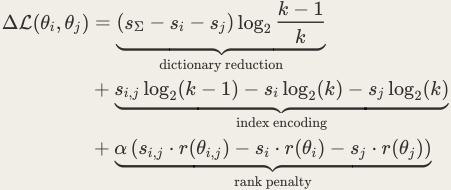


where _r_ ( _θi_ , _j_ ) is the rank of the merged group summed across its constituent matrices. For simplicity, we approximate that _r_ ( _θi_ , _j_ ) ≈ _r_ ( _θi_ ) + _r_ ( _θj_ ) . 

∗ ∗ Naively, one might greedily select the pair ( _i_ , _j_ ) = arg min _i_ < _j_ ΔL( _θi_ , _θj_ ) and merge them, but this risks getting stuck in local minima. To allow for more exploration of the space of possible clusterings, we use stochastic selection: instead of always choosing the minimumcost pair, we sample from all pairs using a probability distribution that exponentially decays with higher cost. Specifically, we rank all candidate merge pairs by their cost ΔL in ascending order and assign each pair a probability that decays exponentially in its rank: 


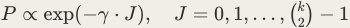


where _J_ = 0 corresponds to the lowest-cost pair and _γ_ > 0 is a decay rate controlling exploration. Setting _γ_ →∞ recovers greedy selection, while _γ_ →0 gives uniform sampling. We sample efficiently via the inverse CDF: letting _N_ = ( _k_ 2) be the number of candidate pairs and _u_ ∼Uniform(0, 1) , the sampled rank is 


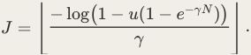


where ⌊… ⌋ is the floor function rounding down to the nearest integer. In our experiments, we use _γ_ = 0.2 , which concentrates most probability mass on the top few candidates while maintaining meaningful probability on roughly the five lowest-cost merges. This stochastic selection allows the algorithm to escape local minima that greedy merging would get trapped in, while still strongly preferring merges that reduce the MDL cost. 

We run the hierarchical clustering algorithm until all subcomponents have been merged into a single component. Then, we find the iteration at which the marginal change in description length from merging ΔL crossed ΔL = 0 , and use the clusters at that iteration as our components. 

###### Choosing alpha 

As an intuition pump for choosing the  hyperparameter in practice, consider two rank-1 _α_ components _θ_ 1, _θ_ 2 with causal importances that are exactly zero or one on all data points, where component _θ_ 2 is causally important with some probability conditional on _θ_ 1 being causally important: co( _θ_ 2 ∣ _θ_ 1) := Pr( _θ_ 2 important ∣ _θ_ 1 important) . If the total dictionary size is large enough that we can approximate log2( _k_ − 1) ≈log2( _k_ ) , and the summed causal importances across the batch and sequence for both components are equal (i.e. _s_ 1 = _s_ 2 ), the mdl loss will be lowered by merging these two components into one if co( _θ_ 2 <u>∣</u> _θ_ 1) log2( _k_ <u>)</u> _α_ < ⋅ . 1 −co( _θ_ 2 ∣ _θ_ 1) 2 

#### A.9  Automated subcomponent labeling 

We describe the procedure here used to produce the subcomponent labels. 

Evidence collection. For each subcomponent, we run a forward-pass harvest over the training distribution and record (i) the firing density of the subcomponent, (ii) a random sample of activating examples (token windows in which the subcomponent's causal importance exceeds a threshold _τ_ ci = 0.1 ), and (iii) per-token co-occurrence statistics for input tokens (the token at the firing position) and output tokens (the model's next-token distribution at the firing position). Each activating example is a window of 20 tokens of context on either side of the firing position ( 41 tokens total), truncated at sequence boundaries. We sample up to 30 activating examples per subcomponent. 

Prompt. For each subcomponent we construct a single prompt containing: 

1. A short description of VPD 

2. A note distinguishing causal importance (CI, the mask value, which is what we care about) from inner activation (the dot product of the input with the read direction _V_ , scaled by the write-direction norm). The prompt instructs the labeler to weight CI heavily and treat lowCI/high-act positions as background. 

3. A note on the sign convention: negating both _uc_ and _vc_ leaves the rank-1 matrix unchanged, so the absolute sign of the inner activation is arbitrary, but the relative sign within a subcomponent is meaningful (positive- and negative-act clusters can correspond to two distinct roles). 

4. The subcomponent's layer ("MLP up-projection in the 2nd of 4 blocks", etc.) and firing density. 

5. The top-recall and top-PMI tables for output and input tokens. 

6. The 30 activating examples of the form [[token (ci:X, act:Y)], ...] (consecutive firings are grouped). Annotations are shown only for firing positions, since CI and act are noisy on non-firing tokens. 

7. The task: return an  word 8 label and a short reasoning summary. 

Model and decoding. All labels were produced by google/gemini-3.1-pro-preview [72] at reasoning_effort=medium , accessed through the OpenRouter API. 

Coverage. We labeled the 10,000 subcomponents with the highest firing density on the harvested distribution. This covers all subcomponents that fire often enough for the harvested sample of activating examples to be informative; subcomponents below this cutoff fire too rarely to support reliable labeling. 

### Appendix B: Results 

#### B.1  End-to-end transcoders 

In Section 3.3, we showed that VPD Pareto-dominates MSE-trained PLTs and CLTs under all three sparsity measures (Figure 4). However, that advantage may partially reflect a difference in training signal, since VPD optimizes end-to-end on the output distribution while the transcoders optimize layer-wise MSE. Here we control for this by training all activation-based methods with the same end-to-end KL-divergence objective as VPD. 

###### Training and evaluation protocols 

When we replace all MLP layers simultaneously, there is an important design choice: should each layer's encoder see the clean residual stream (as computed by the original model) or the modified residual stream (which includes reconstruction errors from earlier layers)? We call these the clean-input and error-propagating evaluation protocols, respectively. A third option, single-layer, replaces only one MLP at a time, with all other layers left unmodified. For a perfectly mechanistically faithful reconstruction — one that exactly replicates each MLP's computation — these three protocols would produce similar results. 

We train separate sweeps of BatchTopK PLTs and CLTs ( _k_ ∈{8, 16, 32} ) in clean-input and error-propagating mode, as well as single-layer-trained PLTs. All use KL divergence on the output logits as the training loss, matching VPD. Each model is then evaluated under all three protocols. Figure 25 shows the results. 


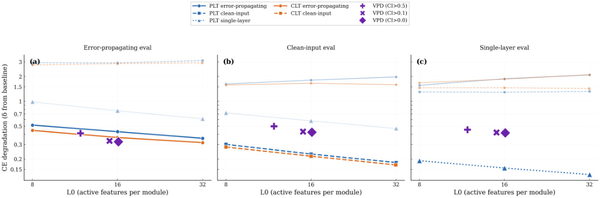


Figure 25. CE degradation vs. L0 (active features per module) for end-to-end KL-trained methods under three evaluation protocols. (a) Error-propagating: each encoder sees the modified residual stream. (b) Clean-input: each encoder sees the clean residual stream. (c) Single-layer replacement, averaged over layers. PLTs (blue) and CLTs (orange) perform well in their training mode but degrade by 5-20x in the mismatched mode. VPD (purple markers) is relatively stable across all three protocols. Linestyle indicates training mode: solid = errorpropagating, dashed = clean-input, dotted = single-layer. 

###### Activation-based methods are brittle to mode mismatch. 

The activation-based methods exhibit severe brittleness to evaluation mode mismatch. In the matched setting, error-propagating-trained PLTs achieve CE degradation as low as _δ_ = 0.32 , and clean-input-trained PLTs reach _δ_ = 0.18 at _k_ = 32 (Figure 25b). But when evaluated in the mismatched setting, these same models degrade catastrophically: clean-input-trained models evaluated in error-propagating mode suffer _δ_ ≈2.9 — 3.5 , roughly an order of magnitude worse. The pattern is symmetric: error-propagating-trained models fail in clean-input evaluation ( _δ_ ≈1.6 — 2.2 ). CLTs exhibit the same pattern. The gap between matched and mismatched performance is a factor of 3 — 20× . 

This brittleness reveals that e.g. a PLT trained in error-propagating mode does not simply learn to approximate each MLP's input-output function. Instead, it learns a replacement model that jointly accounts for both the MLP's true computation and the systematic reconstruction errors introduced by the PLTs in earlier layers. This is a compensatory strategy rather than a mechanistically faithful approximation of the original target model. 

Single-layer-trained PLTs, which each see only the clean residual stream for their own layer, are the most robust of the activation-based methods, and perform best in the single-layer replacement setting ( _δ_ ≈0.13 — 0.19 ). However, when all four single-layer-trained PLTs are inserted simultaneously, they still exhibit meaningful degradation ( _δ_ ≈0.56 — 0.99 ), because each was trained in isolation and cannot account for reconstruction errors accumulating from other layers. 

VPD is stable across protocols. 

VPD's CE degradation, by contrast, is relatively consistent across all three evaluation protocols. At CI > 0, VPD achieves _δ_ ≈0.32 – 0.42 regardless of whether it is evaluated in errorpropagating, clean-input, or single-layer mode. This arises because VPD's stochastic and adversarial masking during training already exposes the decomposition to a rich diversity of partial ablation patterns: on each training step, a random subset of subcomponents across random subsets of weight matrices are partially masked, which naturally covers patterns resembling both error-propagating and clean-input replacement as special cases. More fundamentally, VPD's subcomponents sum to the original weight matrices, and the masked forward pass uses the same architecture and nonlinearities as the target model. A VPD reconstruction is therefore not a different function approximating the MLP, but rather a subset of the MLP's computations. 

That said, VPD does not achieve the lowest CE degradation in every individual setting. In matched-mode evaluation, the best activation-based models outperform it (e.g., clean-input PLTs at _k_ = 16 reach _δ_ ≈0.23 vs. VPD's _δ_ ≈0.42 ). We view this as the expected cost of faithfulness: a model specifically optimized to compensate for a particular error pattern will naturally outperform one that has not learned such compensation. B.2  Confirming feature splitting in PLTs and CLTs geometrically To investigate whether the PLTs and CLTs are indeed splitting features rather than discovering genuinely new ones, we match features between models of different sizes. For each pair of models, we count what fraction of alive objects, latents for PLTs/CLTs and subcomponents for VPD, in one model have more than one match among the alive subcomponents of the other model, averaged across layers. We match objects by calculating the cosine similarity between their output vectors (decoder vector for PLT/CLT; down-projection _U_ vector for VPD) and consider a cosine similarity > 0.5 a match. Results are qualitatively stable across cosine similarity thresholds in [0.3, 0.7] . An object with multiple matches in a target model is evidence that the target model has split what the source model represents as a single feature. 


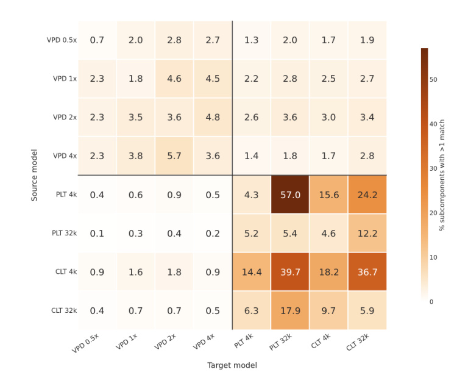


Figure 26. Cross-model latent/subcomponent splitting (decoder vector cosine similarity > 0.5 ). Each cell shows the percentage of alive subcomponents or latents in the source model (row) that have more than one match in the target model (column). VPD shows low cosine similarity across models. PLTs and CLTs show high mutual cosine similarity, suggesting substantial splitting. 

The heatmap confirms that the proportion of features that have multiple decoder matches in a version with more subcomponents is higher in PLTs and CLTs. For example, 57.0% of the components in 4k PLT have more than one match in the 32k PLT. On the other hand, only 2.7% of the subcomponents in the 0.5x VPD model have more than one match in 4x VPD model. 

#### B.3  Geometric consistency across seeds 

In mechanistic interpretability, it is common to look for the 'mechanisms' or 'features' that a network uses in its computations. There's an implication here: That there is a fixed, ground truth set of objects that we're looking for ("the mechanisms"). How true is this? And how would we measure how close we are to finding the right objects? 

One approach is to run a decomposition method with different random seeds or using different hyperparameters. If the approaches converge to the same results despite these differences, this is suggestive that they converged to the 'right' set of objects. 

Previous work has used mean max cosine similarity (MMCS) to measure this similarity quantitatively [73]. Suppose we perform two decompositions using the same method, but with different random seeds. Given these two sets of transcoder latents or VPD subcomponents, we calculate the cosine similarity between the objects in each set, and find the most similar for each, and the take the average cosine similarity between those maximally similar pairs. High MMCS means that decompositions are similar across seeds. 

Since VPD is trained using an end-to-end (e2e) loss we compare it with transcoders trained with an e2e loss (Table 10). We find that the MMCS of the transcoder latents is similar or slightly worse than the MMCS of VPD U and V vectors. But PLTs and CLTs are usually not trained with an e2e loss; they are usually trained to reconstruct activations at each layer (i.e. a 'local MSE' loss). VPD does not typically train with a hidden activation reconstruction loss; if it reconstructed hidden activations perfectly, it would be constructing activations that are not relevant for performance and merely correspond to 'superposition noise'. Despite not training on hidden activation reconstruction loss, the constellation of other loss functions results in a hidden activation reconstruction loss that is similar, albeit slightly higher, than if we do minimize it directly (Stochastic forward pass hidden activation MSE: 0.33 vs. 0.41). When transcoders are trained using their typical training loss (local MSE), their MMCS are much better than VPD. 

|Method|Cross-seed Mean Max Cos Sim|
|---|---|
|VPD U vectors|0.4808|
|VPD V vectors|0.5156|
|PLT (e2e)|0.4390|
|CLT (e2e, parallel)|0.3468|
|TC (local MSE)|0.8063|
|CLT (local MSE)|0.6078|
|VPD rank-1 (V@U)|0.2826|
|VPD components (rank-N, cross-model)|0.3181|
|(Baseline) VPD at init U vectors|0.1263|
|(Baseline) VPD at init V vectors|0.1300|
|(Baseline) VPD at init rank-1 (V@U)|0.0122|


Overall, we're uncertain how much emphasis to put on these similarities. While it is naturally appealing to think that there is a single 'correct' decomposition, we are not sure that this intuition fully accounts for the extent of the degeneracy in neural networks. One of the reasons that neural networks are so good at learning is the sheer amount of degeneracy they seem to have: It is easier to find a good solution in a space where there are many good solutions! It seems quite possible that, even though we place a number of constraints on the solution that VPD looks for, there is not just one set of ground truth mechanisms, but in fact an entire space of optimal parameter components that are nonetheless mechanistically faithful! The same is true of dictionary learning approaches. While (all else equal) cross seed consistency is a desirable property of a decomposition method, other properties such as mechanistic faithfulness are probably closer to what we want our methods to achieve. 

#### B.4  Stochastic vs. adversarial training loss 

The adversarial loss greatly improves the decomposition performance for small source ( _r_ ) values (Figure 27). 


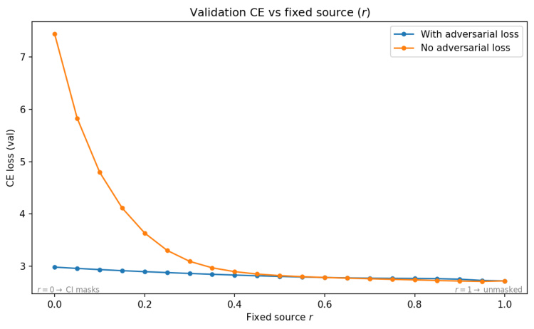


Figure 27. Comparison between a decomposition with and without adversarial loss. The training configuration is otherwise identical. The CE loss is especially improved for small values of . _r_ 

#### B.5  OV circuit weight norms 

Subcomponents in the _WV_ and _WO_ matrices are spread across multiple heads, despite having specialized semantic roles. This is suggestive evidence of attention computations that are distributed across heads. 


Figure 28. The norm of the weights of each _WV_ and _WO_ subcomponent in each head. 

#### B.6  OV circuit metric: Data-weighted Frobenius cosine similarity 

To study the OV circuit across multiple heads, it is helpful to think of _WOVh_ in terms of its _h_ singular value decomposition: _WOV_ = **_LSR_**<sup>⊤</sup> . Now, we construct two new matrices for each _WOVh_ matrix: 


We can study how much each head reads and writes to the same subspace by comparing the similarity between the _Mh_ read or write matrices of different heads. We compare them using a metric called the Frobenius cosine similarity, which is a cosine similarity metric for matrices: 


We will also measure the Frobenius cosine similarity between the raw _WOVh_ matrices of each head, since it is possible that even though matrices might read from and write to similar subspaces, their singular vectors might be paired differently. 

How should we understand this metric? On an intuitive level, we can think of a given _WOVh_ matrix's read- or write-subspace as a _d_ head -dimensional ellipsoid in R<sup>_d_</sup> model space, where the axes of the ellipsoid are the scaled right or left singular vectors of _WOVh_ matrix respectively. The Frobenius cosine similarity measures how much the read- or write-ellipsoid of one head overlaps with another head's. If the ellipsoids perfectly overlap, then the Frobenius cosine similarity is 1. If they exist in entirely non-overlapping subspaces, then their Frobenius cosine similarity is 0. For comparison purposes, we'll compare the Frobenius cosine similarities with a random matrix baseline. This will help us understand whether the model has learned to use more or less overlapping subspaces than would be expected for a pair of random matrices of the same size and dimension. 

###### Weighting subspaces by data variation 

However, the raw Frobenius cosine similarity between these matrices may potentially be misleading. The network does not use every subspace equally. Some subspaces might not contain much of the activations. Unless our metric accounts for how much of the activations lie within the subspaces that the _WOV_ matrices read from and write to, we may get a misleading sense of how similar a pair of heads is. We should therefore weight different dimensions according to the amount of activation variation that exists along that axis. To do this, we form the data-weighted value matrix for each head. For a dataset of activations _φ_ , we perform PCA to get the principal axes of variation : _φ_ ˉ 


_T h_ where _μ_ = _T_ <u>1</u> ∑ _t_ =1 _φt_ . We then project _WOV_ onto the data's principal axes of variation and scale each axis by the corresponding singular value, yielding the data-weighted value projection matrix for head : _h_ 


We can now construct data-weighted read and write Gram matrices ( _Mhφ_ ,read and _Mhφ_ ,write ) as described above for the data-unweighted case. We can then use the Frobenius cosine similarity between them to understand how similarly the OV circuit of each head reads and writes the actual data that it sees. 

We can also use this approach to selectively study how the OV circuit interacts with particular QK pairs. If we filter the dataset such that it contains only datapoints where the associated K subcomponent is causally important, then we can understand whether those pairs are moving similar or dissimilar value information in each head! 

We should note that the pair of subcomponents involved in previous token Behavior 1 in Section 4.4 are almost always active, and so we don't get to benefit from this QK-based filtering approach. But for Behavior 2 in Section 4.4 we study a behavior that is conditionally active, where it will be beneficial to understand how similar the OV circuits in each head behave only when that QK subcomponent interaction is active. 

We are now equipped enough to return to our analysis of previous token behavior and study its OV circuit to establish whether its heads attend to similar or distinct residual stream subspaces. 

#### B.7  Expected Frobenius Cosine Similarity of Random LowRank Gram Matrices 

In this section, we derive an approximation for the expected Frobenius cosine similarity between the Gram matrices of two randomly initialized attention heads. We compare it to an empirical test, and find good agreement. 

Standard (unweighted) Frobenius cosine similarity 

Let _Wa_ , _Wb_ ∈ R<sup>_d_</sup> head× _d_ model be the value projection matrices for two attention heads, where _d_ model is the residual stream dimension ( _d_ model ) and _d_ head is the head dimension. We initialize the elements of _Wa_ and _Wb_ independently from a standard normal distribution, N (0, 1) . 

We define the corresponding Gram matrices as _Ma_ = _Wa_ ⊤ _Wa_ and _Mb_ = _Wb_ ⊤ _Wb_ . Notice that while _Ma_ , _Mb_ ∈ R<sup>_d_</sup> model× _d_ model , their rank is bounded by _d_ head . Because _Wa_ has elements drawn from N (0, 1) , its Gram matrix _Ma_ follows a standard Wishart distribution with _d_ head degrees of freedom, denoted as _Ma_ ∼ W _d_ model( _d_ head, _Id_ model) . 


Now, we will approximate the numerator tr( _M_ ) and denominator tr( _M_ 2) using the fact that traces of high-dimensional matrices concentrate around their expectation value: 

###### Approximating the numerator 


Approximating the denominator 

To approximate tr( _M_ 2) = ∥ _M_ ∥2 _F_ , we sum the expected squared values of all elements in the Gram matrix. Let _Mij_ be the entry in the -th row and -th column. _i j_ 

_d_ model _d_ model _d_ model 2 2 2 2 ∥ _M_ ∥ _F_ = ∑ ∑ _Mij_ = ∑ _Mii_ + ∑ _Mij i_ =1 _j_ =1 _i_ =1 _i_ = _j d_ head 2 1. Diagonal Elements: The diagonal elements are _Mii_ = ∑ _r_ =1 _Wri_ . Since _Wri_ ∼ N (0, 1) , each _Mii_ follows a Chi-squared distribution with  degrees of freedom ( _k χ_ 2 _d_ head ). The mean of a _χ_ 2 _d_ head variable is _d_ head , and its variance is 2 _d_ head . Using the identity E[ _X_ 2] = Var( _X_ ) + (E[ _X_ ])<sup>2</sup> , we get E[ _Mii_ 2] = 2 _d_ head + _d_ 2head . Since there are _d_ model 2 diagonal elements, their total contribution is _d_ model( _d_ head + 2 _d_ head) . 2. Off-Diagonal Elements: For the off-diagonal elements _Mij_ = ∑ _dr_ =1head _WriWrj_ with _i_ = _j_ , _Wri_ and _Wrj_ are independent standard normal variables, so their product has a mean of 0 and a variance of . The sum of 1 _d_ head such independent terms has a mean of  and a 0 variance of _d_ head , so we get E[ _Mij_ 2 ] = Var( _Mij_ ) + (E[ _Mij_ ])2 = _d_ head + 0 = _d_ head . There are _d_ model( _d_ model − 1) off-diagonal elements, so their total contribution is _d_ model( _d_ model − 1) _d_ head . Combining the diagonal and off-diagonal contributions yields: ∥ _M_ ∥2 _F_ ≈ _d_ model _d_ head( _d_ model + _d_ head + 1) 

Combining the diagonal and off-diagonal contributions yields: 

###### Final Expected Baseline 

Substituting the expected inner product and the expected squared norm back into our similarity approximation: 


Thus, we have ≈0.1427 as the expected baseline for the Frobenius cosine similarity between two randomly initialized heads of this dimension and rank. 

This value exactly matches an empirical random baseline computed via Monte Carlo simulation: 

###### Empirical: Standard (unweighted) Frobenius cosine similarity 

We generate 1000 pairs of random matrices _Wa_ , _Wb_ ∈ R<sup>_d_</sup> head× _d_ model with i.i.d. standard normal entries, compute their Gram matrices _M_ = _W_ ⊤ _W_ , and calculate the Frobenius cosine tr( _MaMb_ <u>)</u> similarity ∥ _Ma_ ∥ _F_ ∥ _Mb_ ∥ _F_ for each pair. The mean across pairs gives the expected overlap between matrices with no structural relationship. The empirical result exactly matched the theoretical result proved above (0.1427). 

###### Data-weighted Frobenius cosine similarity 

For the data-weighted case, there is no analytical solution, so we use the same Monte Carlo procedure, except that we right-multiply each random matrix by _Z_<sup>ˉ</sup> _S_<sup>ˉ</sup> (the right singular vectors scaled by singular values from the mean-centered data) before computing Gram matrices. This ensures the baseline reflects the anisotropy of the residual stream because, in a low-rank data distribution, even unrelated matrices may exhibit elevated subspace overlap. 

#### B.8  Layer 1 K and V subcomponent relations 


Figure 29. The probability of each K subcomponent being active when a given V subcomponent is active, and vice versa. This tells us what _WK_ subcomponents are responsible for moving information from particular kinds of _WV_ subcomponents. The L1.Attn.k:329 subcomponent is always active, and therefore moves all kinds of _WV_ subcomponents. 


Figure 30. Data-weighted cosine similarities between each head's _WOVh_ read- and write matrices, and the cosine similarity between each head's raw _WOVh_ . Here, data-weighting uses data where subcomponent L1.Attn.k:119 is causally important. 

#### B.9  Layer 1 O, V subcomponents most aligned with attention heads on data where Layer 1 K.119 is causally important 

Here we list, for each attention head, the top-5 V subcomponents (read-aligned) and top-5 O subcomponents (write-aligned) whose subcomponents are most aligned with that head's OV circuit. 

Here, alignment = ∣∣ _Wvc_ scaled∣∣ (read) or ∣∣ _W_ ⊤ _u_ scaled _c_ ∣∣ (write), where vectors are scaled by the norm of the other factor in the rank-1 decomposition. 

Note that this can exclude several subcomponents not in the top-5 that nonetheless have meaningful alignment. 

Head 0 

Read-aligned V subcomponents (top 5) 

|Rank|Comp|Alignment|Label|
|---|---|---|---|
|1|v.22|74.9453|punctuation, syntax, and formatting tokens|
|2|v.984|68.3169|fires on punctuation and symbols|
|3|v.1000|64.4708|fires on punctuation, delimiters, and structural|
||||boundaries|
|4|v.346|62.6574|distinguishes function words (positive) and content|
||||words (negative)|
|5|v.568|59.1917|fires on word prefixes and partial words|


Write-aligned O subcomponents (top 5) 

|Rank|Comp|Alignment|Label|
|---|---|---|---|
|1|o.923|231.5484|first token of the sequence|
|2|o.411|203.4490|code, markup, and technical formatting syntax|
|3|o.630|191.1107|punctuation, symbols, and syntax in technical text|
|4|o.753|181.5993|closing parentheses and brackets in code and math|
|5|o.300|173.9110|code and structured text syntax/indentation|


###### Head 1 

Read-aligned V subcomponents (top 5) 

|Rank|Comp|Alignment|Label|
|---|---|---|---|
|1|v.984|59.9101|fires on punctuation and symbols|
|2|v.346|56.6177|distinguishes function words (positive) and content<br>words (negative)|
|3|v.22|52.5358|punctuation, syntax, and formatting tokens|
|4|v.1000|52.4579|fires on punctuation, delimiters, and structural<br>boundaries|
|5|v.946|45.8153|distinguishes content words from function<br>words/symbols|


###### Write-aligned O subcomponents (top 5) 

|Rank|Comp|Alignment|Label|
|---|---|---|---|
|1|o.362|167.0992|fires on names, citations, proper nouns and formatting<br>tokens|
|2|o.490|164.5913|line start and indentation tokens|
|3|o.337|149.7576|fires inside parentheses or mathematical formulas|
|4|o.895|132.7422|variables, math symbols, and syntax in technical text|
|5|o.986|116.9061|sentence/paragraph boundaries and transition words|
|Head 2||||


###### Read-aligned V subcomponents (top 5) 

|Rank|Comp|Alignment|Label|
|---|---|---|---|
|1|v.984|83.9813|fires on punctuation and symbols|
|2|v.22|79.5923|punctuation, syntax, and formatting tokens|
|3|v.346|69.2600|distinguishes function words (positive) and content<br>words (negative)|
|4|v.1000|68.2968|fires on punctuation, delimiters, and structural<br>boundaries|
|5|v.531|66.0043|opening parentheses, brackets, braces, and quotes|
|Write-alig|ned O sub|components (t|op 5)|


|Rank|Comp|Alignment|Label|
|---|---|---|---|
|1|o.923|432.9877|first token of the sequence|
|2|o.578|249.4896|heterogeneous subcomponent / lack of clear pattern|
|3|o.180|227.2081|diffuse firing on tokens within words/phrases|
|4|o.866|208.1991|predicts newlines and separators at line ends|
|5|o.336|205.5378|diverges between function words and complex technical<br>terms|


###### Head 3 

###### Read-aligned V subcomponents (top 5) 

|Rank|Comp|Alignment|Label|
|---|---|---|---|
|1|v.984|70.1569|fires on punctuation and symbols|
|2|v.745|57.7404|formatting symbols, operators, and spatial alignment|
|3|v.946|53.8508|distinguishes content words from function<br>words/symbols|
|4|v.494|53.3743|predicts line breaks or indentation in formatted text|
|5|v.346|52.9415|distinguishes function words (positive) and content<br>words (negative)|


###### Write-aligned O subcomponents (top 5) 

|Rank|Comp|Alignment|Label|
|---|---|---|---|
|1|o.311|333.3696|fires universally on most tokens|
|2|o.630|263.6867|punctuation, symbols, and syntax in technical text|
|3|o.37|257.2931|continuations of multi-token entities and compound|
||||words|
|4|o.300|251.2589|code and structured text syntax/indentation|
|5|o.180|177.4386|diffuse firing on tokens within words/phrases|


###### Head 4 

###### Read-aligned V subcomponents (top 5) 

|Rank|Comp|Alignment|Label|
|---|---|---|---|
|1|v.346|146.1802|distinguishes function words (positive) and content<br>words (negative)|
|2|v.22|145.5668|punctuation, syntax, and formatting tokens|
|3|v.984|142.4020|fires on punctuation and symbols|
|4|v.745|129.9418|formatting symbols, operators, and spatial alignment|
|5|v.1000|116.1570|fires on punctuation, delimiters, and structural<br>boundaries|


###### Write-aligned O subcomponents (top 5) 

|Rank|Comp|Alignment|Label|
|---|---|---|---|
|1|o.753|832.6620|closing parentheses and brackets in code and math|
|2|o.630|591.0163|punctuation, symbols, and syntax in technical text|
|3|o.411|538.0296|code, markup, and technical formatting syntax|
|4|o.860|522.9536|structural and formatting markers vs content words|
|5|o.292|503.4616|fires broadly on various tokens, promoting line breaks<br>and punctuation|
|Head 5||||


###### Read-aligned V subcomponents (top 5) 

|Rank|Comp|Alignment|Label|
|---|---|---|---|
|1|v.1000|57.2500|fires on punctuation, delimiters, and structural|
||||boundaries|
|2|v.946|56.3107|distinguishes content words from function|
||||words/symbols|
|3|v.346|53.8432|distinguishes function words (positive) and content|
||||words (negative)|
|4|v.428|51.4916|fragments of proper nouns, foreign, and technical words|
|5|v.984|50.2268|fires on punctuation and symbols|


###### Write-aligned O subcomponents (top 5) 

|Rank|Comp|Alignment|Label|
|---|---|---|---|
|1|o.923|227.1903|first token of the sequence|
|2|o.311|178.6259|fires universally on most tokens|
|3|o.630|160.5296|punctuation, symbols, and syntax in technical text|
|4|o.180|156.3924|diffuse firing on tokens within words/phrases|
|5|o.300|144.0436|code and structured text syntax/indentation|


#### B.10  Interaction graphs 

###### Gradient attributions 

To understand how subcomponents interact with each other during the forward pass, we compute gradient attributions between pairs of subcomponents at adjacent layers in the computational graph. These attributions form the edges of an interaction graph that visualizes the flow of information through the decomposed model on a given prompt or aggregated over the dataset. 

Recall that each subcomponent  at weight matrix  has a subcomponent activation _c l l l l ab_ , _t_ , _c_ = ( _Vcl_ )⊤ _φb_ , _t_ , where _φb_ , _t_ is the pre-weight hidden activation vector at weight matrix  on _l_ batch element  at sequence position . This is the projection of the input onto the right _b t_ singular vector of the subcomponent, and it determines how strongly the subcomponent contributes to the layer's output. 

For a source subcomponent _c_ 1 at layer _l_ 1 and a target subcomponent _c_ 2 at layer _l_ 2 (where _l_ 1 feeds into _l_ 2 in the computational graph), we define the gradient attribution on batch element _b_ and at source sequence position _t_ 1 and target sequence position _t_ 2 as: 


where _gbl_ 1, _t_ 1, _c_ 1 is the causal importance of the source subcomponent. The gradient × activation product ∂∂ _aalbl_ 21, _t_ <u>2,</u> _c_ <u>2</u> ⋅ _alb_ 1, _t_ 1, _c_ 1 gives a first-order estimate of how much the source subcomponent's _b_ , _t_ 1, _c_ 1 activation contributes to the target subcomponent's activation. Weighting by the causal importance _gbl_ 1, _t_ 1, _c_ 1 ensures that subcomponents which are not causally important on a given datapoint (i.e., those that can be ablated without affecting the output) do not contribute to the attribution, even if they happen to have nonzero activations and gradients. 

For most adjacent layer pairs, source and target positions coincide ( _t_ 1 = _t_ 2 ), since MLP and attention projection layers operate position-wise. However, for edges from key or value subcomponents to attention output subcomponents within the same attention layer, the source position _t_ 1 can be any position up to and including the target position _t_ 2 (i.e., _t_ 1 ≤ _t_ 2 , respecting the causal attention mask). This reflects the fact that key and value activations at earlier positions influence the attention output at later positions. 

###### Dataset-aggregated attributions. 

To obtain a summary of how subcomponents interact across the dataset, we aggregate attributions over all datapoints and all valid position pairs: 


where the sum over ( _t_ 1, _t_ 2) ranges over _t_ 1 = _t_ 2 for position-wise layers and _t_ 1 ≤ _t_ 2 for key/value-to-output edges in attention. In practice, we compute this sum over the training dataset using a distributed pipeline across multiple GPUs. To make attributions comparable across subcomponents with different activation scales and different frequencies of causal importance, we normalize by the total causal importance of the source and the root-meansquare activation of the target: 


where RMS( _alc_ 22) = _BT_ <u>1</u> ∑ _b_ , _t_ ( _alb_ 2, _t_ , _c_ 2)2 and _BT_ is the total number of tokens processed. Dividing by the source's cumulative causal importance puts the attribution on a per-occurrence scale (analogous to averaging over only the datapoints where the source is active), while dividing by the target's RMS activation accounts for the target's overall magnitude. Together, these normalizations allow meaningful comparison of attribution strengths across edges in the graph. 

We also compute an absolute-value variant _A_ abs( _c_ 1 → _c_ 2) , which replaces the target activation _alc_ 22 with its absolute value ∣ _alc_ 22∣ in the backward pass. This variant captures the total magnitude of influence irrespective of sign, and is useful for identifying strong interactions where the signed attribution may cancel across datapoints. 

###### Prompt-level attributions. 

For analyzing individual prompts, we compute position-aware attributions without aggregation. Given a prompt and a set of "alive" subcomponents (those with nonzero causal importance at each position), we compute the gradient attribution for each pair of alive source and target subcomponents at each valid combination of source and target positions. The resulting position-aware graph enables detailed analysis of how the model processes a specific input. 

The main changes are: separate _ts_ and  indices throughout, an explicit paragraph explaining _tt_ when they differ (K/V to O edges within an attention layer), and the dataset sum now ranges over valid position pairs rather than a single shared position. 

###### Pruning for specific behaviors: Post-hoc causal importance optimization 

During VPD base training, the causal importance function  is trained to predict which Γ subcomponents are necessary to reconstruct the target model's full output distribution across all sequence positions. However, when analyzing a specific behavior—such as the model's prediction of a particular token at a particular position—many causally important subcomponents will be irrelevant to that specific behavior, even though they are necessary for reconstructing the full output. To isolate only the subcomponents involved in a behavior of interest, we optimize new causal importance values post hoc on a single prompt, using a reconstruction loss that targets only the specific aspect of the output we wish to study. 

###### Setup 

Given a trained VPD model and a prompt, we first run the model's trained causal importance function to obtain the base causal importance values _gtl_ , _c_ for all subcomponents on that prompt. We then identify the set of alive subcomponents for the prompt at each sequence position : those for which _t gtl_ , _c_ > 0 . Only alive subcomponent causal importances are eligible for inclusion in the post-hoc optimization, though masks for the other subcomponents (and the Δ components) can still be sampled stochastically to try to ensure they remain ablatable. 

We parameterize the new causal importances using pre-sigmoid parameters _ϕlt_ , _c_ , one per alive subcomponent at each position. The causal importance values are obtained by passing these parameters through the same lower-leaky (for sampling the masks used in the forward pass) and upper leaky (for the Limportance-minimality and Lfrequency-minimality ) hard sigmoid functions _l σH_ ,lower ,<sup>_σ_</sup> _H_ ,upper (see Appendix Section A.2) used during base training. The parameters _ϕt_ , _c_ are initialized to the pre-sigmoid values produced by the base causal importance function on this prompt, providing a warm start. Non-alive subcomponents have their causal importance fixed at zero throughout optimization. 

###### Loss function 

The post-hoc optimization minimizes a combination of a reconstruction loss and an importance minimality loss: 


The reconstruction loss Lrecon is chosen to target the specific behavior of interest. For example, to study how the model predicts token  at position _y t_<sup>∗</sup> , we use a cross-entropy loss at that position: 


where _p_ masked denotes the output distribution of the model with masks applied according to the post-hoc causal importances. Alternatively, if we wish to reconstruct the model's full output distribution at a specific position rather than targeting a particular token, we can use a KLdivergence loss: 


The importance minimality loss Limportance-minimality has the same form as in base training (Equation 2 and Equation 4), applied to the post-hoc causal importances _g_<sup>~</sup> _tl_ , _c_ . This loss encourages the optimization to find the sparsest set of subcomponents that can still reconstruct the targeted behavior. The coefficient _λ_ min controls the sparsity–fidelity trade-off: larger values yield sparser graphs with fewer active subcomponents, potentially at the cost of reconstruction quality. 

###### Masking during optimization 

As in base training, the post-hoc causal importances define masks on the subcomponents via: 

_l l l l mt_ , _c_ ( _r_ ) = _g_<sup>~</sup> _t_ , _c_ + (1 − _g_<sup>~</sup> _t_ , _c_ ) _rt_ , _c l l_ where _rt_ , _c_ ∈ [0, 1] . On each optimization step, we sample masks by drawing _rt_ , _c_ , either stochastically uniformly or adversarially, and compute the reconstruction loss under those masks. This is done to try to ensure that the optimization satisfies the same mechanistic faithfulness criterion as base training: subcomponents marked as unimportant must be ablatable in any combination without affecting the targeted output.[50] 


where Ladversarial-recon is computed similarly to Equation 7, but using the post-hoc causal importances and the targeted reconstruction loss. There is also one additional constraint imposed on the adversarial sampler compared to VPD base training: Only alive subcomponents on the prompt have their masks adversarially optimized, other subcomponents have their masks drawn stochastically. This is because we want to prevent the adversary from finetuning on data dependent noise inside the many inactive subcomponents of the model, see Appendix Section A.3.4. In base training, this is accomplished by forcing the _l_ adversary to use the same _rc_ for many data points. For post-hoc optimization we cannot do this, because we only have a single prompt available. But the causal importance function has already pre-filtered the subcomponents to exclude those that were not involved in computing the prompt at all, so we attempt to sidestep this issue by restricting the adversary to subcomponents that were alive on the original prompt. 

###### Optimization procedure 

We optimize the pre-sigmoid parameters _ϕlt_ , _c_ using AdamW with a cosine learning rate schedule and brief linear warmup. The model weights and subcomponent parameters ( _U_ , _V_ ) are frozen throughout; only the post-hoc causal importance parameters are updated. The optimization typically converges within a few hundred steps, since it starts from a good initialization and optimizes over a single prompt rather than a dataset. The result is a set of refined causal importance values _g_<sup>~</sup> _tl_ , _c_ that are sparser than the base values: many subcomponents that were causally important for the full output are driven to zero importance when only a specific behavior is targeted. The surviving subcomponents—those with _g_<sup>~</sup> _tl_ , _c_ > 0 — form the nodes of the interaction graph for that behavior, and gradient attributions (Appendix B.10.1) are then computed between them. 

#### B.11  Nonlinear parameter subcomponent interactions 

In our case studies, we traced the relationships between subcomponent activations in particular computations using attributions. However, this is not a complete account of how the model computes its outputs. Attributions only measure how strongly one subcomponent activation influences another; they do not describe the actual functional relationship between them. To fully reverse engineer neural networks with VPD, we will need some account of how downstream subcomponent activations are actually computed from upstream ones. 

For some matrices (such as MLP Up, query, key, and value projection matrices), this should not be difficult. The connections to their preceding subcomponent activations are linear (apart from the RMS norms), so they can be understood almost entirely as linear combinations of preceding subcomponent activations. The RMS norms are non-linear, but not very functionally expressive, so their role in the computation can hopefully be understood without too much trouble. 

For MLP Down projection and attention output matrices, however, functionally rich nonlinearities in the computational graph separate them from preceding subcomponent activations: Neurons in the case of MLP Down projections, and attention heads in the case of attention output matrices. For MLP Down projection subcomponents in particular, every subcomponent activation is a linear combination of many MLP neuron activations, each of which is potentially a nonlinear function of all MLP Up matrix subcomponent activations. 

One might therefore worry that the nonlinear interactions between MLP Up matrix subcomponent activations could be inherently very complicated. We cannot exclude this possibility at present, but there are some theoretical and empirical reasons to think that these interactions may be much simpler than the raw number of nonlinearities might suggest. 

###### Theoretical argument 

To the extent that the network implements different circuits in the same MLP—such as a lookup for which city the Eiffel Tower is in and a modular addition algorithm for the months of the year— it is actively incentivised to avoid nonlinear interactions between them. Otherwise, the circuits would interfere with each other, potentially producing wrong results. So, to the extent that two subcomponents parametrize two unrelated circuits, they should not interact much. From our interpretations of the subcomponents in Section 3.4, it appears that many of them are quite specialized to very different contexts, and thus presumably would not interact substantially. There are components consisting of clusters of related subcomponents, such as those for bracket closing from our analysis in Section 5.4, and these presumably could interact quite a bit. But smaller blocks of mutual interaction would still be much easier to analyze than a single block of all subcomponents interacting with all other subcomponents. There also appear to be some subcomponents, such as those that are nearly-always-active, that would presumably interact nonlinearly with almost everything else. But characterizing these interactions for a reasonably small number of subcomponents still seems quite feasible. 

###### Preliminary empirical investigation 

We can approximately measure the interaction strength between MLP Up projection matrix subcomponents at neurons. Specifically, we compute interaction matrices _Ic_ , _c_<sup>′</sup> that crudely measure two things: 

1. Weight overlap: How strongly different subcomponents _c_ , _c_<sup>′</sup> connect to the same neurons with sizeable weights, and 

2. Activation overlap: How often they are causally important with large activations at the same batch and sequence index: 


Intuitively, _Icl_ , _c_<sup>′</sup> measures how often subcomponents  and  make a large contribution to the _c c_<sup>′</sup> preactivations of the same MLP neurons  at the same batch and sequence indices _i b_ , _t_ . If the contribution of subcomponent  to the preactivation of neuron  is much larger in magnitude _c i l l l l l l_ than the corresponding contribution of subcomponent  (i.e. _c_<sup>′</sup> _Ui_ , _cgb_ , _t_ , _cab_ , _t_ , _c_ ≫ _Ui_ , _c_<sup>′</sup> _gb_ , _t_ , _c_<sup>′</sup> _ab_ , _t_ , _c_<sup>′</sup> ), then  will be mostly irrelevant for determining the nonlinear response of neuron  on that data _c_<sup>′</sup> _i_ point. 

The matrix is normalised such that all diagonal entries equal 1.0 , and each row can be read as estimating the interaction strength between subcomponent  and other subcomponents , _c c_<sup>′</sup> relative to the self-interaction of . If an off-diagonal entry _c Ic_ , _c_<sup>′</sup> is much smaller than 1.0 , this indicates that subcomponent  does not substantially interact with subcomponent  at the _c_<sup>′</sup> _c_ neurons. [51] 

We expect some off-diagonal entries to be large. For example, for subcomponents that form part of the same component. But generally speaking, the fewer large off-diagonal entries there are, the easier it should be to describe the computation in an MLP Up terms of components without considering many inter-component interactions. 


Figure 31. Entries of the interaction matrix _Ic_ , _c_<sup>′</sup> for the layer  MLP Up projection matrix 0 subcomponents. Entries greater than 1.0 are clamped to . Indices are sorted by the 1 components that each subcomponent belong to. Entries ≥1.0 in a row indicate that the nonlinear interaction between subcomponents  and  is large compared to the self-interaction _c_<sup>′</sup> _c_ of  on the diagonal. Many interactions are either block-diagonal, indicating they take place _c_ inside higher-rank components, or arranged along vertical and horizontal lines, indicating they are caused by a relatively small number of highly interacting components. 


Figure 32. Histogram of matrix entries of the interaction matrix _Ic_ , _c_<sup>′</sup> for the layer  up projection 0 subcomponents. Most entries are much smaller than the self-interaction 1.0 . 

Figure 31 shows the  matrix entries for the layer 0 MLP Up matrix, with the subcomponent _I_ indices sorted by the higher-rank components they belong to. Figure 32 shows a histograms of the  entries. We can see that while there are certainly quite a few large off-diagonal entries, _I_ many of them represent interactions within components (the diagonal blocks), or interactions of a small set of highly interacting subcomponents with all others (the vertical and horizontal stripes). Plots for the interaction matrices of other layers can be found in the next subsection. We stress that this is a very preliminary investigation and the matrices _Ic_ , _c_<sup>′</sup> are a crude and imprecise measure of nonlinear interactivity in many ways. 

For example, they do not quantify how much particular nonlinear interactions between subcomponents actually influence downstream observables like the model output. 

Ultimately, what will matter in practice is whether we can use parameter components to interpret nonlinear interactions well enough to reverse engineer the algorithms neural networks have learned to implement. While we may have some reasons for optimism on this question, we cannot provide a real answer to it yet. 

###### Interaction matrix plots for all MLPs 

Here, we show raw heatmaps and histograms for the interaction matrices _Ic_ , _c_<sup>′</sup> quantifying nonlinear interactions between MLP Up projection matrix subcomponents at neurons for the other three mlp layers. For the heatmaps, indices are sorted by the components that subcomponents belong to. Entries ≥1.0 in a row indicate that the nonlinear interaction between subcomponents  and  is large compared to the self-interaction of  on the diagonal. _c_<sup>′</sup> _c c_ Many interactions are either block-diagonal, indicating they take place inside higher-rank components, or arranged along vertical and horizontal lines, indicating they are caused by a relatively small number of highly interacting components. The layer 1 mlp has particularly many interactions, which may be an additional indicator that the VPD decomposition of this transformer layer is somewhat pathological. 


Figure 33. Entries of the interaction matrix _Ic_ , _c_<sup>′</sup> for the layer 1 MLP Up projection subcomponents. Indices are sorted by the components subcomponents belong to. 


Figure 34. Histogram of the entries of the interaction matrix _Ic_ , _c_<sup>′</sup> for the layer 1 MLP Up projection subcomponents. 


Figure 35. Entries of the interaction matrix _Ic_ , _c_<sup>′</sup> for the layer 2 MLP Up projection subcomponents. Indices are sorted by the components subcomponents belong to. 


Figure 36. Histogram of the entries of the interaction matrix _Ic_ , _c_ ′ for the layer 2 MLP Up projection subcomponents. 


Figure 37. Entries of the interaction matrix _Ic_ , _c_<sup>′</sup> for the layer 3 MLP Up projection subcomponents. Indices are sorted by the components subcomponents belong to. 


Figure 38. Histogram of the entries of the interaction matrix _Ic_ , _c_<sup>′</sup> for the layer 3 MLP Up projection subcomponents. 


## `FOOTNOTES` 

Though one would first need to accept philosophically that such mechanisms can be said to exist in non-toy networks! ↩ 

Regrettably, the acronym APD was taken by our previous work, Attribution-based Parameter Decomposition![15] ↩ 

Both approaches are nonetheless designed to approximate what would happen if we could check all potential partial ablations. ↩ 

We use the word "subset" loosely here. In practice, parameters are not divided into discrete sets. The network's parameters are a vector in parameter space, and we want some way to divide up that vector into 'parts' in a way that they still 'make up' the original parameters. ↩ 

An analogy that is sometimes helpful for understanding VPD is that it is similar to Singular Value Decomposition on a weight matrix, except where we decompose the matrix into more subcomponents than the rank of the matrix, and where the subcomponents we identify are the parts of the matrix that have similar downstream causal effects, thereby taking downstream nonlinearities into account. ↩ 

The Delta-components Δ<sup>_l_</sup> should always be ablatable, so they are assigned a causal importance of  by definition. 0 ↩ 

The Δ<sup>_l_</sup> -components are defined always to have causal importance values of zero, since they should never be "necessary" to compute the model output. ↩ 

One way this could happen if _θA_ and _θB_ cancel each other out by influencing the final model output vector in opposite directions. ↩ 

Demanding that every combination of causally unimportant subcomponents is ablatable is actually stricter than demanding 

And Delta components. ↩ 

We observed indications that some VPD decompositions suffered from this failure mode. Sometimes, subcomponents seemed to be involved in multiple (usually two) unrelated computations, which depended on whether the incoming activations had strong positive or negative inner products with the subcomponent's right singular vector. ↩ 

A theoretically clean motivating example of this phenomenon is the toy model of ping pong superposition [29]. In the ping pong superposition construction, 64 superposed rank  circuits can be 1 implemented in layers of width 21 . Only one circuit is ever active at a time, and groups of eight circuits each share the exact same origin or target neurons. Subcomponents for circuits in the same group can then be summed, and the result will again be exactly representable as a rank  matrix, which is causally important for 1 computing the output exactly when any of the circuits in the group are causally important for computing the output. Hence if we apply VPD to this toy model, the importance minimality loss alone will provide no incentive to further separate the eight rank 1 matrices for the eight circuit groups into 64 rank  matrices for 1 the 64 individual circuits, leaving us with components that activate polysemantically and contain more computational machinery than they need to. ↩ 

Note, however, that comparing this metric across models assumes similar levels of compute optimality for both decomposed models, which may not be the case. ↩ 

The adversarial masks were calculated with Projected Gradient Descent (PGD)[35] optimization, sharing the same source for each subcomponent across the batch. For more details on the PGD loss evaluation metric see Appendix Section A.3.4. ↩ To provide some sense of scale, zero-ablating all of the target model's weight matrices gives a KL-divergence of ca. 67.2449 . ↩ Comparing sparsity across methods requires care, because each method has structurally different notion of what constitutes a single active element. A CLT feature writes to the residual stream at every layer simultaneously, while a PLT latent affects only one layer. VPD subcomponents are scoped to individual weight 

matrices, and each MLP layer has two such matrices ( _W_ in and _W_ out ). ↩ 

We multiply by ∣∣ _Ucl_ ∣∣ because neither the _U_ or _V_ vectors are normalized by default, and we therefore need to multiply by this norm to make their subcomponent activations comparable. ↩ 

This phenomenon is sometimes called 'attention head superposition'. However, we prefer to reserve that term for the specific case where the attention layer implements more computations than the number of heads it distributes them across, which might not happen in general. ↩ 

These subcomponent numbers correspond to the number of components with mean causal importance above 10<sup>−6</sup> . ↩ 

The _V_ matrices of the subcomponents do not need  indices _h_ because they only read from the residual stream. The _U_ matrices project into query or key space, and hence need  indices. _h_ ↩ 

Note that, even though "dawned" is not a copula, we can still use the 'expletive "it"' with it. ↩ 

This includes edges cases like the 'meterological it', as in "It is raining." ↩ 

We also found that graphs pruned with only stochastic sampling— but no adversarial sampling—often seemed to be mechanistically unfaithful as well, but we do not show these results here. ↩ 

Coefficient 0.5 for cross-entropy reconstruction with stochastic sampling, coefficient 0.5 for cross entropy with  steps of PGD, lr 4 1 , importance minimality coefficient 0.09 , _p_ = 0.3 , 2000 optimization steps. ↩ Using 2000 optimization steps, cross-entropy reconstruction with stochastic sampling, loss coefficient 0.5 , cross entropy with 4 steps of PGD at lr = 1 , coefficient 0.5 , and importance minimality loss coefficient 0.09 , _p_ = 0.3 . ↩ 

It indeed appears to be causally important primarily on tokens that are verbs. Notably, whether a token is classified as a verb for this purpose is context-dependent. For example, in the sentence I'd ·like ·to ·do ·something ·like ·this , the subcomponent has high activation ( 12.7 , 19.1 ) and causal importance 1.0 on do and the first like token, but low 

activation ( 2.9 ) and causal importance  on the second 0 like token. ↩ 

Coefficient 1.0 for cross-entropy reconstruction with causal importance masking, importance minimality coefficient 1.0 , _p_ = 0.3 , 2000 optimization steps. ↩ 

Using a cross-entropy reconstruction with causal importance masking, importance minimality coefficient 1.0 , _p_ = 0.3 , 2000 optimization steps. ↩ 

With  PGD optimization steps at learning rate . 4 1 ↩ With output probability 0.895 under causal importance masking, and 0.275 under stochastic masking. ↩ Pruning with stochastic masking doesn't perform any better. A graph for the princess prompt we pruned with stochastic masking ended up with 14 subcomponents in total, and still assigned probability < 0.0005 under adversarial masking. ↩ 

Coefficient 0.5 for cross-entropy reconstruction with stochastic sampling, coefficient 0.5 for cross entropy with  steps of PGD, lr 4 1 , importance minimality coefficient 0.05 , _p_ = 0.3 , 2000 optimization steps. ↩ 

Here we use coefficient 0.5 for the cross-entropy reconstruction loss with stochastic sampling, coefficient 0.5 for cross entropy loss with  steps of PGD, lr , importance minimality coefficient 4 1 0.05 , _p_ = 0.3 , 2000 optimization steps. ↩ With 4 PGD optimization steps at learning rate . 1 ↩ 

coefficient 1.0 for cross-entropy reconstruction with causal importance masking, importance minimality coefficient 1.0 , _p_ = 0.3 , 2000 optimization steps. ↩ Coefficient 0.5 for cross-entropy reconstruction with stochastic sampling, coefficient 0.5 for cross entropy with  steps of PGD, lr 4 1 , importance minimality coefficient 0.05 , _p_ = 0.3 , 4000 optimization steps. ↩ 

Coefficient 0.5 for cross-entropy reconstruction with stochastic sampling, coefficient 0.5 for cross entropy with  steps of PGD, lr 4 1 , importance minimality coefficient 0.1 , _p_ = 0.3 , 4000 optimization steps. ↩ 

Coefficient 1.0 for cross-entropy reconstruction with causal importance masking, importance minimality coefficient 0.1 , _p_ = 0.3 , 2000 optimization steps. ↩ 

The new write vector points opposite to _uo_ because the read activation <u>(</u> _Vcl_ <u>)⊤</u> _x_ is itself negative at firing positions for L2.MLP.down:2359 ; the two negatives cancel, so the residual stream gains a positive multiple of _uo_ and the logit for o rises. ↩ 

Here, the LoRA training loss is equivalent to both _D_ KL,Surrounding and _D_ KL,Global (due to how the datapoints are selected). ↩ 

To ensure our auxiliary loss LDelta-L2 is also , we just make up 0 _X_ one more component _θX_ +1 := _θ_ − ∑ _x_ =1 _θx_ so that the sum _X_ +1 ∑ _x_ =1 _θx_ equals the target model parameter vector, and assign it causal importance  on every data point. 0 ↩ 

Ultimately, we think this practical mindset also sheds some light on how we can think about the theoretical toy case we mentioned above, where the adversarial sampler exploits unstructured noise in 'inactive' circuits to change the output: Those 'inactive' circuits really are somewhat involved in computing the model's outputs. It's just that their involvement is quite limited, and only becomes relevant in exponentially rare edge cases that involve ablating very particular sets of components on very particular data points. So, a shorter description of the model's behavior in terms of the much smaller number of 'active' components really isn't completely mechanistically faithful, but it is mostly mechanistically faithful. Dropping the inactive circuits from the description retains its predictive power for almost all cases we might care about while drastically decreasing its length, and that trade-off is usually worth it to us. ↩ 

The causal importance functions already enable this to an extent through fractional causal importance values, see Figure 4, but they are not really trained with this application in mind. ↩ 

Recall that the target model is a 4-layer Llama-style transformer with _d_ model = 768 and _d_ intermediate = 3072 , decomposed across _L_ = 24 weight matrices (6 per layer: c_fc , down_proj , q_proj , k_proj , v_proj , o_proj ), yielding a total of _C_ total = 38, 912 subcomponents and an input dimension of _D_ = 27, 648 ↩ 

For simplicity, we omit the addition of the Δ -component masking term _mlb_ , _t_ , _C_ +1Δ _li_ , _j_ to this sum. ↩ 

Simply called "stochastic reconstruction loss" in that paper, but here we reserve that term for the formulation that ends up in the training loss. ↩ 

We've found the log mean causal importance spectra much more valuable as a measure of the number of "dead subcomponents" compared to counting the number of datapoints on which a subcomponent fires at all. There are often some very small firings that aren't meaningful, making choosing a cutoff difficult. ↩ 

This is a somewhat conservative assumption. If  individual _n_ parameter vectors are ablatable in any combination, their sum is guaranteed to also be ablatable. ↩ 

This is a one-time cost that becomes negligible for sufficiently large datasets, so we do not include it in LMDL . ↩ 

Or at least in almost any combination, see Section 7.3 for discussion. ↩ 

Note that  is not symmetric: _I Ic_ , _c_<sup>′</sup> and _Ic_ ′ , _c_ can differ. This is intentional. If subcomponent  influences a neuron's _c_ preactivation much more strongly than subcomponent , the _c_<sup>′</sup> computational pathway of the latter is likely heavily influenced by the former, but not vice versa. ↩ 

## `REFERENCES` 

The Quest for the Right Mediator: A History, Survey, and Theoretical Grounding of Causal Interpretability [link] Aaron Mueller and Jannik Brinkmann and Millicent Li and Samuel Marks and Koyena Pal and Nikhil Prakash and Can Rager and Aruna Sankaranarayanan and Arnab Sen Sharma and Jiuding Sun and Eric Todd and David Bau and Yonatan Belinkov, 2024. 

Open Problems in Mechanistic Interpretability [link] Lee Sharkey and Bilal Chughtai and Joshua Batson and Jack Lindsey and Jeff Wu and Lucius Bushnaq and Nicholas Goldowsky-Dill and Stefan Heimersheim and Alejandro Ortega and Joseph Bloom and Stella Biderman and Adria GarrigaAlonso and Arthur Conmy and Neel Nanda and Jessica Rumbelow and Martin Wattenberg and Nandi Schoots and Joseph Miller and Eric J. Michaud and Stephen Casper and Max 

Tegmark and William Saunders and David Bau and Eric Todd and Atticus Geiger and Mor Geva and Jesse Hoogland and Daniel Murfet and Tom McGrath, 2025. 

Shape representation in parallel systems Hinton, Geoffrey F., 1981. 

Understanding Intra-Class Knowledge Inside CNN [link] Donglai Wei and Bolei Zhou and Antonio Torrabla and William Freeman, 2015. 

Multifaceted Feature Visualization: Uncovering the Different Types of Features Learned By Each Neuron in Deep Neural Networks [link] 

Anh Nguyen and Jason Yosinski and Jeff Clune, 2016. 

Feature Visualization 

Olah, Chris and Mordvintsev, Alexander and Schubert, Ludwig, 2017. 

Polysemantic Attention Head in a 4-Layer Transformer [link] Janiak, Jett and Mathwin, Chris and Heimersheim, Stefan, 2023. 

Attention Head Superposition [link] 

Jermyn, Adam and Olah, Chris and Henighan, Tom, 2023. 

Transformer visualization via dictionary learning: contextualized embedding as a linear superposition of transformer factors [link] 

Zeyu Yun and Yubei Chen and Bruno A Olshausen and Yann LeCun, 2021. 

Sparse Crosscoders for Cross-Layer Features and Model Diffing [link] 

Lindsay, Jack and Templeton, Adly and Marcus, Jonathan and Conerly, Thomas and Batson, Joshua and Olah, Christopher, 2024. 

Transcoders Find Interpretable LLM Feature Circuits [link] Jacob Dunefsky and Philippe Chlenski and Neel Nanda, 2024. 

Circuit Tracing: Revealing Computational Graphs in Language Models [link] 

Ameisen, Emmanuel and Lindsey, Jack and Pearce, Adam and Gurnee, Wes and Turner, Nicholas L. and Chen, Brian and Citro, Craig and Abrahams, David and Carter, Shan and Hosmer, Basil and Marcus, Jonathan and Sklar, Michael and Templeton, Adly 

and Bricken, Trenton and McDougall, Callum and Cunningham, Hoagy and Henighan, Thomas and Jermyn, Adam and Jones, Andy and Persic, Andrew and Qi, Zhenyi and Ben Thompson, T. and Zimmerman, Sam and Rivoire, Kelley and Conerly, Thomas and Olah, Chris and Batson, Joshua, 2025. 

Towards Interpretability Without Sacrifice: Faithful Dense Layer Decomposition with Mixture of Decoders [link] Oldfield, James and Im, Shawn and Li, Sharon and Nicolaou, Mihalis A. and Patras, Ioannis and Chrysos, Grigorios G., 2025. 

Sparse mixtures of linear transforms [link] 

Lindsey, Jack and Chen, Brian and Pearce, Adam and Hydrie, Sasha and Conerly, Thomas, 2025. 

Interpretability in Parameter Space: Minimizing Mechanistic Description Length with Attribution-based Parameter Decomposition [link] 

Dan Braun and Lucius Bushnaq and Stefan Heimersheim and Jake Mendel and Lee Sharkey, 2025. 

Stochastic Parameter Decomposition [link] Lucius Bushnaq and Dan Braun and Lee Sharkey, 2025. 

Identifying Sparsely Active Circuits Through Local Loss Landscape Decomposition [link] Brianna Chrisman and Lucius Bushnaq and Lee Sharkey, 2025. 

Tracing Attention Computation Through Feature Interactions [link] 

Kamath, Harish and Ameisen, Emmanuel and Kauvar, Isaac and Luger, Rodrigo and Gurnee, Wes and Pearce, Adam and Zimmerman, Sam and Batson, Joshua and Conerly, Thomas and Olah, Chris and Lindsey, Jack, 2025. 

Decomposing the QK circuit with Bilinear Sparse Dictionary Learning [link] 

Wynroe, Keith and Sharkey, Lee, 2024. 

Automatically Identifying Local and Global Circuits with Linear Computation Graphs [link] 

Xuyang Ge and Fukang Zhu and Wuhe Shu and Junxian Wang and Zhengfu He and Xuanjing Qiu, 2024. 

Decomposition of Small Transformer Models [link] Casper L. Christensen and Logan Riggs, 2025. 

The Pile: An 800GB Dataset of Diverse Text for Language Modeling Gao, Leo and Biderman, Stella and Black, Sid and Golding, Laurence and Hoppe, Travis and Foster, Charles and Phang, Jason and He, Horace and Thite, Anish and Nabeshima, Noa and Presser, Shawn and Leahy, Connor, 2020. 

Residual Networks Behave Like Ensembles of Relatively Shallow Networks 

Andreas Veit and Michael Wilber and Serge Belongie, 2016. 

MoEfication: Transformer Feed-forward Layers are Mixtures of Experts Zhengyan Zhang and Yankai Lin and Zhiyuan Liu and Peng Li and Maosong Sun and Jie Zhou, 2022. 

Attention is Not All You Need: Pure Attention Loses Rank Doubly Exponentially with Depth 

Yihe Dong and Jean-Baptiste Cordonnier and Andreas Loukas, 2023. 

Toward A Mathematical Framework for Computation in Superposition [link] Vaintrob, Dmitry and Mendel, Jake and Hänni, Kaarel, 2024. 

Circuits in Superposition: Compressing many small neural networks into one [link] Bushnaq, Lucius and Mendel, Jake, 2024. 

Toy Models of Superposition 

Nelson Elhage and Tristan Hume and Catherine Olsson and Nicholas Schiefer and Tom Henighan and Shauna Kravec and Zac Hatfield-Dodds and Robert Lasenby and Dawn Drain and Carol Chen and Roger Grosse and Sam McCandlish and Jared Kaplan and Dario Amodei and Martin Wattenberg and Christopher Olah, 2022. 

Ping pong computation in superposition Gibson, Alex, 2025. 

RoFormer: Enhanced Transformer with Rotary Position Embedding 

Su, Jianlin and Ahmed, Murtadha and Lu, Yu and Pan, Shengfeng and Bo, Wen and Liu, Yunfeng, 2024. 

Root Mean Square Layer Normalization [link] Biao Zhang and Rico Sennrich, 2019. 

Gaussian Error Linear Units (GELUs) [link] Dan Hendrycks and Kevin Gimpel, 2016. 

##### Attention is All You Need 

Vaswani, Ashish and Shazeer, Noam and Parmar, Niki and Uszkoreit, Jakob and Jones, Llion and Gomez, Aidan N and Kaiser, \Lukasz and Polosukhin, Illia, 2017. 

Scaling and evaluating sparse autoencoders [link] 

Leo Gao and Tom Dupré la Tour and Henk Tillman and Gabriel Goh and Rajan Troll and Alec Radford and Ilya Sutskever and Jan Leike and Jeffrey Wu, 2024. 

Towards Deep Learning Models Resistant to Adversarial Attacks Madry, Aleksander and Makelov, Aleksandar and Schmidt, Ludwig and Tsipras, Dimitris and Vladu, Adrian, 2018. 

BatchTopK Sparse Autoencoders [link] 

Bart Bussmann and Patrick Leask and Neel Nanda, 2024. 

Sparse coding with an overcomplete basis set: A strategy employed by V1? [link] Bruno A. Olshausen and David J. Field, 1997. 

Decoding the Thought Vector [link] Goh, Gabriel, 2016. 

Reading Tea Leaves: How Humans Interpret Topic Models Chang, Jonathan and Boyd-Graber, Jordan and Gerrish, Sean and Wang, Chong and Blei, David M., 2009. 

Evaluating SAE interpretability without explanations Paulo, Gonçalo and Belrose, Nora, 2025. 

A is for Absorption: Studying Feature Splitting and Absorption in Sparse Autoencoders [link] 

David Chanin and James Wilken-Smith and Tomáš Dulka and Hardik Bhatnagar and Joseph Bloom, 2024. 

Towards Monosemanticity: Decomposing Language Models With Dictionary Learning [link] Bricken, Trenton and Templeton, Adly and Batson, Joshua and Chen, Brian and Jermyn, Adam and Conerly, Tom and Turner, Nick and Anil, Cem and Denison, Carson and Askell, Amanda and Lasenby, Robert and Wu, Yifan and Kravec, Shauna and Schiefer, Nicholas and Maxwell, Tim and Joseph, Nicholas and Hatfield-Dodds, Zac and Tamkin, Alex and Nguyen, Karina and 

McLean, Brayden and Burke, Josiah E and Hume, Tristan and Carter, Shan and Henighan, Tom and Olah, Christopher, 2023. 

Parameterized Synthetic Text Generation with SimpleStories [link] 

Lennart Finke and Chandan Sreedhara and Thomas Dooms and Mat Allen and Emerald Zhang and Juan Diego Rodriguez and Noa Nabeshima and Thomas Marshall and Dan Braun, 2025. 

Neural Machine Translation by Jointly Learning to Align and Translate Bahdanau, Dzmitry and Cho, Kyunghyun and Bengio, Yoshua, 2014. 

A Multiscale Visualization of Attention in the Transformer Model [link] Jesse Vig, 2019. 

What Does BERT Look At? An Analysis of BERT's Attention [link] Kevin Clark and Urvashi Khandelwal and Omer Levy and Christopher D. Manning, 2019. 

A Mathematical Framework for Transformer Circuits Elhage, Nelson and Nanda, Neel and Olsson, Catherine and Henighan, Tom and Joseph, Nicholas and Mann, Ben and Askell, Amanda and Bai, Yuntao and Chen, Anna and Conerly, Tom and DasSarma, Nova and Drain, Dawn and Ganguli, Deep and Hatfield-Dodds, Zac and Hernandez, Danny and Jones, Andy and Kernion, Jackson and Lovitt, Liane and Ndousse, Kamal and Amodei, Dario and Brown, Tom and Clark, Jack and Kaplan, Jared and McCandlish, Sam and Olah, Chris, 2021. 

In-context Learning and Induction Heads [link] Catherine Olsson and Nelson Elhage and Neel Nanda and Nicholas Joseph and Nova DasSarma and Tom Henighan and Ben Mann and Amanda Askell and Yuntao Bai and Anna Chen and Tom Conerly and Dawn Drain and Deep Ganguli and Zac Hatfield-Dodds and Danny Hernandez and Scott Johnston and Andy Jones and Jackson Kernion and Liane Lovitt and Kamal Ndousse and Dario Amodei and Tom Brown and Jack Clark and Jared Kaplan and Sam McCandlish and Chris Olah, 2022. 

Interpretability in the wild: a circuit for indirect object identification in gpt-2 small 

Wang, Kevin and Variengien, Alexandre and Conmy, Arthur and Shlegeris, Buck and Steinhardt, Jacob, 2022. 

Causal Head Gating: A Framework for Interpreting Roles of Attention Heads in Transformers [link] Andrew Nam and Henry Conklin and Yukang Yang and Thomas Griffiths and Jonathan Cohen and Sarah-Jane Leslie, 2025. 

Progress on Attention [link] 

Jermyn, Adam and Lindsey, Jack and Luger, Rodrigo and Turner, Nick and Bricken, Trenton and Pearce, Adam and McDougall, Callum and Thompson, Ben and Wu, Jeff and Batson, Joshua and Rivoire, Kelley and Olah, Christopher, 2025. 

Gated Attention Blocks: Preliminary Progress toward Removing Attention Head Superposition Mathwin, Chris and Akar, Dennis and Sharkey, Lee, 2024. 

Decomposing the QK circuit with Bilinear Sparse Dictionary Learning [link] 

Wynroe, Keith and Sharkey, Lee, 2024. 

Attention output saes improve circuit analysis - ai alignment forum [link] 

Kissane, Connor and Conmy, Arthur and Nanda, Neel, 2024. 

What Does BERT Look at? An Analysis of BERT's Attention [link] 

Clark, Kevin and Khandelwal, Urvashi and Levy, Omer and Manning, Christopher D., 2019. 

AtP*: An efficient and scalable method for localizing LLM behaviour to components [link] János Kramár and Tom Lieberum and Rohin Shah and Neel Nanda, 2024. 

RelP: Faithful and Efficient Circuit Discovery in Language Models via Relevance Patching [link] Farnoush Rezaei Jafari and Oliver Eberle and Ashkan Khakzar and Neel Nanda, 2025. 

Attribution Patching: Activation Patching At Industrial Scale [link] Neel Nanda, ?. 

On the Biology of a Large Language Model [link] Lindsey, Jack and Gurnee, Wes and Ameisen, Emmanuel and 

Chen, Brian and Pearce, Adam and Turner, Nicholas L. and Citro, Craig and Abrahams, David and Carter, Shan and Hosmer, Basil and Marcus, Jonathan and Sklar, Michael and Templeton, Adly and Bricken, Trenton and McDougall, Callum and Cunningham, Hoagy and Henighan, Thomas and Jermyn, Adam and Jones, Andy and Persic, Andrew and Qi, Zhenyi and Thompson, T. Ben and Zimmerman, Sam and Rivoire, Kelley and Conerly, Thomas and Olah, Chris and Batson, Joshua, 2025. 

Towards automated circuit discovery for mechanistic interpretability Conmy, Arthur and Mavor-Parker, Augustine and Lynch, Aengus and Heimersheim, Stefan and Garriga-Alonso, Adri\`a, 2024. 

Are Neural Nets Modular? Inspecting Functional Modularity Through Differentiable Weight Masks [link] R\'obert Csord\'as and Sjoerd van Steenkiste and J\"urgen Schmidhuber, 2021. 

Sparse Interventions in Language Models with Differentiable Masking [link] Nicola De Cao and Leon Schmid and Dieuwke Hupkes and Ivan Titov, 2021. 

Nonlinear Programming Bertsekas, Dimitri P., 1999. 

Mathematical Models of Computation in Superposition [link] Kaarel Hänni and Jake Mendel and Dmitry Vaintrob and Lawrence Chan, 2024. 

Circuits in Superposition: Compressing many small neural networks into one [link] Bushnaq, Lucius and Mendel, Jake, 2024. 

Circuits in Superposition 2: Now with Less Wrong Math [link] Linsefors, Linda and Bushnaq, Lucius, 2025. 

Universal Adversarial Training [link] 

Ali Shafahi and Mahyar Najibi and Zheng Xu and John Dickerson and Larry S. Davis and Tom Goldstein, 2019. 

Universal adversarial perturbations [link] 

Seyed-Mohsen Moosavi-Dezfooli and Alhussein Fawzi and Omar Fawzi and Pascal Frossard, 2017. 

Defending Against Universal Perturbations With Shared Adversarial Training Mummadi, Chaithanya Kumar and Brox, Thomas and Metzen, Jan Hendrik, 2019. 

Efficient Adversarial Training with Transferable Adversarial Examples [link] Haizhong Zheng and Ziqi Zhang and Juncheng Gu and Honglak Lee and Atul Prakash, 2020. 

Adam: A Method for Stochastic Optimization Diederik P. Kingma and Jimmy Ba, 2017. 

Gemini 3 Pro Model Card [link] Google DeepMind, 2025. 

Taking features out of superposition with sparse autoencoders [link] Sharkey, Lee and Braun, Dan and Millidge, Beren, 2022.

---

[← 66 Stochastic Parameter Decomposition](66_stochastic_parameter_decomposition.md) · [Contents](README.md) · [68 The World Inside Neural Networks →](68_world_inside_neural_networks.md)
