<!-- Generated by scripts/build_anthology.py export from the source PDF; edit the catalog, not this file. -->
# 69 · Do Sparse Autoencoders Capture Concept Manifolds?

**Bhalla et al. — 2026** · Usha Bhalla, Thomas Fel, Can Rager, Sheridan Feucht, Tal Haklay, Daniel Wurgaft, Siddharth Boppana, Matthew Kowal, Vasudev Shyam, Jack Merullo, Atticus Geiger, Ekdeep Singh Lubana

| | |
|---|---|
| Priority | ◇ F — Frontier |
| Section | G — Competing programmes, 2025–26 |
| Source | [https://arxiv.org/abs/2604.28119v1](https://arxiv.org/abs/2604.28119v1) (arXiv:2604.28119v1) |
| Licence | CC BY 4.0 |
| Print anthology | pages 2661–2694 (cover 2661, text 2662–2694) |

**Why read this.** Asks what it would mean for a sparse autoencoder to capture a concept manifold, and finds that SAEs recover such structure only in a fragmented ‘dilution’ regime that mixes a global subspace with local tiling by many features.

**Reading focus.** The distinction between global subspace capture and local tiling, the Ising-model account of regimes, the toy model of manifold superposition, the Llama 3.1 8B measurements across SAE architectures, and the search for groups of atoms rather than single directions.

**In context.** The technical companion to [68](68_world_inside_neural_networks.md), taking [42](42_not_all_features_linear.md)'s move beyond [40](40_linear_representation_hypothesis.md)'s single directions to dictionaries: it argues SAE troubles recorded in [49](49_feature_absorption.md), [56](56_axbench.md) and [57](57_sae_sparse_probing.md) may partly reflect manifolds tiled by many features. It diagnoses the dictionary programme ([45](45_sparse_autoencoders_cunningham.md)–[49](49_feature_absorption.md)) rather than abandoning it, against [64](64_neural_networks_already_clean.md), which takes neurons rather than groups of atoms as the unit.

[← 68 The World Inside Neural Networks](68_world_inside_neural_networks.md) · [Contents](README.md) · [70 Natural Language Autoencoders →](70_natural_language_autoencoders.md)

---

*Text extracted automatically from the source PDF. Display equations, figures and some tables appear as images; inline mathematics may be garbled — the PDF is authoritative.*

# **Do Sparse Autoencoders Capture Concept Manifolds?** 

**Usha Bhalla****_⋆_** _,a_ **Thomas Fel****_⋆_** **Can Rager Sheridan Feucht** _,b_ **Tal Haklay** _,c_ **Daniel Wurgaft** _,d_ **Siddharth Boppana Matthew Kowal Vasudev Shyam Owen Lewis Thomas McGrath Jack Merullo Atticus Geiger****_†_** **Ekdeep Singh Lubana****_†_** 

> **_⋆_** Equal contribution **_†_** Equal senior contribution 

> _a_ Harvard University _b_ Northeastern University _c_ Technion IIT _d_ Stanford University 

https://github.com/goodfire-ai/sae-manifold 

Sparse autoencoders (SAEs) are widely used to extract interpretable features from neural network representations, often under the implicit assumption that concepts correspond to independent linear directions. However, a growing body of evidence suggests that many concepts are instead organized along low-dimensional manifolds encoding continuous geometric relationships. This raises three basic questions: what does it mean for an SAE to capture a manifold, when do existing SAE architectures do so, and how? We develop a theoretical framework that answers these questions and show that SAEs can capture manifolds in two fundamentally different ways: _globally_ , by allocating a compact group of atoms whose linear span contains the entire manifold, or _locally_ , by distributing it across features that each selectively _tile_ a restricted region of the underlying geometry. Empirically, we find that SAEs suboptimally recover continuous structures, mixing the global subspace and local tiling solutions in a fragmented regime we call _dilution_ . This explains why manifold structure is rarely visible at the level of individual concepts and motivates post-hoc unsupervised discovery methods that search for coherent groups of atoms rather than isolated directions. More broadly, our results suggest that future representation learning methods should treat geometric objects, not just individual directions, as the basic units of interpretability. 

## **1 Introduction** 

Motivated by unprecedented improvements in Large Language Models’ (LLMs) capabilities, recent work has sought to understand why an LLM produces a particular output for a given input (Sharkey et al., 2025). Often, such work makes assumptions about the geometry of neural network representations, arguing especially that abstract concepts (latent factors) underlying the data-generating process are represented in a “linear” fashion (Elhage et al., 2022; Olah, 2023; Arora et al., 2018; Jiang et al., 2024). Called the _Linear Representation Hypothesis (LRH)_ (Park et al., 2023; Zheng et al., 2025), this geometric model argues a neural network’s representations are an additive mixture of several directions, each encoding a specific concept (Elhage et al., 2022); any concept’s value can be read-out from a neural network’s hid- 

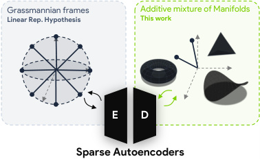

<!-- Start of picture text -->
Grassmannian frames Additive mixture of Manifolds Linear Rep. Hypothesis This work E D Sparse Autoencoders <!-- End of picture text -->

Figure 1: **From directions to manifolds.** Under the linear representation hypothesis, concepts correspond to individual directions in activation space, packed as a Grassmannian frame (Strohmer & Heath Jr, 2003). We consider the richer setting where concepts are organized along low-dimensional manifolds that are additively superposed and ask whether and how SAEs recover these geometric objects. 

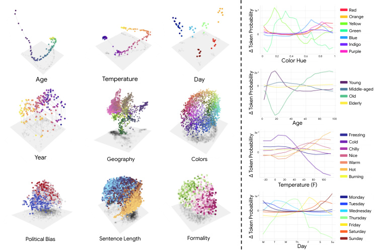

<!-- Start of picture text -->
1e -3 Red Orange Yellow Green 0 Blue Indigo Purple 0 0.2 Color Hue0.4 0.6 0.8 1 2e -3 Age Temperature Day 0 YoungMiddle-aged Old Elderly 0 20 40Age 60 80 100 3e -3 Freezing Cold Year Geography Colors 0 ChillyNiceWarm Hot -20 0 20 40 60 80 100 Burning Temperature (F) 1e -2 Monday Tuesday 0 Wednesday Thursday Friday Saturday Political Bias Sentence Length Formality M T W ThDay F S Su Sunday Δ Token Probability Δ Token Probability Δ Token Probability Δ Token Probability <!-- End of picture text -->

Figure 2: **Evidence of manifold structure in model representations and its effect on behavior.** (Left) PCA projections of Llama3.1-8B layer 19 activations corresponding to continuous concepts (e.g., age, temperature, day, color) reveal smooth geometric structure rather than isolated directions. (Right) Steering interventions between concept centroids (e.g., Wednesday to Thursday) produce smooth changes in token probabilities for concept-dependent outputs. 

den representations via a linear map (Belinkov, 2022); and linear algebraic operations suffice to manipulate this value (Mikolov et al., 2013; Korchinski et al., 2025; Karkada et al., 2025). LRH can thus be deemed as a generative model of neural network representations, the inverse of which leads to Sparse Autoencoders (SAEs) (Costa et al., 2025)—a popular tool used for unsupervised discovery of concepts learned by a model (Bricken et al., 2023; Gao et al., 2024; Bussmann et al., 2024; Rajamanoharan et al., 2024; Bussmann et al., 2025), with deep roots in the older literature on sparse coding (Olshausen & Field, 1996, 1997; Klindt et al., 2020, 2025), sparse subspace clustering (Elhamifar & Vidal, 2013; Abdolali & Gillis, 2021), and nonlinear manifold learning (Tenenbaum et al., 2000; Roweis & Saul, 2000). 

While SAEs have been used at scale to some success, e.g., to debug neural networks deployed at scale (OpenAI, 2025; Nguyen et al., 2025) or to identify candidate biomarkers learned by an epigenetics model (Wang et al., 2026), a growing body of recent work has argued that geometry of neural network representations is more intricate than LRH suggests (Lubana et al., 2025; Fel et al., 2025b; Karkada et al., 2026; Dooms & Gauderis, 2025): e.g., periodic concepts are encoded along a circular topology (Modell et al., 2025; Kantamneni & Tegmark, 2025; Engels et al., 2024); open-ended numerical concepts along a linear topology (Gurnee et al., 2025; Yocum et al., 2025); in-context statistics induce arbitrary graph structured representations (Park et al., 2025; Saanum et al., 2025; Sarfati et al., 2026); hierarchical representations are seen in genomics (Pearce et al., 2025) and vision-language models (Costa et al., 2025); syntactic relations are organized along a polar coordinate system that jointly encodes the existence and the type of dependencies (Diego-Simón et al., 2024); and spatially and temporally smooth representations emerge in vision and language models, respectively (Chung et al., 2018; Cohen et al., 2020; Lubana et al., 2025; Hosseini et al., 2026; Dhimoila et al., 2026; Fel et al., 2025a; Gorton, 2024). Karkada et al. (2026)’s results in fact show that these representation geometries reflect uncertainty across different values a concept can take, hence endowing meaning to distances between two points in the representation space—a property directly at odds with LRH, which primarily focuses on directions. These results then motivate the question: if representations of a concept exhibit structure outside the scope of LRH, **do SAEs capture such manifolds**1 **?** In particular, the mismatch between the assumptions made by SAEs and the 

> 1A note on the word: “manifold” is partly convention (Chung et al., 2018; Cohen et al., 2020; Pearce et al., 2025; Modell et al., 2025) and partly hope. Empirically, we mean curved, low-dimensional structures that representations appear to lie on; we adopt the strict differential-geometric definition as a working assumption. Whether real representations satisfy that assumption, and whether “manifold” survives as the right name, remains an open problem. 

underlying geometry of model activations does not by itself reject SAEs as valuable interpretations of model representations. If SAEs perform reconstruction well, then their activations must necessarily preserve the geometry of model representations. The key issue is therefore not whether the geometry is preserved, but whether it is organized in a useful and interpretable way. To address this question, we make the following contributions. 

- **Formalizing the Problem of Capturing Manifolds using SAEs.** We first demonstrate that a plethora of manifolds, i.e., nonlinearly curved geometric structures with causal efficacy, exist in representations of a pretrained LLM (Sec. 3). Inspired by prior work in neuroscience (Khona & Fiete, 2022; Eichenbaum, 2018), we formalize the problem of capturing such manifolds via sparse coding and show that if features (rows of an SAE decoder) specialize to specific values of a concept, such that different features cover different values, then the SAE can still satisfy its architectural constraints (e.g., sparsity), achieve good reconstruction, and yet capture the curved geometries underlying neural network representations by “tiling” the manifold with its features (Sec. 4). Interestingly, these results also yield an impossibility claim for current SAE architectures directly motivated by manifold learning algorithms. 

- **Exhaustively Characterizing How SAEs Tile Manifolds.** Moving beyond the theoretical possibility of SAEs tiling manifolds, we perform a thorough characterization to demonstrate this mechanism manifests in both natural settings and synthetic datasets. We showcase “tuning curves” (Butts & Goldman, 2006), highlighting the selectivity of SAE features for specific values of a concept: splitting into finer-than-necessary grained buckets (Lubana et al., 2025; Bricken et al., 2023; Chanin et al., 2024), while other parts are represented in a redundant manner across several features. This suggests that low reconstruction error alone does not guarantee coherent manifold recovery. In practice, SAEs often represent manifolds through fragmented collections of atoms that behave like localized detectors, rather than a coherent global structure. 

- **Unsupervised Discovery of Manifold Structures.** Toward a predictive account, we define an optimization problem motivated by the classical Ising model in Physics (Schneidman et al., 2006) to identify features whose co-activation statistics are either strongly correlated or anti-correlated. This unsupervised method helps identify both manifolds tiled by SAE features that we could find via supervised data (Fig. 2) and novel ones. Critically, our results show that mere correlation of feature directions, as used in prior work (Engels et al., 2024), need not suffice to find manifolds. 

More broadly, the perspective put forward in this paper suggests structured, nonlinear geometries are ubiquitous in model representations and are likely to be the unit of computation in which frameworks of interpretability should be defined. To this end, we either need protocols that actively seek to isolate manifolds from a model’s representations or perform posthoc analysis of SAE features to identify such geometries. Despite positive results, we note mixed selectivity features make the latter an unreliable option, but until novel featurizers are developed, are our current best option. 

### **A Geometric Note on Prior Negative Results for SAEs.** 

This perspective has direct practical value in that it explains a number of limitations and phenomena previously documented for SAEs. 

- ( **_i_ ) Instability of learned dictionaries.** The apparent instability of learned features across 

- runs can arise naturally when concepts are organized along manifolds: multiple equivalent bases or tilings can represent the same underlying geometry, so different initializations may yield different but equally valid decompositions. 

( **_ii_ ) Steering through individual features is often ineffective or brittle.** If features correspond to local directions or patches of a curved manifold, then intervening on a single feature pushes representations off the manifold rather than moving coherently along it 

- ( **_iii_ ) Difficulty of automated interpretability.** Only taken together do features span a 

- subspace whose structure makes sense of the underlying object; inspecting directions in isolation will fail to recover any meaning, or worse, hallucinate a spurious one. 

Together, these observations suggest that many negative findings about SAEs reflect a mismatch between direction-based interpretations and the nonlinear geometry of representations, rather than a failure of the models themselves. 

## **2 Notations: Sparse Coding and SAEs** 

Throughout, vectors are denoted by lowercase bold letters (e.g., **_x_** ) and matrices by uppercase bold letters (e.g., **_X_** ). We use [ _n_ ] for the set _{_ 1 _, . . . , n}_ . We write _B__c×d_ = _{_ **_M_** _∈_ R_c×d_ _| ∥_ **_M_** _i,_ : _∥_ 2 = 1 _, ∀i}_ for the set of matrices with unit-norm rows. For a matrix **_V_** _∈_ R_k×d_ , we write Im( **_V_** ) = _{_ **_xV_** : **_x_** _∈_ R_k_ _} ⊆_ R_d_ for its row span and **_X_** _≥_ **0** (or **_x_** _≥_ **0** ) indicates element-wise nonnegativity. It is well-established that current approaches for concept recovery from neural network representations are fundamentally instances of sparse coding (Fel et al., 2023, 2025a; Hindupur et al., 2025). Briefly, sparse coding assumes a generative model where data points are produced by a sparse linear combination of latent variables (the concepts) (Olshausen & Field, 1996, 1997). Given an input **_x_** , the goal is to extract its underlying generative factors using an overcomplete dictionary. 

**Definition 1** (Sparse Autoencoders) **.** _Given an activation_ **_x_** _∈A, SAEs extract a latent representation_ **_z_** _∈_ R_c_ _via a dictionary_ **_D_** _∈_ R_c×d_ _by solving the following optimization:_ 

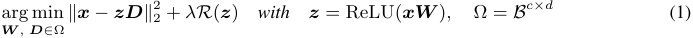

_where R_ ( **_z_** ) _is a sparsity-promoting regularizer (e.g., restricting ∥_ **_z_** _∥_ 0 _≤ k). Consequently, the localized reconstructions_ **_x_** ˆ = **_zD_** _lie in a sparse non-negative span (a cone)._ 

## **3 Manifolds are Ubiquitous in LLM Representations** 

Before we proceed further with a detailed study of how SAEs capture curved geometries, i.e., manifolds, we first show these objects are a construct worth studying. To this end, we build on recent results showing language model representations reflect symmetries in data statistics, resulting in curved representation geometries (Karkada et al., 2026). Many real-world concepts in fact exhibit such inherent continuity and structure, taking values that smoothly vary along some range (e.g., temperature varies along the real line). Such concepts can thus be expected to be represented along low-dimensional geometric objects embedded in a high-dimensional space. Building on this, we take several domains where a concept can be continuously varied, define a template in which a variable takes on values from this concept (see App. B for details), and sample several strings that vary primarily along this concept’s value. Performing a PCA of these representations then results in curved, often nonlinear geometries shown in Fig. 2 (left): this includes concepts characterized in prior work, e.g., days of the week organized in a cycle (Engels et al., 2024), and also new ones, e.g., colors organized along a paraboloid with circular hue and lightness dimensions, and spatial or temporal variables. In all cases in Fig. 2 (left), we see distances and neighborhoods encode semantic similarity, i.e., nearby points correspond to similar meanings. 

To emphasize these results further and highlight more strongly the disparity of these manifolds being outside the scope of LRH, we showcase that these manifolds are not merely geometric artifacts but are functionally relevant by measuring their effect on model behavior. Specifically, we find we can steer along the manifolds by steering between prototypical centroids (e.g., center of “Wednesday" tokens) and smoothly interpolating between those points. For tasks that depend on the underlying variable—such as predicting color names from hex codes or describing temperature in natural language—we observe that model outputs change smoothly and predictably along these interpolations (Fig. 2, right). This indicates that the manifold structure is not only present in the representation but also causally influences downstream behavior. 

## **4 Formalizing Manifold Capture in Sparse Representations** 

To concretize what it means to successfully “capture” manifolds identified from off-the-shelf pretrained LLMs using SAEs, we first analyze an abstraction that extends LRH to concepts with multi-dimensional, nonlinearly curved geometries. We call this model of representations the “Additive Mixture of Manifolds” (see Figure 1). We emphasize we are not making a normative claim here that neural networks satisfy this model of representations; instead, our goal is to take a concrete scenario where we can be rigorous, define useful metrics, and then see how results generalize to off-the-shelf models. 

**Representations as Additive Mixture of Manifolds.** The Linear Representation Hypothesis (LRH) models each concept as a ray in activation space: a single direction scaled by a coefficient (Park et al., 

2023; Costa et al., 2025). The geometric structure identified in Sec. 3 suggests that this is a special case of a richer phenomenon in which concepts vary continuously over low-dimensional surfaces, the formal description of which can be attributed to several prior works (Modell et al., 2025; Fel et al., 2025b; Costa et al., 2025; Lubana et al., 2025). 

**Definition 2** (Additive Mixture of Manifolds) **.** _Let M_ 1 _, . . . , Mm ⊂_ R_d_ _be compact smooth submanifolds with ambient dimensionality_ dim( _Mi_ ) = _di ≪ d. Let_ **_f_** _i_ : _Mi →_ R_d_ _be the immersion maps from each submanifold into_ R_d_ _. Additive mixture of manifolds defines a model of representations wherein representations decompose into a superposition of manifolds as follows._ 

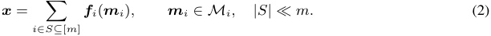

In other words, **_x_** lives in a Minkowski sum of the immersed submanifolds _Mi_ . When each _Mi_ is a ray ( _di_ = 1), every term **_f_** _i_ ( **_m_** _i_ ) is a scalar multiple of a fixed direction, recovering the LRH. In the general case, each manifold is contained in a _ki_ -dimensional affine subspace and admits a parametrization **_m_** _i_ ( **_θ_** ) = **_γ_** _i_ ( **_θ_** ) **_V_** _i_ + **_b_** _i_ . Here, **_θ_** _∈_ Θ _i ⊆_ R_di_ represents the intrinsic coordinates, and the map **_γ_** _i_ is a smooth embedding. Furthermore, **_V_** _i ∈_ R_ki×d_ is an orthonormal basis matrix, and **_b_** _i ∈_ Im( **_V_** _i_ ) is a translation vector. Importantly, superposition arises when� _i__ki>d_.Now that we have formally defined the target object of our interest, we are ready to examine what it mathematically means to capture a manifold. 

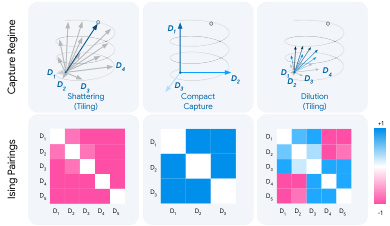

<!-- Start of picture text -->
D1 D1 D2 D3 D4 D3 D2 D1D2 D3 D4 Shattering Compact  Dilution (Tiling) Capture (Tiling) +1 D1 D1 D1 D2 D2 D3 D2 D3 D4 D4 D5 D3 D5 D1 D2 D3 D4 D5 D1 D2 D3 D1 D2 D3 D4 D5 -1 Capture Regime Ising Pairings <!-- End of picture text -->

**Subspace Recovery via SAEs** It is easy to see that for an SAE to reconstruct a representation **_x_** , **_x_** ought to lie in the linear span of its decoder. The central observation we posit in this section is that an SAE captures a manifold well when a small, fixed group of atoms spans a subspace containing it, and the encoder consistently selects this group on every input from the manifold. 

**Definition 3** (Subspace capture) **.** _An SAE captures M at precision ε if there exists S__⋆_ _⊂_ [ _c_ ] _with |S__⋆_ _| ≤ kM such that_ 

# of features required to reconstruct manifold points 

Figure 3: **Tiling vs. Capture.** When features are highly selective, manifolds are “tiled” by shattering into sub-parts and features show anti-correlated occurrences (left). Compact capture involves features jointly reconstructing the manifold with no selectivity, resulting in positive couplings for the full support (middle). Dilution occurs when many redundant atoms activate to tile the manifold, but with feature sets of mixed selectivity (right). 

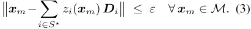

Intuitively speaking, the definition says that a few jointly reconstructing the manifold with no selectivdecoder directions serve as a low-dimensional deity, resulting in positive couplings for the full support (middle). Dilution occurs when many redundant tector for _M_ . This is parsimonious (few atoms for atoms activate to tile the manifold, but with feature the whole manifold) and coherent (the same atoms sets of mixed selectivity (right). fire for every input on _M_ ), and under an additional assumption it is possible to establish a condition for the capture of a manifold in the sense of Defn. 3. We note that this formulation is closely related to the subspace-preserving recovery condition that grounds sparse subspace clustering (Elhamifar & Vidal, 2013; Soltanolkotabi et al., 2014; Tschannen & Bölcskei, 2018); we provide a detailed treatment of this connection in App. A. 

**Theorem 1** (Subspace recovery) **.** _Let M lie in a k-dimensional affine subspace with orthonormal basis_ **_V_** _. Let_ **_D_** _be µ-incoherent, and suppose there exists_ **_S_**_⋆_ _⊂_ [ _c_ ] _with |_ **_S_**_⋆_ _|_ = _k such that_ Im( **_V_** ) = span( **_DS_**_⋆_ ) _and µ <_ 1 _/_ (2 _k −_ 1) _. If the SAE achieves reconstruction error ε_ ( _M_ ) _≤ λ, then an idealized sparse decoder over_ **_D_** _captures M at precision O_ ( _λ_ ) _._ 

The proof relies on classical results in sparse dictionary learning (Donoho & Elad, 2003; Tropp, 2004, 2006); see App. D for details, including a discussion of the amortization gap between the idealized decoder and the trained encoder. Essentially, when (i) the reconstruction error is low enough, (ii) the sparsity regime is aligned with the ambient dimension of _M_ , and (iii) the dictionary is incoherent enough, we can ensure proper manifold recovery in the subspace sense. The coefficients ( _zi_ ) _i∈_ **_S_** _⋆_ then vary continuously as **_x_** _m_ moves along _M_ , tracing out the manifold in the SAE’s coordinate system. 

**From Capture to Tiling.** The result above highlights an ideal scenario, i.e., the features align with the ambient space of the manifold. However, when the number of atoms allocated to a manifold 

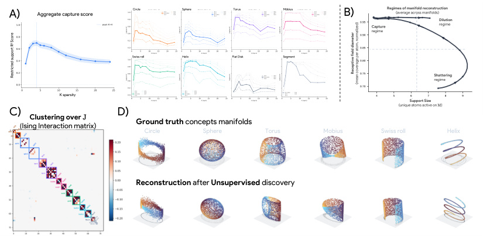

<!-- Start of picture text -->
A) Aggregate capture score Circle Spher e Torus Möbius B) Regimes of manifold reconstruction  (average across manifolds) Dilution Capture regime regime Swiss roll Helix Flat Disk Segment K spa rs ity Shattering regime K spa rs ity Support Size C) D) (unique atoms active on  M ) Clustering over  J Ground truth  concepts manifolds (Ising Interaction matrix) Circle Sphere Torus Mobius Swiss roll Helix Reconstruction  after  Unsupervised  discovery 2 ScoreRestricted support R 2 ScoreRestricted support R Receptive field diameter (mean coverage per atom, normalized) <!-- End of picture text -->

Figure 4: **Synthetic validation of manifold capture.** We construct a controlled benchmark where observations are sparse mixtures of known manifolds embedded in R128 (dictionary width _c_ =512, sparsity _k_ =4) and make three observations. **A)** Subspace capture has a sparsity sweet spot. Restricted _R_2 measures whether _ki_ atoms suffice to reconstruct each manifold from the superposed codes. Capture peaks near _k_ = 4 and degrades at both lower and higher sparsity. Per-manifold breakdowns (right) sweep the number of restricted atoms around each manifold’s embedding dimension _ki_ . **B)** Increasing sparsity drives the SAE through three regimes. At low _k_ , atoms are broadly shared and the manifold is shattered across unrelated groups. At intermediate _k_ , a compact set of atoms spans each manifold’s subspace (capture). At high _k_ , many redundant atoms fire per point and individual atoms lose specificity (dilution). The phase diagram tracks this transition via support size and receptive field spread, averaged across all manifold types. **C–D)** Even outside the capture regime, manifold structure can be recovered post hoc. Fitting a pairwise Ising model on binarized codes yields a coupling matrix **_J_** whose block-diagonal structure aligns with the ground-truth manifold partition ( **C** ). Decoding through the recovered atom groups faithfully reconstructs the topology and geometry of all manifold types without supervision ( **D** ). 

exceeds its ambient dimension _ki_ , the SAE is no longer constrained to reuse a fixed group and may assign different atoms to different regions of _Mi_ . Each atom then acts as a localized detector with a receptive field on the manifold: this mechanism is essentially the one popularly studied in neuroscience, wherein neurons are argued to be sensitive to different values of a concept, covering overall geometry via the population code (Khona & Fiete, 2022; Eichenbaum, 2018). In line with this literature, we call this phenomenon **tiling** : localized features with overlapping support whose joint activity encodes position along the manifold. As we show in Fig. 3, tiling manifests in two qualitatively different forms: **shattering** , where active sets _{_ supp( **_z_** ( **_x_** _m_ )) _}_ **_x_** _m∈M_ across _M_ are nearly disjoint and atoms partition the manifold, and **dilution** , where active sets overlap substantially but no compact group of size _≤ ki_ accounts for _M_ . We give operational definitions of both regimes in Appendix. F. 

Regardless of whether the SAE is in the capture or tiling regime, the group of decoder atoms associated with a manifold is unknown and must be discovered from the codes alone. To this end, one must use co-activation statistics: atoms that jointly represent a manifold fire together, or in smooth succession, across inputs on _Mi_ . Raw co-activation of course confounds two distinct sources of statistical dependence: structural co-activation (atoms that span or tile the same manifold) and correlational co-occurrence (concepts that tend to appear together in the data). It is also dominated by atoms that fire universally, which co-activate with everything without carrying manifold-specific information. 

### **4.1 Ising Pairings and Regimes of Manifold Representation** 

To disentangle structural co-activation from spurious correlations, we model the joint activation statistics of SAE features using a pairwise Ising model over binarized codes (Ising, 1925). Let 

_si_ = 2 _∗_ **1** [ _zi >_ 0] _−_ 1 denote whether atom _i_ is active. We define 

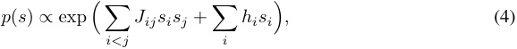

where the fields _hi_ absorb marginal firing rates and the couplings _Jij_ capture _direct_ interactions between atoms after conditioning on the rest of the population. 

This formulation isolates the dependencies that arise from atoms jointly representing a manifold. Atoms that fire frequently across all inputs are explained by large _hi_ but exhibit weak couplings, while indirect correlations induced by superposition are factored out by construction. As a result, _J_ provides a more faithful representation of the functional relationships between features than raw co-activation or decoder similarity. 

Importantly, the _sign_ and structure of the couplings reflect how a manifold is represented by the SAE (Figure 3. In the **capture** regime, a fixed set of atoms spans the manifold and co-activate consistently across inputs, yielding predominantly positive couplings within the group. In the **tiling** (shattering) regime, atoms specialize to distinct regions of the manifold and rarely activate together, leading to strong negative couplings that encode mutual exclusion. In the intermediate **dilution** regime, redundant and overlapping atoms produce a mixture of positive and negative interactions, resulting in a heterogeneous coupling structure. 

These regimes therefore induce distinct signatures in the interaction matrix _J_ . Rather than identifying manifolds through geometric similarity of decoder directions, we can instead recover them as _communities of atoms with strong pairwise interactions_ , irrespective of whether those interactions are cooperative or inhibitory. This perspective reframes manifold discovery as a problem of uncovering structured dependencies in feature activations, which we operationalize in Sec. 5. 

### **4.2 A Toy Model of Manifold Superposition** 

To validate the framework of Sec. 4 in a controlled setting, we construct a synthetic benchmark where the ground-truth manifolds, their ambient subspaces, and the sparse mixing process are all known by construction (Fig. 4). Specifically, we define eight manifold types spanning a range of topologies and intrinsic dimensions: circles, spheres, tori, Möbius strips, Swiss rolls, helices, flat disks, and line segments. Each instance is embedded into R_d_ via a random orthonormal matrix **_V_** _i ∈_ R_ki×d_ and isotropically rescaled to unit RMS norm, preserving all geometric relationships. We instantiate six parameter variants per type (48 instances total), generate observations **_x_** =� _i∈S_**_z_**_i_**_V_**_i_+**_ϵ_**following Defn. 2, and train TopK SAEs across a range of sparsity budgets; see App. E for details. 

**Results.** Three findings emerge from this controlled setting (Fig. 4). ( **_i_** ) Subspace capture has a sparsity sweet-spot. ( **_ii_** ) Increasing sparsity drives the SAE through the three reconstruction regimes hypothesized in Section 4. ( **_iii_** ) Even outside the capture regime, manifold structure can be recovered post hoc. 

## **5 Characterizing Manifold Capture in LLMs** 

We now aim to confirm our framework and findings from the synthetic setup in a more realistic setup. To this end, we use representations from Llama3.1-8B at the residual stream of layer 19. We train five SAE architectures: Standard ( _ℓ_ 1), JumpReLU (Rajamanoharan et al., 2024), TopK (Gao et al., 2024), BatchTopK (Bussmann et al., 2024), and Matryoshka (Bussmann et al., 2025), with expansion factors of 8 and 16 and sparsities of 64, 128, and 256, on 500M tokens of The Pile (Monology, 2021); we only analyze SAEs achieving variance explained above 0.85. See App. B for further details. 

**SAEs do not achieve compact capture.** We apply the same restricted _R_2 protocol as in Sec. 4.2: for each manifold, we greedily select atoms by residual variance explained and measure reconstruction quality as a function of support size. Fig. 6 shows the result averaged across manifolds and architectures. Variance explained grows with the number of restricted features but plateaus at a support size well beyond each manifold’s ambient dimension. This indicates that current SAEs do not allocate a compact atom group whose span contains the manifold. Instead, the geometry is diluted across a larger, partially redundant set of features, placing SAEs in the dilution regime identified in Sec. 4.2. 

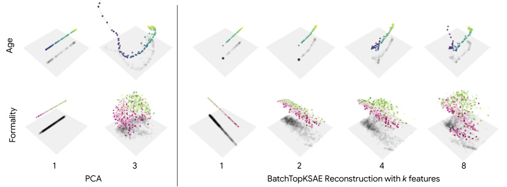

<!-- Start of picture text -->
1 3 1 2 4 8 PCA BatchTopKSAE Reconstruction with  k  features Age Formality <!-- End of picture text -->

Figure 5: **Piecewise-linear approximation of manifold geometry.** (Left) PCA projections of Llama3.18B activations show that manifolds are well described by a small number of global components. (Right) Reconstructing from increasing numbers of SAE features approximates the manifold in a piecewise-linear fashion: each feature captures a local region, and their union progressively covers the full geometry. 

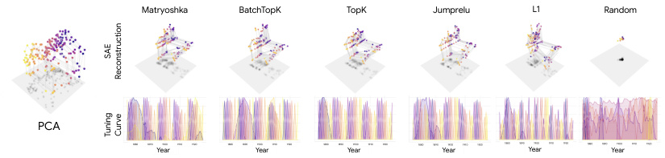

<!-- Start of picture text -->
Matryoshka BatchTopK TopK Jumprelu L1 Random PCA 1880 1890 Year 1900 1910 1920 1880 1890 Year 1900 1910 1920 1880 1890 Year 1900 1910 1920 1880 1890 Year 1900 1910 1920 1880 1890 Year 1900 1910 1920 1880 1890 Year 1900 1910 1920 SAE Reconstruction Tuning  Curve <!-- End of picture text -->

Figure 7: **SAE features tile manifolds with tuning curves reminiscent of population coding.** Activations of the top features as a function of position along the “years” manifold. Each feature exhibits a localized, smooth activation profile covering a restricted region of the manifold, with overlapping support across features. For the years manifold, most SAEs learn features selective to the ‘ones’ digit (activating periodically every 10 years) alongside features encoding the decade. These patterns are reminiscent of neural tuning curves in biological population codes, where no single neuron encodes the full variable but the population’s joint activity traces out the underlying geometry. 

### **Features tile manifolds as localized detectors.** 

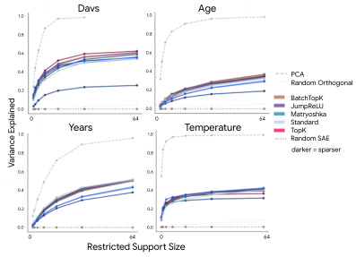

<!-- Start of picture text -->
1.0 Days 1.0 Age 0.8 0.8 0.6 0.6 0.4 0.4 PCA 0.2 0.2 Random Orthogonal BatchTopK 0.01.0 0 Years 64 0.01.0 0 Temperature 64 JumpReLUMatryoshkaStandardTopKRandom SAE 0.8 0.8 darker = sparser 0.6 0.6 0.4 0.4 0.2 0.2 0.0 0.0 0 64 0 64 Restricted Support Size Variance Explained <!-- End of picture text -->

If SAEs do not capture manifolds compactly, how do they represent them? Fig. 5 contrasts PCA projections of the raw activations (which reveal smooth, low-dimensional geometry) with SAE reconstructions using increasing numbers of features. Individual features reconstruct local patches of the manifold in a piecewise-linear fashion, and their union progressively covers the full geometry. These results place current SAEs in an intermediate regime between ideal subspace capture—where a small, fixed set of atoms spans the manifold—and shattering— where localized features cover different regions of the geometry. While the manifold structure is preserved, it is fragmented across many features, consistent with the dilution behavior from Sec. 4.2. 

Figure 6: **Subspace capture on Llama3.1-8B.** Variance explained as a function of the number of restricted features, averaged across manifolds and SAE architectures. Performance increases with support size but plateaus well beyond the manifold’s ambient dimension, indicating that current SAEs are in the Dilution regime identified in Sec. 4.2. 4.2.. 

**Tiling selectivity.** This shattering effect is furidentified in Sec. 4.2. 4.2.. ther made clear when analyzing feature activations as a function of the manifold concept. In Fig. 7, we plot the activations of the top-10 features for each SAE on the years manifold. We observe 

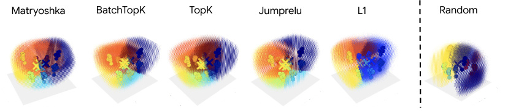

<!-- Start of picture text -->
Matryoshka BatchTopK TopK Jumprelu L1 Random <!-- End of picture text -->

Figure 8: Receptive field plots for different SAE architectures on the days of week manifold. Sampled points in the ambient space of the manifold are colored by their highest activating SAE feature, highlighting feature selectivity in the ambient space as well as the architectural biases of different SAEs (e.g., angular separability in Top-K SAEs and linear separability in _L_ 1). 

that features exhibit localized activation patterns, responses vary smoothly across the manifold, and multiple features cover overlapping regions of the variable. In particular, for years, we can see that most SAEs learn individual features that represent the ones digit of the year, activating periodically every 10 years, as well as other features that carry information about the decade. These patterns are reminiscent of neural tuning curves (Pouget et al., 1999; Hubel & Wiesel, 1968; Georgopoulos et al., 1986), where each feature responds to a restricted region of the manifold. Figure 8 visualizes the receptive fields of the top features for each SAE on the days of the week manifold, highlighting the selectivity of features in the ambient space within which the manifold lives. 

We further explore the selectivity of features by plotting SAE feature activations in the ambient space (defined by the top 3 principal components) a manifold lives in. We sample points in the ambient space, decompose them with the SAE, and color those points by their max activating features. We weight the size of these points by using the reconstruction error of the SAE to model the ambient space as a probability distribution of possible manifold points. In Figure 8, we see that features exhibit selectivity for each day of the week, with the different assumptions made by each SAE resulting (e.g. angular separability vs linear separability) visible in how the ambient space is shattered by the features. 

Overall, the observations in this section strongly support a tiling model of representation: manifolds are encoded by collections of localized features whose joint activity captures the underlying geometry. A second critical implication is that individual features will only offer a narrow view of what concept an SAE is trying to capture: only the group of features that tile a manifold as a whole carries geometric meaning. Interpretability in this regime thus requires reasoning about subspaces, not about individual dictionary elements. 

### **Limitation. A Mismatch Between Featurizers and Geometric Structure.** 

SAEs were designed around sparsity in an almost-orthogonal dictionary, with the linear representation hypothesis as their guiding intuition: features compose by addition and are recovered as directions. Recent refinements admit multidimensional features, but the featurizer has not followed: atoms remain one-dimensional, and the loss rewards reconstruction without rewarding any coherent treatment of the geometric objects that underlie it. The structures we identify sit outside this design point—curved rather than flat, equipped with non-trivial topology, and organized into objects no single atom captures. 

Post-hoc recovery, as we will show now, is possible but unreliable: mixed-selectivity features muddle the co-activation signal, and groupings extracted from Ising couplings are only as good as the underlying tiling permits. Until featurizers are developed that treat geometric objects as the primitive (rather than directions to be assembled into geometry after the fact) post-hoc analysis remains the best available tool, but should be read as a workaround, not a solution. 

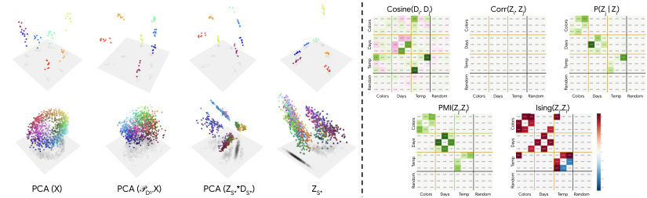

<!-- Start of picture text -->
Cosine(Di, Dj) Corr(Zi, Zj) P(Zj | Zi) Colors Days Temp Random Colors Days Temp Random Colors Days Temp Random PMI(Zj,Zi) Ising(Zj,Zi) PCA (X) PCA (𝒫DS*X) PCA (ZS**DS*) ZS* Colors Days Temp Random Colors Days Temp Random Colors Colors Colors Days Days Days Temp Temp Temp Random Random Random Colors Colors Days Days Temp Temp Random Random <!-- End of picture text -->

Figure 9: **Reading manifold geometry from feature groups.** (Left) Four views of the days and colors manifolds using the top 3 supervised features per manifold: PCA of activations (ground truth), PCA of the projection onto the decoder subspace spanned by the group, PCA of partial code reconstructions, and raw feature activations as coordinates. Projecting onto the decoder subspace most faithfully recovers the continuous geometry. (Right) Pairwise feature similarity under five metrics. Ising couplings and conditional co-activation produce the clearest block-diagonal structure aligned with ground-truth manifold assignments. 

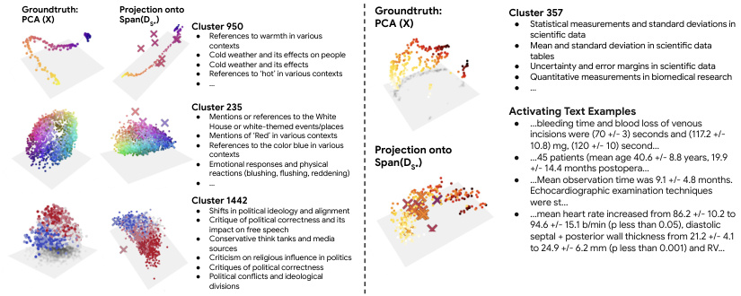

<!-- Start of picture text -->
Groundtruth: Projection onto  Groundtruth: Cluster 357 PCA (X) Span(DS*) Cluster 950 PCA (X) ● Statistical measurements and standard deviations in ● References to warmth in various  scientific data contexts ● Mean and standard deviation in scientific data ● Cold weather and its effects on people tables ●●● Cold weather and its effectsReferences to ‘hot’ in various contexts…  ●●● Uncertainty and error margins in scientific dataQuantitative measurements in biomedical research… Cluster 235 ● Mentions or references to the White  Activating Text Examples House or white-themed events/places ● ...bleeding time and blood loss of venous ● Mentions of ‘Red’ in various contexts incisions were (70 +/- 3) seconds and (117.2 +/- ●●● References to the color blue in various contextsEmotional responses and physical reactions (blushing, flushing, reddening)… Projection onto Span(DS*) ●● 10.8) mg, (120 +/- 10) second... ...45 patients (mean age 40.6 +/- 8.8 years, 19.9 +/- 14.4 months postopera... ...Mean observation time was 9.1 +/- 4.8 months. Echocardiographic examination techniques Cluster 1442 were st... ●● Shifts in political ideology and alignmentCritique of political correctness and its impact on free speech ● ...mean heart rate increased from 86.2 +/- 10.2 to 94.6 +/- 15.1 b/min (p less than 0.05), diastolic ● Conservative think tanks and media  septal + posterior wall thickness from 21.2 +/- 4.1 sources to 24.9 +/- 6.2 mm (p less than 0.001) and RV... ● Criticism on religious influence in politics ● Critiques of political correctness ● Political conflicts and ideological divisions <!-- End of picture text -->

Figure 10: **Unsupervised Discovery from SAE Codes.** (Left) The Ising-pipeline recovers known manifolds (temperature, colors, political bias) as distinct feature communities. (Right) The same pipeline surfaces a novel manifold encoding epistemic uncertainty in scientific contexts, demonstrating its utility for generating hypotheses beyond known structures. 

## **6 Unsupervised Manifold Discovery** 

The results of Sec. 5 confirm that SAEs distribute manifold geometry across many localized features. Recovering coherent geometric objects therefore requires post-hoc analysis that groups related atoms without prior knowledge of the underlying manifolds. We thus now evaluate candidate grouping strategies and demonstrate that the Ising-model introduced in Sec. 4 transfers from the synthetic setting to real language model representations. 

**Which similarity metric can recover manifold groups.** A natural starting point is to cluster features by decoder cosine similarity, as explored in prior work (Engels et al., 2025). However, under subspace capture, the atoms spanning a manifold’s ambient subspace may be nearly orthogonal, and under tiling, atoms covering adjacent but non-overlapping regions of the manifold need not have similar decoder directions. Decoder geometry thus carries no privileged information about the manifold topology that features collectively tile. Co-activation statistics offer a more principled alternative: features that jointly represent a manifold fire together, and in the shattering case the features that jointly represent a manifold have extreme inhibition against each other. We compare five similarity measures for constructing feature affinity graphs: ( **_i_** ) decoder cosine similarity, ( **_ii_** ) conditional co-activation probability, ( **_iii_** ) Pearson correlation of activation magnitudes, ( **_iv_** ) pointwise mutual information, and ( **_v_** ) Ising pairwise couplings. To evaluate each metric, we use the supervised feature selection pipeline as ground truth: for three manifolds (colors, days, and temperature), we take the top three features per manifold and compute pairwise similarity under each metric. Fig. 9 (right) visualizes the 

resulting affinity matrices. A metric succeeds if it produces clear block-diagonal structure with high within-manifold and low cross-manifold similarity. **Ising couplings and conditional co-activation yield the cleanest separation** , while decoder cosine similarity and Pearson correlation fail to recover the block structure, consistent with the observation that manifold membership is a functional property (which atoms co-activate) rather than a geometric one (where atoms point). 

**Unsupervised discovery pipeline.** We apply the Ising-pipeline to a BatchTopK SAE trained on Llama3.1-8B (layer 19, expansion _×_ 8, _k_ = 64). Fig. 10 (left) confirms that the procedure recovers the supervised manifolds identified in Sec. 3: temperature, colors, and political bias emerge as distinct communities with coherent geometric structure. Beyond recovering known manifolds, the pipeline also surfaces _novel_ geometric structures. Fig. 10 (right) shows a previously unidentified manifold related to epistemic uncertainty, encoding the degree of measurement error and imprecision in scientific contexts. This demonstrates that the Ising-based discovery pipeline can serve as a tool for unsupervised manifold discovery. 

## **7 Conclusion** 

The presence of structured, nonlinear geometries in model representations suggests that the fundamental unit of interpretation need not be isolated directions. While sparse autoencoders can, in principle, represent such structures, we show that in practice they do so in a fragmented manner: manifolds are not captured as coherent subspaces, but are instead tiled across many localized, partially redundant features. This preserves geometry only implicitly, obscuring it at the level of individual features and limiting the reliability of direction-based interpretability. Moving forward, we argue that interpretability should be reframed around the recovery and manipulation of geometric structures rather than individual directions. This includes both developing featurization methods that explicitly target manifolds, and designing analysis tools that operate on groups of features as coherent units. 

More broadly, our results suggest that understanding neural networks requires shifting from a dictionary of concepts to a geometry of representations—where meaning is encoded not in single atoms, but in the structure they collectively induce. 

## **Acknowledgments** 

The authors thank Thomas Icard and the Mechanisms team at Goodfire, David Klindt, Aaron Mueller, Demba Ba, Sumedh Hindupur, Valerie Costa, and Ren Makino for helpful discussions during the course of this project. 

## **References** 

- Maryam Abdolali and Nicolas Gillis. Beyond linear subspace clustering: A comparative study of nonlinear manifold clustering algorithms. _Computer Science Review_ , 2021. 

- Sanjeev Arora, Yuanzhi Li, Yingyu Liang, Tengyu Ma, and Andrej Risteski. Linear algebraic structure of word senses, with applications to polysemy. _Transactions of the Association for Computational Linguistics_ , 6:483–495, 2018. 

- Randall Balestriero and Richard G Baraniuk. Mad max: Affine spline insights into deep learning. _Proceedings of the IEEE_ , 2020. 

- Randall Balestriero et al. A spline theory of deep learning. _Proceedings of the International Conference on Machine Learning (ICML)_ , 2018. 

- Yonatan Belinkov. Probing classifiers: Promises, shortcomings, and advances. _Computational Linguistics_ , 2022. 

- Mikhail Belkin and Partha Niyogi. Laplacian eigenmaps and spectral techniques for embedding and clustering. _Advances in Neural Information Processing Systems (NeurIPS)_ , 2001. 

- Julian Besag. Spatial interaction and the statistical analysis of lattice systems. _Journal of the Royal Statistical Society: Series B (Methodological)_ , 1974. 

- Usha Bhalla, Suraj Srinivas, Asma Ghandeharioun, and Himabindu Lakkaraju. Towards unifying interpretability and control: Evaluation via intervention. _ArXiv e-print_ , 2024. 

- Usha Bhalla, Alex Oesterling, Claudio Mayrink Verdun, Himabindu Lakkaraju, and Flavio P. Calmon. Temporal sparse autoencoders: Leveraging the sequential nature of language for interpretability. 2026. URL https://arxiv.org/abs/2511.05541. 

- Sid Black, Lee Sharkey, Leo Grinsztajn, Eric Winsor, Dan Braun, Jacob Merizian, Kip Parker, Carlos Ramón Guevara, Beren Millidge, Gabriel Alfour, et al. Interpreting neural networks through the polytope lens. _ArXiv e-print_ , 2022. 

- Trenton Bricken, Adly Templeton, Joshua Batson, Brian Chen, Adam Jermyn, Tom Conerly, Nick Turner, Cem Anil, Carson Denison, Amanda Askell, Robert Lasenby, Yifan Wu, Shauna Kravec, Nicholas Schiefer, Tim Maxwell, Nicholas Joseph, Zac Hatfield-Dodds, Alex Tamkin, Karina Nguyen, Brayden McLean, Josiah E Burke, Tristan Hume, Shan Carter, Tom Henighan, and Christopher Olah. Towards monosemanticity: Decomposing language models with dictionary learning. _Transformer Circuits Thread_ , 2023. https://transformer-circuits.pub/2023/monosemanticfeatures. 

- Bart Bussmann, Patrick Leask, and Neel Nanda. Batchtopk sparse autoencoders. _ArXiv e-print_ , 2024. 

- Bart Bussmann, Noa Nabeshima, Adam Karvonen, and Neel Nanda. Learning multi-level features with matryoshka sparse autoencoders. _arXiv preprint arXiv:2503.17547_ , 2025. 

- Daniel A Butts and Mark S Goldman. Tuning curves, neuronal variability, and sensory coding. _PLoS biology_ , 4(4):e92, 2006. 

- David Chanin, James Wilken-Smith, Tomas Dulka, Hardik Bhatnagar, and Joseph Bloom. A is for absorption: Studying feature splitting and absorption in sparse autoencoders. _ArXiv e-print_ , 2024. 

- Yubei Chen, Dylan Paiton, and Bruno Olshausen. The sparse manifold transform. _Advances in neural information processing systems_ , 31, 2018. 

- Lingyang Chu, Xia Hu, Juhua Hu, Lanjun Wang, and Jian Pei. Exact and consistent interpretation for piecewise linear neural networks: A closed form solution. _Proceedings of the International Conference on Knowledge Discovery and Data Mining (KDD)_ , 2018. 

- SueYeon Chung and Larry F Abbott. Neural population geometry: An approach for understanding biological and artificial neural networks. _Current opinion in neurobiology_ , 70:137–144, 2021. 

- SueYeon Chung, Daniel D Lee, and Haim Sompolinsky. Classification and geometry of general perceptual manifolds. _Physical Review X_ , 8(3):031003, 2018. 

- Simona Cocco, Stanislas Leibler, and Rémi Monasson. Neuronal couplings between retinal ganglion cells inferred by efficient inverse statistical physics methods. _Proceedings of the National Academy of Sciences_ , 2009. 

- Uri Cohen, SueYeon Chung, Daniel D Lee, and Haim Sompolinsky. Separability and geometry of object manifolds in deep neural networks. _Nature communications_ , 2020. 

- Ronald R Coifman and Stéphane Lafon. Diffusion maps. _Applied and computational harmonic analysis_ , 2006. 

- Valérie Costa, Thomas Fel, Ekdeep Singh Lubana, Bahareh Tolooshams, and Demba Ba. From flat to hierarchical: Extracting sparse representations with matching pursuit. _arXiv preprint arXiv:2506.03093_ , 2025. 

- Róbert Csordás, Christopher Potts, Christopher D Manning, and Atticus Geiger. Recurrent neural networks learn to store and generate sequences using non-linear representations. In Yonatan Belinkov, Najoung Kim, Jaap Jumelet, Hosein Mohebbi, Aaron Mueller, and Hanjie Chen (eds.), _Proceedings of the 7th BlackboxNLP Workshop: Analyzing and Interpreting Neural Networks for NLP_ , pp. 248–262, Miami, Florida, US, November 2024. Association for Computational Linguistics. doi: 10.18653/v1/2024.blackboxnlp-1.17. URL https://aclanthology.org/2024. blackboxnlp-1.17/. 

- Hoagy Cunningham, Aidan Ewart, Logan Riggs, Robert Huben, and Lee Sharkey. Sparse autoencoders find highly interpretable features in language models. _arXiv preprint arXiv:2309.08600_ , 2023. 

- Arthur P Dempster. Covariance selection. _Biometrics_ , 1972. 

- Gregoire Dhimoila, Thomas Fel, Victor Boutin, and Agustin Picard. Cross-modal redundancy and the geometry of vision-language embeddings. _Proceedings of the International Conference on Learning Representations (ICLR)_ , 2026. 

- Pablo Diego-Simón, Stéphane d’Ascoli, Emmanuel Chemla, Yair Lakretz, and Jean-Rémi King. A polar coordinate system represents syntax in large language models. _Advances in Neural Information Processing Systems (NeurIPS)_ , 2024. 

- David L Donoho and Michael Elad. Optimally sparse representation in general (nonorthogonal) dictionaries via l1 minimization. _Proceedings of the National Academy of Sciences_ , 2003. 

- David L Donoho and Carrie Grimes. Hessian eigenmaps: Locally linear embedding techniques for high-dimensional data. _Proceedings of the National Academy of Sciences_ , 2003. 

- Thomas Dooms and Ward Gauderis. Finding manifolds with bilinear autoencoders. _arXiv preprint arXiv:2510.16820_ , 2025. 

- Howard Eichenbaum. Barlow versus hebb: When is it time to abandon the notion of feature detectors and adopt the cell assembly as the unit of cognition? _Neuroscience letters_ , 680:88–93, 2018. 

- Nelson Elhage, Tristan Hume, Catherine Olsson, Nicholas Schiefer, Tom Henighan, Shauna Kravec, Zac Hatfield-Dodds, Robert Lasenby, Dawn Drain, Carol Chen, Roger Grosse, Sam McCandlish, Jared Kaplan, Dario Amodei, Martin Wattenberg, and Christopher Olah. Toy models of superposition. _Transformer Circuits Thread_ , 2022. 

- Ehsan Elhamifar and René Vidal. Sparse manifold clustering and embedding. _Advances in Neural Information Processing Systems (NeurIPS)_ , 2011. 

- Ehsan Elhamifar and René Vidal. Sparse subspace clustering: Algorithm, theory, and applications. _IEEE transactions on pattern analysis and machine intelligence_ , 2013. 

- Joshua Engels, Eric J Michaud, Isaac Liao, Wes Gurnee, and Max Tegmark. Not all language model features are one-dimensionally linear. _arXiv preprint arXiv:2405.14860_ , 2024. 

- Joshua Engels, Eric J. Michaud, Isaac Liao, Wes Gurnee, and Max Tegmark. Not all language model features are one-dimensionally linear, 2025. URL https://arxiv.org/abs/2405.14860. 

- Thomas Fel, Victor Boutin, Mazda Moayeri, Remi Cadene, Louis Bethune, Mathieu Chalvidal, and Thomas Serre. A holistic approach to unifying automatic concept extraction and concept importance estimation. _Advances in Neural Information Processing Systems (NeurIPS)_ , 2023. 

- Thomas Fel, Ekdeep Singh Lubana, Jacob S Prince, Matthew Kowal, Victor Boutin, Isabel Papadimitriou, Binxu Wang, Martin Wattenberg, Demba Ba, and Talia Konkle. Archetypal sae: Adaptive and stable dictionary learning for concept extraction in large vision models. _Proceedings of the International Conference on Machine Learning (ICML)_ , 2025a. 

- Thomas Fel, Binxu Wang, Michael A Lepori, Matthew Kowal, Andrew Lee, Randall Balestriero, Sonia Joseph, Ekdeep S Lubana, Talia Konkle, Demba Ba, et al. Into the rabbit hull: From task-relevant concepts in dino to minkowski geometry. _arXiv preprint arXiv:2510.08638_ , 2025b. 

- Jerome Friedman, Trevor Hastie, and Robert Tibshirani. Sparse inverse covariance estimation with the graphical lasso. _Biostatistics_ , 2008. 

- Leo Gao, Stella Biderman, Sid Black, Laurence Golding, Travis Hoppe, Charles Foster, Jason Phang, Horace He, Anish Thite, Noa Nabeshima, et al. The pile: An 800gb dataset of diverse text for language modeling. _arXiv preprint arXiv:2101.00027_ , 2020. 

- Leo Gao, Tom Dupré la Tour, Henk Tillman, Gabriel Goh, Rajan Troll, Alec Radford, Ilya Sutskever, Jan Leike, and Jeffrey Wu. Scaling and evaluating sparse autoencoders. _arXiv preprint arXiv:2406.04093_ , 2024. 

- Apostolos P Georgopoulos, Andrew B Schwartz, and Ronald E Kettner. Neuronal population coding of movement direction. _Science_ , 233(4771):1416–1419, 1986. 

- Liv Gorton. The missing curve detectors of inceptionv1: Applying sparse autoencoders to inceptionv1 early vision. _ArXiv e-print_ , 2024. 

- Wes Gurnee, Emmanuel Ameisen, Isaac Kauvar, Julius Tarng, Adam Pearce, Chris Olah, and Joshua Batson. When models manipulate manifolds: The geometry of a counting task. _Transformer Circuits Thread_ , 2025. URL https://transformer-circuits.pub/2025/linebreaks/index. html. 

- Benjamin D Haeffele, Chong You, and René Vidal. A critique of self-expressive deep subspace clustering. _Proceedings of the International Conference on Learning Representations (ICLR)_ , 2021. 

- Boris Hanin and David Rolnick. Complexity of linear regions in deep networks. _Proceedings of the International Conference on Machine Learning (ICML)_ , 2019. 

- Sai Sumedh R Hindupur, Ekdeep Singh Lubana, Thomas Fel, and Demba Ba. Projecting assumptions: The duality between sparse autoencoders and concept geometry. _arXiv preprint arXiv:2503.01822_ , 2025. 

- Eghbal A Hosseini, Yuxuan Li, Yasaman Bahri, Declan Campbell, and Andrew Kyle Lampinen. Context structure reshapes the representational geometry of language models. _arXiv preprint arXiv:2601.22364_ , 2026. 

- David H Hubel and Torsten N Wiesel. Receptive fields and functional architecture of monkey striate cortex. _The Journal of Physiology_ , 1968. 

- D.H. Hubel and T.N. Wiesel. Receptive fields, binocular interaction and functional architecture in the cat’s visual cortex. _The Journal of physiology_ , 1962. 

- Ernst Ising. Beitrag zur theorie des ferromagnetismus. _Zeitschrift für Physik_ , 31(1):253–258, 1925. 

- Edwin T Jaynes. Information theory and statistical mechanics. _Physical review_ , 1957. 

- Pan Ji, Tong Zhang, Hongdong Li, Mathieu Salzmann, and Ian Reid. Deep subspace clustering networks. _Advances in Neural Information Processing Systems (NeurIPS)_ , 2017. 

- Yibo Jiang, Goutham Rajendran, Pradeep Ravikumar, Bryon Aragam, and Victor Veitch. On the origins of linear representations in large language models. _arXiv preprint arXiv:2403.03867_ , 2024. 

- Christopher Jones. Political bias dataset: A synthetic dataset for bias detection and reduction. https://huggingface.co/datasets/cajcodes/political-bias, 2024. 

- Subhash Kantamneni and Max Tegmark. Language models use trigonometry to do addition. _arXiv preprint arXiv:2502.00873_ , 2025. 

- Subhash Kantamneni, Joshua Engels, Senthooran Rajamanoharan, Max Tegmark, and Neel Nanda. Are sparse autoencoders useful? a case study in sparse probing, 2025. URL https://arxiv.org/ abs/2502.16681. 

- Dhruva Karkada, James B Simon, Yasaman Bahri, and Michael R DeWeese. Closed-form training dynamics reveal learned features and linear structure in word2vec-like models. _arXiv preprint arXiv:2502.09863_ , 2025. 

- Dhruva Karkada, Daniel J Korchinski, Andres Nava, Matthieu Wyart, and Yasaman Bahri. Symmetry in language statistics shapes the geometry of model representations. _arXiv preprint arXiv:2602.15029_ , 2026. 

- Adam Karvonen, Benjamin Wright, Can Rager, Rico Angell, Jannik Brinkmann, Logan Smith, Claudio Mayrink Verdun, David Bau, and Samuel Marks. Measuring progress in dictionary learning for language model interpretability with board game models. _ArXiv e-print_ , 2024. 

- Mikail Khona and Ila R Fiete. Attractor and integrator networks in the brain. _Nature Reviews Neuroscience_ , 23(12):744–766, 2022. 

- David Klindt, Lukas Schott, Yash Sharma, Ivan Ustyuzhaninov, Wieland Brendel, Matthias Bethge, and Dylan Paiton. Towards nonlinear disentanglement in natural data with temporal sparse coding. _arXiv preprint arXiv:2007.10930_ , 2020. 

- David Klindt, Charles O’Neill, Patrik Reizinger, Harald Maurer, and Nina Miolane. From superposition to sparse codes: interpretable representations in neural networks. _arXiv preprint arXiv:2503.01824_ , 2025. 

- Daniel J Korchinski, Dhruva Karkada, Yasaman Bahri, and Matthieu Wyart. On the emergence of linear analogies in word embeddings. _arXiv preprint arXiv:2505.18651_ , 2025. 

- Steffen L Lauritzen. _Graphical models_ . Clarendon press, 1996. 

- Chun-Guang Li, Chong You, and René Vidal. Structured sparse subspace clustering: A joint affinity learning and subspace clustering framework. _IEEE Transactions on Image Processing_ , 2017. 

- Zengyi Li, Yubei Chen, Yann LeCun, and Friedrich T Sommer. Neural manifold clustering and embedding. _ArXiv e-print_ , 2022. 

- Guangcan Liu, Zhouchen Lin, and Yong Yu. Robust subspace segmentation by low-rank representation. _Proceedings of the International Conference on Machine Learning (ICML)_ , 2010. 

- Guangcan Liu, Zhouchen Lin, Shuicheng Yan, Ju Sun, Yong Yu, and Yi Ma. Robust recovery of subspace structures by low-rank representation. _IEEE transactions on pattern analysis and machine intelligence_ , 2012. 

- Ekdeep Singh Lubana, Can Rager, Sai Sumedh R Hindupur, Valerie Costa, Greta Tuckute, Oam Patel, Sonia Krishna Murthy, Thomas Fel, Daniel Wurgaft, Eric J Bigelow, et al. Priors in time: Missing inductive biases for language model interpretability. _arXiv preprint arXiv:2511.01836_ , 2025. 

- Nicolai Meinshausen and Peter Bühlmann. High-dimensional graphs and variable selection with the lasso. _The Annals of Statistics_ , 2006. 

- Eric J Michaud, Liv Gorton, and Tom McGrath. Understanding sparse autoencoder scaling in the presence of feature manifolds. _ArXiv e-print_ , 2025. 

- Tomas Mikolov, Kai Chen, Greg Corrado, and Jeffrey Dean. Efficient estimation of word representations in vector space. _arXiv preprint arXiv:1301.3781_ , 2013. 

- Alexander Modell, Patrick Rubin-Delanchy, and Nick Whiteley. The origins of representation manifolds in large language models, 2025. URL https://arxiv.org/abs/2505.18235. 

- Monology. The pile: Uncopyrighted subset. https://huggingface.co/datasets/monology/ pile-uncopyrighted, 2021. Based on the original Pile dataset by Gao et al. 

- Guido Montúfar, Razvan Pascanu, Kyunghyun Cho, and Yoshua Bengio. On the number of linear regions of deep neural networks. _Advances in Neural Information Processing Systems (NeurIPS)_ , 2014. 

- Marshall Mueller, Shuchin Aeron, James M Murphy, and Abiy Tasissa. Geometric sparse coding in wasserstein space. _ArXiv e-print_ , 2022. 

- Nam Nguyen, Myra Deng, Dhruvil Gala, Kenta Naruse, Felix Giovanni Virgo, Michael Byun, Dron Hazra, Liv Gorton, Daniel Balsam, Thomas McGrath, Mio Takei, and Yusuke Kaji. Deploying interpretability to production with rakuten: Sae probes for pii detection. _Goodfire_ , 2025. https://www.goodfire.ai/blog/deploying-interpretability-to-production-with-rakuten. 

- Partha Niyogi, Stephen Smale, and Shmuel Weinberger. Finding the homology of submanifolds with high confidence from random samples. _Discrete & Computational Geometry_ , 2008. 

- John O’Keefe and Jonathan Dostrovsky. The hippocampus as a spatial map: preliminary evidence from unit activity in the freely-moving rat. _Brain research_ , 1971. 

- Chris Olah. Distributed Representations: Composition & Superposition, 2023. https:// transformer-circuits.pub/2023/superposition-composition/index.html. 

- Bruno A Olshausen and David J Field. Emergence of simple-cell receptive field properties by learning a sparse code for natural images. _Nature_ , 381(6583):607–609, 1996. 

- Bruno A Olshausen and David J Field. Sparse coding with an overcomplete basis set: A strategy employed by v1? _Vision research_ , 37(23):3311–3325, 1997. 

- OpenAI. SAE Latent Attribution, 2025. https://alignment.openai.com/ sae-latent-attribution/. 

- Core Francisco Park, Andrew Lee, Ekdeep Singh Lubana, Yongyi Yang, Maya Okawa, Kento Nishi, Martin Wattenberg, and Hidenori Tanaka. Iclr: In-context learning of representations, 2025. URL https://arxiv.org/abs/2501.00070. 

- Kiho Park, Yo Joong Choe, and Victor Veitch. The linear representation hypothesis and the geometry of large language models. _arXiv preprint arXiv:2311.03658_ , 2023. 

- Kiho Park, Yo Joong Choe, Yibo Jiang, and Victor Veitch. The geometry of categorical and hierarchical concepts in large language models. _arXiv preprint arXiv:2406.01506_ , 2024. 

- Kiho Park, Todd Nief, Yo Joong Choe, and Victor Veitch. The information geometry of softmax: Probing and steering. _ArXiv e-print_ , 2026. 

- Vishal M Patel and René Vidal. Kernel sparse subspace clustering. _IEEE international conference on image processing, ICIP_ , 2014. 

- Goncalo Paulo and Nora Belrose. Sparse autoencoders trained on the same data learn different features. _ArXiv e-print_ , 2025. 

- Ellie Pavlick and Joel Tetreault. An empirical analysis of formality in online communication. _Transactions of the association for computational linguistics_ , 4:61–74, 2016. 

- Michael Pearce, Elana Simon, Michael Byun, and Daniel Balsam. Finding the tree of life in evo 2. _Goodfire Research_ , August 2025. 

- Alexandre Pouget, Sophie Deneve, Jean-Christophe Ducom, and Peter E Latham. Narrow versus wide tuning curves: What’s best for a population code? _Neural Computation_ , 1999. 

- Alexandre Pouget, Peter Dayan, and Richard Zemel. Information processing with population codes. _Nature Reviews Neuroscience_ , 1(2):125–132, 2000. 

- Maithra Raghu, Ben Poole, Jon Kleinberg, Surya Ganguli, and Jascha Sohl-Dickstein. On the expressive power of deep neural networks. _Proceedings of the International Conference on Machine Learning (ICML)_ , 2017. 

- Senthooran Rajamanoharan, Tom Lieberum, Nicolas Sonnerat, Arthur Conmy, Vikrant Varma, Janos Kramar, and Neel Nanda. Jumping ahead: Improving reconstruction fidelity with jumprelu sparse autoencoders. _ArXiv e-print_ , 2024. 

- Sam T Roweis and Lawrence K Saul. Nonlinear dimensionality reduction by locally linear embedding. _science_ , 2000. 

- Tankred Saanum, Can Demircan, Samuel J Gershman, and Eric Schulz. A circuit for predicting hierarchical structure in-context in large language models. _arXiv preprint arXiv:2509.21534_ , 2025. 

- Raphaël Sarfati, Eric Bigelow, Daniel Wurgaft, Jack Merullo, Atticus Geiger, Owen Lewis, Tom McGrath, and Ekdeep Singh Lubana. The shape of beliefs: Geometry, dynamics, and interventions along representation manifolds of language models’ posteriors. _arXiv preprint arXiv:2602.02315_ , 2026. 

- Elad Schneidman, Michael J Berry, Ronen Segev, and William Bialek. Weak pairwise correlations imply strongly correlated network states in a neural population. _Nature_ , 440(7087):1007–1012, 2006. 

- Thiago Serra, Christian Tjandraatmadja, and Srikumar Ramalingam. Bounding and counting linear regions of deep neural networks. _Proceedings of the International Conference on Machine Learning (ICML)_ , 2018. 

- Lee Sharkey, Bilal Chughtai, Joshua Batson, Jack Lindsey, Jeff Wu, Lucius Bushnaq, Nicholas Goldowsky-Dill, Stefan Heimersheim, Alejandro Ortega, Joseph Bloom, et al. Open problems in mechanistic interpretability. _arXiv preprint arXiv:2501.16496_ , 2025. 

- Vin Silva and Joshua Tenenbaum. Global versus local methods in nonlinear dimensionality reduction. _Advances in Neural Information Processing Systems (NeurIPS)_ , 2002. 

- Mahdi Soltanolkotabi, Ehsan Elhamifar, and Emmanuel J. Candès. Robust subspace clustering. _The Annals of Statistics_ , 2014. 

- Thomas Strohmer and Robert W Heath Jr. Grassmannian frames with applications to coding and communication. _Applied and computational harmonic analysis_ , 2003. 

- Matus Telgarsky. Representation benefits of deep feedforward networks. _ArXiv e-print_ , 2015. 

- Joshua B Tenenbaum, Vin de Silva, and John C Langford. A global geometric framework for nonlinear dimensionality reduction. _science_ , 2000. 

- Joel A. Tropp. Greedy is good: Algorithmic results for sparse approximation. _IEEE Transactions on Information Theory_ , 2004. 

- Joel A Tropp. Just relax: Convex programming methods for identifying sparse signals in noise. _IEEE transactions on information theory_ , 2006. 

- Michael Tschannen and Helmut Bölcskei. Noisy subspace clustering via matching pursuits. _IEEE Transactions on Information Theory_ , 2018. 

- Lenka Tvetkova, Thea Bruesch, Teresa Dorszewski, Fabian Martin Mager, Rasmus Ortoft Aagaard, Jonathan Foldager, Tommy Sonne Alstrom, and Lars Kai Hansen. On convex decision regions in deep network representations. _Nature Communications_ , 2025. 

- Claudia D Van Borkulo, Denny Borsboom, Sacha Epskamp, Tessa F Blanken, Lynn Boschloo, Robert A Schoevers, and Lourens J Waldorp. A new method for constructing networks from binary data. _Scientific reports_ , 2014. 

- Max Vladymyrov and Miguel Á Carreira-Perpinán. Locally linear landmarks for large-scale manifold learning. _Joint European Conference on Machine Learning and Knowledge Discovery in Databases_ , 2013. 

- Martin J Wainwright and Michael I Jordan. Graphical models, exponential families, and variational inference. _Foundations and Trends in Machine Learning_ , 2008. 

- Jinjun Wang, Jianchao Yang, Kai Yu, Fengjun Lv, Thomas Huang, and Yihong Gong. Localityconstrained linear coding for image classification. _Proceedings of the IEEE Conference on Computer Vision and Pattern Recognition (CVPR)_ , 2010. 

- Nicholas Wang, Ching Fang, Mark Bissell, Dron Hazra, Michael Pearce, Christoforos Nalmpantis, Pouya Niki, Pooja Kathail, Andrey Karailiev, Javkhlan-Ochir Ganbat, Luca Giacomoni, Jonathan Wan, Ravi Solanki, Archa Jain, and Daniel Balsam. Using interpretability to identify a novel class of biomarkers for alzheimer’s detection. January 2026. URL https://www.goodfire.ai/ research/alzheimers-biomarkers. 

- Martin Wattenberg and Fernanda B Viegas. Relational composition in neural networks: A survey and call to action. _ArXiv e-print_ , 2024. 

- Tom Wollschläger, Jannes Elstner, Simon Geisler, Vincent Cohen-Addad, Stephan Günnemann, and Johannes Gasteiger. The geometry of refusal in large language models: Concept cones and representational independence. _ArXiv e-print_ , 2025. 

- Zhengxuan Wu, Aryaman Arora, Atticus Geiger, Zheng Wang, Jing Huang, Dan Jurafsky, Christopher D. Manning, and Christopher Potts. Axbench: Steering llms? even simple baselines outperform sparse autoencoders, 2025. URL https://arxiv.org/abs/2501.17148. 

- Julian Yocum, Cameron Allen, Bruno Olshausen, and Stuart Russell. Neural manifold geometry encodes feature fields. In _NeurIPS 2025 Workshop on Symmetry and Geometry in Neural Representations_ , 2025. 

- Chong You, Daniel Robinson, and René Vidal. Scalable sparse subspace clustering by orthogonal matching pursuit. _Proceedings of the IEEE Conference on Computer Vision and Pattern Recognition (CVPR)_ , 2016. 

- Kai Yu, Tong Zhang, and Yihong Gong. Nonlinear learning using local coordinate coding. _Advances in Neural Information Processing Systems (NeurIPS)_ , 2009. 

- Xiao Zhang and Dongrui Wu. Empirical studies on the properties of linear regions in deep neural networks. _ArXiv e-print_ , 2020. 

- Zhenyue Zhang and Hongyuan Zha. Principal manifolds and nonlinear dimensionality reduction via tangent space alignment. _SIAM journal on scientific computing_ , 2004. 

- Carolina Zheng, Nicolas Beltran-Velez, Sweta Karlekar, Claudia Shi, Achille Nazaret, Asif Mallik, Amir Feder, and David M Blei. Model directions, not words: Mechanistic topic models using sparse autoencoders. _arXiv preprint arXiv:2507.23220_ , 2025. 

## **A Extended Related Work** 

**Neuroscience.** The existence of such geometry implies higher-order structure on top of individual concepts: groups of features that co-vary continuously, forming coherent geometric objects. This perspective connects to a foundational principle in neuroscience: continuous variables are typically encoded not by single neurons, but by populations of neurons with localized, overlapping receptive fields that collectively tile the underlying space (Pouget et al., 2000). Place cells in the hippocampus tile physical space, each firing in a circumscribed spatial region, so that the animal’s location is encoded by the pattern of co-active cells (O’Keefe & Dostrovsky, 1971). Orientation-selective neurons in primary visual cortex tile the space of edge angles (Hubel & Wiesel, 1962). In many such cases, no single neuron encodes the full concept; rather, the population’s joint activity maps out the underlying geometry, and the concept’s value can be decoded from the population response (Georgopoulos et al., 1986). If neural network representations recapitulate this coding strategy, one would expect manifolds to be represented by many localized features whose activations tile the geometry, rather than by single features aligned with global directions. 

**Geometry of Neural population.** Prior work provides evidence that situates a mixture of Manifold within a tradition of geometric study of neural network. First (i), early work found that ReLUbased architectures partition input space into convex polyhedral linear regions (often unbounded). Theoretical analyses of this partition structure have established theoretical results on the number of linear regions (Montúfar et al., 2014; Telgarsky, 2015; Serra et al., 2018; Raghu et al., 2017; Balestriero et al., 2018; Balestriero & Baraniuk, 2020). Empirically, prior studies have found that trained networks realize far fewer regions than the maximal theoretical counts (Hanin & Rolnick, 2019; Zhang & Wu, 2020); related interpretability work have exploited this polyhedral structure by enumerating regions to extract exact piecewise-linear rules (Black et al., 2022; Chu et al., 2018). Second (ii), in representation space, recent analyses demonstrate a convex organization of activations and architecture-specific convex projections (Tvetkova et al., 2025; Fel et al., 2025b). This observation dovetails with results in population geometry indicating that network activity concentrates on lowdimensional manifolds with structured variability (Chung & Abbott, 2021; Cohen et al., 2020; Engels et al., 2025; Sarfati et al., 2026).Third (iii), in language models, recent work has shown that categorical and hierarchical concepts admit polytopal encodings whose geometric relations mirror semantic relations (Park et al., 2024, 2026). 

**Sparse Autoencoders.** In recent years, SAEs have resurfaced as a popular implementation of sparse coding and dictionary learning to provide concept-level explanations for neural networks (Olshausen & Field, 1997; Bricken et al., 2023; Cunningham et al., 2023; Gao et al., 2024; Rajamanoharan et al., 2024; Bussmann et al., 2024; Fel et al., 2025a). Advancements beyond ReLU SAEs have included TopK (Gao et al., 2024), BatchTopK (Bussmann et al., 2024), and JumpReLU (Rajamanoharan et al., 2024) nonlinearities. Archetypal SAEs (Fel et al., 2025a) address the algorithmic instability of SAEs, and Matryoshka SAEs (Bussmann et al., 2025) and MP-SAEs (Costa et al., 2025) learn hierarchical concept dictionaries. TFA (Lubana et al., 2025) and T-SAEs (Bhalla et al., 2026) incorporate temporal information into dictionary learning methods, allowing for recovery of temporally abstract features. 

While the use of SAEs is motivated by the LRH, a growing body of recent work has challenged this assumption by revealing hierarchical concepts, dense, "onion-like" representations, and multidimensional contextual representations (Wattenberg & Viegas, 2024; Park et al., 2024; Csordás et al., 2024; Engels et al., 2025; Michaud et al., 2025; Wollschläger et al., 2025). Along another vein, studies have highlighted the lack of intended causal efficacy of SAEs (Wu et al., 2025; Bhalla et al., 2024), their limited utility for probing (Kantamneni et al., 2025; Karvonen et al., 2024), and problems with feature splitting and absorption (Chanin et al., 2024). Many of these issues can be partially explained by representations being additive mixtures of manifolds and SAEs tiling this representation space, understanding this tiling behavior requires tools from a richer geometric tradition. 

**Manifold learning & Subspace clustering.** A natural framework for understanding how SAEs tile representation space comes from the literature on Manifold Learning and Sparse Subspace Clustering (SSC). Those long-standing line of work has studied how to recover low-dimensional structure from high-dimensional data through sparse reconstruction primitives, and contextualizes our framework. Nonlinear manifold learning reconstructs each datapoint from a small set of neighbors on the manifold itself, using either global geometry (Tenenbaum et al., 2000; Silva & Tenenbaum, 2002), local linear patches (Roweis & Saul, 2000; Vladymyrov & Carreira-Perpinán, 2013), spectral embeddings of 

a neighborhood graph (Belkin & Niyogi, 2001; Coifman & Lafon, 2006), curvature-aware local reconstructions (Donoho & Grimes, 2003; Zhang & Zha, 2004), or topological aggregations (Mueller et al., 2022). On the other hand, Subspace clustering and its nonlinear extensions (see this survey by Abdolali & Gillis 2021) instead represent each datapoint as a sparse combination of other datapoints in the same subspace and partition the resulting affinity graph by spectral clustering (Elhamifar & Vidal, 2013; Liu et al., 2010, 2012; Soltanolkotabi et al., 2014; You et al., 2016; Li et al., 2017). Nonlinear extensions adapt this primitive to data on a union of manifolds via locality preservation and tangent estimation (Elhamifar & Vidal, 2011), kernels (Patel & Vidal, 2014), neural networks (Ji et al., 2017; Li et al., 2022), or matching pursuits (Tschannen & Bölcskei, 2018), though even the deep variants have been shown to be ill-posed under their own assumptions (Haeffele et al., 2021). A third strand explicitly bridges sparse coding and manifold learning by penalizing locality so that sparse codes select only nearby atoms (Yu et al., 2009; Wang et al., 2010) or by tying the dictionary to manifold geometry directly (Chen et al., 2018). All of these methods share a common generative assumption: each observation is associated with a single subspace or manifold via a latent label, 

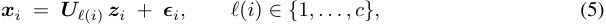

and the goal is to recover the partition _ℓ_ . Our additive mixture of manifolds (Defn. 2) departs from (5) by allowing each observation to participate in _multiple_ manifolds simultaneously, **_x_** =� _i∈S_**_m_**_i_ with _|S| ≪ m_ . This single change has two consequences that make the prior toolkit inapplicable _as is_ : (i) classical self-expression **_x_** _i_ = **_Xc_** _i_ cannot be subspace-preserving, because the coefficients must reach across every manifold active in **_x_** _i_ ; and (ii) the unit of clustering shifts from datapoints to dictionary atoms, since no point-level label _ℓ_ ( **_x_** ) exists. Our Ising affinity is therefore an _c × c_ object over learned features rather than an _n × n_ object over points, and the spectral-clustering pipeline of nonlinear SC does not transfer to our regime. We see this not as a rejection of the prior literature but as identifying the missing additive ingredient required in our assumptions. 

## **B The Ubiquity of Manifolds** 

All manifolds are evaluated using last-token activations from Llama-3.1-8B at layer 19 ( _d_ = 4096). Table 1 summarizes each manifold’s prompt template, sample count, ground-truth labels, and source dataset. 

Table 1: Manifold datasets used for evaluation. All activations are extracted at the last token position. 

|**Manifold**|**Geometry**|_n_|**Prompt template / source**|
|---|---|---|---|
|colors|paraboloid|_∼_900|“The hex code {h_code} is for the color”|
|temperature|line|150|“Today it’s {f} degrees Fahrenheit outside”|
|age|line|99|“They are {age} years old.”|
|geography|hierarchical tree|_∼_4_,_000|“The geographical coordinates {lat, lon} are in the country of”|
|days|circle|420|“It’s {time} on day"|
|years|helix|199|“The date is year”|
|formality|line|1,000|Pavlick & Tetreault(2016)|
|sent_length|line|5,000|WikiText|
|politic bias|1D continuous|varies|GPT-5 augmentations ofJones(2024)|

### **B.1 Steering Details** 

To verify that manifold structure is causally relevant to model behavior, we perform activation patching along the principal components of each manifold’s activations (Fig. 2, right). 

**Setup.** For each continuous manifold, we fit PCA on the cached layer-19 activations, retaining enough components to explain 90% of variance. We then select a base prompt near the manifold’s midpoint and construct a sweep by binning the manifold’s primary continuous label (e.g., fahrenheit for temperature, hue for colors) into 5-10 equal-width bins. For each bin, we compute the PCA centroid and linearly interpolate 5-10 points between consecutive centroids, yielding evenly spaced intervention points per manifold. 

**Intervention.** For each intervention point, we compute the PCA-space delta from the manifold mean, project it back to activation space, and add it to the base prompt’s layer-19 activation during a 

forward pass. We then collect next-token logits and track the probabilities of a set of target tokens chosen to be semantically diagnostic of the underlying variable. Table 2 lists the task suffix and target tokens for each manifold. 

Table 2: Steering task configuration per manifold. 

|**Manifold**|**Task suffix**|**Target tokens**|
|---|---|---|
|temperature|“, which is”|freezing, cold, chilly, nice, warm, hot, burning|
|age|“ They are”|young, middle, old, elderly|
|years colors|“-01-01, which year is it?” (none)|17, 18, 19, 20, 21 red, orange, yellow, green, blue, indigo, purple|
|day|“. What day is it?”|Monday, Tuesday, Wednesday, Thursday, Friday, Saturday, Sunday|

### **B.2 SAE Training Details** 

All SAEs are trained on activations from Llama-3.1-8B at layer 19 (residual stream, _d_ = 4096). Activations are harvested from 500M tokens of The Pile (uncopyrighted) (Gao et al., 2020) using sequence length 4096. 

**Optimization.** All architectures use Adam with learning rate 10_−_4 , no weight decay, and gradient clipping at max norm 1.0. Batch size is 16,384 tokens. We use a linear warmup over the first 1epochs (though most checkpoints are taken at epoch 2 based on validation VE). Activations are auto-normalized by their mean _ℓ_ 2 norm prior to training. 

### **Architecture-specific details.** 

- **TopK / BatchTopK** : Auxiliary loss weight 0.05 with 1 

- **JumpReLU** : STE bandwidth _ε_ = 0 _._ 001. Target L0 set to match _k_ of other architectures. 

- **Matryoshka** : Nested feature groups with geometrically spaced sizes ( _d_ sae _/_ 8, _d_ sae _/_ 8, _d_ sae _/_ 4, remainder). Otherwise same as BatchTopK. 

- **Standard (** _ℓ_ 1 **)** : Sparsity weight _λ ∈_ 0 _._ 03 _,_ 0 _._ 04 _,_ 0 _._ 1. 

**Model selection.** Table 3 lists all trained SAEs. We retain SAEs achieving variance explained (VE) _>_ 0 _._ 85 on held-out activations for the main experiments. SpaDE (VE _≈_ 0 _._ 62) and MFA (VE _≈_ 0 _._ 55) are included for architectural comparison despite lower reconstruction quality. 

### **B.3 Platonic Representations?** 

We investigate whether different SAEs recover a shared underlying representation of the same manifold. To do so, we compare learned features across models using optimal transport (OT) in three spaces: decoder directions, code activations on random inputs, and code activations restricted to points lying on a given manifold. 

Fig. 13 shows weak alignment when comparing decoder directions, particularly for point-based methods such as SpaDE, which differ substantially from direction-based SAEs. Similarly, OT applied to SAE activations on random training data reveals slightly more consistent structure across models, but no clear alignment. These results suggest that individual features are not stable objects: their representation depends strongly on architectural choices and training dynamics, in line with previous work (Fel et al., 2025a; Paulo & Belrose, 2025). 

In contrast, when restricting comparison to specific manifolds, we observe strong alignment across SAEs. Despite differences in individual features, the induced coordinate systems over the manifold are highly consistent, indicating that what is preserved across SAEs is not the features themselves, but the geometric structures they collectively encode. 

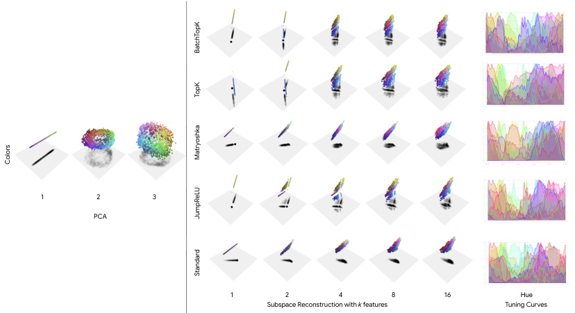

<!-- Start of picture text -->
1 2 3 PCA 1 2 4 8 16 Hue Subspace Reconstruction with  k  features Tuning Curves BatchTopK TopK Matryoshka Colors JumpReLU Standard <!-- End of picture text -->

Figure 11: (Left) PCA projections show that manifolds are well-described by a small number of global components encoding semantic variation. (Middle) SAE reconstructions using increasing numbers of features approximate the manifold in a piecewise-linear fashion, with individual features capturing local regions. (Right) Tuning curves highlight the mixed selectivity of features across the hue dimension of the color manifold. 

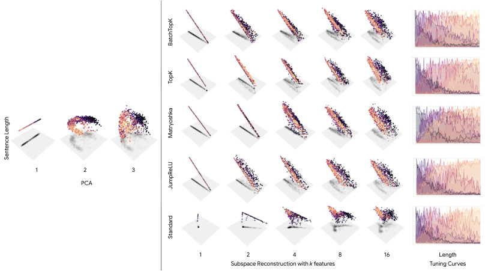

<!-- Start of picture text -->
1 2 3 PCA 1 2 4 8 16 Length Subspace Reconstruction with  k  features Tuning Curves BatchTopK TopK Matryoshka Sentence Length JumpReLU Standard <!-- End of picture text -->

Figure 12: (Left) PCA projections show that manifolds are well-described by a small number of global components encoding semantic variation. (Middle) SAE reconstructions using increasing numbers of features approximate the manifold in a piecewise-linear fashion, with individual features capturing local regions. (Right) Tuning curves highlight the mixed selectivity of features across sentence length. 

Table 3: SAE configurations. VE is variance explained at epoch 2. SAEs below the VE _>_ 0 _._ 85 threshold (marked with _<u>†</u>_ <u>) are included for architectural comparison only.</u> 

|**Architecture**|**Expansion**|**Sparsity**|_d_**sae**|**VE**|
|---|---|---|---|---|
|BatchTopK|_×_8|_k_ = 64|32,768|0.858|
|BatchTopK|_×_8|_k_ = 128|32,768|0.858|
|BatchTopK|_×_8|_k_ = 256|32,768|0.883|
|BatchTopK|_×_16|_k_ = 128|65,536|0.849|
|TopK|_×_8|_k_ = 64|32,768|0.852|
|TopK|_×_8|_k_ = 128|32,768|0.861|
|TopK|_×_8|_k_ = 256|32,768|0.862|
|TopK|_×_16|_k_ = 64|65,536|0.845|
|TopK|_×_16|_k_ = 128|65,536|0.848|
|JumpReLU|_×_8|_k_ = 64|32,768|0.841|
|JumpReLU|_×_8|_k_ = 128|32,768|0.846|
|JumpReLU|_×_8|_k_ = 256|32,768|0.867|
|JumpReLU|_×_16|_k_ = 64|65,536|0.853|
|JumpReLU|_×_16|_k_ = 128|65,536|0.852|
|JumpReLU|_×_16|_k_ = 256|65,536|0.879|
|Matryoshka|_×_8|_k_ = 64|32,768|0.847|
|Matryoshka|_×_8|_k_ = 128|32,768|0.851|
|Matryoshka|_×_8|_k_ = 256|32,768|0.875|
|Matryoshka|_×_16|_k_ = 128|65,536|0.854|
|Matryoshka|_×_16|_k_ = 256|65,536|0.887|
|Standard|_×_8|_λ_= 0_._03|32,768|0.841|
|Standard|_×_8|_λ_= 0_._1|32,768|0.848|
|Standard|_×_16|_λ_= 0_._03|65,536|0.867|
|Standard|_×_16|_λ_= 0_._04|65,536|0.844|
|Standard|_×_16|_λ_= 0_._1|65,536|0.961|

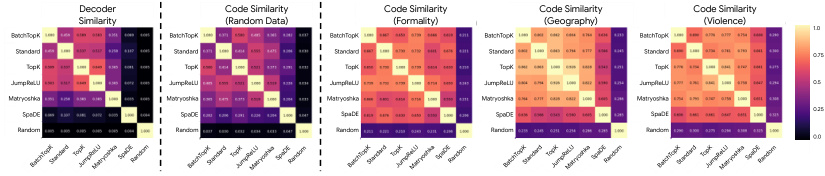

<!-- Start of picture text -->
Decoder Code Similarity  Code Similarity Code Similarity  Code Similarity Similarity (Random Data) (Formality) (Geography) (Violence) 1.0 BatchTopK BatchTopK BatchTopK BatchTopK BatchTopK Standard Standard Standard Standard Standard 0.75 TopK TopK TopK TopK TopK JumpReLU JumpReLU JumpReLU JumpReLU JumpReLU 0.5 Matryoshka Matryoshka Matryoshka Matryoshka Matryoshka SpaDE SpaDE SpaDE SpaDE SpaDE 0.25 Random Random Random Random Random 0.0 BatchTopKStandard TopKJumpReLUMatryoshkaSpaDERandom BatchTopKStandard TopKJumpReLUMatryoshkaSpaDERandom BatchTopKStandard TopKJumpReLUMatryoshkaSpaDERandom BatchTopKStandard TopKJumpReLUMatryoshkaSpaDERandom BatchTopKStandard TopKJumpReLUMatryoshkaSpaDERandom <!-- End of picture text -->

Figure 13: Similarity between features learned by different SAEs measured in decoder space (left), SAE code space (middle and right) for random data (middle) and specific manifolds (right). 

## **C Duality of Concept Geometry** 

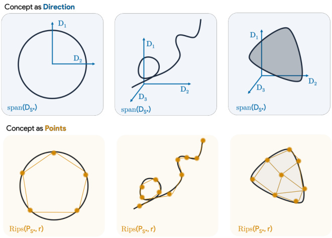

Figure 14: **The Geometric Duality of Sparse Concepts (Definition 4).** (Left) **Concept as Direction** : SAEs capture manifolds extrinsically by finding a fixed atom group whose linear span contains the manifold. **Concept as Points** : SAEs capture manifolds intrinsically by sampling landmarks that form a Vietoris–Rips complex homotopy equivalent to the original manifold shape. (Right) 

It is now well-established that current approaches for concept recovery are fundamentally instances of sparse dictionary learning. In this work, we mainly studied one particular cases of Dictionary learning that make an implicit assumptions about the geometry of concepts (Hindupur et al., 2025): that concepts are directions. This implicit definition is important for the discussion here, as it strictly dictates the topology of the reconstructed space and, consequently, will define what it _means_ mathematically to successfully recover a concept manifold. Briefly, we could cluster the recovery methods in 2 groups and use the implicit definition of concept as foundational distinction: 

**Definition 4** (Geometric Duality of Sparse Concepts) **.** _Given an activation_ **_x_** _∈A, sparse dictionary learning extracts a latent representation_ **_z_** _∈_ R_c_ _via a dictionary_ **_D_** _∈_ R_c×d_ _by solving the following optimization:_ 

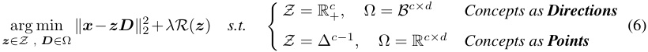

_where R_ ( **_z_** ) _is a sparsity-promoting regularizer (e.g., restricting ∥_ **_z_** _∥_ 0 _≤ k)._ 

AS a recall, the localized reconstructions **_x_** ˆ = **_zD_** lie ( **_i_ )** under the _directional_ paradigm, in a sparse non-negative span (a cone), and we note that contrary to classical SAE, ( **_ii_ )** under the _point_ paradigm, reconstruction lie strictly within a sparse convex hull (a bounded polytope). This work already studied what it means to recover a manifold for the first case, we will now study what it means to recover a manifold in the second case: concepts as points. 

### **C.1 Simplicial recovery** 

In the point paradigm, the dictionary atoms serve as localized landmarks and reconstruction is constrained to their convex hull. As both are dictionary matrices are structurally in R_c×d_ , we distinguish them notationally by writing **_P_** for the dictionary rather than **_D_** . Because point-based methods reconstruct by interpolating between landmark positions rather than combining coordinate axes, manifold recovery is no longer a question of spanning an ambient subspace. Instead, it requires 

that the active landmarks form a sufficiently dense and faithful discrete sample of the underlying geometry. **Definition 5** (Simplicial capture) **.** _A point-based SAE with landmarks_ **_P_** = _{_ **_P_** 1 _, . . . ,_ **_P_** _c} captures a manifold M (with reach τ >_ 0 _) at precision ε if the active landmark subset_ 

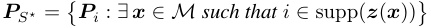

_satisfies dH_ ( **_P_** _S__⋆_ _, M_ ) _≤ ε, where dH denotes the Hausdorff distance._ 

The Hausdorff condition encodes two requirements: every active landmark lies within _ε_ of _M_ (the landmarks are close to the manifold), and every point of _M_ has an active landmark within _ε_ (the landmarks cover the manifold). Together, **_P_** _S⋆_ forms a faithful point sample. Under standard density and reach conditions (Niyogi et al., 2008), such a sample is sufficient for the Vietoris–Rips complex built from **_P_** _S⋆_ to recover the topology of _M_ , including its connected components, loops, and higherorder cycles. When landmarks belonging to multiple manifolds _M_ 1 _, . . . , Mm_ coexist in **_P_** , the landmark neighborhood graph provides a natural tool for separating them. One defines a graph _Gr_ ( **_P_** ) with an edge between **_P_** _i_ and **_P_** _j_ whenever _∥_ **_P_** _i −_ **_P_** _j∥≤ r_ ; this is the 1-skeleton of Rips( **_P_** _, r_ ). If the manifolds are well separated (inter-manifold distance _δ ≫_ 2 _ε_ ), the per-manifold landmark subsets are exactly the connected components of _Gr_ for _r ∈_ (2 _ε, δ −_ 2 _ε_ ). Manifold discovery in this setting reduces to connected component extraction, or spectral clustering when the separation is less clean. **Factor manifolds versus joint geometry.** The analysis above assumes that each landmark can be assigned to a single manifold. Under superposition, this assumption breaks down, and pointbased SAEs face a fundamental obstruction to factorwise recovery. Consider two observations **_x_** = **_m_** 1 + **_m_** 2 and **_x_**_′_ = **_m_**_′_ 1+**_m_**_′_ 2,where**_m_**1_,_**_m_** 1_′∈M_1and**_m_**2_,_**_m_**_′_ 2_∈M_2.Apoint- based SAE reconstructs via convex combinations of landmarks: **_x_** ˆ =� _j__zj_**_P_**_j_with_zj≥_0and <u>�</u> _j__zj_=1.If two landmarks**_P_**_a≈_**_x_**and**_P_**_b≈_**_x_**_′_are both active, their midpoint 2<u>1</u>**_P_**_a_+<u>1</u> 2**_P_**_b≈_ 21(**_m_**1 +**_m_** 1_′_) +<u>1</u> 2(**_m_**2 +**_m_** 2_′_) is a valid reconstruction.But this point does not correspond to any observation on the data manifold:<u>1</u> 2**_m_**1 +<u>1</u> 2**_m_** 1_′_is generically not a point on_M_1(it is a chord, not an arc), and likewise for _M_ 2. The convex hull of landmarks that tile the joint manifold _M_ 1 + _M_ 2 is therefore fundamentally different from the Minkowski sum conv( _M_ 1) + conv( _M_ 2) that would be needed for factorwise decomposition. In other words, the simplex constraint couples all factors: one cannot isolate the contribution of _M_ 1 by selecting a subset of landmarks, because every landmark encodes a specific joint configuration of all co-occurring concepts. **The landmarks tile the joint data manifold as a single object rather than decomposing it into the separate factor manifolds that generated it** . 

**Lemma 1** (Point-based landmarks do not approximate factor manifolds) **.** _Let M_ 1 _⊂ V_ 1 _and M_ 2 _⊂ V_ 2 _be compact manifolds contained in orthogonal linear subspaces V_ 1 _, V_ 2 _⊂_ R_d_ _, with_ **0** _∈M/_ 2 _. Let_ **_P_** = _{_ **_P_** 1 _, . . . ,_ **_P_** _c} ⊂M_ 1 + _M_ 2 _achieve simplicial capture of the joint manifold at precision ε. Then for every landmark_ **_P_** _j,_ 

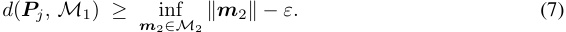

_In particular, if_ inf **_m_** 2 _∥_ **_m_** 2 _∥_ = _δ >_ 0 _, then every landmark is at distance at least δ − ε from M_ 1 _._ 

_Proof._ By simplicial capture, there exist **_m_** 1 _∈M_ 1 and **_m_** 2 _∈M_ 2 with **_P_** _j_ = **_m_** 1 + **_m_** 2 + **_r_** where _∥_ **_r_** _∥≤ ε_ . Let Π _V_ 2 denote orthogonal projection onto _V_ 2. For any **_m_** 1_′∈M_1_⊂V_1, the orthogonality _V_ 1 _⊥ V_ 2 gives Π _V_ 2( **_m_** 1) = Π _V_ 2( **_m_**_′_ 1) =**0**, hence 

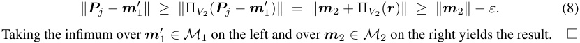

**Point-based dictionary learning tiles the joint manifold.** This observation effectively closes the door, for the purposes of this paper, on point-based SAEs as a model of _factor_ manifold recovery under superposition. Direction-based SAEs avoid this obstruction because their reconstructions are additive: **_x_** ˆ =� _j__zj_**_D_**_j_with no constraint coupling the coefficients, so the partial reconstruction using only atoms aligned with _M_ 1 isolates that factor’s contribution regardless of which other 

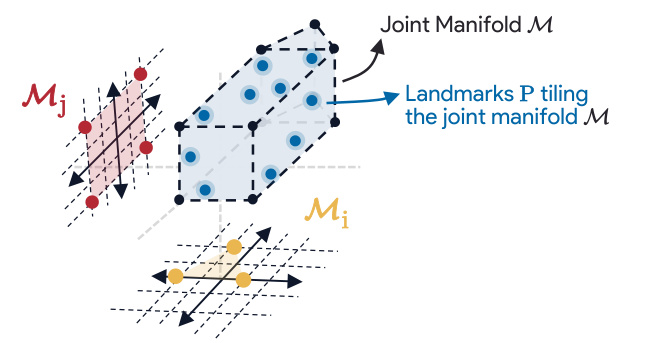

<!-- Start of picture text -->
Joint Manifold M M Landmarks  P  tiling j the joint manifold M M i <!-- End of picture text -->

Figure 15: **Why simplicial capture cannot factor an additive mixture of manifolds.** A point-based dictionary tiling the _joint_ manifold _M_ = _Mi_ + _Mj_ (right) does not induce tilings of the individual factors _Mi, Mj_ (left). Each landmark **_P_** _k ∈M_ encodes one specific joint configuration ( **_m_** _i,_ **_m_** _j_ ) of co-active factors, and convex combinations of landmarks reach points of _M_ that have no preimage in any single factor. As a consequence (Lemma 1), the landmarks cannot lie close to either _Mi_ or _Mj_ : they tile a different geometric object than the factors that generated the data. 

factors are simultaneously active. Recovering individual factor manifolds from point-based SAEs would require replacing the single simplex constraint with a compositional construction such as a Minkowski sum (Fel et al., 2025b) or a blockwise simplex in which separate groups of coefficients are independently constrained to different factors. Such extensions are interesting directions for future work, but they fall outside the scope of the present paper. Since our goal is to recover the geometry of individual factors, we focus in the remainder on direction-based SAEs, for which additive structure makes factorwise analysis well-posed. 

## **D Conditions of Subspace capture** 

Before starting, we absorb the affine offset into the SAE bias and work with centered points **_x_** ˜ = **_V α_** . The hypothesis _µ <_ 1 _/_ (2 _k −_ 1) is the coherence-based Exact Recovery Condition (ERC) of Tropp (2004), which guarantees that for any signal supported on **_S_**_⋆_ , both Orthogonal Matching Pursuit and Basis Pursuit recover the correct support. Moreover, by Lemma 2.3 of Tropp (2004), the squared singular values of **_DS_** _⋆_ exceed 1 _−_ ( _k−_ 1) _µ >_ 0, so **_DS_** _⋆_ has full row rank with _∥_ **_DS_**+_⋆∥_2_≤_ (1 _−_ ( _k−_ 1) _µ_ )_−_1_/_2 . 

We consider the following idealized encoding setting: the dictionary **_D_** is obtained from SAE training, and representations are then computed by an Orthogonal Matching Pursuit (OMP) procedure over the learned dictionary. This separates the quality of the dictionary from the behavior of any particular feedforward encoder, and allows us to leverage classical sparse recovery guarantees (Tropp, 2004; Donoho & Elad, 2003). 

We restate the theorem for convenience. 

**Theorem 2** (Subspace recovery) **.** _Let M lie in a k-dimensional affine subspace with orthonormal basis_ **_V_** _∈_ R_k×d_ _and offset_ **_b_** _M. Let_ **_D_** _be µ-incoherent, and suppose there exists_ **_S_**_⋆_ _⊂_ [ _c_ ] _with |_ **_S_**_⋆_ _|_ = _k such that_ Im( **_V_** ) = span( **_DS_** _⋆_ ) _and µ <_ 1 _/_ (2 _k −_ 1) _. If the SAE achieves reconstruction error ∥_ **_x_** _m −_ **_Dz_** ( **_x_** _m_ ) _∥≤ λ on M, then it captures M at precision O_ ( _λ_ ) _._ 

_Proof._ Since Im( **_V_** ) = span( **_DS_** _⋆_ ), every centered point **_x_** ˜ _m ∈M_ admits a unique representation **_x_** ˜ _m_ = **_DS_** _⋆_ **_c_**_⋆_ for some **_c_**_⋆_ _∈_ R_k_ . Let **_z_** denote the SAE code with support _S_ = supp( **_z_** ), residual **_r_** = **_x_** ˜ _m −_ **_Dz_** , _∥_ **_r_** _∥≤ λ_ , and write _S_¯ = _S \_ **_S_**_⋆_ . Extending **_c_**_⋆_ by zeros to a vector in R_c_ , define **_δ_** = **_z_** _−_ **_c_**_⋆_ . Then 

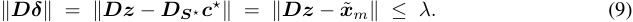

Under the ERC, the noise-robust null-space property of Tropp (2006) (Theorem 14) yields 

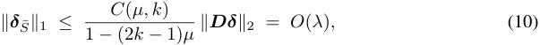

where _C_ ( _µ, k_ ) depends only on _µ_ and _k_ . Since **_c_**_⋆_ is supported on **_S_**_⋆_ , **_δ_** ¯ _S_ = **_z_** ¯ _S_ , hence _∥_ **_z_** ¯ _S∥_ 1 = _O_ ( _λ_ ). 

The **_S_**_⋆_ -restricted reconstruction error then satisfies 

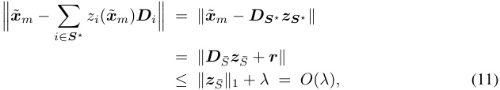

where the first inequality uses unit-norm atoms and the triangle inequality. Thus the SAE captures _M_ at precision _O_ ( _λ_ ) in the sense of Defn. 3. 

## **E Synthetic Experiment Details** 

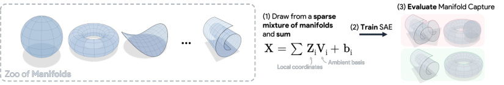

Figure 16: **Synthetic Evaluation Pipeline.** We construct a controlled benchmark for manifold recovery by sparse autoencoders. **(1)** We define a zoo of manifolds (spheres, tori, Möbius strips, etc.) and generate data points by sampling from a sparse mixture: each observation is formed as **_X_** =� _i_**_Z_**_i_**_U_**_i_,where**_Z_**_i_arelocalcoordinatesonthe_i_-thmanifoldand**_U_**_i_areambientbasis matrices embedding each manifold into high-dimensional space. **(2)** An SAE is trained on the resulting superposed activations. **(3)** We evaluate whether the SAE recovers the individual manifolds from the mixture, assessing both subspace capture (for direction-based SAEs) and simplicial capture (for point-based SAEs) as defined in Sections 3 and 5. 

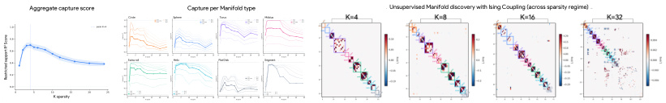

<!-- Start of picture text -->
Aggregate capture score Capture per Manifold type Unsupervised Manifold discovery with Ising Coupling (across sparsity regime) Circle Sphere Torus Möbius Swiss roll Helix Flat Disk Segment K spa rs ity 2 ScoreRestricted support R <!-- End of picture text -->

Figure 17: Ising coupling matrix **_J_** _ij_ recovers latent manifold structure across sparsity regimes. Red = positive coupling ; blue = mutual exclusion ( _J <_ 0). At low _K_ (tiling), atoms are shared across manifolds and block structure is weak. At intermediate _K_ ( _K ≈_ 8–16), clean block-diagonal structure emerges. At high _K_ (dilution), atoms over-tile individual manifolds, fragmenting blocks. 

**Manifold zoo.** Table 4 summarizes the eight manifold types used in the synthetic benchmark. For each type, we list the intrinsic dimension _di_ (the number of free parameters), the embedding dimension _ki_ (the dimension of the ambient subspace containing the manifold, which determines the number of atoms needed for subspace capture), the parametric embedding _γi_ , and the parameter ranges used across variants. 

Table 4: Manifold zoo used in the synthetic benchmark. 

|**Type**|_di ki_|**Embedding**_γi_(_θ_)_∈_R_ki_|**Variant parameters**|
|---|---|---|---|
|Circle|1 2|(_r_cos_θ, r_sin_θ_)|_r ∈{_0_._5_,_0_._75_,_1_._0_,_1_._5_,_2_._0_,_3_._0_}_|
|Sphere|2 3|(_r_sin_ϕ_cos_θ, r_sin_ϕ_sin_θ, r_cos_ϕ_)|_r ∈{_0_._5_,_0_._75_,_1_._0_,_1_._5_,_2_._0_,_3_._0_}_|
|Torus|2 4|Clifford: ((_R_+_r_cos_ϕ_) cos_θ, . . . , r_sin_ϕ_)|(_R, r_)_∈{_(2_,_0_._5)_,_(2_,_1)_,_(3_,_1)_, . . .}_|
|Möbius|2 3|((1+_t_cos _ϕ_ 2 ) cos_ϕ, . . . , t_ sin _ϕ_ 2 )|_w ∈{_0_._2_,_0_._3_,_0_._5_,_0_._7_,_1_._0_,_1_._5_}_|
|Swiss roll|2 3|    (_θ_cos_θ, h, θ_sin_θ_)|(_θ_max_, h_max)_∈{_(2_π,_1_._5)_, . . . ,_(4_._5_π,_6)_}_|
|Helix|1 3|(_r_cos_θ, r_sin_θ, αθ_)|_α ∈{_0_._1_,_0_._2_,_0_._3_,_0_._4_,_0_._5_,_0_._6_}_,_r_=1, 3 turns|
|Flat disk|2 2|(_r_cos_θ, r_sin_θ_)with_r ∼_ ~~�~~ _U_(0_,_1)|_R ∈{_0_._5_,_0_._75_,_1_._0_,_1_._5_,_2_._0_,_3_._0_}_|
|Segment|1 1|(_t_)|length_∈{_0_._5_,_0_._75_,_1_._0_,_1_._5_,_2_._0_,_3_._0_}_|

The distinction between _di_ and _ki_ is important throughout the paper. The intrinsic dimension _di_ governs the manifold’s degrees of freedom and determines the expected number of localized detectors in the tiling regime. The embedding dimension _ki_ determines the number of atoms required for subspace capture (Definition 3): a circle is parameterized by a single angle ( _di_ = 1) but its embedding (cos _θ,_ sin _θ_ ) lives in a 2-dimensional subspace ( _ki_ = 2), so two atoms are needed to span it. Similarly, the torus is intrinsically 2-dimensional but requires a 4-dimensional Clifford embedding to faithfully represent its topology. 

**Normalization.** A critical design choice is ensuring that all manifold instances contribute equally to the reconstruction loss. Without normalization, manifold types with large embeddings (e.g., the Swiss 

roll, whose coordinates scale as _θ ∼_ 3 _π_ to 4 _._ 5 _π_ ) would dominate the SAE’s capacity, while smallnorm manifolds (e.g., a circle with _r_ = 0 _._ 5) would be treated as noise. We address this by centering and isotropically rescaling each instance at construction time. Concretely, for each manifold instance _i_ with parameters _ρi_ , we draw a calibration sample of 50,000 points from the raw embedding _<u>γi</u>_ <u>,</u> compute the sample mean **_µ_** _i_ and the RMS norm of the centered samples _σi_ = �E[ _∥γi_ ( _θ_ ) _−_ **_µ_** _i∥_2 ], and define the normalized embedding as 

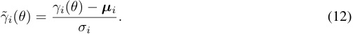

This transformation is an isotropic rescaling composed with a translation: it preserves all angles, relative distances, curvature ratios, and topological structure. After normalization, every instance has RMS norm exactly 1 in local coordinates, regardless of manifold type or variant parameters. 

**Ambient embedding.** For each of the 48 manifold instances (8 types _×_ 6 variants), we draw a random orthonormal matrix **_V_** _i ∈_ R_ki×d_ by sampling a _d×ki_ Gaussian matrix and taking the **_Q_** factor of its QR decomposition (transposed to obtain orthonormal rows). This ensures that _∥_ **_zV_** _i∥_ 2 = _∥_ **_z_** _∥_ 2 for all **_z_** : the ambient embedding is norm-preserving. The bias vectors **_b_** _i_ are set to zero throughout (i.e., _σ_ bias = 0). 

**Sparse mixture sampling.** Observations follow the generative model 

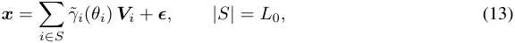

where the active set _S_ is drawn uniformly at random (without replacement) from the 48 instances, intrinsic coordinates _θi_ are sampled uniformly on each manifold, and **_ϵ_** _∼N_ ( **0** _, σϵ_2**_I_**_d_) with_σϵ_= 10_−_5 . The noise level is deliberately kept small so that reconstruction quality reflects the SAE’s geometric organization rather than denoising ability. 

We generate _N_ = 2 _,_ 000 _,_ 000 training samples. The evaluation set consists of 1 _,_ 000 _,_ 000 samples generated at _L_ 0 = 4 with a separate random seed, along with the corresponding per-manifold contributions **_m_** _i_ = _γ_ ˜ _i_ ( _θi_ ) **_V_** _i_ and active masks. This separation ensures that evaluation measures capture on in-distribution superposition with known ground truth. 

**SAE Training** We use TopK sparse autoencoders throughout the synthetic experiments. The encoder is a linear map **_W_** enc _∈_ R_c×d_ followed by TopK selection (retaining only the _k_ largest activations and zeroing the rest). The decoder is a linear map **_W_** dec _∈_ R_d×c_ with unit-norm columns, applied to the sparse code to produce the reconstruction **_x_** ˆ = **_W_** dec TopK( **_W_** enc **_x_** ). The dictionary size is _c_ = 512 throughout, yielding an expansion factor of _c/d_ = 4 relative to the ambient dimension _d_ = 128. 

We train separate SAEs for each sparsity budget _k ∈{_ 3 _,_ 4 _,_ 6 _,_ 8 _,_ 10 _,_ 14 _,_ 16 _,_ 20 _,_ 25 _}_ . This range is chosen to span all three theoretical regimes. 

All SAEs are trained with Adam (learning rate 3 _×_ 10_−_3 , no weight decay) for 10 epochs with batch size 1,024. The loss function combines _ℓ_ 1 reconstruction error with a dead-neuron reanimation term. An atom is considered dead if it has zero activation for every sample in the current batch. The reanimation term encourages dead atoms to develop nonzero pre-activations, preventing capacity waste. 

**Restricted** _R_2 **(subspace capture score).** The primary metric tests Definition 3 directly. For a given SAE trained at sparsity _k_ , we proceed as follows: 

1. Encode the full evaluation set _{_ **_x_**(_j_) _}_ through the SAE to obtain codes _{_ **_z_**(_j_) _}_ . 

2. For each manifold instance _i_ , select the rows where _i_ is active (using the ground-truth active masks) to obtain the manifold-specific codes **_Z_** _i ∈_ R_ni×c_ and the corresponding true contributions **_M_** _i ∈_ R_ni×d_ . 

3. Greedily select _n_ atoms by iteratively choosing the decoder direction **_d_** _j_ that explains the most residual variance of **_M_** _i_ . At each step, the selected atom’s projection is removed from the residual before selecting the next. 

4. Mask the codes to retain only the _n_ selected atoms: **_Z_** _i_(_n_) = **_Z_** _i ⊙_ **_e_** selected, where **_e_** selected is a binary mask. 

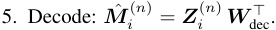

6. Compute the restricted _R_2 : 

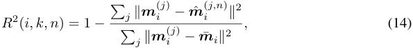

where **_m_** ¯ _i_ is the mean of the true contributions. An _R_2 near 1 at _n_ = _ki_ indicates compact subspace capture. We report _R_2 for _n_ ranging from max(1 _, ki −_ 2) to _ki_ +2 to visualize how capture improves around the embedding dimension. 

Note that the greedy selection operates on the decoder directions of the trained SAE, not on the codes. This is important: we are asking whether _n_ decoder directions span the manifold’s ambient subspace, using the codes the SAE actually produces on in-distribution (superposed) inputs. 

**Support size.** For each manifold instance _i_ and SAE sparsity _k_ , the support size _|SM|_ counts the number of unique dictionary atoms that fire on at least 10% of the manifold’s evaluation points. To avoid counting near-zero activations (e.g., from ReLU tails or numerical noise), we apply a per-atom magnitude threshold: for each atom _j_ , we compute the 10th percentile of its nonzero activations and discard activations below this threshold. Atoms must additionally fire on at least 30 points (an absolute floor) to be counted. This filtering ensures that the support size reflects genuinely active atoms rather than numerical artifacts. 

**Receptive field spread.** For each atom _j_ in the support of manifold _i_ , we gather all manifold points where _j_ fires (after the robustness filtering described above) and compute the mean pairwise Euclidean distance among those points in ambient space. This quantity measures how broadly the atom’s receptive field covers the manifold. We then take the median across all atoms in the support and normalize by the manifold’s own mean pairwise distance (computed from a subsample of up to 2,000 points), yielding a dimensionless quantity between 0 (maximally localized: each atom fires on a tight cluster) and 1 (maximally global: each atom fires uniformly across the entire manifold). 

**Ising coupling inference.** To recover manifold structure from SAE codes without supervision, we binarize the codes ( _sj_ = sign( _zj_ )) and fit a pairwise Ising model 

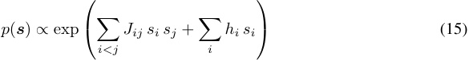

using pseudo-likelihood maximization (PLM) with L-BFGS optimization. We enforce symmetry by setting **_J_** = ( **_W_** + **_W_**_⊤_ ) _/_ 2 during optimization rather than as a post-hoc correction. Regularization strength is selected via the extended Bayesian information criterion (EBIC) with _γ_ = 0 _._ 5, following the IsingFit procedure of Van Borkulo et al. (2014). The fields _hi_ absorb marginal firing rates, so universally active atoms have large _|hi|_ but small _|Jij|_ , and indirectly correlated atoms are factored out by construction. We then apply Louvain community detection to _|_ **_J_** _|_ to partition atoms into candidate manifold groups, and validate each group by checking for a sharp PCA spectral gap in its code vectors (indicating low-dimensional structure consistent with a manifold). 

## **F Recovering Manifold Structure via Ising Model** 

Recovering the manifold partition from SAE codes can be cast as a problem of graphical model selection over dictionary atoms. The goal is to infer which atoms are structurally related (jointly tile or span the same manifold) and which are independent, using only the observed pattern of activations. This section formalizes the connection, states the conditions under which recovery succeeds, and motivates the two-stage pipeline used in the main text. 

**From Covariance to Conditional Independence** A natural first approach to grouping atoms is to examine their pairwise covariance. However, covariance conflates direct and indirect statistical dependencies: two atoms may be correlated not because they tile the same manifold, but because a third atom (or a latent variable such as topic) mediates their interaction (Dempster, 1972). The classical remedy is to examine the precision matrix **Ω** = **Σ**_−_1 instead. For jointly Gaussian random variables, the precision matrix encodes the conditional independence structure exactly: Ω _ab_ = 0 if and only if _za ⊥⊥ zb |_ **_z_** _\{a,b}_ (Lauritzen, 1996). Estimating **Ω** from data is the subject of Gaussian graphical model selection, with well-studied algorithms such as the graphical lasso (Friedman et al., 2008) and neighborhood selection (Meinshausen & Bühlmann, 2006). 

SAE codes, however, are not Gaussian. They are sparse (most entries zero), non-negative (due to ReLU or TopK), and their support is constrained (TopK enforces _∥_ **_z_** _∥_ 0 = _k_ ). Applying Gaussian graphical model selection to such data would yield inconsistent estimates of the conditional independence structure, since the Gaussian likelihood is misspecified. We therefore require a graphical model adapted to the discrete, binary nature of SAE activation patterns. 

**The Ising Model as a Binary Graphical Model** A principled alternative is to binarize the codes, setting _sa_ = sign( _za_ ), and model their joint distribution with a pairwise exponential family. For binary random variables, the maximum-entropy distribution consistent with observed first and second moments E( _sa_ ) and E( _sasb_ ) is the _Ising model_ (Jaynes, 1957; Wainwright & Jordan, 2008): 

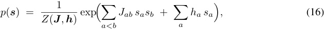

where the couplings **_J_** _∈_ R_c×c_ parameterize pairwise interactions, the fields **_h_** _∈_ R_c_ capture marginal activation rates, and _Z_ ( **_J_** _,_ **_h_** ) is the partition function. This is a well-studied model in statistical physics (Ising, 1925), computational neuroscience (Schneidman et al., 2006; Cocco et al., 2009), and machine learning (Wainwright & Jordan, 2008). Its use for modeling neural co-activation statistics was pioneered by Schneidman et al. (Schneidman et al., 2006), who showed that pairwise interactions account for the vast majority of multi-neuron correlations in biological neural populations. 

The key property connecting the Ising model to manifold recovery is the following classical result. **Proposition 1** (Pairwise Markov property of the Ising model; Besag (1974)) **.** _Let p_ ( **_s_** ) _>_ 0 _for all_ **_s_** _∈{_ 0 _,_ 1 _}__c_ _. Then the distribution p factorizes as in Eq._ (16) _if and only if_ 

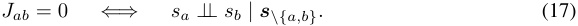

_That is, the support of_ **_J_** _encodes exactly the conditional independence graph of the distribution._ 

This result, a special case of the Hammersley-Clifford theorem (Besag, 1974; Lauritzen, 1996), establishes that the Ising couplings play the same role for binary variables that the precision matrix plays for Gaussian variables: _Jab_ = 0 if and only if atoms _a_ and _b_ are conditionally independent given all others. Fitting the Ising to binarized SAE codes is therefore the construction prescribed by the theory of undirected graphical models for binary data (Wainwright & Jordan, 2008). 

## **G A Geometric and Statistical View of Tiling** 

The empirical results of Sec. 5 establish that trained SAEs rarely operate in the capture regime: rather than reusing a compact group of atoms across an entire manifold, they fragment _M_ into many partially overlapping receptive fields. This fragmented allocation is what we call _tiling_ , and it admits two qualitatively different geometric forms. Before giving formal definitions through Ising couplings, we describe the underlying picture. 

**Tiling by individual atoms: Shattering** The cleanest form of tiling allocates a single atom to each region of _M_ . Each atom **_d_** _i_ activates on a localized patch _Pi ⊆M_ , and the patches _{Pi}i∈GM_ partition the manifold with little overlap. On any input **_x_** _m ∈M_ , exactly one (or few compared to the ambiant space) of the group’s atoms fires; moving along _M_ corresponds to handing off activity from one atom to the next, like the firing of place cells as an animal traverses an environment (O’Keefe & Dostrovsky, 1971). The total number of atoms used to represent _M_ is therefore proportional to the volume of _M_ in atom-units, not to its ambient dimension _kM_ : a larger manifold simply needs more tiles. 

**Tiling by group of atoms: Dilution** Dilution is the same idea applied at the level of groups rather than individuals. Instead of one atom firing per region, a small subset _G_ **_x_** _⊆ GM_ fires on each **_x_** _m ∈M_ , and the subsets _G_ **_x_** vary smoothly (and overlap heavily) as **_x_** _m_ moves along _M_ . No single _G_ **_x_** is small enough to satisfy capture at the manifold scale, but each is locally redundant: many atoms encode the same region in parallel. The total support _GM_ is then much larger than the ambient dimension _kM_ , often by an order of magnitude, because every region is covered by several atoms rather than one. 

**Why the distinction matters.** Both regimes preserve _M_ ’s geometry implicitly through joint activity, and both are consistent with low reconstruction error. Geometrically, however, they correspond to opposite assumptions about what an atom is for: shattering treats atoms as landmarks (point-like detectors with sharp receptive fields), while dilution treats them as local redundant basis (overlapping linear contributions whose sum reconstructs the local geometry). Shattering is closer in spirit to the point paradigm of App. C; dilution is closer to the directional paradigm but with the wrong sparsity budget. Distinguishing them is essential because they will exhibit different statistical signature and thus recovering the manifold will require different strategies. 

**Statistical signatures.** The two regimes leave distinct fingerprints in the joint activation statistics of _GM_ . Under shattering, the single-atom-per-region structure means atoms are mutually exclusive: when _a_ fires, _b̸_ = _a_ does not, and vice versa. Under dilution, atoms within _G_ **_x_** are positively coupled (they fire together on the same region), but atoms in disjoint _G_ **_x_** and _G_ **_x_**_′_ inhibit each other. Capture, in contrast, places all of _GM_ inside every _G_ **_x_** : every pair co-fires on every input. The Ising model makes these qualitative claims precise. 

**Definition 6** (Ising signatures of capture, shattering, and dilution) **.** _Let G ⊆_ [ _c_ ] _be a group of atoms hypothesized to represent a manifold M. Define the_ signed cohesion 

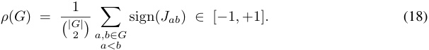

_For thresholds τ ∈_ (0 _,_ 1] _, G is in the:_ 

- **_Capture regime_** _if |G| ≈ kM and ρ_ ( _G_ ) _≥_ + _τ . (all atoms co-fire)_ 

- **_Shattering regime_** _if |G| ≫ kM and ρ_ ( _G_ ) _≤−τ . (atoms mutually exclude)_ 

• **_Dilution regime_** _if |G| ≫ kM and |ρ_ ( _G_ ) _| < τ . (mixed couplings, overlapping sub-groups)_ 

The key auxiliary quantity is _|G|_ itself: capture requires _|G|_ to be small (no more than the ambient dimension), while both forms of tiling require it to be large. Within the tiling regimes, the sign of the couplings then distinguishes the geometric mechanism. 

**Implications for SAE interpretability.** Two consequences follow. First, both ordered states (capture and shattering, ferromagnetic and antiferromagnetic respectively) yield well-defined communities under spectral clustering of _|_ **_J_** _|_ , while the disordered state (dilution) does not — consistent with our empirical finding that recovering manifolds in the dilution regime requires the additional spectral-gap validation step of Sec. 6. Second, the framing identifies dilution as the genuinely problematic regime for interpretability: it preserves geometry but does so without any coherent organizational principle. The empirical evidence assembled in Sec. 5 restricted- _R_2 curves that plateau well beyond _kM_ , tuning curves that fragment manifolds across many partially redundant features, and Ising couplings whose intra-group sign structure is mixed rather than uniformly positive or negative consistently places trained SAEs in this regime. We therefore read current SAEs not as failed instances of capture, but as 

diluted representations: they do encode manifold geometry, but distribute it across a redundant cover whose organizational logic is invisible at the level of any single feature, and only partially recoverable through post-hoc analysis we intended to develop in Sec. 6.

---

[← 68 The World Inside Neural Networks](68_world_inside_neural_networks.md) · [Contents](README.md) · [70 Natural Language Autoencoders →](70_natural_language_autoencoders.md)
