<!-- Generated by scripts/build_anthology.py export from the source PDF; edit the catalog, not this file. -->
# 71 · Loss Landscape Degeneracy and Stagewise Development in Transformers

**Hoogland et al. — 2024** · Jesse Hoogland, George Wang, Matthew Farrugia-Roberts, Liam Carroll, Susan Wei, Daniel Murfet

| | |
|---|---|
| Priority | ○ P1 — Important |
| Section | G — Competing programmes, 2025–26 |
| Source | [https://arxiv.org/abs/2402.02364v3](https://arxiv.org/abs/2402.02364v3) (arXiv:2402.02364v3) |
| Licence | CC BY 4.0 |
| Print anthology | pages 2801–2850 (cover 2801, text 2802–2850) |

**Why read this.** Tracks loss-landscape degeneracy through training with singular learning theory's local learning coefficient, and finds that its turning points divide training into stages that coincide with changes in a transformer's internal structure and behaviour.

**Reading focus.** The local learning coefficient and its estimation, the stage-division method, the language-model stages from bigrams to n-grams to the induction circuit, the in-context regression stages, the small model sizes, and how far the authors take the evidence.

**In context.** A developmental programme rather than a decomposition: it asks when structure forms in training, not what a finished network contains. It recovers the induction circuit of [11](11_induction_heads.md) as a stage and sits beside [14](14_grokking_progress_measures.md)'s progress measures; like [66](66_stochastic_parameter_decomposition.md)–[67](67_interpreting_lm_parameters.md) it works in parameter space rather than activations. Two of its authors, Hoogland and Murfet, co-wrote [03](03_open_problems.md).

**Note.** First posted February 2024 as “The Developmental Landscape of In-Context Learning”; the latest version (v3, August 2025), printed here, is retitled, with v1's essential-dynamics material moved to arXiv:2501.17745.

[← 70 Natural Language Autoencoders](70_natural_language_autoencoders.md) · [Contents](README.md) · [72 Representation Engineering →](72_representation_engineering.md)

---

*Text extracted automatically from the source PDF. Display equations, figures and some tables appear as images; inline mathematics may be garbled — the PDF is authoritative.*

## **Loss Landscape Degeneracy and Stagewise Development in Transformers** 

**Jesse Hoogland**= _Timaeus_ 

_jesse@timaeus.co_ 

**George Wang**= _Timaeus_ 

_george@timaeus.co_ 

#### **Matthew Farrugia-Roberts** 

_matthew@far.in.net_ 

_Department of Computer Science, University of Oxford_ 

**Liam Carroll** _Independent_ 

_lemmykc@gmail.com_ 

#### **Susan Wei** 

_susan.wei@monash.edu_ 

_Department of Econometrics and Business Statistics, Monash University_ 

#### **Daniel Murfet** 

_daniel.murfet@gmail.com_ 

_School of Mathematics and Statistics, the University of Melbourne_ 

### **Abstract** 

Deep learning involves navigating a high-dimensional loss landscape over the neural network parameter space. Over the course of training, complex computational structures form and re-form inside the neural network, leading to shifts in input/output behavior. It is a priority for the science of deep learning to uncover principles governing the development of neural network structure and behavior. Drawing on the framework of singular learning theory, we propose that model development is deeply linked to degeneracy in the local geometry of the loss landscape. We investigate this link by monitoring loss landscape degeneracy throughout training, as quantified by the local learning coefficient, for a transformer language model and an in-context linear regression transformer. We show that training can be divided into distinct periods of change in loss landscape degeneracy, and that these changes in degeneracy coincide with significant changes in the internal computational structure and the input/output behavior of the transformers. This finding provides suggestive evidence that degeneracy and development are linked in transformers, underscoring the potential of a degeneracy-based perspective for understanding modern deep learning. 

### **1 Introduction** 

A striking phenomenon in modern deep learning is the sudden shift in a model’s internal computational structure and associated changes in input/output behavior (e.g., Wei et al., 2022; Olsson et al., 2022; McGrath et al., 2022). As large models become more deeply integrated into real-world applications, understanding this phenomenon is a priority for the science of deep learning. 

A key feature of the loss landscape of neural networks is _degeneracy_ —parameters for which some local perturbations do not affect the loss. Motivated by the perspectives of singular learning theory (SLT; Watanabe, 2009) and nonlinear dynamics (Waddington, 1957; Thom, 1972), where degeneracy plays a fundamental role in governing development, we believe that studying degeneracy in the local geometry of the loss landscape is key to understanding the development of structure and behavior in modern deep learning. 

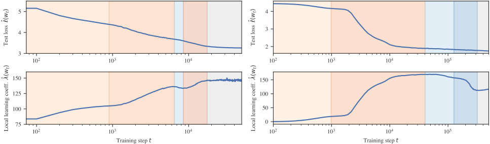

|Stage|LM1|LM2|LM3|LM4|LM5|Stage|LR1|LR2|LR3|LR4|LR5|
|---|---|---|---|---|---|---|---|---|---|---|---|
|End _t_|900|6.5k|8.5k|17k|50k|End _t_|1k|40k|126k|320k|500k|
|∆ˆ_ℓ_|_−_2_._33|_−_1_._22|_−_0_._18|_−_0_._40|_−_0_._34|∆ˆ_ℓ_|_−_0_._32|_−_2_._21|_−_0_._07|_−_0_._05|_−_0_._029|
|∆ˆ_λ_|+26_._4|+22_._5|_−_1_._57|+8_._62|+1_._77|∆ˆ_λ_|+21_._4|+149|_−_12_._3|_−_44_._1|+3_._56|

(a) Two-layer attention-only language transformer (LM). 

(b) In-context linear regression transformer (LR). 

Figure 1: **Tracking loss landscape degeneracy reveals developmental stages.** We train transformer models on both (a) natural language data and (b) synthetic in-context linear regression data. In addition to test loss (top row), we track loss landscape degeneracy as quantified by the local learning coefficient (LLC) (middle row; Section 4). Critical points in the LLC curve mark boundaries between distinct _developmental stages_ (bottom row; warm hues for increasing LLC, cold for decreasing LLC; Section 5). We show in Sections 6 and 7 that most of these stages coincide with the formation of significant internal structures or changes in input/output behavior. The language model first learns to predict using bigram statistics (LM1), then common _n_ -grams (LM2), before forming the induction circuit studied by Olsson et al. (2022) (LM3&LM4). The regression model first learns the optimal context-independent solution (LR1), then acquires robust incontext learning (LR2), then specializes to the pre-training distribution (LR3&LR4). These stage divisions and interpretations are specific to the above training runs, but we show in Appendix B.4 that similar divisions arise with different training seeds. 

In this paper, we contribute an empirical investigation of the link between degeneracy and development for transformers in two learning settings. We track loss landscape degeneracy along with model structure and behavior throughout training, using the following methodology. 

1. **Transformer training** (Section 3) **:** We train two transformers, a _language model_ (LM) with around 3M parameters trained on a subset of the Pile (Gao et al., 2020; Xie et al., 2023), and an _incontext linear regression model_ (LR) with around 50k parameters trained on synthetic regression data following Garg et al. (2022). 

2. **Degeneracy tracking** (Section 4) **:** We quantify loss landscape degeneracy throughout training by estimating the _local learning coefficient_ (LLC; Lau et al., 2025), a measure of degeneracy derived from SLT. 

3. **Degeneracy-based stage division** (Section 5) **:** Motivated by the singular learning process in Bayesian inference (Watanabe, 2009, §7.6; Chen et al., 2023), we use critical points in the LLC curve to divide training into approximate _developmental stages_ . 

4. **Developmental analysis** (Sections 6, 7) **:** We track shifts in each model’s internal computational structure and input/output behavior across training, quantified using various setting-specific metrics. 

Crucially, we discover that most of the developmental stages identified by changes in loss landscape degeneracy coincide with significant, interpretable shifts in the internal computational structure and input/output 

behavior of the transformers, showing that the stage division is meaningful. Our investigations are motivated by the hypothesis of a fundamental link between degeneracy and development in deep learning. This hypothesis is theoretically grounded in SLT but so far not empirically validated except in toy models (Chen et al., 2023). We view the above discoveries as preliminary evidence for this hypothesis in larger models, and an indication of the potential of degeneracy as a lens for understanding modern neural network development. Section 8 discusses this and other implications of our investigation. 

### **2 Related work** 

**Degeneracy and development in singular learning theory** Our hypothesis that degeneracy and development are fundamentally linked is motivated by singular learning theory (SLT; Watanabe, 2009), a framework for studying _singular_ statistical models (a class that includes neural networks, Hagiwara et al., 1993; Watanabe, 2007; Wei et al., 2023). SLT proves that in singular models, Bayesian inference follows the _singular learning process_ , in which degeneracy in the likelihood governs stagewise development in the posterior as the number of samples increases (Watanabe, 2009, §7.6; Lau et al., 2025; Chen et al., 2023). While there are many differences between Bayesian inference and modern neural network training, an analogy to the singular learning process informs our methodology for stage division. 

**Degeneracy and development in nonlinear dynamics** Further motivation for our hypothesis comes from viewing neural network training as a stochastic dynamical system, in which the population loss is a governing potential encoding the data distribution. It is well-understood in nonlinear dynamics that degeneracy in the local geometry of a potential can give rise to stagewise development of system structure (Waddington, 1957; Thom, 1972, cf. Franceschelli, 2010). This connection has been observed in biological systems at significant scale and in the presence of stochasticity (Freedman et al., 2023). We emphasize changes in degeneracy over a stage whereas in bifurcation theory the focus is more on the degeneracy at stage boundaries (Rand et al., 2021; MacArthur, 2022; Sáez et al., 2022). 

**Stagewise development in deep learning** The idea that neural networks development occurs in stages goes back decades (Raijmakers et al., 1996) and has received renewed attention in modern deep learning (e.g., Wei et al., 2022; Olsson et al., 2022; McGrath et al., 2022; Odonnat et al., 2024; Chen et al., 2024; Edelman et al., 2024). In the case of deep linear networks, we understand theoretically that models learn progressively higher-rank approximations of their data distribution (see, e.g., Baldi & Hornik, 1989; Rogers & McClelland, 2004; Saxe et al., 2019) throughout training. Our findings suggest that studying degeneracy could help generalize this understanding to modern architectures that exhibit more complex internal computational structure, such as transformers. 

**Studying loss landscape geometry** Given the central role played by the loss landscape in deep learning, it is unsurprising that there have been many attempts to study its geometry. 

One approach is to visualize low-dimensional slices of the loss landscape (Erhan et al., 2010; Goodfellow et al., 2014; Lipton, 2016; Li et al., 2018; Tikeng Notsawo et al., 2024). Unfortunately, a random slice is with high probability a quadratic form associated to nonzero eigenvalues of the Hessian and is thus biased against geometric features that we know are important, such as degeneracy (Wei et al., 2023). Moreover, Antognini & Sohl-Dickstein (2018) have emphasized the difficulty of probing the loss landscape of neural networks with dimensionality reduction tools. 

Other standard methods of quantifying the geometry of the loss landscape, such as via the Hessian, are insensitive to important aspects of degeneracy. For example, the Hessian trace or maximum eigenvalues quantify the curvature of a critical point but ignore degenerate dimensions, and the Hessian rank counts the number of degenerate dimensions but fails to distinguish between dimensions by the _order_ of their degeneracy (e.g., quartic vs. zero). In contrast, the LLC is a principled quantitative measure of loss landscape degeneracy. Appendix B.5 includes experiments showing that Hessian statistics do not reveal the clear stage boundaries revealed by the LLC in our in-context linear regression setting. 

### **3 Training transformers in two settings** 

We study transformers trained in two learning settings, namely _language modeling_ and _in-context linear regression_ . These settings have been the subject of recent work on the emergence of in-context learning (ICL), a compelling example of a sudden shift in a model’s internal computational structure in modern deep learning (Olsson et al., 2022). 

In this section, we describe both settings and introduce their loss functions and data distributions. Common to both settings is a transformer model denoted _fw_ with parameters _w_ , which takes as input a sequence of tokens, also called a _context_ . We describe specific architecture details and training hyperparameters in Appendices F.1 and F.2. 

**Language modeling** Elhage et al. (2021) and Olsson et al. (2022) observed that two-layer attentiononly transformers (transformers without MLP layers) form interesting internal computational structures supporting ICL, including induction heads. In order to compare with their behavioral and structural analysis we adopt the same architecture. In Appendix E we also study one-layer attention-only transformers. We note that, while we don’t study language models with MLP layers (following prior work), we do use MLP layers for in-context linear regression. We consider the standard task of next-token prediction for token sequences taken from a subset of the Pile (Gao et al., 2020; Xie et al., 2023). We denote the input context by _SK_ = ( _t_ 1 _, . . . , tK_ ) where _K_ is the context length. We denote by _S≤k_ the prefix context ( _t_ 1 _, . . . , tk_ ) of context _SK_ . Our data is a collection of length- _K_ contexts, _{SK__i}_ _i__n_ =1.Thus_S_ _≤__i_ _k_denotesaprefixofthe_i_thcontext,_S_ _K__i_. 

Given the context _S≤__i_ _k_,thetransformermodel_fw_outputsavectoroflogits_fw_(_S_ _≤__i_ _k_)suchthat softmax( _fw_ ( _S≤__i_ _k_))isaprobabilitydistributionoveralltokens(wedenotebysoftmax(_fw_(_S_ _≤__i_ _k_))[_t_]theprob- ability of token _t_ ). The _per-token empirical loss_ for language modeling is then the average cross-entropy between this distribution and the true next token at each index _k ∈{_ 1 _, . . . , K −_ 1 _}_ , 

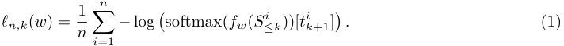

The _empirical loss_ is then _ℓn_ ( _w_ ) = _K_ <u>1</u> _−_ 1 � _Kk_ =1 _−_ 1_ℓn,k_(_w_),withthe_testlossℓ_ˆ(_w_)definedanalogouslyona held-out set of examples. The corresponding _population loss ℓ_ ( _w_ ) is defined by taking the expectation with respect to the true distribution of contexts (see also Appendix A.6). 

**In-context linear regression** Following Garg et al. (2022), a number of recent works have explored ICL in the setting of learning simple function classes, such as linear functions. This setting is of interest because we understand theoretically optimal (in-context) linear regression, and because simple transformers are capable of good ICL performance in practice (see, e.g., Garg et al., 2022; Raventós et al., 2023). We consider a standard synthetic in-context linear regression problem. A _task_ is a vector **t** _∈_ R_D_ , and an _example_ is a pair ( _x, y_ ) _∈_ R_D_ _×_ R. We sample a context by sampling one task **t** _∼N_ (0 _, ID_ ) and then sampling _K_ i.i.d. inputs _x_ 1 _, . . . , xK ∼N_ (0 _, ID_ ) and outputs _y_ 1 _, . . . , yK ∼N_ ( **t**_⊤_ _x, σ_2 ). This results in the context _SK_ = ( _x_ 1 _, y_ 1 _, . . . , xK−_ 1 _, yK−_ 1 _, xK_ ) with label _yK_ . We denote by _S≤k_ the prefix context ( _x_ 1 _, y_ 1 _, . . . , xk_ ) of context _SK_ , its label is _yk_ . Appendix F.2.2 describes how we encode the _xi_ and _yi_ as tokens. Our data is a set of contexts _{_ ( **t** _i, SK__i, y_ _K__i_)_}_ _i__n_ =1sampledi.i.d.asdescribedabove. Running a context _S≤__i_ _k_throughthetransformeryieldsaprediction_y_ˆ _k__i_=_fw_(_S_ _≤__i_ _k_),leadingtothe_per-token_ _empirical loss_ for in-context linear regression for _k ∈{_ 1 _, . . . , K}_ , 

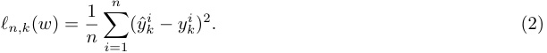

The associated _empirical loss_ is _ℓn_ ( _w_ ) = _K_ <u>1</u> � _Kk_ =1_ℓn,k_(_w_).Thecorresponding_testlossℓ_ˆ(_w_)and_population_ _loss ℓ_ ( _w_ ) are defined analogously as in the language modeling setting. 

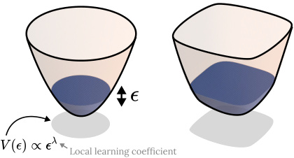

<!-- Start of picture text -->
Local learning coefficient <!-- End of picture text -->

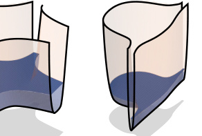

Figure 2: **The local learning coefficient (LLC) measures loss landscape degeneracy.** The LLC can be defined in terms of the rate at which the parameter space volume (within a given neighborhood and with a given maximum loss) shrinks as the loss threshold is reduced to that of the local minimum. We show four population loss landscapes for a two-dimensional parameter space with decreasing LLC (increasing degeneracy). In these examples, the local multiplicity is 1. See Appendix A.2 for a detailed description of each example, as well as several additional examples. 

### **4 Quantifying degeneracy with the local learning coefficient** 

We track the evolution of degeneracy in the local geometry of the loss landscape throughout training by estimating the local learning coefficient (LLC; Watanabe, 2009; Lau et al., 2025) at model checkpoints. In this section, we review the LLC and the estimation procedure of Lau et al. (2025). 

**The local learning coefficient (LLC)** Given a local minimum _w__∗_ of a population loss _ℓ_ (a negative log likelihood), the LLC of _w__∗_ , denoted _λ_ ( _w__∗_ ), is a positive rational number that measures the amount of _degeneracy_ in _ℓ_ near _w__∗_ (Watanabe, 2009; Lau et al., 2025), i.e., how many ways _w_ can be varied near _w__∗_ such that _ℓ_ ( _w_ ) remains equal to _ℓ_ ( _w__∗_ ). Formally, the LLC is defined as the _volume-scaling rate_ near _w__∗_ . This is illustrated in Figure 2, further described in Appendix A.1, and treated in full detail in Lau et al. (2025). Informally, the LLC is a measure of minimum “flatness.” It improves over conventional (secondorder) Hessian-based measures of flatness because the LLC is sensitive to more significant, higher-order contributions to volume-scaling. 

**Estimating the LLC** Lau et al. (2025) introduced an estimator for the LLC based on stochastic-gradient Langevin dynamics (SGLD; Welling & Teh, 2011), which we use in our experiments. Let _w__∗_ be a local minimum of the population loss _ℓ_ . The LLC estimate _λ_ˆ ( _w__∗_ ) is 

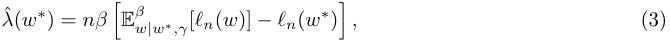

where E_β_ _w|w__∗_ _,γ_denotestheexpectationwithrespecttothelocalizedGibbsposterior 

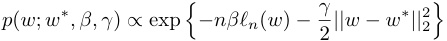

with inverse temperature _β_ (controlling the contribution of the empirical loss landscape) and localization strength _γ_ (controlling proximity to _w__∗_ ). The basic idea behind this estimator is the following: the more degenerate the loss landscape, the easier it is for a sampler exploring the Gibbs posterior to find points of low loss, and, in turn, the lower _λ_ˆ ( _w__∗_ ). Appendix A.3 discusses technical SGLD details, Appendix A.4 documents the hyperparameters used in our experiments, and Appendix A.5 outlines our hyperparameter tuning procedure. 

**Assumptions of LLC estimation** Strictly speaking, the LLC is defined only for loss functions arising as a negative log likelihood, whereas our loss function includes terms from overlapping context prefixes. 

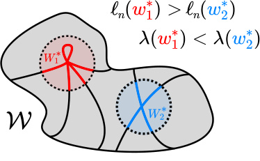

preferred preferred 

Figure 3: **In the singular learning process, the Bayesian posterior can shift between neighborhoods with different degeneracy.** Watanabe’s free energy formula (4) highlights a tradeoff between loss _ℓn_ (the linear term coefficient) and degeneracy _λ_ (the LLC, the logarithmic term coefficient). Consider two local minima _w_ 1_∗, w_ 2_∗_withneighborhoods_W ∗_ 1_, W_ 2_∗_.Asthenumberofsamples_n_increases,if_w_ 2_∗_haslower loss and higher LLC than _w_ 1_∗_,_W ∗_ 2willsuddenlyachievelowerfreeenergythan_W ∗_ 1atsomecriticalsample size _n_ crit, causing the Bayesian posterior to shift from concentrating in _W_ 1_∗_to_W ∗_ 2. 

It is possible to define a negative log likelihood-based loss for transformer training—we show empirically in Appendix A.6 that this does not have a significant effect on LLC estimates, and so we proceed with overlapping contexts for efficiency. 

Moreover, the LLC is defined only for local minima of such loss functions, whereas we note equation (3) is defined for arbitrary _w__∗_ and we apply the estimator throughout training. This approach has precedent in prior work on LLC estimation: Lau et al. (2025) showed that when applied to trained parameters, the estimator accurately recovers the learning coefficient associated with a nearby minimum, and Chen et al. (2023) found that the estimator produces reliable results for parameters throughout training. In our case, we obtain stable estimates throughout training given sufficiently strong localization _γ_ . See Appendix A.7 for more details. 

### **5 Degeneracy-based stage division** 

We use critical points (that is, plateaus, where the first derivative vanishes) in the LLC curve to define _stage boundaries_ that divide training into _developmental stages_ . This approach is motivated by the singular learning process in Bayesian inference, which we review below. 

**Bayesian local free energy** Let _W__∗_ be a neighborhood of a local minimum _w__∗_ of the population loss _ℓ_ (a negative log likelihood). Given _n_ samples we can define the _local free energy_ of the neighborhood (Lau et al., 2025), 

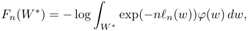

where _φ_ ( _w_ ) is a prior positive on the neighborhood _W__∗_ . The lower the local free energy of a neighborhood _W__∗_ , the higher the Bayesian posterior mass of _W__∗_ . In fact, by a log-sum-exp approximation, the Bayesian posterior is approximately concentrated on the neighborhood with the lowest local free energy (cf., Chen et al., 2023). 

**The singular learning process** Watanabe’s free energy formula gives, under certain technical conditions, an asymptotic expansion in _n_ of the local free energy (Watanabe, 2018, Theorem 11; Lau et al., 2025): 

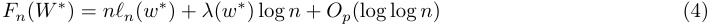

Here, _ℓn_ ( _w__∗_ ) is the empirical loss, _λ_ ( _w__∗_ ) is the LLC, and the lower-order terms include a constant contribution from the prior mass of _W__∗_ . 

The first two terms in equation (4) create a tradeoff between accuracy ( _ℓn_ ) and degeneracy ( _λ_ ). Moreover, as _n_ increases, the linear term becomes increasingly important relative to the logarithmic term, changing the 

nature of the tradeoff. At certain _critical n_ the neighborhood with the lowest local free energy may rapidly change to a neighborhood with _decreased_ loss and _increased_ LLC, as illustrated in Figure 3. 

A sequence of such posterior transitions between increasingly degenerate neighborhoods is a prime example of the _singular learning process_ (Watanabe, 2009, §7.6). We note that this is not the only possible dynamic— lower-order terms may also play a role in the evolving competition. 

**LLC plateaus separate developmental stages** While the general connection between the singular learning process in Bayesian inference and stagewise development in deep learning remains to be understood, Chen et al. (2023) showed that, in small autoencoders, both Bayesian inference and stochastic gradient descent undergo rapid transitions between encoding schemes, and these transitions are reflected as sudden changes in the estimated LLC. 

This perspective suggests that changes in the loss landscape degeneracy, as measured by the LLC, reflect qualitative changes in the model. In larger models, we expect that these qualitative changes may be more gradual, while still being delineated by brief moments in which the posterior is stably concentrated around a given local minimum. This motivates our approach of identifying _plateaus_ in the estimated LLC curve—brief pauses before and after a given increase or decrease in degeneracy—as _stage boundaries_ which divide training into approximate _developmental stages_ . The resolution of these stage boundaries depends on the density of checkpoints used for LLC estimation and the precision of those estimates. 

**Results** In our experiments, we identify plateaus in the estimated LLC curve by first lightly smoothing the LLC curve with a Gaussian process to facilitate stable numerical differentiation with respect to log training time. We identify plateaus as approximate zeros of this derivative, namely local minima of the absolute derivative that fall below a small threshold (see Appendix B.1). Figure 1 and Appendices B.2 and B.3 show the results. Appendix B.4 shows that similar stage divisions arise for independent training runs. 

### **6 Results for language modeling** 

Plateaus in LLC estimates (Figure 1a) reveal five developmental stages for our language model. In order to validate that this stage division is meaningful, we search for concomitant changes in the model’s input/output behavior and its internal computational structure. In this section, we report a range of setting-specific metrics that reveal the following significant, interpretable changes coinciding with each stage: in LM1 the model learns to predict according to bigram statistics; in LM2 the model learns to predict frequent _n_ -grams and use the positional embedding; in LM3 and LM4 the model respectively forms “previous-token heads” and “induction heads” as part of the same induction circuit studied by Olsson et al. (2022). Note that we did not discover significant changes in LM5, and we do not claim that these are the only interesting developmental changes occurring throughout training. There may be other interesting developmental changes that are not captured by our metrics, or are not significant enough to not show up in the LLC curve. 

#### **6.1 Stage LM1 (0–900 steps)** 

**Learning bigram statistics** Figure 4(a) shows that the _bigram score_ —the average cross entropy between model logits and empirical bigram frequencies (see Appendix C.1.1)—is minimized around the LM1–LM2 boundary, with a value only 0.3 nats above the irreducible entropy of the empirical bigram distribution. This suggests that during LM1 the model learns to predict using bigram statistics (the optimal next-token prediction given only the current token). 

#### **6.2 Stage LM2 (900–6.5k steps)** 

**Using positional information** During LM2 the positional embedding becomes structurally important. Figure 4(b) shows that here the test loss for the model with the positional embedding zero-ablated diverges from the test loss of the unablated model (see Appendix C.2.1). Specifically, we mean setting learned positional embeddings to zero during evaluation. Conditional on our architecture this establishes whether the model effectively uses positional information. A similar method could be used in a model without learned 

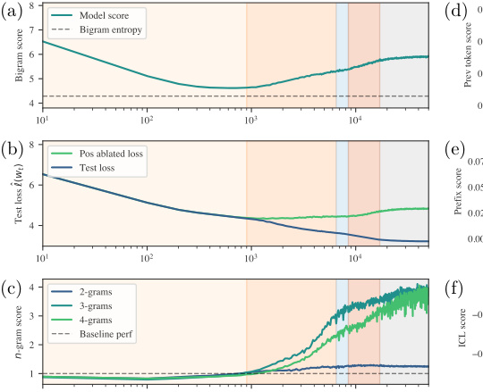

<!-- Start of picture text -->
(a) (d) (b) (e) (c) (f) <!-- End of picture text -->

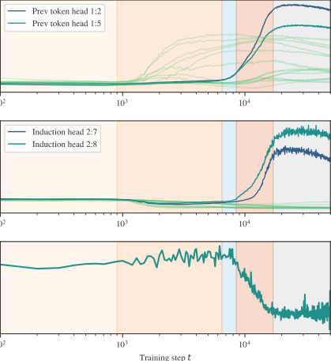

Figure 4: **Language model stages coincide with significant structural and behavioral changes.** (a) The model learns bigram statistics in LM1, (b) then the positional embedding becomes useful from LM2, (c) enabling the learning of common _n_ -grams. Induction circuit formation begins with (d) previous-token heads in LM3, followed by (e) induction heads in LM4, leading to (f) a drop in ICL score indicating the acquisition of in-context learning. Note: in (d,e), _l_ : _h_ denotes attention head _h_ in layer _l_ ; dark lines indicate heads comprising the induction circuit. 

positional embeddings. There is also an uptick in previous-token attention among some first-layer attention heads shown in green in Figure 4(d). 

**Learning common** _n_ **-grams** We define an _n-gram score_ as the ratio of final-position token loss on (1) a baseline set of samples from a validation set truncated to _n_ tokens, and (2) a fixed set of common _n_ -grams (see Appendix C.1.2). To compute the “common n-grams” score after extracting the top 1000 n-grams, we compute the loss on contexts like 

#### `[<bos_token>, <token_1>, <token_2>, ..., <token_n>]` 

using the loss on `<token_n>` and normalize against the average loss on the _n_ -th token of similar-length contexts drawn from the pretraining distribution, then divide the _n_ -th token loss of truncated pretraining contexts by the _n_ -gram loss to get the _n_ -gram score. 

Figure 4(c) shows a large improvement in _n_ -gram score for _n_ = 3 _,_ 4 during LM2. This suggests that during LM2 the model memorizes and learns to predict common _n_ -grams for _n >_ 2 (note this requires using the positional encoding and may also involve previous-token heads). 

**Foundations of induction circuit** In this stage, the heads that eventually become previous-token and induction heads in future stages begin to compose (that is, read from and write to a shared residual stream subspace; see Figure C.4 and Appendix C.2.2). This suggests that the foundations for the induction circuit are laid in advance of any measurable change in model outputs or attention patterns. 

#### **6.3 Stages LM3 & LM4 (6.5k–8.5k & 8.5k–17k steps)** 

**Formation of induction circuit** (as studied in Olsson et al., 2022) Figure 4(d) shows the _previous-token matching score_ (Appendix C.2.3) rises over LM3 and LM4 for the two first-layer heads that eventually par- 

ticipate in the induction circuit (as distinguished by their composition scores, Appendix C.2.2). Figure 4(e) shows that during LM4 there is an increase in the _prefix-matching score_ (Appendix C.2.4) for the two secondlayer induction heads that complete the induction circuit. Figure 4(f) shows a corresponding drop in the _ICL score_ (Appendix C.1.3) as the model begins to perform in-context learning. 

The LLC decreases during LM3, suggesting an increase in degeneracy (a decrease in model complexity). This may be related to interaction between heads. It would be interesting to study this stage further via mechanistic interpretability. 

### **7 Results for in-context linear regression** 

Plateaus in the LLC estimates (Figure 1b) reveal five developmental stages for our in-context linear regression model. We validate that this stage division is meaningful by identifying significant, concomitant changes in the model’s structure and behavior: in LR1 the model learns to predict without looking at the context; in LR2 the model acquires a robust in-context learning ability; and in LR3 and LR4 the model becomes more fragile to out-of-distribution inputs. We did not discover significant changes in LR5, nor do we claim this is an exhaustive list of developments. 

#### **7.1 Stage LR1 (0–1k steps)** 

**Learning to predict without context** Figure 5(a) shows that the mean square prediction for all tokens E[ _∥y_ ˆ _k∥_2 ] decreases during LR1, reaching a minimum of 0 _._ 1 (smaller than the target noise _σ_2 = 0 _._ 125) slightly after the end of LR1. Similar to how the language model learned bigram statistics in LM1, this suggests the model first learns the optimal context-independent prediction _y_ ˆ _k_ =¯ **t** _⊤xk_ where¯ **t** is the mean of the task distribution (zero in this case). 

#### **7.2 Stage LR2 (1k–40k steps)** 

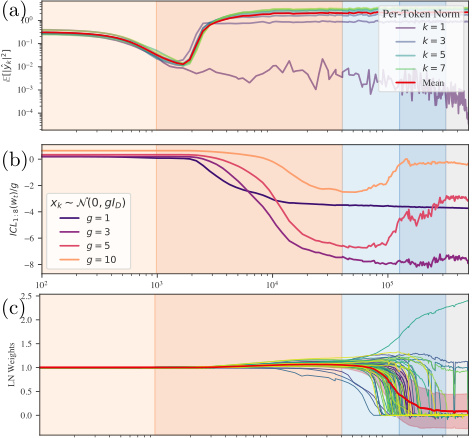

<!-- Start of picture text -->
(a) (b) (c) <!-- End of picture text -->

Figure 5: **In-context linear regression model stages coincide with significant structural and behavioral changes.** (a) During LR1, the model learns to make context-independent predictions, _xk �→ y_ ˆ _k_ = 0. (b) During LR2, ICL performance improves, then during LR3 the model becomes worse at ICL on OOD inputs _xk ∼N_ (0 _, gID_ ) for _g >_ 3. (c) During LR3 and LR4, layer normalization weights “collapse,” possibly contributing to the LLC decrease. 

**Acquiring in-context learning** Figure 5(b) shows that during LR2 there is a drop in ICL score (Appendix D.1.2), indicating that the model acquires in-context learning. 

**Embedding and attention collapse** Appendix D.2 documents additional changes. Near the end of LR2, token and positional embeddings begin to “collapse,” effectively losing singular values and aligning with the same activation subspace (Appendices D.2.1 and D.2.2). At the same time, several attention heads form concentrated, input-independent attention patterns (Appendix D.2.3). 

#### **7.3 Stages LR3 & LR4 (40k–126k & 126k–320k steps)** 

**Reduced robustness to input magnitude** While performance continues to improve on typical sequences, Figure 5(b) shows that during LR3 and LR4, the model’s in-context learning ability _deteriorates_ for outlier sequences with higher-than-average _|xk|_ . 

**Layer-normalization collapse** Figure 5(c) shows the individual weights in the final layer normalization module. A large fraction of these weights go to zero in LR3 and LR4. This occurs in tandem with a similar collapse in the weights of the unembedding transforms (Appendix D.2.4). This results in the model learning to read its prediction _y_ ˆ _k_ from a handful of privileged dimensions of the residual stream. Since this means that the network outputs become insensitive to changes in many of the parameters, we conjecture that this explains part of the striking decrease in estimated LLC over these stages (Appendix D.2.4). 

This collapse is most pronounced and affects the largest proportion of weights in the unembedding module, but in LR4 it spreads to earlier layer normalization modules, particularly the layer normalization module before the first attention block (Appendix D.2.5). 

### **8 Discussion** 

In this paper, we have examined the development of transformer models in two distinct learning settings. We quantified the changes in loss landscape degeneracy throughout transformer training by estimating the local learning coefficient (LLC). Motivated by the singular learning process in Bayesian inference, we divided these training runs into developmental stages at critical points of the LLC curve. We found that these developmental stages roughly coincided with significant changes in the internal computational structure and the input/output behavior of each model. In this section, we discuss several implications of these findings. 

**Towards a degeneracy-based understanding of deep learning** That significant structural and behavioral changes show up in the LLC curve is evidence that the development of our transformers is closely linked to loss landscape degeneracy. This finding underscores the potential of loss landscape degeneracy as a crucial lens through which to study the development of deep learning models. 

While we studied two distinct learning settings (including language modeling with a nontrivial transformer architecture), it remains necessary to verify the connection between degeneracy and development across a more diverse range of emergent model structures and behaviors. Moreover, future work should investigate this connection in more depth, seeking to establish a causal connection between changes in degeneracy and changes in structure and behavior. 

**Towards developmental interpretability** We showed that degeneracy can reveal meaningful changes in transformers. We emphasize that our analysis is not exhaustive—we expect only certain “macroscopic” changes, such as the emergence of in-context learning, will have a significant enough effect on loss landscape degeneracy to appear separated by plateaus in the LLC curve. Recent work has extended these ideas by measuring the LLC with respect to network sub-modules and with different data distributions, providing a more refined picture of model development (Wang et al., 2025). We expect this research direction will lead to insights into the development of more complex models. 

Loss landscape degeneracy offers a setting-agnostic, “unsupervised” alternative to setting-specific _progress measures_ such as those derived by Barak et al. (2022) or developed using mechanistic insights from similar models by Nanda et al. (2023). Both approaches can reveal developments invisible in the loss, but loss landscape degeneracy is able to detect changes without requiring a mechanistic understanding in advance. Of course, once a change is detected through its effect on degeneracy, it remains to interpret the change. 

**Cases studies in transformer development** We do _not_ claim that the structural and behavioral developments we observed in each setting are universal phenomena. Transformers trained with different architectures, data distributions, algorithms, or hyperparameters may develop differently. Rather, our detailed analysis contributes two “case studies” to the growing empirical literature on the emergence of structure in transformers. 

On this note, our observations extend those of Olsson et al. (2022) and Elhage et al. (2021). We show that before the induction circuit forms, our 2-layer language model learns simpler interpretable strategies (based on bigram statistics and common _n_ -grams). This shows that _a single training run_ follows a progression akin to that found by Olsson et al. (2022) for _fully-developed models of increasing depth_ (they showed that 

“0-layer” models learn bigram statistics and 1-layer models learn “skip-trigrams”). A similar progression was observed by Edelman et al. (2024) in a Markovian sequence modeling task. 

Moreover, in _both_ settings, we saw that before in-context learning emerges, the model learns to predict tokens using the optimal prediction given only the current token (bigram statistics for language modeling, zero for in-context linear regression with this distribution of tasks). 

**Development and model complexity** While we have described the LLC as a measure of loss landscape degeneracy, it can also be understood as a measure of model complexity (cf. Appendix A.2). It is natural for changes in a model’s internal structure to show up as a change in complexity. For example, Chen et al. (2024) showed that the emergence of syntactic attention structure coincides with a spike in two model complexity measures, namely the model’s _Fisher information_ and the _intrinsic dimension_ (Facco et al., 2017) of the model’s embeddings. 

Notably, we observe stages in which the LLC _decreases,_ corresponding to a _simplification_ of the computational structure of the model. Such model simplification has empirical precedent, for instance with Chen et al. (2024) and the recent literature on grokking (Power et al., 2022; Nanda et al., 2023; Tikeng Notsawo et al., 2024). In our case, the mechanistic nature of the simplification is not fully clear, with the collapse of various weights and attention patterns arising as candidates in the in-context linear regression setting. 

This phenomenon is currently not accounted for by theories of neural network development. In the theory of saddle-to-saddle dynamics, deep linear networks learn progressively _more_ complex approximations of the data (Saxe et al., 2019). Likewise, the example transitions in the singular learning process outlined in Section 5 and Figure 3 describe LLC _increases._ Though we note that decreasing the LLC while holding the loss constant would be another way to decrease the free energy according to equation (4), providing a full theoretical account of these stages is an open problem. 

### **Author contributions** 

All authors communicated regularly about all aspects of the methodology and writing. The following is a non-exhaustive list of some particular areas of individual contribution. 

- JH led the coding, experimentation, and analysis for the in-context linear regression setting; assisted with analysis of the language modeling setting; contributed substantially to the writing of the manuscript; and designed the conceptual illustrations. 

- GW led the coding, experimentation, and analysis for the language modeling setting; and contributed substantially to the writing of the manuscript. 

- MFR led the writing of the current main text, based on earlier versions written with others; and assisted with coding and tuning hyperparameters for the in-context linear regression setting. 

- LC assisted with coding, experimentation, and analysis for the in-context linear regression setting. 

- SW advised on technical details including assumptions of LLC estimation; and assisted with writing. 

- DM had the original idea for the degeneracy-based stage division methodology; contributed substantially to earlier versions of the main text; and coordinated the project. 

### **Acknowledgments** 

We thank Edmund Lau for advice on LLC estimation and Mansheej Paul for advice on training transformers in the in-context linear regression setting. We are grateful to Evan Hubinger and Simon Pepin Lehalleur for helpful conversations. For their valuable feedback on the manuscript, we thank Andres Campero, Zach Furman, Simon Pepin Lehalleur, and Nandi Schoots. 

We thank Google’s TPU Research Cloud program for supporting some of our experiments with Cloud TPUs. JH and GW completed part of this research through the AI Futures Fellowship. MFR completed part of this research as an independent researcher sponsored by private individuals, part at Timaeus, and part at the University of Oxford. LC’s work was supported by Lightspeed Grants. 

### **References** 

- Joseph Antognini and Jascha Sohl-Dickstein. PCA of high dimensional random walks with comparison to neural network training. In _Advances in Neural Information Processing Systems 31_ , pp. 10307–10316. Curran Associates, 2018. Access via NeurIPS. Cited on pages 3 and 29. 

- Pierre Baldi and Kurt Hornik. Neural networks and principal component analysis: Learning from examples without local minima. _Neural Networks_ , 2(1):53–58, 1989. DOI 10.1016/0893-6080(89)90014-2. Cited on page 3. 

- Boaz Barak, Benjamin Edelman, Surbhi Goel, Sham Kakade, Eran Malach, and Cyril Zhang. Hidden progress in deep learning: SGD learns parities near the computational limit. In _Advances in Neural Information Processing Systems 35_ , pp. 21750–21764. Curran Associates, 2022. Access via NeurIPS. Cited on page 10. 

- Angelica Chen, Ravid Shwartz-Ziv, Kyunghyun Cho, Matthew L Leavitt, and Naomi Saphra. Sudden drops in the loss: Syntax acquisition, phase transitions, and simplicity bias in MLMs. In _The Twelfth International Conference on Learning Representations_ . OpenReview, 2024. Access via OpenReview. Cited on pages 3 and 11. 

- Zhongtian Chen, Edmund Lau, Jake Mendel, Susan Wei, and Daniel Murfet. Dynamical versus Bayesian phase transitions in a toy model of superposition, 2023. Preprint arXiv:2310.06301 [cs.LG]. Cited on pages 2, 3, 6, 7, and 24. 

- Ezra Edelman, Nikolaos Tsilivis, Benjamin L Edelman, Eran Malach, and Surbhi Goel. The evolution of statistical induction heads: In-context learning Markov chains. In _Advances in Neural Information Processing Systems 37_ , pp. 64273–64311. Curran Associates, 2024. Access via NeurIPS. Cited on pages 3 and 11. 

- Ronen Eldan and Yuanzhi Li. TinyStories: How small can language models be and still speak coherent English?, 2023. Preprint arXiv:2305.07759 [cs.CL]. Cited on page 46. 

- Nelson Elhage, Neel Nanda, Catherine Olsson, Tom Henighan, Nicholas Joseph, Ben Mann, Amanda Askell, Yuntao Bai, Anna Chen, Tom Conerly, Nova DasSarma, Dawn Drain, Deep Ganguli, Zac Hatfield-Dodds, Danny Hernandez, Andy Jones, Jackson Kernion, Liane Lovitt, Kamal Ndousse, Dario Amodei, Tom Brown, Jack Clark, Jared Kaplan, Sam McCandlish, and Chris Olah. A mathematical framework for transformer circuits. _Transformer Circuits Thread_ , 2021. Access via Transformer Circuits Thread. Cited on pages 4, 10, 32, and 33. 

- Dumitru Erhan, Yoshua Bengio, Aaron Courville, Pierre-Antoine Manzagol, Pascal Vincent, and Samy Bengio. Why does unsupervised pre-training help deep learning? _Journal of Machine Learning Research_ , 11(19):625–660, 2010. Access via JMLR. Cited on page 3. 

- Elena Facco, Maria d’Errico, Alex Rodriguez, and Alessandro Laio. Estimating the intrinsic dimension of datasets by a minimal neighborhood information. _Scientific Reports_ , 7(1):12140, 2017. DOI 10.1038/s41598-017-11873-y. Cited on page 11. 

- D H Fowler. _Structural Stability and Morphogensis: An Outline of a General Theory of Models_ . W. A. Benjamin, Inc., 1975. English translation of Thom (1972), with updates from the author. Cited on page 14. 

- Sara Franceschelli. Morphogenesis, structural stability and epigenetic landscape. In Paul Bourgine and Annick Lesne (eds.), _Morphogenesis: Origins of Patterns and Shapes_ , pp. 283–293. Springer, 2010. DOI 10.1007/978-3-642-13174-5_16. Cited on page 3. 

- Simon L Freedman, Bingxian Xu, Sidhartha Goyal, and Madhav Mani. A dynamical systems treatment of transcriptomic trajectories in hematopoiesis. _Development_ , 150(11):dev201280, 2023. DOI 10.1242/dev.201280. Cited on page 3. 

- Leo Gao, Stella Biderman, Sid Black, Laurence Golding, Travis Hoppe, Charles Foster, Jason Phang, Horace He, Anish Thite, Noa Nabeshima, Shawn Presser, and Connor Leahy. The Pile: an 800GB dataset of diverse text for language modeling. Technical report, EleutherAI, 2020. Preprint arXiv:2101.00027 [cs.CL]. Cited on pages 2, 4, 46, and 47. 

- Shivam Garg, Dimitris Tsipras, Percy S Liang, and Gregory Valiant. What can transformers learn in-context? A case study of simple function classes. In _Advances in Neural Information Processing Systems 35_ , pp. 30583–30598. Curran Associates, 2022. Access via NeurIPS. Cited on pages 2 and 4. 

- Hamidreza Ghader and Christof Monz. What does attention in neural machine translation pay attention to? In _Proceedings of the Eighth International Joint Conference on Natural Language Processing (Volume 1: Long Papers)_ , pp. 30–39. Asian Federation of Natural Language Processing, 2017. Access via ACL Anthology. Cited on page 37. 

- Ian J Goodfellow, Oriol Vinyals, and Andrew M Saxe. Qualitatively characterizing neural network optimization problems, 2014. Conference paper presented at ICLR 2015. Preprint arXiv:1412.6544 [cs.NE]. Cited on page 3. 

- Katsuyuki Hagiwara, Naohiro Toda, and Shiro Usui. On the problem of applying AIC to determine the structure of a layered feedforward neural network. In _Proceedings Of 1993 International Joint Conference On Neural Networks_ , volume 3, pp. 2263–2266. IEEE, 1993. DOI 10.1109/IJCNN.1993.714176. Cited on page 3. 

- Andrej Karpathy. NanoGPT, 2022. Access via github.com/karpathy. Cited on page 47. 

- Diederik P Kingma and Jimmy Ba. Adam: A method for stochastic optimization, 2014. Conference paper presented at ICLR 2015. Preprint arXiv:1412.6980 [cs.LG]. Cited on page 48. 

- Edmund Lau, Zach Furman, George Wang, Daniel Murfet, and Susan Wei. The local learning coefficient: A singularity-aware complexity measure. In _The 28th International Conference on Artificial Intelligence and Statistics_ . OpenReview, 2025. Access via OpenReview. Cited on pages 2, 3, 5, 6, 17, 18, 19, 22, and 24. 

- Hao Li, Zheng Xu, Gavin Taylor, Christoph Studer, and Tom Goldstein. Visualizing the loss landscape of neural nets. In _Advances in Neural Information Processing Systems 31_ , pp. 6389–6399. Curran Associates, 2018. Access via NeurIPS. Cited on page 3. 

- Zachary C Lipton. Stuck in a what? Adventures in weight space, 2016. Workshop paper presented at ICLR 2016. Preprint arXiv:1602.07320 [cs.LG]. Cited on page 3. 

- Ben D MacArthur. The geometry of cell fate. _Cell Systems_ , 13(1):1–3, 2022. DOI 10.1016/j.cels.2021.12.001. Cited on page 3. 

- Thomas McGrath, Andrei Kapishnikov, Nenad Tomašev, Adam Pearce, Martin Wattenberg, Demis Hassabis, Been Kim, Ulrich Paquet, and Vladimir Kramnik. Acquisition of chess knowledge in AlphaZero. _Proceedings of the National Academy of Sciences_ , 119(47):e2206625119, 2022. DOI 10.1073/pnas.2206625119. Cited on pages 1 and 3. 

- Neel Nanda and Joseph Bloom. TransformerLens, 2022. Access via github.com/neelnanda-io. Cited on page 46. 

- Neel Nanda, Lawrence Chan, Tom Lieberum, Jess Smith, and Jacob Steinhardt. Progress measures for grokking via mechanistic interpretability. In _The Eleventh International Conference on Learning Representations_ . OpenReview, 2023. Access via OpenReview. Cited on pages 10 and 11. 

- Ambroise Odonnat, Wassim Bouaziz, and Vivien Cabannes. Clustering head: A visual case study of the training dynamics in transformers, 2024. Preprint arXiv:2410.24050 [cs.LG]. Cited on page 3. 

- Catherine Olsson, Nelson Elhage, Neel Nanda, Nicholas Joseph, Nova DasSarma, Tom Henighan, Ben Mann, Amanda Askell, Yuntao Bai, Anna Chen, Tom Conerly, Dawn Drain, Deep Ganguli, Zac Hatfield-Dodds, Danny Hernandez, Scott Johnston, Andy Jones, Jackson Kernion, Liane Lovitt, Kamal Ndousse, Dario Amodei, Tom Brown, Jack Clark, Jared Kaplan, Sam McCandlish, and Chris Olah. In-context learning and induction heads. _Transformer Circuits Thread_ , 2022. Access via Transformer Circuits Thread. Cited on pages 1, 2, 3, 4, 7, 8, 10, 28, 29, and 32. 

- Mary Phuong and Marcus Hutter. Formal algorithms for transformers. Technical report, DeepMind, 2022. Preprint arXiv:2207.09238 [cs.LG]. Cited on pages 40 and 47. 

- Alethea Power, Yuri Burda, Harri Edwards, Igor Babuschkin, and Vedant Misra. Grokking: Generalization beyond overfitting on small algorithmic datasets, 2022. Preprint arXiv:2201.02177 [cs.LG]. Cited on page 11. 

- Ofir Press, Noah A Smith, and Mike Lewis. Shortformer: Better language modeling using shorter inputs. In _Proceedings of the 59th Annual Meeting of the Association for Computational Linguistics and the 11th International Joint Conference on Natural Language Processing (Volume 1: Long Papers)_ , pp. 5493–5505. Association for Computational Linguistics, 2021. DOI 10.18653/v1/2021.acl-long.427. Cited on page 46. 

- Maartje E J Raijmakers, Sylvester van Koten, and Peter C M Molenaar. On the validity of simulating stagewise development by means of PDP networks: Application of catastrophe analysis and an experimental test of rule-like network performance. _Cognitive Science_ , 20(1):101–136, 1996. DOI 10.1207/s15516709cog2001_4. Cited on page 3. 

- David A Rand, Archishman Raju, Meritxell Sáez, Francis Corson, and Eric D Siggia. Geometry of gene regulatory dynamics. _Proceedings of the National Academy of Sciences_ , 118(38):e2109729118, 2021. DOI 10.1073/pnas.2109729118. Cited on page 3. 

- Allan Raventós, Mansheej Paul, Feng Chen, and Surya Ganguli. Pretraining task diversity and the emergence of non-Bayesian in-context learning for regression. In _Advances in Neural Information Processing Systems 36_ , pp. 14228–14246. Curran Associates, 2023. Access via NeurIPS. Cited on pages 4, 34, and 35. 

- Timothy T Rogers and James L McClelland. _Semantic Cognition: A Parallel Distributed Processing Approach_ . MIT Press, 2004. DOI 10.7551/mitpress/6161.001.0001. Cited on page 3. 

- Meritxell Sáez, Robert Blassberg, Elena Camacho-Aguilar, Eric D Siggia, David A Rand, and James Briscoe. Statistically derived geometrical landscapes capture principles of decision-making dynamics during cell fate transitions. _Cell Systems_ , 13(1):12–28, 2022. DOI 10.1016/j.cels.2021.08.013. Cited on page 3. 

- Andrew M Saxe, James L McClelland, and Surya Ganguli. A mathematical theory of semantic development in deep neural networks. _Proceedings of the National Academy of Sciences_ , 116(23):11537–11546, 2019. DOI 10.1073/pnas.1820226116. Cited on pages 3 and 11. 

- Maxwell Shinn. Phantom oscillations in principal component analysis. _Proceedings of the National Academy of Sciences_ , 120(48):e2311420120, 2023. DOI 10.1073/pnas.2311420120. Cited on page 29. 

- René Thom. _Stabilité Structurelle et Morphogénèse: Essai d’une Théorie Générale des Modèles [Structural Stability and Morphogensis: An Outline of a General Theory of Models]_ . W. A. Benjamin, Inc., 1972. In French. Translated into English by Fowler (1975). Cited on pages 1, 3, and 12. 

- Pascal Tikeng Notsawo, Jr., Hattie Zhou, Mohammad Pezeshki, Irina Rish, and Guillaume Dumas. Predicting grokking long before it happens: A look into the loss landscape of models which grok. In _ICLR 2024 Workshop on Mathematical and Empirical Understanding of Foundation Models_ . OpenReview, 2024. Access via OpenReview. Cited on pages 3 and 11. 

- Jesse Vig and Yonatan Belinkov. Analyzing the structure of attention in a transformer language model. In _Proceedings of the 2019 ACL Workshop BlackboxNLP: Analyzing and Interpreting Neural Networks for NLP_ , pp. 63–76. Association for Computational Linguistics, 2019. DOI 10.18653/v1/W19-4808. Cited on pages 37 and 38. 

- C H Waddington. _The Strategy of the Genes: A Discussion of Some Aspects of Theoretical Biology_ . Allen & Unwin, 1957. Cited on pages 1, 3, and 24. 

- George Wang, Jesse Hoogland, Stan van Wingerden, Zach Furman, and Daniel Murfet. Differentiation and specialization of attention heads via the refined local learning coefficient. In _The Thirteenth International Conference on Learning Representations_ . OpenReview, 2025. Access via OpenReview. Cited on page 10. 

- Sumio Watanabe. Almost all learning machines are singular. In _IEEE Symposium on Foundations of Computational Intelligence_ , pp. 383–388. IEEE, 2007. DOI 10.1109/FOCI.2007.371500. Cited on page 3. 

- Sumio Watanabe. _Algebraic Geometry and Statistical Learning Theory_ . Cambridge University Press, 2009. DOI 10.1017/CBO9780511800474. Cited on pages 1, 2, 3, 5, 7, and 17. 

- Sumio Watanabe. _Mathematical Theory of Bayesian Statistics_ . CRC Press, 2018. DOI 10.1201/9781315373010. Cited on page 6. 

- Jason Wei, Yi Tay, Rishi Bommasani, Colin Raffel, Barret Zoph, Sebastian Borgeaud, Dani Yogatama, Maarten Bosma, Denny Zhou, Donald Metzler, Ed H Chi, Tatsunori Hashimoto, Oriol Vinyals, Percy Liang, Jeff Dean, and William Fedus. Emergent abilities of large language models. _Transactions on Machine Learning Research_ , 2022. Access via OpenReview. Cited on pages 1 and 3. 

- Susan Wei, Daniel Murfet, Mingming Gong, Hui Li, Jesse Gell-Redman, and Thomas Quella. Deep learning is singular, and that’s good. _IEEE Transactions on Neural Networks and Learning Systems_ , 34(12): 10473–10486, 2023. DOI 10.1109/TNNLS.2022.3167409. Cited on page 3. 

- Max Welling and Yee Whye Teh. Bayesian learning via stochastic gradient Langevin dynamics. In _Proceedings of the 28th International Conference on Machine Learning_ , pp. 681–688. ACM, 2011. Access via ICML. Cited on page 5. 

- Sang Michael Xie, Shibani Santurkar, Tengyu Ma, and Percy S Liang. Data selection for language models via importance resampling. In _Advances in Neural Information Processing Systems 36_ , pp. 34201–34227. Curran Associates, 2023. Access via NeurIPS. Cited on pages 2, 4, 46, and 47. 

- Zhewei Yao, Amir Gholami, Kurt Keutzer, and Michael W Mahoney. PyHessian: neural networks through the lens of the Hessian. In _2020 IEEE International Conference on Big Data (Big Data)_ , pp. 581–590, 2020. DOI 10.1109/BigData50022.2020.9378171. Cited on page 27. 

# **Appendix** 

Appendix A reviews the learning coefficient, providing some simple toy examples contrasting the learning coefficient with Hessian-based measures. This section also discusses SGLD-based LLC estimation including experiment hyperparameters (Appendix A.4), and offers a detailed example of the calibrations involved in applying LLC estimation to regression transformers to serve as a reference (Appendix A.5). Appendix B provides further detail on our procedure for LLC-based stage identification, including stages identified in additional training runs and a brief comparison with Hessian statistics. Appendices C and D examine the developmental stages of language models and in-context linear regression in more detail and explain the various metrics we use to track behavioral and structural development. Appendix E describes some additional experiments on a one-layer language model. Appendix F covers transformer training experimental details, such as model architectures, training procedures, and hyperparameters. 

To facilitate reproduction of our analyses, we have made our codebase available. A repository containing additional figures and code can be accessed at the URL https://github.com/timaeus-research/icl. 

|**A The**|**local learning coefficient (LLC)**|**17**|
|---|---|---|
|A.1|Formal Definition of the LLC . . . . . . . . . . . . . . . . . . . . . . . . . . . . .|. . . . . . . 17|
|A.2|Interpretations and examples of the LLC. . . . . . . . . . . . . . . . . . . . . . .|. . . . . . . 17|
|A.3|Estimating LLCs with SGLD . . . . . . . . . . . . . . . . . . . . . . . . . . . . .|. . . . . . . 18|
|A.4|LLC estimation experiment details . . . . . . . . . . . . . . . . . . . . . . . . . .|. . . . . . . 18|
|A.5|A guide to SGLD-based LLC estimation . . . . . . . . . . . . . . . . . . . . . . .|. . . . . . . 19|
|A.6|LLC estimates for a non-log-likelihood-based loss . . . . . . . . . . . . . . . . . .|. . . . . . . 23|
|A.7|LLC estimates away from local minima . . . . . . . . . . . . . . . . . . . . . . .|. . . . . . . 24|
|**B LL**|**C-based stage boundary identification**|**25**|
|B.1|Procedure for stage boundary identification . . . . . . . . . . . . . . . . . . . . .|. . . . . . . 25|
|B.2|Stage boundary identification details for language model . . . . . . . . . . . . . .|. . . . . . . 25|
|B.3|Stage boundary identification details for in-context linear regression . . . . . . .|. . . . . . . 26|
|B.4|Stage identification for additional training runs . . . . . . . . . . . . . . . . . . .|. . . . . . . 26|
|B.5|Comparison to Hessian statistics . . . . . . . . . . . . . . . . . . . . . . . . . . .|. . . . . . . 27|
|**C Dev**|**elopmental analysis of language models**|**28**|
|C.1|Behavioral development . . . . . . . . . . . . . . . . . . . . . . . . . . . . . . . .|. . . . . . . 28|
|C.2|Structural development . . . . . . . . . . . . . . . . . . . . . . . . . . . . . . . .|. . . . . . . 29|
|**D Dev**|**elopmental analysis of regression transformers**|**34**|
|D.1|Behavioral development . . . . . . . . . . . . . . . . . . . . . . . . . . . . . . . .|. . . . . . . 34|
|D.2|Structural development . . . . . . . . . . . . . . . . . . . . . . . . . . . . . . . .|. . . . . . . 36|
|**E On**|**e-layer language model experiments**|**44**|
|**F Tra**|**nsformer training experiment details**|**46**|
|F.1|Language models . . . . . . . . . . . . . . . . . . . . . . . . . . . . . . . . . . . .|. . . . . . . 46|
|F.2|In-context linear regression transformers . . . . . . . . . . . . . . . . . . . . . . .|. . . . . . . 47|

### **A The local learning coefficient (LLC)** 

#### **A.1 Formal Definition of the LLC** 

In the setting of Section 4, let _B_ be a closed ball around _w__∗_ such that _w__∗_ is a global minimum on _B_ , by which we mean a point with (equal) lowest loss. If there are multiple such global minima, the volume asymptotics are determined by the geometry of one that is most degenerate in the precise sense of SLT, formalised in Lau et al. (2025), roughly corresponding to having the lowest LLC. We call this minimum the maximally degenerate global minimum on _B_ . Consider the volume of the set of nearby low-loss parameters, 

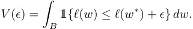

As _ϵ →_ 0, _V_ ( _ϵ_ ) is asymptotically equivalent to 

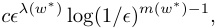

where _λ_ ( _w__∗_ ) is the LLC, _m_ ( _w__∗_ ) is another geometric quantity called the _local multiplicity_ , and _c >_ 0 is a constant. 

#### **A.2 Interpretations and examples of the LLC** 

In Section 4, we introduced the LLC as a quantification of geometric degeneracy. In this section, we discuss an additional perspectives on the LLC as a count of the “effective” dimensionality of a parameter, and we give additional examples of the LLC. We refer the reader to Watanabe (2009) and Lau et al. (2025) for more discussion. 

The LLC has some similarity to an effective parameter count. If the population loss _ℓ_ looks like a quadratic form near _w__∗_ then _λ_ ( _w__∗_ ) =_<u>d</u>_ 2ishalfthenumberofparameters,whichwecanthinkofas_d_contributionsof <u>12</u>fromeveryindependentquadraticdirection.Ifthereareonly_d −_1independentquadraticdirections,and one coordinate _wi_ such that small variations in _wi_ near _wi__∗_donotchangethemodelrelativetothetruth (this dimension is “unused”) then _λ_ ( _w__∗_ ) =_<u>d−</u>_ 2<u>1</u>. 

The situation becomes more intricate when certain dimensions are degenerate but not completely unused, varying to quartic or higher order near the parameter (rather than being quadratic or flat). While every unused coordinate reduces the LLC by 2<u>1</u>,changingthedependencyonacoordinatefromquadratic(_w_ _i_2)to quartic ( _wi_4)(increasingits_degeneracy_whilestill“using”it)reducesthecontributiontotheLLCfrom<u>1</u> 2to <u>1</u> 4. 

As a source of intuition, we provide several examples of exact LLCs: 

- _ℓ_ ( _w_ 1 _, w_ 2 _, w_ 3) = _aw_ 12+_bw_ 22+_cw_ 32with_a, b, c>_0.Thisfunctionisnondegenerate,and_λ_(0_,_0_,_0)= <u>12</u>+<u>1</u> 2+<u>1</u> 2=<u>3</u> 2.Thisisindependentof_a, b, c_.Thatis,theLLC_λ_does_notmeasurecurvature_.For this reason, it is better to avoid an intuition that centers on “basin broadness” since this tends to suggest that lowering _a, b, c_ should affect the LLC. 

- _ℓ_ ( _w_ 1 _, w_ 2 _, w_ 3) = _w_ 12+_w_ 22+0 in R3 is degenerate, but its level sets are still submanifolds and_λ_(0_,_0_,_0) = 21+<u>1</u> 2.Inthiscasethevariable_w_3isunused,andsodoesnotcontributetotheLLC. 

- _ℓ_ ( _w_ 1 _, w_ 2 _, w_ 3) = _w_ 12+_w_ 24+_w_ 34is degenerate and its level sets are, for our purposes, not submanifolds. The singular function germ ( _ℓ,_ 0) is an object of algebraic geometry, and the appropriate mathematical object is not a _manifold_ or a _variety_ but a _scheme_ . The quartic terms contribute<u>1</u> 4totheLLC, so that _λ_ (0 _,_ 0 _,_ 0) =<u>1</u> 2+<u>1</u> 4+<u>1</u> 4=1.Thehigherthepowerofavariable,thegreaterthedegeneracy and the lower the LLC. 

Figure 2 offers several additional examples, from left to right: 

- A quadratic potential _ℓ_ 1( _w_ 1 _, w_ 2) = _w_ 12+_w_ 22,forwhichtheLLCismaximalintwodimensions, _λ_ 1(0 _,_ 0) = _d/_ 2 = 1. 

- A quartic potential _ℓ_ 2( _w_ 1 _, w_ 2) = _w_ 14+_w_ 24,forwhichtheLLCis_λ_2(0_,_0) = 1_/_2. 

- An even more degenerate potential _ℓ_ 3( _w_ 1 _, w_ 2) = _w_ 12_w_ 24,forwhich_λ_3(0_,_0)=1_/_4.Wenotethat Hessian-derived metrics cannot distinguish between this degeneracy and the preceding quartic degeneracy. 

- A qualitatively distinct potential _ℓ_ 4( _w_ 1 _, w_ 2) = ( _w_ 1 _−_ 1)2 ( _w_ 12+_w_ 22)4fromLauetal.(2025)withthe same LLC at the origin, _λ_ 4(0 _,_ 0) = 1 _/_ 4. 

While nondegenerate functions can be locally written as quadratic forms by the Morse Lemma (and are thus qualitatively similar to the approximation obtained from their Hessians), there is no simple equivalent for degenerate functions, such as the population losses of deep neural networks. 

#### **A.3 Estimating LLCs with SGLD** 

We follow Lau et al. (2025) in using SGLD to estimate the expectation value of the loss in the estimator of the LLC. For a given choice of weights _w__∗_ we sample _C_ independent chains with _T_ SGLD steps per chain. Each chain _c_ is a sequence of weights _{wτ_(_c_)_}T_ _τ_ =1SGLD . From these samples, we estimate the expectation E_β_ _w|w__∗_ _,γ_[_O_(_w_)] of an observable _O_ by 

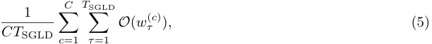

with an optional burn-in period. Dropping the chain index _c_ , each sample in a chain is generated according to: 

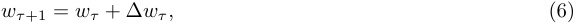

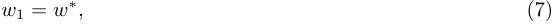

where the step ∆ _wτ_ comes from an SGLD update 

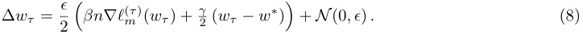

In each step _τ_ we sample a mini-batch of size _m_ and the associated empirical loss, denoted _ℓ_( _m__τ_),isusedto compute the gradient in the SGLD update. We note that LLC estimator defined in (3) uses the expectation E_β_ [ _ℓn_ ( _w_ )] which in the current notation means we should take _O_ ( _w_ ) to be _ℓn_ ( _w_ ). For computational efficiency we follow Lau et al. (2025) in recycling the mini-batch losses _ℓm_ ( _wτ_(_c_))computedduringtheSGLDprocess. That is, we take _O_ = _ℓm_(_τ_)ratherthan_O_=_ℓ_ _n_. 

**Time and Space Complexity.** The computational cost per LLC estimate is proportional to a standard training step, denoted _S_ . We expect to require a constant number _CT_ SGLD of samples (on the order of 102 –104 ) to yield robust estimates, independent of model size. Using logarithmically spaced checkpoints, the total computational complexity for generating an LLC curve over the entire training process scales as _O_ ( _SCT_ SGLD log _N_ ), where _N_ is the total number of training steps. The space complexity incurs a modest linear overhead compared to standard SGD, requiring storage for one additional copy of the weights to enable localization. 

#### **A.4 LLC estimation experiment details** 

#### **A.4.1 LLC estimation details for language models** 

For language models, we use SGLD to sample 20 independent chains with 200 steps per chain and 1 sample per step. For the one-layer model, we used _ϵ_ = 0 _._ 003 _, γ_ = 300, and for the two-layer model we used 

_ϵ_ = 0 _._ 001 _, γ_ = 100. Estimating the LLC across all checkpoints took around 200 GPU hours for the two-layer model on a single A100 and around 125 GPU hours for the one-layer model. For additional runs of the two-layer model, we ran fewer chains, bringing the time down to about 2 TPU hours per training run. 

We sampled a separate set of 1 million lines (lines 10m-11m) from the DSIR filtered Pile, denoted as _D_ sgld. The first 100,000 lines from this SGLD set (lines 10m-10.1m) were used as a validation set. The sampling of batches for SGLD mirrored the approach taken during the primary training phase. Each SGLD estimation pass was seeded analogously, so, at different checkpoints, the SGLD chains encounter the same selection of batches and injected Gaussian noise. 

Table 1: Hyperparameters for estimating the LLC for language models. 

|**Hyperparameter**|**Category**|**Description/Notes**|**1-Layer** **2-Layer**|
|---|---|---|---|
|C|Sampler|# of chains|20|
|_T_SGLD|Sampler|# of SGLD steps / chain|200|
|_ϵ_|SGLD|Step size|0_._003 0_._001|
|_γ_|SGLD|Localization strength|300 100|
|_nβ_|SGLD|Inverse temperature|21.7|
|_m_|SGLD|The size of each SGLD batch|100|
|_µ_|Data|Dataset size for gradient minibatches|13m|

#### **A.4.2 LLC estimation details for in-context linear regression** 

For in-context linear regression models, we generate a fixed dataset of 220 samples. Using SGLD, we sample 10 independent chains with 5,000 steps per chain, of which the first 1,000 are discarded as a burn-in, after which we draw observations once per step, at a temperature _nβ_ = 66 _._ 7, _ϵ_ = 0 _._ 0003, and _γ_ = 13 _._ 3, over batches of size _m_ = 1024. LLC estimation takes up to 72 CPU-hours per training run. 

Table 2: **LLC estimation hyperparameters** . A summary of the hyperparameters involved in estimating the LLC and the default values we use. 

|**Hyperparameter**|**Category**|**Description/Notes**|**Default Values**|
|---|---|---|---|
|C|Sampler|# of chains|10|
|_T_SGLD|Sampler|# of SGLD steps / chain|5000|
|_ϵ_|SGLD|Step size|0_._0003|
|_γ_|SGLD|Localization strength|13_._3|
|_nβ_|SGLD|Inverse temperature|66_._7|
|_m_|SGLD|The size of each SGLD batch|1024|
|_µ_|Data|Dataset size for gradient minibatches|220|

#### **A.5 A guide to SGLD-based LLC estimation** 

This section walks through some of the hyperparameter choices and sweeps involved in calibrating LLC estimates. We provide it as a reference for others seeking to adjust LLC estimation to novel settings. 

#### **A.5.1 Varying the temperature** 

In Lau et al. (2025), the inverse temperature _β_ is set to a fixed “optimal” value _β__∗_ = 1 _/_ log _n_ , where _n_ is the number of training samples. In practice, we find that it can be advantageous to sample at a higher temperature. 

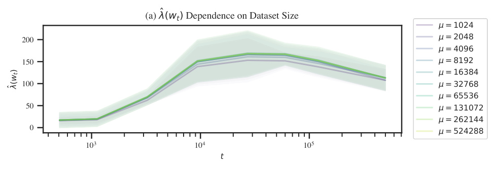

<!-- Start of picture text -->
(a)  (wt) Dependence on Dataset Size = 1024 200 = 2048 = 4096 150 = 8192 = 16384 100 = 32768 = 65536 50 = 131072 = 262144 0 = 524288 10 3 10 4 10 5 t ()wt <!-- End of picture text -->

Figure A.1: Past some threshold, the choice of validation set size from which SGLD batches are sampled has little effect on learning coefficient estimates. Estimation hyperparameters are _C_ = 8 _, T_ SGLD = 2 _,_ 000 _, m_ = 1024 _, ϵ_ = 0 _._ 0003 _,_ ˜ _γ_ = 0 _._ 01 _, β_˜ = 0 _._ 01. Loss is evaluated over gradient minibatches at a representative selection of checkpoints. LLCs quickly converge to a constant value as the size increases. 

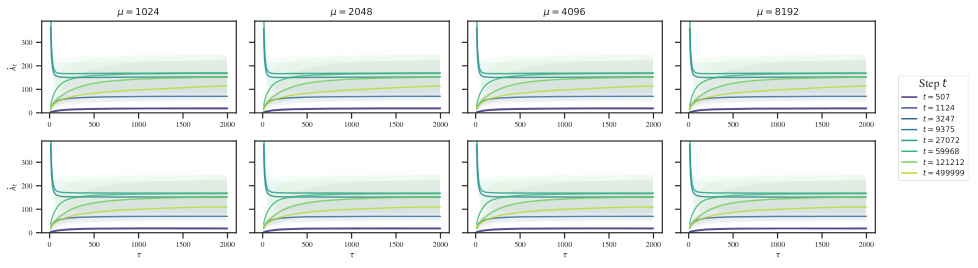

<!-- Start of picture text -->
= 1024 = 2048 = 4096 = 8192 300 200 100 Step t t = 507 0 0 500 1000 1500 2000 0 500 1000 1500 2000 0 500 1000 1500 2000 0 500 1000 1500 2000 ttt = 1124 = 3247 = 9375 t = 27072 t = 59968 300 t = 121212 t = 499999 200 100 0 0 500 1000 1500 2000 0 500 1000 1500 2000 0 500 1000 1500 2000 0 500 1000 1500 2000 t t <!-- End of picture text -->

Figure A.2: The size of SGLD minibatches has a negligible effect on LLC estimates (at least among the batch sizes considered). _Top:_ Loss is evaluated on the same minibatch as the SGLD gradients. _Bottom:_ Loss is evaluated on a newly sampled minibatch from the SGLD gradients (of the same size). Estimation hyperparameters are _C_ = 8 _, T_ SGLD = 2 _,_ 000 _, µ_ = 220 . 

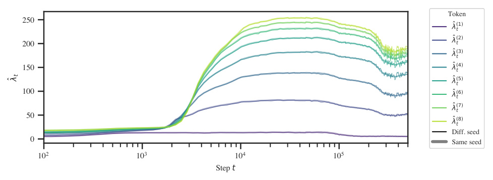

<!-- Start of picture text -->
Token 250 (1) t (2) 200 t (3) t 150 (4)t (5) t 100 (6) t (7) t 50 (8) t Diff. seed 0 Same seed 10 2 10 3 10 4 10 5 Step t t <!-- End of picture text -->

Figure A.3: Consistently seeding SGLD estimates at each checkpoint smooths out the resulting LLC-overtime curve. Except towards the end of training (this is plotted over a log time axis), the difference is barely noticeable. Variable seeds yield a noisier set of estimates. 

Since _β_ always shows up in a product with _n_ (in (8) for the SGLD step and in (3) for the LLC), we can view the inverse temperature as a multiplier that adjusts the effective size of your dataset. In a Bayesian setting, _β_ = 2 would mean updating twice on each of the samples in your dataset. 

The problem with the default choice of _β__∗_ is that as we increase _n_ we have to decrease the SGLD step size _ϵ_ to prevent the update from becoming ill-conditioned, and this eventually causes the gradient term to suppress the noise term. This, in turn, leads to requiring larger batches to suppress the gradient noise and requiring longer chains to sufficiently explore the local posterior (Appendix A.5.3). 

Instead of _nβ_ = _n/_ log _n_ , we perform LLC estimation at _nβ_ = _m/_ log _m_ , where _m_ is the SGLD batch size. 

#### **A.5.2 Seeding the random noise** 

To smooth out the _λ_ˆ _t_ curves, we reset the random seed before LLC estimation run at each checkpoint. This means the sequence of injected Gaussian noise is the same for LLC estimation runs at different checkpoints. Additionally, if the batch size is held constant, the batch schedule will also be constant across different estimation runs. Figure A.3 shows that this does not affect the overall shape of the learning coefficient curves; it simply smooths it out. 

#### **A.5.3 Calibrating** _ϵ_ **,** _β_ **, and** _γ_ 

As a rule of thumb, _ϵ_ should be large enough that the _λ_ˆ estimate converges within the _T_ SGLD steps of each chain but not too large that you run into issues with numerical stability and divergent estimates. Subject to this constraint, _γ_ should be as small as possible to encourage exploration without enabling the chains to “escape” to nearby better optima, and _β_ should be as large as possible (but no greater than 1 _/_ log _n_ ). 

To determine the optimal SGLD hyperparameters, we perform a grid sweep over a reparametrization of the SGLD steps in terms of _β,_˜ ˜ _γ, ε_ : 

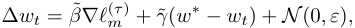

where _β_˜ = _εβn/_ 2, _γ_ ˜ = _εγ/_ 4. 

The results of this hyperparameter sweep are illustrated in Figure A.4 for final checkpoints. Separately (not pictured), we check the resulting hyperparameters for a subset of earlier checkpoints. This is needed since, for example, a well-behaved set of hyperparameters at the end of training may lead to failures like divergent estimates (Figure A.5) earlier in training when the geometry is more complex and thus the chains less stable. 

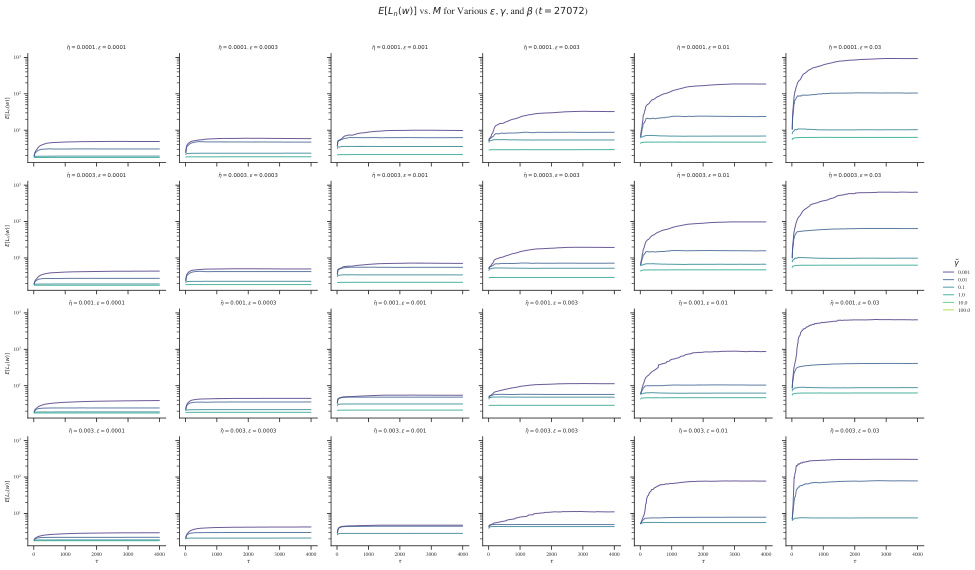

<!-- Start of picture text -->
E[Ln(w)] vs. M for Various , , and  (t = 27072) = 0.0001,  = 0.0001 = 0.0001,  = 0.0003 = 0.0001,  = 0.001 = 0.0001,  = 0.003 = 0.0001,  = 0.01 = 0.0001,  = 0.03 10 3 10 2 10 1 = 0.0003,  = 0.0001 = 0.0003,  = 0.0003 = 0.0003,  = 0.001 = 0.0003,  = 0.003 = 0.0003,  = 0.01 = 0.0003,  = 0.03 10 3 10 2 10 1 0.001 0.01 0.1 1.0 = 0.001,  = 0.0001 = 0.001,  = 0.0003 = 0.001,  = 0.001 = 0.001,  = 0.003 = 0.001,  = 0.01 = 0.001,  = 0.03 10.0 10 3 100.0 10 2 10 1 = 0.003,  = 0.0001 = 0.003,  = 0.0003 = 0.003,  = 0.001 = 0.003,  = 0.003 = 0.003,  = 0.01 = 0.003,  = 0.03 10 3 10 2 10 1 0 1000 2000 3000 4000 0 1000 2000 3000 4000 0 1000 2000 3000 4000 0 1000 2000 3000 4000 0 1000 2000 3000 4000 0 1000 2000 3000 4000 [)]\(ELwn [)]\(ELwn [)]\(ELwn [)]\(ELwn <!-- End of picture text -->

Figure A.4: Results of grid sweep over SGLD hyperparameters for model 0 at _t_ = 27k. 

#### **A.5.4 LLC traces** 

As a useful diagnostic when calibrating the LLC estimates, we propose an online variant for learning coefficient estimation. When overlaid on top of individual-chain LLC traces, this helps reveal common failure modes like divergent estimates, non-converged estimates, and escapes (Figure A.5). These traces display the running estimate of _λ_ˆ as a function of the number of steps taken in a chain (with the estimate averaged across independent chains). 

Define _λ_ˆ _τ_ ( _w_ 0), the LLC at _w_ 0 after _τ_ time-steps for a single SGLD chain as follows (Lau et al., 2025): 

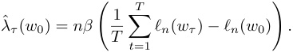

Moving terms around, we get, 

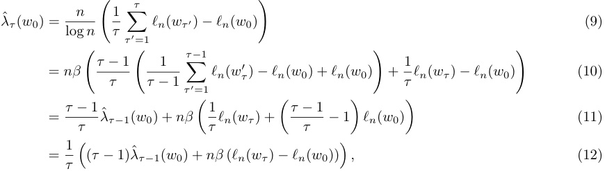

where 

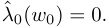

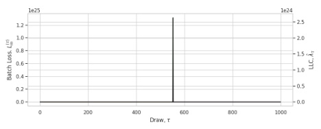

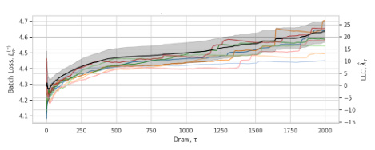

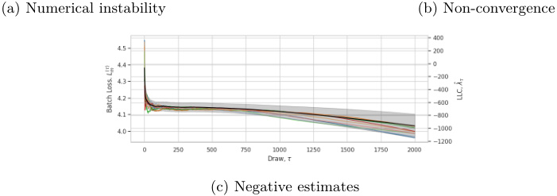

<!-- Start of picture text -->
(a) Numerical instability (b) Non-convergence (c) Negative estimates <!-- End of picture text -->

Figure A.5: **Failure modes of SGLD estimation.** _Top left_ : the gradient term is too large, leading to issues with numerical instability and exploding _λ_ˆ estimates. _Top right_ : _ϵ_ is too small, leading to _λ_ˆ not converging within each chain. _Bottom_ : the localization term is too small, which allows the chain to escape to better optima. 

This can be easily extended to an online estimate over chains by averaging the update _nβ_ ( _ℓn_ ( _wτ_ ) _− ℓn_ ( _w_ 0)) over multiple chains. 

#### **A.6 LLC estimates for a non-log-likelihood-based loss** 

In the main body, we apply the LLC to empirical loss functions that do not arise as the log likelihood of independent random variables, due to the repeated use of dependent sub-sequences. Here we explain that it is possible to define a proper negative log likelihood over independent observations for the in-context linear regression setting: similar observations can be made in the language modeling setting. 

Let Π( _k_ ) be a probability distribution over the context length _k_ . Ideally, the transformer would be trained to make predictions _yk_ given a context of length _k_ where _k_ is sampled from Π. With the given distribution over contexts this leads to a negative log likelihood of the form 

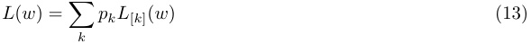

where _pk_ is the probability of sampling _k_ from Π and 

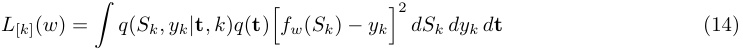

using the notation of Section 3 so _Sk_ = ( _x_ 1 _, y_ 1 _, . . . , xk−_ 1 _, yk−_ 1 _, xk_ ) is a context of length _k_ . It is straightforward to check that this negative log likelihood _L_ agrees with the population loss _ℓ_ associated to the empirical loss defined in Section 3. However the empirical quantities _Ln_ ( _w_ ) and _ℓn_ ( _w_ ) defined for a set of samples of size _n_ are _not_ the same. 

Since we use the empirical loss _ℓn_ in our calculation of the estimated LLC, whereas the foundational theory of SLT is written in terms of the empirical negative log likelihood _Ln_ , it is natural to wonder how much of a difference this makes in practice. Figure A.6 depicts LLC traces (Appendix A.5) for a highlighted number of checkpoints using either a likelihood-based estimate (with variable sequence length) or loss-based estimate (with fixed sequence length). The relative orderings of complexities does not change, and even the values 

of the LLC estimates do not make much of a difference, except at the final checkpoint, which has a higher value for the sub-sequence-based estimate. 

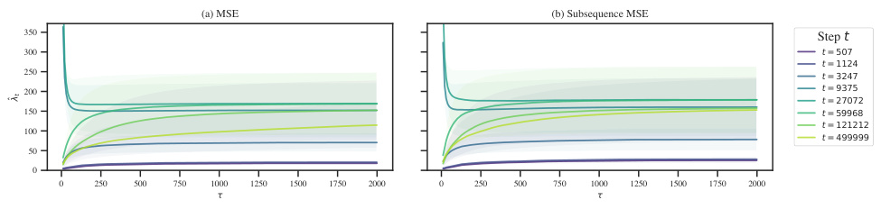

<!-- Start of picture text -->
(a) MSE (b) Subsequence MSE 350 Step t 300 t = 507 t = 1124 250 t = 3247 200 t = 9375 t = 27072 150 t = 59968 t = 121212 100 t = 499999 50 0 0 250 500 750 1000 1250 1500 1750 2000 0 250 500 750 1000 1250 1500 1750 2000 t <!-- End of picture text -->

Figure A.6: Loss-based ( _left_ ) and likelihood-based ( _right_ ) LLC estimation yield identically ordered LLC estimates. With the exception of final checkpoint’s LLC estimate (which is larger for the loss-based estimate), the values are close to identical. These plots display _LLC traces_ , which show the LLC estimate as a function of _SGLD steps_ . This is a useful tool for calibrating LLC estimation (Appendix A.5). 

#### **A.7 LLC estimates away from local minima** 

Our methodology for detecting stages is to apply LLC estimation to compute _λ_ˆ ( _w__∗_ ) at neural network parameters _w__∗_ = _wt_ across training. In the typical case these parameters will _not_ be local minima of the population loss, violating the theoretical conditions under which the LLC is defined. 

It is not surprising that the estimator appears to work if _w__∗_ is approximately a local minima. Lau et al. (2025) validated their estimator at both parameters constructed to be local minima of the population loss and also at parameters found through training with stochastic gradient descent (possibly not local minima of the empirical loss, let alone the population loss). They showed that in both cases the estimator recovers the true learning coefficient associated with the global minimum of the population loss. 

On the other hand, if _w__∗_ is far from any local minima, it is _a priori_ quite surprising that the SGLD-based estimation procedure works at all, as in this situation one might expect the chains to explore directions in which the loss decreases. Nevertheless, Chen et al. (2023) found that, empirically, LLC estimation away from local minima appears to give sensible results in practice. In our case, with sufficient localization we see stable estimates throughout training. 

Theoretically accounting for this phenomenon is an interesting open problem. Perhaps there is a notion of _stably evolving equilibrium_ in the setting of neural network training, echoing some of the ideas of Waddington (1957), such that the LLC estimation procedure is effectively giving us the LLC of a different potential to the population loss—a potential for which the current parameter actually _is_ at a critical point. We leave addressing this question to future work. 

### **B LLC-based stage boundary identification** 

#### **B.1 Procedure for stage boundary identification** 

To identify stage boundaries, we look for plateaus in the LLC: checkpoints at which the slope of _λ_ˆ ( _wt_ ) over _t_ vanishes. To mitigate noise in the LLC estimates, we first fit a Gaussian process with some smoothing to the LLC-over-time curve. Then we numerically calculate the slope of this Gaussian process with respect to log _t_ . The logarithm corrects for the fact that the learning coefficient, like the loss, changes less as training progresses. We identify stage boundaries by looking for checkpoints at which this estimated slope equals zero. The results of this procedure are depicted in Figure B.1 for language and Figure B.2 for in-context linear regression. 

At a local minima or maxima of the estimated LLC curve identifying a plateau from this estimated slope is straightforward, since the derivative crosses the x-axis. However at a saddle point, the slope may not exactly reach zero, so we have to specify a “tolerance” for the absolute value of the derivative, below which we treat the boundary as an effective plateau. 

In this case, we additionally require that the plateau be at a local minimum of the absolute first derivative. Otherwise, we may identify several adjacent points as all constituting a stage boundary. 

To summarize, identifying stage boundaries is sensitive to the following choices: the intervals between checkpoints, the amount of smoothing, whether to differentiate with respect to _t_ or log _t_ , and the choice of tolerance. However, once a given choice of these hyperparameters is fixed, stages can be _automatically_ identified, without further human judgment. 

#### **B.2 Stage boundary identification details for language model** 

Figure B.1 displays the test loss and LLC curves from Figure 1a in addition to the weight norm over time and associated slopes. Stage boundaries coincide with where the slope of the LLC crosses zero, that is, where there is a plateau in the LLC. 

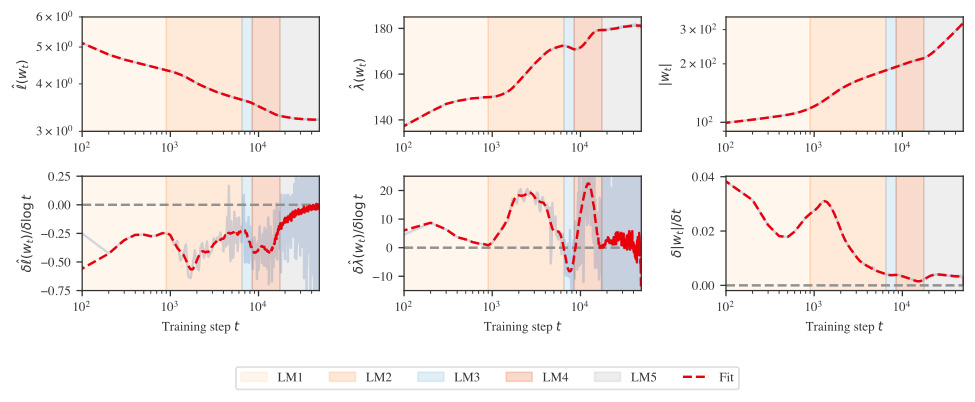

Figure B.1: A more detailed version of Figure 1a for two-layer language models. _Top_ : Loss, LLC, and weight norm, along with an overlaid Gaussian process fit to these curves (red dotted lines). _Bottom_ : Associated slopes, both numerically estimated finite differences (transparent blue) and of the Gaussian process (red dotted lined). Note that stage LM5 may be subdivided into further stages (Appendix B.1). However, the noise in LLC estimates late in training is high, so we do not draw any conclusions from this. 

#### **B.3 Stage boundary identification details for in-context linear regression** 

Figure B.2 displays the test loss and LLC curves from Figure 1b in addition to the weight norm over time, and numerically estimated slopes associated to these three metrics. As in the case of language models, we identify stage boundaries by looking for plateaus in the LLC. Unlike the language models, here the boundaries LR1–LR2 and LR2–LR3 are clearly visible in the loss. 

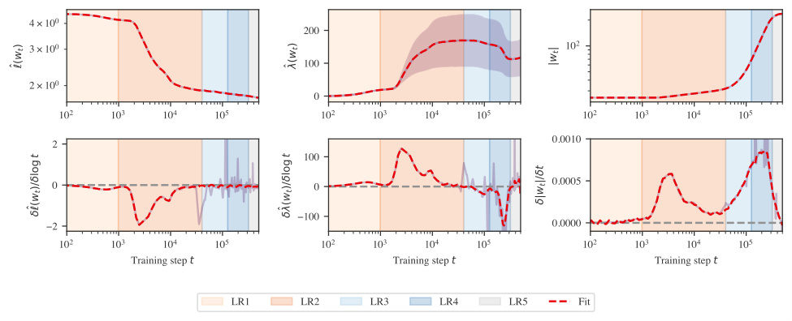

Figure B.2: A more detailed version of Figure 1b for in-context linear regression. _Top_ : Loss, LLC, and weight norm, along with an overlaid Gaussian process fit to these curves (red dotted lines). _Bottom_ : Associated slopes, both numerically estimated finite differences (transparent blue) and of the Gaussian process (red dotted lined). _Top middle_ : Error bars displaying the standard deviation over the 10 SGLD chains are displayed in the background. Note that large error bars across chains are to be expected. Between different SGLD estimations, the variance is much lower. For example, averaged over training, the standard deviation over different seeds is only 4.2. 

#### **B.4 Stage identification for additional training runs** 

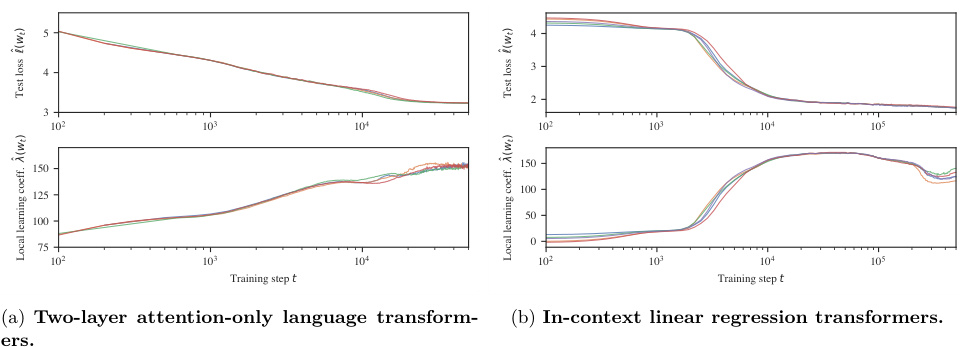

<!-- Start of picture text -->
5 4 4 3 2 3 10 2 10 3 10 4 10 2 10 3 10 4 10 5 150 150 125 100 100 50 75 0 10 2 10 3 10 4 10 2 10 3 10 4 10 5 Training step t Training step t (a) Two-layer attention-only language transform- (b) In-context linear regression transformers. ers. ()Test loss  wt ()Test loss  wt ()Local learning coeff.  wt ()Local learning coeff.  wt <!-- End of picture text -->

Figure B.3: Figure 1a and Figure 1b for multiple seeds. In both settings, LLC reveals a consistent set of stages across five seeds. Late-training behavior shows more variance across seeds (see Appendix B.4). 

Figure B.3a shows loss and LLC curves for five seeds (differing in model initialization and batch schedule). In each seed, LLC estimation reveals stage LM1–LM4. In three of the five seeds, stage LM5 is subdivided into two additional stages. 

Figure B.3b shows loss and LLC curves for five unique seeds (differing in model initialization and batch schedule). In each seed, LLC estimation reveals stages LR1–LR5. There is remarkably little variance across different seeds. 

#### **B.5 Comparison to Hessian statistics** 

Figure B.4 shows a quantification of the curvature-based notion of flatness captured by the Hessian (in contrast to the degeneracy-based notion of flatness captured by the LLC) for our in-context linear regression transformer. To estimate the trace and maximum eigenvalues shown in this figure, we use the PyHessian library (Yao et al., 2020) over a batch of _m_ = 1024 samples. 

Crucially, we observe that these Hessian-derived metrics (henceforth, “curvature”) and the LLC are _not_ consistently correlated. During the first part of LR2, the LLC and the curvature are jointly increasing. Starting at around _~~t~~_ ~~= 20k, while the LLC is still increasing, the curvature starts decreasi~~ ng. In the first part of LR3, both metrics decrease in tandem, but as of around _t_ = 120k, the curvature turns around and starts increasing. 

The Hessian fails to detect three of the four stage boundaries identified by our LLC-based methodology. Since these Hessian ~~-b~~ ased metrics are dominated by the largest eigenvalues—the directions of maximum curvature—they fail <u>to</u> observe the finer-grained measures of degeneracy that dominate the LLC. Moreover, we observe that LLC estimation is more scalable (empirically, it seems to be roughly linear in parameter count) than estimat ~~in~~ g the full Hessian (which is quadratic). 

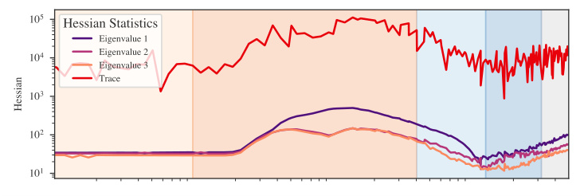

Figure B.4: Hessian-based statistics reveal only one stage boundary in the development of our in-context linear regression transformer. 

### **C Developmental analysis of language models** 

In this section, we present further evidence on behavioral (Appendix C.1) and structural (Appendix C.2) development of the language model over the course of training. 

#### **C.1 Behavioral development** 

#### **C.1.1 Bigram score** 

We empirically estimate the conditional bigram distribution by counting instances of bigrams over the training data. From this, we obtain the conditional distribution _q_ ˜( _t__′_ _|t_ ), the likelihood that a token _t__′_ follows _t_ . The _bigram score Bk__S_at index_k_of an input context_S_is the cross entropy between the model’s predictions _p_ ( _tk_ +1 _|tk_ ) at that position and the empirical bigram distribution, 

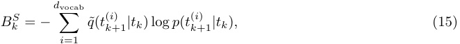

where the _t_(_i_) _k_ +1rangeoverthepossiblesecondtokensfromthetokenizervocabulary.Fromthisweobtain the _average bigram score_ 

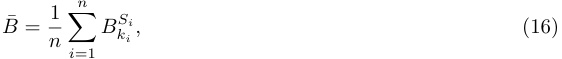

where we take fixed random sequences of _ki_ and _Si_ for 1 _≤ i ≤ n_ = 5 _,_ 000, which is displayed over training in Figure 4(a). This is compared against the best-achievable bigram score, which is the bigram distribution entropy itself, averaged over the validation set. 

#### **C.1.2** _n_ **-gram scores** 

In stage LM2 we consider _n_ -grams, which are sequences of _n_ consecutive tokens, meaning 2-grams and bigrams are the same. Specifically, we consider _common n_ -grams, which is defined heuristically by comparing our 5,000 vocab size tokenizer with the full GPT-2 tokenizer. We use the GPT-2 tokenizer as our heuristic because its vocabulary is constructed iteratively by merging the most frequent pairs of tokens. 

We first tokenize the tokens in the full GPT-2 vocabulary to get a list of 50,257 _n_ -grams for various _n_ . The first 5,000 such _n_ -grams are all 1-grams, after which 2-grams begin appearing, then 3-grams, 4-grams, and so on (where 2-grams and 3-grams may still continue to appear later in the vocabulary). We then define the set of common _n_ -grams as the first 1,000 _n_ -grams that appear in this list for a fixed _n_ , _n ≥_ 2. 

If we track the performance on _n_ -grams and see it improve, we may ask whether this is simply a function of the model learning to use more context in general, rather than specifically improving on the set of _n_ -grams being tracked. We measure performance against this baseline by defining an _n-gram score_ . For a fixed _n_ , we obtain the average loss _ℓ__n_ gramofthemodelonpredictingthefinaltokensofoursetof1,000_n_-gramsand also obtain the average loss _ℓ__n_ testofthemodelonavalidationsetatposition_n_ofeachvalidationsequence. The _n_ -gram score is then defined to be _ℓ__n_ test_/ℓn_ gram. 

#### **C.1.3 In-context learning score** 

The _in-context learning score_ is a behavioral measure of the relative performance of a model later in a sequence versus earlier in the sequence. We define ICL _k_ 1: _k_ 2 to be the loss on token _k_ 2 minus the loss on token _k_ 1, so a more negative score indicates better relative performance later in the sequence. A more negative ICL score does not, however, mean that a model is achieving better overall loss on later tokens; it is only about the relative improvement. For the language model, we follow a similar construction as Olsson et al. (2022), where we take _k_ 2 to be the 500th token and _k_ 1 to be the 50th token. This is then averaged over a 100k-row validation dataset. The performance of the language model over the course of training can be seen at the bottom of Figure 4(f). 

#### **C.1.4 Visualizing behavioral changes** 

In Figure C.1, we visualize changes in the model’s input/output behavior by comparing model predictions before and after developmental stages and highlighting tokens with the greatest differences. 

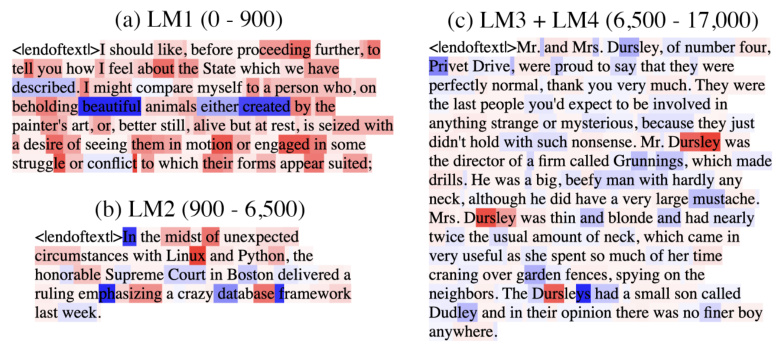

Figure C.1: Samples are shown with tokens highlighted to indicate changes in logits during a given range. Red is improved performance (higher logit output for the true next token) and blue is worse. Sample (a): improvement in bigrams (LM1) such as “te/ll, ab/out, des/ire, mot/ion, eng/aged, strugg/le, etc." Sample (b): improvement in common _n_ -grams (LM2) such as “L/in/ux, P/y/th/on, h/on/or/able, S/up/reme, dat/ab/ase, f/ram/ew/ork." Sample (c): development of in-context learning via induction circuits (LM3, LM4), visible in the improved predictions in the word “D/urs/ley" after the first time it appears in the context, as initially observed by (Olsson et al., 2022). 

#### **C.2 Structural development** 

#### **C.2.1 Positional embedding** 

In Figure C.2, we measure the effect of the positional embedding on model performance by comparing the model’s performance at particular context positions on a validation set over the course of training against performance on the same validation set but with the positional embedding zero-ablated. The full context length is 1024, and we measure test loss at positions 1, 2, 3, 5, 10, 20, 30, 50, 100, 200, 300, 500, and 1000. In the transition from stage LM1 to LM2, the model begins using the learnable positional embedding to improve performance. The difference between test loss with and without the positional ablation is negligible at all measured positions until the LM1–LM2 boundary. 

Structurally, we might predict that the positional embeddings should organize themselves in a particular way: in order to understand relative positions, adjacent positions should be embedded close to each other, and far-away positions should be embedded far apart. 

In Figure C.3, we examine the development of the positional embedding itself over time from two angles. The first is to take the embeddings of each position in the context and to run PCA on those embeddings. The result is that as training progresses, the positional embedding PCAs gradually resolve into Lissajous curves, suggesting that the positional embeddings might look like a random walk (Antognini & Sohl-Dickstein, 2018; Shinn, 2023). However, if we look to the explained variance, we see that it grows very large for PC1, reaching 94 _._ 2% at training step 6400. This is much higher than we would expect for Brownian motion, where we expect to see about 61% explained variance in PC1 (Antognini & Sohl-Dickstein, 2018). 

The second perspective we use is to look at how the magnitudes of positional embeddings over the context length develop. In this case, we observe that the magnitudes seem to have a fairly regular structure. In conjunction with the PCAs and explained variance, we might infer that the positional embeddings look approximately like a (possibly curved) line in _d_ model = 256 dimensional space. A positional embedding 

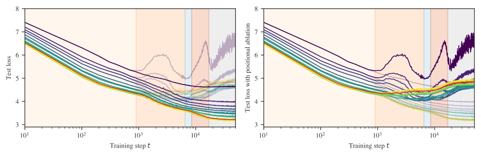

Figure C.2: The model learns to start using the positional encoding in LM2, when the performance starts to worsen when ablating the positional encoding. In both plots, earlier token positions are colored more purple, while later token positions are more yellow, and the overall mean loss is colored in red. Both sets of per-token losses are shown in both graphs for ease of comparison. _Left:_ original test loss is emphasized. _Right:_ test loss with the positional embedding ablated is emphasized. 

organized in this way would make it easier for an attention head to attend to multiple recent tokens, which is necessary if a single head is to learn _n_ -grams. 

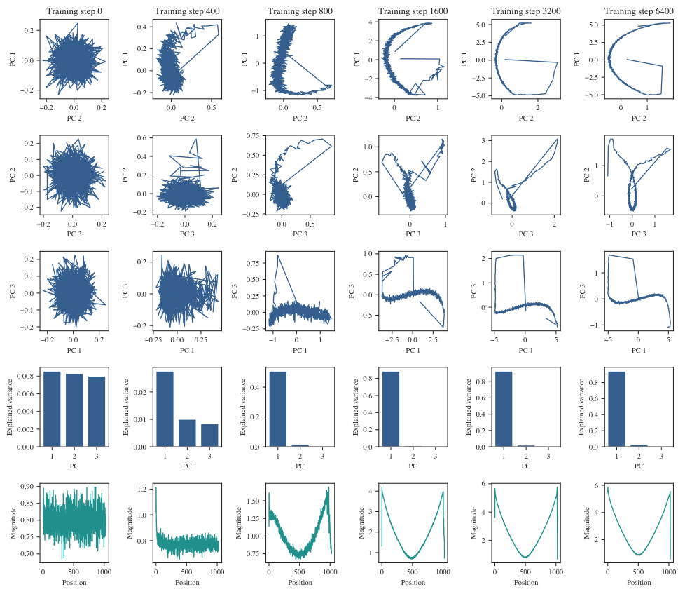

<!-- Start of picture text -->
Training step 0 Training step 400 Training step 800 Training step 1600 Training step 3200 Training step 6400 0.2 0.4 4 5.0 5.0 1 2 2.5 2.5 0.2 0.0 0 0 0.0 0.0 0.0 2 2.5 2.5 0.2 0.2 1 4 5.0 5.0 0.2 0.0 0.2 0.0 0.5 0.0 0.5 0 1 0 2 0 1 PC 2 PC 2 PC 2 PC 2 PC 2 PC 2 0.2 0.6 0.75 1.0 3 0.1 0.4 0.50 2 1 0.0 0.2 0.25 0.5 1 0.1 0.0 0.00 0.0 0 0.2 0 0.2 0.25 0.2 0.0 0.2 0.2 0.0 0.2 0.0 0.5 0 1 0 2 1 0 1 PC 3 PC 3 PC 3 PC 3 PC 3 PC 3 1.0 0.2 0.2 0.75 2 0.1 0.50 0.5 1 1 0.0 0.0 0.25 0.0 0 0.1 0.00 0.5 0 0.2 0.2 0.25 1 0.2 0.0 0.2 0.25 0.00 0.25 1 0 1 2.5 0.0 2.5 5 0 5 5 0 5 PC 1 PC 1 PC 1 PC 1 PC 1 PC 1 0.008 0.8 0.8 0.8 0.4 0.006 0.02 0.6 0.6 0.6 0.004 0.01 0.2 0.4 0.4 0.4 0.002 0.2 0.2 0.2 0.000 0.00 0.0 0.0 0.0 0.0 1 2 3 1 2 3 1 2 3 1 2 3 1 2 3 1 2 3 PC PC PC PC PC PC 0.90 1.2 4 6 6 0.85 1.50 0.80 1.0 1.25 3 4 4 0.75 0.8 1.00 2 2 2 0.70 0.75 1 0 500 1000 0 500 1000 0 500 1000 0 500 1000 0 500 1000 0 500 1000 Position Position Position Position Position Position PC 1 PC 1 PC 1 PC 1 PC 1 PC 1 PC 2 PC 2 PC 2 PC 2 PC 2 PC 2 PC 3 PC 3 PC 3 PC 3 PC 3 PC 3 Explained variance Explained variance Explained variance Explained variance Explained variance Explained variance Magnitude Magnitude Magnitude Magnitude Magnitude Magnitude <!-- End of picture text -->

Figure C.3: Columns progress through training time at training steps 0, 400, 800, 1600, 3200, and 6400. The first three rows are plots of the first three principle components of PCA on the positional embedding weights, while the fourth row shows the explained variance for each of the principal components. The fifth row plots the magnitude of the embedding of each position in the context length of 1024. 

#### **C.2.2 Composition scores** 

Let _WQ__h, W_ _K__h, W_ _V__h_bethequery,key,andvalueweightsofattentionhead_h_respectively.Therearethree types of composition between attention heads in transformer models in Elhage et al. (2021): 

- Q-Composition: the query matrix _WQ__h_of an attention head reads in a subspace affected by a previous head 

- K-Composition: the key matrix _WK__h_ofanattentionheadreadsinasubspaceaffectedbyaprevious head 

- V-Composition: the value matrix _WV__h_of an attention head reads in a subspace affected by a previous head 

If _WO__h_istheoutputmatrixofanattentionhead,then_W h_ _QK_=_W h_ _Q__T_ _WK__h_and_W h_ _OV_=_W h_ _O__W h_ _V_. The composition scores are _||MWOV__h_1_||F/_(_||M||F||W h_ _OV_1_||F_) (17) 

Where _M_ = _WQK__h_2_T_,_M_=_W h_ _QK_2, and_M_=_W h_ _OV_2for Q-, K-, and V-Composition respectively.See Figure C.4 for K-composition scores over time between attention heads in the induction circuits. 

#### **C.2.3 Previous-token matching score** 

The _previous-token matching score_ is a structural measure of induction head attention. It is the attention score given to [ _A_ ] by an attention head at [ _B_ ] in the sequence _. . ._ [ _A_ ][ _B_ ] (i.e., how much the head attends to the immediately preceding token). 

We compute this score using a synthetic data generating process, generating 10k fixed random sequences with length between 16 and 64. The first token is a special “beginning of string" token, and the remaining tokens are uniformly randomly sampled from other tokens in the vocabulary. 

For each sample in this synthetic dataset, we measure the attention score that an attention head gives to the previous token when at the last token in the sequence. These scores are averaged across the dataset to produce the previous-token matching score for that attention head at a given checkpoint. The progression of previous-token matching scores over time can be seen in Figure 4(d). 

#### **C.2.4 Prefix matching score** 

The _prefix matching score_ from Olsson et al. (2022) is defined similarly to the previous-token matching score. Given a sequence [ _A_ ][ _B_ ] _. . ._ [ _A_ ], the prefix matching score of a particular attention head is how much the attention head attends back to the first instance of [ _A_ ] when at the second instance of [ _A_ ]. 

We compute this score using a synthetic data-generating process. We first generate 10k fixed random sequences of length 128. The first token is always a special “beginning of string" token and the [ _A_ ] and [ _B_ ] tokens are selected and placed randomly. One [ _A_ ] token is placed in the first half of the sequence, the other is placed in the second half, and the [ _B_ ] token is placed directly after the first [ _A_ ] token. The remaining tokens are randomly sampled from the tokenizer vocabulary, excluding the [ _A_ ], [ _B_ ], and beginning of string tokens. 

For each sample in this synthetic dataset, we measure the attention score that each attention head assigns to the earlier instance of [ _A_ ] from the latter instance of [ _A_ ]. These scores are averaged across the dataset to produce the prefix matching score for that attention head at a given checkpoint. The progression of prefix matching scores over time can be seen in Figure 4(e). 

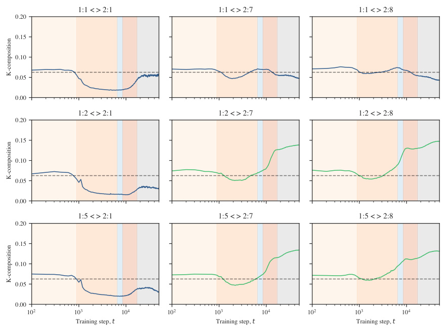

<!-- Start of picture text -->
1:1 < > 2:1 1:1 < > 2:7 1:1 < > 2:8 0.20 0.15 0.10 0.05 0.00 1:2 < > 2:1 1:2 < > 2:7 1:2 < > 2:8 0.20 0.15 0.10 0.05 0.00 1:5 < > 2:1 1:5 < > 2:7 1:5 < > 2:8 0.20 0.15 0.10 0.05 0.00 10 2 10 3 10 4 10 2 10 3 10 4 10 2 10 3 10 4 Training step, t Training step, t Training step, t K-composition K-composition K-composition <!-- End of picture text -->

Figure C.4: The K-composition scores (Elhage et al., 2021) between first and second layer attention heads. The _h_ th attention head in layer _l_ is indexed by _l_ : _h_ . The attention heads that eventually become previous token heads are _h_ = 2 _,_ 5 in layer 1 (subplot rows 2 and 3), and the attention heads that eventually become induction heads are _h_ = 7 _,_ 8 in layer 2 (subplot columns 2 and 3). The attention heads 1 : 1 and 2 : 1 are included for comparison. The induction heads 2 : 7 and 2 : 8 begin K-composing with first layer heads near the start of stage LM2. They continue to compose with the previous token heads in stages LM3 and LM4 (highlighted in green) while their K-composition scores drop with other attention heads in layer 1 in later stages. 

### **D Developmental analysis of regression transformers** 

In this section, we present further evidence on the behavioral (Appendix D.1) and structural (Appendix D.2) development of the transformer in the setting of in-context linear regression. 

#### **D.1 Behavioral development** 

#### **D.1.1 Task prior score** 

In addition to training models on a data distribution in which tasks **t** are generated on-the-fly, we examine the setting of Raventós et al. (2023), in which a finite set of _M_ tasks is generated ahead of time, and training samples involve randomly selected tasks from this set. 

Figure D.1 depicts (a) the mean square distance between the model’s predictions and the zero prediction in addition to (b) the mean square distance between the model’s predictions and the “task prior” prediction, using the component-wise averaged **t** over the set of tasks encountered during training. For all models, the minimum distance to the task prior prediction is lower than the minimum distance to the zero prediction. Hence, we call stage LR1 “learning the task prior” rather than simply learning the zero prediction. 

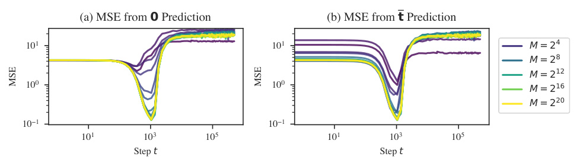

<!-- Start of picture text -->
(a) MSE from 0 Prediction (b) MSE from t Prediction 10 1 10 1 M = 2 4 M = 2 8 M = 2 12 10 0 10 0 M = 2 16 M = 2 20 10 1 10 1 10 1 10 3 10 5 10 1 10 3 10 5 Step t Step t MSE MSE <!-- End of picture text -->

Figure D.1: **Learning the task prior** is universal across models trained on very different data distributions. Each line represents a model trained on a data distribution with a different number of _M_ distinct tasks (“task diversity” in Raventós et al., 2023). In addition to taking a finite _M_ , the models depicted here differ from the other models considered in this paper in that the former were trained with a maximum learning rate of 0 _._ 01, and the models (inadvertently) lack an output matrix after the multi-head attention layer. 

#### **D.1.2 ICL** 

We consider two variants of the ICL score: ICL1: _D_ , and ICL _D_ : _K_ . 

If the noise term _σ_2 equals zero and both tasks **t** and inputs _xk_ are normalized (i.e., **t** _∈ S__D−_1 ), then _D −_ 1 observations of input/output pairs are enough to precisely identify **t** . Therefore, ICL1: _D_ measures how successful the model is at initially locating the task. The fact that the tasks and inputs are not normalized changes this only slightly: the task will still sit near _S__D−_1 within a shell of vanishing thickness as _D →∞_ . 

Once localized, ICL _D_ : _K_ measures how successfully the model refines its internal estimate of **t** with additional examples, which it can use to reduce the error due to noise. 

In terms of implementation, it’s not necessary for the model to internally make a distinction between locating and refining its estimate of the task. For example, ridge regression makes no distinction. Still, we find it useful for reasoning about the progression of the model. In particular, we note that early in stage LR2, while the model begins to develop ICL for early tokens, it becomes _worse_ at ICL over tokens late in the context. Later, at around 23k steps, ICL _D_ : _K_ stabilizes, while ICL1: _D_ continues improving over the entire training run. 

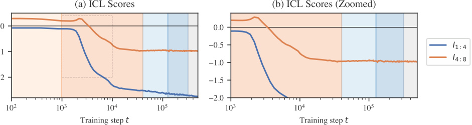

Figure D.2: **ICL scores** for the in-context linear regression model. _Right_ : ICL scores between inputs 1 and 4 and inputs 4 and 8 over time. We see that ICL emerges during the first half of LR2. _Left_ : Highlighted ICL score curves from the end of LR1 to halfway through LR2. Note that when the model first starts improving on early tokens, it temporarily becomes worse at predicting later tokens. Note also that the model ceases to become better at later tokens as of the second half of LR2, whereas ICL on early tokens continues to improve throughout training. 

#### **D.1.3 OOD generalization** 

To further investigate behavior in stages LR2 and LR3, we probe the model on data sampled from different distributions than encountered during training.1 We evaluate behavior on two families of perturbations: “OOD inputs” _xk_ , sampled according to a different scale 

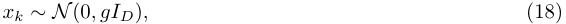

for some gain parameter _g_ , and “OOD tasks” 

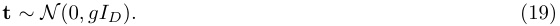

Note that these inputs and tasks are not out-of-distribution in the sense of coming from a distribution with a different support than the training distribution. However, the samples drawn from these “extreme” distributions are exponentially suppressed by the original training distribution. Figure D.3 plots the normalized MSE for these two distributions over training time. 

Between _t_ = 1 _k_ and _t_ = 4k the model’s outputs rapidly _diminish_ in scale for out-of-distribution samples, both for _g >_ 1 and _g <_ 1, especially for out-of-distribution _inputs_ . While the model is moving away from predicting with the task prior for in-distribution samples, it moves closer to predicting with the task prior for-in-distribution samples. 

Between _t_ = 4k and _t_ = 23k, the model recovers on moderately out-of-distribution inputs _g <_ 101_._5 with performance remaining close to constant beyond this range. Past this stage, performance improves constantly for out-of-distribution tasks. 

For out-of-distribution inputs, performance eventually worsens for some ranges of _g_ . Between _t_ = 23k and _t_ = 80k the model further approaches the task prior prediction for extreme out-of-distribution inputs _g >_ 101_._5 . Subsequently, between _t_ = 75k and _t_ = 130k the model moves away from the task prior prediction for extreme inputs, and performance deteriorates for inputs with _g >_ 100_._5 . As of LR5, performance is roughly constant. 

> 1Cf. Raventós et al. (2023) evaluating models trained on a set of discrete tasks on the “true” distribution consisting of novel tasks. 

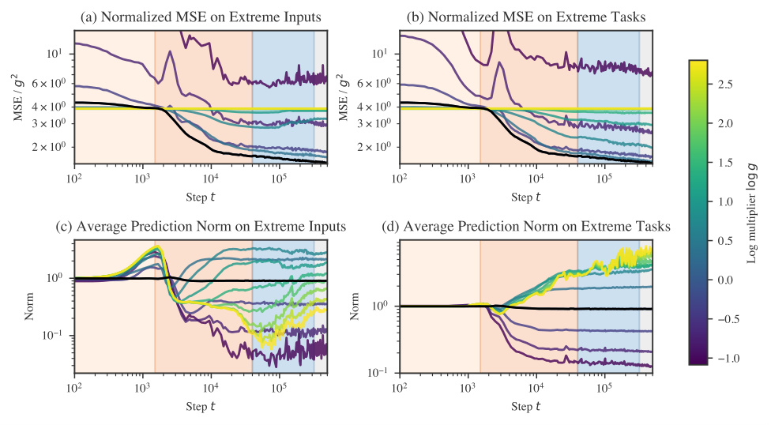

Figure D.3: Performance on extreme inputs over time may reveal additional substages in LR2 and in LR3. _Left_ : The model first becomes better, then worsens at ICL on inputs sampled from _N_ (0 _, gID_ ) for large _g_ . _Right_ : The model continues to improve on ICL at tasks sampled from _N_ (0 _, gID_ ). _Top_ : Normalized loss (divided by _g_2 ) over time for OOD inputs and tasks. _Bottom_ : Average _|y_ ˆ _|_ over time for OOD inputs and tasks. 

#### **D.2 Structural development** 

#### **D.2.1 Embedding** 

The embedding matrix _WE_ is a linear transformation from R_D_+1 _→_ R_d_embed . Plotting the _D_ + 1 singular values of this matrix, we notice that the embedding partially loses one of its components starting at the end of LR2 (Figure D.4a). 

The input “tokens” _xk_ span a _D_ -dimensional subspace of the ( _D_ + 1)-dimensional “token space.” The target tokens _yk_ span an orthogonal 1-dimensional subspace. The collapse of one of the embedding matrix’s singular values means that the model learns to redundantly encode the inputs and targets in the same _D_ - dimensional subspace of the space of residual stream activations. The almost order of magnitude separation in the magnitudes of the square singular value means that the ( _D_ + 1)th component of the token embedding explains only 2.9% of the variance in activations of the residual stream immediately after the embedding, whereas the dominant components explain roughly 24% each. 

**Contributions to degeneracy** Given a linear transformation _T_ 1 : R_D_1 _→_ R_D_2 followed by another linear transformation _T_ 2 : R_D_2 _→_ R_D_3 , reducing the rank of _T_ 1 from _r_ to _r__′_ _< r_ renders _D_ 3( _r − r__′_ ) components of the second transformation irrelevant. This would mean a _decrease_ in the learning coefficient of _D_ 3( _r−r__′_ ) _/_ 2 (a decrease in the _effective dimensionality_ of _d_ leads to a decrease in the LLC of _d/_ 22 ). In the actual model, we don’t see an exact decrease in the rank, and a layer normalization sits between the linear transformation of the embedding and the linear transformations of each transformer block and unembedding. It is unclear what the precise relation between structure and degeneracy is in this case (Appendix D.2.6). Still, suggestively, the onset of embedding collapse coincides with a decrease in the rate of increase of _λ_ˆ ( _wt_ ). 

> 2Note that this is not the only possible way for the LLC to decrease. Changing the local loss landscape from quadratic to quartic or some higher power would also lower the LLC, by a fractional amount. 

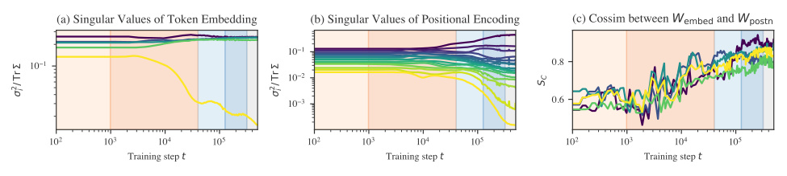

Figure D.4: _Left_ : The embedding partially “collapses” during the second half of LR2. At the start of stage LR2, the minimum singular values explains only 3% of the variance in residual stream activations due to the sample. By the end of training, it explains half that. _Middle_ : The positional encoding goes through a similar shift during LR3 (that begins earlier during LR2). _Right_ : The cosine similarity between the 5 rows of _W_ embed and the projection of those rows onto the subspace spanned by _W_ unembed shows that the model learns to write to the same write tokens and positional information to the same subspace. 

#### **D.2.2 Positional encoding** 

The positional encoding goes through a similar collapse to the unembedding starting during the second part of LR2 and continuing into LR3 (Figure D.4b). Additionally, throughout these stages, the subspace spanned by the embedding becomes more aligned with the subspace spanned by the positional encoding (Figure D.4c). 

**Contributions to degeneracy** For the same reason as with the token embedding, a decrease in the dimensionality of the subspace occupied by activations reduces the effective number of dimensions and thus the learning coefficient. This occurs both as the positional encoding’s effective dimensionality decreases (vanishing singular values, Figure D.4b) and as the token embedding subspace and positional embedding subspace align (increasing cosine similarity, Figure D.4b). 

#### **D.2.3 Attention collapse** 

Over the course of training, we observe that some attention heads learn to attend _solely_ (soft attention becomes hard attention) and _consistently_ to certain positions (the attention pattern becomes contentindependent). We call this phenomenon _attention collapse_ in parallel with the other observed forms of collapse. Not only does this potentially contribute to a decrease in the LLC, but it also makes the attention heads identifiable: we find a self-attention head, previous-attention heads, previous- _x_ -attention heads, and previous- _y_ -attention heads. 

_x_ **-attention vs.** _y_ **-attention** For convenience we separate each attention head in two: one part for the _x_ -tokens, and the other for the _y_ -tokens. 

**Attention entropy score** To quantify attention hardness, we use the _attention entropy score_ (Ghader & Monz, 2017; Vig & Belinkov, 2019). Given the attention pattern _αk,k_(_b,h′_)forhowmuchtoken_k_inhead_h_in block _b_ attends back to token _k__′_ , its attention entropy score _Hk_(_b,h_) is the Shannon entropy over preceding indices _k__′_ _< k_ , 

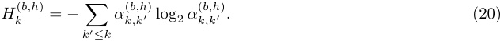

From this, we compute the normalized entropy _H_ˆ _k_(_b,k_) , which divides the attention entropy by the maximum entropy for the given context length, 

Figure D.5: **Attention hardening** as measured by the normalized attention entropy score (Appendix D.2.3). Block 1 heads 1y/3y and block 2 head 1y harden over training. In combination with the fact that these attention heads become less variable (Figure D.6), this may contribute to a decrease in the LLC (discussed in Appendix D.2.3) The x-components of the attention heads remain much softer over the entire training run. 

This accounts for the entropy being calculated over different numbers of tokens and is displayed in Figure D.5. Notably, the identified stages line up closely to stages of these attention entropy curves. 

**Constant attention** Accomplishing constant attention requires the presence of biases in the query and key transformations, or if there is no bias (as is the case for the models we investigated), requires attending to the positional embedding. With the Shortformer-style positional encoding used for the language models (Appendix F.1.1), this is straightforward: the positional information is injected directly into the key and weight matrices. With the in-context linear regression models, where the positional embedding is added to the residual stream activations, this is less straightforward: achieving constant attention requires separating residual stream activations into orthogonal positional- and input-dependent subspaces, then reading from the former with the query and key weight matrices. 

**Attention variability score** To quantify how constant the attention pattern is, we use measure _attention variability_ (Vig & Belinkov, 2019), 

Figure D.6: **Attention variability** over time. The heads that develop hard attention in Figure D.5 (block 1 heads 1y, 3y, and 4y) also become less variable over time. 

where the division by 2 ensures the variability lies in the range [0 _,_ 1]. This is displayed in Figure D.6. These reveal that though attention hardness and variability are independent axes of differentiation, empirically, we observe that hard attention is correlated with low variability. 

**Self-attention score** Self-attention is measured by the average amount a token _k_ attends to itself, _αk,k_(_b,h_). 

**Previous-token attention score** Previous-token attention is measured the same as in the language model setting (Appendix C.2) with one difference: we compute the previous-token score not over a synthetic dataset but over a validation batch. 

Figure D.7: Collection of attention heads identified by their consistent and recognizable attention patterns. _Left to right_ : previous- _x_ s head, previous-token head, previous- _y_ s head, previous- _y_ s head 

**Classifying attention heads** Several attention heads are easy to identify by virtue of being both concentrated and consistent. These are depicted in Figure D.7 and include: (B1H3y) previous-token heads (also present in the language model case), (B1H1y) previous-x, and (B1H4x, B2H1y) previous-y heads. Other training runs also include self-attention heads. 

**Contributions to degeneracy** Suppose an attention head _h_ in block _b_ has the following constant attention pattern (after the softmax) _A_(_b,h_) =� _i__δl_(_i_)_i_.That is, for each token_i_, that attention head attends solely to a single earlier token _l_ ( _i_ ) _≤ i_ and no others. Restricting to single-head attention (the argument generalizes straightforwardly), the final contribution of this attention head to the residual stream is the following (Phuong & Hutter, 2022): 

where _A ∈_ R_ℓz_ _×_ R_ℓx_ is the attention pattern, _V ∈_ R_d_out _×_ R_ℓz_ is the value matrix, and _WO ∈_ R_dz_ _×_ R_ℓz_ is the matrix of residual stream activations, and _V ∈_ R_d_out _×_ R_ℓz_ is the value matrix. The result of this operation is subsequently multiplied by the output matrix and then added back into the residual stream. Plugging in the hard and constant attention pattern, writing out the matrix multiplication, and filling in the definition of _A_ we get 

For each column in _A_ , the hard attention picks out a single element of _V_ at column _l_ ( _j_ ) for each row _k_ . Now suppose that there is a token _l__′_ that receives no attention from any position _j_ . That is, there exists no _j_ such that _l__′_ = _l_ ( _j_ ). Then, there is a column _l__′_ in _V_ which does not contribute to the result of _V · A_ , and, in turn, a column _l__′_ in _WO_ , which does not contribute to the output of the head. As discussed for the embedding and layer norm, this decrease in effective dimensionality leads to a decrease in the learning coefficient. 

Note that this argument does not hold for all hard and constant attention patterns. It holds solely for attention patterns that consistently ignore some earlier token across all positions, such as the previous- _x_ and previous- _y_ heads, but not the self-attention and previous-token heads. As discussed in Appendix D.2.6, it remains unclear what exactly the threshold for “ignoring” a token should be before it contributes to degeneracy and whether any of the heads we examine actually meet this threshold. 

#### **D.2.4 Unembedding collapse** 

The unembedding block consists of a layer normalization layer LN( _z_ ) followed by a linear transformation _WU z_ + _bU_ and finally a projection _πy_ to extract the _y_ -component. Given the 64-dimensional vector of activations _z_ in the residual stream right before the unembedding (for a specific token), the full unembedding operation is: 

Figure D.8: **Unembedding weights over time** for the RT 1 transformer undergo a “collapse” that begins towards the end of LR2. When these weights reach zero in LR3 and LR4, it may contribute to the observed decrease in the LLC. _Top_ : Weights over time. The outlier in the positive direction is the weight for the _y_ - token output. _Bottom_ : Biases over time. _Left_ : Unembedding layer normalization weights over time. _Middle_ : Unembedding linear weights over time (restricted to _y_ -subspace). _Right_ : Effective unembedding weights over time (obtained by element-wise multiplication of preceding columns, and focusing on the bias for only the _y_ -token. 

where _⊙_ denotes element-wise multiplication of two vectors and _γ, β_ are the layer normalization weights and biases respectively. 

**Effective unembedding weights and biases** Moving terms around, we can represent this as 

where we order the outputs so that the _y_ -token corresponds to the 0th row. Because we are reading out a single _y_ component, we can express the unembedding transformation in terms of “effective" unembedding weights and biases 

**Unembedding weights over time** In Figure D.8, we plot ( _γ, β_ ), (( _WU_ )[0 _,_ :] _,_ ( _bU_ )[0]), and ( _W_˜ _U ,_˜ _bU_ ) as a function of training steps, along with the mean weight over time. These are 64- and 1-dimensional vectors, so we can display the entire set of components. During stage LR3 the majority of weights _β_ and _WU_ “collapse” to zero. Additionally, the layer normalization biases temporarily experience a large increase in variance before returning to small values. Despite this, the mean of the linear weights, layer normalization biases, and effective weights remains remarkably constant and close to zero throughout the entire process. 

**Contributions to degeneracy** Suppose that _D_ of the layer normalization weights have vanished, say _γi_ = 0 for 1 _≤ i ≤ D_ . Then the corresponding columns of _WU_ only contribute to the unembedding via their product ( _WU_ )[: _,_ 1: _D_ ] _β_ [1: _D_ ] with the first _D_ rows of _β_ . This creates a typical form of degeneracy studied in SLT and found, for example, in deep linear networks, where we can change the weights to ( _WU_ )[: _,_ 1: _D_ ] _A, A__−_1 _β_ [1: _D_ ] for any invertible _D × D_ matrix _A_ without changing the function computed by the network. If in addition the _βi_ vanish for 1 _≤ i ≤ D_ then the entries of ( _WU_ )[: _,_ 1: _D_ ] are completely unconstrained, creating further degeneracy. 

Figure D.9: **Layer norm weights over time** . _Top_ : After LR3, the layer normalization collapse expands from the unembedding to earlier layers, most notably in the first pre-attention layer norm. This occurs without explicit regularization and may contribute to the concurrent decrease in LLC. _Bottom_ : During layer normalization collapse, the variance of layer normalization biases increases drastically while the mean of the biases remains relatively constant. _Inset_ : Plotting the fraction of weights or biases whose magnitude is less than 0.1 over time reveals that the collapse is more measured for intermediate layer norms: weights shrink to small values but not extremely close to zero as in the unembedding and first attention layer. 

#### **D.2.5 Layer normalization collapse** 

The “collapse” in layer normalization weights is not unique to the unembedding. As depicted in Figure D.9, this behavior occurs in all layer norms except for the second MLP. The biases also remain centered close to zero even as the variance in biases grows much larger. Unlike in the unembedding, these layers begin to change earlier (starting halfway through LR2). 

What is most striking about the layer normalization collapse is that it occurs without any explicit regularization (neither weight decay nor dropout). As such, it demonstrates a clear example of _implicit regularization_ , i.e., inductive biases in the optimizer or model that favor simpler solutions. 

**Contributions to degeneracy** In the previous section, we describe how layer norm collapse in the unembedding is linked to an increase in degeneracy because it ensures that parameters in the subsequent linear layer become irrelevant. The same is true for layer norm which precedes the attention and MLP blocks. 

#### **D.2.6 Degeneracy and development** 

In the previous subsections, we provide a set of theoretical arguments for how embedding collapse (Appendix D.2.1), layer normalization collapse (Appendix D.2.5), and attention collapse (Appendix D.2.3) can lead to an increase in degeneracy, even while leaving the implemented function unchanged. 

The free energy formula tells us that, for two different solutions (sets of weights) with the same loss, the Bayesian posterior will asymptotically prefer the model that has the lower learning coefficient (i.e., higher degeneracy). This suggests that these different forms of collapse may be driven by a bias towards higher degeneracy, as captured in the free energy formula. However, in idealized Bayesian inference, we do not expect the posterior to concentrated around the neighborhood of an equal-loss-but-higher-degeneracy local minimum to begin with. That this kind of transition arises in practice might arise from one of the various differences between Bayesian inference and gradient-based training. 

Actually establishing a causal link between increasing degeneracy and structure development is beyond the scope of this paper. For one, the theoretical arguments hinge on the collapse being _complete_ , that is, the components that go to zero must become _exactly_ zero in the limit, where we take the number of samples to compute the loss to infinity. In practice, we expect there to be some threshold _ϵ_ below which we can treat weights as effectively zero. Second, even if these explanations are correct, we do not know that they account for all of the empirically observed decrease in the LLC during these stages. There may be other drivers 

we missed. Finally, establishing a causal link requires theoretical progress in relating the Bayesian learning process to the SGD learning process. The arguments are suggestive, but currently only a source of intuition for how structure and degeneracy can be related, and a starting point for future research. 

### **E One-layer language model experiments** 

We also trained and ran some experiments on a one-layer language model (see Appendix F.1.1 for details). We aggregate results for the one-layer language model here, mirroring the experiments for the two-layer language model where possible. The early development of the one-layer model has many parallels with the two-layer model. At a single stage boundary, just as it occurs in the two-layer model, the one-layer model minimizes its bigram score (see Appendix C.1.1), begins utilizing the positional embedding to noticeably improve performance (see Appendix C.2.1), and starts making sudden improvements to the same _n_ -gram scores (see Appendix C.1.2). Remarkably this occurs at the same checkpoint as in the 2-layer model (at 900 training steps). 

One key difference, however, is that this occurs at the _second_ stage boundary as discerned by the plateaus of the LLC estimation. We did not closely investigate why the LLC estimation appears to drop between steps 400 and 900 in this model. As a result though, we do observe an interesting qualitative similarity to the drop in LLC in stage LM3 of the two-layer model, that this drop precedes a noticeable bump in the loss function. 

Figure E.1: We train a one-layer transformer model in the language setting to compare with the twolayer model. The development of certain behavioral and structural metrics over time closely mirrors the development of the same metrics in the early stages of the two-layer language model. _Top:_ test loss and LLC estimations over time for the one-layer attention-only transformer, compare with Figure 1a. _Bottom:_ bigram score, test loss with positional embedding ablated, and _n_ -gram scores for the one-layer attention-only transformer, compare with Figure 4(a,b,c). 

Figure E.2: A more detailed version of Figure E.1 for the one-layer language model. _Top_ : Loss, LLC, and weight norm, along with an overlaid Gaussian process fit to these curves (red dotted lines). _Bottom_ : Associated slopes, both numerically estimated finite differences (transparent blue) and of the Gaussian process (red dotted lined). 

### **F Transformer training experiment details** 

#### **F.1 Language models** 

#### **F.1.1 Architecture** 

The language model architectures we consider are one- and two-layer attention-only transformers. They have a context length of 1024, a residual stream dimension of _dmodel_ = 256, _H_ = 8 attention heads per layer, and include layer normalization layers. We also used a learnable Shortformer positional embedding (Press et al., 2021). The resulting models have a total of _d_ = 3 _,_ 091 _,_ 336 parameters for _L_ = 1 and _d_ = 3 _,_ 355 _,_ 016 parameters for _L_ = 2. We used an implementation provided by TransformerLens (Nanda & Bloom, 2022). 

|**Compo**|**nent**|**1-Layer**|**2-Layer**|
|---|---|---|---|
|Token E|mbedding Weights|1_,_280|_,_000|
|Position|al Embedding Weights|262_,_|144|
|Layer 1|Layer Norm Weights|25|6|
|Layer 1|Layer Norm Bias|25|6|
|Layer 1|Attention Query Weights|65_,_|536|
|Layer 1|Attention Key Weights|65_,_|536|
|Layer 1|Attention Value Weights|65_,_|536|
|Layer 1|Attention Output Weights|65_,_|536|
|Layer 1|Attention Query Bias|25|6|
|Layer 1|Attention Key Bias|25|6|
|Layer 1|Attention Value Bias|25|6|
|Layer 1|Attention Output Bias|25|6|
|Layer 2|Layer Norm Weights|N/A|256|
|Layer 2|Layer Norm Bias|N/A|256|
|Layer 2|Attention Query Weights|N/A|65_,_536|
|Layer 2|Attention Key Weights|N/A|65_,_536|
|Layer 2|Attention Value Weights|N/A|65_,_536|
|Layer 2|Attention Output Weights|N/A|65_,_536|
|Layer 2|Attention Query Bias|N/A|256|
|Layer 2|Attention Key Bias|N/A|256|
|Layer 2|Attention Value Bias|N/A|256|
|Layer 2|Attention Output Bias|N/A|256|
|Final La|yer Norm Weights|25|6|
|Final La|yer Norm Bias|25|6|
|Unembe|dding Weights|1_,_280|_,_000|
|Unembe|dding Bias|5_,_0|00|

Figure F.1: **Attention-only transformers** with Shortformer position-infused attention and pre-layer norm. The one-layer model has a total of 3,091,336 trainable parameters, while the two-layer model has 3,355,016. 

#### **F.1.2 Tokenization** 

For tokenization, we used a truncated variant of the GPT-2 tokenizer that cut the original vocabulary of 50,000 tokens down to 5,000 (Eldan & Li, 2023) to reduce the size of the model. We think this may contribute to the prominence of the the plateau at the end of LM1: the frequency of bigram statistics depends on your choice of tokens, and a larger tokenizer leads to bigrams that are individually much less frequent. 

#### **F.1.3 Training** 

The models are trained on a single epoch over 50 _,_ 000 steps on _∼_ 5 billion tokens using a resampled subset of the Pile (Gao et al., 2020; Xie et al., 2023) using a batch size of 100. A snapshot was saved every 10 steps 

for a total of 5000 checkpoints, though a majority of analysis used checkpoints every 100 steps. The training time was around 6 GPU hours per model on an A100. Additional seeds were trained on v4 TPUs at around 1.5 TPU hours per model. 

Training was conducted on the first 10 million lines of the DSIR-filtered Pile (Xie et al., 2023; Gao et al., 2020) but did not exhaust all 10 million lines. The model was subject to weight decay regularization, without the application of dropout. We did not employ a learning rate scheduler throughout the training process. 

Table 3: Summary of hyperparameters and their values for transformer language model training experiments. 

|**Hyperparameter**|**Category**|**Description/Notes**|**Value**|
|---|---|---|---|
|_n_|Data|# of training samples|5_,_000_,_000|
|_T_|Data|# of training steps|50_,_000|
|_N_test|Data|# of test samples|512|
|Tokenizer Type|Data|Type of Tokenizer|Truncated GPT-2 Tokenizer|
|_D_|Data|Vocabulary size|5,000|
|_K_|Data|Context size|1,024|
|_L_|Model|# of layers in the model|2|
|_H_|Model|# of heads per layer|8|
|_d_mlp|Model|MLP hidden layer size|N/A|
|_d_embed|Model|Embedding size|256|
|_d_head|Model|Head size|32|
|seed|Model|Model initialization|1|
|m|Training|Batch Size|100|
|Optimizer Type|Optimizer|Type of optimizer|AdamW|
|_η_|Optimizer|Learning rate|0_._001|
|_λ_wd|Optimizer|Weight Decay|0_._05|
|_β_1_,_2|Optimizer|Betas|(0_._9_,_0_._999)|

#### **F.2 In-context linear regression transformers** 

#### **F.2.1 Architecture** 

In the following _L_ refers to the number of layers (blocks) in the transformer, _H_ is the number of heads in each layer, _D_ is the dimension of inputs _x ∈_ R_D_ and _K_ is the number of ( _x, y_ ) pairs provided to the Transformer in-context. 

The architecture is a pre-layer-norm decoder-only transformer modeled after NanoGPT (Karpathy, 2022; see also Phuong & Hutter, 2022) with a learnable positional embedding. For the models discussed in the main body, we consider _L_ = 2, _H_ = 4 transformers (with _d_ = 51 _,_ 717 parameters), i.e., two transformer blocks with four attention heads each. 

#### **F.2.2 Tokenization** 

To run contexts _SK_ through the above model requires an initial encoding or “tokenization step” and final “projection step.” The context is encoded as a sequence of “tokens” _Tk_ as follows: 

Through the main text, we write _fw_ ( _Sk_ ) for _fw_ ( _Tk_ ). Note that this tokenization includes the final _yk_ token even though this receives no training signal. For this reason, we omit this token from the attention entropy and variability plots (Figures D.5 and D.6). 

|**Compo**|**nent**|**# of Parameters**|
|---|---|---|
|Token E|mbedding Weight|320|
|Position|al Embedding Weight|1_,_024|
|Layer 1|Layer Norm Weight 2|64|
|Layer 1|Layer Norm Bias 1|64|
|Layer 1|Attention Weights|12_,_288|
|Layer 1|Attention Output Weights|4_,_096|
|Layer 1|Layer Norm Weight 1|64|
|Layer 1|Layer Norm Bias 2|64|
|Layer 1|Feed-Forward MLP Weight|4_,_096|
|Layer 1|Feed-Forward MLP Bias|64|
|Layer 1|Feed-Forward Output Weight|4_,_096|
|Layer 1|Feed-Forward Output Bias|64|
|Layer 2|Layer Norm Weight 1|64|
|Layer 2|Layer Norm Bias 1|64|
|Layer 2|Attention Weights|12_,_288|
|Layer 2|Attention Output Weights|4_,_096|
|Layer 2|Layer Norm Weight 2|64|
|Layer 2|Layer Norm Bias 2|64|
|Layer 2|Feed-Forward MLP Weight|4_,_096|
|Layer 2|Feed-Forward MLP Bias|64|
|Layer 2|Feed-Forward Output Weight|4_,_096|
|Layer 2|Feed-Forward Output Bias|64|
|Unembe|dding Layer Norm Weight 1|64|
|Unembe|dding Layer Norm Bias 1|64|
|Unembe|dding Weight 2|320|
|Unembe|dding Bias 2|5|

Figure F.2: **Transformer parameters in the in-context linear regression setting** . The model has two transformer blocks for a total of 51 _,_ 717 trainable parameters. 

The transformer outputs a series of tokens of the same shape as _Tk_ . To read out the _y_ ˆ _k_ predictions, we read out the first component of every other token, i.e., 

#### **F.2.3 Training** 

We train from a single seed for each choice of architecture and optimizer hyperparameters using minibatch stochastic gradient descent. We train without explicit regularization and use the Adam optimizer (Kingma & Ba, 2014). The training runs take 1 to 5 TPU-hours on TPUs provided by Google Research. Models are trained from the same initialization and on the data vectors within each batch (but for different sets of tasks and task orderings). 

Models are trained on a single epoch: each of the _T_ = 500 _,_ 000 batches consists of a new set of sequences with batch size 256. For the LLC estimates, we save 190 checkpoints: 100 are linearly spaced over the training run, and the remaining 90 are logarithmically spaced. We perform LLC estimation and other analyses on these checkpoints. 

Table 4: Summary of hyperparameters and their default values for in-context linear regression transformer model training experiments. 

|**Hyperparameter**|**Category**|**Description/Notes**|**Default Values**|
|---|---|---|---|
|_n_|Data|# of training samples|128,000,000|
|_B_|Data|Batch size during training|256|
|_T_|Data|# of training steps|500k|
|_N_test|Data|# of eval samples|2048|
|_D_|Data|Dimensions of linear regression task (Task size)|4|
|_K_|Data|Maximum in-context examples|8|
|_σ_2|Data|Variance of noise in data generation|0.125|
|_L_|Model|# of layers in the model|2|
|_H_|Model|# of attention heads per layer|4|
|_d_mlp|Model|Size of the hidden layer in MLP|64|
|_d_embed|Model|Embedding size|64|
|seed|Misc|Training run seeds|{0, 1, 2, 3, 4}|
|Optimizer Type|Optimizer|Type of optimizer|Adam|
|_η_|Optimizer|Maximum learning rate|0.003|
|_λ_wd|Optimizer|Weight Decay|0|
|_β_1_,_2|Optimizer|Betas|(0.9, 0.999)|
|Scheduler Type|Scheduler|Type of learning rate scheduler|OneCycleLR|
|Strategy|Scheduler|Strategy for annealing the learning rate|Linear|
|% start|Scheduler|Percentage of the cycle when learning rate is increasing|0.5|

---

[← 70 Natural Language Autoencoders](70_natural_language_autoencoders.md) · [Contents](README.md) · [72 Representation Engineering →](72_representation_engineering.md)
