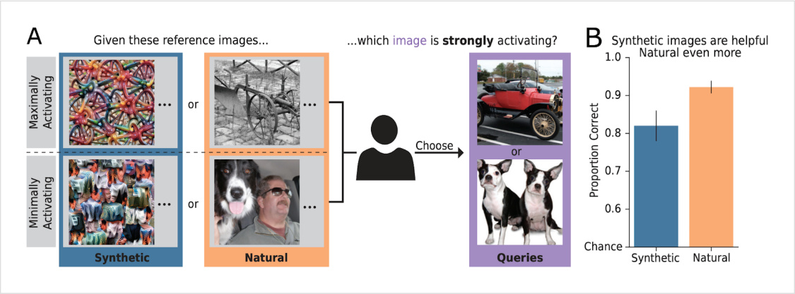
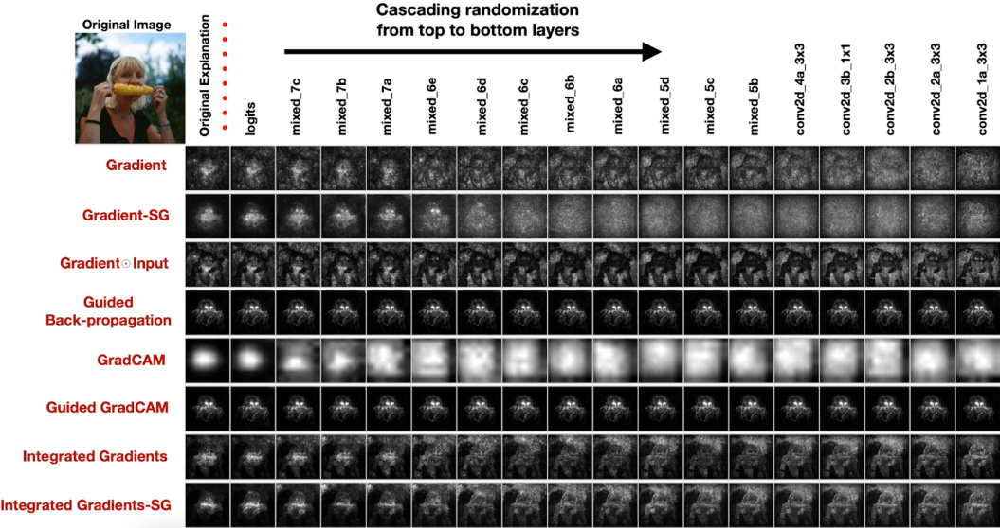

<!-- Generated by scripts/build_anthology.py export from the source PDF; edit the catalog, not this file. -->
# 88 · The Misguided Quest for Mechanistic AI Interpretability

**Hendrycks & Hiscott — 2025** · Dan Hendrycks, Laura Hiscott

| | |
|---|---|
| Priority | ○ P1 — Important |
| Section | I — Is this worth doing? |
| Source | [https://ai-frontiers.org/articles/the-misguided-quest-for-mechanistic-ai-interpretability](https://ai-frontiers.org/articles/the-misguided-quest-for-mechanistic-ai-interpretability) (AI Frontiers) |
| Licence | No explicit licence published on ai-frontiers.org |
| Print anthology | pages 3667–3675 (cover 3667, text 3668–3675) |

**Why read this.** Argues that mechanistic interpretability rests on a flawed premise: AI models are complex systems whose behaviour cannot be compressed into human-sized mechanisms, and a decade of its findings has not lasted.

**Reading focus.** The complex-systems and compression arguments, the track record it cites (feature visualisation, saliency maps, the BERT illusion, Chinchilla circuits, SAEs), the case for top-down representation engineering, and its reading of the ‘MRI for AI’ analogy.

**In context.** Written weeks after [91](91_urgency_of_interpretability.md) and answering its ‘MRI for AI’, it enlists [84](84_saliency_sanity_checks.md) and [55](55_gdm_sae_negative_results.md) as evidence. Its alternative is [72](72_representation_engineering.md), which Hendrycks co-authored, so it is partly a case for a rival programme. Set its complex-systems argument against the compact mechanisms of [13](13_ioi_circuit.md), [14](14_grokking_progress_measures.md) and [54](54_biology_of_llm.md).

[← 87 Against Almost Every Theory of Impact](87_against_theories_of_impact.md) · [Contents](README.md) · [89 Will Not Reliably Find Deceptive AI →](89_not_reliably_find_deception.md)

---

*Text extracted automatically from the source PDF. Display equations, figures and some tables appear as images; inline mathematics may be garbled — the PDF is authoritative.*

# The Misguided Quest for Mechanistic AI Interpretability 

Despite years of effort, mechanistic interpretability has failed to provide insight into AI behavior — the result of a flawed foundational assumption. 

May 15, 2025 

Dan Hendrycks Laura Hiscott Director of the Staff Writer for AI Frontiers Center for AI Safety 

In March this year, Google DeepMind researchers <u>announced they</u> were deprioritizing work on sparse autoencoders, their leading approach to mechanistic interpretability. The following month, Anthropic CEO Dario Amodei published an essay advocating for greater focus on “mechanistic interpretability” and expounding his optimism about achieving “MRI for AI” in the next 5-10 years. While policymakers and the public tend to assume interpretability would be a good thing, there has recently been intensified debate among experts about the value of research in this field. 

Mechanistic interpretability aims to reverse-engineer AI systems. Mechanistic interpretability research, which has been going on for over a decade, aims to uncover the specific neurons and circuits in a model that are responsible for given tasks. In so doing, it hopes to trace the model’s reasoning process and offer a “nutsand-bolts” explanation of its behavior. This is an understandable impulse: knowledge is power; to name is to know, and to know is to control. As such, many assume that such a detailed understanding would be invaluable for AI safety; it could enable researchers to precisely engineer models to behave as desired under all conditions, reliably avoiding all hazards. 

The logic is understandable, but more than a decade of research efforts suggest it might not translate into practice. Perhaps this should not surprise us. The term mechanistic interpretability evokes physical “mechanisms” or simple clockwork systems, which scientists can analyze step-by-step and thoroughly understand. Yet attempting to apply this reductionist approach to AI might be misguided. 

## AI and Complex Systems 

Complex systems cannot easily be reduced to simple mechanisms. As systems become larger and more complex, scientists begin focusing on higher-level properties — such as emergent patterns, collective behaviors, or statistical descriptions — instead of attempting direct analysis at the smallest scale of fundamental interactions. Meteorologists do not try to predict the weather by tracing every single molecule in the atmosphere, for instance. Similarly, it would be intractable to understand biological systems by starting from subatomic particles and working up from there. And few psychologists attempt to explain a person’s behavior by quantifying the contribution of every neuron to their thoughts. 

Complexity makes AIs more powerful, but less transparent. All these cases are examples of complex systems – characterized by countless weak nonlinear connections between huge numbers of components. They exhibit emergent properties that spontaneously appear at a certain level of complexity, despite not being present in a smaller number of identical components. In other words, the whole is more than the sum of its parts. Today’s AI models are complex <u>systems,</u> too, and this is no accident. As the pioneers of deep learning discovered, more complex systems are more powerful. But they are also more opaque. 

To return to the analogy with psychology, although experts may be able to draw some conclusions about individuals’ thoughts and feelings from their outward behavior, they cannot fully elucidate another person’s inner monologue. 

Humans’ decisions are often a product of too many factors for individuals to explain. People often fail to understand even their own decisions and actions. Ask a driver why they chose one parking spot over the adjacent one, and they would often struggle to answer. Sometimes there might be an obvious reason, such as a nearby tree that provides shade on a sunny day, but very often there is no clear advantage. Instead, countless subconscious factors too numerous to name played into the driver’s decision. 

## Subscribe to AI Frontiers 

Enter your email... 

Subscribe 

<u>Polanyi’s paradox</u> sums this up in the phrase “we know more than we can tell.” This describes our “tacit knowledge,” or the way that we absorb all kinds of information about our environment, much of it subconsciously. These external factors combine with our own past experiences to form an intuition that guides our actions. But we cannot articulate the minutiae of how we make those decisions. If we could, then psychology and neuroscience would be far more complete. 

It is likely intractable to spell out an AI’s complete chain of thought. Given that we struggle to faithfully explain our own thought processes, and that frontier AI models now exhibit a similar level of complexity, it seems ambitious to expect that we could clearly lay out their reasoning in step-by-step detail. Furthermore, the assumption that there are specific, human-graspable processes by which AI reasoning occurs is just that: an assumption. 

It may be intractable to explain a terabyte-sized model succinctly enough for humans to grasp. All these arguments might boil down to an inherent trade-off in the idea of mechanistic interpretability: researchers want a highly detailed description of a huge model, but they want it to be succinct enough for humans to grasp and work with, ideally only requiring a person’s limited short-term memory. An AI’s distinct capabilities are captured in its weights, a file that, for today’s advanced models, measures in the terabytes. It seems unlikely that we could distill model behavior into an explanation that takes up less than a kilobyte or around a paragraph. If this were possible, it might suggest that the model itself could be greatly simplified and made orders of magnitude more efficient, and that we did not need such a complex system in the first place. 

Discussing explainable AI in a 2018 interview, Geoffrey Hinton put it like this: “If you put in an image, out comes the right decision, say, whether this was a pedestrian or not. But if you ask “Why did it think that?” well if there were any simple rules for deciding whether an image contains a pedestrian or not, it would have been a solved problem ages ago.” 

Compression means losing edge cases, which are essential for performance and safety. We can certainly compress models significantly by identifying core features. But in that process, we lose the ability to parse the long tail of edge cases where decisions are not obvious. A great deal of AI models’ complexity is required to 

deal with scenarios where no simple rules will yield the right answer. Any interpretation that fails to explain or anticipate these edge cases is not only far less useful for understanding how the model functions, but also far less useful for safety. Edge cases, and how a system responds to them, are often where risks arise. NYU professor Bob Rehder <u>wrote:</u> “Explanation tends to induce learners to search for general patterns, it may cause them to overlook exceptions, with the result that explanation may be detrimental in domains where exceptions are common.” 

## High Investment, No Returns 

These conceptual ideas offer some intuition that mechanistic interpretability might be too lofty a goal. But we have more than theoretical arguments — we have data. Over the past decade and a half, companies and research institutes have poured talent and millions of dollars into numerous interpretability projects. New findings have routinely generated short-term excitement, but so far, none have stood the test of time. 

Feature visualizations. Introduced by <u>Mordvintsev et al. in 2015, feature visualizations aim to understand how</u> image classifiers work by discovering which features activate individual neurons. Some seemingly promising results found that individual neurons appeared to respond to specific features, such as whiskers. Yet doubts remain about the technique’s reliability and usefulness. Neurons often respond to multiple unrelated features, evading a neat explanation of their role. Visualizations that are not cherry-picked are also often abstract and strange-looking, making it difficult to discern what human concept they correspond to. 

From “Exemplary Natural Images Explain CNN Activations Better <u>than State-of-the-Art Feature Visualization”</u> 

Saliency maps. Another method that emerged early is saliency maps, which try to identify which specific parts of an input are most salient to a model’s decision. This approach has yielded compelling images that do seem to highlight, from a human perspective, the most important parts of an image. But a 2020 <u>paper</u> found that the outputs of this method barely changed when different layers within a model were set to random values. This suggests that the saliency maps do not capture what the trained model has learned or what it is paying attention to. 

Guided Backpropagation is a saliency map technique that provides similar explanations for random models and actual trained models, suggesting it’s not explaining anything. 

BERT interpretability illusion. Similar vulnerabilities appear in techniques for interpreting language models. In a 2021 <u>paper,</u> researchers described looking for sentences that maximally activated a single target neuron in the model BERT and initially found a compelling pattern. But when presented with a different dataset, the pattern vanished, and the same neuron responded most strongly to different kinds of sentences altogether. Frequently, mechanistic interpretability researchers claim to have discovered the singular role of a neuron or circuit, but eventually people find various exceptions to the mechanism’s assumed simple role. 

Chinchilla circuit analysis. Much mechanistic interpretability work has been done on relatively small models and might not scale reliably to state-of-the-art AIs. A 2023 <u>paper</u> from DeepMind applied interpretability methods to the 70-billion-parameter Chinchilla model, with mixed results. Although the authors discovered a 

group of neurons that appeared to be involved in a specific task, it took an intensive, months-long effort, raising questions about the practicality of understanding large models in this way. Moreover, when the task format changed just slightly, the performance of the identified nodes declined, suggesting that they offer only a partial explanation and that other parts of the model must be involved too. 

Sparse Autoencoders. Another technique initially hailed as a breakthrough is sparse autoencoders (SAEs). These aim to compress a model’s activations into a representation comprising a minimal number of active neurons. Yet getting SAEs to work reliably has proven challenging, possibly because some concepts are distributed too widely across the network, or perhaps because the model’s operations are not founded on a neat set of human-understandable concepts at all. This is the field that DeepMind recently deprioritized, noting that their SAE research had yielded disappointing results. In fact, given the task of detecting harmful intent in user inputs, SAEs underperformed a simple baseline. 

As these examples illustrate, research in the area continues to reliably generate hype. However, despite substantial efforts over the past decade, the returns from interpretability have been roughly nonexistent. To avoid overinvesting in ideas that are unlikely to work, potentially to the neglect of more effective ones, we should be more skeptical in the future about heavily prioritizing mechanistic interpretability over other types of AI research. 

## Bottom-Up vs Top-Down 

Interpretability should start from higher-level characteristics. I have been pointing out limitations in interpretability <u>for years. This is not</u> to say we should not try to understand AI models at some level. Rather, recognizing them for the complex systems they are, we should draw inspiration from the study of other such systems. Just as meteorologists, biologists, and psychologists begin by studying higher-level characteristics of their respective subjects, so too should we take a top-down approach to AI interpretability, rather than a bottom-up mechanistic approach. 

As the physicist Murray Gell-Mann recommended in his 1995 book The Quark and the Jaguar: Adventures in the Simple and the Complex, we ought to: “Operate at the level of most invariances and find generalizable rules that apply at the level of these phenomena.” 

A top-down interpretability approach that captures emergent properties. <u>Representation engineering</u> (RepE) is a promising emerging field that takes this view. Focusing on representations as the primary units of analysis – as opposed to neurons or circuits – this area finds meaning in the patterns of activity across many neurons. 

A strong argument for this approach is the fact that models often largely retain the same overall behaviors even if entire layers of their structure are removed. As well as demonstrating their remarkable flexibility and adaptability – not unlike that of the brain – this indicates that the individual components in isolation offer far fewer insights than the organization between them. In fact, because of emergence, analyzing complex systems at a higher level is often enough to understand or predict their behavior, while detailed lower-level inspection can be unnecessary or even misleading. 

RepE can identify, amplify, and suppress characteristics. RepE helps manipulate model internals to control them and make them safer. Since the original RepE paper, we have used RepE to make models <u>unlearn dualuse concepts, be more honest, be more robust to adversarial attacks, edit AIs’ values, and more.</u> 

We do not need mechanistic understanding to make progress on safety. This should be cause for optimism. Even if mechanistic interpretability turns out to be beyond reach, we don’t necessarily need it to make significant progress in safety. Instead, we can design safety objectives and then directly assess and engineer the model’s compliance with them at the representational level, rather than trying to build it up through a mechanistic approach. 

## Conclusion 

Embracing Complexity: Neats vs Scruffies. Despite the rationale for top-down interpretability, the bottomup, mechanistic approach may still hold some appeal. AI researchers, who have self-selected to work in tech and are mathematically inclined, are likely drawn to the ideal of a complete, nuts-and-bolts understanding. These researchers are sometimes <u>called “neats,” and the rest are called “scruffies.”</u> “Good old fashioned <u>artificial intelligence”</u> researchers are neats, while early neural network researchers were cast as scruffies. In a seminal and at-the-time highly controversial 2001 <u>paper, Leo Breiman argued that opaque, complex machine</u> learning systems are far more powerful than neat statistical formulas. Mechanistic interpretability can be viewed as an attractor for researchers with neat aesthetic tastes, rather than a field that has plausible research upside. 

To cling to mechanistic interpretability is to want deep learning systems to be something different from what they are. That said, researchers do not have to cease all exploration of mechanistic interpretability, but the attention it receives should be helped or harmed by its track record, not primarily a function of the sentiments of Anthropic leadership and associated grantmakers. Given its disappointing results so far, we should scale down the resources we put towards it and, from a strategy perspective, we should assume it will not work out. 

Future. To return to Amodei’s recent essay, perhaps his analogy points to the need for top-down interpretability, rather than a mechanistic approach. After all, MRI scans can detect blood flow and reveal brain areas associated with certain ideas and tasks, but they cannot trace a person’s thoughts, neuron by neuron. “MRI for AI” would surely be useful, but we need to change our expectations of what it will look like.

---

[← 87 Against Almost Every Theory of Impact](87_against_theories_of_impact.md) · [Contents](README.md) · [89 Will Not Reliably Find Deceptive AI →](89_not_reliably_find_deception.md)
